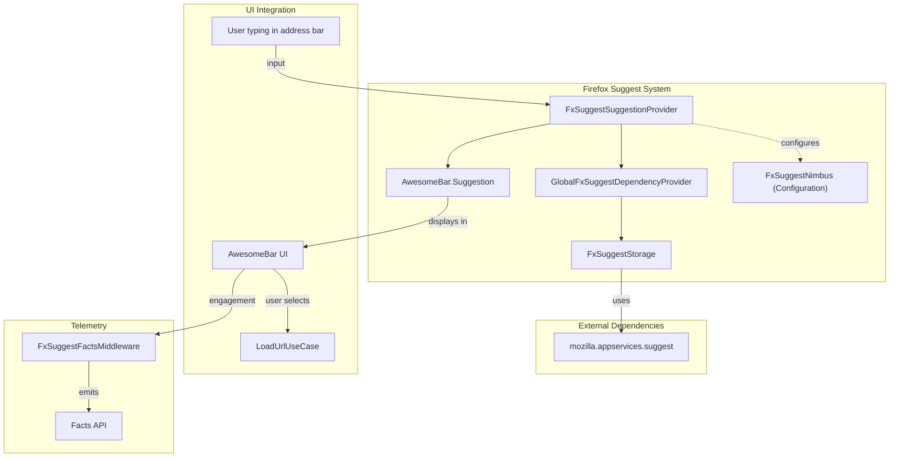
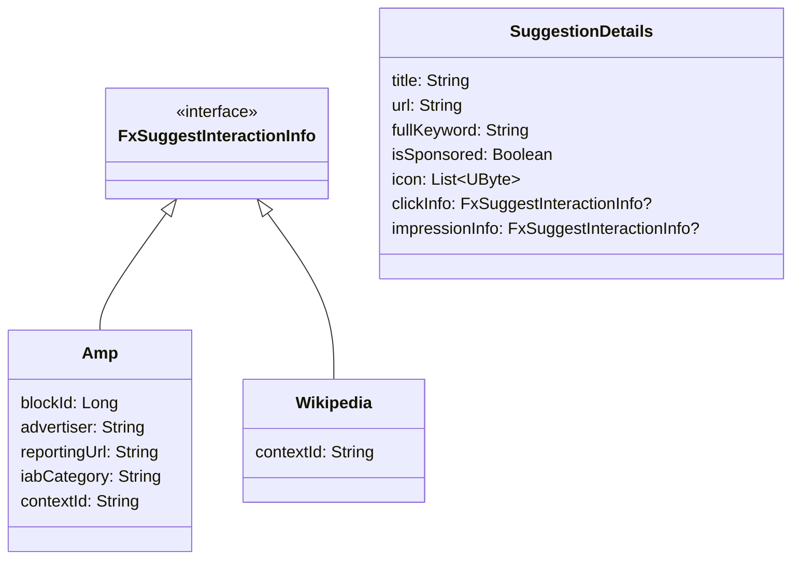
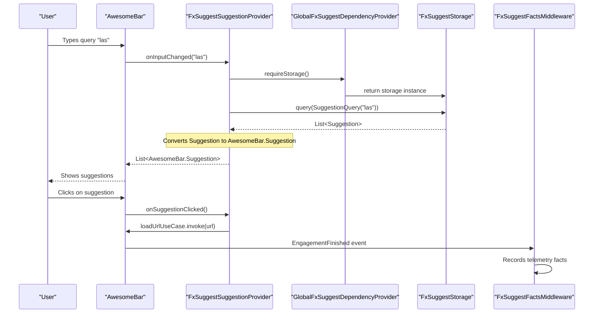
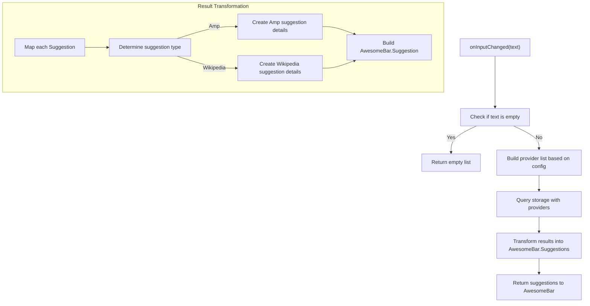
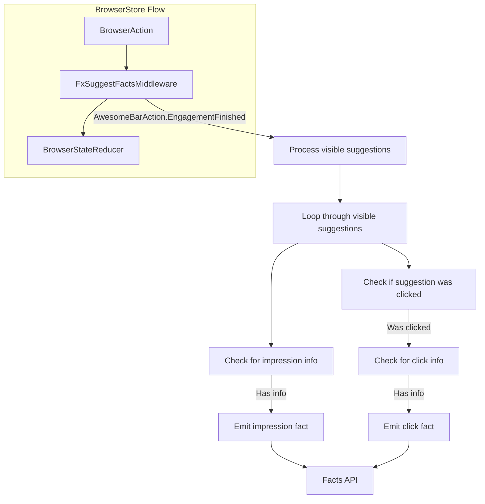
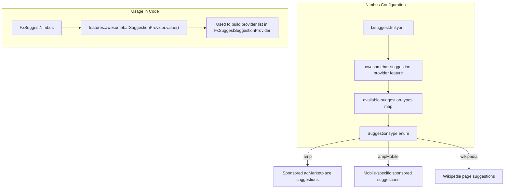

<!-- source: DeepWiki mcp.deepwiki.com · repo mozilla-mobile/firefox-android · page 2.4 Firefox Suggest System · fetched 2026-10-09 -->

# Firefox Suggest System

Relevant source files

The following files were used as context for generating this wiki page:

- [android-components/components/feature/fxsuggest/README.md](android-components/components/feature/fxsuggest/README.md)
- [android-components/components/feature/fxsuggest/build.gradle](android-components/components/feature/fxsuggest/build.gradle)
- [android-components/components/feature/fxsuggest/fxsuggest.fml.yaml](android-components/components/feature/fxsuggest/fxsuggest.fml.yaml)
- [android-components/components/feature/fxsuggest/src/main/java/mozilla/components/feature/fxsuggest/FxSuggestSuggestionProvider.kt](android-components/components/feature/fxsuggest/src/main/java/mozilla/components/feature/fxsuggest/FxSuggestSuggestionProvider.kt)
- [android-components/components/feature/fxsuggest/src/main/java/mozilla/components/feature/fxsuggest/facts/FxSuggestFacts.kt](android-components/components/feature/fxsuggest/src/main/java/mozilla/components/feature/fxsuggest/facts/FxSuggestFacts.kt)
- [android-components/components/feature/fxsuggest/src/main/java/mozilla/components/feature/fxsuggest/facts/FxSuggestFactsMiddleware.kt](android-components/components/feature/fxsuggest/src/main/java/mozilla/components/feature/fxsuggest/facts/FxSuggestFactsMiddleware.kt)
- [android-components/components/feature/fxsuggest/src/test/java/mozilla/components/feature/fxsuggest/FxSuggestFactsMiddlewareTest.kt](android-components/components/feature/fxsuggest/src/test/java/mozilla/components/feature/fxsuggest/FxSuggestFactsMiddlewareTest.kt)
- [android-components/components/feature/fxsuggest/src/test/java/mozilla/components/feature/fxsuggest/FxSuggestFactsTest.kt](android-components/components/feature/fxsuggest/src/test/java/mozilla/components/feature/fxsuggest/FxSuggestFactsTest.kt)
- [android-components/components/feature/fxsuggest/src/test/java/mozilla/components/feature/fxsuggest/FxSuggestSuggestionProviderTest.kt](android-components/components/feature/fxsuggest/src/test/java/mozilla/components/feature/fxsuggest/FxSuggestSuggestionProviderTest.kt)
- [android-components/plugins/dependencies/src/main/java/ApplicationServices.kt](android-components/plugins/dependencies/src/main/java/ApplicationServices.kt)

Firefox Suggest is a component that provides search suggestions in the address bar (AwesomeBar) of Firefox for Android. It offers both sponsored suggestions (advertisements) and non-sponsored suggestions (like Wikipedia pages) that are downloaded, stored, and matched locally on the device.

## System Overview

The Firefox Suggest system displays relevant suggestions to users as they type in the address bar. These suggestions can come from different providers and may include both sponsored content from adMarketplace (AMP) and non-sponsored content like Wikipedia entries.

Sources:
- [android-components/components/feature/fxsuggest/src/main/java/mozilla/components/feature/fxsuggest/FxSuggestSuggestionProvider.kt:28-142]()
- [android-components/components/feature/fxsuggest/src/main/java/mozilla/components/feature/fxsuggest/facts/FxSuggestFactsMiddleware.kt:31-84]()
- [android-components/components/feature/fxsuggest/README.md:1-44]()

## Suggestion Types and Features

Firefox Suggest supports different types of suggestions, with their availability configurable through Nimbus experimentation:

| Suggestion Type | Description | Configurable Through Nimbus |
|----------------|-------------|---------------------------|
| AMP | Sponsored suggestions from adMarketplace | Yes |
| AMP_MOBILE | Mobile-specific sponsored suggestions from adMarketplace | Yes |
| WIKIPEDIA | Non-sponsored Wikipedia page suggestions | Yes |

Sources:
- [android-components/components/feature/fxsuggest/src/main/java/mozilla/components/feature/fxsuggest/FxSuggestSuggestionProvider.kt:145-185]()
- [android-components/components/feature/fxsuggest/fxsuggest.fml.yaml:14-36]()

## Architecture and Data Flow

When a user types in the address bar, the `FxSuggestSuggestionProvider` communicates with the storage component to retrieve relevant suggestions, transforms them into a format the UI can display, and handles user interactions with those suggestions.

Sources:
- [android-components/components/feature/fxsuggest/src/main/java/mozilla/components/feature/fxsuggest/FxSuggestSuggestionProvider.kt:47-74]()
- [android-components/components/feature/fxsuggest/src/main/java/mozilla/components/feature/fxsuggest/facts/FxSuggestFactsMiddleware.kt:31-84]()

## Provider Implementation

The `FxSuggestSuggestionProvider` is the main class that interfaces with the AwesomeBar system to provide Firefox Suggest results. It handles:

1. Querying the storage based on user input
2. Converting raw suggestions into UI-ready format
3. Adding metadata for telemetry
4. Loading URLs when users click suggestions

Sources:
- [android-components/components/feature/fxsuggest/src/main/java/mozilla/components/feature/fxsuggest/FxSuggestSuggestionProvider.kt:28-142]()
- [android-components/components/feature/fxsuggest/src/test/java/mozilla/components/feature/fxsuggest/FxSuggestSuggestionProviderTest.kt:53-74]()

## Telemetry Integration

Firefox Suggest records two primary types of telemetry events:

1. **Impressions** - Recorded when a suggestion is displayed and the user completes their interaction with the AwesomeBar
2. **Clicks** - Recorded when a user clicks on a suggestion

This telemetry is implemented using Mozilla's Facts API and a BrowserStore middleware called `FxSuggestFactsMiddleware`.

The telemetry events include detailed metadata:

| Event Type | Metadata | Description |
|------------|----------|-------------|
| Impression | Interaction info | Type-specific information (AMP or Wikipedia) |
| Impression | Position | 1-based position in the AwesomeBar |
| Impression | Is clicked | Whether the user clicked the suggestion |
| Impression | Engagement abandoned | Whether the user dismissed without clicking |
| Click | Interaction info | Type-specific information (AMP or Wikipedia) |
| Click | Position | 1-based position in the AwesomeBar |

Sources:
- [android-components/components/feature/fxsuggest/src/main/java/mozilla/components/feature/fxsuggest/facts/FxSuggestFacts.kt:16-89]()
- [android-components/components/feature/fxsuggest/src/main/java/mozilla/components/feature/fxsuggest/facts/FxSuggestFactsMiddleware.kt:31-84]()
- [android-components/components/feature/fxsuggest/README.md:17-44]()

## Configuration with Nimbus

Firefox Suggest is configurable via Nimbus, Mozilla's experimentation platform. This allows for A/B testing and controlled feature rollout. The configuration is defined in the `fxsuggest.fml.yaml` file.

The Nimbus configuration controls:
- Which suggestion types are available (AMP, AMP_MOBILE, WIKIPEDIA)
- Whether each type is enabled or disabled

Sources:
- [android-components/components/feature/fxsuggest/fxsuggest.fml.yaml:1-37]()
- [android-components/components/feature/fxsuggest/build.gradle:74-87]()
- [android-components/components/feature/fxsuggest/src/main/java/mozilla/components/feature/fxsuggest/FxSuggestSuggestionProvider.kt:53-66]()

## Integration with Applications

To integrate Firefox Suggest into an application:

1. Add the `feature-fxsuggest` component as a dependency
2. Create an instance of `FxSuggestSuggestionProvider`
3. Register the provider with the AwesomeBar
4. Add `FxSuggestFactsMiddleware` to the BrowserStore middleware chain

The suggestion provider can be configured to include or exclude sponsored and non-sponsored suggestions based on user preferences or other application requirements.

Sources:
- [android-components/components/feature/fxsuggest/README.md:7-15]()
- [android-components/components/feature/fxsuggest/src/main/java/mozilla/components/feature/fxsuggest/FxSuggestSuggestionProvider.kt:28-35]()

## Relationship to Browser Components

Firefox Suggest is part of the larger Firefox Android ecosystem. It's a feature component that relies on:

- **BrowserStore** - For state management and middleware integration
- **AwesomeBar** - For displaying suggestions in the UI
- **Application Services** - For the underlying suggestion engine and storage
- **Nimbus** - For configuration and experimentation

This component provides enhanced search suggestions while maintaining privacy by performing matching on-device rather than sending every keystroke to a server.

Sources:
- [android-components/components/feature/fxsuggest/README.md:1-5]()
- [android-components/components/feature/fxsuggest/build.gradle:48-60]()

---

