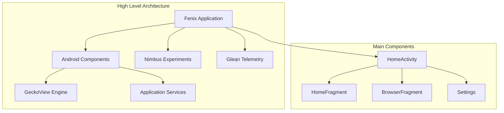
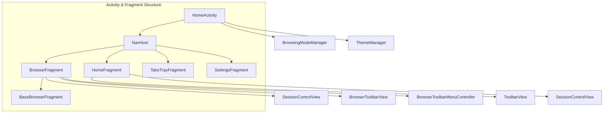
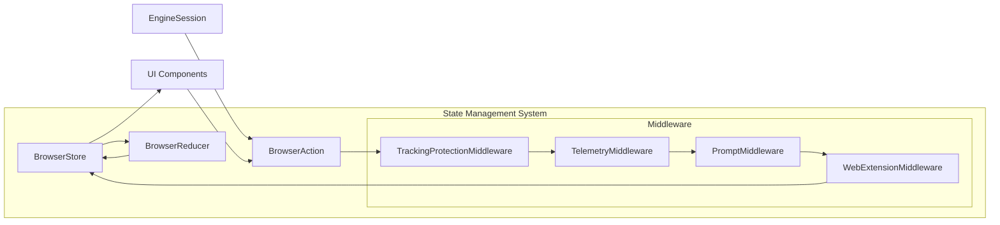
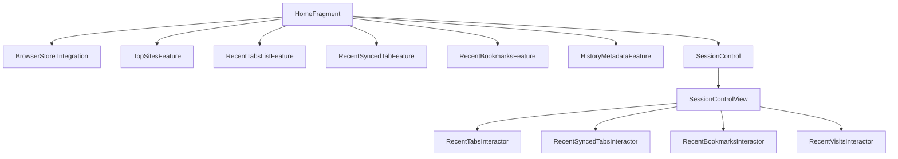
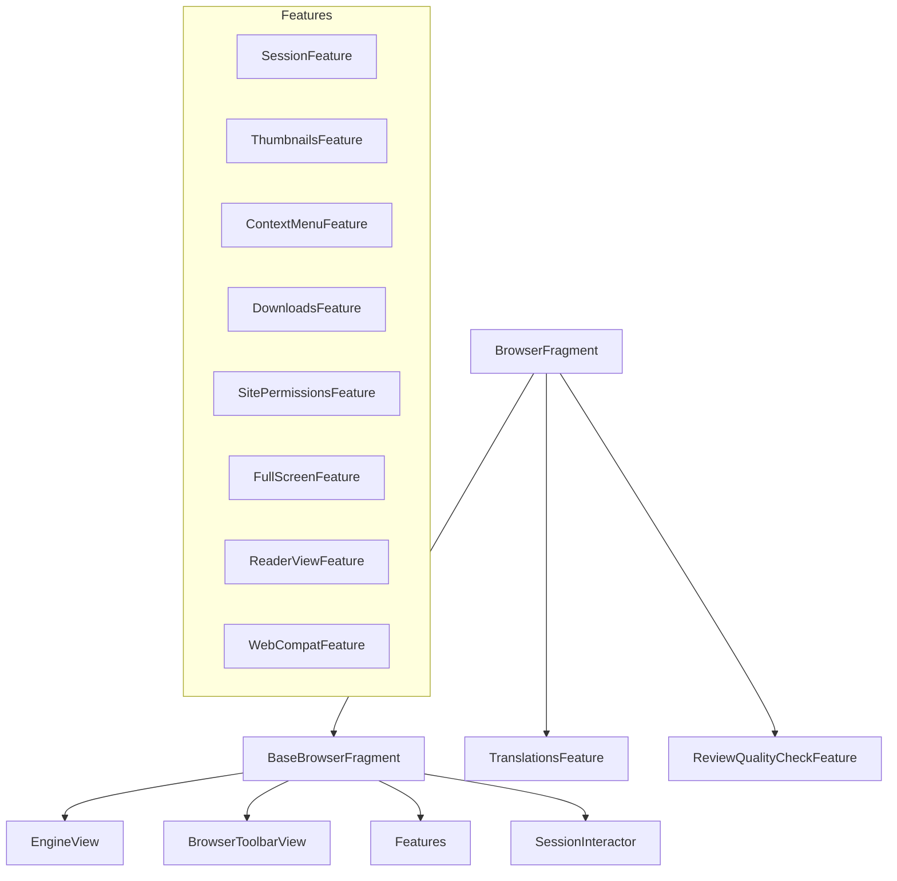
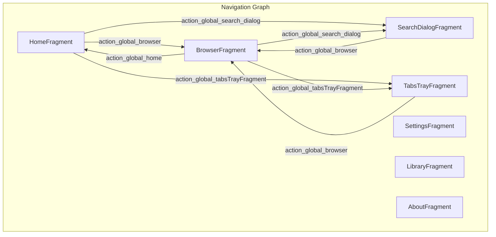
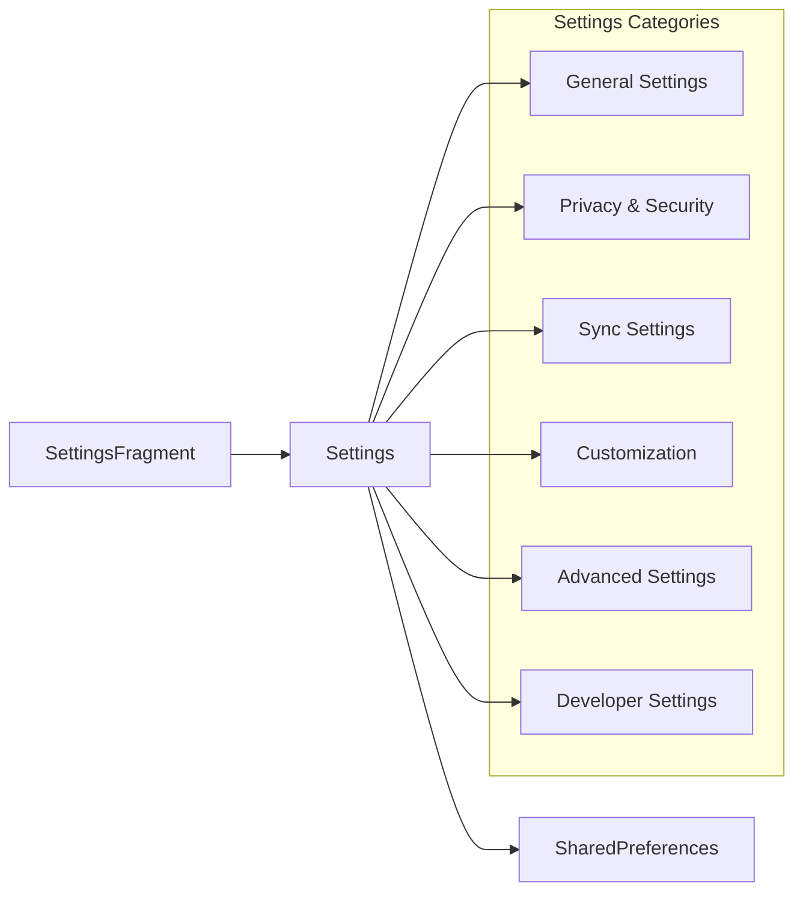
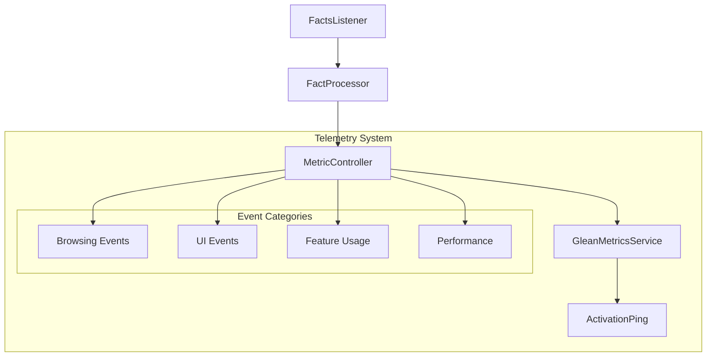
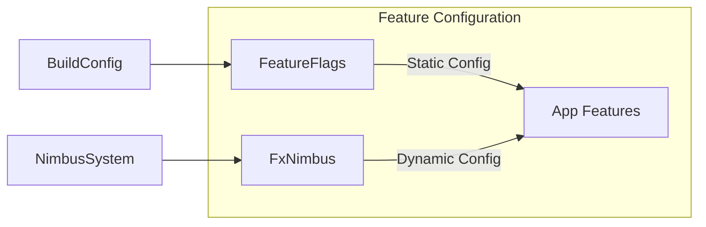
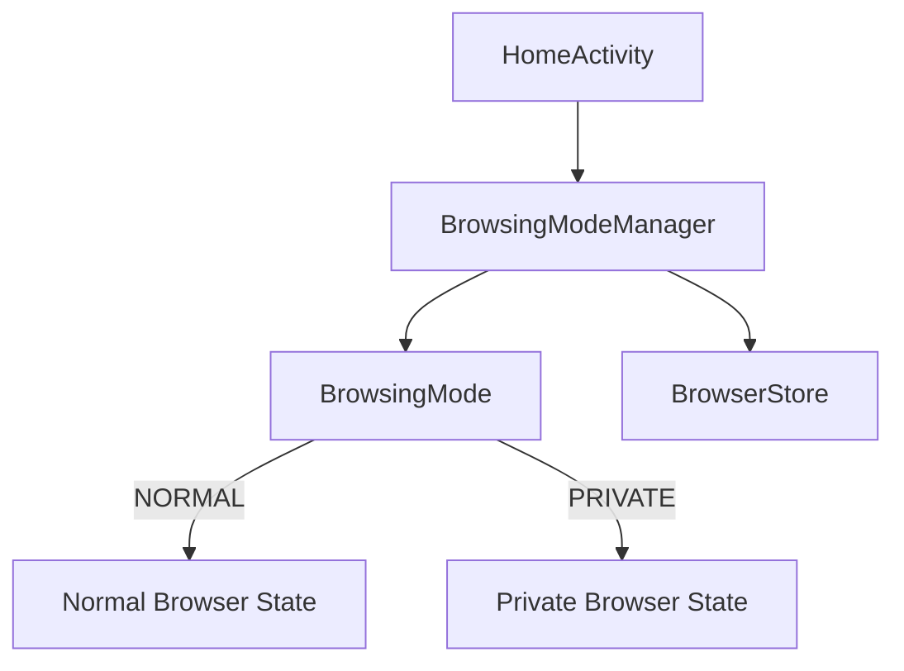

<!-- source: DeepWiki mcp.deepwiki.com · repo mozilla-mobile/firefox-android · page 3 Fenix (Firefox for Android) · fetched 2026-10-09 -->

# Fenix (Firefox for Android)

Relevant source files

The following files were used as context for generating this wiki page:

- [fenix/app/metrics.yaml](fenix/app/metrics.yaml)
- [fenix/app/src/main/java/org/mozilla/fenix/FeatureFlags.kt](fenix/app/src/main/java/org/mozilla/fenix/FeatureFlags.kt)
- [fenix/app/src/main/java/org/mozilla/fenix/FenixApplication.kt](fenix/app/src/main/java/org/mozilla/fenix/FenixApplication.kt)
- [fenix/app/src/main/java/org/mozilla/fenix/HomeActivity.kt](fenix/app/src/main/java/org/mozilla/fenix/HomeActivity.kt)
- [fenix/app/src/main/java/org/mozilla/fenix/browser/BaseBrowserFragment.kt](fenix/app/src/main/java/org/mozilla/fenix/browser/BaseBrowserFragment.kt)
- [fenix/app/src/main/java/org/mozilla/fenix/browser/BrowserFragment.kt](fenix/app/src/main/java/org/mozilla/fenix/browser/BrowserFragment.kt)
- [fenix/app/src/main/java/org/mozilla/fenix/components/Core.kt](fenix/app/src/main/java/org/mozilla/fenix/components/Core.kt)
- [fenix/app/src/main/java/org/mozilla/fenix/components/UseCases.kt](fenix/app/src/main/java/org/mozilla/fenix/components/UseCases.kt)
- [fenix/app/src/main/java/org/mozilla/fenix/components/metrics/Event.kt](fenix/app/src/main/java/org/mozilla/fenix/components/metrics/Event.kt)
- [fenix/app/src/main/java/org/mozilla/fenix/components/metrics/GleanMetricsService.kt](fenix/app/src/main/java/org/mozilla/fenix/components/metrics/GleanMetricsService.kt)
- [fenix/app/src/main/java/org/mozilla/fenix/components/metrics/MetricController.kt](fenix/app/src/main/java/org/mozilla/fenix/components/metrics/MetricController.kt)
- [fenix/app/src/main/java/org/mozilla/fenix/home/HomeFragment.kt](fenix/app/src/main/java/org/mozilla/fenix/home/HomeFragment.kt)
- [fenix/app/src/main/java/org/mozilla/fenix/settings/SecretSettingsFragment.kt](fenix/app/src/main/java/org/mozilla/fenix/settings/SecretSettingsFragment.kt)
- [fenix/app/src/main/java/org/mozilla/fenix/settings/SettingsFragment.kt](fenix/app/src/main/java/org/mozilla/fenix/settings/SettingsFragment.kt)
- [fenix/app/src/main/java/org/mozilla/fenix/utils/Settings.kt](fenix/app/src/main/java/org/mozilla/fenix/utils/Settings.kt)
- [fenix/app/src/main/res/layout/preference_category_no_icon_style.xml](fenix/app/src/main/res/layout/preference_category_no_icon_style.xml)
- [fenix/app/src/main/res/navigation/nav_graph.xml](fenix/app/src/main/res/navigation/nav_graph.xml)
- [fenix/app/src/main/res/values/preference_keys.xml](fenix/app/src/main/res/values/preference_keys.xml)
- [fenix/app/src/main/res/values/static_strings.xml](fenix/app/src/main/res/values/static_strings.xml)
- [fenix/app/src/main/res/values/strings.xml](fenix/app/src/main/res/values/strings.xml)
- [fenix/app/src/main/res/xml/preferences.xml](fenix/app/src/main/res/xml/preferences.xml)
- [fenix/app/src/main/res/xml/secret_settings_preferences.xml](fenix/app/src/main/res/xml/secret_settings_preferences.xml)
- [fenix/app/src/test/java/org/mozilla/fenix/FenixApplicationTest.kt](fenix/app/src/test/java/org/mozilla/fenix/FenixApplicationTest.kt)
- [fenix/app/src/test/java/org/mozilla/fenix/components/metrics/MetricControllerTest.kt](fenix/app/src/test/java/org/mozilla/fenix/components/metrics/MetricControllerTest.kt)
- [fenix/app/src/test/java/org/mozilla/fenix/utils/SettingsTest.kt](fenix/app/src/test/java/org/mozilla/fenix/utils/SettingsTest.kt)
- [fenix/docs/metrics.md](fenix/docs/metrics.md)

This document provides a comprehensive overview of the Fenix application, which is the code name for Firefox for Android. It covers the architecture, key components, and how they interact to deliver the Firefox browser experience on Android devices. For information about Android Components library which serves as the foundation for Firefox browsers on Android, see [Android Components](#2).

## Overview

Fenix is the implementation of Firefox for Android, built as a modern Android application utilizing Mozilla's GeckoView engine, Android Components library, and a collection of services. Its architecture follows a fragment-based approach where the application is primarily a single activity (`HomeActivity`) with fragments for different screens.

The app consists of several major components:
- Core browser functionality
- Home screen experience
- Account integration and sync
- Settings and preferences
- Telemetry and metrics collection

Sources:
- [fenix/app/src/main/java/org/mozilla/fenix/HomeActivity.kt:150-157](fenix/app/src/main/java/org/mozilla/fenix/HomeActivity.kt:150-157)
- [fenix/app/src/main/java/org/mozilla/fenix/FenixApplication.kt:126-140](fenix/app/src/main/java/org/mozilla/fenix/FenixApplication.kt:126-140)

## Application Architecture

Fenix follows a modern Android application architecture with several key components:

### 1. Activities and Fragments

Sources:
- [fenix/app/src/main/java/org/mozilla/fenix/HomeActivity.kt:150-186](fenix/app/src/main/java/org/mozilla/fenix/HomeActivity.kt:150-186)
- [fenix/app/src/main/java/org/mozilla/fenix/browser/BrowserFragment.kt:71-93](fenix/app/src/main/java/org/mozilla/fenix/browser/BrowserFragment.kt:71-93)
- [fenix/app/src/main/java/org/mozilla/fenix/home/HomeFragment.kt:150-190](fenix/app/src/main/java/org/mozilla/fenix/home/HomeFragment.kt:150-190)

### 2. State Management

Fenix uses a unidirectional data flow architecture for state management:

Sources:
- [fenix/app/src/main/java/org/mozilla/fenix/components/Core.kt:123-140](fenix/app/src/main/java/org/mozilla/fenix/components/Core.kt:123-140)

## Key Components

### BrowserStore and State Management

The `BrowserStore` is the central state container for browser-related information. It follows a Redux-like pattern with actions, reducers, and middleware:

1. **Actions**: Events that modify the state
2. **Reducers**: Pure functions that apply actions to produce new state
3. **Middleware**: Intercepts actions for side effects
4. **Store**: Maintains the current state and notifies observers of changes

The system uses Mozilla's lib-state for implementation, providing a reactive approach to state management.

Sources:
- [fenix/app/src/main/java/org/mozilla/fenix/components/Core.kt:133-170](fenix/app/src/main/java/org/mozilla/fenix/components/Core.kt:133-170)

### Home Screen

The home screen is implemented in `HomeFragment`, displaying:

- Jump back in (recent tabs)
- Synced tabs
- Recent bookmarks
- History highlights
- Top sites
- Pocket stories (in supported locales)
- Collections

Sources:
- [fenix/app/src/main/java/org/mozilla/fenix/home/HomeFragment.kt:300-376](fenix/app/src/main/java/org/mozilla/fenix/home/HomeFragment.kt:300-376)

### Browser Fragment

The `BrowserFragment` implements the main browser functionality, displaying web content and providing UI controls:

Sources:
- [fenix/app/src/main/java/org/mozilla/fenix/browser/BaseBrowserFragment.kt:196-254](fenix/app/src/main/java/org/mozilla/fenix/browser/BaseBrowserFragment.kt:196-254)
- [fenix/app/src/main/java/org/mozilla/fenix/browser/BrowserFragment.kt:71-100](fenix/app/src/main/java/org/mozilla/fenix/browser/BrowserFragment.kt:71-100)

### Navigation System

Fenix uses Android's Navigation Component for managing screens:

Sources:
- [fenix/app/src/main/res/navigation/nav_graph.xml:6-50](fenix/app/src/main/res/navigation/nav_graph.xml:6-50)
- [fenix/app/src/main/java/org/mozilla/fenix/HomeActivity.kt:308-337](fenix/app/src/main/java/org/mozilla/fenix/HomeActivity.kt:308-337)

## Application Lifecycle

The application lifecycle is managed primarily through the `FenixApplication` and `HomeActivity` classes:

1. **Application Initialization**:
   - System creates `FenixApplication`
   - Glean telemetry is initialized
   - Core services are started
   - Nimbus experiments are fetched

2. **Activity Lifecycle**:
   - `HomeActivity` is created
   - Navigation is configured
   - Fragments are loaded based on saved state or intent

3. **Fragment Transitions**:
   - Fragments are managed by the Navigation Component
   - State is preserved during configuration changes

Sources:
- [fenix/app/src/main/java/org/mozilla/fenix/FenixApplication.kt:142-170](fenix/app/src/main/java/org/mozilla/fenix/FenixApplication.kt:142-170)
- [fenix/app/src/main/java/org/mozilla/fenix/HomeActivity.kt:222-295](fenix/app/src/main/java/org/mozilla/fenix/HomeActivity.kt:222-295)

## Settings and Configuration

Fenix uses a comprehensive settings system implemented in the `Settings` class:

The settings system includes support for:
- User preferences
- Feature flags
- A/B testing with Nimbus
- Build-specific configurations

Sources:
- [fenix/app/src/main/java/org/mozilla/fenix/utils/Settings.kt:72-135](fenix/app/src/main/java/org/mozilla/fenix/utils/Settings.kt:72-135)
- [fenix/app/src/main/java/org/mozilla/fenix/settings/SettingsFragment.kt:69-120](fenix/app/src/main/java/org/mozilla/fenix/settings/SettingsFragment.kt:69-120)

## Telemetry and Metrics

Fenix uses Mozilla's Glean system for telemetry collection:

The metrics system allows for:
- Event tracking
- Performance measurement
- Feature usage analytics
- A/B testing analysis

Sources:
- [fenix/app/src/main/java/org/mozilla/fenix/components/metrics/MetricController.kt:66-102](fenix/app/src/main/java/org/mozilla/fenix/components/metrics/MetricController.kt:66-102)
- [fenix/app/src/main/java/org/mozilla/fenix/components/metrics/GleanMetricsService.kt:60-103](fenix/app/src/main/java/org/mozilla/fenix/components/metrics/GleanMetricsService.kt:60-103)
- [fenix/app/src/main/java/org/mozilla/fenix/components/metrics/Event.kt:7-57](fenix/app/src/main/java/org/mozilla/fenix/components/metrics/Event.kt:7-57)

## Feature Flags and Experimentation

Fenix uses a combination of build-time feature flags and run-time experimentation:

1. **FeatureFlags**: Static feature toggles based on build configuration
2. **Nimbus**: Mozilla's experimentation system for A/B testing features

This allows for gradual feature rollouts and behavior experimentation.

Sources:
- [fenix/app/src/main/java/org/mozilla/fenix/FeatureFlags.kt:13-90](fenix/app/src/main/java/org/mozilla/fenix/FeatureFlags.kt:13-90)
- [fenix/app/src/main/java/org/mozilla/fenix/FenixApplication.kt:229-255](fenix/app/src/main/java/org/mozilla/fenix/FenixApplication.kt:229-255)

## Components Integration

Fenix integrates various components in a modular fashion:

| Component | Purpose | Implementation |
|-----------|---------|----------------|
| Core | Browser engine and storage | `Core.kt` |
| UseCases | Feature business logic | `UseCases.kt` |
| Services | Background operations | `BackgroundServices.kt` |
| UI Components | Reusable UI elements | `Components.kt` |

The dependency injection pattern is implemented through the `Components` class, which serves as a service locator.

Sources:
- [fenix/app/src/main/java/org/mozilla/fenix/components/Core.kt:123-133](fenix/app/src/main/java/org/mozilla/fenix/components/Core.kt:123-133)
- [fenix/app/src/main/java/org/mozilla/fenix/components/UseCases.kt:38-49](fenix/app/src/main/java/org/mozilla/fenix/components/UseCases.kt:38-49)

## Browsing Modes

Fenix supports two browsing modes:

1. **Normal Browsing**: Standard browsing with history, cookies, and persistent state
2. **Private Browsing**: Incognito mode with no persistence of browsing data

The modes are managed by the `BrowsingModeManager` and can be toggled by the user.

Sources:
- [fenix/app/src/main/java/org/mozilla/fenix/HomeActivity.kt:154-155](fenix/app/src/main/java/org/mozilla/fenix/HomeActivity.kt:154-155)
- [fenix/app/src/main/java/org/mozilla/fenix/browser/browsingmode/BrowsingMode.kt](fenix/app/src/main/java/org/mozilla/fenix/browser/browsingmode/BrowsingMode.kt)

## Development Features

Fenix includes several developer-oriented features that can be enabled through "Secret Settings":

1. **Remote debugging**
2. **Nimbus experimentation controls**
3. **Custom Glean server URL**
4. **UI redesign feature flags**

These are primarily accessible through the Secret Settings screen, which can be accessed by tapping the settings gear icon 5 times.

Sources:
- [fenix/app/src/main/java/org/mozilla/fenix/settings/SecretSettingsFragment.kt:28-60](fenix/app/src/main/java/org/mozilla/fenix/settings/SecretSettingsFragment.kt:28-60)
- [fenix/app/src/main/res/xml/secret_settings_preferences.xml:7-38](fenix/app/src/main/res/xml/secret_settings_preferences.xml:7-38)

## Conclusion

Fenix is a modern Android application implementing Firefox for Android. It utilizes Mozilla's Android Components library, GeckoView engine, and a modular architecture for flexibility and maintainability. The application follows best practices for Android development, including fragment-based navigation, unidirectional data flow, and reactive programming patterns.

---

