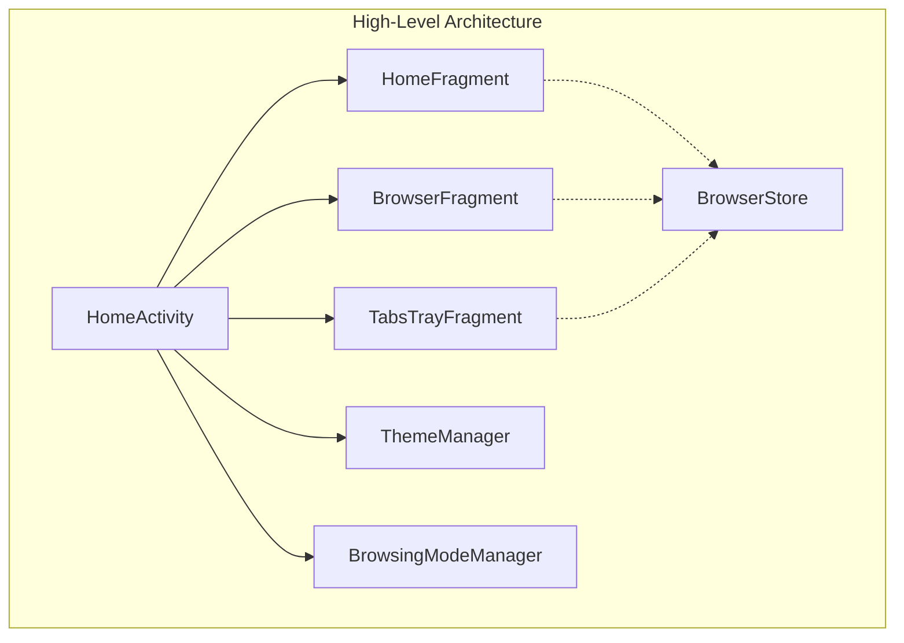
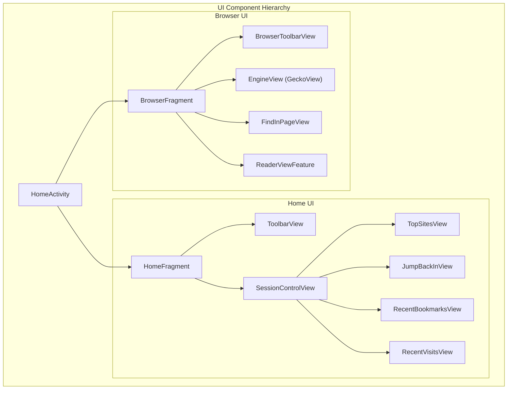
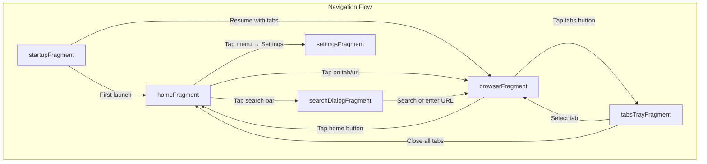
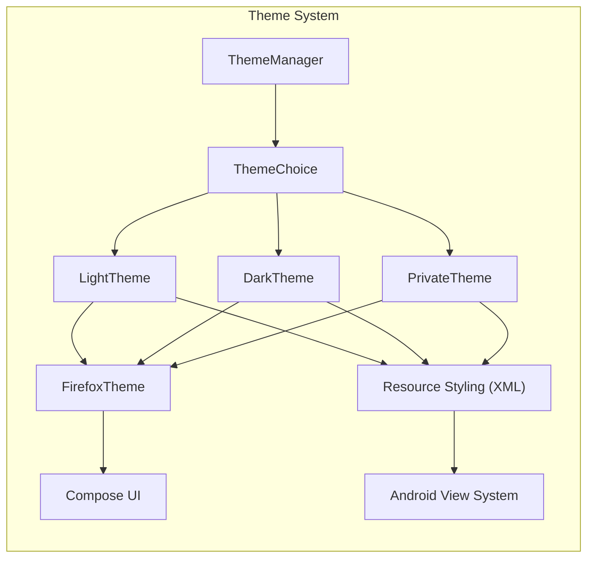
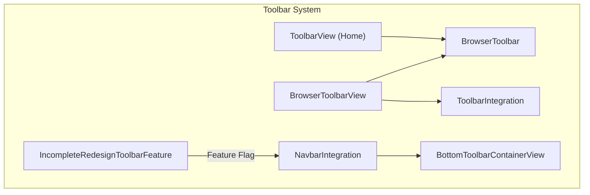
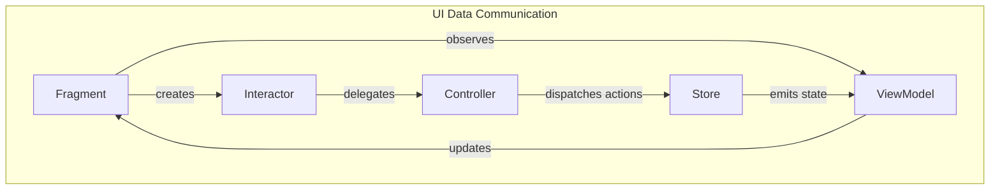
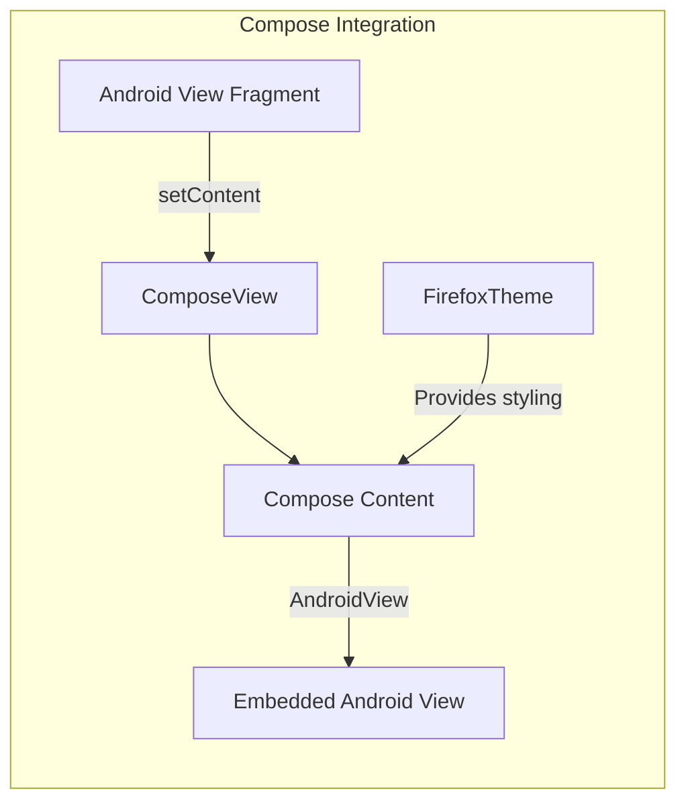
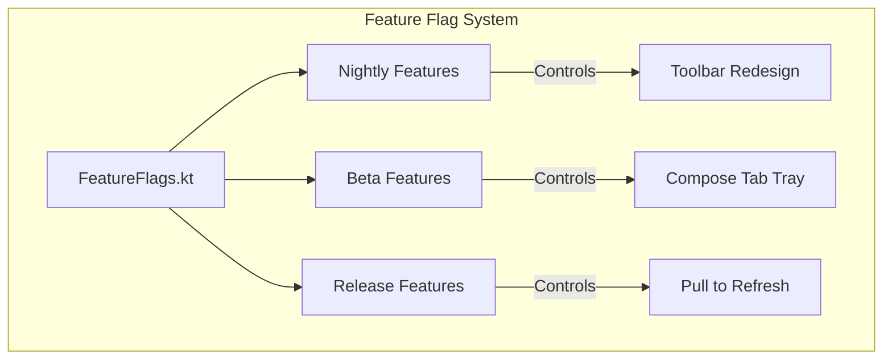
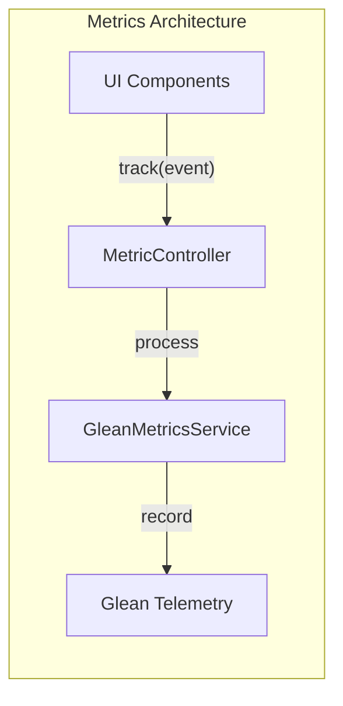

<!-- source: DeepWiki mcp.deepwiki.com · repo mozilla-mobile/firefox-android · page 3.1 Fenix UI Architecture · fetched 2026-10-09 -->

# Fenix UI Architecture

Relevant source files

The following files were used as context for generating this wiki page:

- [fenix/app/metrics.yaml](fenix/app/metrics.yaml)
- [fenix/app/src/main/java/org/mozilla/fenix/FeatureFlags.kt](fenix/app/src/main/java/org/mozilla/fenix/FeatureFlags.kt)
- [fenix/app/src/main/java/org/mozilla/fenix/FenixApplication.kt](fenix/app/src/main/java/org/mozilla/fenix/FenixApplication.kt)
- [fenix/app/src/main/java/org/mozilla/fenix/HomeActivity.kt](fenix/app/src/main/java/org/mozilla/fenix/HomeActivity.kt)
- [fenix/app/src/main/java/org/mozilla/fenix/browser/BaseBrowserFragment.kt](fenix/app/src/main/java/org/mozilla/fenix/browser/BaseBrowserFragment.kt)
- [fenix/app/src/main/java/org/mozilla/fenix/browser/BrowserFragment.kt](fenix/app/src/main/java/org/mozilla/fenix/browser/BrowserFragment.kt)
- [fenix/app/src/main/java/org/mozilla/fenix/components/Core.kt](fenix/app/src/main/java/org/mozilla/fenix/components/Core.kt)
- [fenix/app/src/main/java/org/mozilla/fenix/components/UseCases.kt](fenix/app/src/main/java/org/mozilla/fenix/components/UseCases.kt)
- [fenix/app/src/main/java/org/mozilla/fenix/components/metrics/Event.kt](fenix/app/src/main/java/org/mozilla/fenix/components/metrics/Event.kt)
- [fenix/app/src/main/java/org/mozilla/fenix/components/metrics/GleanMetricsService.kt](fenix/app/src/main/java/org/mozilla/fenix/components/metrics/GleanMetricsService.kt)
- [fenix/app/src/main/java/org/mozilla/fenix/components/metrics/MetricController.kt](fenix/app/src/main/java/org/mozilla/fenix/components/metrics/MetricController.kt)
- [fenix/app/src/main/java/org/mozilla/fenix/home/HomeFragment.kt](fenix/app/src/main/java/org/mozilla/fenix/home/HomeFragment.kt)
- [fenix/app/src/main/java/org/mozilla/fenix/home/intent/OpenSpecificTabIntentProcessor.kt](fenix/app/src/main/java/org/mozilla/fenix/home/intent/OpenSpecificTabIntentProcessor.kt)
- [fenix/app/src/main/java/org/mozilla/fenix/settings/SecretSettingsFragment.kt](fenix/app/src/main/java/org/mozilla/fenix/settings/SecretSettingsFragment.kt)
- [fenix/app/src/main/java/org/mozilla/fenix/settings/SettingsFragment.kt](fenix/app/src/main/java/org/mozilla/fenix/settings/SettingsFragment.kt)
- [fenix/app/src/main/java/org/mozilla/fenix/tabstray/browser/PrivateBrowserTrayList.kt](fenix/app/src/main/java/org/mozilla/fenix/tabstray/browser/PrivateBrowserTrayList.kt)
- [fenix/app/src/main/java/org/mozilla/fenix/theme/FenixTypography.kt](fenix/app/src/main/java/org/mozilla/fenix/theme/FenixTypography.kt)
- [fenix/app/src/main/java/org/mozilla/fenix/theme/FirefoxTheme.kt](fenix/app/src/main/java/org/mozilla/fenix/theme/FirefoxTheme.kt)
- [fenix/app/src/main/java/org/mozilla/fenix/utils/Settings.kt](fenix/app/src/main/java/org/mozilla/fenix/utils/Settings.kt)
- [fenix/app/src/main/res/color/tab_icon.xml](fenix/app/src/main/res/color/tab_icon.xml)
- [fenix/app/src/main/res/drawable/tab_tray_grid_item_selected_border.xml](fenix/app/src/main/res/drawable/tab_tray_grid_item_selected_border.xml)
- [fenix/app/src/main/res/layout/component_tabstray2.xml](fenix/app/src/main/res/layout/component_tabstray2.xml)
- [fenix/app/src/main/res/layout/fragment_home.xml](fenix/app/src/main/res/layout/fragment_home.xml)
- [fenix/app/src/main/res/layout/fragment_pwa_onboarding.xml](fenix/app/src/main/res/layout/fragment_pwa_onboarding.xml)
- [fenix/app/src/main/res/layout/normal_browser_tray_list.xml](fenix/app/src/main/res/layout/normal_browser_tray_list.xml)
- [fenix/app/src/main/res/layout/preference_category_no_icon_style.xml](fenix/app/src/main/res/layout/preference_category_no_icon_style.xml)
- [fenix/app/src/main/res/layout/private_browser_tray_list.xml](fenix/app/src/main/res/layout/private_browser_tray_list.xml)
- [fenix/app/src/main/res/layout/tab_tray_grid_item.xml](fenix/app/src/main/res/layout/tab_tray_grid_item.xml)
- [fenix/app/src/main/res/layout/tab_tray_item.xml](fenix/app/src/main/res/layout/tab_tray_item.xml)
- [fenix/app/src/main/res/layout/top_site_item.xml](fenix/app/src/main/res/layout/top_site_item.xml)
- [fenix/app/src/main/res/navigation/nav_graph.xml](fenix/app/src/main/res/navigation/nav_graph.xml)
- [fenix/app/src/main/res/values-night/colors.xml](fenix/app/src/main/res/values-night/colors.xml)
- [fenix/app/src/main/res/values/attrs.xml](fenix/app/src/main/res/values/attrs.xml)
- [fenix/app/src/main/res/values/colors.xml](fenix/app/src/main/res/values/colors.xml)
- [fenix/app/src/main/res/values/dimens.xml](fenix/app/src/main/res/values/dimens.xml)
- [fenix/app/src/main/res/values/preference_keys.xml](fenix/app/src/main/res/values/preference_keys.xml)
- [fenix/app/src/main/res/values/static_strings.xml](fenix/app/src/main/res/values/static_strings.xml)
- [fenix/app/src/main/res/values/strings.xml](fenix/app/src/main/res/values/strings.xml)
- [fenix/app/src/main/res/values/styles.xml](fenix/app/src/main/res/values/styles.xml)
- [fenix/app/src/main/res/xml/preferences.xml](fenix/app/src/main/res/xml/preferences.xml)
- [fenix/app/src/main/res/xml/secret_settings_preferences.xml](fenix/app/src/main/res/xml/secret_settings_preferences.xml)
- [fenix/app/src/test/java/org/mozilla/fenix/FenixApplicationTest.kt](fenix/app/src/test/java/org/mozilla/fenix/FenixApplicationTest.kt)
- [fenix/app/src/test/java/org/mozilla/fenix/components/metrics/MetricControllerTest.kt](fenix/app/src/test/java/org/mozilla/fenix/components/metrics/MetricControllerTest.kt)
- [fenix/app/src/test/java/org/mozilla/fenix/home/intent/OpenSpecificTabIntentProcessorTest.kt](fenix/app/src/test/java/org/mozilla/fenix/home/intent/OpenSpecificTabIntentProcessorTest.kt)
- [fenix/app/src/test/java/org/mozilla/fenix/tabstray/ext/TabSessionStateKtTest.kt](fenix/app/src/test/java/org/mozilla/fenix/tabstray/ext/TabSessionStateKtTest.kt)
- [fenix/app/src/test/java/org/mozilla/fenix/utils/SettingsTest.kt](fenix/app/src/test/java/org/mozilla/fenix/utils/SettingsTest.kt)
- [fenix/docs/metrics.md](fenix/docs/metrics.md)

This document outlines the UI architecture of Firefox for Android (code name Fenix). It focuses on the high-level UI components, patterns, and workflows that make up the Firefox for Android user interface. For information about the browser engine integration, see [Browser Engine Abstraction](#2.1), and for information about state management, see [Browser State Management](#2.2).

## Overview

Firefox for Android uses a fragment-based architecture with a single activity (`HomeActivity`) that hosts various fragments such as `HomeFragment` and `BrowserFragment`. The application follows modern Android architecture patterns, including:

- Fragment-based navigation using the Navigation Component
- State management through a Redux-like pattern with BrowserStore
- Theme system supporting light, dark, and private browsing themes
- Gradual adoption of Jetpack Compose alongside traditional Android Views
- Feature toggles for experimental UI features

Sources:
- [fenix/app/src/main/java/org/mozilla/fenix/HomeActivity.kt:151-186]()
- [fenix/app/src/main/java/org/mozilla/fenix/home/HomeFragment.kt:150-241]()
- [fenix/app/src/main/java/org/mozilla/fenix/browser/BaseBrowserFragment.kt:196-290]()
- [fenix/app/src/main/res/navigation/nav_graph.xml:6-70]()

## Main UI Components

Firefox for Android has a few key UI components that form the core of the user interface:

### HomeActivity

`HomeActivity` is the single activity container that hosts all fragments. It manages:

- Theme application (light, dark, private)
- Browsing mode management (normal vs private)
- Navigation between fragments
- Common UI elements like status bar configuration

### HomeFragment

The `HomeFragment` is the landing page of the application, showing:

- Toolbar with search bar
- Jump back in section (recently used tabs)
- Top sites
- Recent bookmarks
- Recent history
- Pocket recommendations (if enabled)

The HomeFragment uses a combination of traditional Android Views defined in XML and some Jetpack Compose components.

### BrowserFragment

The `BrowserFragment` handles the web browsing experience, displaying:

- Web content via GeckoView (the browser engine)
- Browser toolbar with navigation controls
- Reader mode UI
- Various feature UI components like translations, find in page, etc.

Sources:
- [fenix/app/src/main/java/org/mozilla/fenix/home/HomeFragment.kt:242-500]()
- [fenix/app/src/main/java/org/mozilla/fenix/browser/BaseBrowserFragment.kt:260-290]()
- [fenix/app/src/main/java/org/mozilla/fenix/browser/BrowserFragment.kt:70-110]()
- [fenix/app/src/main/res/layout/fragment_home.xml:1-6]()

## Navigation System

Firefox for Android uses the Android Navigation Component to manage navigation between fragments. The navigation graph is defined in `nav_graph.xml` and provides actions for navigating between destinations.

Key navigation flows include:

1. Startup → Home or directly to Browser (depending on settings)
2. Home → Browser (when opening a tab)
3. Browser → TabTray (when viewing all tabs)
4. Home → Settings (when accessing settings)

Sources:
- [fenix/app/src/main/res/navigation/nav_graph.xml:12-90]()
- [fenix/app/src/main/java/org/mozilla/fenix/HomeActivity.kt:193-235]()

## Theme System

Firefox for Android has a comprehensive theming system that supports three modes:

1. Light theme
2. Dark theme
3. Private browsing theme (purple color scheme)

Themes are implemented through:

- Defined color resources in `colors.xml` and `colors-night.xml`
- A `FirefoxTheme` Compose-based implementation for newer UI elements
- `ThemeManager` for traditional Android View theming

Sources:
- [fenix/app/src/main/java/org/mozilla/fenix/theme/FirefoxTheme.kt:27-83]()
- [fenix/app/src/main/res/values/colors.xml:9-123]()
- [fenix/app/src/main/res/values-night/colors.xml:9-70]()
- [fenix/app/src/main/res/values/styles.xml:15-35]()

## Toolbar Architecture

The toolbar is a central UI component that appears in both the `HomeFragment` and `BrowserFragment`. It can be positioned at the top or bottom based on user preference.

The toolbar is implemented through:

- `BrowserToolbarView` for the main browser interface
- `ToolbarView` for the home screen search bar
- `ToolbarIntegration` to connect with browser functionality

A toolbar redesign feature is in progress (behind feature flags) that introduces a new bottom navigation bar UI.

Sources:
- [fenix/app/src/main/java/org/mozilla/fenix/FeatureFlags.kt:83-89]()
- [fenix/app/src/main/java/org/mozilla/fenix/browser/BaseBrowserFragment.kt:204-225]()
- [fenix/app/src/main/java/org/mozilla/fenix/home/HomeFragment.kt:448-476]()

## Fragment-ViewModel Communication

Communication between fragments and their data sources follows a pattern of:

1. ViewModels to manage UI state
2. Interactors that handle user interactions
3. Controllers that perform business logic
4. Stores that maintain state

For example, in `HomeFragment`:

- `HomeScreenViewModel` provides UI state
- `SessionControlInteractor` handles user interactions
- `DefaultSessionControlController` contains business logic
- `BrowserStore` and `AppStore` maintain app state

Sources:
- [fenix/app/src/main/java/org/mozilla/fenix/home/HomeFragment.kt:162-221]()
- [fenix/app/src/main/java/org/mozilla/fenix/home/HomeFragment.kt:378-446]()

## Compose Integration

Firefox for Android is gradually adopting Jetpack Compose for UI development. Current implementations include:

- Parts of the home screen
- The new toolbar redesign
- Dialog UI components
- Settings screens

The integration with existing Android Views is handled through:

- `ViewCompositionStrategy` for managing Compose lifecycle
- `AndroidView` for embedding traditional Views in Compose
- Hybrid approaches where Compose components are added to View-based fragments

Sources:
- [fenix/app/src/main/java/org/mozilla/fenix/theme/FirefoxTheme.kt:57-80]()
- [fenix/app/src/main/java/org/mozilla/fenix/home/HomeFragment.kt:475-487]()

## Feature Flag System

Firefox for Android uses feature flags to control the availability of experimental features. Feature flags are defined in `FeatureFlags.kt` and include:

- Toolbar redesign
- Compose UI components
- Experimental features like Firefox Suggest

Feature flags are based on build type (Nightly, Beta, Release) and can also be controlled through settings.

Sources:
- [fenix/app/src/main/java/org/mozilla/fenix/FeatureFlags.kt:14-90]()
- [fenix/app/src/main/java/org/mozilla/fenix/utils/Settings.kt:147-151]()

## Metrics and Telemetry

Firefox for Android uses Glean for telemetry and analytics. UI interactions are tracked through event recording.

Key UI metrics include:

- Screen navigation events
- User interactions with UI elements
- Feature usage statistics

Sources:
- [fenix/app/src/main/java/org/mozilla/fenix/components/metrics/GleanMetricsService.kt:60-103]()
- [fenix/app/src/main/java/org/mozilla/fenix/components/metrics/MetricController.kt:1-104]()
- [fenix/app/metrics.yaml:10-880]()

## Performance Considerations

The Fenix UI architecture includes several optimizations for performance:

1. Lazy initialization of components
2. View binding to prevent findViewById() calls
3. ViewModel for configuration change survival
4. Fragment-scoped dependencies

This ensures that the UI remains responsive and memory usage is optimized.

Sources:
- [fenix/app/src/main/java/org/mozilla/fenix/FenixApplication.kt:128-187]()
- [fenix/app/src/main/java/org/mozilla/fenix/home/HomeFragment.kt:243-257]()

## Conclusion

The Firefox for Android UI architecture combines traditional Android Views with modern Jetpack Compose elements in a fragment-based navigation structure. The architecture follows a separation of concerns with clear boundaries between UI components, business logic, and state management.

As the application evolves, there is a gradual transition towards more Compose-based UI elements, with feature flags guiding the rollout of experimental UI features like the toolbar redesign.

---

