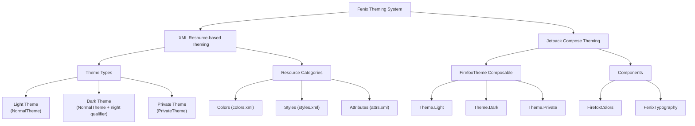
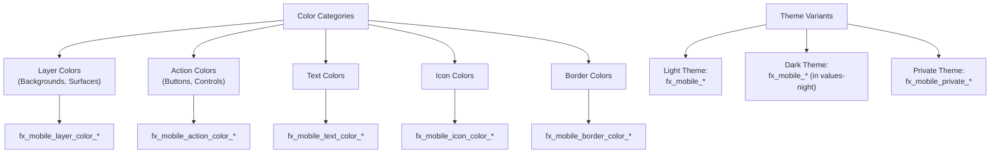
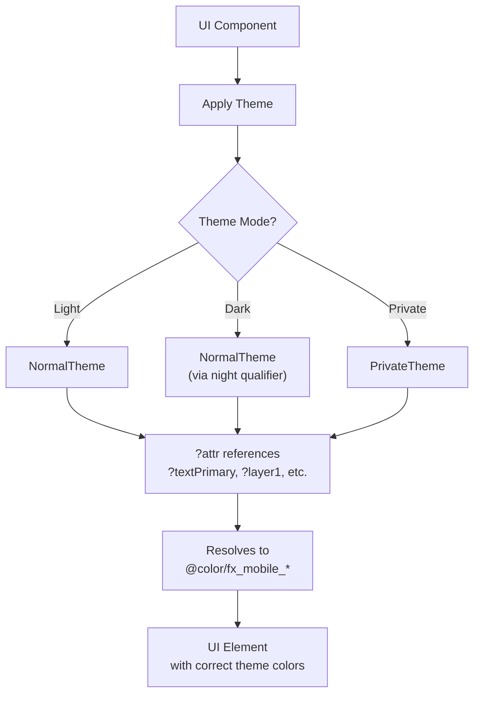
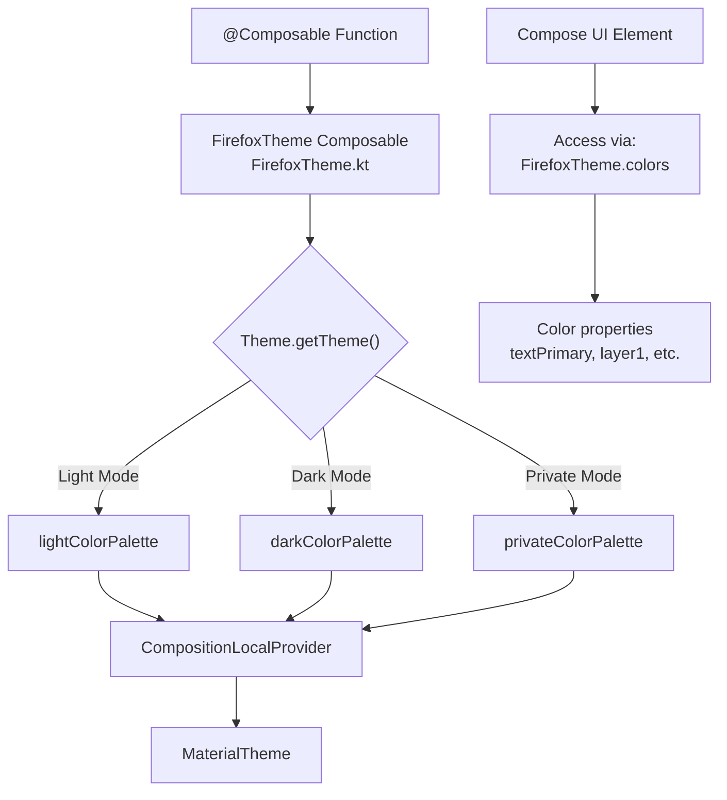

<!-- source: DeepWiki mcp.deepwiki.com · repo mozilla-mobile/firefox-android · page 3.2 Fenix Theming System · fetched 2026-10-09 -->

# Fenix Theming System

<details>
<summary>Relevant source files</summary>

The following files were used as context for generating this wiki page:

- [fenix/app/src/main/java/org/mozilla/fenix/home/intent/OpenSpecificTabIntentProcessor.kt](fenix/app/src/main/java/org/mozilla/fenix/home/intent/OpenSpecificTabIntentProcessor.kt)
- [fenix/app/src/main/java/org/mozilla/fenix/tabstray/browser/PrivateBrowserTrayList.kt](fenix/app/src/main/java/org/mozilla/fenix/tabstray/browser/PrivateBrowserTrayList.kt)
- [fenix/app/src/main/java/org/mozilla/fenix/theme/FenixTypography.kt](fenix/app/src/main/java/org/mozilla/fenix/theme/FenixTypography.kt)
- [fenix/app/src/main/java/org/mozilla/fenix/theme/FirefoxTheme.kt](fenix/app/src/main/java/org/mozilla/fenix/theme/FirefoxTheme.kt)
- [fenix/app/src/main/res/color/tab_icon.xml](fenix/app/src/main/res/color/tab_icon.xml)
- [fenix/app/src/main/res/drawable/tab_tray_grid_item_selected_border.xml](fenix/app/src/main/res/drawable/tab_tray_grid_item_selected_border.xml)
- [fenix/app/src/main/res/layout/component_tabstray2.xml](fenix/app/src/main/res/layout/component_tabstray2.xml)
- [fenix/app/src/main/res/layout/fragment_home.xml](fenix/app/src/main/res/layout/fragment_home.xml)
- [fenix/app/src/main/res/layout/fragment_pwa_onboarding.xml](fenix/app/src/main/res/layout/fragment_pwa_onboarding.xml)
- [fenix/app/src/main/res/layout/normal_browser_tray_list.xml](fenix/app/src/main/res/layout/normal_browser_tray_list.xml)
- [fenix/app/src/main/res/layout/private_browser_tray_list.xml](fenix/app/src/main/res/layout/private_browser_tray_list.xml)
- [fenix/app/src/main/res/layout/tab_tray_grid_item.xml](fenix/app/src/main/res/layout/tab_tray_grid_item.xml)
- [fenix/app/src/main/res/layout/tab_tray_item.xml](fenix/app/src/main/res/layout/tab_tray_item.xml)
- [fenix/app/src/main/res/layout/top_site_item.xml](fenix/app/src/main/res/layout/top_site_item.xml)
- [fenix/app/src/main/res/values-night/colors.xml](fenix/app/src/main/res/values-night/colors.xml)
- [fenix/app/src/main/res/values/attrs.xml](fenix/app/src/main/res/values/attrs.xml)
- [fenix/app/src/main/res/values/colors.xml](fenix/app/src/main/res/values/colors.xml)
- [fenix/app/src/main/res/values/dimens.xml](fenix/app/src/main/res/values/dimens.xml)
- [fenix/app/src/main/res/values/styles.xml](fenix/app/src/main/res/values/styles.xml)
- [fenix/app/src/test/java/org/mozilla/fenix/home/intent/OpenSpecificTabIntentProcessorTest.kt](fenix/app/src/test/java/org/mozilla/fenix/home/intent/OpenSpecificTabIntentProcessorTest.kt)
- [fenix/app/src/test/java/org/mozilla/fenix/tabstray/ext/TabSessionStateKtTest.kt](fenix/app/src/test/java/org/mozilla/fenix/tabstray/ext/TabSessionStateKtTest.kt)

</details>


This document describes the theming system used in Firefox for Android (Fenix), covering both traditional Android XML-based theming and Jetpack Compose-based theming. It explains how themes are structured, how colors are organized, and how to apply themes to UI components.

## Overview

The Fenix theming system supports three primary theme modes:
1. Light theme (default)
2. Dark theme (follows system dark mode)
3. Private browsing theme

The theming system is designed to ensure visual consistency across the application while supporting these different modes. It's built around a structured color system that categorizes colors based on their functional purpose rather than their visual appearance.



Sources:
- [fenix/app/src/main/res/values/colors.xml]()
- [fenix/app/src/main/res/values-night/colors.xml]()
- [fenix/app/src/main/res/values/styles.xml]()
- [fenix/app/src/main/java/org/mozilla/fenix/theme/FirefoxTheme.kt]()

## Color System

The color system is the foundation of the theming architecture. Colors are organized into functional categories that describe their purpose in the UI, making it easier to maintain visual consistency.

### Color Categories



Sources:
- [fenix/app/src/main/res/values/colors.xml]()
- [fenix/app/src/main/res/values-night/colors.xml]()

### Layer Colors

Layer colors are used for background elements and define the structural levels of the UI. The system uses numeric suffixes to indicate the visual hierarchy of layers.

| Color Name | Purpose | 
|------------|---------|
| `fx_mobile_layer_color_1` | Default screen background, frontlayer background, app bars |
| `fx_mobile_layer_color_2` | Card background, menu background, dialog, banner |
| `fx_mobile_layer_color_3` | Search |
| `fx_mobile_layer_color_4_start/center/end` | Homescreen background, toolbar (gradient colors) |
| `fx_mobile_layer_color_accent` | App bar when editing, text cursor, selected tab check |
| `fx_mobile_layer_color_accent_nonopaque` | Selected tab with transparency |
| `fx_mobile_layer_color_accent_opaque` | Selected tab without transparency |

Sources:
- [fenix/app/src/main/res/values/colors.xml:8-36]()
- [fenix/app/src/main/res/values-night/colors.xml:8-35]()
- [fenix/app/src/main/res/values/colors.xml:153-182]() (private theme)

### Action Colors

Action colors are used for interactive elements like buttons and controls.

| Color Name | Purpose |
|------------|---------|
| `fx_mobile_action_color_primary` | Primary button, snackbar, floating action button |
| `fx_mobile_action_color_secondary` | Secondary button |
| `fx_mobile_action_color_tertiary` | Filter |
| `fx_mobile_action_color_quarternary` | Chip |
| `fx_mobile_action_color_warning` | Warning button |
| `fx_mobile_action_color_form_*` | Form controls (checkbox, radio, switch) |

Sources:
- [fenix/app/src/main/res/values/colors.xml:36-68]()
- [fenix/app/src/main/res/values-night/colors.xml:37-69]()
- [fenix/app/src/main/res/values/colors.xml:179-202]() (private theme)

### Text Colors

Text colors define how text appears in different contexts and states.

| Color Name | Purpose |
|------------|---------|
| `fx_mobile_text_color_primary` | Primary text |
| `fx_mobile_text_color_secondary` | Secondary text |
| `fx_mobile_text_color_disabled` | Disabled text |
| `fx_mobile_text_color_warning` | Warning text |
| `fx_mobile_text_color_accent` | Small heading, text link |
| `fx_mobile_text_color_oncolor_primary` | Text on colored background |
| `fx_mobile_text_color_action_*` | Text on action elements |

Sources:
- [fenix/app/src/main/res/values/colors.xml:70-97]()
- [fenix/app/src/main/res/values-night/colors.xml:72-97]()
- [fenix/app/src/main/res/values/colors.xml:204-230]() (private theme)

### Icon Colors

Icon colors control the appearance of icons throughout the UI.

| Color Name | Purpose |
|------------|---------|
| `fx_mobile_icon_color_primary` | Primary icon |
| `fx_mobile_icon_color_primary_inactive` | Inactive tab |
| `fx_mobile_icon_color_secondary` | Secondary icon |
| `fx_mobile_icon_color_active` | Active tab |
| `fx_mobile_icon_color_disabled` | Disabled icon |
| `fx_mobile_icon_color_oncolor` | Icon on colored background |
| `fx_mobile_icon_color_accent_*` | Accent-colored icons |

Sources:
- [fenix/app/src/main/res/values/colors.xml:98-132]()
- [fenix/app/src/main/res/values-night/colors.xml:100-133]()
- [fenix/app/src/main/res/values/colors.xml:232-266]() (private theme)

### Border Colors

Border colors define the appearance of borders, dividers, and other separators.

| Color Name | Purpose |
|------------|---------|
| `fx_mobile_border_color_primary` | Default, divider, dotted |
| `fx_mobile_border_color_toolbar_divider` | Toolbar divider |
| `fx_mobile_border_color_accent` | Active tab, selected tab, active form |
| `fx_mobile_border_color_disabled` | Disabled form parts |
| `fx_mobile_border_color_warning` | Warning form parts |

Sources:
- [fenix/app/src/main/res/values/colors.xml:134-146]()
- [fenix/app/src/main/res/values-night/colors.xml:136-149]()
- [fenix/app/src/main/res/values/colors.xml:269-282]() (private theme)

## Theme Implementation

### XML Resource-based Theming

The theming system defines three primary theme styles:

1. `NormalTheme` - Used for light and dark modes (through resource qualifiers)
2. `PrivateTheme` - Used for private browsing mode
3. `DialogStyleBase` - Base theme for dialogs

Each theme style is defined in `styles.xml` and maps theme attributes to color resources.



Theme attributes in `attrs.xml` serve as an intermediary abstraction layer between UI components and color resources. This allows theme switching without changing references in layout files.

| Theme Attribute | Description |
|-----------------|-------------|
| `?layer1` | Default screen background |
| `?layer2` | Card background, menu background |
| `?textPrimary` | Primary text color |
| `?textSecondary` | Secondary text color |
| `?actionPrimary` | Primary action color |
| `?iconActive` | Active icon color |
| `?borderPrimary` | Default border color |

Sources:
- [fenix/app/src/main/res/values/attrs.xml:6-52]()
- [fenix/app/src/main/res/values/styles.xml:15-137]() (NormalTheme)
- [fenix/app/src/main/res/values/styles.xml:210-331]() (PrivateTheme)

Example of theme attribute usage in layout:

```xml
<!-- Example: Tab tray item uses theme attributes -->
<TextView
    android:id="@+id/mozac_browser_tabstray_title"
    android:layout_width="0dp"
    android:layout_height="wrap_content"
    android:textColor="@color/fx_mobile_text_color_primary"
    android:textSize="16sp"/>
```

Sources:
- [fenix/app/src/main/res/layout/tab_tray_item.xml:52-69]()
- [fenix/app/src/main/res/layout/top_site_item.xml:28-45]()

### Jetpack Compose Theming

For Jetpack Compose UI components, Fenix implements a custom theming system through the `FirefoxTheme` composable function and associated classes.



The Compose theming is centered around the `FirefoxTheme` object and `FirefoxColors` class, which provide a color palette that mirrors the XML-based color system.

Key components:

1. `Theme` enum class - Defines the three theme modes (Light, Dark, Private)
2. `FirefoxTheme` composable - Sets up the theme for Compose UI components
3. `FirefoxColors` class - Contains all theme color properties
4. `FenixTypography` class - Defines typography styles

Sources:
- [fenix/app/src/main/java/org/mozilla/fenix/theme/FirefoxTheme.kt:28-89]() (Theme enum and FirefoxTheme composable)
- [fenix/app/src/main/java/org/mozilla/fenix/theme/FirefoxTheme.kt:91-251]() (color palettes)
- [fenix/app/src/main/java/org/mozilla/fenix/theme/FirefoxTheme.kt:258-625]() (FirefoxColors class properties)
- [fenix/app/src/main/java/org/mozilla/fenix/theme/FenixTypography.kt:36-128]() (typography)

Example of using FirefoxTheme in a Compose UI:

```kotlin
@Composable
fun MyComposeUI() {
    FirefoxTheme {
        Surface(
            color = FirefoxTheme.colors.layer1
        ) {
            Text(
                text = "Hello Firefox",
                color = FirefoxTheme.colors.textPrimary,
                style = FirefoxTheme.typography.body1
            )
        }
    }
}
```

## Theme Switching

Themes are applied based on the current state of the application:

1. **Light/Dark Theme**: Determined by system settings through resource qualifiers (`values-night`)
2. **Private Browsing Theme**: Applied when a private browsing session is active

The `Theme.getTheme()` function in `FirefoxTheme.kt` determines which theme to use for Compose UI elements:

```kotlin
@Composable
fun getTheme(allowPrivateTheme: Boolean = true) =
    if (allowPrivateTheme &&
        !inComposePreview &&
        LocalContext.current.settings().lastKnownMode.isPrivate
    ) {
        Private
    } else if (isSystemInDarkTheme()) {
        Dark
    } else {
        Light
    }
```

Sources:
- [fenix/app/src/main/java/org/mozilla/fenix/theme/FirefoxTheme.kt:43-54]()

## Best Practices for Using the Theming System

1. **Always use theme attributes instead of direct color references**:
   ```xml
   <!-- Good -->
   android:textColor="?attr/textPrimary"
   
   <!-- Avoid -->
   android:textColor="@color/fx_mobile_text_color_primary"
   ```

2. **For Compose UI, wrap components with FirefoxTheme**:
   ```kotlin
   FirefoxTheme {
       // Compose UI components here
   }
   ```

3. **Access colors through FirefoxTheme.colors**:
   ```kotlin
   Surface(color = FirefoxTheme.colors.layer1)
   ```

4. **Use appropriate color categories for different UI elements**:
   - Layer colors for backgrounds
   - Text colors for text
   - Action colors for interactive elements
   - Icon colors for icons
   - Border colors for borders and dividers

5. **For custom views that need to react to theme changes**, observe theme settings and update accordingly.

## Theme Application in UI Components

Here are examples of how the theming system is applied to various UI components:

### Tab Tray

The tab tray uses theme attributes for consistent coloring across theme modes:

```xml
<com.google.android.material.card.MaterialCardView
    app:cardBackgroundColor="@color/fx_mobile_layer_color_2"
    app:strokeColor="@color/fx_mobile_border_color_primary"
    app:strokeWidth="1dp">
    <!-- Content -->
</com.google.android.material.card.MaterialCardView>
```

Selected tabs use accent colors defined by the theme:

```xml
<!-- Tab selection indicator -->
<shape android:shape="rectangle">
    <stroke
        android:width="4dp"
        android:color="@color/fx_mobile_border_color_accent" />
    <corners android:radius="@dimen/tab_tray_grid_item_outer_border_radius" />
</shape>
```

Sources:
- [fenix/app/src/main/res/layout/tab_tray_grid_item.xml:16-112]()
- [fenix/app/src/main/res/drawable/tab_tray_grid_item_selected_border.xml:9-27]()

### Home Screen

The home screen uses theme-specific backgrounds and text colors:

```xml
<androidx.coordinatorlayout.widget.CoordinatorLayout
    android:layout_width="match_parent"
    android:layout_height="match_parent"
    android:background="?homeBackground">
    <!-- Content -->
</androidx.coordinatorlayout.widget.CoordinatorLayout>
```

Sources:
- [fenix/app/src/main/res/layout/fragment_home.xml:9-202]()
- [fenix/app/src/main/res/layout/top_site_item.xml:5-66]()

### Tab Layout

Tab indicators use the theme's accent colors:

```xml
<com.google.android.material.tabs.TabLayout
    android:background="@color/fx_mobile_layer_color_1"
    app:tabIconTint="@color/tab_icon"
    app:tabIndicatorColor="@color/fx_mobile_icon_color_active">
    <!-- Tab items -->
</com.google.android.material.tabs.TabLayout>
```

The `tab_icon.xml` selector uses different colors based on the tab state:

```xml
<selector xmlns:android="http://schemas.android.com/apk/res/android">
    <item android:color="@color/fx_mobile_icon_color_active" android:state_selected="true" />
    <item android:color="@color/fx_mobile_icon_color_primary_inactive" />
</selector>
```

Sources:
- [fenix/app/src/main/res/layout/component_tabstray2.xml:77-109]()
- [fenix/app/src/main/res/color/tab_icon.xml:5-8]()

## Conclusion

The Fenix theming system provides a comprehensive framework for maintaining visual consistency across different theme modes (light, dark, and private browsing). By organizing colors into functional categories and using theme attributes as an abstraction layer, the system makes it easy to apply and switch between themes.

For XML-based views, theme attributes provide the connection between UI components and themed colors. For Jetpack Compose UI, the `FirefoxTheme` composable and associated classes offer a similar abstraction.

When implementing new UI components or modifying existing ones, developers should follow the established patterns to ensure proper theme support across all modes.

---

