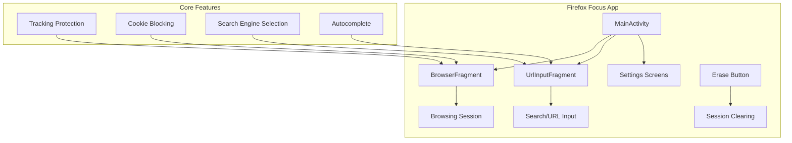
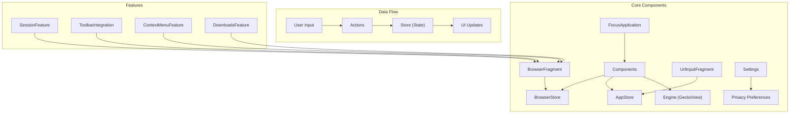
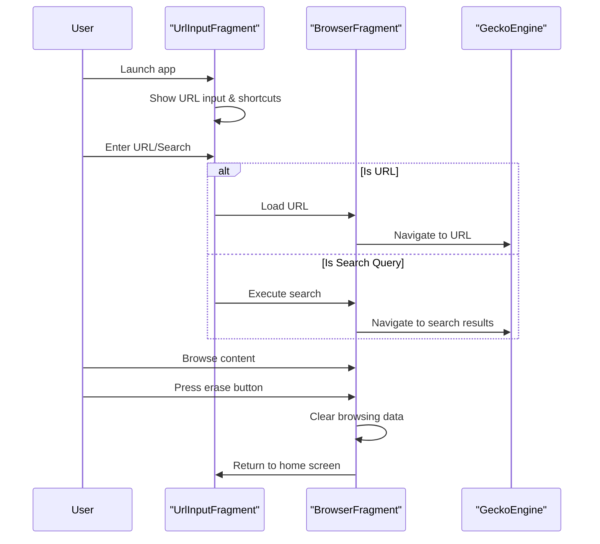
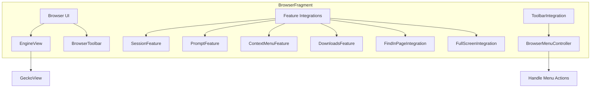
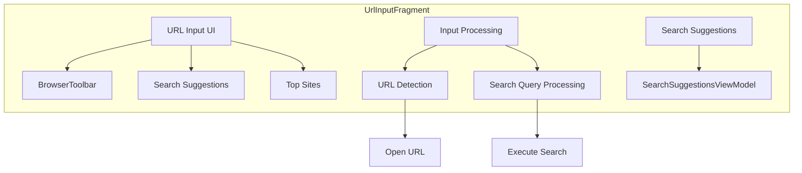
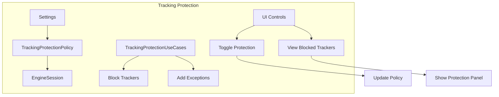
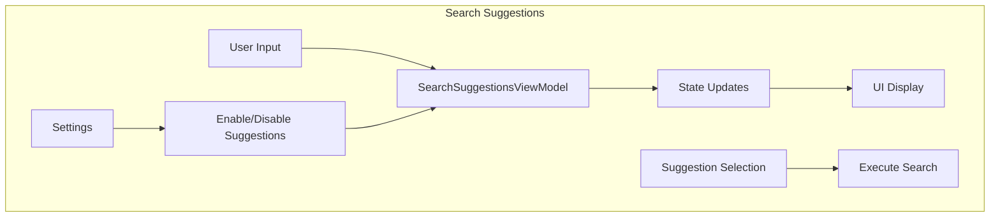
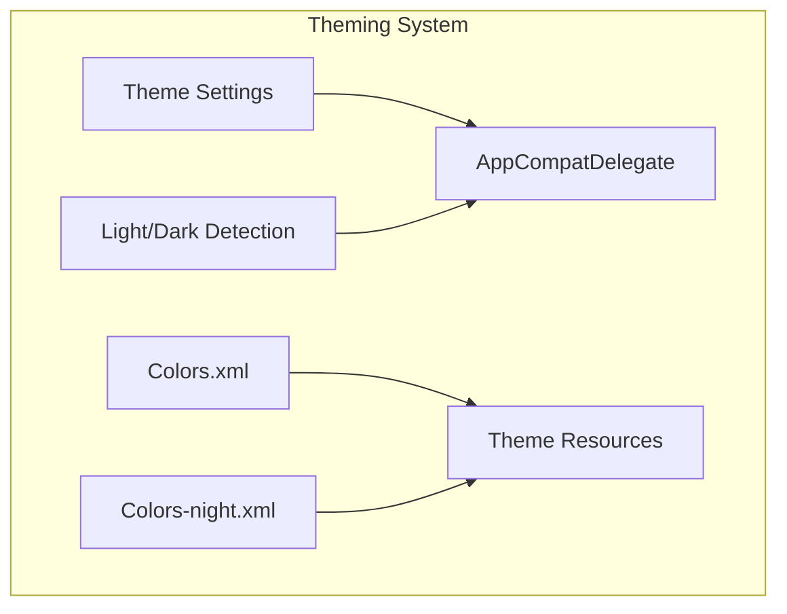

<!-- source: DeepWiki mcp.deepwiki.com · repo mozilla-mobile/firefox-android · page 4 Focus Android · fetched 2026-10-09 -->

# Focus Android

Relevant source files

The following files were used as context for generating this wiki page:

- [focus-android/app/metrics.yaml](focus-android/app/metrics.yaml)
- [focus-android/app/pings.yaml](focus-android/app/pings.yaml)
- [focus-android/app/src/main/java/org/mozilla/focus/Components.kt](focus-android/app/src/main/java/org/mozilla/focus/Components.kt)
- [focus-android/app/src/main/java/org/mozilla/focus/FocusApplication.kt](focus-android/app/src/main/java/org/mozilla/focus/FocusApplication.kt)
- [focus-android/app/src/main/java/org/mozilla/focus/activity/CustomTabActivity.kt](focus-android/app/src/main/java/org/mozilla/focus/activity/CustomTabActivity.kt)
- [focus-android/app/src/main/java/org/mozilla/focus/activity/MainActivity.kt](focus-android/app/src/main/java/org/mozilla/focus/activity/MainActivity.kt)
- [focus-android/app/src/main/java/org/mozilla/focus/animation/TransitionDrawableGroup.kt](focus-android/app/src/main/java/org/mozilla/focus/animation/TransitionDrawableGroup.kt)
- [focus-android/app/src/main/java/org/mozilla/focus/autocomplete/AutocompleteCustomDomainsPreference.kt](focus-android/app/src/main/java/org/mozilla/focus/autocomplete/AutocompleteCustomDomainsPreference.kt)
- [focus-android/app/src/main/java/org/mozilla/focus/autocomplete/AutocompleteDefaultDomainsPreference.kt](focus-android/app/src/main/java/org/mozilla/focus/autocomplete/AutocompleteDefaultDomainsPreference.kt)
- [focus-android/app/src/main/java/org/mozilla/focus/engine/EngineSharedPreferencesListener.kt](focus-android/app/src/main/java/org/mozilla/focus/engine/EngineSharedPreferencesListener.kt)
- [focus-android/app/src/main/java/org/mozilla/focus/firstrun/FirstrunPagerAdapter.kt](focus-android/app/src/main/java/org/mozilla/focus/firstrun/FirstrunPagerAdapter.kt)
- [focus-android/app/src/main/java/org/mozilla/focus/fragment/BrowserFragment.kt](focus-android/app/src/main/java/org/mozilla/focus/fragment/BrowserFragment.kt)
- [focus-android/app/src/main/java/org/mozilla/focus/fragment/UrlInputFragment.kt](focus-android/app/src/main/java/org/mozilla/focus/fragment/UrlInputFragment.kt)
- [focus-android/app/src/main/java/org/mozilla/focus/input/InputToolbarIntegration.kt](focus-android/app/src/main/java/org/mozilla/focus/input/InputToolbarIntegration.kt)
- [focus-android/app/src/main/java/org/mozilla/focus/search/MultiselectSearchEngineListPreference.kt](focus-android/app/src/main/java/org/mozilla/focus/search/MultiselectSearchEngineListPreference.kt)
- [focus-android/app/src/main/java/org/mozilla/focus/searchsuggestions/SearchSuggestionsPreferences.kt](focus-android/app/src/main/java/org/mozilla/focus/searchsuggestions/SearchSuggestionsPreferences.kt)
- [focus-android/app/src/main/java/org/mozilla/focus/searchsuggestions/SearchSuggestionsViewModel.kt](focus-android/app/src/main/java/org/mozilla/focus/searchsuggestions/SearchSuggestionsViewModel.kt)
- [focus-android/app/src/main/java/org/mozilla/focus/searchsuggestions/ui/SearchSuggestionsFragment.kt](focus-android/app/src/main/java/org/mozilla/focus/searchsuggestions/ui/SearchSuggestionsFragment.kt)
- [focus-android/app/src/main/java/org/mozilla/focus/searchsuggestions/ui/SearchSuggestionsPreference.kt](focus-android/app/src/main/java/org/mozilla/focus/searchsuggestions/ui/SearchSuggestionsPreference.kt)
- [focus-android/app/src/main/java/org/mozilla/focus/settings/SafeBrowsingSwitchPreference.kt](focus-android/app/src/main/java/org/mozilla/focus/settings/SafeBrowsingSwitchPreference.kt)
- [focus-android/app/src/main/java/org/mozilla/focus/settings/StatePreference.kt](focus-android/app/src/main/java/org/mozilla/focus/settings/StatePreference.kt)
- [focus-android/app/src/main/java/org/mozilla/focus/settings/privacy/PreferenceSwitch.kt](focus-android/app/src/main/java/org/mozilla/focus/settings/privacy/PreferenceSwitch.kt)
- [focus-android/app/src/main/java/org/mozilla/focus/settings/privacy/PrivacySecuritySettingsFragment.kt](focus-android/app/src/main/java/org/mozilla/focus/settings/privacy/PrivacySecuritySettingsFragment.kt)
- [focus-android/app/src/main/java/org/mozilla/focus/telemetry/ActivationPing.kt](focus-android/app/src/main/java/org/mozilla/focus/telemetry/ActivationPing.kt)
- [focus-android/app/src/main/java/org/mozilla/focus/telemetry/FactsProcessor.kt](focus-android/app/src/main/java/org/mozilla/focus/telemetry/FactsProcessor.kt)
- [focus-android/app/src/main/java/org/mozilla/focus/telemetry/GleanMetricsService.kt](focus-android/app/src/main/java/org/mozilla/focus/telemetry/GleanMetricsService.kt)
- [focus-android/app/src/main/java/org/mozilla/focus/telemetry/MetricsService.kt](focus-android/app/src/main/java/org/mozilla/focus/telemetry/MetricsService.kt)
- [focus-android/app/src/main/java/org/mozilla/focus/telemetry/ProfilerMarkerFactProcessor.kt](focus-android/app/src/main/java/org/mozilla/focus/telemetry/ProfilerMarkerFactProcessor.kt)
- [focus-android/app/src/main/java/org/mozilla/focus/telemetry/startuptelemetry/StartupActivityLog.kt](focus-android/app/src/main/java/org/mozilla/focus/telemetry/startuptelemetry/StartupActivityLog.kt)
- [focus-android/app/src/main/java/org/mozilla/focus/telemetry/startuptelemetry/StartupPathProvider.kt](focus-android/app/src/main/java/org/mozilla/focus/telemetry/startuptelemetry/StartupPathProvider.kt)
- [focus-android/app/src/main/java/org/mozilla/focus/telemetry/startuptelemetry/StartupStateProvider.kt](focus-android/app/src/main/java/org/mozilla/focus/telemetry/startuptelemetry/StartupStateProvider.kt)
- [focus-android/app/src/main/java/org/mozilla/focus/telemetry/startuptelemetry/StartupTypeTelemetry.kt](focus-android/app/src/main/java/org/mozilla/focus/telemetry/startuptelemetry/StartupTypeTelemetry.kt)
- [focus-android/app/src/main/java/org/mozilla/focus/topsites/DefaultTopSitesStorage.kt](focus-android/app/src/main/java/org/mozilla/focus/topsites/DefaultTopSitesStorage.kt)
- [focus-android/app/src/main/java/org/mozilla/focus/utils/Settings.kt](focus-android/app/src/main/java/org/mozilla/focus/utils/Settings.kt)
- [focus-android/app/src/main/java/org/mozilla/focus/widget/CookiesPreference.kt](focus-android/app/src/main/java/org/mozilla/focus/widget/CookiesPreference.kt)
- [focus-android/app/src/main/java/org/mozilla/focus/widget/MozillaPreference.kt](focus-android/app/src/main/java/org/mozilla/focus/widget/MozillaPreference.kt)
- [focus-android/app/src/main/java/org/mozilla/focus/widget/TelemetrySwitchPreference.kt](focus-android/app/src/main/java/org/mozilla/focus/widget/TelemetrySwitchPreference.kt)
- [focus-android/app/src/main/res/drawable/background_search_suggestion_section.xml](focus-android/app/src/main/res/drawable/background_search_suggestion_section.xml)
- [focus-android/app/src/main/res/drawable/top_rounded_corners_bottom_sheet_background.xml](focus-android/app/src/main/res/drawable/top_rounded_corners_bottom_sheet_background.xml)
- [focus-android/app/src/main/res/layout/fragment_search_suggestions.xml](focus-android/app/src/main/res/layout/fragment_search_suggestions.xml)
- [focus-android/app/src/main/res/layout/fragment_studies.xml](focus-android/app/src/main/res/layout/fragment_studies.xml)
- [focus-android/app/src/main/res/layout/fragment_urlinput.xml](focus-android/app/src/main/res/layout/fragment_urlinput.xml)
- [focus-android/app/src/main/res/values-night/colors.xml](focus-android/app/src/main/res/values-night/colors.xml)
- [focus-android/app/src/main/res/values/colors.xml](focus-android/app/src/main/res/values/colors.xml)
- [focus-android/app/src/main/res/values/preference_keys.xml](focus-android/app/src/main/res/values/preference_keys.xml)
- [focus-android/app/src/main/res/values/strings.xml](focus-android/app/src/main/res/values/strings.xml)
- [focus-android/app/src/main/res/values/strings_references.xml](focus-android/app/src/main/res/values/strings_references.xml)
- [focus-android/app/src/main/res/values/styles.xml](focus-android/app/src/main/res/values/styles.xml)
- [focus-android/app/src/main/res/xml/privacy_security_settings.xml](focus-android/app/src/main/res/xml/privacy_security_settings.xml)
- [focus-android/app/src/main/res/xml/search_settings.xml](focus-android/app/src/main/res/xml/search_settings.xml)
- [focus-android/app/src/test/java/org/mozilla/focus/animation/TransitionDrawableGroupTest.java](focus-android/app/src/test/java/org/mozilla/focus/animation/TransitionDrawableGroupTest.java)
- [focus-android/app/src/test/java/org/mozilla/focus/searchsuggestions/SearchSuggestionsViewModelTest.kt](focus-android/app/src/test/java/org/mozilla/focus/searchsuggestions/SearchSuggestionsViewModelTest.kt)
- [focus-android/app/src/test/java/org/mozilla/focus/telemetry/GleanMetricsServiceTest.kt](focus-android/app/src/test/java/org/mozilla/focus/telemetry/GleanMetricsServiceTest.kt)
- [focus-android/app/src/test/java/org/mozilla/focus/telemetry/ProfilerMarkerFactProcessorTest.kt](focus-android/app/src/test/java/org/mozilla/focus/telemetry/ProfilerMarkerFactProcessorTest.kt)
- [focus-android/app/src/test/java/org/mozilla/focus/telemetry/StartupTypeTelemetryTest.kt](focus-android/app/src/test/java/org/mozilla/focus/telemetry/StartupTypeTelemetryTest.kt)
- [focus-android/app/src/test/java/org/mozilla/focus/topsites/DefaultTopSitesStorageTest.kt](focus-android/app/src/test/java/org/mozilla/focus/topsites/DefaultTopSitesStorageTest.kt)
- [focus-android/app/src/test/resources/mockito-extensions/org.mockito.plugins.MockMaker](focus-android/app/src/test/resources/mockito-extensions/org.mockito.plugins.MockMaker)

Firefox Focus is a privacy-centric mobile browser that emphasizes simplicity, speed, and enhanced privacy protection. This document provides a technical overview of Focus Android's architecture, key components, and main features. For information about the overall repository structure, see [Overview](#1), and for details about the shared components library, see [Android Components](#2).

## Introduction

Firefox Focus (branded as Firefox Klar in German-speaking regions) is designed to provide automatic private browsing with built-in tracking protection and a simplified browsing experience. The browser's main differentiator is its "browse and erase" workflow - when users close the app or tap the erase button, their browsing session is completely removed.

Sources:
- [focus-android/app/src/main/java/org/mozilla/focus/activity/MainActivity.kt]()
- [focus-android/app/src/main/java/org/mozilla/focus/fragment/BrowserFragment.kt]()
- [focus-android/app/src/main/java/org/mozilla/focus/fragment/UrlInputFragment.kt]()
- [focus-android/app/src/main/res/values/strings.xml:19-20]()

## Architecture Overview

Focus Android is built on top of Mozilla's Android Components library, leveraging reusable browser components. It follows a modern architecture pattern with clear separation of concerns between UI components, state management, and business logic.

Sources:
- [focus-android/app/src/main/java/org/mozilla/focus/FocusApplication.kt]()
- [focus-android/app/src/main/java/org/mozilla/focus/Components.kt]()
- [focus-android/app/src/main/java/org/mozilla/focus/fragment/BrowserFragment.kt]()

## Navigation and UI Flow

Focus Android has a simple navigation model. The app starts with the URL input screen (home screen) and transitions to the browser screen when a URL is loaded or a search is performed.

Sources:
- [focus-android/app/src/main/java/org/mozilla/focus/fragment/UrlInputFragment.kt:508-600]()
- [focus-android/app/src/main/java/org/mozilla/focus/activity/MainActivity.kt:329-365]()

## Key Components

### MainActivity

The main entry point for the application that hosts fragments and manages app-level navigation. It handles intents, manages the app lifecycle, and coordinates between the different screens.

Sources:
- [focus-android/app/src/main/java/org/mozilla/focus/activity/MainActivity.kt]()

### BrowserFragment

The core UI component responsible for displaying web content. It integrates several features:

- Session management
- Toolbar and menu functionality
- Tracking protection
- Downloads
- Context menus
- Find in page functionality

Sources:
- [focus-android/app/src/main/java/org/mozilla/focus/fragment/BrowserFragment.kt:118-791]()

### UrlInputFragment

Handles user input for URLs and search queries. It provides:
- URL entry field
- Search suggestions (if enabled)
- Top sites display
- Home screen logo and layout

Sources:
- [focus-android/app/src/main/java/org/mozilla/focus/fragment/UrlInputFragment.kt]()
- [focus-android/app/src/main/res/layout/fragment_urlinput.xml]()

### Components

The container class for lazily initializing various app components, including:
- Engine (GeckoView)
- BrowserStore
- AppStore
- Various use cases (tabs, sessions, searching)
- Telemetry services

Sources:
- [focus-android/app/src/main/java/org/mozilla/focus/Components.kt]()

## Privacy Features

Privacy is the core differentiator for Focus Android, with several key features:

### Enhanced Tracking Protection

Focus blocks different categories of trackers:
- Advertising trackers
- Analytics trackers
- Social trackers
- Other content trackers

Users can configure tracking protection settings individually.

Sources:
- [focus-android/app/src/main/java/org/mozilla/focus/utils/Settings.kt:61-87]()
- [focus-android/app/src/main/res/xml/privacy_security_settings.xml:21-48]()

### Cookie Management

Focus provides granular cookie handling options:
- Block all cookies
- Block third-party tracking cookies
- Block all third-party cookies
- Block cross-site cookies
- Allow all cookies (default is to block cross-site cookies)

Sources:
- [focus-android/app/src/main/java/org/mozilla/focus/utils/Settings.kt:88-151]()
- [focus-android/app/src/main/res/xml/privacy_security_settings.xml:85-92]()
- [focus-android/app/src/main/java/org/mozilla/focus/widget/CookiesPreference.kt]()

### Erase Functionality

One of Focus's signature features is the ability to quickly erase browsing history:
- Automatic erasure when closing the app
- Manual erasure via the erase button
- Notification action for erasure

Sources:
- [focus-android/app/src/main/java/org/mozilla/focus/fragment/BrowserFragment.kt:562-564]()
- [focus-android/app/src/main/res/values/strings.xml:22-27]()

### Stealth Mode

Focus provides a "Stealth Mode" that prevents app content from appearing in the recent apps screen and blocks screenshots.

Sources:
- [focus-android/app/src/main/java/org/mozilla/focus/utils/Settings.kt:284-286]()
- [focus-android/app/src/main/res/values/strings.xml:319-326]()

## Search System

Focus provides a flexible search system with several features:

### Search Engine Selection

Users can select from a variety of built-in search engines or add custom search engines.

Sources:
- [focus-android/app/src/main/res/values/strings.xml:368-386]()
- [focus-android/app/src/main/res/xml/search_settings.xml]()

### Search Suggestions

Optional search suggestions can be enabled to provide query suggestions as the user types.

Sources:
- [focus-android/app/src/main/java/org/mozilla/focus/searchsuggestions/SearchSuggestionsViewModel.kt]()
- [focus-android/app/src/main/java/org/mozilla/focus/searchsuggestions/ui/SearchSuggestionsFragment.kt]()
- [focus-android/app/src/main/res/layout/fragment_search_suggestions.xml]()

### URL Autocomplete

Focus can autocomplete URLs from:
- A list of popular sites
- User-added custom sites

Sources:
- [focus-android/app/src/main/java/org/mozilla/focus/input/InputToolbarIntegration.kt]()
- [focus-android/app/src/main/java/org/mozilla/focus/autocomplete/AutocompleteCustomDomainsPreference.kt]()
- [focus-android/app/src/main/java/org/mozilla/focus/autocomplete/AutocompleteDefaultDomainsPreference.kt]()

## Telemetry and Data Collection

Focus uses Mozilla's Glean telemetry system for collecting usage data while respecting user privacy:

- Users can opt out of telemetry
- Data collection is focused on feature usage, not personal browsing
- Metrics include tracking protection statistics, feature usage, and performance data

Sources:
- [focus-android/app/src/main/java/org/mozilla/focus/telemetry/GleanMetricsService.kt]()
- [focus-android/app/metrics.yaml]()
- [focus-android/app/src/main/java/org/mozilla/focus/widget/TelemetrySwitchPreference.kt]()
- [focus-android/app/src/main/java/org/mozilla/focus/telemetry/FactsProcessor.kt]()

## Theming and UI

Focus uses a distinct visual identity with custom theming:

- Dark/light mode support
- Distinctive purple brand color
- Simple, distraction-free UI

Sources:
- [focus-android/app/src/main/res/values/colors.xml]()
- [focus-android/app/src/main/res/values-night/colors.xml]()
- [focus-android/app/src/main/res/values/styles.xml]()
- [focus-android/app/src/main/java/org/mozilla/focus/FocusApplication.kt:161-198]()

## In Conclusion

Firefox Focus Android is built as a privacy-first browser with a streamlined user experience. It leverages Mozilla's Android Components library for core functionality while adding specialized privacy features and a unique UX that emphasizes the "browse and erase" workflow. The app uses a modern architecture with clear separation between UI, state management, and business logic.

The most notable aspect of Focus is its comprehensive privacy feature set combined with a minimalist interface, offering users a fast, private, and distraction-free browsing experience.

Sources:
- [focus-android/app/src/main/java/org/mozilla/focus/activity/MainActivity.kt]()
- [focus-android/app/src/main/java/org/mozilla/focus/fragment/BrowserFragment.kt]()
- [focus-android/app/src/main/java/org/mozilla/focus/fragment/UrlInputFragment.kt]()
- [focus-android/app/src/main/java/org/mozilla/focus/Components.kt]()

---

