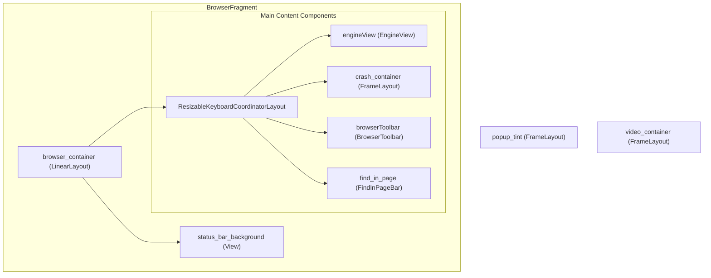
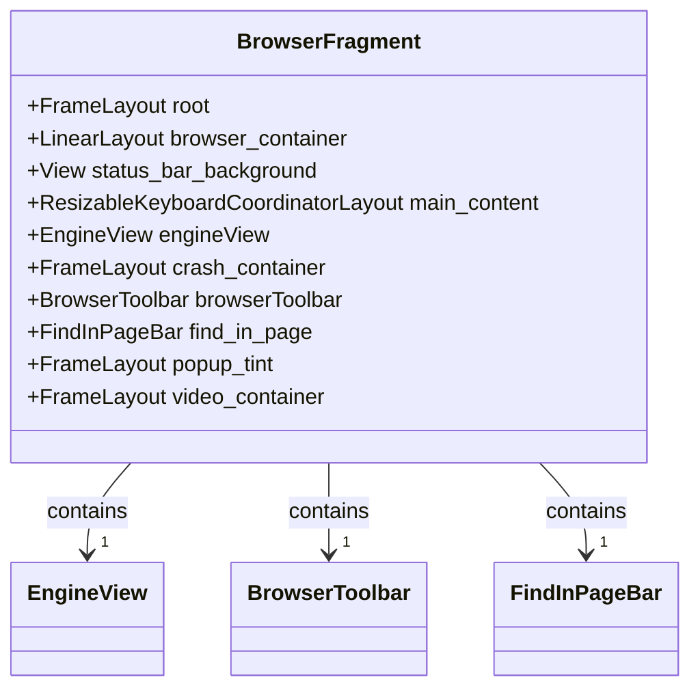
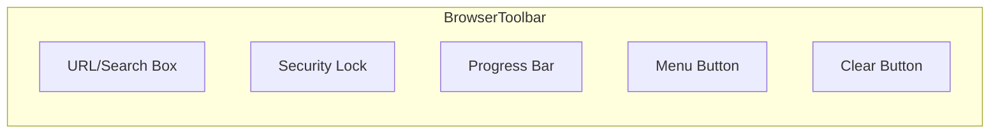
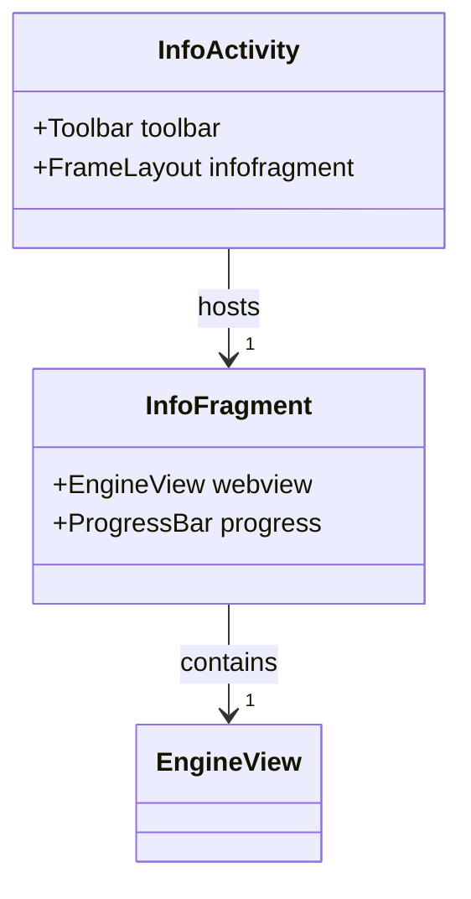

<!-- source: DeepWiki mcp.deepwiki.com · repo mozilla-mobile/firefox-android · page 4.1 Focus UI Components · fetched 2026-10-09 -->

# Focus UI Components

<details>
<summary>Relevant source files</summary>

The following files were used as context for generating this wiki page:

- [focus-android/CONTRIBUTING.md](focus-android/CONTRIBUTING.md)
- [focus-android/app/proguard-rules.pro](focus-android/app/proguard-rules.pro)
- [focus-android/app/src/androidTest/assets/tab1.html](focus-android/app/src/androidTest/assets/tab1.html)
- [focus-android/app/src/androidTest/assets/tab2.html](focus-android/app/src/androidTest/assets/tab2.html)
- [focus-android/app/src/androidTest/assets/tab3.html](focus-android/app/src/androidTest/assets/tab3.html)
- [focus-android/app/src/main/res/drawable/find_in_page_background.xml](focus-android/app/src/main/res/drawable/find_in_page_background.xml)
- [focus-android/app/src/main/res/drawable/ic_arrowhead_down.xml](focus-android/app/src/main/res/drawable/ic_arrowhead_down.xml)
- [focus-android/app/src/main/res/drawable/ic_arrowhead_up.xml](focus-android/app/src/main/res/drawable/ic_arrowhead_up.xml)
- [focus-android/app/src/main/res/layout/activity_info.xml](focus-android/app/src/main/res/layout/activity_info.xml)
- [focus-android/app/src/main/res/layout/fragment_browser.xml](focus-android/app/src/main/res/layout/fragment_browser.xml)
- [focus-android/app/src/main/res/layout/fragment_info.xml](focus-android/app/src/main/res/layout/fragment_info.xml)

</details>


## Purpose and Scope

This document describes the main UI components used in Mozilla Focus Android, the privacy-focused browser variant in the Firefox Android ecosystem. It covers the primary browser interface components, their layout structure, and how they interact to create the minimalist, privacy-centric browsing experience that Focus is known for. For information about Focus telemetry and the application startup process, see [Focus Telemetry and Startup](#4.2).

## Main UI Architecture

Focus follows a simplified UI architecture compared to Firefox for Android (Fenix), emphasizing a streamlined browsing experience with minimal UI elements. The main UI components are organized in a hierarchical structure as shown below.



Sources: [focus-android/app/src/main/res/layout/fragment_browser.xml:5-93]()

### Key Components Overview

The Focus UI consists of several core components that work together to provide a cohesive browsing experience:

| Component | Type | Description |
|-----------|------|-------------|
| EngineView | `mozilla.components.concept.engine.EngineView` | Renders web content using the underlying engine (GeckoView) |
| BrowserToolbar | `mozilla.components.browser.toolbar.BrowserToolbar` | Handles URL input, navigation controls, and menu access |
| FindInPageBar | `mozilla.components.feature.findinpage.view.FindInPageBar` | Provides text search functionality within web pages |
| ResizableKeyboardCoordinatorLayout | `org.mozilla.focus.widget.ResizableKeyboardCoordinatorLayout` | Custom layout that adjusts for keyboard visibility |

Sources: [focus-android/app/src/main/res/layout/fragment_browser.xml:31-74]()

## Core UI Components in Detail

### BrowserFragment Layout

The `BrowserFragment` is the main container for the browsing experience in Focus. It uses a hierarchical structure with a main LinearLayout (`browser_container`) that contains the status bar background and the main content area.



Sources: [focus-android/app/src/main/res/layout/fragment_browser.xml:5-93]()

### EngineView

The `EngineView` is the central component that renders web content. It's an implementation of Mozilla's abstraction over browser engines, which in Focus is typically GeckoView.

Key characteristics:
- Takes up the full width and height of its container
- Has vertical scrollbars with a custom thumb drawable
- Set as focusable to receive user input directly

The EngineView is positioned beneath the BrowserToolbar in the z-order but fills the entire screen, with the toolbar overlaid on top.

Sources: [focus-android/app/src/main/res/layout/fragment_browser.xml:31-38]()

### BrowserToolbar

The `BrowserToolbar` is the navigation control center of Focus, providing URL display, site security information, and access to browser controls.



Key characteristics:
- Fixed height of `@dimen/browser_toolbar_height`
- Positioned at the top of the screen with elevation to appear above content
- Uses a gradient background
- Custom color settings for different security states (secure, insecure)
- Progress bar positioned at the bottom of the toolbar

The toolbar is elevated with a 4dp elevation to create a shadow effect that visually separates it from the web content below.

Sources: [focus-android/app/src/main/res/layout/fragment_browser.xml:47-61]()

### FindInPageBar

The `FindInPageBar` provides in-page text search functionality. It's hidden by default and appears when the user initiates a search within the current web page.

Key characteristics:
- Fixed height of 56dp with 4dp padding
- Elevated above other UI elements (10dp elevation)
- Custom text colors for different states (hint text, no matches, result count)
- Positioned at the top of the screen when active

Sources: [focus-android/app/src/main/res/layout/fragment_browser.xml:63-74]()

## Secondary UI Components

### InfoActivity and InfoFragment

Focus includes a separate UI for displaying static content like about pages, privacy policy, and help information through the `InfoActivity` and `InfoFragment`.



The InfoActivity uses a simpler layout compared to the main browser:
- Toolbar at the top for navigation
- Frame container for the InfoFragment
- InfoFragment contains another EngineView instance specifically for rendering static content
- Simple horizontal progress bar at the top

Sources: 
- [focus-android/app/src/main/res/layout/activity_info.xml:5-19]()
- [focus-android/app/src/main/res/layout/fragment_info.xml:5-19]()

### UI Icons and Resources

Focus uses a set of custom icons for its UI elements, including navigation controls and indicators:

1. Arrowhead icons for navigation and expandable elements
   - `ic_arrowhead_down.xml` - Used for expanding panels or indicating more content below
   - `ic_arrowhead_up.xml` - Used for collapsing panels or navigating upward

These icons use the `primaryText` color from the Focus theme to maintain consistent styling across the app.

Sources:
- [focus-android/app/src/main/res/drawable/ic_arrowhead_down.xml:5-14]()
- [focus-android/app/src/main/res/drawable/ic_arrowhead_up.xml:5-14]()

## Integration with Android Components

Focus UI is built on top of the Android Components library, which provides browser-specific UI elements and functionality. The relationship between Focus UI and Android Components is shown below:

```mermaid
flowchart TD
    subgraph "Focus UI Implementation"
        BF["BrowserFragment"]
        IF["InfoFragment"]
    end
    
    subgraph "Android Components Library"
        EVI["EngineView Interface"]
        BTI["BrowserToolbar Implementation"]
        FIPI["FindInPage Implementation"]
    end
    
    BF --> EVI: "uses"
    BF --> BTI: "uses"
    BF --> FIPI: "uses"
    IF --> EVI: "uses"
    
    subgraph "Engine Implementation"
        GEV["GeckoEngineView"]
    end
    
    EVI --> GEV: "implemented by"
```

Focus directly uses the UI components provided by Android Components rather than implementing custom versions. This provides several advantages:
- Consistent behavior across Mozilla's Android browsers
- Shared maintenance and bug fixes
- Standardized integration with the underlying browser engine

Sources:
- [focus-android/app/src/main/res/layout/fragment_browser.xml:31-38]()
- [focus-android/app/src/main/res/layout/fragment_browser.xml:47-61]()
- [focus-android/app/src/main/res/layout/fragment_browser.xml:63-74]()
- [focus-android/app/src/main/res/layout/fragment_info.xml:8-18]()

## Special UI Containers

Focus includes several specialized containers for specific UI states:

1. **Crash Container**: A fullscreen container shown when the browser engine crashes
   - Uses a distinctive background color
   - Hidden by default (visibility="gone")

2. **Popup Tint**: An overlay that dims the main UI when popups are displayed
   - Semi-transparent (alpha=0.5)
   - Uses the primary color as background
   - Hidden by default

3. **Video Container**: A dedicated container for video playback
   - Used for fullscreen video experiences
   - Hidden by default

These containers provide important UI states for error handling, modal dialogs, and media presentation.

Sources: [focus-android/app/src/main/res/layout/fragment_browser.xml:40-92]()

## ProGuard Configurations for UI Components

Focus includes specific ProGuard rules to ensure proper functioning of UI components, particularly those related to the Android Architecture Components used in the UI layer:

- ViewModels have special keep rules to preserve their constructors
- AndroidViewModels have specific rules for their application context constructor
- Various warnings are suppressed for UI-related libraries

These configurations ensure that the UI components function correctly even after the APK optimization process.

Sources: [focus-android/app/proguard-rules.pro:85-105]()

---

