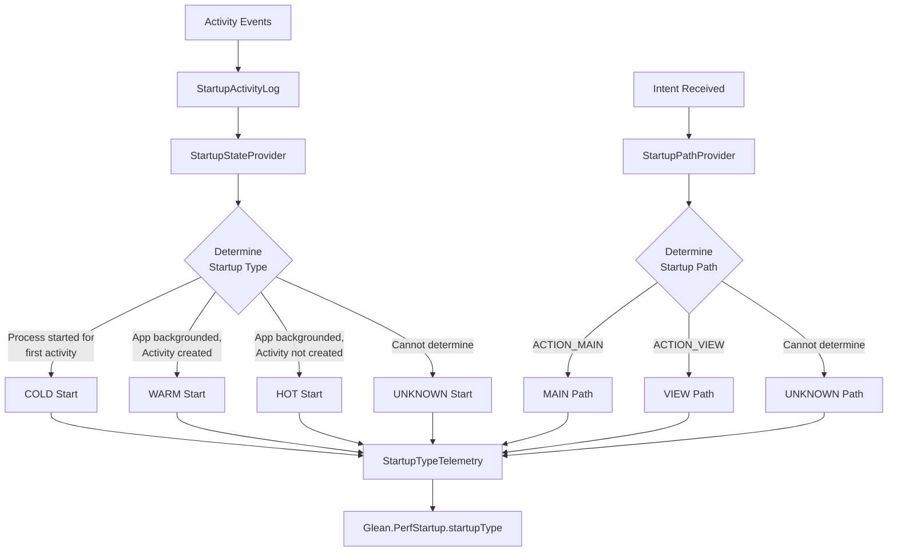
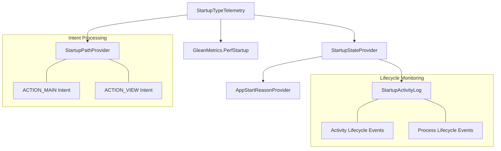
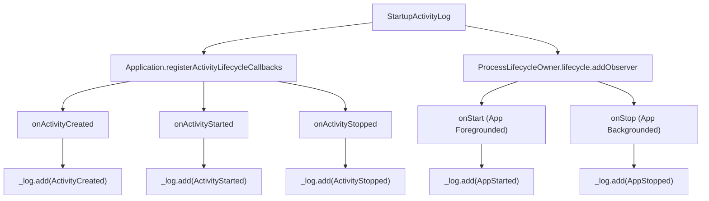
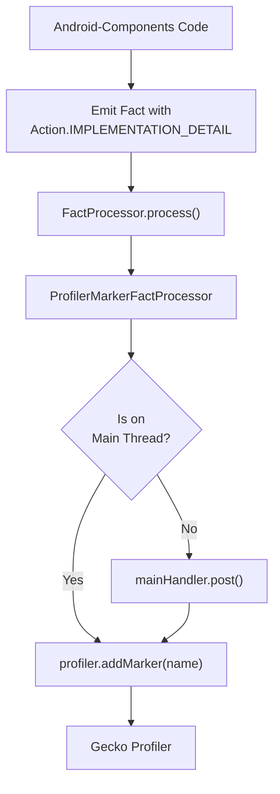
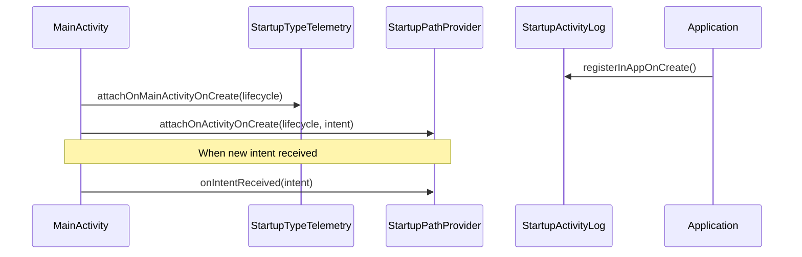
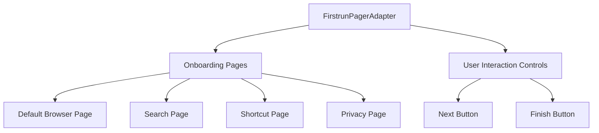

<!-- source: DeepWiki mcp.deepwiki.com · repo mozilla-mobile/firefox-android · page 4.2 Focus Telemetry and Startup · fetched 2026-10-09 -->

# Focus Telemetry and Startup

<details>
<summary>Relevant source files</summary>

The following files were used as context for generating this wiki page:

- [focus-android/app/src/main/java/org/mozilla/focus/animation/TransitionDrawableGroup.kt](focus-android/app/src/main/java/org/mozilla/focus/animation/TransitionDrawableGroup.kt)
- [focus-android/app/src/main/java/org/mozilla/focus/firstrun/FirstrunPagerAdapter.kt](focus-android/app/src/main/java/org/mozilla/focus/firstrun/FirstrunPagerAdapter.kt)
- [focus-android/app/src/main/java/org/mozilla/focus/telemetry/ProfilerMarkerFactProcessor.kt](focus-android/app/src/main/java/org/mozilla/focus/telemetry/ProfilerMarkerFactProcessor.kt)
- [focus-android/app/src/main/java/org/mozilla/focus/telemetry/startuptelemetry/StartupActivityLog.kt](focus-android/app/src/main/java/org/mozilla/focus/telemetry/startuptelemetry/StartupActivityLog.kt)
- [focus-android/app/src/main/java/org/mozilla/focus/telemetry/startuptelemetry/StartupPathProvider.kt](focus-android/app/src/main/java/org/mozilla/focus/telemetry/startuptelemetry/StartupPathProvider.kt)
- [focus-android/app/src/main/java/org/mozilla/focus/telemetry/startuptelemetry/StartupStateProvider.kt](focus-android/app/src/main/java/org/mozilla/focus/telemetry/startuptelemetry/StartupStateProvider.kt)
- [focus-android/app/src/main/java/org/mozilla/focus/telemetry/startuptelemetry/StartupTypeTelemetry.kt](focus-android/app/src/main/java/org/mozilla/focus/telemetry/startuptelemetry/StartupTypeTelemetry.kt)
- [focus-android/app/src/main/java/org/mozilla/focus/topsites/DefaultTopSitesStorage.kt](focus-android/app/src/main/java/org/mozilla/focus/topsites/DefaultTopSitesStorage.kt)
- [focus-android/app/src/test/java/org/mozilla/focus/animation/TransitionDrawableGroupTest.java](focus-android/app/src/test/java/org/mozilla/focus/animation/TransitionDrawableGroupTest.java)
- [focus-android/app/src/test/java/org/mozilla/focus/telemetry/ProfilerMarkerFactProcessorTest.kt](focus-android/app/src/test/java/org/mozilla/focus/telemetry/ProfilerMarkerFactProcessorTest.kt)
- [focus-android/app/src/test/java/org/mozilla/focus/telemetry/StartupTypeTelemetryTest.kt](focus-android/app/src/test/java/org/mozilla/focus/telemetry/StartupTypeTelemetryTest.kt)
- [focus-android/app/src/test/java/org/mozilla/focus/topsites/DefaultTopSitesStorageTest.kt](focus-android/app/src/test/java/org/mozilla/focus/topsites/DefaultTopSitesStorageTest.kt)

</details>


## Purpose and Scope

This document describes the telemetry collection system for Mozilla Focus Android's startup process. It explains how startup types are classified, tracked, and recorded for performance analysis. The system captures detailed information about how the app is launched, process state during startup, and provides measurement points for performance analysis.

This page focuses specifically on the Focus browser implementation. For general telemetry in the Android Components library, see [Telemetry and Analytics](#8).

## Startup Classification System

The Focus telemetry system classifies app startups along two dimensions:

1. **Startup State**: Whether this is a cold, warm, or hot startup based on process and activity lifecycle state
2. **Startup Path**: How the app was launched (main launcher or through a view intent)

These classifications help analyze performance metrics and understand user behavior patterns.



Sources:
- [focus-android/app/src/main/java/org/mozilla/focus/telemetry/startuptelemetry/StartupTypeTelemetry.kt:38-110]()
- [focus-android/app/src/main/java/org/mozilla/focus/telemetry/startuptelemetry/StartupStateProvider.kt:21-137]()
- [focus-android/app/src/main/java/org/mozilla/focus/telemetry/startuptelemetry/StartupPathProvider.kt:20-98]()

## Core Telemetry Components

The startup telemetry system consists of the following interrelated components:



Sources:
- [focus-android/app/src/main/java/org/mozilla/focus/telemetry/startuptelemetry/StartupTypeTelemetry.kt:38-110]()
- [focus-android/app/src/main/java/org/mozilla/focus/telemetry/startuptelemetry/StartupActivityLog.kt:30-106]()

### StartupTypeTelemetry

This is the main class responsible for recording telemetry data related to how Focus was started. It:

1. Attaches to MainActivity's lifecycle
2. Determines the startup type and path at the appropriate time
3. Records metrics to Glean

The class implements a lifecycle observer to track when the Activity moves through its lifecycle states, ensuring metrics are recorded at the right time.

```kotlin
fun attachOnMainActivityOnCreate(lifecycle: Lifecycle) {
    lifecycle.addObserver(StartupTypeLifecycleObserver())
}
```

The telemetry is recorded in the `onResume` callback, but only if `onStart` was called for this resume cycle (to avoid recording metrics when returning from an onPause state).

Sources:
- [focus-android/app/src/main/java/org/mozilla/focus/telemetry/startuptelemetry/StartupTypeTelemetry.kt:38-110]()
- [focus-android/app/src/test/java/org/mozilla/focus/telemetry/StartupTypeTelemetryTest.kt:46-152]()

### StartupStateProvider

The `StartupStateProvider` class identifies the startup state by analyzing activity lifecycle events. It categorizes startups into:

| Startup Type | Definition | Lifecycle Pattern |
|--------------|------------|-------------------|
| COLD | Process started for the first time | `[ActivityStarted, AppStarted]` with no prior AppStopped |
| WARM | App was backgrounded, activity recreated | `[AppStopped, ..., ActivityCreated, ActivityStarted, AppStarted]` |
| HOT | App was backgrounded, activity reused | `[AppStopped, ..., ActivityStarted, AppStarted]` without ActivityCreated |
| UNKNOWN | State cannot be determined | Any other pattern |

The provider analyzes the activity log sequence to determine which type of startup occurred.

Sources:
- [focus-android/app/src/main/java/org/mozilla/focus/telemetry/startuptelemetry/StartupStateProvider.kt:21-137]()

### StartupPathProvider

The `StartupPathProvider` determines how the app was launched based on the Intent's action:

```kotlin
private fun getStartupPathFromIntent(intent: Intent): StartupPath = when (intent.action) {
    Intent.ACTION_MAIN -> StartupPath.MAIN
    Intent.ACTION_VIEW -> StartupPath.VIEW
    else -> StartupPath.UNKNOWN
}
```

The different startup paths include:
- `MAIN`: App launched from the launcher (ACTION_MAIN)
- `VIEW`: App launched to open a URL (ACTION_VIEW)
- `UNKNOWN`: Intent action not recognized
- `NOT_SET`: No intent received yet or app opened via app switcher

The provider attaches to the activity's lifecycle and tracks intents received during startup.

Sources:
- [focus-android/app/src/main/java/org/mozilla/focus/telemetry/startuptelemetry/StartupPathProvider.kt:20-98]()

### StartupActivityLog

This component records activity and application lifecycle events to provide a chronological log for startup state determination:



The log is maintained in a `mutableListOf<LogEntry>()` and includes these entry types:
- `AppStarted`: Application foregrounded
- `AppStopped`: Application backgrounded
- `ActivityCreated`: Activity onCreate called
- `ActivityStarted`: Activity onStart called
- `ActivityStopped`: Activity onStop called

To prevent memory leaks, the log is cleared when the application is stopped.

Sources:
- [focus-android/app/src/main/java/org/mozilla/focus/telemetry/startuptelemetry/StartupActivityLog.kt:30-106]()

## Profiler Marker Integration

Focus Android includes a `ProfilerMarkerFactProcessor` that integrates with the Mozilla components' Facts system to add performance markers:



This component:
1. Processes Facts with `Action.IMPLEMENTATION_DETAIL`
2. Converts them to profiler markers
3. Ensures they're added on the main thread (required by the profiler)

This allows adding profiler markers from android-components code without direct dependencies on the Profiler.

Sources:
- [focus-android/app/src/main/java/org/mozilla/focus/telemetry/ProfilerMarkerFactProcessor.kt:45-85]()
- [focus-android/app/src/test/java/org/mozilla/focus/telemetry/ProfilerMarkerFactProcessorTest.kt:23-96]()

## Telemetry Data Structure

The `StartupTypeTelemetry` class combines the startup state and path into a single telemetry label with the format `{state}_{path}`:

```
[state]_[path]

Where:
- state: cold, warm, hot, or unknown
- path: main, view, or unknown
```

Examples of valid labels:
- `cold_main`: Cold start via launcher
- `hot_view`: Hot start via URL intent
- `warm_unknown`: Warm start via unrecognized intent

The label is sent to Glean's `PerfStartup.startupType` metric counter:

```kotlin
PerfStartup.startupType[label].add(1)
```

This ensures telemetry is appropriately categorized for analysis.

Sources:
- [focus-android/app/src/main/java/org/mozilla/focus/telemetry/startuptelemetry/StartupTypeTelemetry.kt:47-67]()
- [focus-android/app/src/test/java/org/mozilla/focus/telemetry/StartupTypeTelemetryTest.kt:37-41]()

## Initialization Flow

The startup telemetry system must be initialized in the application and main activity:



The `StartupActivityLog` should be initialized in the application's `onCreate()` method, while the `StartupTypeTelemetry` and `StartupPathProvider` should be initialized in MainActivity's `onCreate()`.

Sources:
- [focus-android/app/src/main/java/org/mozilla/focus/telemetry/startuptelemetry/StartupActivityLog.kt:35-41]()
- [focus-android/app/src/main/java/org/mozilla/focus/telemetry/startuptelemetry/StartupTypeTelemetry.kt:43-45]()
- [focus-android/app/src/main/java/org/mozilla/focus/telemetry/startuptelemetry/StartupPathProvider.kt:48-51]()

## First Run Experience

Focus Android includes a first run experience via the `FirstrunPagerAdapter`, which displays onboarding screens to new users:



This component initializes during first launch and impacts the startup flow for new users.

Sources:
- [focus-android/app/src/main/java/org/mozilla/focus/firstrun/FirstrunPagerAdapter.kt:18-103]()

## Conclusion

Focus Android's telemetry and startup system provides detailed performance data and user behavior insights through a comprehensive classification of startup states and paths. This data helps the development team optimize performance and understand how users launch the application.

The system is designed to be minimally invasive to the startup process itself, with telemetry recording happening after the app is fully visible to users, ensuring that the act of measurement doesn't significantly impact the metrics being measured.

---

