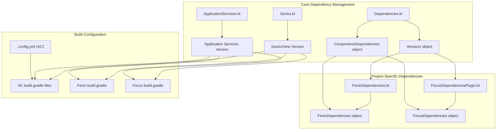
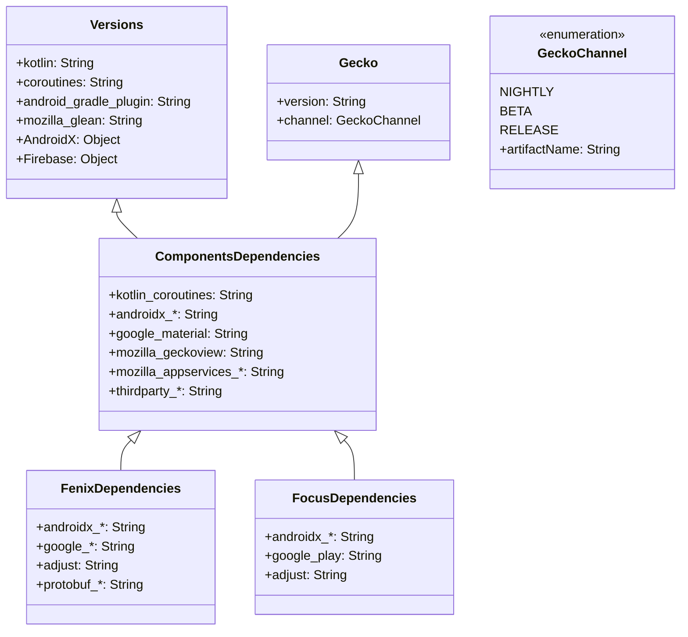
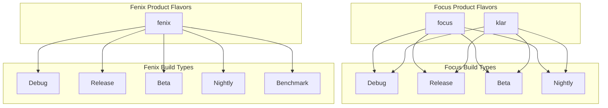
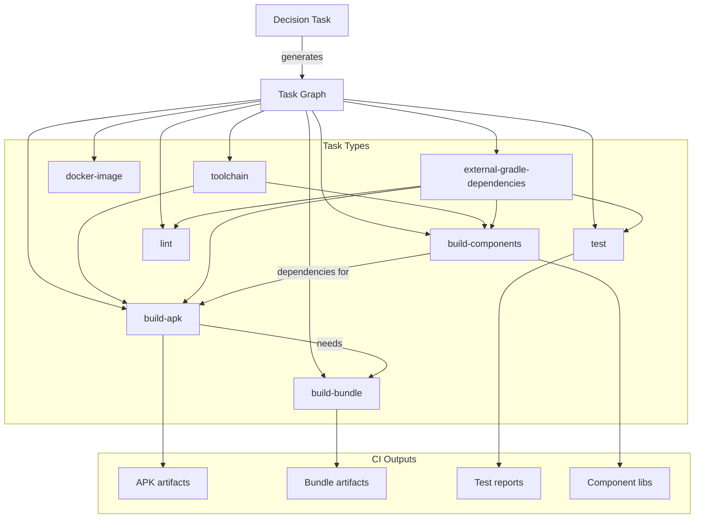
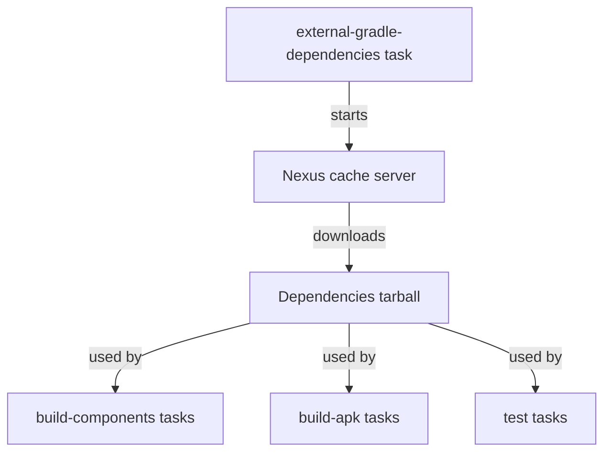
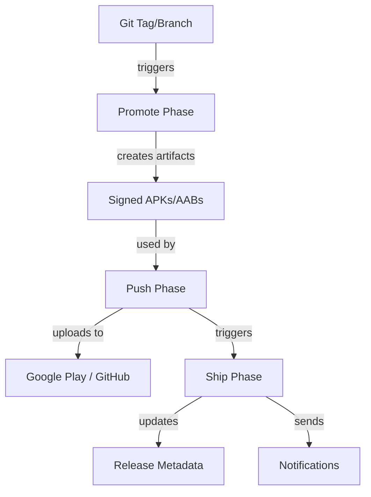

<!-- source: DeepWiki mcp.deepwiki.com · repo mozilla-mobile/firefox-android · page 5 Build System and Dependency Management · fetched 2026-10-09 -->

# Build System and Dependency Management

<details>
<summary>Relevant source files</summary>

The following files were used as context for generating this wiki page:

- [.mergify.yml](.mergify.yml)
- [.taskcluster.yml](.taskcluster.yml)
- [android-components/.config.yml](android-components/.config.yml)
- [android-components/components/browser/session-storage/build.gradle](android-components/components/browser/session-storage/build.gradle)
- [android-components/components/feature/session/build.gradle](android-components/components/feature/session/build.gradle)
- [android-components/components/feature/toolbar/build.gradle](android-components/components/feature/toolbar/build.gradle)
- [android-components/components/support/test/src/main/java/mozilla/components/support/test/rule/Helpers.kt](android-components/components/support/test/src/main/java/mozilla/components/support/test/rule/Helpers.kt)
- [android-components/components/tooling/detekt/build.gradle](android-components/components/tooling/detekt/build.gradle)
- [android-components/components/tooling/lint/build.gradle](android-components/components/tooling/lint/build.gradle)
- [android-components/plugins/dependencies/src/main/java/DependenciesPlugin.kt](android-components/plugins/dependencies/src/main/java/DependenciesPlugin.kt)
- [android-components/plugins/dependencies/src/main/java/Gecko.kt](android-components/plugins/dependencies/src/main/java/Gecko.kt)
- [fenix/app/build.gradle](fenix/app/build.gradle)
- [fenix/app/src/main/AndroidManifest.xml](fenix/app/src/main/AndroidManifest.xml)
- [fenix/app/src/main/java/org/mozilla/fenix/GlobalDirections.kt](fenix/app/src/main/java/org/mozilla/fenix/GlobalDirections.kt)
- [fenix/app/src/main/java/org/mozilla/fenix/components/IntentProcessorType.kt](fenix/app/src/main/java/org/mozilla/fenix/components/IntentProcessorType.kt)
- [fenix/app/src/main/java/org/mozilla/fenix/home/intent/HomeDeepLinkIntentProcessor.kt](fenix/app/src/main/java/org/mozilla/fenix/home/intent/HomeDeepLinkIntentProcessor.kt)
- [fenix/app/src/main/java/org/mozilla/fenix/intent/ExternalDeepLinkIntentProcessor.kt](fenix/app/src/main/java/org/mozilla/fenix/intent/ExternalDeepLinkIntentProcessor.kt)
- [fenix/app/src/test/java/org/mozilla/fenix/components/IntentProcessorTypeTest.kt](fenix/app/src/test/java/org/mozilla/fenix/components/IntentProcessorTypeTest.kt)
- [fenix/benchmark/build.gradle](fenix/benchmark/build.gradle)
- [fenix/build.gradle](fenix/build.gradle)
- [fenix/mozilla-detekt-rules/build.gradle](fenix/mozilla-detekt-rules/build.gradle)
- [fenix/mozilla-detekt-rules/src/main/java/org/mozilla/fenix/detektrules/perf/MozillaUseLazyMonitored.kt](fenix/mozilla-detekt-rules/src/main/java/org/mozilla/fenix/detektrules/perf/MozillaUseLazyMonitored.kt)
- [fenix/mozilla-detekt-rules/src/test/java/org/mozilla/fenix/detektrules/perf/MozillaUseLazyMonitoredTest.kt](fenix/mozilla-detekt-rules/src/test/java/org/mozilla/fenix/detektrules/perf/MozillaUseLazyMonitoredTest.kt)
- [fenix/mozilla-lint-rules/build.gradle](fenix/mozilla-lint-rules/build.gradle)
- [fenix/plugins/fenixdependencies/src/main/java/FenixDependenciesPlugin.kt](fenix/plugins/fenixdependencies/src/main/java/FenixDependenciesPlugin.kt)
- [focus-android/app/build.gradle](focus-android/app/build.gradle)
- [focus-android/app/src/main/java/org/mozilla/focus/browser/BlockedTrackersMiddleware.kt](focus-android/app/src/main/java/org/mozilla/focus/browser/BlockedTrackersMiddleware.kt)
- [focus-android/app/src/main/java/org/mozilla/focus/searchsuggestions/ui/SearchOverlay.kt](focus-android/app/src/main/java/org/mozilla/focus/searchsuggestions/ui/SearchOverlay.kt)
- [focus-android/app/src/main/java/org/mozilla/focus/telemetry/TelemetryMiddleware.kt](focus-android/app/src/main/java/org/mozilla/focus/telemetry/TelemetryMiddleware.kt)
- [focus-android/build.gradle](focus-android/build.gradle)
- [focus-android/plugins/focusdependencies/settings.gradle](focus-android/plugins/focusdependencies/settings.gradle)
- [focus-android/plugins/focusdependencies/src/main/java/FocusDependenciesPlugin.kt](focus-android/plugins/focusdependencies/src/main/java/FocusDependenciesPlugin.kt)
- [taskcluster/android_taskgraph/__init__.py](taskcluster/android_taskgraph/__init__.py)
- [taskcluster/android_taskgraph/job.py](taskcluster/android_taskgraph/job.py)
- [taskcluster/android_taskgraph/loader/build_config.py](taskcluster/android_taskgraph/loader/build_config.py)
- [taskcluster/android_taskgraph/parameters.py](taskcluster/android_taskgraph/parameters.py)
- [taskcluster/android_taskgraph/release_promotion.py](taskcluster/android_taskgraph/release_promotion.py)
- [taskcluster/android_taskgraph/target_tasks.py](taskcluster/android_taskgraph/target_tasks.py)
- [taskcluster/android_taskgraph/transforms/complete.py](taskcluster/android_taskgraph/transforms/complete.py)
- [taskcluster/ci/build-components/kind.yml](taskcluster/ci/build-components/kind.yml)
- [taskcluster/ci/build-samples-browser/kind.yml](taskcluster/ci/build-samples-browser/kind.yml)
- [taskcluster/ci/complete/kind.yml](taskcluster/ci/complete/kind.yml)
- [taskcluster/ci/config.yml](taskcluster/ci/config.yml)
- [taskcluster/ci/docker-image/kind.yml](taskcluster/ci/docker-image/kind.yml)
- [taskcluster/ci/lint/kind.yml](taskcluster/ci/lint/kind.yml)
- [taskcluster/ci/test-components/kind.yml](taskcluster/ci/test-components/kind.yml)
- [taskcluster/ci/toolchain/android.yml](taskcluster/ci/toolchain/android.yml)
- [taskcluster/ci/trigger-nightly/kind.yml](taskcluster/ci/trigger-nightly/kind.yml)
- [taskcluster/requirements.in](taskcluster/requirements.in)
- [taskcluster/requirements.txt](taskcluster/requirements.txt)
- [taskcluster/scripts/are_dependencies_completed.py](taskcluster/scripts/are_dependencies_completed.py)
- [taskcluster/scripts/toolchain/external-gradle-dependencies/after.sh](taskcluster/scripts/toolchain/external-gradle-dependencies/after.sh)
- [taskcluster/test/params/fork-promote-beta.yml](taskcluster/test/params/fork-promote-beta.yml)
- [taskcluster/test/params/main-repo-promote-beta.yml](taskcluster/test/params/main-repo-promote-beta.yml)
- [taskcluster/test/params/main-repo-push-beta.yml](taskcluster/test/params/main-repo-push-beta.yml)
- [version.txt](version.txt)

</details>


This document explains how dependencies are managed and how the build system is structured across the Firefox Android projects (Fenix, Focus, and Android Components). The build system uses Gradle with custom plugins to centralize dependency management and ensure consistency across all projects.

## Overview

The Firefox Android repository employs a sophisticated build system architecture using Gradle, with specialized Kotlin-based plugins for dependency management. This centralized approach ensures that all subprojects (Android Components, Fenix, and Focus) maintain consistent versions of dependencies across the codebase.



Sources:
- [android-components/plugins/dependencies/src/main/java/Gecko.kt]()
- [android-components/plugins/dependencies/src/main/java/DependenciesPlugin.kt]()
- [fenix/plugins/fenixdependencies/src/main/java/FenixDependenciesPlugin.kt]()
- [focus-android/plugins/focusdependencies/src/main/java/FocusDependenciesPlugin.kt]()
- [android-components/.config.yml]()

## Dependency Management System

Firefox Android employs a hierarchical dependency management system to maintain consistent dependencies across all projects. This system consists of:

1. **Core Dependency Definitions**: Centralized in the Android Components project
2. **Project-Specific Dependencies**: Defined in dedicated plugins for each application
3. **Version Management**: Centralized version numbers to ensure consistency

### Core Dependency Files

The core dependency management is defined in several key files:

- `DependenciesPlugin.kt`: Contains the central `Versions` object and `ComponentsDependencies` object
- `Gecko.kt`: Manages GeckoView version and channel
- `ApplicationServices.kt`: Manages Application Services version



Sources:
- [android-components/plugins/dependencies/src/main/java/DependenciesPlugin.kt:15-217]()
- [android-components/plugins/dependencies/src/main/java/Gecko.kt:8-29]()
- [fenix/plugins/fenixdependencies/src/main/java/FenixDependenciesPlugin.kt:15-119]()
- [focus-android/plugins/focusdependencies/src/main/java/FocusDependenciesPlugin.kt:15-68]()

### Dependency Reference System

Dependencies are referenced in a consistent way across projects using objects defined in the plugins:

```kotlin
// In Android Components modules
implementation ComponentsDependencies.androidx_browser
implementation ComponentsDependencies.kotlin_coroutines

// In Fenix
implementation FenixDependencies.adjust
implementation ComponentsDependencies.androidx_appcompat

// In Focus
implementation FocusDependencies.androidx_splashscreen
implementation ComponentsDependencies.androidx_browser
```

This system ensures that all projects use the same versions of shared dependencies while allowing for project-specific dependencies as needed.

Sources:
- [focus-android/app/build.gradle:215-324]()
- [fenix/app/build.gradle:520-674]()

## Build Configuration

The build system is configured through a combination of:

1. **Root `build.gradle`** files defining core project settings and repositories
2. **Module-specific `build.gradle`** files containing module-specific configurations
3. **Configuration files** for centralized build settings like `.config.yml`

### Build Types and Product Flavors

Each application defines its own build types and product flavors to support different release channels and variants:



Sources:
- [focus-android/app/build.gradle:56-92]()
- [focus-android/app/build.gradle:111-131]()
- [fenix/app/build.gradle:110-166]()
- [fenix/app/build.gradle:191-197]()

### Version Code Generation

The build system automatically generates version codes for each application variant, taking into account:

1. Base version code (generated or static)
2. Architecture/ABI adjustments
3. Differences between APK and AAB (Android App Bundle)

For example, in Focus Android:

```kotlin
def baseVersionCode = generatedVersionCode
// Ensure baseVersionCode is even (APKs)
if (baseVersionCode % 2) {
    baseVersionCode = baseVersionCode + 1
}

// For AABs, use odd version code
if (aab) {
    versionCodeOverride = baseVersionCode + 1
} else {
    // For APKs, add architecture-specific offset
    if (abi == "x86_64") {
        versionCodeOverride = baseVersionCode + 6
    } else if (abi == "x86") {
        versionCodeOverride = baseVersionCode + 4
    } else if (abi == "arm64-v8a") {
        versionCodeOverride = baseVersionCode + 2
    } else if (abi == "armeabi-v7a") {
        versionCodeOverride = baseVersionCode + 0
    }
}
```

Sources:
- [focus-android/app/build.gradle:365-428]()
- [fenix/app/build.gradle:295-319]()

### Split APKs for Different Architectures

The build system is configured to generate separate APKs for different CPU architectures to optimize APK size for end users:

```kotlin
splits {
    abi {
        enable true
        reset()
        include "x86", "armeabi-v7a", "arm64-v8a", "x86_64"
    }
}
```

Sources:
- [focus-android/app/build.gradle:133-141]()
- [fenix/app/build.gradle:205-220]()

### Build Config Fields

The build system generates various `BuildConfig` fields depending on the build type and environment:

- GeckoView version
- Build date
- API tokens for services like Adjust, MLS, and Sentry
- Telemetry and crash reporting flags
- Feature flags

These are typically set in the `android.applicationVariants.configureEach` block in the build.gradle files.

Sources:
- [focus-android/app/build.gradle:434-492]()
- [fenix/app/build.gradle:332-457]()

## CI/CD Pipeline with TaskCluster

Firefox Android uses TaskCluster for continuous integration and delivery. The pipeline is defined in `.taskcluster.yml` and other configuration files in the `taskcluster/` directory.



Sources:
- [.taskcluster.yml]()
- [taskcluster/ci/config.yml]()
- [taskcluster/ci/build-components/kind.yml]()
- [taskcluster/ci/complete/kind.yml]()

### TaskCluster Configuration

The main configuration file `.taskcluster.yml` defines:

1. Decision task that generates the task graph
2. Worker types and environments
3. Repository and branch-specific settings
4. Different workflows for pull requests, pushes, and scheduled runs

TaskCluster tasks are organized by "kinds" defined in the `taskcluster/ci/` directory, including:

- `build-components` - Build Android Components library modules
- `build-apk` - Build application APKs
- `test` - Run tests
- `lint` - Run static analysis
- `toolchain` - Set up build tools

Sources:
- [.taskcluster.yml]()
- [taskcluster/ci/build-components/kind.yml]()
- [taskcluster/ci/build-samples-browser/kind.yml]()
- [taskcluster/ci/toolchain/android.yml]()
- [taskcluster/ci/lint/kind.yml]()

### External Gradle Dependencies

To improve build speed and reliability, external Gradle dependencies are pre-fetched and cached as a separate task in the CI pipeline:



This task runs a Nexus repository server to download dependencies once and package them for use by other tasks.

Sources:
- [taskcluster/scripts/toolchain/external-gradle-dependencies/after.sh]()

## Publication Process

Android Components are published as Maven artifacts to Mozilla's Maven repository. The publication process is configured in Gradle and executed by TaskCluster.

### Component Publication

Each Android Components module is published as a separate Maven artifact with the group ID defined in `.config.yml`:

```yaml
# Maven group ID used for all components
componentsGroupId: "org.mozilla.components"

# Synchronized build configuration for all modules
jvmTargetCompatibility: 17
compileSdkVersion: 34
minSdkVersion: 21
targetSdkVersion: 34
```

Source:
- [android-components/.config.yml]()

### Release Promotion

The release process is managed through TaskCluster's release promotion mechanism, which consists of several phases:

1. **Promote phase** - Builds and signs the artifacts
2. **Push phase** - Publishes artifacts to repositories
3. **Ship phase** - Updates release information and sends notifications



Sources:
- [taskcluster/android_taskgraph/release_promotion.py]()
- [taskcluster/android_taskgraph/target_tasks.py:28-107]()

### Version Management for Releases

For release builds, version names are automatically generated based on:

1. Information from `version.txt` for major version
2. Git commit information for build identification
3. Build type (nightly, beta, release)

Version codes are generated to ensure:
- Consistent version progression
- Architecture-specific differences
- Compatibility with Google Play Store requirements

Sources:
- [focus-android/app/build.gradle:365-428]()
- [fenix/app/build.gradle:295-319]()
- [version.txt]()

## Further Information

For more detailed information on specific aspects of the build system, see:
- [Build Configuration](#5.1) for more details on build types and product flavors
- [CI/CD Pipeline](#5.2) for more information about the TaskCluster configuration
- [Publication Process](#5.3) for details on how components are published to Maven repositories

---

