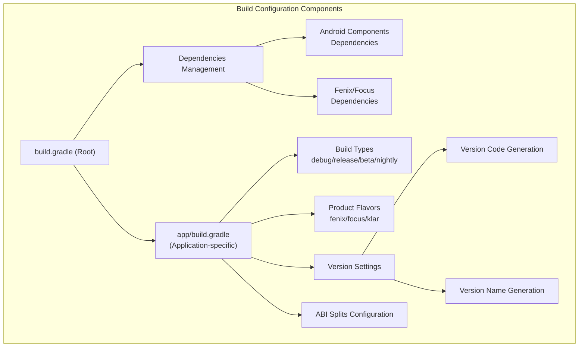
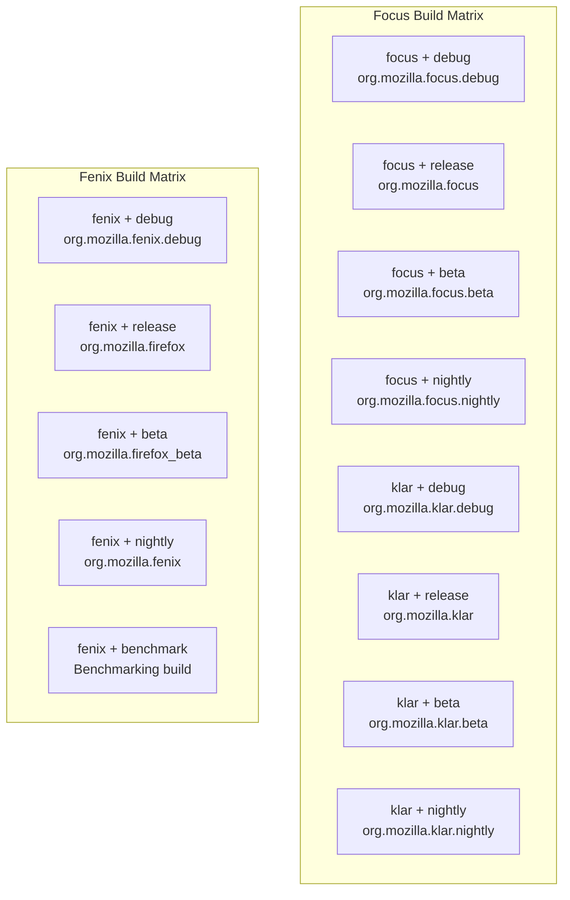
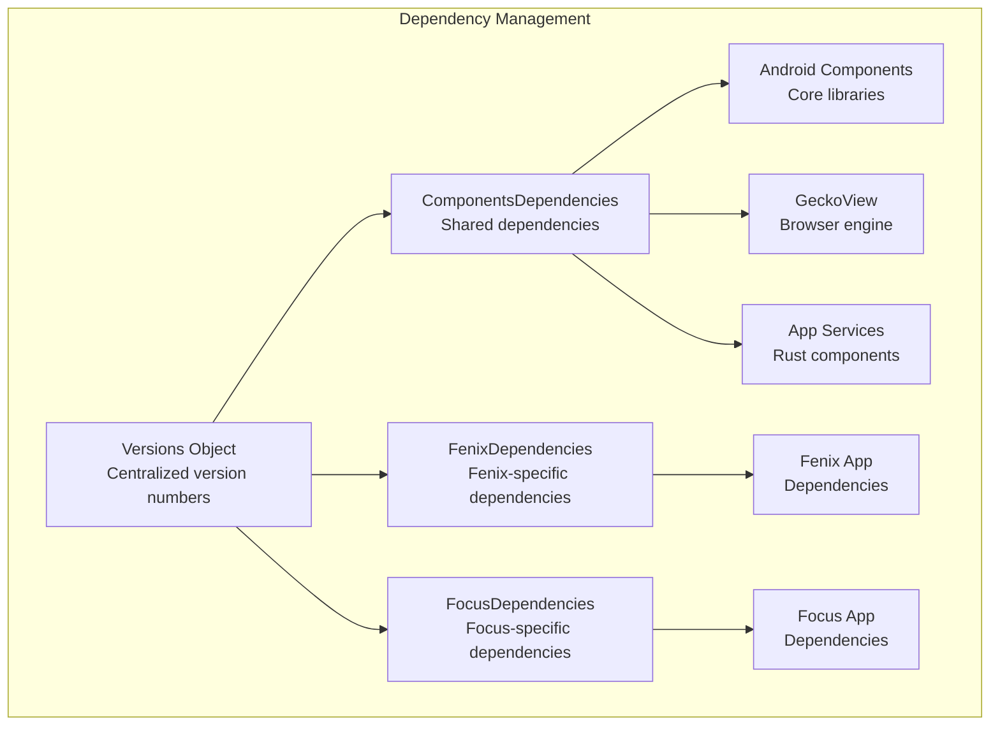
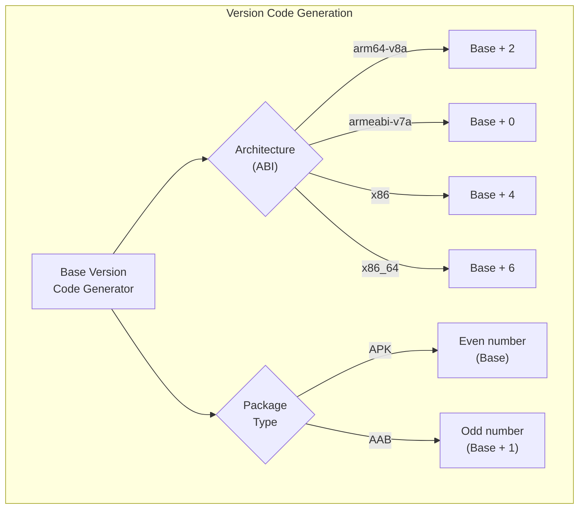
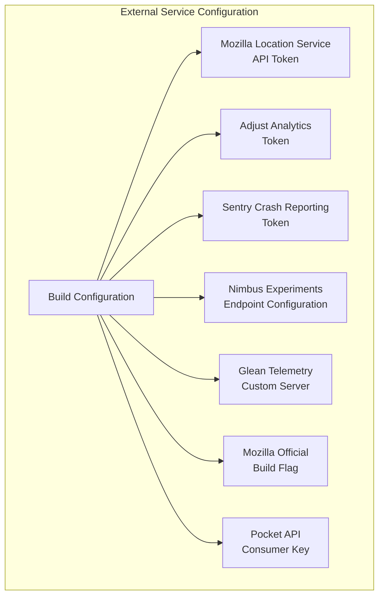
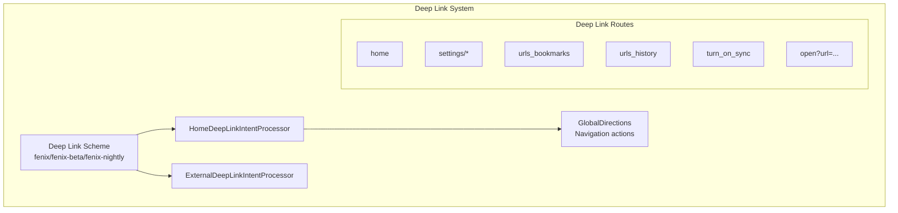

<!-- source: DeepWiki mcp.deepwiki.com · repo mozilla-mobile/firefox-android · page 5.1 Build Configuration · fetched 2026-10-09 -->

# Build Configuration

<details>
<summary>Relevant source files</summary>

The following files were used as context for generating this wiki page:

- [android-components/.config.yml](android-components/.config.yml)
- [android-components/components/browser/session-storage/build.gradle](android-components/components/browser/session-storage/build.gradle)
- [android-components/components/feature/session/build.gradle](android-components/components/feature/session/build.gradle)
- [android-components/components/feature/toolbar/build.gradle](android-components/components/feature/toolbar/build.gradle)
- [android-components/components/support/test/src/main/java/mozilla/components/support/test/rule/Helpers.kt](android-components/components/support/test/src/main/java/mozilla/components/support/test/rule/Helpers.kt)
- [android-components/components/tooling/detekt/build.gradle](android-components/components/tooling/detekt/build.gradle)
- [android-components/components/tooling/lint/build.gradle](android-components/components/tooling/lint/build.gradle)
- [android-components/plugins/dependencies/src/main/java/DependenciesPlugin.kt](android-components/plugins/dependencies/src/main/java/DependenciesPlugin.kt)
- [fenix/app/build.gradle](fenix/app/build.gradle)
- [fenix/app/src/main/AndroidManifest.xml](fenix/app/src/main/AndroidManifest.xml)
- [fenix/app/src/main/java/org/mozilla/fenix/GlobalDirections.kt](fenix/app/src/main/java/org/mozilla/fenix/GlobalDirections.kt)
- [fenix/app/src/main/java/org/mozilla/fenix/components/IntentProcessorType.kt](fenix/app/src/main/java/org/mozilla/fenix/components/IntentProcessorType.kt)
- [fenix/app/src/main/java/org/mozilla/fenix/home/intent/HomeDeepLinkIntentProcessor.kt](fenix/app/src/main/java/org/mozilla/fenix/home/intent/HomeDeepLinkIntentProcessor.kt)
- [fenix/app/src/main/java/org/mozilla/fenix/intent/ExternalDeepLinkIntentProcessor.kt](fenix/app/src/main/java/org/mozilla/fenix/intent/ExternalDeepLinkIntentProcessor.kt)
- [fenix/app/src/test/java/org/mozilla/fenix/components/IntentProcessorTypeTest.kt](fenix/app/src/test/java/org/mozilla/fenix/components/IntentProcessorTypeTest.kt)
- [fenix/benchmark/build.gradle](fenix/benchmark/build.gradle)
- [fenix/build.gradle](fenix/build.gradle)
- [fenix/mozilla-detekt-rules/build.gradle](fenix/mozilla-detekt-rules/build.gradle)
- [fenix/mozilla-detekt-rules/src/main/java/org/mozilla/fenix/detektrules/perf/MozillaUseLazyMonitored.kt](fenix/mozilla-detekt-rules/src/main/java/org/mozilla/fenix/detektrules/perf/MozillaUseLazyMonitored.kt)
- [fenix/mozilla-detekt-rules/src/test/java/org/mozilla/fenix/detektrules/perf/MozillaUseLazyMonitoredTest.kt](fenix/mozilla-detekt-rules/src/test/java/org/mozilla/fenix/detektrules/perf/MozillaUseLazyMonitoredTest.kt)
- [fenix/mozilla-lint-rules/build.gradle](fenix/mozilla-lint-rules/build.gradle)
- [fenix/plugins/fenixdependencies/src/main/java/FenixDependenciesPlugin.kt](fenix/plugins/fenixdependencies/src/main/java/FenixDependenciesPlugin.kt)
- [focus-android/app/build.gradle](focus-android/app/build.gradle)
- [focus-android/app/src/main/java/org/mozilla/focus/browser/BlockedTrackersMiddleware.kt](focus-android/app/src/main/java/org/mozilla/focus/browser/BlockedTrackersMiddleware.kt)
- [focus-android/app/src/main/java/org/mozilla/focus/searchsuggestions/ui/SearchOverlay.kt](focus-android/app/src/main/java/org/mozilla/focus/searchsuggestions/ui/SearchOverlay.kt)
- [focus-android/app/src/main/java/org/mozilla/focus/telemetry/TelemetryMiddleware.kt](focus-android/app/src/main/java/org/mozilla/focus/telemetry/TelemetryMiddleware.kt)
- [focus-android/build.gradle](focus-android/build.gradle)
- [focus-android/plugins/focusdependencies/settings.gradle](focus-android/plugins/focusdependencies/settings.gradle)
- [focus-android/plugins/focusdependencies/src/main/java/FocusDependenciesPlugin.kt](focus-android/plugins/focusdependencies/src/main/java/FocusDependenciesPlugin.kt)

</details>


This document describes the build configuration system used in Firefox for Android projects including Fenix (Firefox for Android) and Focus (Firefox Focus). It covers the gradle build system, build types, product flavors, dependency management, and version code generation. For information about the CI/CD pipeline, see [CI/CD Pipeline](#5.2).

## Build System Overview

The Firefox Android projects use Gradle as their build system with custom plugins to manage dependencies, versioning, and build variants. The build system manages the creation of different application variants based on build types and product flavors.



Sources: [focus-android/app/build.gradle:5-175](), [fenix/app/build.gradle:1-277](), [focus-android/build.gradle:1-46](), [fenix/build.gradle:1-100]()

## Build Types and Product Flavors

### Build Types

Both Fenix and Focus define multiple build types for different release channels:

| Build Type | Description | Application | 
|------------|-------------|-------------|
| `debug`    | Development builds with debugging enabled | Fenix, Focus |
| `release`  | Production release builds with optimizations | Fenix, Focus |
| `nightly`  | Nightly release channel builds | Fenix, Focus |
| `beta`     | Beta release channel builds | Fenix, Focus |
| `benchmark`| Performance benchmarking builds (Fenix only) | Fenix |

Each build type can configure specific settings like:
- Debug flags
- ProGuard/R8 optimizations
- Application ID suffixes
- Version naming schemes
- Deep link schemes

### Product Flavors

Product flavors define different variants of the same application:

- **Fenix**: Single product flavor named "fenix"
- **Focus**: Two product flavors:
  - `focus`: Firefox Focus (used in most countries)
  - `klar`: Firefox Klar (used in Germany, Austria, and Switzerland due to local naming requirements)



Sources: [focus-android/app/build.gradle:56-131](), [fenix/app/build.gradle:110-166](), [fenix/app/build.gradle:191-197]()

## Dependency Management

Dependencies are managed through a set of specialized Kotlin files that provide centralized version management and dependency declarations.

### Centralized Version Management

Three main components handle dependency versions:

1. **Core Components Dependencies**: Defined in `android-components/plugins/dependencies/src/main/java/DependenciesPlugin.kt`
2. **Fenix-specific Dependencies**: Defined in `fenix/plugins/fenixdependencies/src/main/java/FenixDependenciesPlugin.kt`
3. **Focus-specific Dependencies**: Defined in `focus-android/plugins/focusdependencies/src/main/java/FocusDependenciesPlugin.kt`



The `Versions` object in the dependencies plugin defines shared version numbers for all libraries:

```kotlin
object Versions {
    const val kotlin = "1.9.22"
    const val coroutines = "1.8.0"
    // Many more versions...
    
    object AndroidX {
        const val activityCompose = "1.7.2"
        // AndroidX component versions...
    }
    
    object Firebase {
        const val messaging = "23.4.1"
    }
}
```

These version constants are then used in the dependency objects:

```kotlin
object ComponentsDependencies {
    const val kotlin_coroutines = "org.jetbrains.kotlinx:kotlinx-coroutines-android:${Versions.coroutines}"
    // Many more dependencies...
}
```

Sources: [android-components/plugins/dependencies/src/main/java/DependenciesPlugin.kt:15-217](), [fenix/plugins/fenixdependencies/src/main/java/FenixDependenciesPlugin.kt:15-119](), [focus-android/plugins/focusdependencies/src/main/java/FocusDependenciesPlugin.kt:15-68]()

## Version Code and Version Name Generation

### Version Code Generation

Version codes are generated dynamically to ensure unique identifiers for different variants of the applications. This is necessary because:

1. The Google Play Store requires unique version codes for different APKs of the same app
2. Different architectures (ARM, x86, etc.) need different version codes
3. App Bundles (AAB) need different version codes than APKs



In Focus, the version code logic can be found in the `android.applicationVariants.configureEach` block:

```kotlin
def versionCodeOverride = baseVersionCode
// ensure baseVersionCode is even
if (baseVersionCode % 2) {
    baseVersionCode = baseVersionCode + 1
}

if (aab) {
    // AAB version code is odd
    versionCodeOverride = versionCodeOverride + 1
} else {
    if (abi == "x86_64") {
        versionCodeOverride = versionCodeOverride + 6
    } else if (abi == "x86") {
        versionCodeOverride = versionCodeOverride + 4
    } else if (abi == "arm64-v8a") {
        versionCodeOverride = versionCodeOverride + 2
    } else if (abi == "armeabi-v7a") {
        versionCodeOverride = versionCodeOverride + 0
    }
}
```

### Version Name Generation

Version names are dynamically generated for release builds:

- For debug builds: Generated from a debug version name utility method
- For release builds: Generated based on the release type (nightly, beta, release)

Fenix uses a utility class called `Config` with methods like `nightlyVersionName()` and `releaseVersionName(project)` to generate appropriate version names.

Sources: [focus-android/app/build.gradle:365-432](), [fenix/app/build.gradle:279-326]()

## External Service Configuration

The build system includes configuration for various external services and APIs:



### Service Token Management

The build system looks for tokens in local files or properties:

1. **MLS (Mozilla Location Service)**: Read from `.mls_token` file
2. **Adjust Analytics**: Read from `.adjust_token` file for release builds
3. **Sentry Crash Reporting**: Read from `.sentry_token` file
4. **Nimbus Experiments**: Read from `.nimbus` file or from `local.properties`
5. **Glean Telemetry**: Configuration from `local.properties`
6. **Pocket API**: Read from `.pocket_consumer_key` file

These tokens are injected into the appropriate `buildConfigField` values at build time.

### Conditional Feature Configuration

The build configuration also handles feature flags for different build types:

```kotlin
if (!isDebug) {
    buildConfigField 'boolean', 'CRASH_REPORTING', 'true'
    // Add Sentry token if available
} else {
    buildConfigField 'boolean', 'CRASH_REPORTING', 'false'
}

if (!isDebug) {
    buildConfigField 'boolean', 'TELEMETRY', 'true'
} else {
    buildConfigField 'boolean', 'TELEMETRY', 'false'
}
```

Sources: [focus-android/app/build.gradle:434-565](), [fenix/app/build.gradle:329-487]()

## Application ID Management

Application IDs are managed through a combination of:
- Base application ID in the `defaultConfig` block
- Build type specific suffixes
- Product flavor specific suffixes

The combinations create unique application IDs for each variant:

### Focus Example
- Base application ID: `org.mozilla`
- Debug build type suffix: `.debug`
- Focus flavor suffix: `.focus`
- Resulting ID for Focus Debug: `org.mozilla.focus.debug`

### Fenix Example
- Base application ID: `org.mozilla`
- Release build type suffix: `.firefox`
- Resulting ID for Fenix Release: `org.mozilla.firefox`

### Shared User IDs

For seamless upgrades from older Firefox versions, Fenix beta and release builds use a shared user ID:

```kotlin
manifestPlaceholders.putAll([
    // This release type is meant to replace Firefox (Release channel) and therefore needs to inherit
    // its sharedUserId for all eternity.
    "sharedUserId": "org.mozilla.firefox.sharedID",
    // Other placeholders...
])
```

Sources: [focus-android/app/build.gradle:24-42](), [fenix/app/build.gradle:34-85](), [fenix/app/build.gradle:133-159]()

## ABI Split Configuration

Both applications use ABI splits to generate architecture-specific APKs:

```kotlin
splits {
    abi {
        enable true
        reset()
        include "x86", "armeabi-v7a", "arm64-v8a", "x86_64"
    }
}
```

This generates separate APKs for each architecture, which reduces download size for users by only providing the binaries needed for their device's architecture.

For benchmark tests in Fenix, only the `arm64-v8a` architecture is built to ensure consistent testing:

```kotlin
// For benchmark tests in Fenix
if (project.hasProperty("benchmarkTest")) {
    include "arm64-v8a"
} else {
    include "x86", "armeabi-v7a", "arm64-v8a", "x86_64"
}
```

Sources: [focus-android/app/build.gradle:133-141](), [fenix/app/build.gradle:205-220]()

## Deep Link Configuration

The build system configures deep linking schemes for the applications to enable direct navigation to specific app features from external sources.



Deep link schemes are defined in the build configuration for each build type:
- Debug: `fenix-dev`
- Nightly: `fenix-nightly`
- Beta: `fenix-beta`
- Release: `fenix`

The scheme is injected into both `buildConfigField` and `manifestPlaceholders`:

```kotlin
def deepLinkSchemeValue = "fenix-nightly"
buildConfigField "String", "DEEP_LINK_SCHEME", "\"$deepLinkSchemeValue\""
manifestPlaceholders.putAll([
    "deepLinkScheme": deepLinkSchemeValue
])
```

These values are then used in the AndroidManifest.xml to define the intent filters:

```xml
<data android:scheme="${deepLinkScheme}"
    android:host="settings"/>
```

The `HomeDeepLinkIntentProcessor` and `ExternalDeepLinkIntentProcessor` classes handle the actual processing of these deep links:

```kotlin
val scheme = intent.scheme?.equals(BuildConfig.DEEP_LINK_SCHEME, ignoreCase = true) ?: return false
```

Sources: [fenix/app/build.gradle:66-159](), [fenix/app/src/main/AndroidManifest.xml:122-158](), [fenix/app/src/main/java/org/mozilla/fenix/home/intent/HomeDeepLinkIntentProcessor.kt:32-71](), [fenix/app/src/main/java/org/mozilla/fenix/intent/ExternalDeepLinkIntentProcessor.kt:14-28](), [fenix/app/src/main/java/org/mozilla/fenix/GlobalDirections.kt:17-63]()

## Locale Management

For Firefox Focus/Klar, the build system automatically generates a list of supported locales based on the resource directories:

```kotlin
// Generate a Kotlin class with all supported locales
tasks.register('generateLocaleList') {
    doLast {
        // Create a file with a list of all locales
        def localeList = file(new File(dir, generatedLocaleListFilename))
        // ...
        localeList << "object LocalesList {" << "\n"
        localeList << "    " << "val BUNDLED_LOCALES: List<String> = Collections.unmodifiableList("
        // ...
        localeList << getEnabledLocales().join(",\n" + "            ")
        // ...
    }
}
```

The function `getEnabledLocales()` analyzes the resource directories to find all language files and creates a list of language codes.

For Fenix, the list of supported locales is injected into BuildConfig:

```kotlin
buildConfigField "String[]", "SUPPORTED_LOCALE_ARRAY", getSupportedLocales()
```

Sources: [focus-android/app/build.gradle:498-609](), [fenix/app/build.gradle:86]()

## Compose Configuration

Both applications use Jetpack Compose for parts of their UI, which requires specific build configuration:

```kotlin
buildFeatures {
    compose true
    viewBinding true
    buildConfig true
}

composeOptions {
    kotlinCompilerExtensionVersion = Versions.compose_compiler
}
```

The `Versions.compose_compiler` value is defined in the dependencies plugin to ensure consistent Compose compiler versions across all components.

Sources: [focus-android/app/build.gradle:101-109](), [fenix/app/build.gradle:168-274]()

## Build Task Configuration

The build system configures various tasks for building, testing, and analysis:

### Kotlin Compiler Configuration

```kotlin
tasks.withType(KotlinCompile).configureEach {
    kotlinOptions.allWarningsAsErrors = true
    kotlinOptions.freeCompilerArgs += [
        "-opt-in=kotlinx.coroutines.ExperimentalCoroutinesApi",
        "-opt-in=kotlin.RequiresOptIn",
        "-Xjvm-default=all"
    ]
}
```

### Static Analysis Tools

Both applications configure detekt and ktlint for static code analysis:

```kotlin
detekt {
    input = files("$projectDir/app/src")
    config = files("$projectDir/config/detekt.yml")
    // ...
}

tasks.register('ktlint', JavaExec) {
    description = "Check Kotlin code style."
    classpath = configurations.ktlint
    mainClass.set("com.pinterest.ktlint.Main")
    args "app/**/*.kt", "!**/build/**/*.kt"
}
```

### Custom Tasks for CI/CD

Special tasks are defined to support CI/CD workflows:

```kotlin
tasks.register('printVariants') {
    doLast {
        def variants = android.applicationVariants.collect { variant -> [
            apks: variant.outputs.collect { output -> [
                abi: output.getFilter(FilterConfiguration.FilterType.ABI.name()),
                fileName: output.outputFile.name
            ]},
            build_type: variant.buildType.name,
            name: variant.name,
        ]}
        // ...
    }
}
```

Sources: [focus-android/app/build.gradle:177-186](), [focus-android/app/build.gradle:611-680](), [fenix/build.gradle:172-297]()

## Repository Management

The projects use multiple Maven repositories for dependencies:

```kotlin
repositories {
    maven {
        name "Mozilla Nightly"
        url "https://nightly.maven.mozilla.org/maven2"
        content {
            includeGroupByRegex RepoMatching.mozilla
        }
    }
    maven {
        name "Mozilla"
        url "https://maven.mozilla.org/maven2"
        content {
            includeGroupByRegex RepoMatching.mozilla
        }
    }
    google()
    mavenCentral()
}
```

Repository content filtering is used to optimize dependency resolution time and security:

```kotlin
content {
    // Improve performance: only check google maven for google deps.
    includeGroupByRegex RepoMatching.androidx
    includeGroupByRegex RepoMatching.comAndroid
    includeGroupByRegex RepoMatching.comGoogle
}
```

Sources: [fenix/build.gradle:12-75](), [fenix/build.gradle:106-170]()

---

