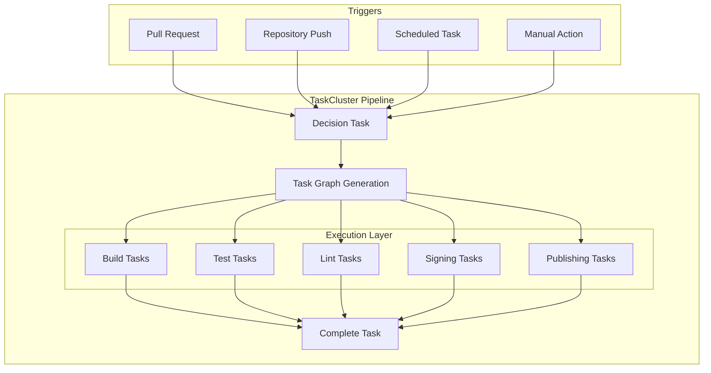
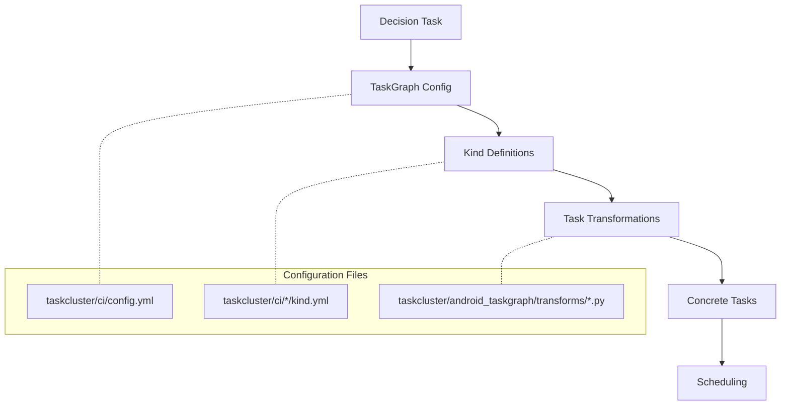
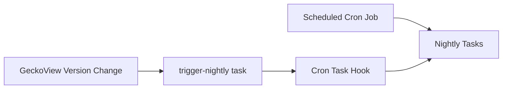
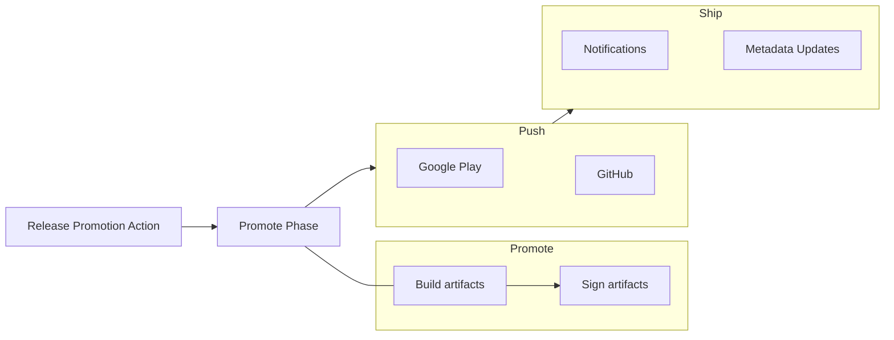
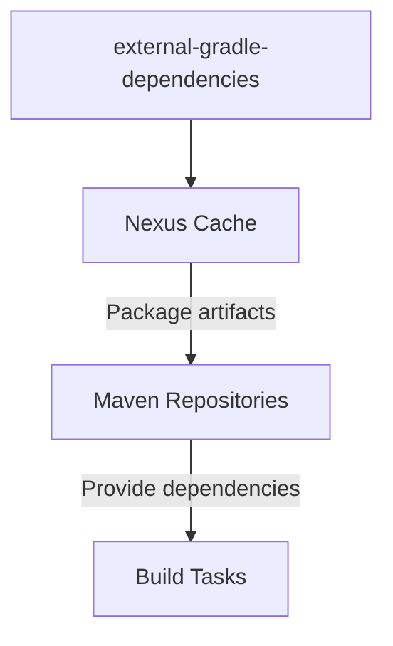
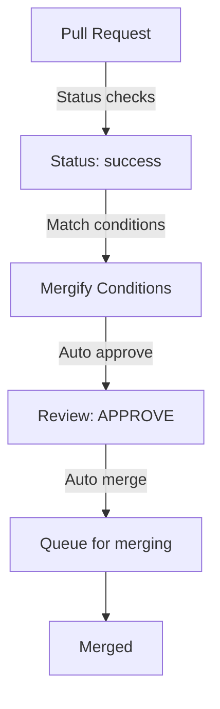

<!-- source: DeepWiki mcp.deepwiki.com · repo mozilla-mobile/firefox-android · page 5.2 CI/CD Pipeline · fetched 2026-10-09 -->

# CI/CD Pipeline

<details>
<summary>Relevant source files</summary>

The following files were used as context for generating this wiki page:

- [.mergify.yml](.mergify.yml)
- [.taskcluster.yml](.taskcluster.yml)
- [android-components/plugins/dependencies/src/main/java/Gecko.kt](android-components/plugins/dependencies/src/main/java/Gecko.kt)
- [android-components/publish.gradle](android-components/publish.gradle)
- [taskcluster/android_taskgraph/__init__.py](taskcluster/android_taskgraph/__init__.py)
- [taskcluster/android_taskgraph/job.py](taskcluster/android_taskgraph/job.py)
- [taskcluster/android_taskgraph/loader/build_config.py](taskcluster/android_taskgraph/loader/build_config.py)
- [taskcluster/android_taskgraph/parameters.py](taskcluster/android_taskgraph/parameters.py)
- [taskcluster/android_taskgraph/release_promotion.py](taskcluster/android_taskgraph/release_promotion.py)
- [taskcluster/android_taskgraph/target_tasks.py](taskcluster/android_taskgraph/target_tasks.py)
- [taskcluster/android_taskgraph/transforms/complete.py](taskcluster/android_taskgraph/transforms/complete.py)
- [taskcluster/ci/build-components/kind.yml](taskcluster/ci/build-components/kind.yml)
- [taskcluster/ci/build-samples-browser/kind.yml](taskcluster/ci/build-samples-browser/kind.yml)
- [taskcluster/ci/complete/kind.yml](taskcluster/ci/complete/kind.yml)
- [taskcluster/ci/config.yml](taskcluster/ci/config.yml)
- [taskcluster/ci/docker-image/kind.yml](taskcluster/ci/docker-image/kind.yml)
- [taskcluster/ci/lint/kind.yml](taskcluster/ci/lint/kind.yml)
- [taskcluster/ci/test-components/kind.yml](taskcluster/ci/test-components/kind.yml)
- [taskcluster/ci/toolchain/android.yml](taskcluster/ci/toolchain/android.yml)
- [taskcluster/ci/trigger-nightly/kind.yml](taskcluster/ci/trigger-nightly/kind.yml)
- [taskcluster/requirements.in](taskcluster/requirements.in)
- [taskcluster/requirements.txt](taskcluster/requirements.txt)
- [taskcluster/scripts/are_dependencies_completed.py](taskcluster/scripts/are_dependencies_completed.py)
- [taskcluster/scripts/toolchain/external-gradle-dependencies/after.sh](taskcluster/scripts/toolchain/external-gradle-dependencies/after.sh)
- [taskcluster/test/params/fork-promote-beta.yml](taskcluster/test/params/fork-promote-beta.yml)
- [taskcluster/test/params/main-repo-promote-beta.yml](taskcluster/test/params/main-repo-promote-beta.yml)
- [taskcluster/test/params/main-repo-push-beta.yml](taskcluster/test/params/main-repo-push-beta.yml)
- [version.txt](version.txt)

</details>


## Purpose
This page describes the Continuous Integration and Continuous Deployment (CI/CD) pipeline for the Firefox Android repository. The system uses TaskCluster, Mozilla's task execution framework, to handle automated building, testing, signing, and publishing of Android Components, Fenix, and Focus applications.

For information about the build configuration and dependencies, see [Build Configuration](#5.1) and [Publication Process](#5.3).

## Pipeline Architecture Overview

The CI/CD system is triggered by various events including GitHub pull requests, pushes to main, and scheduled tasks. It generates a directed acyclic graph (DAG) of tasks through a specialized "decision task."



Sources: [.taskcluster.yml:1-350](), [taskcluster/ci/config.yml:1-251](), [taskcluster/ci/complete/kind.yml:1-59]()

## Decision Task and Task Graph Generation

The decision task is the entry point for the pipeline, defined in `.taskcluster.yml`. It:

1. Runs when events are triggered (push, PR, cron)
2. Clones the repository
3. Generates a task graph via `taskgraph decision` command 
4. Schedules the resulting tasks



The task graph is defined by:

- **Kind definitions**: YAML files in `taskcluster/ci/` that define types of tasks
- **Transforms**: Python code that processes task definitions into executable tasks
- **Task dependencies**: Define the execution order of tasks

Sources: [.taskcluster.yml:271-303](), [taskcluster/android_taskgraph/__init__.py:1-37](), [taskcluster/ci/config.yml:174-183]()

## Task Kinds and Their Functions

The Firefox Android repository defines several task kinds:

| Kind | Purpose | Configuration |
|------|---------|--------------|
| `build-components` | Builds Android Components | [taskcluster/ci/build-components/kind.yml:1-142]() |
| `build-samples-browser` | Builds browser samples | [taskcluster/ci/build-samples-browser/kind.yml:1-66]() |
| `build-apk` | Builds application APKs | Referenced in multiple files |
| `test-components` | Runs unit/integration tests | [taskcluster/ci/test-components/kind.yml:1-93]() |
| `lint` | Runs code quality checks | [taskcluster/ci/lint/kind.yml:1-52]() |
| `toolchain` | Prepares build environments | [taskcluster/ci/toolchain/android.yml:1-33]() |
| `docker-image` | Builds Docker images | [taskcluster/ci/docker-image/kind.yml:1-22]() |
| `complete` | Verifies all tasks completed | [taskcluster/ci/complete/kind.yml:1-59]() |

Each kind has specific configurations including:
- Which workers execute them
- What Docker images to use
- What commands to run
- What artifacts to produce
- What triggering conditions apply

Sources: [taskcluster/ci/config.yml:4-162](), [taskcluster/android_taskgraph/loader/build_config.py:1-73]()

## Triggering Mechanisms

The pipeline responds to different triggering events:

### Pull Requests

When a PR is opened or updated, a subset of tasks runs to validate changes:

```yaml
run-on-tasks-for:
    - github-pull-request
    - github-pull-request-untrusted
```

These tasks typically include builds, tests, and linting.

### Branch Pushes

When code is pushed to the repository (especially the main branch), tasks are triggered:

```yaml
run-on-tasks-for: [github-push]
```

### Scheduled Tasks and Nightly Builds

Nightly builds are triggered by either:
- Cron jobs scheduled in TaskCluster
- The `trigger-nightly` task when GeckoView version changes



Sources: [taskcluster/ci/trigger-nightly/kind.yml:1-48](), [taskcluster/android_taskgraph/target_tasks.py:28-47]()

## Release Process

Releases are managed through "release promotion" which has three distinct phases:



Each phase is triggered by a target tasks method:

1. **Promote**: Builds and signs release artifacts
   ```python
   @_target_task("promote")
   def target_tasks_promote(full_task_graph, parameters, graph_config):
   ```

2. **Push**: Publishes artifacts to distribution channels
   ```python
   @_target_task("push")
   def target_tasks_push(full_task_graph, parameters, graph_config):
   ```

3. **Ship**: Finalizes the release process
   ```python
   @_target_task("ship")
   def target_tasks_ship(full_task_graph, parameters, graph_config):
   ```

Sources: [taskcluster/android_taskgraph/release_promotion.py:1-202](), [taskcluster/android_taskgraph/target_tasks.py:58-89](), [taskcluster/ci/config.yml:260-272]()

## Worker Types and Environments

Tasks run on different worker types based on their requirements:

| Worker Type | Description | Used For |
|-------------|-------------|----------|
| `b-android` | Basic Android worker | Simple tasks |
| `b-android-large` | Large Android worker | Build tasks |
| `b-android-xlarge` | Extra large Android worker | Complex builds |
| `signing` | Signing worker | Signing artifacts |
| `beetmover` | File movement worker | Moving artifacts |
| `push-apk` | Google Play publishing | App deployment |
| `github` | GitHub interaction | Release tagging |

Workers run in Docker containers with specific images defined in the task configurations.

Sources: [taskcluster/ci/config.yml:184-256](), [taskcluster/ci/docker-image/kind.yml:1-22]()

## Dependency Management

The system handles external dependencies through specialized tasks:

1. **Fetching dependencies**: The `external-gradle-dependencies` task fetches Maven dependencies
2. **Caching**: Dependencies are cached for reuse across tasks
3. **Maven Repositories**: The system creates local Maven repositories from cached dependencies



Sources: [taskcluster/scripts/toolchain/external-gradle-dependencies/after.sh:1-51](), [taskcluster/android_taskgraph/job.py:100-106]()

## Complete Task

The "complete" task verifies all dependent tasks have completed successfully. It:

1. Fetches its own task definition
2. Extracts the list of dependencies
3. Verifies each dependency is in "completed" state
4. Fails if any dependency didn't complete

This ensures the pipeline status accurately reflects the overall success or failure.

Sources: [taskcluster/ci/complete/kind.yml:1-59](), [taskcluster/scripts/are_dependencies_completed.py:1-60]()

## Automated Version Management

The pipeline handles version changes:

1. GeckoView version is defined in [android-components/plugins/dependencies/src/main/java/Gecko.kt:12]()
2. Version changes can trigger nightly builds
3. Release versions are managed through the release promotion process

Sources: [android-components/plugins/dependencies/src/main/java/Gecko.kt:1-29](), [version.txt:1-2]()

## Mergify Integration

The repository uses Mergify to automate PR merging in specific scenarios:

- Automated GeckoView version updates
- L10n (localization) updates
- Release automation



Sources: [.mergify.yml:1-87]()

## Conclusion

The Firefox Android CI/CD pipeline provides a robust system for automating building, testing, and releasing Android components and applications. It leverages TaskCluster's flexibility to define complex workflows with proper dependency management and execution controls.

For specific information about extending the pipeline or troubleshooting issues, consult the code and comments in the taskcluster directory and Mozilla's TaskCluster documentation.

---

