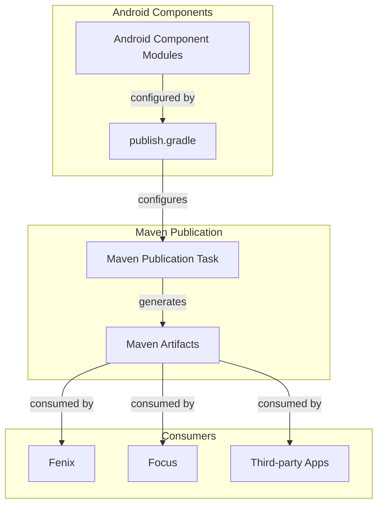
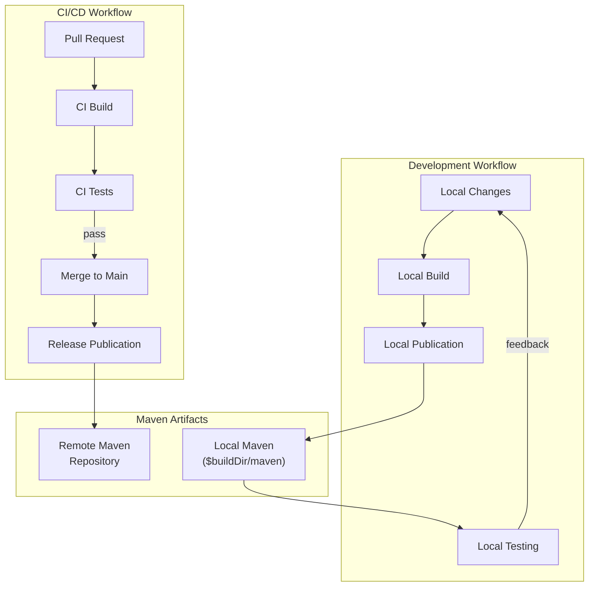
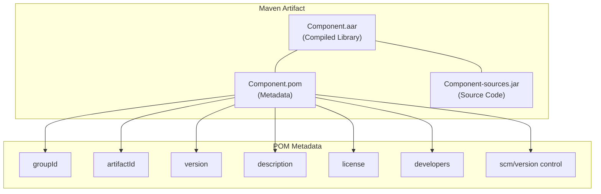
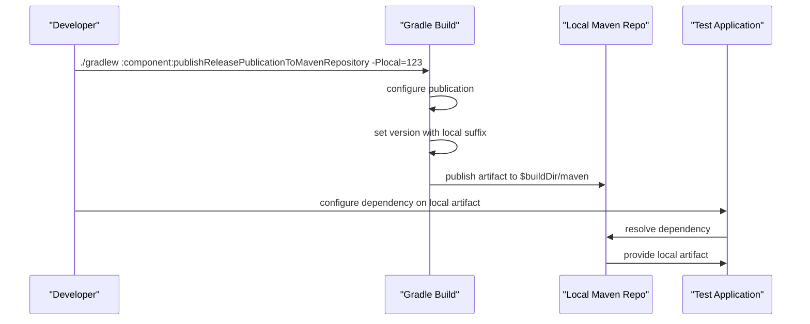
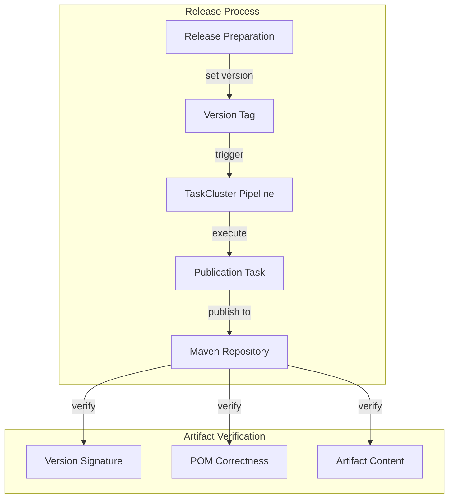

<!-- source: DeepWiki mcp.deepwiki.com · repo mozilla-mobile/firefox-android · page 5.3 Publication Process · fetched 2026-10-09 -->

# Publication Process

<details>
<summary>Relevant source files</summary>

The following files were used as context for generating this wiki page:

- [android-components/publish.gradle](android-components/publish.gradle)

</details>


## Purpose and Scope

This document details how Android Components in the Firefox Android project are published to Maven repositories. It covers the configuration, workflow, and structure of the publication process that makes these components available for consumption by Fenix, Focus, and potentially other applications. For information about the general build configuration, see [Build Configuration](#5.1), and for details about CI/CD pipeline, see [CI/CD Pipeline](#5.2).

## Maven Publication Overview

The Firefox Android project uses the Gradle Maven Publish plugin to publish Android Components as Maven artifacts. These artifacts are then consumed by the main applications (Fenix and Focus) and can also be used by third-party applications.



Sources: [android-components/publish.gradle:1-86]()

## Publication Configuration

The publication process is configured in `publish.gradle`, which defines a reusable Gradle extension function `configurePublish` that can be applied to each Android Component module.

```mermaid
classDiagram
    class "configurePublish()" {
        +groupIdArg: String
        +artifactIdArg: String
        +descriptionArg: String
        +apply maven-publish plugin
        +configure sourcesJar
        +configure publication
    }
    
    class "AndroidComponent" {
        +android{}
        +dependencies{}
        +apply plugin
    }
    
    class "MavenPublication" {
        +groupId
        +artifactId
        +version
        +POM metadata
        +license
        +developers
        +SCM info
    }
    
    "AndroidComponent" ..> "configurePublish()" : calls
    "configurePublish()" --> "MavenPublication" : creates
```

The `configurePublish` extension takes three parameters:
- `groupIdArg`: Maven group ID (typically org.mozilla.components)
- `artifactIdArg`: Maven artifact ID (component name)
- `descriptionArg`: Description of the component

It then configures:
1. Source JAR generation for the component
2. Single variant (release) publishing
3. Maven publication with proper metadata
4. Local Maven repository location

Sources: [android-components/publish.gradle:26-86]()

## Publication Process Workflow

The publication process follows a specific workflow that differs slightly between local development and CI/CD builds.



The publication process handles two main scenarios:
1. **Local publications**: Used during development with a timestamp suffix
2. **Official publications**: Released through the CI/CD pipeline to the Mozilla Maven repository

Sources: [android-components/publish.gradle:11-14](), [android-components/publish.gradle:51-51]()

## Maven Artifact Structure

Each published Android Component consists of several files that make up the Maven artifact:



The version of the artifact is controlled by:
- `config.componentsVersion`: The base version number
- For local publications, a suffix of `-local[timestamp]` can be added

The Maven artifacts include:
1. AAR file containing the compiled component
2. POM file with metadata (dependencies, license, etc.)
3. Sources JAR with the component's source code

Sources: [android-components/publish.gradle:29-32](), [android-components/publish.gradle:46-75]()

## Publication Configuration Details

The `publish.gradle` script handles the following key aspects of publication:

| Configuration Aspect | Description | Source Location |
|----------------------|-------------|----------------|
| Maven Publication Plugin | Applies the plugin to enable Maven publishing | [android-components/publish.gradle:27-27]() |
| Source JAR Creation | Packages source code for easier debugging | [android-components/publish.gradle:29-32]() |
| Single Variant Publishing | Configures only the release variant for publication | [android-components/publish.gradle:34-40]() |
| Artifact Metadata | Configures group, artifact ID, and version | [android-components/publish.gradle:48-51]() |
| POM Configuration | Sets up description, licenses, developers, SCM info | [android-components/publish.gradle:53-75]() |
| Git Hash Integration | Captures the current commit hash for versioning | [android-components/publish.gradle:17-22]() |

Each Android Component module applies this configuration by calling the `configurePublish` function with appropriate parameters.

Sources: [android-components/publish.gradle:26-86]()

## Local Publication Workflow

For development and testing purposes, developers can publish components locally. This creates Maven artifacts in the local build directory that can be referenced by other projects.



The local publication process uses a timestamp or developer-provided suffix to ensure the local version doesn't conflict with official releases. This is controlled by the `-Plocal` property passed to Gradle.

Sources: [android-components/publish.gradle:51-51]()

## CI/CD Publication Process

The CI/CD pipeline handles official publications of Android Components through TaskCluster. When a release is triggered, the components are published to the Mozilla Maven repository.



The CI/CD publication process ensures that components are properly versioned, signed, and published with correct metadata. It integrates with the overall CI/CD pipeline described in the [CI/CD Pipeline](#5.2) section.

Sources: [android-components/publish.gradle:43-85]()

---

