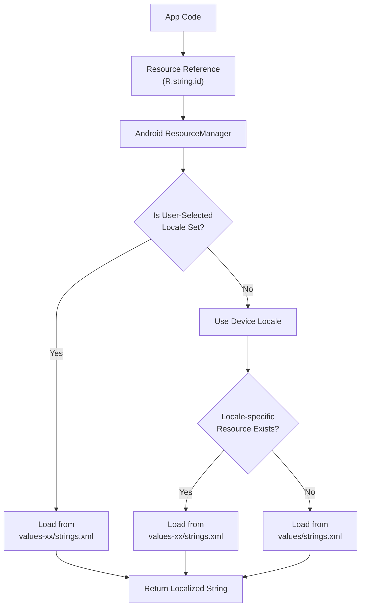
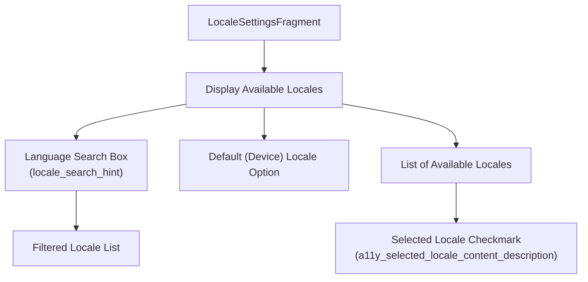
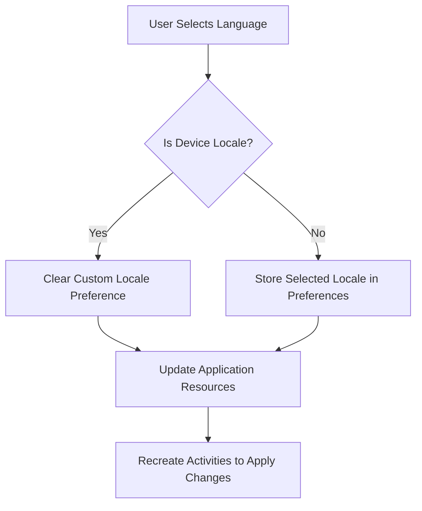
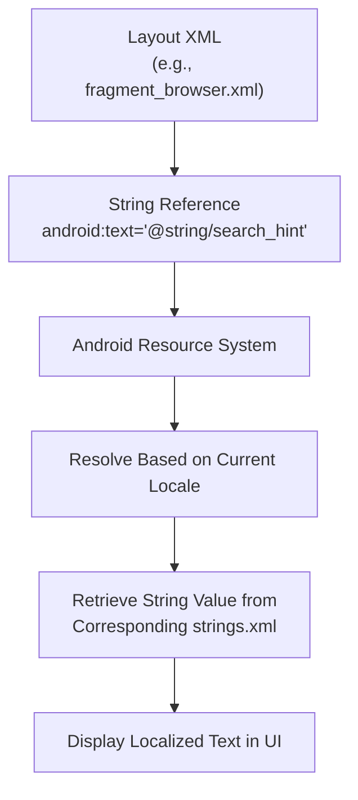

<!-- source: DeepWiki mcp.deepwiki.com · repo mozilla-mobile/firefox-android · page 6 Internationalization and Localization · fetched 2026-10-09 -->

# Internationalization and Localization

<details>
<summary>Relevant source files</summary>

The following files were used as context for generating this wiki page:

- [fenix/app/src/main/res/values-cy/strings.xml](fenix/app/src/main/res/values-cy/strings.xml)
- [fenix/app/src/main/res/values-da/strings.xml](fenix/app/src/main/res/values-da/strings.xml)
- [fenix/app/src/main/res/values-de/strings.xml](fenix/app/src/main/res/values-de/strings.xml)
- [fenix/app/src/main/res/values-dsb/strings.xml](fenix/app/src/main/res/values-dsb/strings.xml)
- [fenix/app/src/main/res/values-el/strings.xml](fenix/app/src/main/res/values-el/strings.xml)
- [fenix/app/src/main/res/values-es-rAR/strings.xml](fenix/app/src/main/res/values-es-rAR/strings.xml)
- [fenix/app/src/main/res/values-es-rCL/strings.xml](fenix/app/src/main/res/values-es-rCL/strings.xml)
- [fenix/app/src/main/res/values-es-rES/strings.xml](fenix/app/src/main/res/values-es-rES/strings.xml)
- [fenix/app/src/main/res/values-es-rMX/strings.xml](fenix/app/src/main/res/values-es-rMX/strings.xml)
- [fenix/app/src/main/res/values-es/strings.xml](fenix/app/src/main/res/values-es/strings.xml)
- [fenix/app/src/main/res/values-fi/strings.xml](fenix/app/src/main/res/values-fi/strings.xml)
- [fenix/app/src/main/res/values-fr/strings.xml](fenix/app/src/main/res/values-fr/strings.xml)
- [fenix/app/src/main/res/values-fy-rNL/strings.xml](fenix/app/src/main/res/values-fy-rNL/strings.xml)
- [fenix/app/src/main/res/values-gn/strings.xml](fenix/app/src/main/res/values-gn/strings.xml)
- [fenix/app/src/main/res/values-hsb/strings.xml](fenix/app/src/main/res/values-hsb/strings.xml)
- [fenix/app/src/main/res/values-hu/strings.xml](fenix/app/src/main/res/values-hu/strings.xml)
- [fenix/app/src/main/res/values-hy-rAM/strings.xml](fenix/app/src/main/res/values-hy-rAM/strings.xml)
- [fenix/app/src/main/res/values-ia/strings.xml](fenix/app/src/main/res/values-ia/strings.xml)
- [fenix/app/src/main/res/values-it/strings.xml](fenix/app/src/main/res/values-it/strings.xml)
- [fenix/app/src/main/res/values-iw/strings.xml](fenix/app/src/main/res/values-iw/strings.xml)
- [fenix/app/src/main/res/values-ja/strings.xml](fenix/app/src/main/res/values-ja/strings.xml)
- [fenix/app/src/main/res/values-kab/strings.xml](fenix/app/src/main/res/values-kab/strings.xml)
- [fenix/app/src/main/res/values-kk/strings.xml](fenix/app/src/main/res/values-kk/strings.xml)
- [fenix/app/src/main/res/values-ko/strings.xml](fenix/app/src/main/res/values-ko/strings.xml)
- [fenix/app/src/main/res/values-lo/strings.xml](fenix/app/src/main/res/values-lo/strings.xml)
- [fenix/app/src/main/res/values-nl/strings.xml](fenix/app/src/main/res/values-nl/strings.xml)
- [fenix/app/src/main/res/values-nn-rNO/strings.xml](fenix/app/src/main/res/values-nn-rNO/strings.xml)
- [fenix/app/src/main/res/values-oc/strings.xml](fenix/app/src/main/res/values-oc/strings.xml)
- [fenix/app/src/main/res/values-pa-rIN/strings.xml](fenix/app/src/main/res/values-pa-rIN/strings.xml)
- [fenix/app/src/main/res/values-pl/strings.xml](fenix/app/src/main/res/values-pl/strings.xml)
- [fenix/app/src/main/res/values-pt-rBR/strings.xml](fenix/app/src/main/res/values-pt-rBR/strings.xml)
- [fenix/app/src/main/res/values-pt-rPT/strings.xml](fenix/app/src/main/res/values-pt-rPT/strings.xml)
- [fenix/app/src/main/res/values-ru/strings.xml](fenix/app/src/main/res/values-ru/strings.xml)
- [fenix/app/src/main/res/values-sk/strings.xml](fenix/app/src/main/res/values-sk/strings.xml)
- [fenix/app/src/main/res/values-skr/strings.xml](fenix/app/src/main/res/values-skr/strings.xml)
- [fenix/app/src/main/res/values-sl/strings.xml](fenix/app/src/main/res/values-sl/strings.xml)
- [fenix/app/src/main/res/values-su/strings.xml](fenix/app/src/main/res/values-su/strings.xml)
- [fenix/app/src/main/res/values-sv-rSE/strings.xml](fenix/app/src/main/res/values-sv-rSE/strings.xml)
- [fenix/app/src/main/res/values-tg/strings.xml](fenix/app/src/main/res/values-tg/strings.xml)
- [fenix/app/src/main/res/values-th/strings.xml](fenix/app/src/main/res/values-th/strings.xml)
- [fenix/app/src/main/res/values-tr/strings.xml](fenix/app/src/main/res/values-tr/strings.xml)
- [fenix/app/src/main/res/values-uk/strings.xml](fenix/app/src/main/res/values-uk/strings.xml)
- [fenix/app/src/main/res/values-vi/strings.xml](fenix/app/src/main/res/values-vi/strings.xml)
- [fenix/app/src/main/res/values-zh-rCN/strings.xml](fenix/app/src/main/res/values-zh-rCN/strings.xml)
- [fenix/app/src/main/res/values-zh-rTW/strings.xml](fenix/app/src/main/res/values-zh-rTW/strings.xml)
- [focus-android/app/src/main/res/values-cs/strings.xml](focus-android/app/src/main/res/values-cs/strings.xml)
- [focus-android/app/src/main/res/values-cy/strings.xml](focus-android/app/src/main/res/values-cy/strings.xml)
- [focus-android/app/src/main/res/values-de/strings.xml](focus-android/app/src/main/res/values-de/strings.xml)
- [focus-android/app/src/main/res/values-dsb/strings.xml](focus-android/app/src/main/res/values-dsb/strings.xml)
- [focus-android/app/src/main/res/values-el/strings.xml](focus-android/app/src/main/res/values-el/strings.xml)
- [focus-android/app/src/main/res/values-es-rAR/strings.xml](focus-android/app/src/main/res/values-es-rAR/strings.xml)
- [focus-android/app/src/main/res/values-es-rCL/strings.xml](focus-android/app/src/main/res/values-es-rCL/strings.xml)
- [focus-android/app/src/main/res/values-es-rES/strings.xml](focus-android/app/src/main/res/values-es-rES/strings.xml)
- [focus-android/app/src/main/res/values-es-rMX/strings.xml](focus-android/app/src/main/res/values-es-rMX/strings.xml)
- [focus-android/app/src/main/res/values-fi/strings.xml](focus-android/app/src/main/res/values-fi/strings.xml)
- [focus-android/app/src/main/res/values-fr/strings.xml](focus-android/app/src/main/res/values-fr/strings.xml)
- [focus-android/app/src/main/res/values-fy-rNL/strings.xml](focus-android/app/src/main/res/values-fy-rNL/strings.xml)
- [focus-android/app/src/main/res/values-hsb/strings.xml](focus-android/app/src/main/res/values-hsb/strings.xml)
- [focus-android/app/src/main/res/values-hu/strings.xml](focus-android/app/src/main/res/values-hu/strings.xml)
- [focus-android/app/src/main/res/values-ia/strings.xml](focus-android/app/src/main/res/values-ia/strings.xml)
- [focus-android/app/src/main/res/values-in/strings.xml](focus-android/app/src/main/res/values-in/strings.xml)
- [focus-android/app/src/main/res/values-it/strings.xml](focus-android/app/src/main/res/values-it/strings.xml)
- [focus-android/app/src/main/res/values-iw/strings.xml](focus-android/app/src/main/res/values-iw/strings.xml)
- [focus-android/app/src/main/res/values-ja/strings.xml](focus-android/app/src/main/res/values-ja/strings.xml)
- [focus-android/app/src/main/res/values-ka/strings.xml](focus-android/app/src/main/res/values-ka/strings.xml)
- [focus-android/app/src/main/res/values-kab/strings.xml](focus-android/app/src/main/res/values-kab/strings.xml)
- [focus-android/app/src/main/res/values-nb-rNO/strings.xml](focus-android/app/src/main/res/values-nb-rNO/strings.xml)
- [focus-android/app/src/main/res/values-nl/strings.xml](focus-android/app/src/main/res/values-nl/strings.xml)
- [focus-android/app/src/main/res/values-nn-rNO/strings.xml](focus-android/app/src/main/res/values-nn-rNO/strings.xml)
- [focus-android/app/src/main/res/values-pl/strings.xml](focus-android/app/src/main/res/values-pl/strings.xml)
- [focus-android/app/src/main/res/values-pt-rBR/strings.xml](focus-android/app/src/main/res/values-pt-rBR/strings.xml)
- [focus-android/app/src/main/res/values-ru/strings.xml](focus-android/app/src/main/res/values-ru/strings.xml)
- [focus-android/app/src/main/res/values-sk/strings.xml](focus-android/app/src/main/res/values-sk/strings.xml)
- [focus-android/app/src/main/res/values-sl/strings.xml](focus-android/app/src/main/res/values-sl/strings.xml)
- [focus-android/app/src/main/res/values-sv-rSE/strings.xml](focus-android/app/src/main/res/values-sv-rSE/strings.xml)
- [focus-android/app/src/main/res/values-th/strings.xml](focus-android/app/src/main/res/values-th/strings.xml)
- [focus-android/app/src/main/res/values-tr/strings.xml](focus-android/app/src/main/res/values-tr/strings.xml)
- [focus-android/app/src/main/res/values-uk/strings.xml](focus-android/app/src/main/res/values-uk/strings.xml)
- [focus-android/app/src/main/res/values-vi/strings.xml](focus-android/app/src/main/res/values-vi/strings.xml)
- [focus-android/app/src/main/res/values-zh-rCN/strings.xml](focus-android/app/src/main/res/values-zh-rCN/strings.xml)
- [focus-android/app/src/main/res/values-zh-rTW/strings.xml](focus-android/app/src/main/res/values-zh-rTW/strings.xml)

</details>


## Purpose and Scope
This page documents the internationalization (i18n) and localization (L10n) architecture in the Firefox for Android codebase. It covers how string resources are organized, managed, and presented to users in their preferred language, as well as how the app handles locale selection and switching between languages.

## Resource Structure

Firefox for Android follows Android's resource localization system, where string resources are organized in language-specific folders.

### Resource File Organization

String resources are organized following Android's locale-specific folder naming convention:

| Folder Name | Description | Example |
|-------------|-------------|---------|
| `values/` | Default strings (English) | `strings.xml` |
| `values-XX/` | Language-specific strings | `values-fr/strings.xml` (French) |
| `values-XX-rYY/` | Region-specific language strings | `values-zh-rCN/strings.xml` (Chinese-China) |

### Resource Resolution Flow

The following diagram illustrates how string resources are resolved based on the user's locale settings:



Sources:
- [fenix/app/src/main/res/values-zh-rCN/strings.xml]()
- [fenix/app/src/main/res/values-sl/strings.xml]()
- [fenix/app/src/main/res/values-nn-rNO/strings.xml]()

## String Management

Strings in Firefox for Android are defined in XML files with unique identifiers, allowing the app to reference the appropriate translated string based on the user's locale.

### String Definition

Strings are defined in `strings.xml` files with comments describing their purpose:

```xml
<!-- Placeholder text shown in the search bar before a user enters text -->
<string name="search_hint">搜索或输入网址</string>
```

These strings are referenced in code and layouts using `R.string.search_hint`.

### String Parameters

Many strings include format specifiers for dynamic content:

```xml
<!-- App name for private browsing mode -->
<string name="app_name_private_5">私密 %s</string>
```

When displayed, the `%s` is replaced with the app name, allowing for grammatically correct translations in different languages.

### String Lifecycle Management

Firefox for Android uses special attributes to manage string lifecycle:

```xml
<string name="onboarding_home_enable_notifications_title" 
        moz:removedIn="124" 
        tools:ignore="UnusedResources">允许通知可以让 %s 更贴心好用</string>
```

- `moz:removedIn="124"` indicates the version where this string will be removed
- `tools:ignore="UnusedResources"` prevents build warnings for strings not currently referenced

Sources:
- [fenix/app/src/main/res/values-zh-rCN/strings.xml:17-19]()
- [fenix/app/src/main/res/values-zh-rCN/strings.xml:5-8]()
- [fenix/app/src/main/res/values-zh-rCN/strings.xml:337-343]()

## Locale Selection

Firefox for Android provides a custom locale selection interface that allows users to choose a language independent of their device settings.

### Locale Settings Fragment

The UI for selecting locales is implemented through a dedicated fragment which displays available languages and provides search functionality:



Sources:
- [fenix/app/src/main/res/values-zh-rCN/strings.xml:269-275]()
- [fenix/app/src/main/res/values-sl/strings.xml:263-269]()
- [fenix/app/src/main/res/values-nn-rNO/strings.xml:262-268]()

### Locale Selection Process

When a user selects a new locale, the app follows this process:



The relevant strings for this interface include:

```xml
<!-- Content description for tick mark on selected language -->
<string name="a11y_selected_locale_content_description">选择的语言</string>
<!-- Text for default locale item -->
<string name="default_locale_text">依照设备语言显示 (ISO 3166/639)</string>
<!-- Placeholder text shown in the search bar before a user enters text -->
<string name="locale_search_hint">搜索语言</string>
```

Sources:
- [fenix/app/src/main/res/values-zh-rCN/strings.xml:269-275]()
- [fenix/app/src/main/res/values-tr/strings.xml:263-269]()

## String Reference Usage in UI

When a UI component needs to display text, it references a string ID that is resolved to the appropriate localized text at runtime:



This ensures that all text in the UI is displayed in the user's preferred language.

Sources:
- [fenix/app/src/main/res/values-zh-rCN/strings.xml:255-257]()
- [fenix/app/src/main/res/values-sl/strings.xml:255-257]()

## Advanced Localization Features

Firefox for Android implements several advanced localization features to ensure a proper experience across languages.

### Translation Features

The app includes a browser page translation feature with appropriate UI strings:

```xml
<!-- Content description for the translate page toolbar button -->
<string name="browser_toolbar_translate">翻译页面</string>

<!-- Content description for the translate page toolbar button when page is translated -->
<string name="browser_toolbar_translated_successfully">已将页面从%1$s翻译成%2$s｡</string>
```

This allows users to translate web content while maintaining the app's interface in their preferred language.

### RTL Language Support

The codebase includes proper support for Right-to-Left (RTL) languages like Arabic and Hebrew, ensuring that the UI layout automatically adjusts for these languages.

### Handling Cultural Differences

The localization system takes into account cultural differences and sensitivities by allowing translators to adapt content appropriately for different regions and languages.

Sources:
- [fenix/app/src/main/res/values-zh-rCN/strings.xml:255-267]()
- [fenix/app/src/main/res/values-tr/strings.xml:252-261]()

## Tables of Supported Languages

Firefox for Android supports a wide range of languages, as evidenced by the various locale-specific resource folders in the codebase:

| Language | Locale Folder | Example Resource |
|----------|---------------|------------------|
| Chinese (Simplified) | values-zh-rCN | [strings.xml](fenix/app/src/main/res/values-zh-rCN/strings.xml) |
| Slovenian | values-sl | [strings.xml](fenix/app/src/main/res/values-sl/strings.xml) |
| Norwegian Nynorsk | values-nn-rNO | [strings.xml](fenix/app/src/main/res/values-nn-rNO/strings.xml) |
| Turkish | values-tr | [strings.xml](fenix/app/src/main/res/values-tr/strings.xml) |
| Tajik | values-tg | [strings.xml](fenix/app/src/main/res/values-tg/strings.xml) |
| Guarani | values-gn | [strings.xml](fenix/app/src/main/res/values-gn/strings.xml) |
| Occitan | values-oc | [strings.xml](fenix/app/src/main/res/values-oc/strings.xml) |
| French | values-fr | [strings.xml](fenix/app/src/main/res/values-fr/strings.xml) |

Sources:
- All provided `strings.xml` files in various locale folders

## Conclusion

Firefox for Android employs a comprehensive internationalization and localization system built on Android's resource framework. The system allows for efficient management of translated strings, user-selectable locales independent of device settings, and proper handling of cultural and linguistic differences.

The codebase's organization of string resources in locale-specific folders, along with proper string ID management and documentation, facilitates the maintenance and expansion of language support, ensuring that Firefox for Android remains accessible to users worldwide.

---

