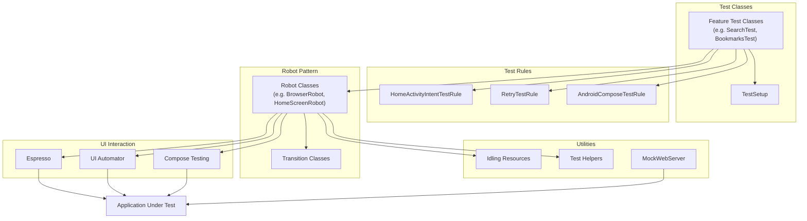
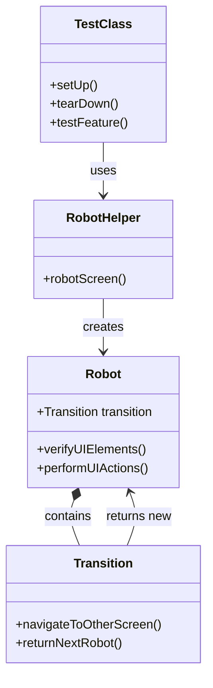
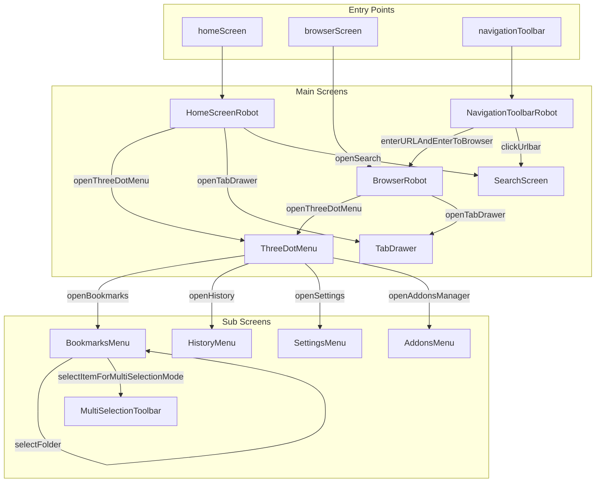
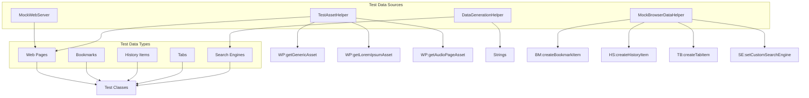
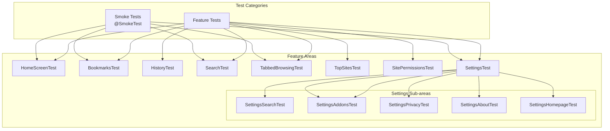

<!-- source: DeepWiki mcp.deepwiki.com · repo mozilla-mobile/firefox-android · page 7 Testing Architecture · fetched 2026-10-09 -->

# Testing Architecture

<details>
<summary>Relevant source files</summary>

The following files were used as context for generating this wiki page:

- [fenix/app/src/androidTest/java/org/mozilla/fenix/helpers/TestHelper.kt](fenix/app/src/androidTest/java/org/mozilla/fenix/helpers/TestHelper.kt)
- [fenix/app/src/androidTest/java/org/mozilla/fenix/screenshots/DefaultHomeScreenTest.kt](fenix/app/src/androidTest/java/org/mozilla/fenix/screenshots/DefaultHomeScreenTest.kt)
- [fenix/app/src/androidTest/java/org/mozilla/fenix/screenshots/MenuScreenShotTest.kt](fenix/app/src/androidTest/java/org/mozilla/fenix/screenshots/MenuScreenShotTest.kt)
- [fenix/app/src/androidTest/java/org/mozilla/fenix/ui/BookmarksTest.kt](fenix/app/src/androidTest/java/org/mozilla/fenix/ui/BookmarksTest.kt)
- [fenix/app/src/androidTest/java/org/mozilla/fenix/ui/ComposeBookmarksTest.kt](fenix/app/src/androidTest/java/org/mozilla/fenix/ui/ComposeBookmarksTest.kt)
- [fenix/app/src/androidTest/java/org/mozilla/fenix/ui/ComposeCollectionTest.kt](fenix/app/src/androidTest/java/org/mozilla/fenix/ui/ComposeCollectionTest.kt)
- [fenix/app/src/androidTest/java/org/mozilla/fenix/ui/ComposeContextMenusTest.kt](fenix/app/src/androidTest/java/org/mozilla/fenix/ui/ComposeContextMenusTest.kt)
- [fenix/app/src/androidTest/java/org/mozilla/fenix/ui/ComposeHistoryTest.kt](fenix/app/src/androidTest/java/org/mozilla/fenix/ui/ComposeHistoryTest.kt)
- [fenix/app/src/androidTest/java/org/mozilla/fenix/ui/ComposeHomeScreenTest.kt](fenix/app/src/androidTest/java/org/mozilla/fenix/ui/ComposeHomeScreenTest.kt)
- [fenix/app/src/androidTest/java/org/mozilla/fenix/ui/ComposeMediaNotificationTest.kt](fenix/app/src/androidTest/java/org/mozilla/fenix/ui/ComposeMediaNotificationTest.kt)
- [fenix/app/src/androidTest/java/org/mozilla/fenix/ui/ComposeNavigationToolbarTest.kt](fenix/app/src/androidTest/java/org/mozilla/fenix/ui/ComposeNavigationToolbarTest.kt)
- [fenix/app/src/androidTest/java/org/mozilla/fenix/ui/ComposeSearchTest.kt](fenix/app/src/androidTest/java/org/mozilla/fenix/ui/ComposeSearchTest.kt)
- [fenix/app/src/androidTest/java/org/mozilla/fenix/ui/ComposeSettingsDeleteBrowsingDataOnQuitTest.kt](fenix/app/src/androidTest/java/org/mozilla/fenix/ui/ComposeSettingsDeleteBrowsingDataOnQuitTest.kt)
- [fenix/app/src/androidTest/java/org/mozilla/fenix/ui/ComposeSettingsDeleteBrowsingDataTest.kt](fenix/app/src/androidTest/java/org/mozilla/fenix/ui/ComposeSettingsDeleteBrowsingDataTest.kt)
- [fenix/app/src/androidTest/java/org/mozilla/fenix/ui/ComposeTabbedBrowsingTest.kt](fenix/app/src/androidTest/java/org/mozilla/fenix/ui/ComposeTabbedBrowsingTest.kt)
- [fenix/app/src/androidTest/java/org/mozilla/fenix/ui/ComposeTopSitesTest.kt](fenix/app/src/androidTest/java/org/mozilla/fenix/ui/ComposeTopSitesTest.kt)
- [fenix/app/src/androidTest/java/org/mozilla/fenix/ui/HistoryTest.kt](fenix/app/src/androidTest/java/org/mozilla/fenix/ui/HistoryTest.kt)
- [fenix/app/src/androidTest/java/org/mozilla/fenix/ui/HomeScreenTest.kt](fenix/app/src/androidTest/java/org/mozilla/fenix/ui/HomeScreenTest.kt)
- [fenix/app/src/androidTest/java/org/mozilla/fenix/ui/OnboardingTest.kt](fenix/app/src/androidTest/java/org/mozilla/fenix/ui/OnboardingTest.kt)
- [fenix/app/src/androidTest/java/org/mozilla/fenix/ui/ReaderViewTest.kt](fenix/app/src/androidTest/java/org/mozilla/fenix/ui/ReaderViewTest.kt)
- [fenix/app/src/androidTest/java/org/mozilla/fenix/ui/SearchTest.kt](fenix/app/src/androidTest/java/org/mozilla/fenix/ui/SearchTest.kt)
- [fenix/app/src/androidTest/java/org/mozilla/fenix/ui/SettingsAboutTest.kt](fenix/app/src/androidTest/java/org/mozilla/fenix/ui/SettingsAboutTest.kt)
- [fenix/app/src/androidTest/java/org/mozilla/fenix/ui/SettingsAddonsTest.kt](fenix/app/src/androidTest/java/org/mozilla/fenix/ui/SettingsAddonsTest.kt)
- [fenix/app/src/androidTest/java/org/mozilla/fenix/ui/SettingsAdvancedTest.kt](fenix/app/src/androidTest/java/org/mozilla/fenix/ui/SettingsAdvancedTest.kt)
- [fenix/app/src/androidTest/java/org/mozilla/fenix/ui/SettingsCustomizeTest.kt](fenix/app/src/androidTest/java/org/mozilla/fenix/ui/SettingsCustomizeTest.kt)
- [fenix/app/src/androidTest/java/org/mozilla/fenix/ui/SettingsDeleteBrowsingDataOnQuitTest.kt](fenix/app/src/androidTest/java/org/mozilla/fenix/ui/SettingsDeleteBrowsingDataOnQuitTest.kt)
- [fenix/app/src/androidTest/java/org/mozilla/fenix/ui/SettingsDeleteBrowsingDataTest.kt](fenix/app/src/androidTest/java/org/mozilla/fenix/ui/SettingsDeleteBrowsingDataTest.kt)
- [fenix/app/src/androidTest/java/org/mozilla/fenix/ui/SettingsGeneralTest.kt](fenix/app/src/androidTest/java/org/mozilla/fenix/ui/SettingsGeneralTest.kt)
- [fenix/app/src/androidTest/java/org/mozilla/fenix/ui/SettingsHTTPSOnlyModeTest.kt](fenix/app/src/androidTest/java/org/mozilla/fenix/ui/SettingsHTTPSOnlyModeTest.kt)
- [fenix/app/src/androidTest/java/org/mozilla/fenix/ui/SettingsHomepageTest.kt](fenix/app/src/androidTest/java/org/mozilla/fenix/ui/SettingsHomepageTest.kt)
- [fenix/app/src/androidTest/java/org/mozilla/fenix/ui/SettingsPrivacyTest.kt](fenix/app/src/androidTest/java/org/mozilla/fenix/ui/SettingsPrivacyTest.kt)
- [fenix/app/src/androidTest/java/org/mozilla/fenix/ui/SettingsPrivateBrowsingTest.kt](fenix/app/src/androidTest/java/org/mozilla/fenix/ui/SettingsPrivateBrowsingTest.kt)
- [fenix/app/src/androidTest/java/org/mozilla/fenix/ui/SettingsSearchTest.kt](fenix/app/src/androidTest/java/org/mozilla/fenix/ui/SettingsSearchTest.kt)
- [fenix/app/src/androidTest/java/org/mozilla/fenix/ui/SettingsSitePermissionsTest.kt](fenix/app/src/androidTest/java/org/mozilla/fenix/ui/SettingsSitePermissionsTest.kt)
- [fenix/app/src/androidTest/java/org/mozilla/fenix/ui/SitePermissionsTest.kt](fenix/app/src/androidTest/java/org/mozilla/fenix/ui/SitePermissionsTest.kt)
- [fenix/app/src/androidTest/java/org/mozilla/fenix/ui/TabbedBrowsingTest.kt](fenix/app/src/androidTest/java/org/mozilla/fenix/ui/TabbedBrowsingTest.kt)
- [fenix/app/src/androidTest/java/org/mozilla/fenix/ui/TopSitesTest.kt](fenix/app/src/androidTest/java/org/mozilla/fenix/ui/TopSitesTest.kt)
- [fenix/app/src/androidTest/java/org/mozilla/fenix/ui/robots/BookmarksRobot.kt](fenix/app/src/androidTest/java/org/mozilla/fenix/ui/robots/BookmarksRobot.kt)
- [fenix/app/src/androidTest/java/org/mozilla/fenix/ui/robots/BrowserRobot.kt](fenix/app/src/androidTest/java/org/mozilla/fenix/ui/robots/BrowserRobot.kt)
- [fenix/app/src/androidTest/java/org/mozilla/fenix/ui/robots/ComposeTabDrawerRobot.kt](fenix/app/src/androidTest/java/org/mozilla/fenix/ui/robots/ComposeTabDrawerRobot.kt)
- [fenix/app/src/androidTest/java/org/mozilla/fenix/ui/robots/ComposeTopSitesRobot.kt](fenix/app/src/androidTest/java/org/mozilla/fenix/ui/robots/ComposeTopSitesRobot.kt)
- [fenix/app/src/androidTest/java/org/mozilla/fenix/ui/robots/HistoryRobot.kt](fenix/app/src/androidTest/java/org/mozilla/fenix/ui/robots/HistoryRobot.kt)
- [fenix/app/src/androidTest/java/org/mozilla/fenix/ui/robots/HomeScreenRobot.kt](fenix/app/src/androidTest/java/org/mozilla/fenix/ui/robots/HomeScreenRobot.kt)
- [fenix/app/src/androidTest/java/org/mozilla/fenix/ui/robots/LibrarySubMenusMultipleSelectionToolbarRobot.kt](fenix/app/src/androidTest/java/org/mozilla/fenix/ui/robots/LibrarySubMenusMultipleSelectionToolbarRobot.kt)
- [fenix/app/src/androidTest/java/org/mozilla/fenix/ui/robots/NavigationToolbarRobot.kt](fenix/app/src/androidTest/java/org/mozilla/fenix/ui/robots/NavigationToolbarRobot.kt)
- [fenix/app/src/androidTest/java/org/mozilla/fenix/ui/robots/SearchRobot.kt](fenix/app/src/androidTest/java/org/mozilla/fenix/ui/robots/SearchRobot.kt)
- [fenix/app/src/androidTest/java/org/mozilla/fenix/ui/robots/SettingsRobot.kt](fenix/app/src/androidTest/java/org/mozilla/fenix/ui/robots/SettingsRobot.kt)
- [fenix/app/src/androidTest/java/org/mozilla/fenix/ui/robots/SettingsSubMenuAboutRobot.kt](fenix/app/src/androidTest/java/org/mozilla/fenix/ui/robots/SettingsSubMenuAboutRobot.kt)
- [fenix/app/src/androidTest/java/org/mozilla/fenix/ui/robots/SettingsSubMenuAddonsManagerAddonDetailedMenuRobot.kt](fenix/app/src/androidTest/java/org/mozilla/fenix/ui/robots/SettingsSubMenuAddonsManagerAddonDetailedMenuRobot.kt)
- [fenix/app/src/androidTest/java/org/mozilla/fenix/ui/robots/SettingsSubMenuAddonsManagerRobot.kt](fenix/app/src/androidTest/java/org/mozilla/fenix/ui/robots/SettingsSubMenuAddonsManagerRobot.kt)
- [fenix/app/src/androidTest/java/org/mozilla/fenix/ui/robots/SettingsSubMenuCustomizeRobot.kt](fenix/app/src/androidTest/java/org/mozilla/fenix/ui/robots/SettingsSubMenuCustomizeRobot.kt)
- [fenix/app/src/androidTest/java/org/mozilla/fenix/ui/robots/SettingsSubMenuDeleteBrowsingDataOnQuitRobot.kt](fenix/app/src/androidTest/java/org/mozilla/fenix/ui/robots/SettingsSubMenuDeleteBrowsingDataOnQuitRobot.kt)
- [fenix/app/src/androidTest/java/org/mozilla/fenix/ui/robots/SettingsSubMenuDeleteBrowsingDataRobot.kt](fenix/app/src/androidTest/java/org/mozilla/fenix/ui/robots/SettingsSubMenuDeleteBrowsingDataRobot.kt)
- [fenix/app/src/androidTest/java/org/mozilla/fenix/ui/robots/SettingsSubMenuExperimentsRobot.kt](fenix/app/src/androidTest/java/org/mozilla/fenix/ui/robots/SettingsSubMenuExperimentsRobot.kt)
- [fenix/app/src/androidTest/java/org/mozilla/fenix/ui/robots/SettingsSubMenuHomepageRobot.kt](fenix/app/src/androidTest/java/org/mozilla/fenix/ui/robots/SettingsSubMenuHomepageRobot.kt)
- [fenix/app/src/androidTest/java/org/mozilla/fenix/ui/robots/SettingsSubMenuPrivateBrowsingRobot.kt](fenix/app/src/androidTest/java/org/mozilla/fenix/ui/robots/SettingsSubMenuPrivateBrowsingRobot.kt)
- [fenix/app/src/androidTest/java/org/mozilla/fenix/ui/robots/SettingsSubMenuSearchRobot.kt](fenix/app/src/androidTest/java/org/mozilla/fenix/ui/robots/SettingsSubMenuSearchRobot.kt)
- [fenix/app/src/androidTest/java/org/mozilla/fenix/ui/robots/SettingsSubMenuSetDefaultBrowserRobot.kt](fenix/app/src/androidTest/java/org/mozilla/fenix/ui/robots/SettingsSubMenuSetDefaultBrowserRobot.kt)
- [fenix/app/src/androidTest/java/org/mozilla/fenix/ui/robots/SettingsSubMenuSitePermissionsCommonRobot.kt](fenix/app/src/androidTest/java/org/mozilla/fenix/ui/robots/SettingsSubMenuSitePermissionsCommonRobot.kt)
- [fenix/app/src/androidTest/java/org/mozilla/fenix/ui/robots/SettingsSubMenuSitePermissionsExceptionsRobot.kt](fenix/app/src/androidTest/java/org/mozilla/fenix/ui/robots/SettingsSubMenuSitePermissionsExceptionsRobot.kt)
- [fenix/app/src/androidTest/java/org/mozilla/fenix/ui/robots/SettingsSubMenuSitePermissionsRobot.kt](fenix/app/src/androidTest/java/org/mozilla/fenix/ui/robots/SettingsSubMenuSitePermissionsRobot.kt)
- [fenix/app/src/androidTest/java/org/mozilla/fenix/ui/robots/SettingsTurnOnSyncRobot.kt](fenix/app/src/androidTest/java/org/mozilla/fenix/ui/robots/SettingsTurnOnSyncRobot.kt)
- [fenix/app/src/androidTest/java/org/mozilla/fenix/ui/robots/SitePermissionsRobot.kt](fenix/app/src/androidTest/java/org/mozilla/fenix/ui/robots/SitePermissionsRobot.kt)
- [fenix/app/src/androidTest/java/org/mozilla/fenix/ui/robots/TabDrawerRobot.kt](fenix/app/src/androidTest/java/org/mozilla/fenix/ui/robots/TabDrawerRobot.kt)
- [fenix/app/src/androidTest/java/org/mozilla/fenix/ui/robots/ThreeDotMenuMainRobot.kt](fenix/app/src/androidTest/java/org/mozilla/fenix/ui/robots/ThreeDotMenuMainRobot.kt)
- [fenix/app/src/main/java/org/mozilla/fenix/settings/HomeSettingsFragment.kt](fenix/app/src/main/java/org/mozilla/fenix/settings/HomeSettingsFragment.kt)
- [fenix/app/src/main/res/xml/home_preferences.xml](fenix/app/src/main/res/xml/home_preferences.xml)
- [fenix/app/src/test/java/org/mozilla/fenix/settings/HomeSettingsFragmentTest.kt](fenix/app/src/test/java/org/mozilla/fenix/settings/HomeSettingsFragmentTest.kt)

</details>


This document describes the testing architecture used in the Firefox Android codebase. It explains the frameworks, patterns, and organization of automated tests, with a focus on UI testing. For information about running tests locally, see [Running Tests](#6).

## Overview

Firefox Android uses a comprehensive testing approach that combines multiple testing frameworks and patterns to ensure app quality. The codebase primarily uses a Robot Pattern for UI testing, which provides clear separation between test logic and UI interaction details.

The testing architecture uses the following key components:
- JUnit 4 as the base testing framework
- Espresso for Android UI testing
- UI Automator for system-level interactions
- Jetpack Compose testing for Compose UI elements
- MockWebServer for mocking network requests
- Custom test rules and utilities

Sources:
- [fenix/app/src/androidTest/java/org/mozilla/fenix/ui/HomeScreenTest.kt:1-183]()
- [fenix/app/src/androidTest/java/org/mozilla/fenix/ui/SearchTest.kt:1-574]()

## Test Framework Architecture

The Android test architecture is structured into several layers, with different responsibilities:



The diagram shows how test classes use rules, robots, and utilities to interact with the application. The Robot Pattern is central to this architecture, providing an abstraction layer for UI interactions.

Sources:
- [fenix/app/src/androidTest/java/org/mozilla/fenix/ui/robots/BrowserRobot.kt:1-2094]()
- [fenix/app/src/androidTest/java/org/mozilla/fenix/ui/robots/HomeScreenRobot.kt:1-1113]()
- [fenix/app/src/androidTest/java/org/mozilla/fenix/helpers/TestHelper.kt:1-186]()

## Robot Pattern Implementation

The Firefox Android codebase uses the Robot Pattern extensively to organize UI tests. This pattern abstracts UI interactions into "robot" classes, each representing a specific screen or component in the app.



Each Robot class typically contains:
1. Methods to verify UI elements are displayed correctly
2. Methods to interact with UI elements (click, type, swipe)
3. A nested Transition class that handles navigation to other screens
4. Helper functions to create a fluent API for tests

Example usage in a test:

```kotlin
@Test
fun bookmarkPageTest() {
    homeScreen {
    }.openThreeDotMenu {
    }.openBookmarks {
        verifyBookmarksMenuView()
    }.clickAddFolderButton {
        addNewFolderName("Test Folder")
        saveNewFolder()
    }
}
```

This approach makes tests readable, maintainable, and resistant to UI implementation changes.

Sources:
- [fenix/app/src/androidTest/java/org/mozilla/fenix/ui/robots/BrowserRobot.kt:67-813]()
- [fenix/app/src/androidTest/java/org/mozilla/fenix/ui/robots/SearchRobot.kt:61-467]()
- [fenix/app/src/androidTest/java/org/mozilla/fenix/ui/BookmarksTest.kt:40-364]()

## Robot Hierarchy and Navigation

The robots mirror the app's navigation structure, with transitions between robots representing navigation between screens.



This diagram shows how robots connect to each other via transition methods, reflecting the app's navigation paths.

Sources:
- [fenix/app/src/androidTest/java/org/mozilla/fenix/ui/robots/HomeScreenRobot.kt:81-1113]()
- [fenix/app/src/androidTest/java/org/mozilla/fenix/ui/robots/ThreeDotMenuMainRobot.kt:53-764]()
- [fenix/app/src/androidTest/java/org/mozilla/fenix/ui/robots/TabDrawerRobot.kt:66-863]()

## Test Synchronization Methods

Proper test synchronization is critical for reliable UI tests. Firefox Android uses several approaches to synchronize tests with the application:

| Synchronization Method | Description | Used In |
|------------------------|-------------|---------|
| Idling Resources | Custom implementations that track when the app is "idle" | SessionLoadedIdlingResource, RecyclerViewIdlingResource |
| Explicit Waits | Specific waiting methods with timeouts | waitForPageToLoad(), mDevice.wait() |
| Retrying Actions | Retry mechanisms for flaky interactions | RetryTestRule, retry loops in robots |
| UI Automator waits | Platform waits for UI elements | waitForExists(), waitUntilGone() |

The codebase includes a common pattern for reliable UI interactions with retry logic:

```kotlin
for (i in 1..RETRY_COUNT) {
    try {
        // UI interaction or verification
        break
    } catch (e: AssertionError) {
        if (i == RETRY_COUNT) {
            throw e
        } else {
            // Fallback or recovery action
        }
    }
}
```

This pattern helps handle timing-related failures in UI tests.

Sources:
- [fenix/app/src/androidTest/java/org/mozilla/fenix/ui/robots/BrowserRobot.kt:108-119]()
- [fenix/app/src/androidTest/java/org/mozilla/fenix/ui/robots/SearchRobot.kt:97-127]()
- [fenix/app/src/androidTest/java/org/mozilla/fenix/helpers/TestHelper.kt:150-157]()

## Test Data and Mocking

Firefox Android tests use several approaches to generate and manage test data:



Key components include:
- MockWebServer for serving test web pages
- TestAssetHelper for creating common test assets
- Helper classes for creating browser data programmatically

Sources:
- [fenix/app/src/androidTest/java/org/mozilla/fenix/ui/SearchTest.kt:65-93]()
- [fenix/app/src/androidTest/java/org/mozilla/fenix/ui/BookmarksTest.kt:42-45]()
- [fenix/app/src/androidTest/java/org/mozilla/fenix/ui/HomeScreenTest.kt:83-96]()

## UI Testing Frameworks Integration

Firefox Android integrates multiple UI testing frameworks to provide comprehensive coverage:

| Framework | Used For | Example Usage |
|-----------|----------|---------------|
| Espresso | View-based UI interactions | onView(withId(R.id.tab_button)).perform(click()) |
| UI Automator | System-level interactions | mDevice.findObject(UiSelector().text("Settings")).click() |
| Compose Testing | Jetpack Compose UI testing | composeTestRule.onNodeWithTag("recent.tab.title").assert(hasText(title)) |

The integration between these frameworks is managed in the Robot classes, which abstract away the implementation details and provide a unified API for tests.

```mermaid
flowchart LR
    subgraph "Test"
        TC["Test Class"]
    end
    
    subgraph "Robot Pattern"
        R["Robot"]
    end
    
    subgraph "UI Testing Frameworks"
        ESP["Espresso"]
        UIA["UI Automator"]
        CMP["Compose Testing"]
    end
    
    TC --> R
    R --> ESP:onView().perform()
    R --> ESP:onView().check()
    R --> UIA:mDevice.findObject()
    R --> UIA:mDevice.wait()
    R --> CMP:composeTestRule.onNodeWithTag()
    R --> CMP:composeTestRule.onNodeWithText()
    
    ESP --> APP["Application\nViews"]
    UIA --> SYS["System UI"]
    CMP --> COM["Compose UI"]
```

The robot pattern allows tests to remain framework-agnostic, enabling the use of the right tool for each testing scenario.

Sources:
- [fenix/app/src/androidTest/java/org/mozilla/fenix/ui/robots/BrowserRobot.kt:20-63]()
- [fenix/app/src/androidTest/java/org/mozilla/fenix/ui/robots/HomeScreenRobot.kt:14-74]()
- [fenix/app/src/androidTest/java/org/mozilla/fenix/ui/robots/ComposeTabDrawerRobot.kt:7-35]()

## Test Categories and Organization

The tests are organized by feature areas and test types:



Each test class typically extends a common `TestSetup` base class that provides shared functionality. Tests are also categorized with annotations like `@SmokeTest` to identify critical test paths.

Sources:
- [fenix/app/src/androidTest/java/org/mozilla/fenix/ui/HomeScreenTest.kt:36-37]()
- [fenix/app/src/androidTest/java/org/mozilla/fenix/ui/BookmarksTest.kt:40-145]()
- [fenix/app/src/androidTest/java/org/mozilla/fenix/ui/SearchTest.kt:181-193]()

## Test Rules

Firefox Android uses custom JUnit rules to set up test environments:

| Rule | Purpose | Features |
|------|---------|----------|
| HomeActivityIntentTestRule | Launch the main activity with specific settings | Skip onboarding, disable features for testing |
| RetryTestRule | Retry flaky tests automatically | Configurable retry count |
| AndroidComposeTestRule | Compose UI testing | Access to ComposeTestRule functionality |

These rules are often combined to provide a comprehensive test environment:

```kotlin
@get:Rule(order = 0)
val activityTestRule = AndroidComposeTestRule(HomeActivityIntentTestRule.withDefaultSettingsOverrides()) { it.activity }

@Rule(order = 1)
@JvmField
val retryTestRule = RetryTestRule(3)
```

Sources:
- [fenix/app/src/androidTest/java/org/mozilla/fenix/ui/HomeScreenTest.kt:28-34]()
- [fenix/app/src/androidTest/java/org/mozilla/fenix/ui/BookmarksTest.kt:47-55]()
- [fenix/app/src/androidTest/java/org/mozilla/fenix/ui/SearchTest.kt:73-84]()

## Logging and Debugging

The codebase implements extensive logging to help diagnose test failures:

```kotlin
Log.i(TAG, "verifyTabButtonShortcutMenuItems: Trying to verify tab counter shortcut options")
onView(withId(R.id.mozac_browser_menu_recyclerView))
    .check(matches(hasDescendant(withText("Close tab"))))
    .check(matches(hasDescendant(withText("New private tab"))))
    .check(matches(hasDescendant(withText("New tab"))))
Log.i(TAG, "verifyTabButtonShortcutMenuItems: Verified tab counter shortcut options")
```

This logging pattern includes:
1. Clear step descriptions with "Trying to..." messages before actions
2. Confirmation messages after successful actions
3. Consistent TAG constant for filtering logs
4. Error handling with informative messages

Sources:
- [fenix/app/src/androidTest/java/org/mozilla/fenix/ui/robots/NavigationToolbarRobot.kt:67-73]()
- [fenix/app/src/androidTest/java/org/mozilla/fenix/ui/robots/BrowserRobot.kt:73-76]()
- [fenix/app/src/androidTest/java/org/mozilla/fenix/helpers/TestHelper.kt:53-61]()

## Best Practices for Writing Tests

Based on the codebase patterns, here are the best practices for writing UI tests:

1. **Use the Robot Pattern**:
   - Create or use existing robot classes for UI interactions
   - Keep test methods focused on business logic, not UI details

2. **Handle Asynchronous Operations**:
   - Use idling resources for waiting on async operations
   - Implement retry logic for potentially flaky interactions

3. **Logging and Diagnostics**:
   - Add detailed logging before and after actions
   - Include clear verification messages

4. **Test Organization**:
   - Group related tests in feature-specific test classes
   - Use `@SmokeTest` for critical tests that should run frequently

5. **Test Data**:
   - Use helper methods to create test data consistently
   - Clean up test data in tearDown methods

Following these practices helps create reliable, maintainable UI tests.

Sources:
- [fenix/app/src/androidTest/java/org/mozilla/fenix/ui/HomeScreenTest.kt:38-182]()
- [fenix/app/src/androidTest/java/org/mozilla/fenix/ui/BookmarksTest.kt:58-180]()
- [fenix/app/src/androidTest/java/org/mozilla/fenix/ui/SearchTest.kt:100-215]()

---

