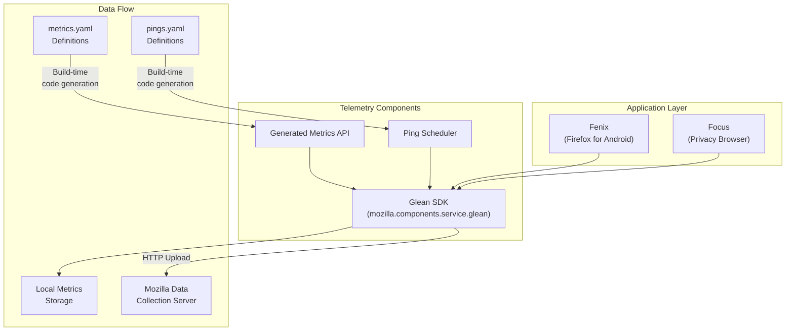
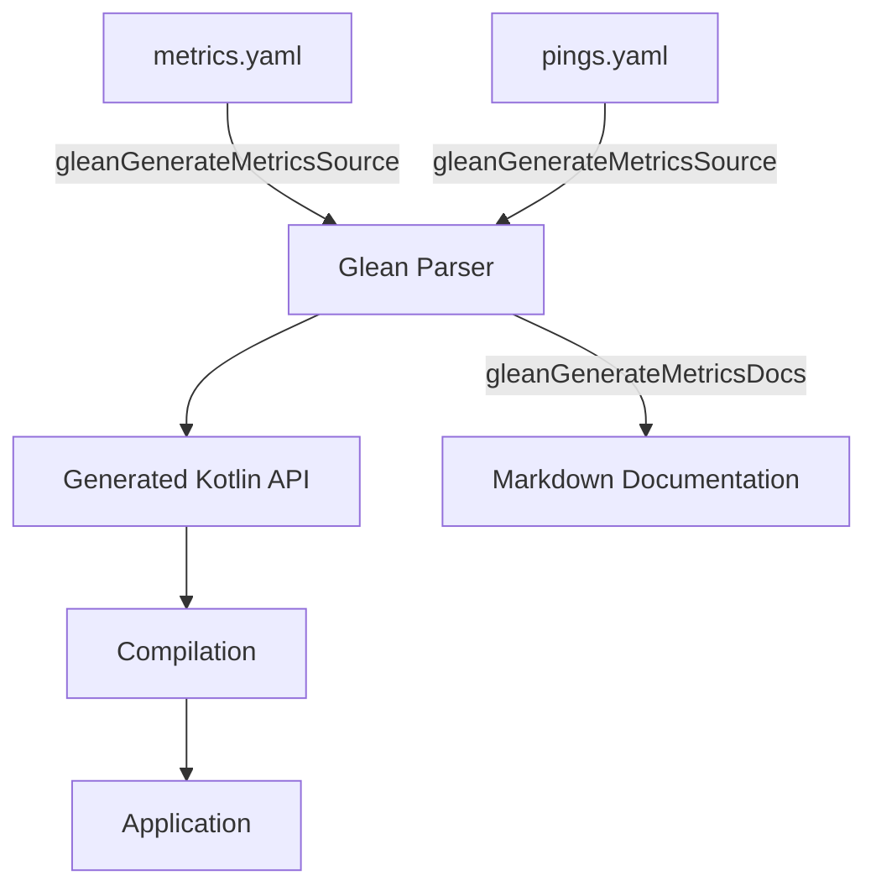
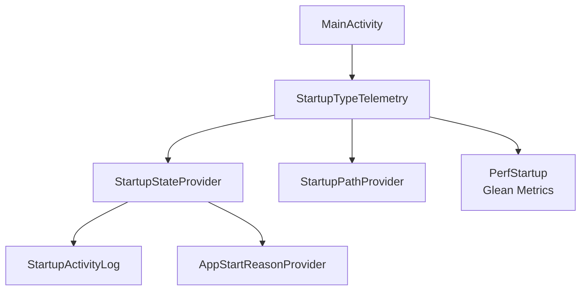

<!-- source: DeepWiki mcp.deepwiki.com · repo mozilla-mobile/firefox-android · page 8 Telemetry and Analytics · fetched 2026-10-09 -->

# Telemetry and Analytics

<details>
<summary>Relevant source files</summary>

The following files were used as context for generating this wiki page:

- [android-components/components/service/glean/README.md](android-components/components/service/glean/README.md)
- [android-components/components/service/glean/build.gradle](android-components/components/service/glean/build.gradle)
- [android-components/components/service/glean/scripts/sdk_generator.gradle](android-components/components/service/glean/scripts/sdk_generator.gradle)
- [android-components/components/service/glean/src/main/java/mozilla/components/service/glean/Glean.kt](android-components/components/service/glean/src/main/java/mozilla/components/service/glean/Glean.kt)
- [android-components/components/service/glean/src/main/java/mozilla/components/service/glean/config/Configuration.kt](android-components/components/service/glean/src/main/java/mozilla/components/service/glean/config/Configuration.kt)
- [android-components/components/service/glean/src/main/java/mozilla/components/service/glean/testing/GleanTestRule.kt](android-components/components/service/glean/src/main/java/mozilla/components/service/glean/testing/GleanTestRule.kt)
- [android-components/components/service/glean/src/test/java/mozilla/components/service/glean/GleanFromJavaTest.java](android-components/components/service/glean/src/test/java/mozilla/components/service/glean/GleanFromJavaTest.java)
- [android-components/components/service/glean/src/test/java/mozilla/components/service/glean/GleanTest.kt](android-components/components/service/glean/src/test/java/mozilla/components/service/glean/GleanTest.kt)
- [android-components/samples/glean/metrics.yaml](android-components/samples/glean/metrics.yaml)
- [focus-android/app/src/main/java/org/mozilla/focus/animation/TransitionDrawableGroup.kt](focus-android/app/src/main/java/org/mozilla/focus/animation/TransitionDrawableGroup.kt)
- [focus-android/app/src/main/java/org/mozilla/focus/firstrun/FirstrunPagerAdapter.kt](focus-android/app/src/main/java/org/mozilla/focus/firstrun/FirstrunPagerAdapter.kt)
- [focus-android/app/src/main/java/org/mozilla/focus/telemetry/ProfilerMarkerFactProcessor.kt](focus-android/app/src/main/java/org/mozilla/focus/telemetry/ProfilerMarkerFactProcessor.kt)
- [focus-android/app/src/main/java/org/mozilla/focus/telemetry/startuptelemetry/StartupActivityLog.kt](focus-android/app/src/main/java/org/mozilla/focus/telemetry/startuptelemetry/StartupActivityLog.kt)
- [focus-android/app/src/main/java/org/mozilla/focus/telemetry/startuptelemetry/StartupPathProvider.kt](focus-android/app/src/main/java/org/mozilla/focus/telemetry/startuptelemetry/StartupPathProvider.kt)
- [focus-android/app/src/main/java/org/mozilla/focus/telemetry/startuptelemetry/StartupStateProvider.kt](focus-android/app/src/main/java/org/mozilla/focus/telemetry/startuptelemetry/StartupStateProvider.kt)
- [focus-android/app/src/main/java/org/mozilla/focus/telemetry/startuptelemetry/StartupTypeTelemetry.kt](focus-android/app/src/main/java/org/mozilla/focus/telemetry/startuptelemetry/StartupTypeTelemetry.kt)
- [focus-android/app/src/main/java/org/mozilla/focus/topsites/DefaultTopSitesStorage.kt](focus-android/app/src/main/java/org/mozilla/focus/topsites/DefaultTopSitesStorage.kt)
- [focus-android/app/src/test/java/org/mozilla/focus/animation/TransitionDrawableGroupTest.java](focus-android/app/src/test/java/org/mozilla/focus/animation/TransitionDrawableGroupTest.java)
- [focus-android/app/src/test/java/org/mozilla/focus/telemetry/ProfilerMarkerFactProcessorTest.kt](focus-android/app/src/test/java/org/mozilla/focus/telemetry/ProfilerMarkerFactProcessorTest.kt)
- [focus-android/app/src/test/java/org/mozilla/focus/telemetry/StartupTypeTelemetryTest.kt](focus-android/app/src/test/java/org/mozilla/focus/telemetry/StartupTypeTelemetryTest.kt)
- [focus-android/app/src/test/java/org/mozilla/focus/topsites/DefaultTopSitesStorageTest.kt](focus-android/app/src/test/java/org/mozilla/focus/topsites/DefaultTopSitesStorageTest.kt)

</details>


This document provides a comprehensive overview of the telemetry and analytics systems used in Firefox Android applications. It covers how Mozilla collects usage data, the architecture of the telemetry system, and how developers can instrument, test, and analyze telemetry data.

## Glean SDK Integration

Firefox Android uses Mozilla's Glean SDK for telemetry collection. Glean is a modern telemetry library designed with privacy in mind that provides a structured way to collect, store and transmit telemetry data.

### Architecture Overview



Sources: [android-components/components/service/glean/src/main/java/mozilla/components/service/glean/Glean.kt](), [android-components/components/service/glean/README.md]()

### Initialization

The Glean SDK must be initialized before any metrics can be recorded. This is typically done in the application's `onCreate` method:

```kotlin
Glean.initialize(
    applicationContext = context,
    uploadEnabled = true,
    configuration = configuration,
    buildInfo = buildInfo
)
```

The `initialize` method takes the following parameters:
- `applicationContext`: The application context
- `uploadEnabled`: A boolean that determines whether data collection is enabled
- `configuration`: A Glean Configuration object with global settings
- `buildInfo`: A BuildInfo object with build-time metadata

Sources: [android-components/components/service/glean/src/main/java/mozilla/components/service/glean/Glean.kt:42-55]()

### Configuration

The `Configuration` class provides global settings for Glean:

```kotlin
val configuration = Configuration(
    httpClient = ConceptFetchHttpUploader.fromClient(httpClient),
    serverEndpoint = Configuration.DEFAULT_TELEMETRY_ENDPOINT,
    channel = "nightly"
)
```

Parameters include:
- `httpClient`: The HTTP client for uploading pings
- `serverEndpoint`: The server endpoint (defaults to Mozilla's telemetry server)
- `channel`: The release channel (e.g., "nightly", "beta")
- `maxEvents`: The maximum number of events to store before sending

Sources: [android-components/components/service/glean/src/main/java/mozilla/components/service/glean/config/Configuration.kt:10-50]()

### Controlling Telemetry

Telemetry collection can be enabled or disabled at runtime:

```kotlin
Glean.setUploadEnabled(enabled)
```

When disabled, no metrics are recorded and no data is uploaded, respecting user privacy choices.

Sources: [android-components/components/service/glean/src/main/java/mozilla/components/service/glean/Glean.kt:77-79]()

## Telemetry Data Types

Glean supports various metric types for collecting different kinds of data. These metrics are defined in `metrics.yaml` files.

### Metric Definition

Metrics are defined in YAML format and processed at build time by the Glean parser to generate type-safe Kotlin APIs:

```yaml
browser.engagement:
  click:
    type: event
    description: >
      Just testing events
    bugs:
      - https://bugzilla.mozilla.org/123456789
    data_reviews:
      - N/A
    notification_emails:
      - CHANGE-ME@example.com
    extra_keys:
      key1:
        type: string
        description: "This is key one"
      key2:
        type: string
        description: "This is key two"
    expires: 2100-01-01
```

Each metric definition includes:
- `type`: The type of metric (e.g., counter, event, string)
- `description`: A description of what the metric collects
- `bugs`: References to bug trackers
- `data_reviews`: References to data review documents
- `notification_emails`: Email addresses for metric owners
- `expires`: When the metric should expire

Sources: [android-components/samples/glean/metrics.yaml:10-42]()

### Common Metric Types

Glean supports several metric types:

| Metric Type   | Purpose                                         | Example Usage                               |
|---------------|--------------------------------------------------|---------------------------------------------|
| Counter       | Count number of occurrences                      | `GleanMetrics.Test.counter.add(1)`          |
| String        | Record string values                            | `GleanMetrics.Basic.os.set("Android")`      |
| Event         | Record timestamped events with extra information | `GleanMetrics.Browser.engagement.click.record(mapOf("key1" to "value1"))` |
| Timespan      | Record time intervals                           | `GleanMetrics.Test.timespan.start()` and `.stop()` |
| String List   | Record lists of strings                         | `GleanMetrics.Test.stringList.add("item")` |

Sources: [android-components/samples/glean/metrics.yaml:43-116]()

### Build Process Integration

The Glean metrics are processed during the build using a Gradle task:



Sources: [android-components/components/service/glean/scripts/sdk_generator.gradle:203-273]()

## Startup Telemetry

Focus Android implements specialized telemetry to measure application startup performance, distinguishing between different types of startups.

### Startup Telemetry Architecture



Sources: [focus-android/app/src/main/java/org/mozilla/focus/telemetry/startuptelemetry/StartupTypeTelemetry.kt](), [focus-android/app/src/main/java/org/mozilla/focus/telemetry/startuptelemetry/StartupStateProvider.kt](), [focus-android/app/src/main/java/org/mozilla/focus/telemetry/startuptelemetry/StartupPathProvider.kt](), [focus-android/app/src/main/java/org/mozilla/focus/telemetry/startuptelemetry/StartupActivityLog.kt]()

### Startup Types

The telemetry system categorizes startups into three types:

1. **Cold Start**: The process is started for the first time
2. **Warm Start**: The app was backgrounded and the activity needs to be created
3. **Hot Start**: The app was backgrounded but the activity can be reused

And two primary paths:

1. **Main**: Started from the launcher (ACTION_MAIN)
2. **View**: Started to handle a VIEW intent

Sources: [focus-android/app/src/main/java/org/mozilla/focus/telemetry/startuptelemetry/StartupStateProvider.kt:26-36](), [focus-android/app/src/main/java/org/mozilla/focus/telemetry/startuptelemetry/StartupPathProvider.kt:22-37]()

### Recording Startup Metrics

Startup telemetry is recorded as a combination of startup type and path:

```kotlin
// From StartupTypeTelemetry.kt
val startupState = startupStateProvider.getStartupStateForStartedActivity(activityClass)
val startupPath = startupPathProvider.startupPathForActivity
val label = getTelemetryLabel(startupState, startupPath)
PerfStartup.startupType[label].add(1)
```

Producing labels like "cold_main", "warm_view", etc., which are recorded in the Glean telemetry system.

Sources: [focus-android/app/src/main/java/org/mozilla/focus/telemetry/startuptelemetry/StartupTypeTelemetry.kt:78-87]()

## Profiler Markers

Focus Android integrates telemetry with the Gecko profiler through a `ProfilerMarkerFactProcessor` that adds markers for important events.

### Profiler Integration

```mermaid
flowchart TD
    subgraph "Component Code"
        Fact["Fact(Action.IMPLEMENTATION_DETAIL, \"marker_name\")"]
    end
    
    subgraph "Telemetry System"
        FactProcessor["ProfilerMarkerFactProcessor"]
        ThreadCheck["Thread Check"]
        MainThread["Main Thread Processing"]
        BackgroundThread["Background Thread Processing"]
    end
    
    subgraph "Profiler"
        GeckoProfiler["Gecko Profiler API"]
    end
    
    Fact --> FactProcessor
    FactProcessor --> ThreadCheck
    ThreadCheck --> |"If on Main Thread"| MainThread
    ThreadCheck --> |"If on Background Thread"| BackgroundThread
    MainThread --> |"Direct call"| GeckoProfiler
    BackgroundThread --> |"Post to Main Thread"| GeckoProfiler
```

Sources: [focus-android/app/src/main/java/org/mozilla/focus/telemetry/ProfilerMarkerFactProcessor.kt]()

### How Profiler Markers Work

`ProfilerMarkerFactProcessor` is a fact processor that watches for specific Fact patterns and translates them into profiler markers:

1. Listens for Facts with the `IMPLEMENTATION_DETAIL` action
2. Uses the Fact's `item` field as the marker name
3. If called from the main thread, adds a marker directly
4. If called from a background thread, posts to the main thread to add the marker

This allows components to add performance markers without direct dependencies on the profiler.

Sources: [focus-android/app/src/main/java/org/mozilla/focus/telemetry/ProfilerMarkerFactProcessor.kt:47-79]()

## Testing Telemetry

Glean provides a comprehensive testing framework to verify telemetry implementation.

### GleanTestRule

The `GleanTestRule` initializes Glean for testing:

```kotlin
@get:Rule
val gleanRule = GleanTestRule(context)
```

This rule initializes a fresh Glean instance for each test and ensures metrics are reset between tests.

Sources: [android-components/components/service/glean/src/main/java/mozilla/components/service/glean/testing/GleanTestRule.kt](), [android-components/components/service/glean/src/test/java/mozilla/components/service/glean/GleanTest.kt:24-25]()

### Testing Metric Recording

Glean metrics provide test methods to verify recorded values:

```kotlin
// Define a metric
val booleanMetric = BooleanMetricType(
    CommonMetricData(
        disabled = false,
        category = "telemetry",
        lifetime = Lifetime.APPLICATION,
        name = "boolean_metric",
        sendInPings = listOf("store1"),
    ),
)

// Record a value
booleanMetric.set(true)

// Verify the recorded value
assertTrue(booleanMetric.testGetValue()!!)
```

Sources: [android-components/components/service/glean/src/test/java/mozilla/components/service/glean/GleanTest.kt:28-42]()

### Testing Startup Telemetry

Testing startup telemetry involves mocking the necessary components and verifying metrics:

```kotlin
// Mock startup state and path
doReturn(StartupState.COLD).`when`(stateProvider).getStartupStateForStartedActivity(activityClass)
doReturn(StartupPath.MAIN).`when`(pathProvider).startupPathForActivity

// Record telemetry
telemetry.record(testDispatcher)
advanceUntilIdle()

// Verify the recorded metric
assertEquals(1, PerfStartup.startupType["cold_main"].testGetValue())
```

Sources: [focus-android/app/src/test/java/org/mozilla/focus/telemetry/StartupTypeTelemetryTest.kt:101-108]()

## Experiments Integration

Glean also supports recording experiment information for A/B testing analysis:

```kotlin
// Set an experiment as active
Glean.setExperimentActive(
    experimentId = "search-experiment-1",
    branch = "treatment-a",
    extra = mapOf("ui-feature" to "enabled")
)

// Set an experiment as inactive
Glean.setExperimentInactive("search-experiment-1")
```

This experiment data is sent along with telemetry pings, allowing analysis of how different experiment branches affect metrics.

Sources: [android-components/components/service/glean/src/main/java/mozilla/components/service/glean/Glean.kt:91-111]()

## Conclusion

The telemetry and analytics system in Firefox Android provides a comprehensive framework for collecting, analyzing, and testing usage data. It balances the need for product insights with user privacy through:

1. The Glean SDK that handles data collection and transmission
2. A structured approach to metric definition with strict expiration policies
3. Specialized telemetry for critical aspects like app startup performance
4. Integration with the profiler for detailed performance analysis
5. A robust testing framework to ensure data quality

All telemetry collection respects user preferences through the `uploadEnabled` setting and follows Mozilla's data collection practices.