# Page: Overview

# Overview

<details>
<summary>Relevant source files</summary>

The following files were used as context for generating this wiki page:

- [CODEOWNERS](CODEOWNERS)
- [LICENSE](LICENSE)
- [README.md](README.md)
- [android-components/.buildconfig.yml](android-components/.buildconfig.yml)
- [android-components/README.md](android-components/README.md)
- [android-components/automation/taskcluster/action/update_geckoview.sh](android-components/automation/taskcluster/action/update_geckoview.sh)
- [android-components/automation/taskcluster/action/update_publicsuffixlist.sh](android-components/automation/taskcluster/action/update_publicsuffixlist.sh)
- [android-components/components/browser/engine-gecko/src/main/java/mozilla/components/browser/engine/gecko/GeckoEngine.kt](android-components/components/browser/engine-gecko/src/main/java/mozilla/components/browser/engine/gecko/GeckoEngine.kt)
- [android-components/components/browser/engine-gecko/src/main/java/mozilla/components/browser/engine/gecko/GeckoEngineSession.kt](android-components/components/browser/engine-gecko/src/main/java/mozilla/components/browser/engine/gecko/GeckoEngineSession.kt)
- [android-components/components/browser/engine-gecko/src/test/java/mozilla/components/browser/engine/gecko/GeckoEngineSessionTest.kt](android-components/components/browser/engine-gecko/src/test/java/mozilla/components/browser/engine/gecko/GeckoEngineSessionTest.kt)
- [android-components/components/browser/engine-gecko/src/test/java/mozilla/components/browser/engine/gecko/GeckoEngineTest.kt](android-components/components/browser/engine-gecko/src/test/java/mozilla/components/browser/engine/gecko/GeckoEngineTest.kt)
- [android-components/components/browser/engine-system/src/main/java/mozilla/components/browser/engine/system/SystemEngine.kt](android-components/components/browser/engine-system/src/main/java/mozilla/components/browser/engine/system/SystemEngine.kt)
- [android-components/components/browser/engine-system/src/main/java/mozilla/components/browser/engine/system/SystemEngineSession.kt](android-components/components/browser/engine-system/src/main/java/mozilla/components/browser/engine/system/SystemEngineSession.kt)
- [android-components/components/browser/engine-system/src/test/java/mozilla/components/browser/engine/system/SystemEngineSessionTest.kt](android-components/components/browser/engine-system/src/test/java/mozilla/components/browser/engine/system/SystemEngineSessionTest.kt)
- [android-components/components/browser/state/src/main/java/mozilla/components/browser/state/action/BrowserAction.kt](android-components/components/browser/state/src/main/java/mozilla/components/browser/state/action/BrowserAction.kt)
- [android-components/components/browser/state/src/main/java/mozilla/components/browser/state/engine/EngineObserver.kt](android-components/components/browser/state/src/main/java/mozilla/components/browser/state/engine/EngineObserver.kt)
- [android-components/components/browser/state/src/main/java/mozilla/components/browser/state/reducer/ContentStateReducer.kt](android-components/components/browser/state/src/main/java/mozilla/components/browser/state/reducer/ContentStateReducer.kt)
- [android-components/components/browser/state/src/main/java/mozilla/components/browser/state/state/ContentState.kt](android-components/components/browser/state/src/main/java/mozilla/components/browser/state/state/ContentState.kt)
- [android-components/components/browser/state/src/test/java/mozilla/components/browser/state/action/ContentActionTest.kt](android-components/components/browser/state/src/test/java/mozilla/components/browser/state/action/ContentActionTest.kt)
- [android-components/components/browser/state/src/test/java/mozilla/components/browser/state/engine/EngineObserverTest.kt](android-components/components/browser/state/src/test/java/mozilla/components/browser/state/engine/EngineObserverTest.kt)
- [android-components/components/concept/engine/src/main/java/mozilla/components/concept/engine/Engine.kt](android-components/components/concept/engine/src/main/java/mozilla/components/concept/engine/Engine.kt)
- [android-components/components/concept/engine/src/main/java/mozilla/components/concept/engine/EngineSession.kt](android-components/components/concept/engine/src/main/java/mozilla/components/concept/engine/EngineSession.kt)
- [android-components/components/concept/engine/src/main/java/mozilla/components/concept/engine/Settings.kt](android-components/components/concept/engine/src/main/java/mozilla/components/concept/engine/Settings.kt)
- [android-components/components/concept/engine/src/test/java/mozilla/components/concept/engine/EngineSessionTest.kt](android-components/components/concept/engine/src/test/java/mozilla/components/concept/engine/EngineSessionTest.kt)
- [android-components/components/concept/engine/src/test/java/mozilla/components/concept/engine/EngineTest.kt](android-components/components/concept/engine/src/test/java/mozilla/components/concept/engine/EngineTest.kt)
- [android-components/components/concept/engine/src/test/java/mozilla/components/concept/engine/SettingsTest.kt](android-components/components/concept/engine/src/test/java/mozilla/components/concept/engine/SettingsTest.kt)
- [android-components/components/feature/containers/README.md](android-components/components/feature/containers/README.md)
- [android-components/components/feature/containers/proguard-rules.pro](android-components/components/feature/containers/proguard-rules.pro)
- [android-components/components/feature/containers/schemas/mozilla.components.feature.containers.db.ContainerDatabase/1.json](android-components/components/feature/containers/schemas/mozilla.components.feature.containers.db.ContainerDatabase/1.json)
- [android-components/components/feature/containers/src/main/AndroidManifest.xml](android-components/components/feature/containers/src/main/AndroidManifest.xml)
- [android-components/samples/browser/README.md](android-components/samples/browser/README.md)
- [android-components/samples/browser/build.gradle](android-components/samples/browser/build.gradle)
- [android-components/samples/browser/src/main/java/org/mozilla/samples/browser/BrowserFragment.kt](android-components/samples/browser/src/main/java/org/mozilla/samples/browser/BrowserFragment.kt)
- [android-components/samples/browser/src/main/java/org/mozilla/samples/browser/DefaultComponents.kt](android-components/samples/browser/src/main/java/org/mozilla/samples/browser/DefaultComponents.kt)
- [docs/changelog.md](docs/changelog.md)
- [fenix/app/metrics.yaml](fenix/app/metrics.yaml)
- [fenix/app/src/main/java/org/mozilla/fenix/FeatureFlags.kt](fenix/app/src/main/java/org/mozilla/fenix/FeatureFlags.kt)
- [fenix/app/src/main/java/org/mozilla/fenix/FenixApplication.kt](fenix/app/src/main/java/org/mozilla/fenix/FenixApplication.kt)
- [fenix/app/src/main/java/org/mozilla/fenix/HomeActivity.kt](fenix/app/src/main/java/org/mozilla/fenix/HomeActivity.kt)
- [fenix/app/src/main/java/org/mozilla/fenix/browser/BaseBrowserFragment.kt](fenix/app/src/main/java/org/mozilla/fenix/browser/BaseBrowserFragment.kt)
- [fenix/app/src/main/java/org/mozilla/fenix/browser/BrowserFragment.kt](fenix/app/src/main/java/org/mozilla/fenix/browser/BrowserFragment.kt)
- [fenix/app/src/main/java/org/mozilla/fenix/components/Core.kt](fenix/app/src/main/java/org/mozilla/fenix/components/Core.kt)
- [fenix/app/src/main/java/org/mozilla/fenix/components/UseCases.kt](fenix/app/src/main/java/org/mozilla/fenix/components/UseCases.kt)
- [fenix/app/src/main/java/org/mozilla/fenix/components/metrics/Event.kt](fenix/app/src/main/java/org/mozilla/fenix/components/metrics/Event.kt)
- [fenix/app/src/main/java/org/mozilla/fenix/components/metrics/GleanMetricsService.kt](fenix/app/src/main/java/org/mozilla/fenix/components/metrics/GleanMetricsService.kt)
- [fenix/app/src/main/java/org/mozilla/fenix/components/metrics/MetricController.kt](fenix/app/src/main/java/org/mozilla/fenix/components/metrics/MetricController.kt)
- [fenix/app/src/main/java/org/mozilla/fenix/home/HomeFragment.kt](fenix/app/src/main/java/org/mozilla/fenix/home/HomeFragment.kt)
- [fenix/app/src/main/java/org/mozilla/fenix/settings/SecretSettingsFragment.kt](fenix/app/src/main/java/org/mozilla/fenix/settings/SecretSettingsFragment.kt)
- [fenix/app/src/main/java/org/mozilla/fenix/settings/SettingsFragment.kt](fenix/app/src/main/java/org/mozilla/fenix/settings/SettingsFragment.kt)
- [fenix/app/src/main/java/org/mozilla/fenix/utils/Settings.kt](fenix/app/src/main/java/org/mozilla/fenix/utils/Settings.kt)
- [fenix/app/src/main/res/layout/preference_category_no_icon_style.xml](fenix/app/src/main/res/layout/preference_category_no_icon_style.xml)
- [fenix/app/src/main/res/navigation/nav_graph.xml](fenix/app/src/main/res/navigation/nav_graph.xml)
- [fenix/app/src/main/res/values/preference_keys.xml](fenix/app/src/main/res/values/preference_keys.xml)
- [fenix/app/src/main/res/values/static_strings.xml](fenix/app/src/main/res/values/static_strings.xml)
- [fenix/app/src/main/res/values/strings.xml](fenix/app/src/main/res/values/strings.xml)
- [fenix/app/src/main/res/xml/preferences.xml](fenix/app/src/main/res/xml/preferences.xml)
- [fenix/app/src/main/res/xml/secret_settings_preferences.xml](fenix/app/src/main/res/xml/secret_settings_preferences.xml)
- [fenix/app/src/test/java/org/mozilla/fenix/FenixApplicationTest.kt](fenix/app/src/test/java/org/mozilla/fenix/FenixApplicationTest.kt)
- [fenix/app/src/test/java/org/mozilla/fenix/components/metrics/MetricControllerTest.kt](fenix/app/src/test/java/org/mozilla/fenix/components/metrics/MetricControllerTest.kt)
- [fenix/app/src/test/java/org/mozilla/fenix/utils/SettingsTest.kt](fenix/app/src/test/java/org/mozilla/fenix/utils/SettingsTest.kt)
- [fenix/docs/metrics.md](fenix/docs/metrics.md)

</details>


This document provides a comprehensive overview of the Firefox Android repository architecture and structure. It covers the major components, their relationships, and the fundamental concepts that drive the Firefox for Android (Fenix) and Focus applications. This document serves as a starting point for understanding the codebase organization, key abstractions, and system design principles.

The Firefox Android repository contains both the application code for Firefox for Android (codename "Fenix") and Focus, as well as a collection of reusable browser components that power these applications. This overview aims to help developers understand the high-level architecture before diving into specific implementation details.

Sources:
[fenix/app/src/main/java/org/mozilla/fenix/FenixApplication.kt:123-127]()
[android-components/README.md:1-11]()
[fenix/app/src/main/java/org/mozilla/fenix/components/Core.kt:5-7]()

## Repository Structure

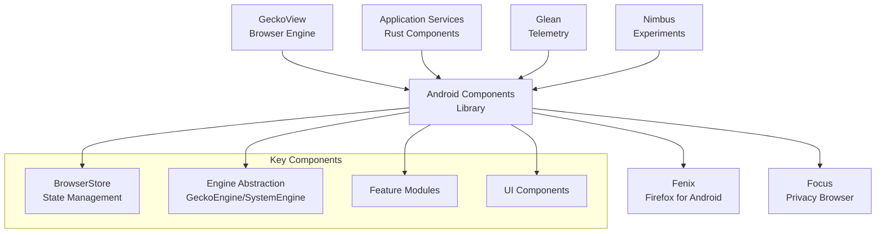

The Firefox Android repository is structured into two main parts:

1. **Android Components** - A collection of reusable Android libraries for building browsers or browser-like applications. These components provide the foundation for both Firefox for Android (Fenix) and Focus. The components are designed to be modular and reusable across different applications.

2. **Applications** - The actual browser applications built on top of Android Components:
   - **Fenix** - The main Firefox for Android application
   - **Focus** - The privacy-focused browser variant

The repository relies on several key external dependencies:
- **GeckoView** - Mozilla's browser engine implementation for Android
- **Application Services** - Rust-implemented cross-platform components for services like sync and logins
- **Glean** - Mozilla's telemetry collection library
- **Nimbus** - Mozilla's experimentation platform

Sources:
[android-components/.buildconfig.yml:1-20]()
[android-components/README.md:1-21]()
[fenix/app/src/main/res/values/static_strings.xml:1-9]()

## Core Architecture Components

The Firefox Android architecture follows a modular design pattern, where various functions are separated into distinct components. This section outlines the major architectural components.

### BrowserStore and State Management

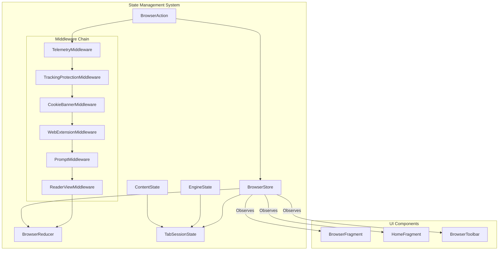

The `BrowserStore` is the central state management component based on a Redux-like architecture. It stores the entire browsing state of the application, including:

- Open tabs (normal and private)
- Tab content (URL, title, loading state, etc.)
- Engine state
- Extensions state
- Download state

Actions dispatched to the store are processed through middleware chains before reaching reducers that update the state. The store emits state changes that components can observe and react to.

Sources:
[android-components/components/browser/state/src/main/java/mozilla/components/browser/state/action/BrowserAction.kt:5-59]()
[fenix/app/src/main/java/org/mozilla/fenix/components/Core.kt:25-38]()
[fenix/app/src/main/java/org/mozilla/fenix/browser/BaseBrowserFragment.kt:208-226]()

### Engine Abstraction

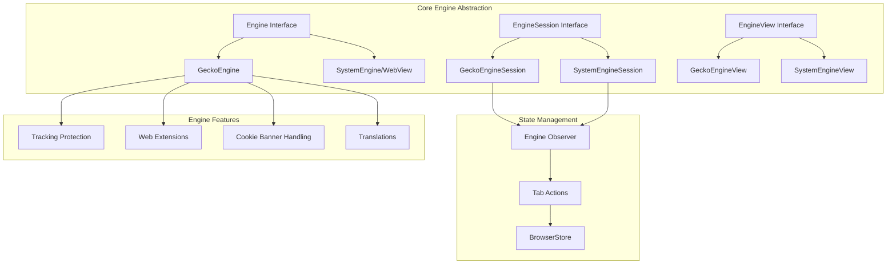

The browser engine is abstracted behind interfaces that allow Firefox Android to support multiple browser engines, though GeckoView is used in production. The key components of the engine abstraction are:

- **Engine Interface** - Defines operations that can be performed by a browser engine
- **EngineSession** - Represents a browsing session (similar to a tab)
- **EngineView** - UI component that renders web content

This abstraction allows for flexibility in the underlying engine implementation while providing a consistent API for the rest of the application.

Sources:
[android-components/components/concept/engine/src/main/java/mozilla/components/concept/engine/EngineSession.kt:35-48]()
[android-components/components/browser/engine-gecko/src/main/java/mozilla/components/browser/engine/gecko/GeckoEngineSession.kt:89-104]()
[android-components/components/browser/engine-gecko/src/main/java/mozilla/components/browser/engine/gecko/GeckoEngine.kt:5-22]()
[android-components/components/browser/engine-system/src/main/java/mozilla/components/browser/engine/system/SystemEngineSession.kt:1-4]()

### Application Components

The `Components` class serves as a dependency container that provides access to various browser components and features. The main components include:

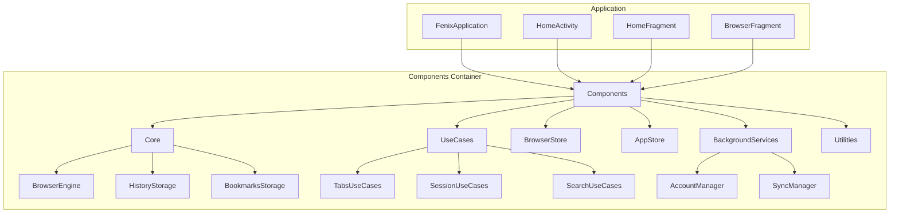

The `FenixApplication` is the main Android application class that initializes core components and sets up global services like telemetry and crash reporting. It serves as the entry point for the Firefox Android application.

Sources:
[fenix/app/src/main/java/org/mozilla/fenix/components/Core.kt:5-7]()
[fenix/app/src/main/java/org/mozilla/fenix/FenixApplication.kt:126-139]()
[android-components/samples/browser/src/main/java/org/mozilla/samples/browser/DefaultComponents.kt:1-85]()

## User Interface Architecture

Firefox Android uses a fragment-based UI architecture with two main fragments:

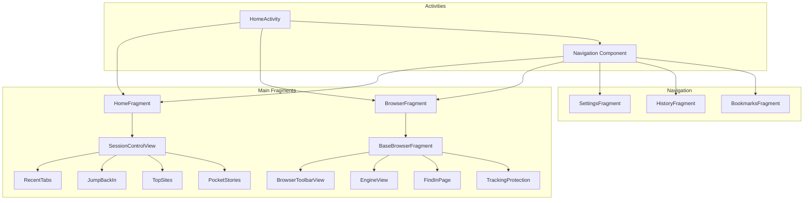

1. **HomeFragment** - Displays the home screen with recent tabs, bookmarks, history, and other personalized content
2. **BrowserFragment** - Renders web content and provides browser controls

The UI components are organized into a hierarchy where:
- `HomeActivity` serves as the main container
- Navigation between fragments is managed by the Android Navigation Component
- Each fragment has its own view components and controllers

Sources:
[fenix/app/src/main/java/org/mozilla/fenix/HomeActivity.kt:145-189]()
[fenix/app/src/main/java/org/mozilla/fenix/home/HomeFragment.kt:150-177]()
[fenix/app/src/main/java/org/mozilla/fenix/browser/BrowserFragment.kt:71-85]()
[fenix/app/src/main/java/org/mozilla/fenix/browser/BaseBrowserFragment.kt:196-270]()
[fenix/app/src/main/res/navigation/nav_graph.xml:1-34]()

## Settings and Preferences

Firefox Android has an extensive settings system for managing user preferences:

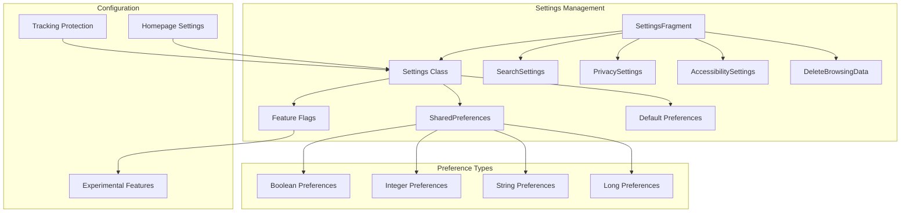

The `Settings` class provides a centralized place for accessing and updating user preferences. It wraps Android's SharedPreferences with typed accessors and default values. Key settings include:

- Privacy and tracking protection options
- Homepage configuration
- Tab management preferences
- Theme and appearance settings
- Search engine configuration

Sources:
[fenix/app/src/main/java/org/mozilla/fenix/utils/Settings.kt:72-135]()
[fenix/app/src/main/java/org/mozilla/fenix/settings/SettingsFragment.kt:1-26]()
[fenix/app/src/main/res/values/preference_keys.xml:1-75]()
[fenix/app/src/main/java/org/mozilla/fenix/FeatureFlags.kt:1-14]()

## Telemetry and Metrics

Firefox Android uses Glean for collecting telemetry data about user interactions and application performance:

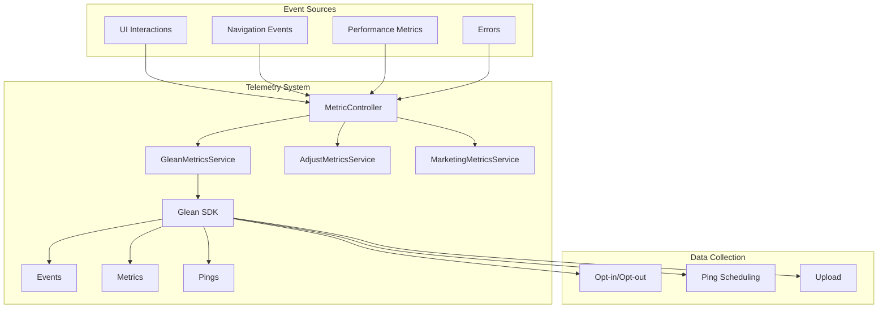

Telemetry collection is managed by the `MetricController` which delegates to various metric services. Firefox Android collects various types of metrics including:

- User interaction events
- Performance metrics
- Feature usage
- Error conditions

All telemetry collection respects user privacy settings and can be disabled by the user.

Sources:
[fenix/app/src/main/java/org/mozilla/fenix/components/metrics/Event.kt:7-57]()
[fenix/app/src/main/java/org/mozilla/fenix/components/metrics/GleanMetricsService.kt:1-103]()
[fenix/app/src/main/java/org/mozilla/fenix/components/metrics/MetricController.kt:1-13]()
[fenix/app/metrics.yaml:1-60]()
[fenix/docs/metrics.md:1-6]()

## Navigation and Lifecycle

The navigation in Firefox Android is primarily handled by the Android Navigation Component, which defines the flow between different screens in the application:

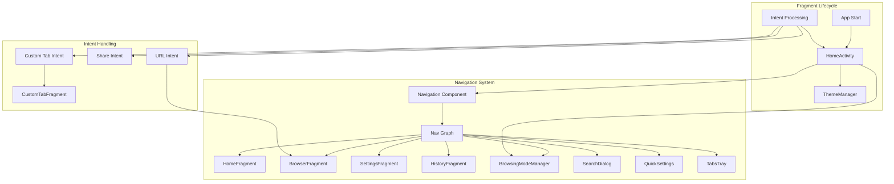

The navigation flow starts from the `HomeActivity` which uses the Navigation Component to manage transitions between fragments. Key navigation paths include:

- Home to Browser (when opening a URL)
- Browser to Tabs Tray (when viewing open tabs)
- Browser to Settings (when accessing preferences)
- Various dialogs for specific actions (search, quick settings, etc.)

The application handles different types of intents including URL intents, share intents, and custom tab intents.

Sources:
[fenix/app/src/main/java/org/mozilla/fenix/HomeActivity.kt:197-254]()
[fenix/app/src/main/res/navigation/nav_graph.xml:1-65]()
[fenix/app/src/main/java/org/mozilla/fenix/home/HomeFragment.kt:258-299]()

## Conclusion

Firefox Android is a sophisticated mobile browser built on a modular, component-based architecture. The codebase is organized into reusable components (Android Components) and application-specific code (Fenix and Focus). Key architectural patterns include:

1. Redux-like state management with the BrowserStore
2. Engine abstraction to support different browser engines
3. Fragment-based UI architecture
4. Component-based design for reusability
5. Telemetry collection with Glean

This architecture allows for maintainability, testability, and the ability to reuse components across different applications like Fenix and Focus.

Sources:
[android-components/README.md:1-21]()
[fenix/app/src/main/java/org/mozilla/fenix/FenixApplication.kt:126-153]()
[android-components/.buildconfig.yml:1-20]()

---

# Page: Key Concepts and Terminology

# Key Concepts and Terminology

<details>
<summary>Relevant source files</summary>

The following files were used as context for generating this wiki page:

- [android-components/components/browser/engine-gecko/src/main/java/mozilla/components/browser/engine/gecko/GeckoEngine.kt](android-components/components/browser/engine-gecko/src/main/java/mozilla/components/browser/engine/gecko/GeckoEngine.kt)
- [android-components/components/browser/engine-gecko/src/main/java/mozilla/components/browser/engine/gecko/GeckoEngineSession.kt](android-components/components/browser/engine-gecko/src/main/java/mozilla/components/browser/engine/gecko/GeckoEngineSession.kt)
- [android-components/components/browser/engine-gecko/src/test/java/mozilla/components/browser/engine/gecko/GeckoEngineSessionTest.kt](android-components/components/browser/engine-gecko/src/test/java/mozilla/components/browser/engine/gecko/GeckoEngineSessionTest.kt)
- [android-components/components/browser/engine-gecko/src/test/java/mozilla/components/browser/engine/gecko/GeckoEngineTest.kt](android-components/components/browser/engine-gecko/src/test/java/mozilla/components/browser/engine/gecko/GeckoEngineTest.kt)
- [android-components/components/browser/engine-system/src/main/java/mozilla/components/browser/engine/system/SystemEngine.kt](android-components/components/browser/engine-system/src/main/java/mozilla/components/browser/engine/system/SystemEngine.kt)
- [android-components/components/browser/engine-system/src/main/java/mozilla/components/browser/engine/system/SystemEngineSession.kt](android-components/components/browser/engine-system/src/main/java/mozilla/components/browser/engine/system/SystemEngineSession.kt)
- [android-components/components/browser/engine-system/src/test/java/mozilla/components/browser/engine/system/SystemEngineSessionTest.kt](android-components/components/browser/engine-system/src/test/java/mozilla/components/browser/engine/system/SystemEngineSessionTest.kt)
- [android-components/components/browser/state/src/main/java/mozilla/components/browser/state/action/BrowserAction.kt](android-components/components/browser/state/src/main/java/mozilla/components/browser/state/action/BrowserAction.kt)
- [android-components/components/browser/state/src/main/java/mozilla/components/browser/state/engine/EngineObserver.kt](android-components/components/browser/state/src/main/java/mozilla/components/browser/state/engine/EngineObserver.kt)
- [android-components/components/browser/state/src/main/java/mozilla/components/browser/state/reducer/ContentStateReducer.kt](android-components/components/browser/state/src/main/java/mozilla/components/browser/state/reducer/ContentStateReducer.kt)
- [android-components/components/browser/state/src/main/java/mozilla/components/browser/state/state/ContentState.kt](android-components/components/browser/state/src/main/java/mozilla/components/browser/state/state/ContentState.kt)
- [android-components/components/browser/state/src/test/java/mozilla/components/browser/state/action/ContentActionTest.kt](android-components/components/browser/state/src/test/java/mozilla/components/browser/state/action/ContentActionTest.kt)
- [android-components/components/browser/state/src/test/java/mozilla/components/browser/state/engine/EngineObserverTest.kt](android-components/components/browser/state/src/test/java/mozilla/components/browser/state/engine/EngineObserverTest.kt)
- [android-components/components/concept/engine/src/main/java/mozilla/components/concept/engine/Engine.kt](android-components/components/concept/engine/src/main/java/mozilla/components/concept/engine/Engine.kt)
- [android-components/components/concept/engine/src/main/java/mozilla/components/concept/engine/EngineSession.kt](android-components/components/concept/engine/src/main/java/mozilla/components/concept/engine/EngineSession.kt)
- [android-components/components/concept/engine/src/main/java/mozilla/components/concept/engine/Settings.kt](android-components/components/concept/engine/src/main/java/mozilla/components/concept/engine/Settings.kt)
- [android-components/components/concept/engine/src/test/java/mozilla/components/concept/engine/EngineSessionTest.kt](android-components/components/concept/engine/src/test/java/mozilla/components/concept/engine/EngineSessionTest.kt)
- [android-components/components/concept/engine/src/test/java/mozilla/components/concept/engine/EngineTest.kt](android-components/components/concept/engine/src/test/java/mozilla/components/concept/engine/EngineTest.kt)
- [android-components/components/concept/engine/src/test/java/mozilla/components/concept/engine/SettingsTest.kt](android-components/components/concept/engine/src/test/java/mozilla/components/concept/engine/SettingsTest.kt)
- [docs/changelog.md](docs/changelog.md)
- [fenix/app/metrics.yaml](fenix/app/metrics.yaml)
- [fenix/app/src/main/java/org/mozilla/fenix/FeatureFlags.kt](fenix/app/src/main/java/org/mozilla/fenix/FeatureFlags.kt)
- [fenix/app/src/main/java/org/mozilla/fenix/FenixApplication.kt](fenix/app/src/main/java/org/mozilla/fenix/FenixApplication.kt)
- [fenix/app/src/main/java/org/mozilla/fenix/HomeActivity.kt](fenix/app/src/main/java/org/mozilla/fenix/HomeActivity.kt)
- [fenix/app/src/main/java/org/mozilla/fenix/browser/BaseBrowserFragment.kt](fenix/app/src/main/java/org/mozilla/fenix/browser/BaseBrowserFragment.kt)
- [fenix/app/src/main/java/org/mozilla/fenix/browser/BrowserFragment.kt](fenix/app/src/main/java/org/mozilla/fenix/browser/BrowserFragment.kt)
- [fenix/app/src/main/java/org/mozilla/fenix/components/Core.kt](fenix/app/src/main/java/org/mozilla/fenix/components/Core.kt)
- [fenix/app/src/main/java/org/mozilla/fenix/components/UseCases.kt](fenix/app/src/main/java/org/mozilla/fenix/components/UseCases.kt)
- [fenix/app/src/main/java/org/mozilla/fenix/components/metrics/Event.kt](fenix/app/src/main/java/org/mozilla/fenix/components/metrics/Event.kt)
- [fenix/app/src/main/java/org/mozilla/fenix/components/metrics/GleanMetricsService.kt](fenix/app/src/main/java/org/mozilla/fenix/components/metrics/GleanMetricsService.kt)
- [fenix/app/src/main/java/org/mozilla/fenix/components/metrics/MetricController.kt](fenix/app/src/main/java/org/mozilla/fenix/components/metrics/MetricController.kt)
- [fenix/app/src/main/java/org/mozilla/fenix/home/HomeFragment.kt](fenix/app/src/main/java/org/mozilla/fenix/home/HomeFragment.kt)
- [fenix/app/src/main/java/org/mozilla/fenix/settings/SecretSettingsFragment.kt](fenix/app/src/main/java/org/mozilla/fenix/settings/SecretSettingsFragment.kt)
- [fenix/app/src/main/java/org/mozilla/fenix/settings/SettingsFragment.kt](fenix/app/src/main/java/org/mozilla/fenix/settings/SettingsFragment.kt)
- [fenix/app/src/main/java/org/mozilla/fenix/utils/Settings.kt](fenix/app/src/main/java/org/mozilla/fenix/utils/Settings.kt)
- [fenix/app/src/main/res/layout/preference_category_no_icon_style.xml](fenix/app/src/main/res/layout/preference_category_no_icon_style.xml)
- [fenix/app/src/main/res/navigation/nav_graph.xml](fenix/app/src/main/res/navigation/nav_graph.xml)
- [fenix/app/src/main/res/values/preference_keys.xml](fenix/app/src/main/res/values/preference_keys.xml)
- [fenix/app/src/main/res/values/static_strings.xml](fenix/app/src/main/res/values/static_strings.xml)
- [fenix/app/src/main/res/values/strings.xml](fenix/app/src/main/res/values/strings.xml)
- [fenix/app/src/main/res/xml/preferences.xml](fenix/app/src/main/res/xml/preferences.xml)
- [fenix/app/src/main/res/xml/secret_settings_preferences.xml](fenix/app/src/main/res/xml/secret_settings_preferences.xml)
- [fenix/app/src/test/java/org/mozilla/fenix/FenixApplicationTest.kt](fenix/app/src/test/java/org/mozilla/fenix/FenixApplicationTest.kt)
- [fenix/app/src/test/java/org/mozilla/fenix/components/metrics/MetricControllerTest.kt](fenix/app/src/test/java/org/mozilla/fenix/components/metrics/MetricControllerTest.kt)
- [fenix/app/src/test/java/org/mozilla/fenix/utils/SettingsTest.kt](fenix/app/src/test/java/org/mozilla/fenix/utils/SettingsTest.kt)
- [fenix/docs/metrics.md](fenix/docs/metrics.md)

</details>


This page explains the fundamental concepts and terminology used throughout the Firefox for Android codebase. Understanding these core concepts is essential for effectively working with the browser's architecture, state management, and component system.

## High-Level Architecture Overview

Firefox for Android is built on a modular architecture with several key components:

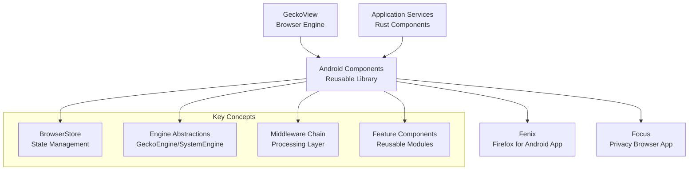

Sources:
- [fenix/app/src/main/java/org/mozilla/fenix/FenixApplication.kt]()
- [fenix/app/src/main/java/org/mozilla/fenix/components/Core.kt]()

## BrowserStore: State Management

The BrowserStore is the central state management system for the browser, implementing Redux principles to maintain a consistent application state.

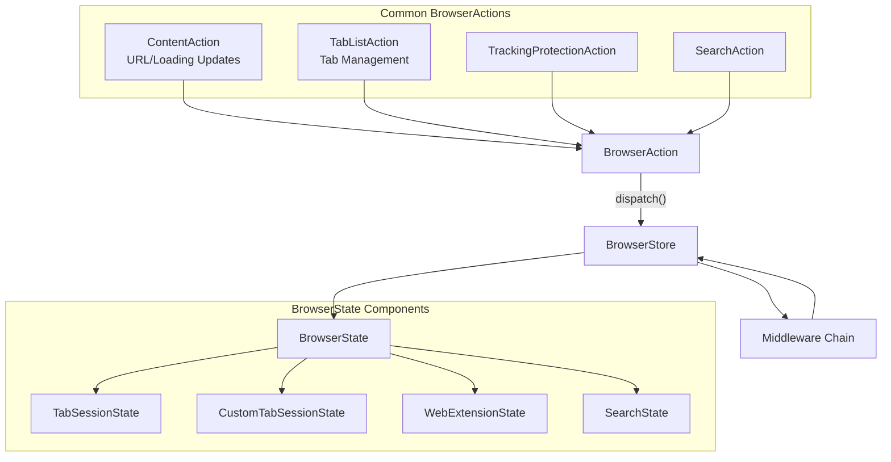

The BrowserStore serves as the single source of truth for the entire browser's state. Components observe the store to react to state changes and dispatch actions to modify the state.

Example of dispatching an action:

```kotlin
browserStore.dispatch(ContentAction.UpdateUrlAction(tabId, url))
```

Example of observing state:

```kotlin
browserStore.flowScoped(viewLifecycleOwner) { flow ->
    flow.map { it.selectedTab }.collect { tab ->
        // Update UI with tab information
    }
}
```

Sources:
- [android-components/components/browser/state/src/main/java/mozilla/components/browser/state/action/BrowserAction.kt]()
- [android-components/components/browser/state/src/main/java/mozilla/components/browser/state/reducer/ContentStateReducer.kt]()
- [fenix/app/src/main/java/org/mozilla/fenix/components/Core.kt:225-268]()
- [fenix/app/src/main/java/org/mozilla/fenix/browser/BaseBrowserFragment.kt:217-220]()

## Engine Abstraction Layer

Firefox for Android uses an engine abstraction to support different browser engines, primarily GeckoView (Mozilla's engine).

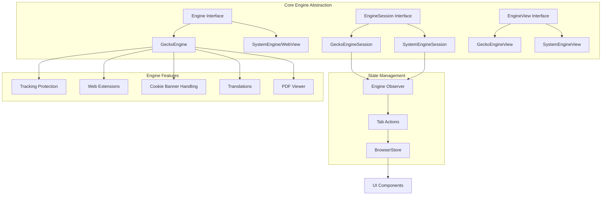

The engine abstraction consists of three main components:

| Component | Purpose | Main Implementation |
|-----------|---------|---------------------|
| Engine | Browser engine factory | GeckoEngine |
| EngineSession | Individual browsing session | GeckoEngineSession |
| EngineView | Visual component displaying web content | GeckoEngineView |

Common operations:

```kotlin
// Create a session
val engineSession = engine.createSession()

// Load a URL
engineSession.loadUrl("https://mozilla.org")

// Navigate
engineSession.goBack()
engineSession.goForward()

// Register observers
engineSession.register(object : EngineSession.Observer {
    override fun onLocationChange(url: String, hasUserGesture: Boolean) {
        // Update UI with new URL
    }
    
    override fun onProgress(progress: Int) {
        // Update loading progress
    }
})
```

Sources:
- [android-components/components/concept/engine/src/main/java/mozilla/components/concept/engine/Engine.kt]()
- [android-components/components/concept/engine/src/main/java/mozilla/components/concept/engine/EngineSession.kt]()
- [android-components/components/browser/engine-gecko/src/main/java/mozilla/components/browser/engine/gecko/GeckoEngine.kt]()
- [android-components/components/browser/engine-gecko/src/main/java/mozilla/components/browser/engine/gecko/GeckoEngineSession.kt]()

## Middleware

Middleware provides a processing layer between actions and state updates, allowing for side effects and additional processing.

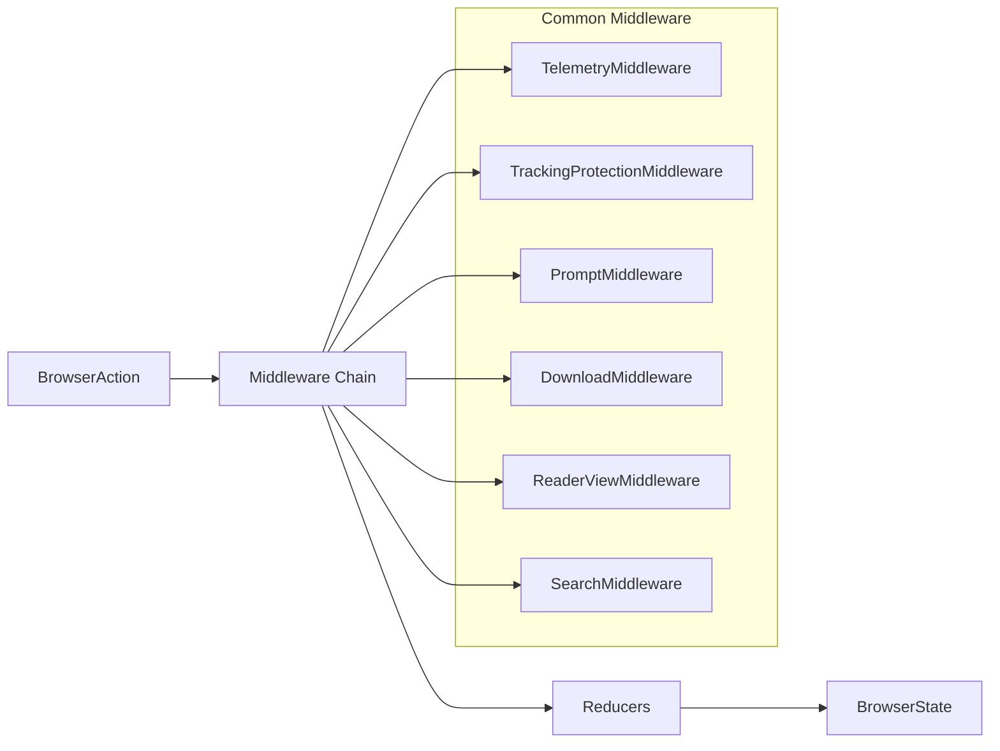

Examples of middleware in Firefox for Android:

| Middleware | Purpose |
|------------|---------|
| PromptMiddleware | Manages web-content prompts (dialogs, alerts) |
| DownloadMiddleware | Handles file downloads |
| TrackingProtectionMiddleware | Implements tracking protection features |
| TelemetryMiddleware | Collects usage data |
| ReaderViewMiddleware | Handles reader view state |
| SessionMiddleware | Connects to engine sessions |

Sources:
- [fenix/app/src/main/java/org/mozilla/fenix/components/Core.kt:225-268]()
- [android-components/components/browser/state/src/main/java/mozilla/components/browser/state/action/BrowserAction.kt]()

## Feature Components

Feature components are self-contained modules that implement specific browser functionality, following a consistent lifecycle pattern.

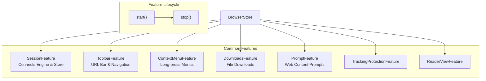

Features are typically integrated in fragments using the ViewBoundFeatureWrapper:

```kotlin
private val downloadsFeature = ViewBoundFeatureWrapper<DownloadsFeature>()

override fun onViewCreated(view: View, savedInstanceState: Bundle?) {
    downloadsFeature.set(
        feature = DownloadsFeature(
            context = requireContext(),
            store = components.core.store,
            useCases = components.useCases.downloadUseCases,
            fragmentManager = childFragmentManager
        ),
        owner = viewLifecycleOwner,
        view = view
    )
}
```

Sources:
- [fenix/app/src/main/java/org/mozilla/fenix/browser/BaseBrowserFragment.kt:226-254]()
- [fenix/app/src/main/java/org/mozilla/fenix/home/HomeFragment.kt:233-376]()

## Navigation Architecture

Firefox for Android uses the Jetpack Navigation component for screen navigation, with a central navigation graph.

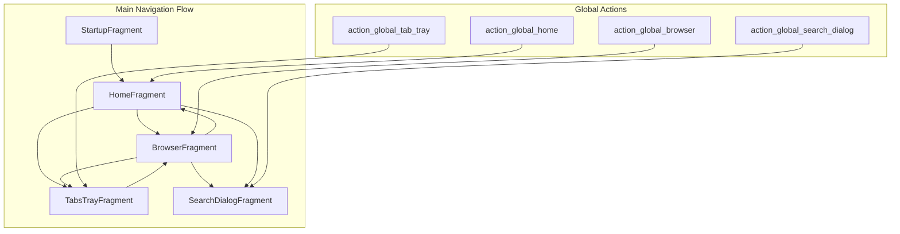

Navigation is typically performed using:

```kotlin
// Navigate using directions
findNavController().navigate(
    HomeFragmentDirections.actionHomeFragmentToBrowserFragment(tabId)
)

// Navigate using global actions
findNavController().navigate(NavGraphDirections.actionGlobalBrowser(tabId))
```

Sources:
- [fenix/app/src/main/res/navigation/nav_graph.xml]()
- [fenix/app/src/main/java/org/mozilla/fenix/HomeActivity.kt]()

## Settings System

Firefox for Android uses a unified Settings class to manage user preferences, backed by SharedPreferences.

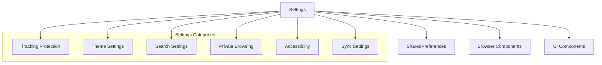

Settings are accessed through extension properties:

```kotlin
// Access settings
val settings = context.settings()

// Read a setting
if (settings.showPrivateBrowsingShortcut) {
    // Do something
}

// Write a setting
settings.shouldUseTrackingProtection = true
```

Main settings are defined in [fenix/app/src/main/java/org/mozilla/fenix/utils/Settings.kt]() and use property delegates for easy access:

```kotlin
var showPrivateBrowsingShortcut by booleanPreference(
    appContext.getPreferenceKey(R.string.pref_key_add_private_browsing_shortcut),
    default = false
)
```

Sources:
- [fenix/app/src/main/java/org/mozilla/fenix/utils/Settings.kt]()
- [fenix/app/src/main/res/xml/preferences.xml]()
- [fenix/app/src/main/res/values/preference_keys.xml]()

## Metrics and Telemetry

Firefox for Android uses Mozilla's Glean library for telemetry collection.

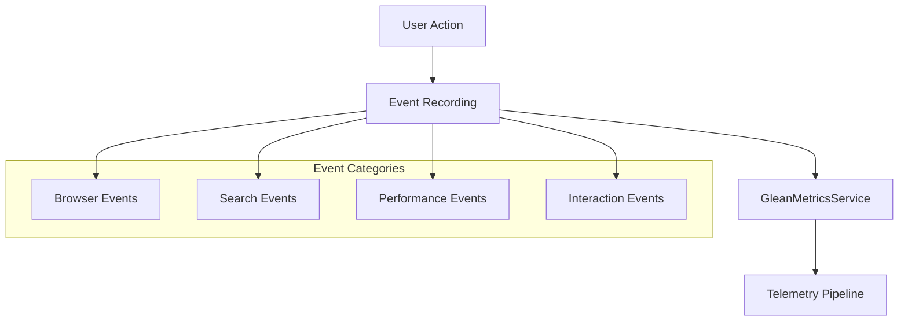

Events are recorded using:

```kotlin
// Record simple event
Events.openedBookmark.record(NoExtras())

// Record event with extra data
Events.performedSearch.record(
    Events.PerformedSearchExtra(
        source = searchAccessPoint
    )
)
```

Common event categories:

| Category | Purpose |
|----------|---------|
| Events | General user interactions |
| BrowserMenuAction | Menu interactions |
| SearchAction | Search-related events |
| TabsTray | Tab management events |
| TrackingProtection | Tracking protection interactions |

Sources:
- [fenix/app/metrics.yaml]()
- [fenix/app/src/main/java/org/mozilla/fenix/components/metrics/GleanMetricsService.kt]()
- [fenix/app/src/main/java/org/mozilla/fenix/components/metrics/Event.kt]()
- [fenix/app/src/main/java/org/mozilla/fenix/components/metrics/MetricController.kt]()

## Browser Session Management

Browser session management handles the lifecycle of tabs and their content.

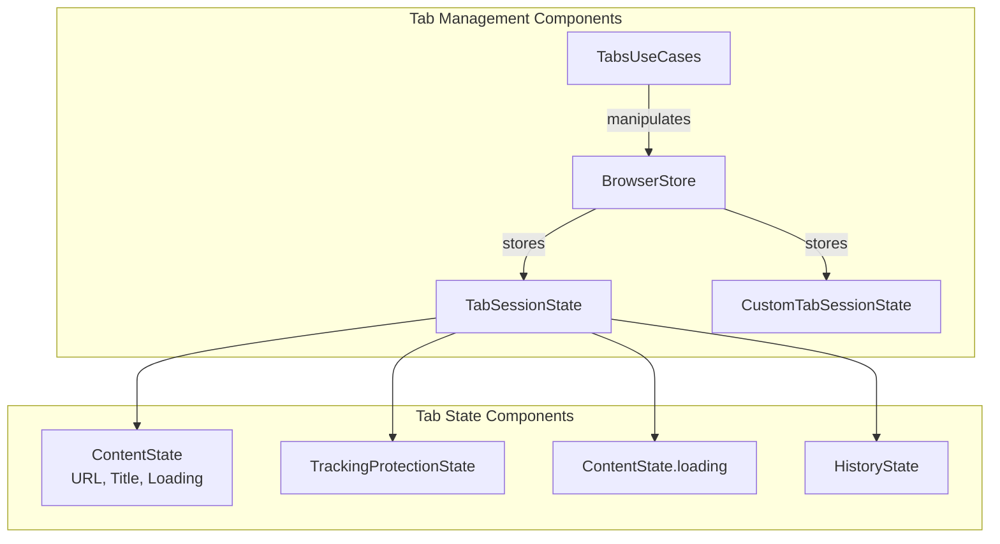

Common tabs operations:

```kotlin
// Add a new tab
tabsUseCases.addTab(
    url = "https://mozilla.org",
    private = false,
    selectTab = true
)

// Select a tab
tabsUseCases.selectTab(tabId)

// Remove a tab
tabsUseCases.removeTab(tabId)
```

Sources:
- [fenix/app/src/main/java/org/mozilla/fenix/browser/BaseBrowserFragment.kt]()
- [fenix/app/src/main/java/org/mozilla/fenix/home/HomeFragment.kt]()

## Conclusion

This document covered the key concepts and terminology used throughout the Firefox for Android codebase. These concepts form the foundation of the browser's architecture and are essential for understanding how the various components interact to provide a complete browsing experience.

---

# Page: Android Components

# Android Components

<details>
<summary>Relevant source files</summary>

The following files were used as context for generating this wiki page:

- [CODEOWNERS](CODEOWNERS)
- [LICENSE](LICENSE)
- [README.md](README.md)
- [android-components/.buildconfig.yml](android-components/.buildconfig.yml)
- [android-components/README.md](android-components/README.md)
- [android-components/automation/taskcluster/action/update_geckoview.sh](android-components/automation/taskcluster/action/update_geckoview.sh)
- [android-components/automation/taskcluster/action/update_publicsuffixlist.sh](android-components/automation/taskcluster/action/update_publicsuffixlist.sh)
- [android-components/components/browser/engine-gecko/src/main/java/mozilla/components/browser/engine/gecko/GeckoEngine.kt](android-components/components/browser/engine-gecko/src/main/java/mozilla/components/browser/engine/gecko/GeckoEngine.kt)
- [android-components/components/browser/engine-gecko/src/main/java/mozilla/components/browser/engine/gecko/GeckoEngineSession.kt](android-components/components/browser/engine-gecko/src/main/java/mozilla/components/browser/engine/gecko/GeckoEngineSession.kt)
- [android-components/components/browser/engine-gecko/src/test/java/mozilla/components/browser/engine/gecko/GeckoEngineSessionTest.kt](android-components/components/browser/engine-gecko/src/test/java/mozilla/components/browser/engine/gecko/GeckoEngineSessionTest.kt)
- [android-components/components/browser/engine-gecko/src/test/java/mozilla/components/browser/engine/gecko/GeckoEngineTest.kt](android-components/components/browser/engine-gecko/src/test/java/mozilla/components/browser/engine/gecko/GeckoEngineTest.kt)
- [android-components/components/browser/engine-system/src/main/java/mozilla/components/browser/engine/system/SystemEngine.kt](android-components/components/browser/engine-system/src/main/java/mozilla/components/browser/engine/system/SystemEngine.kt)
- [android-components/components/browser/engine-system/src/main/java/mozilla/components/browser/engine/system/SystemEngineSession.kt](android-components/components/browser/engine-system/src/main/java/mozilla/components/browser/engine/system/SystemEngineSession.kt)
- [android-components/components/browser/engine-system/src/test/java/mozilla/components/browser/engine/system/SystemEngineSessionTest.kt](android-components/components/browser/engine-system/src/test/java/mozilla/components/browser/engine/system/SystemEngineSessionTest.kt)
- [android-components/components/browser/state/src/main/java/mozilla/components/browser/state/action/BrowserAction.kt](android-components/components/browser/state/src/main/java/mozilla/components/browser/state/action/BrowserAction.kt)
- [android-components/components/browser/state/src/main/java/mozilla/components/browser/state/engine/EngineObserver.kt](android-components/components/browser/state/src/main/java/mozilla/components/browser/state/engine/EngineObserver.kt)
- [android-components/components/browser/state/src/main/java/mozilla/components/browser/state/reducer/ContentStateReducer.kt](android-components/components/browser/state/src/main/java/mozilla/components/browser/state/reducer/ContentStateReducer.kt)
- [android-components/components/browser/state/src/main/java/mozilla/components/browser/state/state/ContentState.kt](android-components/components/browser/state/src/main/java/mozilla/components/browser/state/state/ContentState.kt)
- [android-components/components/browser/state/src/test/java/mozilla/components/browser/state/action/ContentActionTest.kt](android-components/components/browser/state/src/test/java/mozilla/components/browser/state/action/ContentActionTest.kt)
- [android-components/components/browser/state/src/test/java/mozilla/components/browser/state/engine/EngineObserverTest.kt](android-components/components/browser/state/src/test/java/mozilla/components/browser/state/engine/EngineObserverTest.kt)
- [android-components/components/concept/engine/src/main/java/mozilla/components/concept/engine/Engine.kt](android-components/components/concept/engine/src/main/java/mozilla/components/concept/engine/Engine.kt)
- [android-components/components/concept/engine/src/main/java/mozilla/components/concept/engine/EngineSession.kt](android-components/components/concept/engine/src/main/java/mozilla/components/concept/engine/EngineSession.kt)
- [android-components/components/concept/engine/src/main/java/mozilla/components/concept/engine/Settings.kt](android-components/components/concept/engine/src/main/java/mozilla/components/concept/engine/Settings.kt)
- [android-components/components/concept/engine/src/test/java/mozilla/components/concept/engine/EngineSessionTest.kt](android-components/components/concept/engine/src/test/java/mozilla/components/concept/engine/EngineSessionTest.kt)
- [android-components/components/concept/engine/src/test/java/mozilla/components/concept/engine/EngineTest.kt](android-components/components/concept/engine/src/test/java/mozilla/components/concept/engine/EngineTest.kt)
- [android-components/components/concept/engine/src/test/java/mozilla/components/concept/engine/SettingsTest.kt](android-components/components/concept/engine/src/test/java/mozilla/components/concept/engine/SettingsTest.kt)
- [android-components/components/feature/containers/README.md](android-components/components/feature/containers/README.md)
- [android-components/components/feature/containers/proguard-rules.pro](android-components/components/feature/containers/proguard-rules.pro)
- [android-components/components/feature/containers/schemas/mozilla.components.feature.containers.db.ContainerDatabase/1.json](android-components/components/feature/containers/schemas/mozilla.components.feature.containers.db.ContainerDatabase/1.json)
- [android-components/components/feature/containers/src/main/AndroidManifest.xml](android-components/components/feature/containers/src/main/AndroidManifest.xml)
- [android-components/samples/browser/README.md](android-components/samples/browser/README.md)
- [android-components/samples/browser/build.gradle](android-components/samples/browser/build.gradle)
- [android-components/samples/browser/src/main/java/org/mozilla/samples/browser/BrowserFragment.kt](android-components/samples/browser/src/main/java/org/mozilla/samples/browser/BrowserFragment.kt)
- [android-components/samples/browser/src/main/java/org/mozilla/samples/browser/DefaultComponents.kt](android-components/samples/browser/src/main/java/org/mozilla/samples/browser/DefaultComponents.kt)
- [docs/changelog.md](docs/changelog.md)

</details>


Android Components is a collection of reusable Android libraries that form the foundation for building browser applications on Android. It provides modular building blocks for browser functionality including web rendering, state management, UI components, and various browser features. This page covers the architecture, core components, and how they work together to create a complete browser experience.

For information about specific Firefox for Android applications that use these components, see [Fenix (Firefox for Android)](#3) and [Focus Android](#4).

## Architecture Overview

Android Components is organized as a modular library collection with several categories of components that work together to create browser functionality. Each component is designed to be independent but composable, allowing applications to include only what they need.

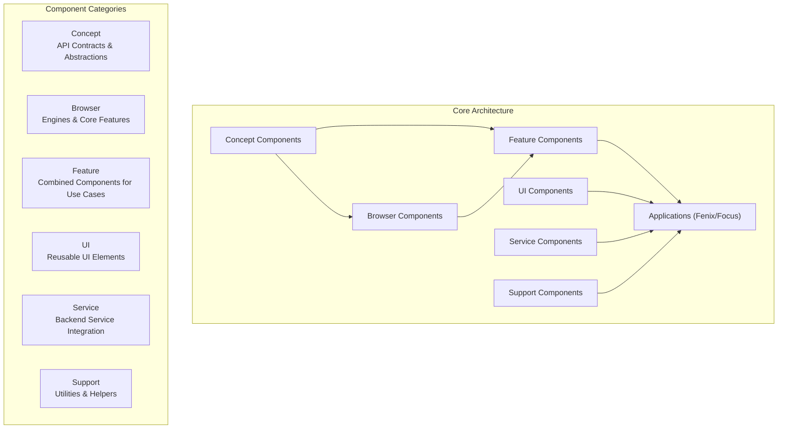

Sources: [android-components/README.md:1-41](), [android-components/.buildconfig.yml:1-1437]()

### Component Types

Android Components are divided into the following categories:

| Category | Purpose | Examples |
|----------|---------|----------|
| Concept | Define API contracts and abstraction layers | `concept-engine`, `concept-toolbar` |
| Browser | Implement core browser functionality | `browser-engine-gecko`, `browser-state` |
| Feature | Combine components for specific use cases | `feature-tabs`, `feature-session` |
| UI | Provide reusable UI elements | `ui-colors`, `ui-icons` |
| Service | Interface with backend services | `service-firefox-accounts`, `service-glean` |
| Support | Utility functions and helpers | `support-ktx`, `support-base` |

Sources: [android-components/README.md:48-193](), [android-components/.buildconfig.yml:1-1437]()

## Core Systems

### Browser Engine Abstraction

One of the core systems in Android Components is the browser engine abstraction layer, which provides a common interface for different browser engines (Gecko or WebView).

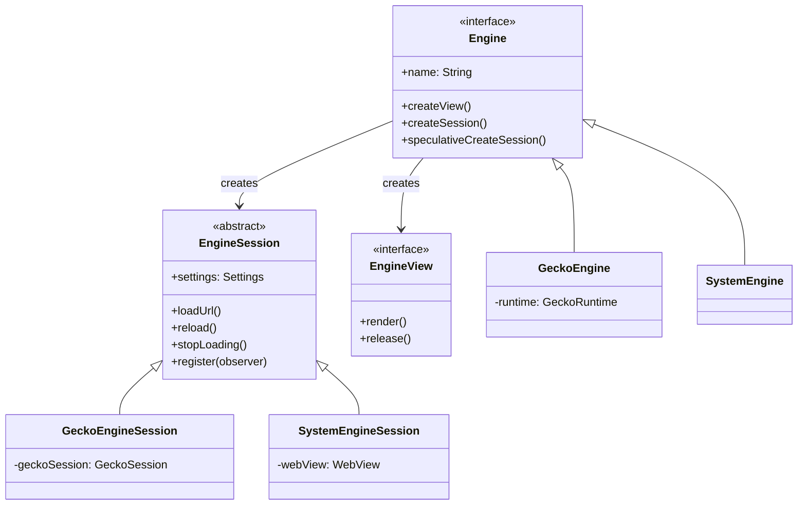

The engine abstraction layer allows applications to be built on top of either GeckoView (Mozilla's browser engine) or Android's WebView, with the same APIs regardless of the underlying engine. This enables engine-agnostic browser implementations.

Sources: [android-components/components/concept/engine/src/main/java/mozilla/components/concept/engine/Engine.kt:1-25](), [android-components/components/concept/engine/src/main/java/mozilla/components/concept/engine/EngineSession.kt:1-56](), [android-components/components/browser/engine-gecko/src/main/java/mozilla/components/browser/engine/gecko/GeckoEngine.kt:1-118](), [android-components/components/browser/engine-system/src/main/java/mozilla/components/browser/engine/system/SystemEngine.kt:1-12]()

Key components:

- **Engine**: Interface for creating sessions and views
- **EngineSession**: Abstract representation of a browsing session
- **EngineView**: Displays web content
- **Settings**: Configuration for the engine behavior

### Browser State Management

The browser state management system provides a centralized place to store and manage the state of the browser, including tabs, sessions, and other browser data.

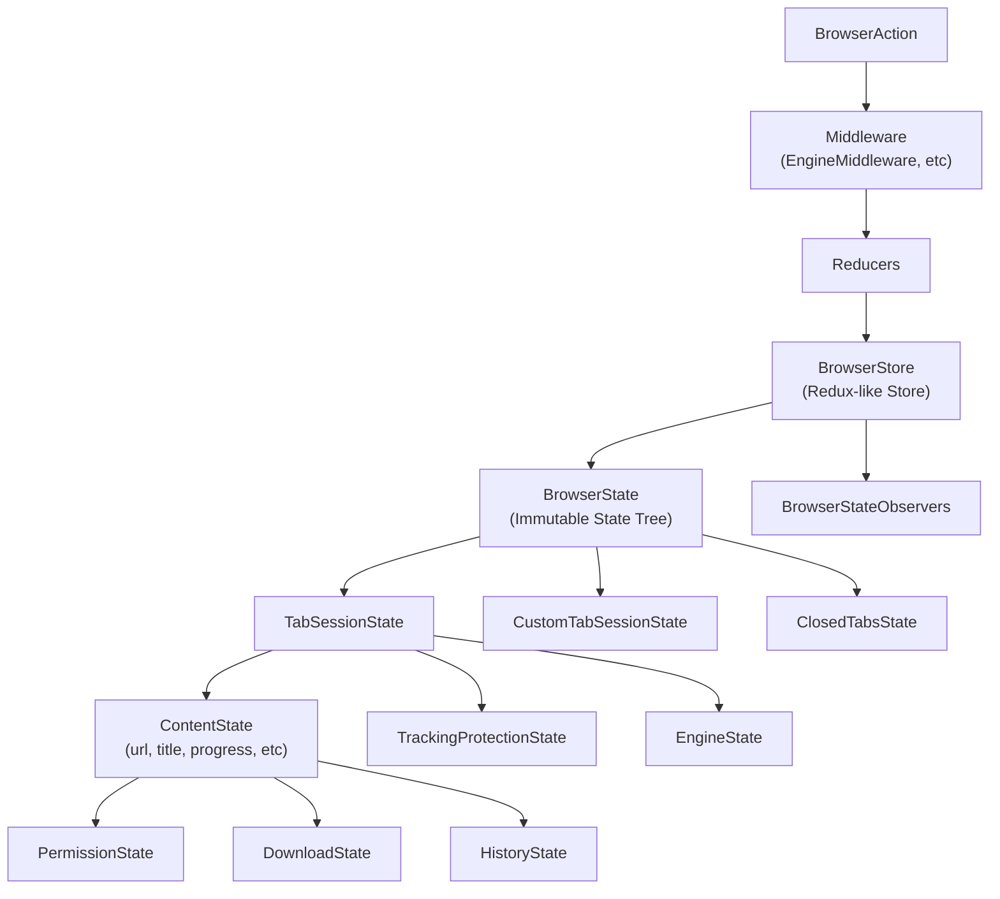

Sources: [android-components/components/browser/state/src/main/java/mozilla/components/browser/state/action/BrowserAction.kt:1-73](), [android-components/components/browser/state/src/main/java/mozilla/components/browser/state/state/ContentState.kt:1-25](), [android-components/components/browser/state/src/main/java/mozilla/components/browser/state/reducer/ContentStateReducer.kt:1-66]()

The browser state management system follows a Redux-like pattern:

1. **BrowserStore**: Central state container that holds the immutable browser state
2. **BrowserAction**: Actions that describe changes to the state
3. **Reducers**: Pure functions that take the current state and an action and return a new state
4. **Middleware**: Intercepts actions before they reach the reducers, useful for side effects

Key state components:

- **TabSessionState**: Represents a normal browser tab
- **CustomTabSessionState**: Represents a custom tab
- **ContentState**: Contains the actual content of a tab (URL, title, loading state, etc.)
- **EngineState**: Holds engine-specific state

## Feature Components

Feature components combine the basic building blocks to implement specific browser features. These components typically connect the browser state with the UI and handle user interactions.

```mermaid
flowchart TD
    subgraph "Core Features"
        Session["feature-session\nEngineSession + BrowserStore"]
        Tabs["feature-tabs\nTab Management"]
        Toolbar["feature-toolbar\nAddress Bar & Controls"]
        AwesomeBar["feature-awesomebar\nURL Suggestions"]
    end
    
    subgraph "Additional Features"
        Downloads["feature-downloads"]
        Addons["feature-addons"]
        ContextMenu["feature-contextmenu"]
        Reader["feature-readerview"]
        PrivateMode["feature-privatemode"]
        PWA["feature-pwa"]
        FindInPage["feature-findinpage"]
        SitePermissions["feature-sitepermissions"]
    end
    
    BrowserEngine["browser-engine-gecko/system"]
    BrowserState["browser-state"]
    
    BrowserEngine --> Session
    BrowserState --> Session
    BrowserState --> Tabs
    BrowserState --> Toolbar
    BrowserState --> AwesomeBar
    
    Session --> Downloads
    Session --> Addons
    Session --> ContextMenu
    Session --> Reader
    Session --> PrivateMode
    Session --> PWA
    Session --> FindInPage
    Session --> SitePermissions
```

Sources: [android-components/README.md:104-170](), [android-components/samples/browser/src/main/java/org/mozilla/samples/browser/DefaultComponents.kt:1-136]()

Major feature components include:

- **Session**: Connects an engine implementation with the browser session module
- **Tabs**: Manages tabs and provides a tabs tray UI
- **Toolbar**: Handles the browser toolbar/address bar
- **Awesomebar**: Provides URL suggestions and search results
- **Downloads**: Manages file downloads
- **Context Menu**: Displays context menus when long-pressing web content
- **Reader View**: Implements reader mode functionality
- **Private Mode**: Provides private browsing features

## Integration Example

The following example shows how Android Components are combined to create a complete browser:

```mermaid
flowchart TD
    subgraph "Application Components"
        Components["DefaultComponents\n(DI Container)"]
        Fragment["BrowserFragment"]
        Activity["BrowserActivity"]
    end
    
    subgraph "Engine Components"
        Engine["GeckoEngine"]
        EngineView["GeckoEngineView"]
        EngineSession["GeckoEngineSession"]
    end
    
    subgraph "State Management"
        BrowserStore["BrowserStore"]
        Middleware["EngineMiddleware"]
    end
    
    subgraph "UI Components"
        Toolbar["BrowserToolbar"]
        Awesomebar["AwesomeBar"]
    end
    
    subgraph "Features"
        ToolbarFeature["ToolbarFeature"]
        TabsFeature["TabsFeature"]
        AwesomebarFeature["AwesomeBarFeature"]
        DownloadFeature["DownloadFeature"]
        ContextMenuFeature["ContextMenuFeature"]
    end
    
    Components --> Engine
    Components --> BrowserStore
    
    Fragment --> EngineView
    Fragment --> Toolbar
    Fragment --> Awesomebar
    
    Components --> Middleware
    Middleware --> BrowserStore
    
    Engine --> EngineSession
    EngineView --> EngineSession
    
    Fragment --> ToolbarFeature
    Fragment --> TabsFeature
    Fragment --> AwesomebarFeature
    Fragment --> DownloadFeature
    Fragment --> ContextMenuFeature
    
    ToolbarFeature --> Toolbar
    ToolbarFeature --> BrowserStore
    
    TabsFeature --> BrowserStore
    AwesomebarFeature --> Awesomebar
    AwesomebarFeature --> BrowserStore
    
    DownloadFeature --> BrowserStore
    ContextMenuFeature --> BrowserStore
```

Sources: [android-components/samples/browser/src/main/java/org/mozilla/samples/browser/DefaultComponents.kt:1-515](), [android-components/samples/browser/src/main/java/org/mozilla/samples/browser/BrowserFragment.kt:1-183]()

In the sample browser:

1. `DefaultComponents` serves as a dependency injection container that initializes all components
2. `BrowserFragment` connects UI components with features
3. Each feature connects to the central `BrowserStore` and relevant UI components
4. The engine components provide the actual web rendering capabilities

## Observer Pattern

Android Components extensively uses the observer pattern to notify components about changes:

```mermaid
classDiagram
    class Observable~T~ {
        +register(observer: T)
        +unregister(observer: T)
        +notifyObservers(block: T.() -> Unit)
    }
    
    class EngineSession {
        +register(observer: Observer)
        +notifyObservers { onLocationChange() }
        +notifyObservers { onProgress() }
    }
    
    class BrowserStore {
        +observeSelected()
        +observeFixed()
    }
    
    class Feature {
        -sessionId: String
        -store: BrowserStore
        +start()
        +stop()
    }
    
    Observable <|-- EngineSession
    EngineSession -- EngineSession.Observer
    BrowserStore -- Feature
```

Sources: [android-components/components/concept/engine/src/main/java/mozilla/components/concept/engine/EngineSession.kt:35-439](), [android-components/components/browser/engine-gecko/src/main/java/mozilla/components/browser/engine/gecko/GeckoEngineSession.kt:104-173]()

The observer pattern enables loose coupling between components. For example:

- `EngineSession` notifies observers about navigation events, page loads, etc.
- `BrowserStore` notifies features about state changes
- Features observe both the engine sessions and the browser store to react to changes

## Integration with Third-Party Applications

Android Components provides several features for integrating with third-party applications:

1. **Custom Tabs**: Allows apps to use a browser tab without leaving the app
2. **Web App support**: Enables Progressive Web Apps (PWAs)
3. **External App handling**: Handles opening links in external apps

Sources: [android-components/components/feature/customtabs/README.md](), [android-components/components/feature/pwa/README.md]()

## Using Android Components in Your Project

To use Android Components in a project, you need to add the Mozilla Maven repository and include the desired components as dependencies:

```groovy
repositories {
    maven {
        url "https://maven.mozilla.org/maven2"
    }
}

dependencies {
    implementation 'org.mozilla.components:browser-engine-gecko:+'
    implementation 'org.mozilla.components:browser-state:+'
    implementation 'org.mozilla.components:feature-session:+'
    // Add other components as needed
}
```

Sources: [android-components/README.md:23-42]()

## Common Components

Here's a list of the most commonly used components in Firefox Android applications:

| Component | Description | Usage |
|-----------|-------------|-------|
| `browser-engine-gecko` | Gecko engine implementation | Web rendering using GeckoView |
| `browser-state` | Browser state management | Manage browser tabs and sessions |
| `feature-session` | Session feature integration | Connect engine with browser state |
| `feature-tabs` | Tab management | Tab list and operations |
| `feature-toolbar` | Browser toolbar | Address bar and navigation controls |
| `feature-awesomebar` | URL suggestions | Address bar completion suggestions |
| `feature-prompts` | Web content dialogs | Handle prompts from websites |
| `feature-downloads` | Download management | Download files from websites |
| `feature-addons` | Add-ons support | Browser extension support |

Sources: [android-components/samples/browser/build.gradle:71-138](), [android-components/README.md:48-170]()

## Conclusion

Android Components provides a comprehensive set of reusable libraries for building browser applications on Android. By abstracting the browser engine and providing modular components that handle different aspects of browser functionality, it enables the creation of customized browser experiences while maintaining consistency and code reuse.

The component architecture allows Firefox for Android (Fenix) and Focus Android to share a common foundation, resulting in more consistent behavior and easier maintenance across Mozilla's Android browser products.

---

# Page: Browser Engine Abstraction

# Browser Engine Abstraction

<details>
<summary>Relevant source files</summary>

The following files were used as context for generating this wiki page:

- [android-components/components/browser/engine-gecko/src/main/java/mozilla/components/browser/engine/gecko/GeckoEngine.kt](android-components/components/browser/engine-gecko/src/main/java/mozilla/components/browser/engine/gecko/GeckoEngine.kt)
- [android-components/components/browser/engine-gecko/src/main/java/mozilla/components/browser/engine/gecko/GeckoEngineSession.kt](android-components/components/browser/engine-gecko/src/main/java/mozilla/components/browser/engine/gecko/GeckoEngineSession.kt)
- [android-components/components/browser/engine-gecko/src/test/java/mozilla/components/browser/engine/gecko/GeckoEngineSessionTest.kt](android-components/components/browser/engine-gecko/src/test/java/mozilla/components/browser/engine/gecko/GeckoEngineSessionTest.kt)
- [android-components/components/browser/engine-gecko/src/test/java/mozilla/components/browser/engine/gecko/GeckoEngineTest.kt](android-components/components/browser/engine-gecko/src/test/java/mozilla/components/browser/engine/gecko/GeckoEngineTest.kt)
- [android-components/components/browser/engine-system/src/main/java/mozilla/components/browser/engine/system/SystemEngine.kt](android-components/components/browser/engine-system/src/main/java/mozilla/components/browser/engine/system/SystemEngine.kt)
- [android-components/components/browser/engine-system/src/main/java/mozilla/components/browser/engine/system/SystemEngineSession.kt](android-components/components/browser/engine-system/src/main/java/mozilla/components/browser/engine/system/SystemEngineSession.kt)
- [android-components/components/browser/engine-system/src/test/java/mozilla/components/browser/engine/system/SystemEngineSessionTest.kt](android-components/components/browser/engine-system/src/test/java/mozilla/components/browser/engine/system/SystemEngineSessionTest.kt)
- [android-components/components/browser/state/src/main/java/mozilla/components/browser/state/action/BrowserAction.kt](android-components/components/browser/state/src/main/java/mozilla/components/browser/state/action/BrowserAction.kt)
- [android-components/components/browser/state/src/main/java/mozilla/components/browser/state/engine/EngineObserver.kt](android-components/components/browser/state/src/main/java/mozilla/components/browser/state/engine/EngineObserver.kt)
- [android-components/components/browser/state/src/main/java/mozilla/components/browser/state/reducer/ContentStateReducer.kt](android-components/components/browser/state/src/main/java/mozilla/components/browser/state/reducer/ContentStateReducer.kt)
- [android-components/components/browser/state/src/main/java/mozilla/components/browser/state/state/ContentState.kt](android-components/components/browser/state/src/main/java/mozilla/components/browser/state/state/ContentState.kt)
- [android-components/components/browser/state/src/test/java/mozilla/components/browser/state/action/ContentActionTest.kt](android-components/components/browser/state/src/test/java/mozilla/components/browser/state/action/ContentActionTest.kt)
- [android-components/components/browser/state/src/test/java/mozilla/components/browser/state/engine/EngineObserverTest.kt](android-components/components/browser/state/src/test/java/mozilla/components/browser/state/engine/EngineObserverTest.kt)
- [android-components/components/concept/engine/src/main/java/mozilla/components/concept/engine/Engine.kt](android-components/components/concept/engine/src/main/java/mozilla/components/concept/engine/Engine.kt)
- [android-components/components/concept/engine/src/main/java/mozilla/components/concept/engine/EngineSession.kt](android-components/components/concept/engine/src/main/java/mozilla/components/concept/engine/EngineSession.kt)
- [android-components/components/concept/engine/src/main/java/mozilla/components/concept/engine/Settings.kt](android-components/components/concept/engine/src/main/java/mozilla/components/concept/engine/Settings.kt)
- [android-components/components/concept/engine/src/test/java/mozilla/components/concept/engine/EngineSessionTest.kt](android-components/components/concept/engine/src/test/java/mozilla/components/concept/engine/EngineSessionTest.kt)
- [android-components/components/concept/engine/src/test/java/mozilla/components/concept/engine/EngineTest.kt](android-components/components/concept/engine/src/test/java/mozilla/components/concept/engine/EngineTest.kt)
- [android-components/components/concept/engine/src/test/java/mozilla/components/concept/engine/SettingsTest.kt](android-components/components/concept/engine/src/test/java/mozilla/components/concept/engine/SettingsTest.kt)
- [docs/changelog.md](docs/changelog.md)

</details>


The Browser Engine Abstraction layer in the Firefox Android codebase provides a unified interface for interacting with different browser engines while hiding their implementation details. This enables Firefox for Android to primarily use Mozilla's GeckoView engine while maintaining a WebView-based alternative for certain scenarios. The abstraction allows higher-level components to remain independent from the specifics of the underlying browser engine.

For a broader overview of Firefox Android's architecture, see [Overview](#1).

## Architecture Overview

The Browser Engine Abstraction is composed of several key interfaces and their implementations:

```mermaid
graph TD
    subgraph "Core Interfaces"
        E["Engine"]
        ES["EngineSession"]
        EV["EngineView"]
        S["Settings"]
    end
    
    subgraph "Gecko Implementation"
        GE["GeckoEngine"]
        GES["GeckoEngineSession"]
        GEV["GeckoEngineView"]
    end
    
    subgraph "WebView Implementation"
        SE["SystemEngine"]
        SES["SystemEngineSession"]
        SEV["SystemEngineView"]
    end
    
    E --> ES
    E --> EV
    ES --> S
    
    GE --> E
    GES --> ES
    GEV --> EV
    
    SE --> E
    SES --> ES
    SEV --> EV
    
    GE --- GeckoRuntime
    GES --- GeckoSession
    
    SE --- WebView
    SES --- WebView
```

Sources: 
- [android-components/components/concept/engine/src/main/java/mozilla/components/concept/engine/Engine.kt]()
- [android-components/components/concept/engine/src/main/java/mozilla/components/concept/engine/EngineSession.kt]()
- [android-components/components/browser/engine-gecko/src/main/java/mozilla/components/browser/engine/gecko/GeckoEngine.kt]()
- [android-components/components/browser/engine-gecko/src/main/java/mozilla/components/browser/engine/gecko/GeckoEngineSession.kt]()
- [android-components/components/browser/engine-system/src/main/java/mozilla/components/browser/engine/system/SystemEngine.kt]()

## Core Components

### Engine Interface

The `Engine` interface serves as the entry point for interacting with a browser engine implementation. It provides factory methods for creating sessions and views, and handles engine-wide configuration.

Key responsibilities:
- Creating `EngineSession` instances
- Creating `EngineView` instances
- Managing engine settings
- Managing WebExtensions
- Clearing browsing data
- Speculative connections for performance optimization

```mermaid
classDiagram
    class Engine {
        +createView(context, attrs): EngineView
        +createSession(private, contextId): EngineSession
        +speculativeConnect(url)
        +name(): String
        +settings: Settings
        +version: EngineVersion
        +clearData()
    }
    
    class GeckoEngine {
        -runtime: GeckoRuntime
        +createSession(): GeckoEngineSession
        +createView(): GeckoEngineView
    }
    
    class SystemEngine {
        +createSession(): SystemEngineSession
        +createView(): SystemEngineView
    }
    
    Engine <|-- GeckoEngine
    Engine <|-- SystemEngine
```

Sources:
- [android-components/components/concept/engine/src/main/java/mozilla/components/concept/engine/Engine.kt]()
- [android-components/components/browser/engine-gecko/src/main/java/mozilla/components/browser/engine/gecko/GeckoEngine.kt:87-203]()
- [android-components/components/browser/engine-system/src/main/java/mozilla/components/browser/engine/system/SystemEngine.kt:29-58]()

### EngineSession Interface

The `EngineSession` interface represents a single browsing session (equivalent to a browser tab). It provides methods for navigation, content manipulation, and state management.

Key functionalities:
- URL loading and navigation
- Session state serialization/restoration
- Tracking protection
- Find-in-page functionality
- Form handling
- History navigation
- PDF generation
- Translation services
- Shopping features

```mermaid
classDiagram
    class EngineSession {
        +loadUrl(url, parent, flags, headers)
        +loadData(data, mimeType, encoding)
        +stopLoading()
        +reload(flags)
        +goBack()
        +goForward()
        +saveState(): EngineSessionState
        +restoreState(state): Boolean
        +settings: Settings
        +register(observer: Observer)
    }
    
    class Observer {
        +onLocationChange(url)
        +onProgress(progress)
        +onLoadingStateChange(loading)
        +onSecurityChange(secure, host)
        +onTrackerBlocked(tracker)
        +onPromptRequest(request)
        +onError(error)
    }
    
    EngineSession "1" -- "*" Observer : notifies
```

Sources:
- [android-components/components/concept/engine/src/main/java/mozilla/components/concept/engine/EngineSession.kt:34-779]()
- [android-components/components/browser/engine-gecko/src/main/java/mozilla/components/browser/engine/gecko/GeckoEngineSession.kt:89-811]()
- [android-components/components/browser/engine-system/src/main/java/mozilla/components/browser/engine/system/SystemEngineSession.kt:45-161]()

### EngineView Interface

The `EngineView` interface represents a visual component that renders web content from an `EngineSession`. It handles rendering, input, and interactions with the web content.

Key responsibilities:
- Rendering web content
- Capturing screenshots
- Input handling
- Lifecycle management

### Settings Interface

The `Settings` class holds configuration options that can be applied to engines or sessions. It provides a unified API for configuring browser behavior.

Key settings include:
- JavaScript enablement
- Tracking protection policy
- User agent string
- Web fonts
- Remote debugging
- Cookie handling
- Media autoplay behavior

```kotlin
// Example settings configuration
val settings = DefaultSettings(
    javascriptEnabled = true,
    webFontsEnabled = true,
    trackingProtectionPolicy = TrackingProtectionPolicy.recommended(),
    userAgentString = "Mozilla/5.0 (Android) Firefox"
)
```

Sources:
- [android-components/components/concept/engine/src/main/java/mozilla/components/concept/engine/Settings.kt:20-470]()
- [android-components/components/concept/engine/src/test/java/mozilla/components/concept/engine/SettingsTest.kt]()

## Implementation Details

### GeckoEngine / GeckoEngineSession

The primary implementation uses Mozilla's GeckoView as the underlying engine. GeckoView is a component that embeds the Gecko browser engine used in Firefox desktop, providing a full-featured browser engine.

Key features:
- Full Firefox rendering engine
- Enhanced tracking protection
- Web extension support
- Translation support
- PDF generation
- Cookie banner handling

```mermaid
flowchart TD
    subgraph "Application"
        AC["Application Code"]
    end
    
    subgraph "Browser Engine Abstraction"
        ES["EngineSession"]
        GES["GeckoEngineSession"]
    end
    
    subgraph "GeckoView"
        GVS["GeckoSession"]
        GVD["GeckoDelegate<br>(Navigation, Content, etc.)"]
    end
    
    AC --> ES
    ES <--> GES
    GES <--> GVS
    GVS --> GVD
    GVD --> GES
```

Sources:
- [android-components/components/browser/engine-gecko/src/main/java/mozilla/components/browser/engine/gecko/GeckoEngine.kt]()
- [android-components/components/browser/engine-gecko/src/main/java/mozilla/components/browser/engine/gecko/GeckoEngineSession.kt]()
- [android-components/components/browser/engine-gecko/src/test/java/mozilla/components/browser/engine/gecko/GeckoEngineTest.kt]()

### SystemEngine / SystemEngineSession

The WebView-based implementation uses Android's built-in WebView component. This implementation has more limited capabilities but better platform integration. It serves as a fallback option in certain situations.

Key limitations:
- No WebExtension support
- Limited tracking protection
- No translation support
- No PDF operations
- No cookie banner handling

Sources:
- [android-components/components/browser/engine-system/src/main/java/mozilla/components/browser/engine/system/SystemEngine.kt]()
- [android-components/components/browser/engine-system/src/main/java/mozilla/components/browser/engine/system/SystemEngineSession.kt]()
- [android-components/components/browser/engine-system/src/test/java/mozilla/components/browser/engine/system/SystemEngineSessionTest.kt]()

## State Management and Observation

The engine abstraction uses the Observer pattern to notify components about state changes. These events are translated into actions that update the application's `BrowserStore`.

```mermaid
sequenceDiagram
    participant UI as UI Components
    participant BS as BrowserStore
    participant EO as EngineObserver
    participant ES as EngineSession
    participant E as Engine Implementation
    
    UI->>ES: loadUrl("https://mozilla.org")
    ES->>E: loadUrl()
    E-->>ES: onProgress(30%)
    ES-->>EO: onProgress(30%)
    EO-->>BS: dispatch(UpdateProgressAction)
    BS-->>UI: State update (progress = 30%)
    E-->>ES: onLocationChange("https://mozilla.org")
    ES-->>EO: onLocationChange("https://mozilla.org")
    EO-->>BS: dispatch(UpdateUrlAction)
    BS-->>UI: State update (url = "https://mozilla.org")
```

Key components in this flow:
- `EngineSession.Observer`: Interface for receiving engine events
- `EngineObserver`: Implementation that translates events to actions
- `ContentAction`: Actions that update content state (URL, title, progress, etc.)
- `BrowserStore`: Central store for browser state

Sources:
- [android-components/components/concept/engine/src/main/java/mozilla/components/concept/engine/EngineSession.kt:42-378]()
- [android-components/components/browser/state/src/main/java/mozilla/components/browser/state/engine/EngineObserver.kt]()
- [android-components/components/browser/state/src/main/java/mozilla/components/browser/state/action/BrowserAction.kt]()
- [android-components/components/browser/state/src/main/java/mozilla/components/browser/state/action/ContentAction.kt]()
- [android-components/components/browser/state/src/main/java/mozilla/components/browser/state/reducer/ContentStateReducer.kt]()

## Typical Usage Patterns

### Creating a Session and Loading Content

```kotlin
// Get the engine instance (typically from a component)
val engine = components.engine

// Create a new browsing session
val session = engine.createSession(private = false)

// Load a URL
session.loadUrl("https://www.mozilla.org")

// Or load HTML content directly
session.loadData("<html><body>Hello, world!</body></html>", "text/html", "UTF-8")
```

### Observing Session Changes

```kotlin
// Register an observer to receive events
session.register(object : EngineSession.Observer {
    override fun onLocationChange(url: String, hasUserGesture: Boolean) {
        // Update URL display
    }
    
    override fun onProgress(progress: Int) {
        // Update progress indicator
    }
    
    override fun onLoadingStateChange(loading: Boolean) {
        // Show/hide loading indicator
    }
    
    override fun onSecurityChange(secure: Boolean, host: String?, issuer: String?) {
        // Update security indicator
    }
})
```

### Rendering Content in a View

```kotlin
// Create a view
val engineView = engine.createView(context)

// Render a session in the view
engineView.render(session)
```

## Advanced Features

### Tracking Protection

The abstraction provides a unified API for configuring tracking protection, allowing applications to protect users from various types of online tracking.

```kotlin
// Configure tracking protection policy
val policy = TrackingProtectionPolicy.strict()
session.updateTrackingProtection(policy)
```

The policy can be configured to block different categories of trackers (ads, analytics, social, etc.) and control cookie behavior.

Sources:
- [android-components/components/concept/engine/src/main/java/mozilla/components/concept/engine/EngineSession.kt:424-477]()
- [android-components/components/browser/engine-gecko/src/main/java/mozilla/components/browser/engine/gecko/GeckoEngineSession.kt:389-407]()

### Cookie Banner Handling

GeckoEngine supports automatic cookie banner handling to improve user experience by automatically managing cookie consent prompts.

```kotlin
// Check if a cookie banner rule exists for the current session
session.hasCookieBannerRuleForSession(
    onResult = { hasRule -> /* Handle result */ },
    onException = { exception -> /* Handle error */ }
)
```

Sources:
- [android-components/components/browser/engine-gecko/src/main/java/mozilla/components/browser/engine/gecko/GeckoEngineSession.kt:489-515]()

### PDF Operations

GeckoEngine supports PDF generation, allowing users to save pages as PDF files.

```kotlin
// Request PDF generation
session.requestPdfToDownload()
```

Sources:
- [android-components/components/browser/engine-gecko/src/main/java/mozilla/components/browser/engine/gecko/GeckoEngineSession.kt:240-297]()

### Shopping Features

Recent additions include product analysis features for shopping, which can analyze product pages and provide recommendations.

```kotlin
// Request product analysis
session.requestProductAnalysis(
    url = "https://shop.example.com/product/123",
    onResult = { analysis -> /* Handle product analysis */ },
    onException = { exception -> /* Handle error */ }
)
```

Sources:
- [android-components/components/browser/engine-gecko/src/main/java/mozilla/components/browser/engine/gecko/GeckoEngineSession.kt:714-774]()

## Conclusion

The Browser Engine Abstraction provides a clean separation between the application code and the underlying browser engines. This abstraction allows Firefox for Android to primarily use Mozilla's GeckoView engine while maintaining a WebView-based alternative. The design enables the application to evolve independently from the engine implementations and provides a foundation for implementing advanced browser features.

For more information about specific components that build on top of this abstraction, see [Browser State Management](#2.2).

Sources:
- [android-components/components/concept/engine/src/main/java/mozilla/components/concept/engine/Engine.kt]()
- [android-components/components/concept/engine/src/main/java/mozilla/components/concept/engine/EngineSession.kt]()
- [android-components/components/browser/engine-gecko/src/main/java/mozilla/components/browser/engine/gecko/GeckoEngine.kt]()
- [android-components/components/browser/engine-gecko/src/main/java/mozilla/components/browser/engine/gecko/GeckoEngineSession.kt]()
- [android-components/components/browser/engine-system/src/main/java/mozilla/components/browser/engine/system/SystemEngine.kt]()
- [android-components/components/browser/engine-system/src/main/java/mozilla/components/browser/engine/system/SystemEngineSession.kt]()

---

# Page: Browser State Management

# Browser State Management

<details>
<summary>Relevant source files</summary>

The following files were used as context for generating this wiki page:

- [android-components/components/browser/engine-gecko/src/main/java/mozilla/components/browser/engine/gecko/GeckoEngine.kt](android-components/components/browser/engine-gecko/src/main/java/mozilla/components/browser/engine/gecko/GeckoEngine.kt)
- [android-components/components/browser/engine-gecko/src/main/java/mozilla/components/browser/engine/gecko/GeckoEngineSession.kt](android-components/components/browser/engine-gecko/src/main/java/mozilla/components/browser/engine/gecko/GeckoEngineSession.kt)
- [android-components/components/browser/engine-gecko/src/test/java/mozilla/components/browser/engine/gecko/GeckoEngineSessionTest.kt](android-components/components/browser/engine-gecko/src/test/java/mozilla/components/browser/engine/gecko/GeckoEngineSessionTest.kt)
- [android-components/components/browser/engine-gecko/src/test/java/mozilla/components/browser/engine/gecko/GeckoEngineTest.kt](android-components/components/browser/engine-gecko/src/test/java/mozilla/components/browser/engine/gecko/GeckoEngineTest.kt)
- [android-components/components/browser/engine-system/src/main/java/mozilla/components/browser/engine/system/SystemEngine.kt](android-components/components/browser/engine-system/src/main/java/mozilla/components/browser/engine/system/SystemEngine.kt)
- [android-components/components/browser/engine-system/src/main/java/mozilla/components/browser/engine/system/SystemEngineSession.kt](android-components/components/browser/engine-system/src/main/java/mozilla/components/browser/engine/system/SystemEngineSession.kt)
- [android-components/components/browser/engine-system/src/test/java/mozilla/components/browser/engine/system/SystemEngineSessionTest.kt](android-components/components/browser/engine-system/src/test/java/mozilla/components/browser/engine/system/SystemEngineSessionTest.kt)
- [android-components/components/browser/state/src/main/java/mozilla/components/browser/state/action/BrowserAction.kt](android-components/components/browser/state/src/main/java/mozilla/components/browser/state/action/BrowserAction.kt)
- [android-components/components/browser/state/src/main/java/mozilla/components/browser/state/engine/EngineObserver.kt](android-components/components/browser/state/src/main/java/mozilla/components/browser/state/engine/EngineObserver.kt)
- [android-components/components/browser/state/src/main/java/mozilla/components/browser/state/reducer/ContentStateReducer.kt](android-components/components/browser/state/src/main/java/mozilla/components/browser/state/reducer/ContentStateReducer.kt)
- [android-components/components/browser/state/src/main/java/mozilla/components/browser/state/state/ContentState.kt](android-components/components/browser/state/src/main/java/mozilla/components/browser/state/state/ContentState.kt)
- [android-components/components/browser/state/src/test/java/mozilla/components/browser/state/action/ContentActionTest.kt](android-components/components/browser/state/src/test/java/mozilla/components/browser/state/action/ContentActionTest.kt)
- [android-components/components/browser/state/src/test/java/mozilla/components/browser/state/engine/EngineObserverTest.kt](android-components/components/browser/state/src/test/java/mozilla/components/browser/state/engine/EngineObserverTest.kt)
- [android-components/components/concept/engine/src/main/java/mozilla/components/concept/engine/Engine.kt](android-components/components/concept/engine/src/main/java/mozilla/components/concept/engine/Engine.kt)
- [android-components/components/concept/engine/src/main/java/mozilla/components/concept/engine/EngineSession.kt](android-components/components/concept/engine/src/main/java/mozilla/components/concept/engine/EngineSession.kt)
- [android-components/components/concept/engine/src/main/java/mozilla/components/concept/engine/Settings.kt](android-components/components/concept/engine/src/main/java/mozilla/components/concept/engine/Settings.kt)
- [android-components/components/concept/engine/src/test/java/mozilla/components/concept/engine/EngineSessionTest.kt](android-components/components/concept/engine/src/test/java/mozilla/components/concept/engine/EngineSessionTest.kt)
- [android-components/components/concept/engine/src/test/java/mozilla/components/concept/engine/EngineTest.kt](android-components/components/concept/engine/src/test/java/mozilla/components/concept/engine/EngineTest.kt)
- [android-components/components/concept/engine/src/test/java/mozilla/components/concept/engine/SettingsTest.kt](android-components/components/concept/engine/src/test/java/mozilla/components/concept/engine/SettingsTest.kt)
- [docs/changelog.md](docs/changelog.md)
- [fenix/app/metrics.yaml](fenix/app/metrics.yaml)
- [fenix/app/src/main/java/org/mozilla/fenix/FeatureFlags.kt](fenix/app/src/main/java/org/mozilla/fenix/FeatureFlags.kt)
- [fenix/app/src/main/java/org/mozilla/fenix/FenixApplication.kt](fenix/app/src/main/java/org/mozilla/fenix/FenixApplication.kt)
- [fenix/app/src/main/java/org/mozilla/fenix/HomeActivity.kt](fenix/app/src/main/java/org/mozilla/fenix/HomeActivity.kt)
- [fenix/app/src/main/java/org/mozilla/fenix/browser/BaseBrowserFragment.kt](fenix/app/src/main/java/org/mozilla/fenix/browser/BaseBrowserFragment.kt)
- [fenix/app/src/main/java/org/mozilla/fenix/browser/BrowserFragment.kt](fenix/app/src/main/java/org/mozilla/fenix/browser/BrowserFragment.kt)
- [fenix/app/src/main/java/org/mozilla/fenix/components/Core.kt](fenix/app/src/main/java/org/mozilla/fenix/components/Core.kt)
- [fenix/app/src/main/java/org/mozilla/fenix/components/UseCases.kt](fenix/app/src/main/java/org/mozilla/fenix/components/UseCases.kt)
- [fenix/app/src/main/java/org/mozilla/fenix/components/metrics/Event.kt](fenix/app/src/main/java/org/mozilla/fenix/components/metrics/Event.kt)
- [fenix/app/src/main/java/org/mozilla/fenix/components/metrics/GleanMetricsService.kt](fenix/app/src/main/java/org/mozilla/fenix/components/metrics/GleanMetricsService.kt)
- [fenix/app/src/main/java/org/mozilla/fenix/components/metrics/MetricController.kt](fenix/app/src/main/java/org/mozilla/fenix/components/metrics/MetricController.kt)
- [fenix/app/src/main/java/org/mozilla/fenix/home/HomeFragment.kt](fenix/app/src/main/java/org/mozilla/fenix/home/HomeFragment.kt)
- [fenix/app/src/main/java/org/mozilla/fenix/settings/SecretSettingsFragment.kt](fenix/app/src/main/java/org/mozilla/fenix/settings/SecretSettingsFragment.kt)
- [fenix/app/src/main/java/org/mozilla/fenix/settings/SettingsFragment.kt](fenix/app/src/main/java/org/mozilla/fenix/settings/SettingsFragment.kt)
- [fenix/app/src/main/java/org/mozilla/fenix/utils/Settings.kt](fenix/app/src/main/java/org/mozilla/fenix/utils/Settings.kt)
- [fenix/app/src/main/res/layout/preference_category_no_icon_style.xml](fenix/app/src/main/res/layout/preference_category_no_icon_style.xml)
- [fenix/app/src/main/res/navigation/nav_graph.xml](fenix/app/src/main/res/navigation/nav_graph.xml)
- [fenix/app/src/main/res/values/preference_keys.xml](fenix/app/src/main/res/values/preference_keys.xml)
- [fenix/app/src/main/res/values/static_strings.xml](fenix/app/src/main/res/values/static_strings.xml)
- [fenix/app/src/main/res/values/strings.xml](fenix/app/src/main/res/values/strings.xml)
- [fenix/app/src/main/res/xml/preferences.xml](fenix/app/src/main/res/xml/preferences.xml)
- [fenix/app/src/main/res/xml/secret_settings_preferences.xml](fenix/app/src/main/res/xml/secret_settings_preferences.xml)
- [fenix/app/src/test/java/org/mozilla/fenix/FenixApplicationTest.kt](fenix/app/src/test/java/org/mozilla/fenix/FenixApplicationTest.kt)
- [fenix/app/src/test/java/org/mozilla/fenix/components/metrics/MetricControllerTest.kt](fenix/app/src/test/java/org/mozilla/fenix/components/metrics/MetricControllerTest.kt)
- [fenix/app/src/test/java/org/mozilla/fenix/utils/SettingsTest.kt](fenix/app/src/test/java/org/mozilla/fenix/utils/SettingsTest.kt)
- [fenix/docs/metrics.md](fenix/docs/metrics.md)

</details>


The purpose of this page is to document Firefox Android's core state management architecture. This covers how browser state like tabs, URLs, history, and other data is stored, updated, and observed by UI components. The system provides a predictable way to manage data flow throughout the application and keeps UI components in sync with the underlying browser engine.

For information about UI-specific state, see [Browser UI Components](#3.1).

## Architecture Overview

Firefox Android's state management follows a unidirectional data flow pattern similar to Redux. The centralized `BrowserStore` holds all browser state in a single, immutable data structure. Components dispatch actions to request state changes, and the store processes these actions through middleware and reducers to create a new state.

```mermaid
flowchart TD
    subgraph "State Management"
        BS["BrowserStore"] --> |holds| BST["BrowserState"]
        BST --> |contains| TST["TabSessionState(s)"]
        TST --> |contains| CS["ContentState"]
        
        AC["BrowserAction"] --> |dispatched to| BS
        BS --> |processes through| MID["Middleware Chain"]
        MID --> |passes to| RED["Reducers"]
        RED --> |creates new| BST
    end
    
    subgraph "UI Components"
        HF["HomeFragment"] --> |observes| BS
        BF["BrowserFragment"] --> |observes| BS
        TB["Toolbar"] --> |observes| BS
        
        HF --> |dispatches| AC
        BF --> |dispatches| AC
        TB --> |dispatches| AC
    end
    
    subgraph "Engine Integration"
        SF["SessionFeature"] --> |connects| BS
        SF --> |controls| ES["EngineSession"]
        ES --> |implemented by| GES["GeckoEngineSession"]
        ES --> |implemented by| SES["SystemEngineSession"]
    end
```

Sources:
- [fenix/app/src/main/java/org/mozilla/fenix/components/Core.kt]()
- [fenix/app/src/main/java/org/mozilla/fenix/browser/BaseBrowserFragment.kt]()
- [android-components/components/browser/state/src/main/java/mozilla/components/browser/state/action/BrowserAction.kt]()

## Key Components

### BrowserStore

The `BrowserStore` is the central repository for all browser state. It's implemented using Mozilla's `lib-state` component, which provides a Redux-like architecture. The store handles processing actions through middleware and reducers, and notifies observers when the state changes.

```kotlin
val store = BrowserStore(
    initialState = BrowserState(),
    middleware = listOf(
        EngineMiddleware.create(engine),
        ThumbnailsMiddleware(),
        PromptMiddleware()
        // Other middleware...
    )
)
```

The store is typically created in the `Core.kt` component and is accessible throughout the application via `context.components.core.store`.

Sources:
- [fenix/app/src/main/java/org/mozilla/fenix/components/Core.kt]()
- [fenix/app/src/main/java/org/mozilla/fenix/ext/Components.kt]()

### BrowserState

`BrowserState` is an immutable data class containing the complete state of the browser, including:

- Normal tabs (`tabs`)
- Private tabs (`privateTabs`)
- Selected tab ID (`selectedTabId`)
- Custom tabs (`customTabs`)
- Web extensions (`extensions`)
- Container state (`containers`)
- Search state (`search`)
- Media state (`media`)
- And more...

```mermaid
classDiagram
    class BrowserState {
        +List~TabSessionState~ tabs
        +List~TabSessionState~ privateTabs
        +String selectedTabId
        +Map~String,CustomTabSessionState~ customTabs
        +Map~String,WebExtensionState~ extensions
        +SearchState search
        +MediaState media
        +UndoHistoryState undoHistory
        +ExtensionsProcessState extensionsProcessState
    }
    
    class TabSessionState {
        +String id
        +ContentState content
        +TrackingProtectionState trackingProtection
        +EngineState engineState
        +ReaderState readerState
        +CustomTabConfig customTabConfig
        +Boolean createdAt
    }
    
    class ContentState {
        +String url
        +String title
        +Boolean loading
        +SecurityInfoState securityInfo
        +Boolean isProductUrl
        +SearchTermGroups searchTerms
        +HistoryState history
        +DownloadState downloads
        +FindResultState findResults
        +PermissionHighlightsState permissionHighlights
        +WindowRequest windowRequest
        +TranslationsState translations
    }
    
    BrowserState "1" --> "*" TabSessionState : tabs, privateTabs
    TabSessionState "1" --> "1" ContentState : content
```

Sources:
- [android-components/components/browser/state/src/main/java/mozilla/components/browser/state/state/BrowserState.kt]()
- [android-components/components/browser/state/src/main/java/mozilla/components/browser/state/state/TabSessionState.kt]()
- [android-components/components/browser/state/src/main/java/mozilla/components/browser/state/state/ContentState.kt]()

### Actions

Actions are the only way to modify the browser state. They are dispatched to the `BrowserStore` and processed by reducers to create a new state. Firefox Android uses a hierarchy of sealed classes to represent different types of actions:

```mermaid
classDiagram
    class BrowserAction {
        <<sealed class>>
    }
    
    class ContentAction {
        <<sealed class>>
    }
    
    class TabListAction {
        <<sealed class>>
    }
    
    class WebExtensionAction {
        <<sealed class>>
    }
    
    BrowserAction <|-- ContentAction
    BrowserAction <|-- TabListAction
    BrowserAction <|-- WebExtensionAction
    
    ContentAction <|-- UpdateUrlAction
    ContentAction <|-- UpdateTitleAction
    ContentAction <|-- UpdateLoadingStateAction
    
    TabListAction <|-- AddTabAction
    TabListAction <|-- RemoveTabAction
    TabListAction <|-- SelectTabAction
```

Common actions include:
- `ContentAction.UpdateUrlAction`: Update the URL of a tab
- `ContentAction.UpdateTitleAction`: Update the title of a tab
- `TabListAction.AddTabAction`: Add a new tab
- `TabListAction.RemoveTabAction`: Remove a tab
- `TabListAction.SelectTabAction`: Select a tab

Actions are dispatched to the store using:
```kotlin
store.dispatch(ContentAction.UpdateUrlAction(tabId, url))
```

Sources:
- [android-components/components/browser/state/src/main/java/mozilla/components/browser/state/action/BrowserAction.kt]()
- [android-components/components/browser/state/src/main/java/mozilla/components/browser/state/action/ContentAction.kt]()
- [android-components/components/browser/state/src/main/java/mozilla/components/browser/state/action/TabListAction.kt]()

### Reducers

Reducers are pure functions that take the current state and an action, and return a new state. The main reducers include:

- `TabListReducer`: Handles actions related to tabs (add, remove, select)
- `ContentStateReducer`: Handles actions related to tab content (URL, title, loading state)
- `WebExtensionReducer`: Handles actions related to web extensions
- And many others...

Each reducer processes only the actions it knows how to handle, ignoring the rest.

Sources:
- [android-components/components/browser/state/src/main/java/mozilla/components/browser/state/reducer/ContentStateReducer.kt]()
- [android-components/components/browser/state/src/main/java/mozilla/components/browser/state/reducer/TabListReducer.kt]()

### Middleware

Middleware intercepts actions before they reach the reducer. They can perform side effects, transform actions, or dispatch additional actions. Important middleware includes:

- `EngineMiddleware`: Synchronizes state between the browser engine and BrowserStore
- `ThumbnailsMiddleware`: Manages thumbnails for tabs
- `PromptMiddleware`: Handles prompt requests from web content
- `ReaderViewMiddleware`: Manages reader view state
- `LastAccessMiddleware`: Updates the last access time for tabs
- `UndoMiddleware`: Provides undo functionality for tab closures

Sources:
- [fenix/app/src/main/java/org/mozilla/fenix/components/Core.kt]()

## Engine Integration

The browser state management system is tightly integrated with the browser engine (GeckoView or WebView) through several components:

```mermaid
flowchart TD
    subgraph "Browser State Management"
        BS["BrowserStore"] --> |holds| BST["BrowserState"]
        AC["BrowserAction"] --> |dispatched to| BS
    end

    subgraph "Engine Layer"
        ES["EngineSession"] --> |abstracts| E["Engine"]
        GES["GeckoEngineSession"] -.-> |implements| ES
        SES["SystemEngineSession"] -.-> |implements| ES
        
        EV["EngineView"] --> |displays| E
        SF["SessionFeature"]
        
        ES --> |notifies via| OBS["EngineSession.Observer"]
    end
    
    SF <--> BS
    SF --> |controls| ES
    OBS --> |translates to| AC
```

### EngineSession

`EngineSession` is an abstract interface representing a single browsing session in the engine. It provides methods to:
- Load URLs
- Navigate (back, forward)
- Reload pages
- Find in page
- Toggle tracking protection
- And many more browser functions

Two main implementations are provided:
- `GeckoEngineSession`: Uses GeckoView as the browser engine
- `SystemEngineSession`: Uses Android's WebView

The `EngineSession` notifies observers of events like URL changes, title changes, loading state changes, etc., through the `EngineSession.Observer` interface.

### SessionFeature

The `SessionFeature` is the bridge between the browser engine and the `BrowserStore`:

1. It observes engine events and dispatches corresponding actions to the `BrowserStore`
2. It observes the `BrowserStore` state and updates the engine when needed
3. It handles user interactions with the engine, like navigation

The feature is initialized in fragment classes like `BaseBrowserFragment` and tied to the fragment's lifecycle.

Sources:
- [android-components/components/concept/engine/src/main/java/mozilla/components/concept/engine/EngineSession.kt]()
- [android-components/components/browser/engine-gecko/src/main/java/mozilla/components/browser/engine/gecko/GeckoEngineSession.kt]()
- [android-components/components/browser/engine-system/src/main/java/mozilla/components/browser/engine/system/SystemEngineSession.kt]()
- [fenix/app/src/main/java/org/mozilla/fenix/browser/BaseBrowserFragment.kt]()

## Data Flow in the System

The data flow in the browser state management system follows a unidirectional pattern:

```mermaid
sequenceDiagram
    participant UI as UI Component
    participant Store as BrowserStore
    participant Middleware
    participant Reducer
    participant Engine as EngineSession
    
    Note over UI,Engine: User action (e.g., click a link)
    
    Engine->>Store: Observer notifies of URL change
    Store->>Middleware: process(action)
    Middleware->>Reducer: next(action)
    Reducer->>Store: Returns new state
    Store->>UI: Notify observers of new state
    UI->>UI: Update UI with new URL
    
    Note over UI,Engine: User action in UI (e.g., press back)
    
    UI->>Store: dispatch(NavigateAction.BackAction)
    Store->>Middleware: process(action)
    Middleware->>Engine: goBack()
    Middleware->>Reducer: next(action)
    Reducer->>Store: Returns new state
    Store->>UI: Notify observers of new state
```

This pattern ensures a consistent, predictable data flow throughout the application.

Sources:
- [fenix/app/src/main/java/org/mozilla/fenix/browser/BaseBrowserFragment.kt]()
- [android-components/components/browser/state/src/main/java/mozilla/components/browser/state/action/BrowserAction.kt]()

## Integration with UI Components

Various UI components integrate with the `BrowserStore` to display and modify browser state:

### HomeFragment

`HomeFragment` observes the `BrowserStore` to display:
- Recent tabs
- Synced tabs
- Tab groups
- Home screen customization state

```kotlin
// Example of HomeFragment observing browser state
components.core.store.flowScoped(viewLifecycleOwner) {
    it.map { state -> state.tabs }
       .distinctUntilChanged()
       .collect { tabs ->
           // Update UI with tabs
       }
}
```

### BrowserFragment

`BrowserFragment` and its parent `BaseBrowserFragment` use the `BrowserStore` to:
- Display the current tab
- Update the toolbar with the current URL and loading state
- Handle navigation (back, forward, reload)
- Manage reader mode, tracking protection, and other browser features

```kotlin
// Example of BrowserFragment dispatching an action
requireComponents.core.store.dispatch(
    ContentAction.UpdateLoadingStateAction(tab.id, loading = true)
)
```

### Toolbar Components

Toolbar components like `BrowserToolbarView` observe the `BrowserStore` to display:
- Current URL
- Loading state
- Security information
- Reader mode availability
- Tracking protection state

Sources:
- [fenix/app/src/main/java/org/mozilla/fenix/home/HomeFragment.kt]()
- [fenix/app/src/main/java/org/mozilla/fenix/browser/BrowserFragment.kt]()
- [fenix/app/src/main/java/org/mozilla/fenix/browser/BaseBrowserFragment.kt]()

## Advanced Topics

### State Restoration

The browser state can be preserved across application restarts using the `SessionStorage` component, which:
1. Serializes the `BrowserState` to disk
2. Restores it when the application restarts
3. Recreates engine sessions for each tab

This ensures that users' browsing sessions are maintained even if the application is killed by the system.

### Testing

The state management architecture makes testing easier because:
1. State is centralized and immutable
2. Actions and their effects are predictable
3. Components can be tested in isolation with mocked states
4. Reducers are pure functions that can be unit tested

### Performance Optimizations

Several optimizations help maintain good performance:
1. Selective state observation with `flow` and `distinctUntilChanged()`
2. Lazy creation of engine sessions
3. Tab prioritization to focus resources on the active tab
4. Background processing of heavy operations in middleware

Sources:
- [fenix/app/src/main/java/org/mozilla/fenix/components/metrics/Event.kt]()
- [fenix/app/src/main/java/org/mozilla/fenix/utils/Settings.kt]()

By following this architecture, Firefox Android maintains a clear, predictable flow of data throughout the application, ensuring that UI components stay in sync with the browser's state and providing a solid foundation for complex browser features.

---

# Page: Prompts and Dialog System

# Prompts and Dialog System

<details>
<summary>Relevant source files</summary>

The following files were used as context for generating this wiki page:

- [android-components/build.gradle](android-components/build.gradle)
- [android-components/components/browser/engine-gecko/src/main/java/mozilla/components/browser/engine/gecko/prompt/GeckoPromptDelegate.kt](android-components/components/browser/engine-gecko/src/main/java/mozilla/components/browser/engine/gecko/prompt/GeckoPromptDelegate.kt)
- [android-components/components/browser/engine-gecko/src/test/java/mozilla/components/browser/engine/gecko/prompt/GeckoPromptDelegateTest.kt](android-components/components/browser/engine-gecko/src/test/java/mozilla/components/browser/engine/gecko/prompt/GeckoPromptDelegateTest.kt)
- [android-components/components/concept/engine/src/main/java/mozilla/components/concept/engine/prompt/PromptRequest.kt](android-components/components/concept/engine/src/main/java/mozilla/components/concept/engine/prompt/PromptRequest.kt)
- [android-components/components/concept/engine/src/test/java/mozilla/components/concept/engine/prompt/PromptRequestTest.kt](android-components/components/concept/engine/src/test/java/mozilla/components/concept/engine/prompt/PromptRequestTest.kt)
- [android-components/components/feature/prompts/src/main/java/mozilla/components/feature/prompts/PromptFeature.kt](android-components/components/feature/prompts/src/main/java/mozilla/components/feature/prompts/PromptFeature.kt)
- [android-components/components/feature/prompts/src/main/res/values/strings.xml](android-components/components/feature/prompts/src/main/res/values/strings.xml)
- [android-components/components/feature/prompts/src/test/java/mozilla/components/feature/prompts/PromptFeatureTest.kt](android-components/components/feature/prompts/src/test/java/mozilla/components/feature/prompts/PromptFeatureTest.kt)
- [focus-android/app/nimbus.fml.yaml](focus-android/app/nimbus.fml.yaml)

</details>


The Prompts and Dialog System is responsible for displaying native dialogs in response to web content prompts in Firefox for Android. This system bridges web content with native Android UI components, handling various prompt types including alerts, confirmations, file pickers, authentication dialogs, and form autofill interactions.

## Architecture Overview

The Prompts and Dialog System translates web requests into native dialogs and feeds user responses back to web content through the browser state management system.

```mermaid
graph TD
    subgraph "Web Layer"
        WebContent["Web Content"]
    end
    
    subgraph "Engine Layer"
        GE["GeckoEngine"]
        GPD["GeckoPromptDelegate"]
    end
    
    subgraph "State Management"
        BS["BrowserStore"]
    end
    
    subgraph "Feature Layer"
        PF["PromptFeature"]
    end
    
    subgraph "UI Layer"
        DF["Dialog Fragments"]
        UI["User Interaction"]
    end
    
    WebContent --> |"Prompt Request"| GE
    GE --> |"GeckoSession.PromptDelegate"| GPD
    GPD --> |"ContentAction.UpdatePromptRequestAction"| BS
    BS --> |"state.content.promptRequests"| PF
    PF --> |"show()"| DF
    DF --> |"Display"| UI
    UI --> |"onConfirm/onCancel"| DF
    DF --> |"Callbacks"| PF
    PF --> |"ContentAction.ConsumePromptRequestAction"| BS
    BS --> |"GeckoResult complete"| GPD
    GPD --> |"Return result"| GE
    GE --> |"Process response"| WebContent
```

Sources:
- [android-components/components/feature/prompts/src/main/java/mozilla/components/feature/prompts/PromptFeature.kt:160-331]()
- [android-components/components/browser/engine-gecko/src/main/java/mozilla/components/browser/engine/gecko/prompt/GeckoPromptDelegate.kt:73-95]()
- [android-components/components/concept/engine/src/main/java/mozilla/components/concept/engine/prompt/PromptRequest.kt:28-45]()

## Key Components

### PromptFeature

`PromptFeature` is the central coordinator that:
- Observes browser state for prompt requests
- Creates and displays appropriate dialog fragments
- Manages dialog lifecycle (creation, display, dismissal)
- Routes user responses back to the browser engine
- Handles activity results for file pickers and other external prompts

```mermaid
graph TD
    subgraph "PromptFeature Interfaces"
        PF["PromptFeature"] --> LAF["LifecycleAwareFeature"]
        PF --> PF_["PermissionsFeature"]
        PF --> PR["Prompter"]
        PF --> ARH["ActivityResultHandler"]
        PF --> UIH["UserInteractionHandler"]
    end
    
    subgraph "Related Components"
        PF --> |"contains"| PAD["PromptAbuserDetector"]
        PF --> |"uses"| FP["FilePicker"]
        PF --> |"uses"| LP["LoginPicker"]
        PF --> |"uses"| CP["CreditCardPicker"]
        PF --> |"uses"| AP["AddressPicker"]
    end
    
    subgraph "State Management"
        PF --> |"observes"| BS["BrowserStore"]
        BS --> |"state.tabs[].content.promptRequests"| PF
    end
    
    subgraph "Fragment Management"
        PF --> |"shows"| FM["FragmentManager"]
        FM --> |"transaction"| DF["Dialog Fragments"]
    end
```

Sources:
- [android-components/components/feature/prompts/src/main/java/mozilla/components/feature/prompts/PromptFeature.kt:160-186]()
- [android-components/components/feature/prompts/src/main/java/mozilla/components/feature/prompts/PromptFeature.kt:307-351]()

### PromptRequest Hierarchy

`PromptRequest` is a sealed class with numerous subclasses representing different types of prompt requests:

```mermaid
classDiagram
    PromptRequest <|-- Alert
    PromptRequest <|-- Confirm
    PromptRequest <|-- TextPrompt
    PromptRequest <|-- SingleChoice
    PromptRequest <|-- MultipleChoice
    PromptRequest <|-- MenuChoice
    PromptRequest <|-- Authentication
    PromptRequest <|-- File
    PromptRequest <|-- TimeSelection
    PromptRequest <|-- Color
    PromptRequest <|-- SaveLoginPrompt
    PromptRequest <|-- SelectLoginPrompt
    PromptRequest <|-- SaveCreditCard
    PromptRequest <|-- SelectCreditCard
    PromptRequest <|-- SelectAddress
    PromptRequest <|-- Popup
    PromptRequest <|-- Share
    PromptRequest <|-- BeforeUnload
    PromptRequest <|-- Repost
    PromptRequest <|-- IdentityCredential
    IdentityCredential <|-- SelectProvider
    IdentityCredential <|-- SelectAccount
    IdentityCredential <|-- PrivacyPolicy
    
    class PromptRequest {
        +shouldDismissOnLoad: Boolean
        +uid: String
    }
    
    class Dismissible {
        <<interface>>
        +onDismiss(): Unit
    }
    
    Alert ..|> Dismissible
    Confirm ..|> Dismissible
    TextPrompt ..|> Dismissible
    SingleChoice ..|> Dismissible
    MultipleChoice ..|> Dismissible
    MenuChoice ..|> Dismissible
    Authentication ..|> Dismissible
    File ..|> Dismissible
    TimeSelection ..|> Dismissible
    Color ..|> Dismissible
    SaveLoginPrompt ..|> Dismissible
    SelectLoginPrompt ..|> Dismissible
    SaveCreditCard ..|> Dismissible
    SelectCreditCard ..|> Dismissible
    SelectAddress ..|> Dismissible
    Popup ..|> Dismissible
    Share ..|> Dismissible
    IdentityCredential ..|> Dismissible
    Repost ..|> Dismissible
```

Sources:
- [android-components/components/concept/engine/src/main/java/mozilla/components/concept/engine/prompt/PromptRequest.kt:28-445]()

### GeckoPromptDelegate

`GeckoPromptDelegate` bridges between GeckoView's prompt system and Firefox Android's prompt system by:
- Implementing `GeckoSession.PromptDelegate` to intercept GeckoView prompt events
- Converting GeckoView prompt data to `PromptRequest` objects
- Dispatching these requests to the browser state
- Returning user-provided results back to GeckoView

Sources:
- [android-components/components/browser/engine-gecko/src/main/java/mozilla/components/browser/engine/gecko/prompt/GeckoPromptDelegate.kt:73-95]()

## Prompt Request Flow

When a web page requests user input through a prompt, this is the complete flow from request to response:

```mermaid
sequenceDiagram
    participant Web as Web Content
    participant Gecko as GeckoEngine
    participant Delegate as GeckoPromptDelegate
    participant Store as BrowserStore
    participant Feature as PromptFeature
    participant Dialog as Dialog Fragment
    participant User as User

    Web->>Gecko: Request prompt (alert, confirm, etc.)
    Gecko->>Delegate: Call appropriate method (onAlertPrompt, etc.)
    
    Note over Delegate: Creates GeckoResult to return
    Delegate->>Store: dispatch(UpdatePromptRequestAction)
    
    Store-->>Feature: Flow notification of state change
    
    Note over Feature: In flowScoped {} observer
    Feature->>Feature: onPromptRequested()
    
    alt Dialog-type prompt
        Feature->>Dialog: Create and show dialog fragment
        Dialog->>User: Display UI
        User->>Dialog: Interact (confirm/cancel)
        Dialog->>Feature: Callback (onConfirm/onCancel)
    else File picker, Share, etc.
        Feature->>User: Start external intent
        User->>Feature: onActivityResult()
    end
    
    Feature->>Store: dispatch(ConsumePromptRequestAction)
    Store-->>Delegate: Complete GeckoResult
    Delegate->>Gecko: Return result
    Gecko->>Web: Provide response to web content
```

Sources:
- [android-components/components/feature/prompts/src/main/java/mozilla/components/feature/prompts/PromptFeature.kt:365-429]()
- [android-components/components/browser/engine-gecko/src/main/java/mozilla/components/browser/engine/gecko/prompt/GeckoPromptDelegate.kt:420-442]()

## Supported Prompt Types

The Prompts and Dialog System handles a wide range of prompt types:

| Prompt Type | Description | Web API or Element | Native UI |
|-------------|-------------|-------------------|-----------|
| Alert | Simple message dialog | `window.alert()` | AlertDialogFragment |
| Confirm | Yes/no dialog | `window.confirm()` | ConfirmDialogFragment |
| TextPrompt | Text input dialog | `window.prompt()` | TextPromptDialogFragment |
| SingleChoice | Single selection list | `<select>` | ChoiceDialogFragment |
| MultipleChoice | Multi-selection list | `<select multiple>` | ChoiceDialogFragment |
| MenuChoice | Menu selection | Context menu | ChoiceDialogFragment |
| Authentication | Username/password dialog | HTTP Authentication | AuthenticationDialogFragment |
| File | File selector | `<input type="file">` | Intent or FilePicker |
| TimeSelection | Date/time picker | `<input type="date">` etc. | TimePickerDialogFragment |
| Color | Color picker | `<input type="color">` | ColorPickerDialogFragment |
| SaveLoginPrompt | Save login credentials | Form submission | SaveLoginDialogFragment |
| SelectLoginPrompt | Select stored credentials | Form detection | LoginPicker UI |
| SaveCreditCard | Save credit card | Form submission | CreditCardSaveDialogFragment |
| SelectCreditCard | Select stored card | Form detection | CreditCardPicker UI |
| SelectAddress | Select stored address | Form detection | AddressPicker UI |
| Popup | Permission for popup window | `window.open()` | AlertDialogFragment variant |
| Share | Native share dialog | Web Share API | Intent to system share |
| BeforeUnload | Confirm page navigation | `onbeforeunload` | MultiButtonDialogFragment |
| Repost | Confirm form resubmission | Form resubmission | MultiButtonDialogFragment |

Sources:
- [android-components/components/concept/engine/src/main/java/mozilla/components/concept/engine/prompt/PromptRequest.kt:38-440]()
- [android-components/components/feature/prompts/src/main/java/mozilla/components/feature/prompts/PromptFeature.kt:547-588]()

## Dialog Management

### Creation and Display

The `PromptFeature` handles dialog lifecycle through the following process:

1. Detects new `PromptRequest` in the `BrowserStore` via `flowScoped` observation
2. Determines the appropriate dialog type in `onPromptRequested` and `handleDialogsRequest`
3. Creates the dialog fragment with the necessary data
4. Shows the dialog using the `FragmentManager`
5. Keeps track of active prompts via `activePrompt` and `activePromptsToDismiss`

### Dismissal Logic

Dialogs can be dismissed through several mechanisms:

1. **User action**: User confirms or cancels the dialog
2. **Navigation**: Page navigation triggers dialog dismissal if `shouldDismissOnLoad` is true
3. **New prompt**: A new prompt of the same type replaces the previous one
4. **Tab closure**: When a tab is closed, all its prompts are dismissed
5. **Manual dismissal**: Calling `dismissDialogRequest()` or `dismissSelectPrompts()`

The system manages this through the `dismissPromptScope` flow collector that monitors state changes.

Sources:
- [android-components/components/feature/prompts/src/main/java/mozilla/components/feature/prompts/PromptFeature.kt:365-429]()
- [android-components/components/feature/prompts/src/main/java/mozilla/components/feature/prompts/PromptFeature.kt:440-461]()
- [android-components/components/feature/prompts/src/main/java/mozilla/components/feature/prompts/PromptFeature.kt:480-482]()

## Special Features

### Prompt Abuse Detection

The `PromptAbuserDetector` prevents websites from showing excessive dialogs by:
- Tracking how many dialogs a site has shown
- Offering a "Prevent this page from creating additional dialogs" checkbox
- Providing reset mechanisms when pages are reloaded

Sources:
- [android-components/components/feature/prompts/src/main/java/mozilla/components/feature/prompts/PromptFeature.kt:199]()
- [android-components/components/feature/prompts/src/main/java/mozilla/components/feature/prompts/PromptFeature.kt:635-659]()

### FilePicker Integration

The `FilePicker` component handles file selection through:
- Camera capture for images/video
- File system browsing
- Multiple file selection
- Permission handling

It communicates with the system via `onActivityResult` and `onPermissionsResult`.

Sources:
- [android-components/components/feature/prompts/src/main/java/mozilla/components/feature/prompts/PromptFeature.kt:307-309]()
- [android-components/components/feature/prompts/src/main/java/mozilla/components/feature/prompts/PromptFeature.kt:492-504]()
- [android-components/components/feature/prompts/src/main/java/mozilla/components/feature/prompts/PromptFeature.kt:529-531]()

### Autofill Integration

The system provides specialized pickers for various autofill scenarios:

1. **LoginPicker**: Displays saved login credentials for autofill
2. **CreditCardPicker**: Shows saved credit cards for payment forms
3. **AddressPicker**: Provides address autofill options

These components have their own UI elements that appear inline rather than as dialogs.

Sources:
- [android-components/components/feature/prompts/src/main/java/mozilla/components/feature/prompts/PromptFeature.kt:311-351]()
- [android-components/components/feature/prompts/src/main/java/mozilla/components/feature/prompts/PromptFeature.kt:559-585]()

## Best Practices for Extension

When adding new prompt types:

1. Add a new subclass to `PromptRequest` in the concept module
2. Create a new dialog fragment if needed
3. Add handling in `PromptFeature.onPromptRequested()` and `handleDialogsRequest()`
4. Add integration in `GeckoPromptDelegate` if it relates to web content

For specialized pickers (like the login and credit card pickers):

1. Create a new picker class
2. Define appropriate delegate interfaces
3. Add initialization in the `PromptFeature` constructor
4. Hook up state observation and callbacks

Sources:
- [android-components/components/concept/engine/src/main/java/mozilla/components/concept/engine/prompt/PromptRequest.kt:28-445]()
- [android-components/components/feature/prompts/src/main/java/mozilla/components/feature/prompts/PromptFeature.kt:540-587]()

---

# Page: Firefox Suggest System

# Firefox Suggest System

<details>
<summary>Relevant source files</summary>

The following files were used as context for generating this wiki page:

- [android-components/components/feature/fxsuggest/README.md](android-components/components/feature/fxsuggest/README.md)
- [android-components/components/feature/fxsuggest/build.gradle](android-components/components/feature/fxsuggest/build.gradle)
- [android-components/components/feature/fxsuggest/fxsuggest.fml.yaml](android-components/components/feature/fxsuggest/fxsuggest.fml.yaml)
- [android-components/components/feature/fxsuggest/src/main/java/mozilla/components/feature/fxsuggest/FxSuggestSuggestionProvider.kt](android-components/components/feature/fxsuggest/src/main/java/mozilla/components/feature/fxsuggest/FxSuggestSuggestionProvider.kt)
- [android-components/components/feature/fxsuggest/src/main/java/mozilla/components/feature/fxsuggest/facts/FxSuggestFacts.kt](android-components/components/feature/fxsuggest/src/main/java/mozilla/components/feature/fxsuggest/facts/FxSuggestFacts.kt)
- [android-components/components/feature/fxsuggest/src/main/java/mozilla/components/feature/fxsuggest/facts/FxSuggestFactsMiddleware.kt](android-components/components/feature/fxsuggest/src/main/java/mozilla/components/feature/fxsuggest/facts/FxSuggestFactsMiddleware.kt)
- [android-components/components/feature/fxsuggest/src/test/java/mozilla/components/feature/fxsuggest/FxSuggestFactsMiddlewareTest.kt](android-components/components/feature/fxsuggest/src/test/java/mozilla/components/feature/fxsuggest/FxSuggestFactsMiddlewareTest.kt)
- [android-components/components/feature/fxsuggest/src/test/java/mozilla/components/feature/fxsuggest/FxSuggestFactsTest.kt](android-components/components/feature/fxsuggest/src/test/java/mozilla/components/feature/fxsuggest/FxSuggestFactsTest.kt)
- [android-components/components/feature/fxsuggest/src/test/java/mozilla/components/feature/fxsuggest/FxSuggestSuggestionProviderTest.kt](android-components/components/feature/fxsuggest/src/test/java/mozilla/components/feature/fxsuggest/FxSuggestSuggestionProviderTest.kt)
- [android-components/plugins/dependencies/src/main/java/ApplicationServices.kt](android-components/plugins/dependencies/src/main/java/ApplicationServices.kt)

</details>


Firefox Suggest is a component that provides search suggestions in the address bar (AwesomeBar) of Firefox for Android. It offers both sponsored suggestions (advertisements) and non-sponsored suggestions (like Wikipedia pages) that are downloaded, stored, and matched locally on the device.

## System Overview

The Firefox Suggest system displays relevant suggestions to users as they type in the address bar. These suggestions can come from different providers and may include both sponsored content from adMarketplace (AMP) and non-sponsored content like Wikipedia entries.

```mermaid
flowchart TD
    subgraph "Firefox Suggest System"
        FxSuggestSuggestionProvider["FxSuggestSuggestionProvider"] --> GFSDP["GlobalFxSuggestDependencyProvider"]
        GFSDP --> FxSuggestStorage["FxSuggestStorage"]
        
        FxSuggestSuggestionProvider --> ABES["AwesomeBar.Suggestion"]
        
        FxSuggestSuggestionProvider -.-> |"configures"| NimbusConfig
    end
    
    subgraph "External Dependencies"
        NimbusConfig["FxSuggestNimbus (Configuration)"]
        AppServices["mozilla.appservices.suggest"]
    end
    
    subgraph "UI Integration"
        User["User typing in address bar"] --> |"input"| FxSuggestSuggestionProvider
        ABES --> |"displays in"| AwesomeBar["AwesomeBar UI"]
        AwesomeBar --> |"user selects"| LoadUrlUseCase["LoadUrlUseCase"]
    end
    
    subgraph "Telemetry"
        FxSuggestFactsMiddleware["FxSuggestFactsMiddleware"] --> |"emits"| Facts["Facts API"]
        AwesomeBar --> |"engagement"| FxSuggestFactsMiddleware
    end
    
    FxSuggestStorage --> |"uses"| AppServices
```

Sources:
- [android-components/components/feature/fxsuggest/src/main/java/mozilla/components/feature/fxsuggest/FxSuggestSuggestionProvider.kt:28-142]()
- [android-components/components/feature/fxsuggest/src/main/java/mozilla/components/feature/fxsuggest/facts/FxSuggestFactsMiddleware.kt:31-84]()
- [android-components/components/feature/fxsuggest/README.md:1-44]()

## Suggestion Types and Features

Firefox Suggest supports different types of suggestions, with their availability configurable through Nimbus experimentation:

| Suggestion Type | Description | Configurable Through Nimbus |
|----------------|-------------|---------------------------|
| AMP | Sponsored suggestions from adMarketplace | Yes |
| AMP_MOBILE | Mobile-specific sponsored suggestions from adMarketplace | Yes |
| WIKIPEDIA | Non-sponsored Wikipedia page suggestions | Yes |

```mermaid
classDiagram
    class FxSuggestInteractionInfo {
        <<interface>>
    }
    
    class Amp {
        blockId: Long
        advertiser: String
        reportingUrl: String
        iabCategory: String
        contextId: String
    }
    
    class Wikipedia {
        contextId: String
    }
    
    FxSuggestInteractionInfo <|-- Amp
    FxSuggestInteractionInfo <|-- Wikipedia
    
    class SuggestionDetails {
        title: String
        url: String
        fullKeyword: String
        isSponsored: Boolean
        icon: List~UByte~
        clickInfo: FxSuggestInteractionInfo?
        impressionInfo: FxSuggestInteractionInfo?
    }
```

Sources:
- [android-components/components/feature/fxsuggest/src/main/java/mozilla/components/feature/fxsuggest/FxSuggestSuggestionProvider.kt:145-185]()
- [android-components/components/feature/fxsuggest/fxsuggest.fml.yaml:14-36]()

## Architecture and Data Flow

When a user types in the address bar, the `FxSuggestSuggestionProvider` communicates with the storage component to retrieve relevant suggestions, transforms them into a format the UI can display, and handles user interactions with those suggestions.

```mermaid
sequenceDiagram
    participant User as "User"
    participant AB as "AwesomeBar"
    participant FSP as "FxSuggestSuggestionProvider"
    participant GFSDP as "GlobalFxSuggestDependencyProvider"
    participant FSS as "FxSuggestStorage"
    participant FFM as "FxSuggestFactsMiddleware"
    
    User->>AB: Types query "las"
    AB->>FSP: onInputChanged("las")
    FSP->>GFSDP: requireStorage()
    GFSDP->>FSS: return storage instance
    
    FSP->>FSS: query(SuggestionQuery("las"))
    FSS-->>FSP: List<Suggestion>
    
    Note over FSP: Converts Suggestion to AwesomeBar.Suggestion
    FSP-->>AB: List<AwesomeBar.Suggestion>
    AB-->>User: Shows suggestions
    
    User->>AB: Clicks on suggestion
    AB->>FSP: onSuggestionClicked()
    FSP->>AB: loadUrlUseCase.invoke(url)
    
    AB->>FFM: EngagementFinished event
    FFM->>FFM: Records telemetry facts
```

Sources:
- [android-components/components/feature/fxsuggest/src/main/java/mozilla/components/feature/fxsuggest/FxSuggestSuggestionProvider.kt:47-74]()
- [android-components/components/feature/fxsuggest/src/main/java/mozilla/components/feature/fxsuggest/facts/FxSuggestFactsMiddleware.kt:31-84]()

## Provider Implementation

The `FxSuggestSuggestionProvider` is the main class that interfaces with the AwesomeBar system to provide Firefox Suggest results. It handles:

1. Querying the storage based on user input
2. Converting raw suggestions into UI-ready format
3. Adding metadata for telemetry
4. Loading URLs when users click suggestions

```mermaid
flowchart TD
    onInputChanged["onInputChanged(text)"] --> checkEmpty["Check if text is empty"]
    checkEmpty -->|"Yes"| returnEmpty["Return empty list"]
    checkEmpty -->|"No"| buildProviderList["Build provider list based on config"]
    
    buildProviderList --> queryStorage["Query storage with providers"]
    queryStorage --> transformResults["Transform results into AwesomeBar.Suggestions"]
    
    transformResults --> returnSuggestions["Return suggestions to AwesomeBar"]
    
    subgraph "Result Transformation"
        mapSuggestion["Map each Suggestion"] --> categorizeType["Determine suggestion type"]
        categorizeType -->|"Amp"| createAmpDetails["Create Amp suggestion details"]
        categorizeType -->|"Wikipedia"| createWikiDetails["Create Wikipedia suggestion details"]
        
        createAmpDetails --> buildAwesomeBarSuggestion["Build AwesomeBar.Suggestion"]
        createWikiDetails --> buildAwesomeBarSuggestion
    end
```

Sources:
- [android-components/components/feature/fxsuggest/src/main/java/mozilla/components/feature/fxsuggest/FxSuggestSuggestionProvider.kt:28-142]()
- [android-components/components/feature/fxsuggest/src/test/java/mozilla/components/feature/fxsuggest/FxSuggestSuggestionProviderTest.kt:53-74]()

## Telemetry Integration

Firefox Suggest records two primary types of telemetry events:

1. **Impressions** - Recorded when a suggestion is displayed and the user completes their interaction with the AwesomeBar
2. **Clicks** - Recorded when a user clicks on a suggestion

This telemetry is implemented using Mozilla's Facts API and a BrowserStore middleware called `FxSuggestFactsMiddleware`.

```mermaid
flowchart TD
    subgraph "BrowserStore Flow"
        BrowserAction["BrowserAction"] --> Middleware["FxSuggestFactsMiddleware"]
        Middleware --> Reducer["BrowserStateReducer"]
    end
    
    Middleware -->|"AwesomeBarAction.EngagementFinished"| ProcessVisible["Process visible suggestions"]
    
    ProcessVisible --> LoopSuggestions["Loop through visible suggestions"]
    
    LoopSuggestions --> CheckImpressionInfo["Check for impression info"]
    CheckImpressionInfo -->|"Has info"| EmitImpressionFact["Emit impression fact"]
    
    LoopSuggestions --> CheckClicked["Check if suggestion was clicked"]
    CheckClicked -->|"Was clicked"| CheckClickInfo["Check for click info"]
    CheckClickInfo -->|"Has info"| EmitClickFact["Emit click fact"]
    
    EmitImpressionFact --> FactsAPI["Facts API"]
    EmitClickFact --> FactsAPI
```

The telemetry events include detailed metadata:

| Event Type | Metadata | Description |
|------------|----------|-------------|
| Impression | Interaction info | Type-specific information (AMP or Wikipedia) |
| Impression | Position | 1-based position in the AwesomeBar |
| Impression | Is clicked | Whether the user clicked the suggestion |
| Impression | Engagement abandoned | Whether the user dismissed without clicking |
| Click | Interaction info | Type-specific information (AMP or Wikipedia) |
| Click | Position | 1-based position in the AwesomeBar |

Sources:
- [android-components/components/feature/fxsuggest/src/main/java/mozilla/components/feature/fxsuggest/facts/FxSuggestFacts.kt:16-89]()
- [android-components/components/feature/fxsuggest/src/main/java/mozilla/components/feature/fxsuggest/facts/FxSuggestFactsMiddleware.kt:31-84]()
- [android-components/components/feature/fxsuggest/README.md:17-44]()

## Configuration with Nimbus

Firefox Suggest is configurable via Nimbus, Mozilla's experimentation platform. This allows for A/B testing and controlled feature rollout. The configuration is defined in the `fxsuggest.fml.yaml` file.

```mermaid
flowchart TD
    subgraph "Nimbus Configuration"
        FML["fxsuggest.fml.yaml"] --> NimbusFeature["awesomebar-suggestion-provider feature"]
        NimbusFeature --> AvailableSuggestionTypes["available-suggestion-types map"]
        AvailableSuggestionTypes --> SuggestionTypeEnum["SuggestionType enum"]
    end
    
    SuggestionTypeEnum -->|"amp"| AMPType["Sponsored adMarketplace suggestions"]
    SuggestionTypeEnum -->|"ampMobile"| AMPMobileType["Mobile-specific sponsored suggestions"]
    SuggestionTypeEnum -->|"wikipedia"| WikipediaType["Wikipedia page suggestions"]
    
    subgraph "Usage in Code"
        FxSuggestNimbus["FxSuggestNimbus"] --> FeatureConfig["features.awesomebarSuggestionProvider.value()"]
        FeatureConfig --> ProviderBuildList["Used to build provider list in FxSuggestSuggestionProvider"]
    end
```

The Nimbus configuration controls:
- Which suggestion types are available (AMP, AMP_MOBILE, WIKIPEDIA)
- Whether each type is enabled or disabled

Sources:
- [android-components/components/feature/fxsuggest/fxsuggest.fml.yaml:1-37]()
- [android-components/components/feature/fxsuggest/build.gradle:74-87]()
- [android-components/components/feature/fxsuggest/src/main/java/mozilla/components/feature/fxsuggest/FxSuggestSuggestionProvider.kt:53-66]()

## Integration with Applications

To integrate Firefox Suggest into an application:

1. Add the `feature-fxsuggest` component as a dependency
2. Create an instance of `FxSuggestSuggestionProvider`
3. Register the provider with the AwesomeBar
4. Add `FxSuggestFactsMiddleware` to the BrowserStore middleware chain

The suggestion provider can be configured to include or exclude sponsored and non-sponsored suggestions based on user preferences or other application requirements.

Sources:
- [android-components/components/feature/fxsuggest/README.md:7-15]()
- [android-components/components/feature/fxsuggest/src/main/java/mozilla/components/feature/fxsuggest/FxSuggestSuggestionProvider.kt:28-35]()

## Relationship to Browser Components

Firefox Suggest is part of the larger Firefox Android ecosystem. It's a feature component that relies on:

- **BrowserStore** - For state management and middleware integration
- **AwesomeBar** - For displaying suggestions in the UI
- **Application Services** - For the underlying suggestion engine and storage
- **Nimbus** - For configuration and experimentation

This component provides enhanced search suggestions while maintaining privacy by performing matching on-device rather than sending every keystroke to a server.

Sources:
- [android-components/components/feature/fxsuggest/README.md:1-5]()
- [android-components/components/feature/fxsuggest/build.gradle:48-60]()

---

# Page: Fenix (Firefox for Android)

# Fenix (Firefox for Android)

<details>
<summary>Relevant source files</summary>

The following files were used as context for generating this wiki page:

- [fenix/app/metrics.yaml](fenix/app/metrics.yaml)
- [fenix/app/src/main/java/org/mozilla/fenix/FeatureFlags.kt](fenix/app/src/main/java/org/mozilla/fenix/FeatureFlags.kt)
- [fenix/app/src/main/java/org/mozilla/fenix/FenixApplication.kt](fenix/app/src/main/java/org/mozilla/fenix/FenixApplication.kt)
- [fenix/app/src/main/java/org/mozilla/fenix/HomeActivity.kt](fenix/app/src/main/java/org/mozilla/fenix/HomeActivity.kt)
- [fenix/app/src/main/java/org/mozilla/fenix/browser/BaseBrowserFragment.kt](fenix/app/src/main/java/org/mozilla/fenix/browser/BaseBrowserFragment.kt)
- [fenix/app/src/main/java/org/mozilla/fenix/browser/BrowserFragment.kt](fenix/app/src/main/java/org/mozilla/fenix/browser/BrowserFragment.kt)
- [fenix/app/src/main/java/org/mozilla/fenix/components/Core.kt](fenix/app/src/main/java/org/mozilla/fenix/components/Core.kt)
- [fenix/app/src/main/java/org/mozilla/fenix/components/UseCases.kt](fenix/app/src/main/java/org/mozilla/fenix/components/UseCases.kt)
- [fenix/app/src/main/java/org/mozilla/fenix/components/metrics/Event.kt](fenix/app/src/main/java/org/mozilla/fenix/components/metrics/Event.kt)
- [fenix/app/src/main/java/org/mozilla/fenix/components/metrics/GleanMetricsService.kt](fenix/app/src/main/java/org/mozilla/fenix/components/metrics/GleanMetricsService.kt)
- [fenix/app/src/main/java/org/mozilla/fenix/components/metrics/MetricController.kt](fenix/app/src/main/java/org/mozilla/fenix/components/metrics/MetricController.kt)
- [fenix/app/src/main/java/org/mozilla/fenix/home/HomeFragment.kt](fenix/app/src/main/java/org/mozilla/fenix/home/HomeFragment.kt)
- [fenix/app/src/main/java/org/mozilla/fenix/settings/SecretSettingsFragment.kt](fenix/app/src/main/java/org/mozilla/fenix/settings/SecretSettingsFragment.kt)
- [fenix/app/src/main/java/org/mozilla/fenix/settings/SettingsFragment.kt](fenix/app/src/main/java/org/mozilla/fenix/settings/SettingsFragment.kt)
- [fenix/app/src/main/java/org/mozilla/fenix/utils/Settings.kt](fenix/app/src/main/java/org/mozilla/fenix/utils/Settings.kt)
- [fenix/app/src/main/res/layout/preference_category_no_icon_style.xml](fenix/app/src/main/res/layout/preference_category_no_icon_style.xml)
- [fenix/app/src/main/res/navigation/nav_graph.xml](fenix/app/src/main/res/navigation/nav_graph.xml)
- [fenix/app/src/main/res/values/preference_keys.xml](fenix/app/src/main/res/values/preference_keys.xml)
- [fenix/app/src/main/res/values/static_strings.xml](fenix/app/src/main/res/values/static_strings.xml)
- [fenix/app/src/main/res/values/strings.xml](fenix/app/src/main/res/values/strings.xml)
- [fenix/app/src/main/res/xml/preferences.xml](fenix/app/src/main/res/xml/preferences.xml)
- [fenix/app/src/main/res/xml/secret_settings_preferences.xml](fenix/app/src/main/res/xml/secret_settings_preferences.xml)
- [fenix/app/src/test/java/org/mozilla/fenix/FenixApplicationTest.kt](fenix/app/src/test/java/org/mozilla/fenix/FenixApplicationTest.kt)
- [fenix/app/src/test/java/org/mozilla/fenix/components/metrics/MetricControllerTest.kt](fenix/app/src/test/java/org/mozilla/fenix/components/metrics/MetricControllerTest.kt)
- [fenix/app/src/test/java/org/mozilla/fenix/utils/SettingsTest.kt](fenix/app/src/test/java/org/mozilla/fenix/utils/SettingsTest.kt)
- [fenix/docs/metrics.md](fenix/docs/metrics.md)

</details>


This document provides a comprehensive overview of the Fenix application, which is the code name for Firefox for Android. It covers the architecture, key components, and how they interact to deliver the Firefox browser experience on Android devices. For information about Android Components library which serves as the foundation for Firefox browsers on Android, see [Android Components](#2).

## Overview

Fenix is the implementation of Firefox for Android, built as a modern Android application utilizing Mozilla's GeckoView engine, Android Components library, and a collection of services. Its architecture follows a fragment-based approach where the application is primarily a single activity (`HomeActivity`) with fragments for different screens.

The app consists of several major components:
- Core browser functionality
- Home screen experience
- Account integration and sync
- Settings and preferences
- Telemetry and metrics collection

```mermaid
flowchart TD
    subgraph "High Level Architecture"
        F["Fenix Application"]
        AC["Android Components"]
        GV["GeckoView Engine"]
        AS["Application Services"]
        NB["Nimbus Experiments"]
        GL["Glean Telemetry"]
        
        F --> AC
        AC --> GV
        AC --> AS
        F --> NB
        F --> GL
    end
    
    subgraph "Main Components"
        HA["HomeActivity"]
        HF["HomeFragment"]
        BF["BrowserFragment"]
        ST["Settings"]
        
        HA --> HF
        HA --> BF
        HA --> ST
    end
    
    F --> HA
```

Sources:
- [fenix/app/src/main/java/org/mozilla/fenix/HomeActivity.kt:150-157](fenix/app/src/main/java/org/mozilla/fenix/HomeActivity.kt:150-157)
- [fenix/app/src/main/java/org/mozilla/fenix/FenixApplication.kt:126-140](fenix/app/src/main/java/org/mozilla/fenix/FenixApplication.kt:126-140)

## Application Architecture

Fenix follows a modern Android application architecture with several key components:

### 1. Activities and Fragments

```mermaid
flowchart TD
    subgraph "Activity & Fragment Structure"
        HA["HomeActivity"] --> N["NavHost"]
        
        N --> HF["HomeFragment"]
        N --> BF["BrowserFragment"]
        N --> TT["TabsTrayFragment"]
        N --> SF["SettingsFragment"]
        
        BF --> BBF["BaseBrowserFragment"]
    end
    
    HA --> BM["BrowsingModeManager"]
    HA --> TM["ThemeManager"]
    
    BF --> SCV["SessionControlView"]
    BF --> BTV["BrowserToolbarView"]
    BF --> BTM["BrowserToolbarMenuController"]
    
    HF --> TVF["ToolbarView"]
    HF --> SCV2["SessionControlView"]
```

Sources:
- [fenix/app/src/main/java/org/mozilla/fenix/HomeActivity.kt:150-186](fenix/app/src/main/java/org/mozilla/fenix/HomeActivity.kt:150-186)
- [fenix/app/src/main/java/org/mozilla/fenix/browser/BrowserFragment.kt:71-93](fenix/app/src/main/java/org/mozilla/fenix/browser/BrowserFragment.kt:71-93)
- [fenix/app/src/main/java/org/mozilla/fenix/home/HomeFragment.kt:150-190](fenix/app/src/main/java/org/mozilla/fenix/home/HomeFragment.kt:150-190)

### 2. State Management

Fenix uses a unidirectional data flow architecture for state management:

```mermaid
flowchart LR
    subgraph "State Management System"
        BS["BrowserStore"]
        BA["BrowserAction"]
        BR["BrowserReducer"]
        
        subgraph "Middleware"
            TPM["TrackingProtectionMiddleware"]
            TM["TelemetryMiddleware"]
            PM["PromptMiddleware"]
            WM["WebExtensionMiddleware"]
        end
        
        BA --> TPM
        TPM --> TM
        TM --> PM
        PM --> WM
        WM --> BS
        BS --> BR
        BR --> BS
    end
    
    ES["EngineSession"] --> BA
    UI["UI Components"] --> BA
    BS --> UI
```

Sources:
- [fenix/app/src/main/java/org/mozilla/fenix/components/Core.kt:123-140](fenix/app/src/main/java/org/mozilla/fenix/components/Core.kt:123-140)

## Key Components

### BrowserStore and State Management

The `BrowserStore` is the central state container for browser-related information. It follows a Redux-like pattern with actions, reducers, and middleware:

1. **Actions**: Events that modify the state
2. **Reducers**: Pure functions that apply actions to produce new state
3. **Middleware**: Intercepts actions for side effects
4. **Store**: Maintains the current state and notifies observers of changes

The system uses Mozilla's lib-state for implementation, providing a reactive approach to state management.

Sources:
- [fenix/app/src/main/java/org/mozilla/fenix/components/Core.kt:133-170](fenix/app/src/main/java/org/mozilla/fenix/components/Core.kt:133-170)

### Home Screen

The home screen is implemented in `HomeFragment`, displaying:

- Jump back in (recent tabs)
- Synced tabs
- Recent bookmarks
- History highlights
- Top sites
- Pocket stories (in supported locales)
- Collections

```mermaid
flowchart TD
    HF["HomeFragment"] --> BSI["BrowserStore Integration"]
    HF --> TSF["TopSitesFeature"]
    HF --> RTF["RecentTabsListFeature"]
    HF --> RSTF["RecentSyncedTabFeature"]
    HF --> RBF["RecentBookmarksFeature"]
    HF --> HMF["HistoryMetadataFeature"]
    
    SC["SessionControl"] --> SCV["SessionControlView"]
    SCV --> RTI["RecentTabsInteractor"]
    SCV --> RSI["RecentSyncedTabsInteractor"]
    SCV --> RBI["RecentBookmarksInteractor"]
    SCV --> RVI["RecentVisitsInteractor"]
    
    HF --> SC
```

Sources:
- [fenix/app/src/main/java/org/mozilla/fenix/home/HomeFragment.kt:300-376](fenix/app/src/main/java/org/mozilla/fenix/home/HomeFragment.kt:300-376)

### Browser Fragment

The `BrowserFragment` implements the main browser functionality, displaying web content and providing UI controls:

```mermaid
flowchart TD
    BF["BrowserFragment"] --> BBF["BaseBrowserFragment"]
    BBF --> EV["EngineView"]
    BBF --> BTV["BrowserToolbarView"]
    BBF --> FR["Features"]
    
    subgraph "Features"
        SF["SessionFeature"]
        TF["ThumbnailsFeature"]
        CMF["ContextMenuFeature"]
        DF["DownloadsFeature"]
        SPF["SitePermissionsFeature"]
        FSF["FullScreenFeature"]
        RVF["ReaderViewFeature"]
        WCF["WebCompatFeature"]
    end
    
    BBF --> SI["SessionInteractor"]
    BF --> TF2["TranslationsFeature"]
    BF --> RQF["ReviewQualityCheckFeature"]
```

Sources:
- [fenix/app/src/main/java/org/mozilla/fenix/browser/BaseBrowserFragment.kt:196-254](fenix/app/src/main/java/org/mozilla/fenix/browser/BaseBrowserFragment.kt:196-254)
- [fenix/app/src/main/java/org/mozilla/fenix/browser/BrowserFragment.kt:71-100](fenix/app/src/main/java/org/mozilla/fenix/browser/BrowserFragment.kt:71-100)

### Navigation System

Fenix uses Android's Navigation Component for managing screens:

```mermaid
flowchart TD
    subgraph "Navigation Graph"
        HF["HomeFragment"]
        BF["BrowserFragment"]
        TT["TabsTrayFragment"]
        SF["SettingsFragment"]
        LSF["LibraryFragment"]
        ABF["AboutFragment"]
        SDF["SearchDialogFragment"]
    end
    
    HF -->|"action_global_browser"| BF
    HF -->|"action_global_search_dialog"| SDF
    HF -->|"action_global_tabsTrayFragment"| TT
    BF -->|"action_global_home"| HF
    BF -->|"action_global_search_dialog"| SDF
    BF -->|"action_global_tabsTrayFragment"| TT
    TT -->|"action_global_browser"| BF
    SDF -->|"action_global_browser"| BF
```

Sources:
- [fenix/app/src/main/res/navigation/nav_graph.xml:6-50](fenix/app/src/main/res/navigation/nav_graph.xml:6-50)
- [fenix/app/src/main/java/org/mozilla/fenix/HomeActivity.kt:308-337](fenix/app/src/main/java/org/mozilla/fenix/HomeActivity.kt:308-337)

## Application Lifecycle

The application lifecycle is managed primarily through the `FenixApplication` and `HomeActivity` classes:

1. **Application Initialization**:
   - System creates `FenixApplication`
   - Glean telemetry is initialized
   - Core services are started
   - Nimbus experiments are fetched

2. **Activity Lifecycle**:
   - `HomeActivity` is created
   - Navigation is configured
   - Fragments are loaded based on saved state or intent

3. **Fragment Transitions**:
   - Fragments are managed by the Navigation Component
   - State is preserved during configuration changes

Sources:
- [fenix/app/src/main/java/org/mozilla/fenix/FenixApplication.kt:142-170](fenix/app/src/main/java/org/mozilla/fenix/FenixApplication.kt:142-170)
- [fenix/app/src/main/java/org/mozilla/fenix/HomeActivity.kt:222-295](fenix/app/src/main/java/org/mozilla/fenix/HomeActivity.kt:222-295)

## Settings and Configuration

Fenix uses a comprehensive settings system implemented in the `Settings` class:

```mermaid
flowchart LR
    Settings --> SP["SharedPreferences"]
    
    subgraph "Settings Categories"
        GS["General Settings"]
        PPS["Privacy & Security"]
        SYS["Sync Settings"]
        CS["Customization"]
        AS["Advanced Settings"]
        DS["Developer Settings"]
    end
    
    Settings --> GS
    Settings --> PPS
    Settings --> SYS
    Settings --> CS
    Settings --> AS
    Settings --> DS
    
    SF["SettingsFragment"] --> Settings
```

The settings system includes support for:
- User preferences
- Feature flags
- A/B testing with Nimbus
- Build-specific configurations

Sources:
- [fenix/app/src/main/java/org/mozilla/fenix/utils/Settings.kt:72-135](fenix/app/src/main/java/org/mozilla/fenix/utils/Settings.kt:72-135)
- [fenix/app/src/main/java/org/mozilla/fenix/settings/SettingsFragment.kt:69-120](fenix/app/src/main/java/org/mozilla/fenix/settings/SettingsFragment.kt:69-120)

## Telemetry and Metrics

Fenix uses Mozilla's Glean system for telemetry collection:

```mermaid
flowchart TD
    subgraph "Telemetry System"
        MC["MetricController"]
        GS["GleanMetricsService"]
        AP["ActivationPing"]
        
        MC --> GS
        GS --> AP
        
        subgraph "Event Categories"
            E1["Browsing Events"]
            E2["UI Events"]
            E3["Feature Usage"]
            E4["Performance"]
        end
        
        MC --> E1
        MC --> E2
        MC --> E3
        MC --> E4
    end
    
    FC["FactProcessor"] --> MC
    FA["FactsListener"] --> FC
```

The metrics system allows for:
- Event tracking
- Performance measurement
- Feature usage analytics
- A/B testing analysis

Sources:
- [fenix/app/src/main/java/org/mozilla/fenix/components/metrics/MetricController.kt:66-102](fenix/app/src/main/java/org/mozilla/fenix/components/metrics/MetricController.kt:66-102)
- [fenix/app/src/main/java/org/mozilla/fenix/components/metrics/GleanMetricsService.kt:60-103](fenix/app/src/main/java/org/mozilla/fenix/components/metrics/GleanMetricsService.kt:60-103)
- [fenix/app/src/main/java/org/mozilla/fenix/components/metrics/Event.kt:7-57](fenix/app/src/main/java/org/mozilla/fenix/components/metrics/Event.kt:7-57)

## Feature Flags and Experimentation

Fenix uses a combination of build-time feature flags and run-time experimentation:

1. **FeatureFlags**: Static feature toggles based on build configuration
2. **Nimbus**: Mozilla's experimentation system for A/B testing features

This allows for gradual feature rollouts and behavior experimentation.

```mermaid
flowchart LR
    subgraph "Feature Configuration"
        FF["FeatureFlags"]
        NB["FxNimbus"]
        
        FF -->|"Static Config"| FA["App Features"]
        NB -->|"Dynamic Config"| FA
    end
    
    BC["BuildConfig"] --> FF
    NS["NimbusSystem"] --> NB
```

Sources:
- [fenix/app/src/main/java/org/mozilla/fenix/FeatureFlags.kt:13-90](fenix/app/src/main/java/org/mozilla/fenix/FeatureFlags.kt:13-90)
- [fenix/app/src/main/java/org/mozilla/fenix/FenixApplication.kt:229-255](fenix/app/src/main/java/org/mozilla/fenix/FenixApplication.kt:229-255)

## Components Integration

Fenix integrates various components in a modular fashion:

| Component | Purpose | Implementation |
|-----------|---------|----------------|
| Core | Browser engine and storage | `Core.kt` |
| UseCases | Feature business logic | `UseCases.kt` |
| Services | Background operations | `BackgroundServices.kt` |
| UI Components | Reusable UI elements | `Components.kt` |

The dependency injection pattern is implemented through the `Components` class, which serves as a service locator.

Sources:
- [fenix/app/src/main/java/org/mozilla/fenix/components/Core.kt:123-133](fenix/app/src/main/java/org/mozilla/fenix/components/Core.kt:123-133)
- [fenix/app/src/main/java/org/mozilla/fenix/components/UseCases.kt:38-49](fenix/app/src/main/java/org/mozilla/fenix/components/UseCases.kt:38-49)

## Browsing Modes

Fenix supports two browsing modes:

1. **Normal Browsing**: Standard browsing with history, cookies, and persistent state
2. **Private Browsing**: Incognito mode with no persistence of browsing data

The modes are managed by the `BrowsingModeManager` and can be toggled by the user.

```mermaid
flowchart TD
    BMM["BrowsingModeManager"] --> BM["BrowsingMode"]
    BM -->|"NORMAL"| NBS["Normal Browser State"]
    BM -->|"PRIVATE"| PBS["Private Browser State"]
    
    HA["HomeActivity"] --> BMM
    BMM --> BST["BrowserStore"]
```

Sources:
- [fenix/app/src/main/java/org/mozilla/fenix/HomeActivity.kt:154-155](fenix/app/src/main/java/org/mozilla/fenix/HomeActivity.kt:154-155)
- [fenix/app/src/main/java/org/mozilla/fenix/browser/browsingmode/BrowsingMode.kt](fenix/app/src/main/java/org/mozilla/fenix/browser/browsingmode/BrowsingMode.kt)

## Development Features

Fenix includes several developer-oriented features that can be enabled through "Secret Settings":

1. **Remote debugging**
2. **Nimbus experimentation controls**
3. **Custom Glean server URL**
4. **UI redesign feature flags**

These are primarily accessible through the Secret Settings screen, which can be accessed by tapping the settings gear icon 5 times.

Sources:
- [fenix/app/src/main/java/org/mozilla/fenix/settings/SecretSettingsFragment.kt:28-60](fenix/app/src/main/java/org/mozilla/fenix/settings/SecretSettingsFragment.kt:28-60)
- [fenix/app/src/main/res/xml/secret_settings_preferences.xml:7-38](fenix/app/src/main/res/xml/secret_settings_preferences.xml:7-38)

## Conclusion

Fenix is a modern Android application implementing Firefox for Android. It utilizes Mozilla's Android Components library, GeckoView engine, and a modular architecture for flexibility and maintainability. The application follows best practices for Android development, including fragment-based navigation, unidirectional data flow, and reactive programming patterns.

---

# Page: Fenix UI Architecture

# Fenix UI Architecture

<details>
<summary>Relevant source files</summary>

The following files were used as context for generating this wiki page:

- [fenix/app/metrics.yaml](fenix/app/metrics.yaml)
- [fenix/app/src/main/java/org/mozilla/fenix/FeatureFlags.kt](fenix/app/src/main/java/org/mozilla/fenix/FeatureFlags.kt)
- [fenix/app/src/main/java/org/mozilla/fenix/FenixApplication.kt](fenix/app/src/main/java/org/mozilla/fenix/FenixApplication.kt)
- [fenix/app/src/main/java/org/mozilla/fenix/HomeActivity.kt](fenix/app/src/main/java/org/mozilla/fenix/HomeActivity.kt)
- [fenix/app/src/main/java/org/mozilla/fenix/browser/BaseBrowserFragment.kt](fenix/app/src/main/java/org/mozilla/fenix/browser/BaseBrowserFragment.kt)
- [fenix/app/src/main/java/org/mozilla/fenix/browser/BrowserFragment.kt](fenix/app/src/main/java/org/mozilla/fenix/browser/BrowserFragment.kt)
- [fenix/app/src/main/java/org/mozilla/fenix/components/Core.kt](fenix/app/src/main/java/org/mozilla/fenix/components/Core.kt)
- [fenix/app/src/main/java/org/mozilla/fenix/components/UseCases.kt](fenix/app/src/main/java/org/mozilla/fenix/components/UseCases.kt)
- [fenix/app/src/main/java/org/mozilla/fenix/components/metrics/Event.kt](fenix/app/src/main/java/org/mozilla/fenix/components/metrics/Event.kt)
- [fenix/app/src/main/java/org/mozilla/fenix/components/metrics/GleanMetricsService.kt](fenix/app/src/main/java/org/mozilla/fenix/components/metrics/GleanMetricsService.kt)
- [fenix/app/src/main/java/org/mozilla/fenix/components/metrics/MetricController.kt](fenix/app/src/main/java/org/mozilla/fenix/components/metrics/MetricController.kt)
- [fenix/app/src/main/java/org/mozilla/fenix/home/HomeFragment.kt](fenix/app/src/main/java/org/mozilla/fenix/home/HomeFragment.kt)
- [fenix/app/src/main/java/org/mozilla/fenix/home/intent/OpenSpecificTabIntentProcessor.kt](fenix/app/src/main/java/org/mozilla/fenix/home/intent/OpenSpecificTabIntentProcessor.kt)
- [fenix/app/src/main/java/org/mozilla/fenix/settings/SecretSettingsFragment.kt](fenix/app/src/main/java/org/mozilla/fenix/settings/SecretSettingsFragment.kt)
- [fenix/app/src/main/java/org/mozilla/fenix/settings/SettingsFragment.kt](fenix/app/src/main/java/org/mozilla/fenix/settings/SettingsFragment.kt)
- [fenix/app/src/main/java/org/mozilla/fenix/tabstray/browser/PrivateBrowserTrayList.kt](fenix/app/src/main/java/org/mozilla/fenix/tabstray/browser/PrivateBrowserTrayList.kt)
- [fenix/app/src/main/java/org/mozilla/fenix/theme/FenixTypography.kt](fenix/app/src/main/java/org/mozilla/fenix/theme/FenixTypography.kt)
- [fenix/app/src/main/java/org/mozilla/fenix/theme/FirefoxTheme.kt](fenix/app/src/main/java/org/mozilla/fenix/theme/FirefoxTheme.kt)
- [fenix/app/src/main/java/org/mozilla/fenix/utils/Settings.kt](fenix/app/src/main/java/org/mozilla/fenix/utils/Settings.kt)
- [fenix/app/src/main/res/color/tab_icon.xml](fenix/app/src/main/res/color/tab_icon.xml)
- [fenix/app/src/main/res/drawable/tab_tray_grid_item_selected_border.xml](fenix/app/src/main/res/drawable/tab_tray_grid_item_selected_border.xml)
- [fenix/app/src/main/res/layout/component_tabstray2.xml](fenix/app/src/main/res/layout/component_tabstray2.xml)
- [fenix/app/src/main/res/layout/fragment_home.xml](fenix/app/src/main/res/layout/fragment_home.xml)
- [fenix/app/src/main/res/layout/fragment_pwa_onboarding.xml](fenix/app/src/main/res/layout/fragment_pwa_onboarding.xml)
- [fenix/app/src/main/res/layout/normal_browser_tray_list.xml](fenix/app/src/main/res/layout/normal_browser_tray_list.xml)
- [fenix/app/src/main/res/layout/preference_category_no_icon_style.xml](fenix/app/src/main/res/layout/preference_category_no_icon_style.xml)
- [fenix/app/src/main/res/layout/private_browser_tray_list.xml](fenix/app/src/main/res/layout/private_browser_tray_list.xml)
- [fenix/app/src/main/res/layout/tab_tray_grid_item.xml](fenix/app/src/main/res/layout/tab_tray_grid_item.xml)
- [fenix/app/src/main/res/layout/tab_tray_item.xml](fenix/app/src/main/res/layout/tab_tray_item.xml)
- [fenix/app/src/main/res/layout/top_site_item.xml](fenix/app/src/main/res/layout/top_site_item.xml)
- [fenix/app/src/main/res/navigation/nav_graph.xml](fenix/app/src/main/res/navigation/nav_graph.xml)
- [fenix/app/src/main/res/values-night/colors.xml](fenix/app/src/main/res/values-night/colors.xml)
- [fenix/app/src/main/res/values/attrs.xml](fenix/app/src/main/res/values/attrs.xml)
- [fenix/app/src/main/res/values/colors.xml](fenix/app/src/main/res/values/colors.xml)
- [fenix/app/src/main/res/values/dimens.xml](fenix/app/src/main/res/values/dimens.xml)
- [fenix/app/src/main/res/values/preference_keys.xml](fenix/app/src/main/res/values/preference_keys.xml)
- [fenix/app/src/main/res/values/static_strings.xml](fenix/app/src/main/res/values/static_strings.xml)
- [fenix/app/src/main/res/values/strings.xml](fenix/app/src/main/res/values/strings.xml)
- [fenix/app/src/main/res/values/styles.xml](fenix/app/src/main/res/values/styles.xml)
- [fenix/app/src/main/res/xml/preferences.xml](fenix/app/src/main/res/xml/preferences.xml)
- [fenix/app/src/main/res/xml/secret_settings_preferences.xml](fenix/app/src/main/res/xml/secret_settings_preferences.xml)
- [fenix/app/src/test/java/org/mozilla/fenix/FenixApplicationTest.kt](fenix/app/src/test/java/org/mozilla/fenix/FenixApplicationTest.kt)
- [fenix/app/src/test/java/org/mozilla/fenix/components/metrics/MetricControllerTest.kt](fenix/app/src/test/java/org/mozilla/fenix/components/metrics/MetricControllerTest.kt)
- [fenix/app/src/test/java/org/mozilla/fenix/home/intent/OpenSpecificTabIntentProcessorTest.kt](fenix/app/src/test/java/org/mozilla/fenix/home/intent/OpenSpecificTabIntentProcessorTest.kt)
- [fenix/app/src/test/java/org/mozilla/fenix/tabstray/ext/TabSessionStateKtTest.kt](fenix/app/src/test/java/org/mozilla/fenix/tabstray/ext/TabSessionStateKtTest.kt)
- [fenix/app/src/test/java/org/mozilla/fenix/utils/SettingsTest.kt](fenix/app/src/test/java/org/mozilla/fenix/utils/SettingsTest.kt)
- [fenix/docs/metrics.md](fenix/docs/metrics.md)

</details>


This document outlines the UI architecture of Firefox for Android (code name Fenix). It focuses on the high-level UI components, patterns, and workflows that make up the Firefox for Android user interface. For information about the browser engine integration, see [Browser Engine Abstraction](#2.1), and for information about state management, see [Browser State Management](#2.2).

## Overview

Firefox for Android uses a fragment-based architecture with a single activity (`HomeActivity`) that hosts various fragments such as `HomeFragment` and `BrowserFragment`. The application follows modern Android architecture patterns, including:

- Fragment-based navigation using the Navigation Component
- State management through a Redux-like pattern with BrowserStore
- Theme system supporting light, dark, and private browsing themes
- Gradual adoption of Jetpack Compose alongside traditional Android Views
- Feature toggles for experimental UI features

```mermaid
flowchart TB
    subgraph "High-Level Architecture"
        HA["HomeActivity"]
        HF["HomeFragment"]
        BF["BrowserFragment"]
        TS["TabsTrayFragment"]
        
        BS["BrowserStore"]
        TMgr["ThemeManager"]
        BMgr["BrowsingModeManager"]
        
        HA --> HF
        HA --> BF
        HA --> TS
        
        HA --> TMgr
        HA --> BMgr
        
        HF -.-> BS
        BF -.-> BS
        TS -.-> BS
    end
```

Sources:
- [fenix/app/src/main/java/org/mozilla/fenix/HomeActivity.kt:151-186]()
- [fenix/app/src/main/java/org/mozilla/fenix/home/HomeFragment.kt:150-241]()
- [fenix/app/src/main/java/org/mozilla/fenix/browser/BaseBrowserFragment.kt:196-290]()
- [fenix/app/src/main/res/navigation/nav_graph.xml:6-70]()

## Main UI Components

Firefox for Android has a few key UI components that form the core of the user interface:

### HomeActivity

`HomeActivity` is the single activity container that hosts all fragments. It manages:

- Theme application (light, dark, private)
- Browsing mode management (normal vs private)
- Navigation between fragments
- Common UI elements like status bar configuration

### HomeFragment

The `HomeFragment` is the landing page of the application, showing:

- Toolbar with search bar
- Jump back in section (recently used tabs)
- Top sites
- Recent bookmarks
- Recent history
- Pocket recommendations (if enabled)

The HomeFragment uses a combination of traditional Android Views defined in XML and some Jetpack Compose components.

### BrowserFragment

The `BrowserFragment` handles the web browsing experience, displaying:

- Web content via GeckoView (the browser engine)
- Browser toolbar with navigation controls
- Reader mode UI
- Various feature UI components like translations, find in page, etc.

```mermaid
flowchart TD
    subgraph "UI Component Hierarchy"
        HA["HomeActivity"]
        
        subgraph "Home UI"
            HF["HomeFragment"]
            HT["ToolbarView"]
            HSC["SessionControlView"]
            HTS["TopSitesView"]
            HJB["JumpBackInView"]
            HRB["RecentBookmarksView"]
            HRV["RecentVisitsView"]
        end
        
        subgraph "Browser UI"
            BF["BrowserFragment"]
            BTV["BrowserToolbarView"]
            EV["EngineView (GeckoView)"]
            FIP["FindInPageView"]
            RV["ReaderViewFeature"]
        end
        
        HA --> HF
        HA --> BF
        
        HF --> HT
        HF --> HSC
        HSC --> HTS
        HSC --> HJB
        HSC --> HRB
        HSC --> HRV
        
        BF --> BTV
        BF --> EV
        BF --> FIP
        BF --> RV
    end
```

Sources:
- [fenix/app/src/main/java/org/mozilla/fenix/home/HomeFragment.kt:242-500]()
- [fenix/app/src/main/java/org/mozilla/fenix/browser/BaseBrowserFragment.kt:260-290]()
- [fenix/app/src/main/java/org/mozilla/fenix/browser/BrowserFragment.kt:70-110]()
- [fenix/app/src/main/res/layout/fragment_home.xml:1-6]()

## Navigation System

Firefox for Android uses the Android Navigation Component to manage navigation between fragments. The navigation graph is defined in `nav_graph.xml` and provides actions for navigating between destinations.

Key navigation flows include:

1. Startup → Home or directly to Browser (depending on settings)
2. Home → Browser (when opening a tab)
3. Browser → TabTray (when viewing all tabs)
4. Home → Settings (when accessing settings)

```mermaid
flowchart TD
    subgraph "Navigation Flow"
        SF["startupFragment"]
        HF["homeFragment"]
        BF["browserFragment"]
        TTF["tabsTrayFragment"]
        SD["searchDialogFragment"]
        ST["settingsFragment"]
        
        SF -->|"First launch"| HF
        SF -->|"Resume with tabs"| BF
        
        HF -->|"Tap on tab/url"| BF
        HF -->|"Tap search bar"| SD
        HF -->|"Tap menu → Settings"| ST
        
        BF -->|"Tap tabs button"| TTF
        BF -->|"Tap home button"| HF
        
        TTF -->|"Select tab"| BF
        TTF -->|"Close all tabs"| HF
        
        SD -->|"Search or enter URL"| BF
    end
```

Sources:
- [fenix/app/src/main/res/navigation/nav_graph.xml:12-90]()
- [fenix/app/src/main/java/org/mozilla/fenix/HomeActivity.kt:193-235]()

## Theme System

Firefox for Android has a comprehensive theming system that supports three modes:

1. Light theme
2. Dark theme
3. Private browsing theme (purple color scheme)

Themes are implemented through:

- Defined color resources in `colors.xml` and `colors-night.xml`
- A `FirefoxTheme` Compose-based implementation for newer UI elements
- `ThemeManager` for traditional Android View theming

```mermaid
flowchart LR
    subgraph "Theme System"
        TM["ThemeManager"] --> TC["ThemeChoice"]
        TC --> LT["LightTheme"]
        TC --> DT["DarkTheme"]
        TC --> PT["PrivateTheme"]
        
        FT["FirefoxTheme"]
        
        LT --> RES["Resource Styling (XML)"]
        DT --> RES
        PT --> RES
        
        LT --> FT
        DT --> FT
        PT --> FT
        
        FT --> CPV["Compose UI"]
        RES --> AVS["Android View System"]
    end
```

Sources:
- [fenix/app/src/main/java/org/mozilla/fenix/theme/FirefoxTheme.kt:27-83]()
- [fenix/app/src/main/res/values/colors.xml:9-123]()
- [fenix/app/src/main/res/values-night/colors.xml:9-70]()
- [fenix/app/src/main/res/values/styles.xml:15-35]()

## Toolbar Architecture

The toolbar is a central UI component that appears in both the `HomeFragment` and `BrowserFragment`. It can be positioned at the top or bottom based on user preference.

The toolbar is implemented through:

- `BrowserToolbarView` for the main browser interface
- `ToolbarView` for the home screen search bar
- `ToolbarIntegration` to connect with browser functionality

A toolbar redesign feature is in progress (behind feature flags) that introduces a new bottom navigation bar UI.

```mermaid
flowchart TD
    subgraph "Toolbar System"
        BTV["BrowserToolbarView"]
        TV["ToolbarView (Home)"]
        
        BT["BrowserToolbar"]
        TI["ToolbarIntegration"]
        
        IRTF["IncompleteRedesignToolbarFeature"]
        NI["NavbarIntegration"]
        BTCV["BottomToolbarContainerView"]
        
        BTV --> BT
        TV --> BT
        
        BTV --> TI
        
        IRTF -->|"Feature Flag"| NI
        NI --> BTCV
    end
```

Sources:
- [fenix/app/src/main/java/org/mozilla/fenix/FeatureFlags.kt:83-89]()
- [fenix/app/src/main/java/org/mozilla/fenix/browser/BaseBrowserFragment.kt:204-225]()
- [fenix/app/src/main/java/org/mozilla/fenix/home/HomeFragment.kt:448-476]()

## Fragment-ViewModel Communication

Communication between fragments and their data sources follows a pattern of:

1. ViewModels to manage UI state
2. Interactors that handle user interactions
3. Controllers that perform business logic
4. Stores that maintain state

```mermaid
flowchart TB
    subgraph "UI Data Communication"
        F["Fragment"]
        VM["ViewModel"]
        I["Interactor"]
        C["Controller"]
        S["Store"]
        
        F -->|"observes"| VM
        F -->|"creates"| I
        I -->|"delegates"| C
        C -->|"dispatches actions"| S
        S -->|"emits state"| VM
        VM -->|"updates"| F
    end
```

For example, in `HomeFragment`:

- `HomeScreenViewModel` provides UI state
- `SessionControlInteractor` handles user interactions
- `DefaultSessionControlController` contains business logic
- `BrowserStore` and `AppStore` maintain app state

Sources:
- [fenix/app/src/main/java/org/mozilla/fenix/home/HomeFragment.kt:162-221]()
- [fenix/app/src/main/java/org/mozilla/fenix/home/HomeFragment.kt:378-446]()

## Compose Integration

Firefox for Android is gradually adopting Jetpack Compose for UI development. Current implementations include:

- Parts of the home screen
- The new toolbar redesign
- Dialog UI components
- Settings screens

The integration with existing Android Views is handled through:

- `ViewCompositionStrategy` for managing Compose lifecycle
- `AndroidView` for embedding traditional Views in Compose
- Hybrid approaches where Compose components are added to View-based fragments

```mermaid
flowchart LR
    subgraph "Compose Integration"
        AVF["Android View Fragment"]
        CM["Compose Content"]
        
        AVF -->|"setContent"| CS["ComposeView"]
        CS --> CM
        
        CM -->|"AndroidView"| EAV["Embedded Android View"]
        
        FT["FirefoxTheme"] -->|"Provides styling"| CM
    end
```

Sources:
- [fenix/app/src/main/java/org/mozilla/fenix/theme/FirefoxTheme.kt:57-80]()
- [fenix/app/src/main/java/org/mozilla/fenix/home/HomeFragment.kt:475-487]()

## Feature Flag System

Firefox for Android uses feature flags to control the availability of experimental features. Feature flags are defined in `FeatureFlags.kt` and include:

- Toolbar redesign
- Compose UI components
- Experimental features like Firefox Suggest

Feature flags are based on build type (Nightly, Beta, Release) and can also be controlled through settings.

```mermaid
flowchart TD
    subgraph "Feature Flag System"
        FF["FeatureFlags.kt"]
        
        NF["Nightly Features"]
        BF["Beta Features"]
        RF["Release Features"]
        
        FF --> NF
        FF --> BF
        FF --> RF
        
        NF -->|"Controls"| TRF["Toolbar Redesign"]
        BF -->|"Controls"| CTS["Compose Tab Tray"]
        RF -->|"Controls"| PTS["Pull to Refresh"]
    end
```

Sources:
- [fenix/app/src/main/java/org/mozilla/fenix/FeatureFlags.kt:14-90]()
- [fenix/app/src/main/java/org/mozilla/fenix/utils/Settings.kt:147-151]()

## Metrics and Telemetry

Firefox for Android uses Glean for telemetry and analytics. UI interactions are tracked through event recording.

Key UI metrics include:

- Screen navigation events
- User interactions with UI elements
- Feature usage statistics

```mermaid
flowchart LR
    subgraph "Metrics Architecture"
        MC["MetricController"]
        GMS["GleanMetricsService"]
        
        UI["UI Components"]
        
        UI -->|"track(event)"| MC
        MC -->|"process"| GMS
        GMS -->|"record"| GT["Glean Telemetry"]
    end
```

Sources:
- [fenix/app/src/main/java/org/mozilla/fenix/components/metrics/GleanMetricsService.kt:60-103]()
- [fenix/app/src/main/java/org/mozilla/fenix/components/metrics/MetricController.kt:1-104]()
- [fenix/app/metrics.yaml:10-880]()

## Performance Considerations

The Fenix UI architecture includes several optimizations for performance:

1. Lazy initialization of components
2. View binding to prevent findViewById() calls
3. ViewModel for configuration change survival
4. Fragment-scoped dependencies

This ensures that the UI remains responsive and memory usage is optimized.

Sources:
- [fenix/app/src/main/java/org/mozilla/fenix/FenixApplication.kt:128-187]()
- [fenix/app/src/main/java/org/mozilla/fenix/home/HomeFragment.kt:243-257]()

## Conclusion

The Firefox for Android UI architecture combines traditional Android Views with modern Jetpack Compose elements in a fragment-based navigation structure. The architecture follows a separation of concerns with clear boundaries between UI components, business logic, and state management.

As the application evolves, there is a gradual transition towards more Compose-based UI elements, with feature flags guiding the rollout of experimental UI features like the toolbar redesign.

---

# Page: Fenix Theming System

# Fenix Theming System

<details>
<summary>Relevant source files</summary>

The following files were used as context for generating this wiki page:

- [fenix/app/src/main/java/org/mozilla/fenix/home/intent/OpenSpecificTabIntentProcessor.kt](fenix/app/src/main/java/org/mozilla/fenix/home/intent/OpenSpecificTabIntentProcessor.kt)
- [fenix/app/src/main/java/org/mozilla/fenix/tabstray/browser/PrivateBrowserTrayList.kt](fenix/app/src/main/java/org/mozilla/fenix/tabstray/browser/PrivateBrowserTrayList.kt)
- [fenix/app/src/main/java/org/mozilla/fenix/theme/FenixTypography.kt](fenix/app/src/main/java/org/mozilla/fenix/theme/FenixTypography.kt)
- [fenix/app/src/main/java/org/mozilla/fenix/theme/FirefoxTheme.kt](fenix/app/src/main/java/org/mozilla/fenix/theme/FirefoxTheme.kt)
- [fenix/app/src/main/res/color/tab_icon.xml](fenix/app/src/main/res/color/tab_icon.xml)
- [fenix/app/src/main/res/drawable/tab_tray_grid_item_selected_border.xml](fenix/app/src/main/res/drawable/tab_tray_grid_item_selected_border.xml)
- [fenix/app/src/main/res/layout/component_tabstray2.xml](fenix/app/src/main/res/layout/component_tabstray2.xml)
- [fenix/app/src/main/res/layout/fragment_home.xml](fenix/app/src/main/res/layout/fragment_home.xml)
- [fenix/app/src/main/res/layout/fragment_pwa_onboarding.xml](fenix/app/src/main/res/layout/fragment_pwa_onboarding.xml)
- [fenix/app/src/main/res/layout/normal_browser_tray_list.xml](fenix/app/src/main/res/layout/normal_browser_tray_list.xml)
- [fenix/app/src/main/res/layout/private_browser_tray_list.xml](fenix/app/src/main/res/layout/private_browser_tray_list.xml)
- [fenix/app/src/main/res/layout/tab_tray_grid_item.xml](fenix/app/src/main/res/layout/tab_tray_grid_item.xml)
- [fenix/app/src/main/res/layout/tab_tray_item.xml](fenix/app/src/main/res/layout/tab_tray_item.xml)
- [fenix/app/src/main/res/layout/top_site_item.xml](fenix/app/src/main/res/layout/top_site_item.xml)
- [fenix/app/src/main/res/values-night/colors.xml](fenix/app/src/main/res/values-night/colors.xml)
- [fenix/app/src/main/res/values/attrs.xml](fenix/app/src/main/res/values/attrs.xml)
- [fenix/app/src/main/res/values/colors.xml](fenix/app/src/main/res/values/colors.xml)
- [fenix/app/src/main/res/values/dimens.xml](fenix/app/src/main/res/values/dimens.xml)
- [fenix/app/src/main/res/values/styles.xml](fenix/app/src/main/res/values/styles.xml)
- [fenix/app/src/test/java/org/mozilla/fenix/home/intent/OpenSpecificTabIntentProcessorTest.kt](fenix/app/src/test/java/org/mozilla/fenix/home/intent/OpenSpecificTabIntentProcessorTest.kt)
- [fenix/app/src/test/java/org/mozilla/fenix/tabstray/ext/TabSessionStateKtTest.kt](fenix/app/src/test/java/org/mozilla/fenix/tabstray/ext/TabSessionStateKtTest.kt)

</details>


This document describes the theming system used in Firefox for Android (Fenix), covering both traditional Android XML-based theming and Jetpack Compose-based theming. It explains how themes are structured, how colors are organized, and how to apply themes to UI components.

## Overview

The Fenix theming system supports three primary theme modes:
1. Light theme (default)
2. Dark theme (follows system dark mode)
3. Private browsing theme

The theming system is designed to ensure visual consistency across the application while supporting these different modes. It's built around a structured color system that categorizes colors based on their functional purpose rather than their visual appearance.

```mermaid
graph TD
    A["Fenix Theming System"]
    A --> B["XML Resource-based Theming"]
    A --> C["Jetpack Compose Theming"]
    
    B --> D["Theme Types"]
    D --> E["Light Theme<br>(NormalTheme)"]
    D --> F["Dark Theme<br>(NormalTheme + night qualifier)"]
    D --> G["Private Theme<br>(PrivateTheme)"]
    
    B --> H["Resource Categories"]
    H --> I["Colors (colors.xml)"]
    H --> J["Styles (styles.xml)"]
    H --> K["Attributes (attrs.xml)"]
    
    C --> L["FirefoxTheme Composable"]
    L --> M["Theme.Light"]
    L --> N["Theme.Dark"]
    L --> O["Theme.Private"]
    
    C --> P["Components"]
    P --> Q["FirefoxColors"]
    P --> R["FenixTypography"]
```

Sources:
- [fenix/app/src/main/res/values/colors.xml]()
- [fenix/app/src/main/res/values-night/colors.xml]()
- [fenix/app/src/main/res/values/styles.xml]()
- [fenix/app/src/main/java/org/mozilla/fenix/theme/FirefoxTheme.kt]()

## Color System

The color system is the foundation of the theming architecture. Colors are organized into functional categories that describe their purpose in the UI, making it easier to maintain visual consistency.

### Color Categories

```mermaid
graph TD
    A["Color Categories"]
    A --> B["Layer Colors<br>(Backgrounds, Surfaces)"]
    A --> C["Action Colors<br>(Buttons, Controls)"]
    A --> D["Text Colors"]
    A --> E["Icon Colors"]
    A --> F["Border Colors"]
    
    B --> B1["fx_mobile_layer_color_*"]
    C --> C1["fx_mobile_action_color_*"]
    D --> D1["fx_mobile_text_color_*"]
    E --> E1["fx_mobile_icon_color_*"]
    F --> F1["fx_mobile_border_color_*"]
    
    G["Theme Variants"]
    G --> H["Light Theme:<br>fx_mobile_*"]
    G --> I["Dark Theme:<br>fx_mobile_* (in values-night)"]
    G --> J["Private Theme:<br>fx_mobile_private_*"]
```

Sources:
- [fenix/app/src/main/res/values/colors.xml]()
- [fenix/app/src/main/res/values-night/colors.xml]()

### Layer Colors

Layer colors are used for background elements and define the structural levels of the UI. The system uses numeric suffixes to indicate the visual hierarchy of layers.

| Color Name | Purpose | 
|------------|---------|
| `fx_mobile_layer_color_1` | Default screen background, frontlayer background, app bars |
| `fx_mobile_layer_color_2` | Card background, menu background, dialog, banner |
| `fx_mobile_layer_color_3` | Search |
| `fx_mobile_layer_color_4_start/center/end` | Homescreen background, toolbar (gradient colors) |
| `fx_mobile_layer_color_accent` | App bar when editing, text cursor, selected tab check |
| `fx_mobile_layer_color_accent_nonopaque` | Selected tab with transparency |
| `fx_mobile_layer_color_accent_opaque` | Selected tab without transparency |

Sources:
- [fenix/app/src/main/res/values/colors.xml:8-36]()
- [fenix/app/src/main/res/values-night/colors.xml:8-35]()
- [fenix/app/src/main/res/values/colors.xml:153-182]() (private theme)

### Action Colors

Action colors are used for interactive elements like buttons and controls.

| Color Name | Purpose |
|------------|---------|
| `fx_mobile_action_color_primary` | Primary button, snackbar, floating action button |
| `fx_mobile_action_color_secondary` | Secondary button |
| `fx_mobile_action_color_tertiary` | Filter |
| `fx_mobile_action_color_quarternary` | Chip |
| `fx_mobile_action_color_warning` | Warning button |
| `fx_mobile_action_color_form_*` | Form controls (checkbox, radio, switch) |

Sources:
- [fenix/app/src/main/res/values/colors.xml:36-68]()
- [fenix/app/src/main/res/values-night/colors.xml:37-69]()
- [fenix/app/src/main/res/values/colors.xml:179-202]() (private theme)

### Text Colors

Text colors define how text appears in different contexts and states.

| Color Name | Purpose |
|------------|---------|
| `fx_mobile_text_color_primary` | Primary text |
| `fx_mobile_text_color_secondary` | Secondary text |
| `fx_mobile_text_color_disabled` | Disabled text |
| `fx_mobile_text_color_warning` | Warning text |
| `fx_mobile_text_color_accent` | Small heading, text link |
| `fx_mobile_text_color_oncolor_primary` | Text on colored background |
| `fx_mobile_text_color_action_*` | Text on action elements |

Sources:
- [fenix/app/src/main/res/values/colors.xml:70-97]()
- [fenix/app/src/main/res/values-night/colors.xml:72-97]()
- [fenix/app/src/main/res/values/colors.xml:204-230]() (private theme)

### Icon Colors

Icon colors control the appearance of icons throughout the UI.

| Color Name | Purpose |
|------------|---------|
| `fx_mobile_icon_color_primary` | Primary icon |
| `fx_mobile_icon_color_primary_inactive` | Inactive tab |
| `fx_mobile_icon_color_secondary` | Secondary icon |
| `fx_mobile_icon_color_active` | Active tab |
| `fx_mobile_icon_color_disabled` | Disabled icon |
| `fx_mobile_icon_color_oncolor` | Icon on colored background |
| `fx_mobile_icon_color_accent_*` | Accent-colored icons |

Sources:
- [fenix/app/src/main/res/values/colors.xml:98-132]()
- [fenix/app/src/main/res/values-night/colors.xml:100-133]()
- [fenix/app/src/main/res/values/colors.xml:232-266]() (private theme)

### Border Colors

Border colors define the appearance of borders, dividers, and other separators.

| Color Name | Purpose |
|------------|---------|
| `fx_mobile_border_color_primary` | Default, divider, dotted |
| `fx_mobile_border_color_toolbar_divider` | Toolbar divider |
| `fx_mobile_border_color_accent` | Active tab, selected tab, active form |
| `fx_mobile_border_color_disabled` | Disabled form parts |
| `fx_mobile_border_color_warning` | Warning form parts |

Sources:
- [fenix/app/src/main/res/values/colors.xml:134-146]()
- [fenix/app/src/main/res/values-night/colors.xml:136-149]()
- [fenix/app/src/main/res/values/colors.xml:269-282]() (private theme)

## Theme Implementation

### XML Resource-based Theming

The theming system defines three primary theme styles:

1. `NormalTheme` - Used for light and dark modes (through resource qualifiers)
2. `PrivateTheme` - Used for private browsing mode
3. `DialogStyleBase` - Base theme for dialogs

Each theme style is defined in `styles.xml` and maps theme attributes to color resources.

```mermaid
flowchart TD
    A["UI Component"] --> B["Apply Theme"]
    B --> C{"Theme Mode?"}
    C -->|"Light"| D["NormalTheme"]
    C -->|"Dark"| E["NormalTheme<br>(via night qualifier)"]
    C -->|"Private"| F["PrivateTheme"]
    
    D --> G["?attr references<br>?textPrimary, ?layer1, etc."]
    E --> G
    F --> G
    
    G --> H["Resolves to<br>@color/fx_mobile_*"]
    
    H --> I["UI Element<br>with correct theme colors"]
```

Theme attributes in `attrs.xml` serve as an intermediary abstraction layer between UI components and color resources. This allows theme switching without changing references in layout files.

| Theme Attribute | Description |
|-----------------|-------------|
| `?layer1` | Default screen background |
| `?layer2` | Card background, menu background |
| `?textPrimary` | Primary text color |
| `?textSecondary` | Secondary text color |
| `?actionPrimary` | Primary action color |
| `?iconActive` | Active icon color |
| `?borderPrimary` | Default border color |

Sources:
- [fenix/app/src/main/res/values/attrs.xml:6-52]()
- [fenix/app/src/main/res/values/styles.xml:15-137]() (NormalTheme)
- [fenix/app/src/main/res/values/styles.xml:210-331]() (PrivateTheme)

Example of theme attribute usage in layout:

```xml
<!-- Example: Tab tray item uses theme attributes -->
<TextView
    android:id="@+id/mozac_browser_tabstray_title"
    android:layout_width="0dp"
    android:layout_height="wrap_content"
    android:textColor="@color/fx_mobile_text_color_primary"
    android:textSize="16sp"/>
```

Sources:
- [fenix/app/src/main/res/layout/tab_tray_item.xml:52-69]()
- [fenix/app/src/main/res/layout/top_site_item.xml:28-45]()

### Jetpack Compose Theming

For Jetpack Compose UI components, Fenix implements a custom theming system through the `FirefoxTheme` composable function and associated classes.

```mermaid
flowchart TD
    A["@Composable Function"] --> B["FirefoxTheme Composable<br>FirefoxTheme.kt"]
    B --> C{"Theme.getTheme()"}
    
    C -->|"Light Mode"| D["lightColorPalette"]
    C -->|"Dark Mode"| E["darkColorPalette"]
    C -->|"Private Mode"| F["privateColorPalette"]
    
    D --> G["CompositionLocalProvider"]
    E --> G
    F --> G
    
    G --> H["MaterialTheme"]
    
    I["Compose UI Element"] --> J["Access via:<br>FirefoxTheme.colors"]
    J --> K["Color properties<br>textPrimary, layer1, etc."]
```

The Compose theming is centered around the `FirefoxTheme` object and `FirefoxColors` class, which provide a color palette that mirrors the XML-based color system.

Key components:

1. `Theme` enum class - Defines the three theme modes (Light, Dark, Private)
2. `FirefoxTheme` composable - Sets up the theme for Compose UI components
3. `FirefoxColors` class - Contains all theme color properties
4. `FenixTypography` class - Defines typography styles

Sources:
- [fenix/app/src/main/java/org/mozilla/fenix/theme/FirefoxTheme.kt:28-89]() (Theme enum and FirefoxTheme composable)
- [fenix/app/src/main/java/org/mozilla/fenix/theme/FirefoxTheme.kt:91-251]() (color palettes)
- [fenix/app/src/main/java/org/mozilla/fenix/theme/FirefoxTheme.kt:258-625]() (FirefoxColors class properties)
- [fenix/app/src/main/java/org/mozilla/fenix/theme/FenixTypography.kt:36-128]() (typography)

Example of using FirefoxTheme in a Compose UI:

```kotlin
@Composable
fun MyComposeUI() {
    FirefoxTheme {
        Surface(
            color = FirefoxTheme.colors.layer1
        ) {
            Text(
                text = "Hello Firefox",
                color = FirefoxTheme.colors.textPrimary,
                style = FirefoxTheme.typography.body1
            )
        }
    }
}
```

## Theme Switching

Themes are applied based on the current state of the application:

1. **Light/Dark Theme**: Determined by system settings through resource qualifiers (`values-night`)
2. **Private Browsing Theme**: Applied when a private browsing session is active

The `Theme.getTheme()` function in `FirefoxTheme.kt` determines which theme to use for Compose UI elements:

```kotlin
@Composable
fun getTheme(allowPrivateTheme: Boolean = true) =
    if (allowPrivateTheme &&
        !inComposePreview &&
        LocalContext.current.settings().lastKnownMode.isPrivate
    ) {
        Private
    } else if (isSystemInDarkTheme()) {
        Dark
    } else {
        Light
    }
```

Sources:
- [fenix/app/src/main/java/org/mozilla/fenix/theme/FirefoxTheme.kt:43-54]()

## Best Practices for Using the Theming System

1. **Always use theme attributes instead of direct color references**:
   ```xml
   <!-- Good -->
   android:textColor="?attr/textPrimary"
   
   <!-- Avoid -->
   android:textColor="@color/fx_mobile_text_color_primary"
   ```

2. **For Compose UI, wrap components with FirefoxTheme**:
   ```kotlin
   FirefoxTheme {
       // Compose UI components here
   }
   ```

3. **Access colors through FirefoxTheme.colors**:
   ```kotlin
   Surface(color = FirefoxTheme.colors.layer1)
   ```

4. **Use appropriate color categories for different UI elements**:
   - Layer colors for backgrounds
   - Text colors for text
   - Action colors for interactive elements
   - Icon colors for icons
   - Border colors for borders and dividers

5. **For custom views that need to react to theme changes**, observe theme settings and update accordingly.

## Theme Application in UI Components

Here are examples of how the theming system is applied to various UI components:

### Tab Tray

The tab tray uses theme attributes for consistent coloring across theme modes:

```xml
<com.google.android.material.card.MaterialCardView
    app:cardBackgroundColor="@color/fx_mobile_layer_color_2"
    app:strokeColor="@color/fx_mobile_border_color_primary"
    app:strokeWidth="1dp">
    <!-- Content -->
</com.google.android.material.card.MaterialCardView>
```

Selected tabs use accent colors defined by the theme:

```xml
<!-- Tab selection indicator -->
<shape android:shape="rectangle">
    <stroke
        android:width="4dp"
        android:color="@color/fx_mobile_border_color_accent" />
    <corners android:radius="@dimen/tab_tray_grid_item_outer_border_radius" />
</shape>
```

Sources:
- [fenix/app/src/main/res/layout/tab_tray_grid_item.xml:16-112]()
- [fenix/app/src/main/res/drawable/tab_tray_grid_item_selected_border.xml:9-27]()

### Home Screen

The home screen uses theme-specific backgrounds and text colors:

```xml
<androidx.coordinatorlayout.widget.CoordinatorLayout
    android:layout_width="match_parent"
    android:layout_height="match_parent"
    android:background="?homeBackground">
    <!-- Content -->
</androidx.coordinatorlayout.widget.CoordinatorLayout>
```

Sources:
- [fenix/app/src/main/res/layout/fragment_home.xml:9-202]()
- [fenix/app/src/main/res/layout/top_site_item.xml:5-66]()

### Tab Layout

Tab indicators use the theme's accent colors:

```xml
<com.google.android.material.tabs.TabLayout
    android:background="@color/fx_mobile_layer_color_1"
    app:tabIconTint="@color/tab_icon"
    app:tabIndicatorColor="@color/fx_mobile_icon_color_active">
    <!-- Tab items -->
</com.google.android.material.tabs.TabLayout>
```

The `tab_icon.xml` selector uses different colors based on the tab state:

```xml
<selector xmlns:android="http://schemas.android.com/apk/res/android">
    <item android:color="@color/fx_mobile_icon_color_active" android:state_selected="true" />
    <item android:color="@color/fx_mobile_icon_color_primary_inactive" />
</selector>
```

Sources:
- [fenix/app/src/main/res/layout/component_tabstray2.xml:77-109]()
- [fenix/app/src/main/res/color/tab_icon.xml:5-8]()

## Conclusion

The Fenix theming system provides a comprehensive framework for maintaining visual consistency across different theme modes (light, dark, and private browsing). By organizing colors into functional categories and using theme attributes as an abstraction layer, the system makes it easy to apply and switch between themes.

For XML-based views, theme attributes provide the connection between UI components and themed colors. For Jetpack Compose UI, the `FirefoxTheme` composable and associated classes offer a similar abstraction.

When implementing new UI components or modifying existing ones, developers should follow the established patterns to ensure proper theme support across all modes.

---

# Page: Focus Android

# Focus Android

<details>
<summary>Relevant source files</summary>

The following files were used as context for generating this wiki page:

- [focus-android/app/metrics.yaml](focus-android/app/metrics.yaml)
- [focus-android/app/pings.yaml](focus-android/app/pings.yaml)
- [focus-android/app/src/main/java/org/mozilla/focus/Components.kt](focus-android/app/src/main/java/org/mozilla/focus/Components.kt)
- [focus-android/app/src/main/java/org/mozilla/focus/FocusApplication.kt](focus-android/app/src/main/java/org/mozilla/focus/FocusApplication.kt)
- [focus-android/app/src/main/java/org/mozilla/focus/activity/CustomTabActivity.kt](focus-android/app/src/main/java/org/mozilla/focus/activity/CustomTabActivity.kt)
- [focus-android/app/src/main/java/org/mozilla/focus/activity/MainActivity.kt](focus-android/app/src/main/java/org/mozilla/focus/activity/MainActivity.kt)
- [focus-android/app/src/main/java/org/mozilla/focus/animation/TransitionDrawableGroup.kt](focus-android/app/src/main/java/org/mozilla/focus/animation/TransitionDrawableGroup.kt)
- [focus-android/app/src/main/java/org/mozilla/focus/autocomplete/AutocompleteCustomDomainsPreference.kt](focus-android/app/src/main/java/org/mozilla/focus/autocomplete/AutocompleteCustomDomainsPreference.kt)
- [focus-android/app/src/main/java/org/mozilla/focus/autocomplete/AutocompleteDefaultDomainsPreference.kt](focus-android/app/src/main/java/org/mozilla/focus/autocomplete/AutocompleteDefaultDomainsPreference.kt)
- [focus-android/app/src/main/java/org/mozilla/focus/engine/EngineSharedPreferencesListener.kt](focus-android/app/src/main/java/org/mozilla/focus/engine/EngineSharedPreferencesListener.kt)
- [focus-android/app/src/main/java/org/mozilla/focus/firstrun/FirstrunPagerAdapter.kt](focus-android/app/src/main/java/org/mozilla/focus/firstrun/FirstrunPagerAdapter.kt)
- [focus-android/app/src/main/java/org/mozilla/focus/fragment/BrowserFragment.kt](focus-android/app/src/main/java/org/mozilla/focus/fragment/BrowserFragment.kt)
- [focus-android/app/src/main/java/org/mozilla/focus/fragment/UrlInputFragment.kt](focus-android/app/src/main/java/org/mozilla/focus/fragment/UrlInputFragment.kt)
- [focus-android/app/src/main/java/org/mozilla/focus/input/InputToolbarIntegration.kt](focus-android/app/src/main/java/org/mozilla/focus/input/InputToolbarIntegration.kt)
- [focus-android/app/src/main/java/org/mozilla/focus/search/MultiselectSearchEngineListPreference.kt](focus-android/app/src/main/java/org/mozilla/focus/search/MultiselectSearchEngineListPreference.kt)
- [focus-android/app/src/main/java/org/mozilla/focus/searchsuggestions/SearchSuggestionsPreferences.kt](focus-android/app/src/main/java/org/mozilla/focus/searchsuggestions/SearchSuggestionsPreferences.kt)
- [focus-android/app/src/main/java/org/mozilla/focus/searchsuggestions/SearchSuggestionsViewModel.kt](focus-android/app/src/main/java/org/mozilla/focus/searchsuggestions/SearchSuggestionsViewModel.kt)
- [focus-android/app/src/main/java/org/mozilla/focus/searchsuggestions/ui/SearchSuggestionsFragment.kt](focus-android/app/src/main/java/org/mozilla/focus/searchsuggestions/ui/SearchSuggestionsFragment.kt)
- [focus-android/app/src/main/java/org/mozilla/focus/searchsuggestions/ui/SearchSuggestionsPreference.kt](focus-android/app/src/main/java/org/mozilla/focus/searchsuggestions/ui/SearchSuggestionsPreference.kt)
- [focus-android/app/src/main/java/org/mozilla/focus/settings/SafeBrowsingSwitchPreference.kt](focus-android/app/src/main/java/org/mozilla/focus/settings/SafeBrowsingSwitchPreference.kt)
- [focus-android/app/src/main/java/org/mozilla/focus/settings/StatePreference.kt](focus-android/app/src/main/java/org/mozilla/focus/settings/StatePreference.kt)
- [focus-android/app/src/main/java/org/mozilla/focus/settings/privacy/PreferenceSwitch.kt](focus-android/app/src/main/java/org/mozilla/focus/settings/privacy/PreferenceSwitch.kt)
- [focus-android/app/src/main/java/org/mozilla/focus/settings/privacy/PrivacySecuritySettingsFragment.kt](focus-android/app/src/main/java/org/mozilla/focus/settings/privacy/PrivacySecuritySettingsFragment.kt)
- [focus-android/app/src/main/java/org/mozilla/focus/telemetry/ActivationPing.kt](focus-android/app/src/main/java/org/mozilla/focus/telemetry/ActivationPing.kt)
- [focus-android/app/src/main/java/org/mozilla/focus/telemetry/FactsProcessor.kt](focus-android/app/src/main/java/org/mozilla/focus/telemetry/FactsProcessor.kt)
- [focus-android/app/src/main/java/org/mozilla/focus/telemetry/GleanMetricsService.kt](focus-android/app/src/main/java/org/mozilla/focus/telemetry/GleanMetricsService.kt)
- [focus-android/app/src/main/java/org/mozilla/focus/telemetry/MetricsService.kt](focus-android/app/src/main/java/org/mozilla/focus/telemetry/MetricsService.kt)
- [focus-android/app/src/main/java/org/mozilla/focus/telemetry/ProfilerMarkerFactProcessor.kt](focus-android/app/src/main/java/org/mozilla/focus/telemetry/ProfilerMarkerFactProcessor.kt)
- [focus-android/app/src/main/java/org/mozilla/focus/telemetry/startuptelemetry/StartupActivityLog.kt](focus-android/app/src/main/java/org/mozilla/focus/telemetry/startuptelemetry/StartupActivityLog.kt)
- [focus-android/app/src/main/java/org/mozilla/focus/telemetry/startuptelemetry/StartupPathProvider.kt](focus-android/app/src/main/java/org/mozilla/focus/telemetry/startuptelemetry/StartupPathProvider.kt)
- [focus-android/app/src/main/java/org/mozilla/focus/telemetry/startuptelemetry/StartupStateProvider.kt](focus-android/app/src/main/java/org/mozilla/focus/telemetry/startuptelemetry/StartupStateProvider.kt)
- [focus-android/app/src/main/java/org/mozilla/focus/telemetry/startuptelemetry/StartupTypeTelemetry.kt](focus-android/app/src/main/java/org/mozilla/focus/telemetry/startuptelemetry/StartupTypeTelemetry.kt)
- [focus-android/app/src/main/java/org/mozilla/focus/topsites/DefaultTopSitesStorage.kt](focus-android/app/src/main/java/org/mozilla/focus/topsites/DefaultTopSitesStorage.kt)
- [focus-android/app/src/main/java/org/mozilla/focus/utils/Settings.kt](focus-android/app/src/main/java/org/mozilla/focus/utils/Settings.kt)
- [focus-android/app/src/main/java/org/mozilla/focus/widget/CookiesPreference.kt](focus-android/app/src/main/java/org/mozilla/focus/widget/CookiesPreference.kt)
- [focus-android/app/src/main/java/org/mozilla/focus/widget/MozillaPreference.kt](focus-android/app/src/main/java/org/mozilla/focus/widget/MozillaPreference.kt)
- [focus-android/app/src/main/java/org/mozilla/focus/widget/TelemetrySwitchPreference.kt](focus-android/app/src/main/java/org/mozilla/focus/widget/TelemetrySwitchPreference.kt)
- [focus-android/app/src/main/res/drawable/background_search_suggestion_section.xml](focus-android/app/src/main/res/drawable/background_search_suggestion_section.xml)
- [focus-android/app/src/main/res/drawable/top_rounded_corners_bottom_sheet_background.xml](focus-android/app/src/main/res/drawable/top_rounded_corners_bottom_sheet_background.xml)
- [focus-android/app/src/main/res/layout/fragment_search_suggestions.xml](focus-android/app/src/main/res/layout/fragment_search_suggestions.xml)
- [focus-android/app/src/main/res/layout/fragment_studies.xml](focus-android/app/src/main/res/layout/fragment_studies.xml)
- [focus-android/app/src/main/res/layout/fragment_urlinput.xml](focus-android/app/src/main/res/layout/fragment_urlinput.xml)
- [focus-android/app/src/main/res/values-night/colors.xml](focus-android/app/src/main/res/values-night/colors.xml)
- [focus-android/app/src/main/res/values/colors.xml](focus-android/app/src/main/res/values/colors.xml)
- [focus-android/app/src/main/res/values/preference_keys.xml](focus-android/app/src/main/res/values/preference_keys.xml)
- [focus-android/app/src/main/res/values/strings.xml](focus-android/app/src/main/res/values/strings.xml)
- [focus-android/app/src/main/res/values/strings_references.xml](focus-android/app/src/main/res/values/strings_references.xml)
- [focus-android/app/src/main/res/values/styles.xml](focus-android/app/src/main/res/values/styles.xml)
- [focus-android/app/src/main/res/xml/privacy_security_settings.xml](focus-android/app/src/main/res/xml/privacy_security_settings.xml)
- [focus-android/app/src/main/res/xml/search_settings.xml](focus-android/app/src/main/res/xml/search_settings.xml)
- [focus-android/app/src/test/java/org/mozilla/focus/animation/TransitionDrawableGroupTest.java](focus-android/app/src/test/java/org/mozilla/focus/animation/TransitionDrawableGroupTest.java)
- [focus-android/app/src/test/java/org/mozilla/focus/searchsuggestions/SearchSuggestionsViewModelTest.kt](focus-android/app/src/test/java/org/mozilla/focus/searchsuggestions/SearchSuggestionsViewModelTest.kt)
- [focus-android/app/src/test/java/org/mozilla/focus/telemetry/GleanMetricsServiceTest.kt](focus-android/app/src/test/java/org/mozilla/focus/telemetry/GleanMetricsServiceTest.kt)
- [focus-android/app/src/test/java/org/mozilla/focus/telemetry/ProfilerMarkerFactProcessorTest.kt](focus-android/app/src/test/java/org/mozilla/focus/telemetry/ProfilerMarkerFactProcessorTest.kt)
- [focus-android/app/src/test/java/org/mozilla/focus/telemetry/StartupTypeTelemetryTest.kt](focus-android/app/src/test/java/org/mozilla/focus/telemetry/StartupTypeTelemetryTest.kt)
- [focus-android/app/src/test/java/org/mozilla/focus/topsites/DefaultTopSitesStorageTest.kt](focus-android/app/src/test/java/org/mozilla/focus/topsites/DefaultTopSitesStorageTest.kt)
- [focus-android/app/src/test/resources/mockito-extensions/org.mockito.plugins.MockMaker](focus-android/app/src/test/resources/mockito-extensions/org.mockito.plugins.MockMaker)

</details>


Firefox Focus is a privacy-centric mobile browser that emphasizes simplicity, speed, and enhanced privacy protection. This document provides a technical overview of Focus Android's architecture, key components, and main features. For information about the overall repository structure, see [Overview](#1), and for details about the shared components library, see [Android Components](#2).

## Introduction

Firefox Focus (branded as Firefox Klar in German-speaking regions) is designed to provide automatic private browsing with built-in tracking protection and a simplified browsing experience. The browser's main differentiator is its "browse and erase" workflow - when users close the app or tap the erase button, their browsing session is completely removed.

```mermaid
graph TD
    subgraph "Firefox Focus App"
        A["MainActivity"] --> B["BrowserFragment"]
        A --> C["UrlInputFragment"]
        A --> D["Settings Screens"]
        
        B --> E["Browsing Session"]
        C --> F["Search/URL Input"]
        
        G["Erase Button"] --> H["Session Clearing"]
    end
    
    subgraph "Core Features"
        I["Tracking Protection"] --> B
        J["Cookie Blocking"] --> B
        K["Search Engine Selection"] --> C
        L["Autocomplete"] --> C
    end
```

Sources:
- [focus-android/app/src/main/java/org/mozilla/focus/activity/MainActivity.kt]()
- [focus-android/app/src/main/java/org/mozilla/focus/fragment/BrowserFragment.kt]()
- [focus-android/app/src/main/java/org/mozilla/focus/fragment/UrlInputFragment.kt]()
- [focus-android/app/src/main/res/values/strings.xml:19-20]()

## Architecture Overview

Focus Android is built on top of Mozilla's Android Components library, leveraging reusable browser components. It follows a modern architecture pattern with clear separation of concerns between UI components, state management, and business logic.

```mermaid
graph TD
    subgraph "Core Components"
        A["FocusApplication"] --> B["Components"]
        B --> C["BrowserStore"]
        B --> D["AppStore"]
        B --> E["Engine (GeckoView)"]
        
        F["BrowserFragment"] --> C
        G["UrlInputFragment"] --> D
        
        H["Settings"] --> I["Privacy Preferences"]
    end
    
    subgraph "Data Flow"
        J["User Input"] --> K["Actions"]
        K --> L["Store (State)"]
        L --> M["UI Updates"]
    end
    
    subgraph "Features"
        N["SessionFeature"] --> F
        O["ToolbarIntegration"] --> F
        P["ContextMenuFeature"] --> F
        Q["DownloadsFeature"] --> F
    end
```

Sources:
- [focus-android/app/src/main/java/org/mozilla/focus/FocusApplication.kt]()
- [focus-android/app/src/main/java/org/mozilla/focus/Components.kt]()
- [focus-android/app/src/main/java/org/mozilla/focus/fragment/BrowserFragment.kt]()

## Navigation and UI Flow

Focus Android has a simple navigation model. The app starts with the URL input screen (home screen) and transitions to the browser screen when a URL is loaded or a search is performed.

```mermaid
sequenceDiagram
    participant User
    participant Home as "UrlInputFragment"
    participant Browser as "BrowserFragment"
    participant Engine as "GeckoEngine"
    
    User->>Home: Launch app
    Home->>Home: Show URL input & shortcuts
    
    User->>Home: Enter URL/Search
    
    alt Is URL
        Home->>Browser: Load URL
        Browser->>Engine: Navigate to URL
    else Is Search Query
        Home->>Browser: Execute search
        Browser->>Engine: Navigate to search results
    end
    
    User->>Browser: Browse content
    User->>Browser: Press erase button
    Browser->>Browser: Clear browsing data
    Browser->>Home: Return to home screen
```

Sources:
- [focus-android/app/src/main/java/org/mozilla/focus/fragment/UrlInputFragment.kt:508-600]()
- [focus-android/app/src/main/java/org/mozilla/focus/activity/MainActivity.kt:329-365]()

## Key Components

### MainActivity

The main entry point for the application that hosts fragments and manages app-level navigation. It handles intents, manages the app lifecycle, and coordinates between the different screens.

Sources:
- [focus-android/app/src/main/java/org/mozilla/focus/activity/MainActivity.kt]()

### BrowserFragment

The core UI component responsible for displaying web content. It integrates several features:

- Session management
- Toolbar and menu functionality
- Tracking protection
- Downloads
- Context menus
- Find in page functionality

```mermaid
graph TD
    subgraph "BrowserFragment"
        A["Browser UI"] --> B["EngineView"]
        A --> C["BrowserToolbar"]
        
        D["Feature Integrations"] --> E["SessionFeature"]
        D --> F["PromptFeature"]
        D --> G["ContextMenuFeature"]
        D --> H["DownloadsFeature"]
        D --> I["FindInPageIntegration"]
        D --> J["FullScreenIntegration"]
        
        K["ToolbarIntegration"] --> L["BrowserMenuController"]
    end
    
    B --> M["GeckoView"]
    L --> N["Handle Menu Actions"]
```

Sources:
- [focus-android/app/src/main/java/org/mozilla/focus/fragment/BrowserFragment.kt:118-791]()

### UrlInputFragment

Handles user input for URLs and search queries. It provides:
- URL entry field
- Search suggestions (if enabled)
- Top sites display
- Home screen logo and layout

```mermaid
graph TD
    subgraph "UrlInputFragment"
        A["URL Input UI"] --> B["BrowserToolbar"]
        A --> C["Search Suggestions"]
        A --> D["Top Sites"]
        
        E["Input Processing"] --> F["URL Detection"]
        E --> G["Search Query Processing"]
        
        H["Search Suggestions"] --> I["SearchSuggestionsViewModel"]
    end
    
    F --> J["Open URL"]
    G --> K["Execute Search"]
```

Sources:
- [focus-android/app/src/main/java/org/mozilla/focus/fragment/UrlInputFragment.kt]()
- [focus-android/app/src/main/res/layout/fragment_urlinput.xml]()

### Components

The container class for lazily initializing various app components, including:
- Engine (GeckoView)
- BrowserStore
- AppStore
- Various use cases (tabs, sessions, searching)
- Telemetry services

Sources:
- [focus-android/app/src/main/java/org/mozilla/focus/Components.kt]()

## Privacy Features

Privacy is the core differentiator for Focus Android, with several key features:

### Enhanced Tracking Protection

Focus blocks different categories of trackers:
- Advertising trackers
- Analytics trackers
- Social trackers
- Other content trackers

Users can configure tracking protection settings individually.

```mermaid
graph TD
    subgraph "Tracking Protection"
        A["Settings"] --> B["TrackingProtectionPolicy"]
        B --> C["EngineSession"]
        
        D["TrackingProtectionUseCases"] --> E["Block Trackers"]
        D --> F["Add Exceptions"]
        
        G["UI Controls"] --> H["Toggle Protection"]
        G --> I["View Blocked Trackers"]
    end
    
    H --> J["Update Policy"]
    I --> K["Show Protection Panel"]
```

Sources:
- [focus-android/app/src/main/java/org/mozilla/focus/utils/Settings.kt:61-87]()
- [focus-android/app/src/main/res/xml/privacy_security_settings.xml:21-48]()

### Cookie Management

Focus provides granular cookie handling options:
- Block all cookies
- Block third-party tracking cookies
- Block all third-party cookies
- Block cross-site cookies
- Allow all cookies (default is to block cross-site cookies)

Sources:
- [focus-android/app/src/main/java/org/mozilla/focus/utils/Settings.kt:88-151]()
- [focus-android/app/src/main/res/xml/privacy_security_settings.xml:85-92]()
- [focus-android/app/src/main/java/org/mozilla/focus/widget/CookiesPreference.kt]()

### Erase Functionality

One of Focus's signature features is the ability to quickly erase browsing history:
- Automatic erasure when closing the app
- Manual erasure via the erase button
- Notification action for erasure

Sources:
- [focus-android/app/src/main/java/org/mozilla/focus/fragment/BrowserFragment.kt:562-564]()
- [focus-android/app/src/main/res/values/strings.xml:22-27]()

### Stealth Mode

Focus provides a "Stealth Mode" that prevents app content from appearing in the recent apps screen and blocks screenshots.

Sources:
- [focus-android/app/src/main/java/org/mozilla/focus/utils/Settings.kt:284-286]()
- [focus-android/app/src/main/res/values/strings.xml:319-326]()

## Search System

Focus provides a flexible search system with several features:

### Search Engine Selection

Users can select from a variety of built-in search engines or add custom search engines.

Sources:
- [focus-android/app/src/main/res/values/strings.xml:368-386]()
- [focus-android/app/src/main/res/xml/search_settings.xml]()

### Search Suggestions

Optional search suggestions can be enabled to provide query suggestions as the user types.

```mermaid
graph TD
    subgraph "Search Suggestions"
        A["User Input"] --> B["SearchSuggestionsViewModel"]
        B --> C["State Updates"]
        C --> D["UI Display"]
        
        E["Settings"] --> F["Enable/Disable Suggestions"]
        F --> B
        
        G["Suggestion Selection"] --> H["Execute Search"]
    end
```

Sources:
- [focus-android/app/src/main/java/org/mozilla/focus/searchsuggestions/SearchSuggestionsViewModel.kt]()
- [focus-android/app/src/main/java/org/mozilla/focus/searchsuggestions/ui/SearchSuggestionsFragment.kt]()
- [focus-android/app/src/main/res/layout/fragment_search_suggestions.xml]()

### URL Autocomplete

Focus can autocomplete URLs from:
- A list of popular sites
- User-added custom sites

Sources:
- [focus-android/app/src/main/java/org/mozilla/focus/input/InputToolbarIntegration.kt]()
- [focus-android/app/src/main/java/org/mozilla/focus/autocomplete/AutocompleteCustomDomainsPreference.kt]()
- [focus-android/app/src/main/java/org/mozilla/focus/autocomplete/AutocompleteDefaultDomainsPreference.kt]()

## Telemetry and Data Collection

Focus uses Mozilla's Glean telemetry system for collecting usage data while respecting user privacy:

- Users can opt out of telemetry
- Data collection is focused on feature usage, not personal browsing
- Metrics include tracking protection statistics, feature usage, and performance data

Sources:
- [focus-android/app/src/main/java/org/mozilla/focus/telemetry/GleanMetricsService.kt]()
- [focus-android/app/metrics.yaml]()
- [focus-android/app/src/main/java/org/mozilla/focus/widget/TelemetrySwitchPreference.kt]()
- [focus-android/app/src/main/java/org/mozilla/focus/telemetry/FactsProcessor.kt]()

## Theming and UI

Focus uses a distinct visual identity with custom theming:

- Dark/light mode support
- Distinctive purple brand color
- Simple, distraction-free UI

```mermaid
graph TD
    subgraph "Theming System"
        A["Theme Settings"] --> B["AppCompatDelegate"]
        C["Light/Dark Detection"] --> B
        
        D["Colors.xml"] --> E["Theme Resources"]
        F["Colors-night.xml"] --> E
    end
```

Sources:
- [focus-android/app/src/main/res/values/colors.xml]()
- [focus-android/app/src/main/res/values-night/colors.xml]()
- [focus-android/app/src/main/res/values/styles.xml]()
- [focus-android/app/src/main/java/org/mozilla/focus/FocusApplication.kt:161-198]()

## In Conclusion

Firefox Focus Android is built as a privacy-first browser with a streamlined user experience. It leverages Mozilla's Android Components library for core functionality while adding specialized privacy features and a unique UX that emphasizes the "browse and erase" workflow. The app uses a modern architecture with clear separation between UI, state management, and business logic.

The most notable aspect of Focus is its comprehensive privacy feature set combined with a minimalist interface, offering users a fast, private, and distraction-free browsing experience.

Sources:
- [focus-android/app/src/main/java/org/mozilla/focus/activity/MainActivity.kt]()
- [focus-android/app/src/main/java/org/mozilla/focus/fragment/BrowserFragment.kt]()
- [focus-android/app/src/main/java/org/mozilla/focus/fragment/UrlInputFragment.kt]()
- [focus-android/app/src/main/java/org/mozilla/focus/Components.kt]()

---

# Page: Focus UI Components

# Focus UI Components

<details>
<summary>Relevant source files</summary>

The following files were used as context for generating this wiki page:

- [focus-android/CONTRIBUTING.md](focus-android/CONTRIBUTING.md)
- [focus-android/app/proguard-rules.pro](focus-android/app/proguard-rules.pro)
- [focus-android/app/src/androidTest/assets/tab1.html](focus-android/app/src/androidTest/assets/tab1.html)
- [focus-android/app/src/androidTest/assets/tab2.html](focus-android/app/src/androidTest/assets/tab2.html)
- [focus-android/app/src/androidTest/assets/tab3.html](focus-android/app/src/androidTest/assets/tab3.html)
- [focus-android/app/src/main/res/drawable/find_in_page_background.xml](focus-android/app/src/main/res/drawable/find_in_page_background.xml)
- [focus-android/app/src/main/res/drawable/ic_arrowhead_down.xml](focus-android/app/src/main/res/drawable/ic_arrowhead_down.xml)
- [focus-android/app/src/main/res/drawable/ic_arrowhead_up.xml](focus-android/app/src/main/res/drawable/ic_arrowhead_up.xml)
- [focus-android/app/src/main/res/layout/activity_info.xml](focus-android/app/src/main/res/layout/activity_info.xml)
- [focus-android/app/src/main/res/layout/fragment_browser.xml](focus-android/app/src/main/res/layout/fragment_browser.xml)
- [focus-android/app/src/main/res/layout/fragment_info.xml](focus-android/app/src/main/res/layout/fragment_info.xml)

</details>


## Purpose and Scope

This document describes the main UI components used in Mozilla Focus Android, the privacy-focused browser variant in the Firefox Android ecosystem. It covers the primary browser interface components, their layout structure, and how they interact to create the minimalist, privacy-centric browsing experience that Focus is known for. For information about Focus telemetry and the application startup process, see [Focus Telemetry and Startup](#4.2).

## Main UI Architecture

Focus follows a simplified UI architecture compared to Firefox for Android (Fenix), emphasizing a streamlined browsing experience with minimal UI elements. The main UI components are organized in a hierarchical structure as shown below.

```mermaid
flowchart TD
    subgraph "BrowserFragment"
        BC["browser_container (LinearLayout)"]
        SBB["status_bar_background (View)"]
        RKCL["ResizableKeyboardCoordinatorLayout"]
        
        BC --> SBB
        BC --> RKCL
        
        subgraph "Main Content Components"
            EV["engineView (EngineView)"]
            CC["crash_container (FrameLayout)"]
            BT["browserToolbar (BrowserToolbar)"]
            FIP["find_in_page (FindInPageBar)"]
            
            RKCL --> EV
            RKCL --> CC
            RKCL --> BT
            RKCL --> FIP
        end
    end
    
    PT["popup_tint (FrameLayout)"]
    VC["video_container (FrameLayout)"]
```

Sources: [focus-android/app/src/main/res/layout/fragment_browser.xml:5-93]()

### Key Components Overview

The Focus UI consists of several core components that work together to provide a cohesive browsing experience:

| Component | Type | Description |
|-----------|------|-------------|
| EngineView | `mozilla.components.concept.engine.EngineView` | Renders web content using the underlying engine (GeckoView) |
| BrowserToolbar | `mozilla.components.browser.toolbar.BrowserToolbar` | Handles URL input, navigation controls, and menu access |
| FindInPageBar | `mozilla.components.feature.findinpage.view.FindInPageBar` | Provides text search functionality within web pages |
| ResizableKeyboardCoordinatorLayout | `org.mozilla.focus.widget.ResizableKeyboardCoordinatorLayout` | Custom layout that adjusts for keyboard visibility |

Sources: [focus-android/app/src/main/res/layout/fragment_browser.xml:31-74]()

## Core UI Components in Detail

### BrowserFragment Layout

The `BrowserFragment` is the main container for the browsing experience in Focus. It uses a hierarchical structure with a main LinearLayout (`browser_container`) that contains the status bar background and the main content area.

```mermaid
classDiagram
    class BrowserFragment {
        +FrameLayout root
        +LinearLayout browser_container
        +View status_bar_background
        +ResizableKeyboardCoordinatorLayout main_content
        +EngineView engineView
        +FrameLayout crash_container
        +BrowserToolbar browserToolbar
        +FindInPageBar find_in_page
        +FrameLayout popup_tint
        +FrameLayout video_container
    }
    
    BrowserFragment --> "1" EngineView: contains
    BrowserFragment --> "1" BrowserToolbar: contains
    BrowserFragment --> "1" FindInPageBar: contains
```

Sources: [focus-android/app/src/main/res/layout/fragment_browser.xml:5-93]()

### EngineView

The `EngineView` is the central component that renders web content. It's an implementation of Mozilla's abstraction over browser engines, which in Focus is typically GeckoView.

Key characteristics:
- Takes up the full width and height of its container
- Has vertical scrollbars with a custom thumb drawable
- Set as focusable to receive user input directly

The EngineView is positioned beneath the BrowserToolbar in the z-order but fills the entire screen, with the toolbar overlaid on top.

Sources: [focus-android/app/src/main/res/layout/fragment_browser.xml:31-38]()

### BrowserToolbar

The `BrowserToolbar` is the navigation control center of Focus, providing URL display, site security information, and access to browser controls.

```mermaid
flowchart LR
    subgraph "BrowserToolbar"
        URL["URL/Search Box"]
        SL["Security Lock"]
        PR["Progress Bar"]
        ME["Menu Button"]
        CL["Clear Button"]
    end
```

Key characteristics:
- Fixed height of `@dimen/browser_toolbar_height`
- Positioned at the top of the screen with elevation to appear above content
- Uses a gradient background
- Custom color settings for different security states (secure, insecure)
- Progress bar positioned at the bottom of the toolbar

The toolbar is elevated with a 4dp elevation to create a shadow effect that visually separates it from the web content below.

Sources: [focus-android/app/src/main/res/layout/fragment_browser.xml:47-61]()

### FindInPageBar

The `FindInPageBar` provides in-page text search functionality. It's hidden by default and appears when the user initiates a search within the current web page.

Key characteristics:
- Fixed height of 56dp with 4dp padding
- Elevated above other UI elements (10dp elevation)
- Custom text colors for different states (hint text, no matches, result count)
- Positioned at the top of the screen when active

Sources: [focus-android/app/src/main/res/layout/fragment_browser.xml:63-74]()

## Secondary UI Components

### InfoActivity and InfoFragment

Focus includes a separate UI for displaying static content like about pages, privacy policy, and help information through the `InfoActivity` and `InfoFragment`.

```mermaid
classDiagram
    class InfoActivity {
        +Toolbar toolbar
        +FrameLayout infofragment
    }
    
    class InfoFragment {
        +EngineView webview
        +ProgressBar progress
    }
    
    InfoActivity --> "1" InfoFragment: hosts
    InfoFragment --> "1" EngineView: contains
```

The InfoActivity uses a simpler layout compared to the main browser:
- Toolbar at the top for navigation
- Frame container for the InfoFragment
- InfoFragment contains another EngineView instance specifically for rendering static content
- Simple horizontal progress bar at the top

Sources: 
- [focus-android/app/src/main/res/layout/activity_info.xml:5-19]()
- [focus-android/app/src/main/res/layout/fragment_info.xml:5-19]()

### UI Icons and Resources

Focus uses a set of custom icons for its UI elements, including navigation controls and indicators:

1. Arrowhead icons for navigation and expandable elements
   - `ic_arrowhead_down.xml` - Used for expanding panels or indicating more content below
   - `ic_arrowhead_up.xml` - Used for collapsing panels or navigating upward

These icons use the `primaryText` color from the Focus theme to maintain consistent styling across the app.

Sources:
- [focus-android/app/src/main/res/drawable/ic_arrowhead_down.xml:5-14]()
- [focus-android/app/src/main/res/drawable/ic_arrowhead_up.xml:5-14]()

## Integration with Android Components

Focus UI is built on top of the Android Components library, which provides browser-specific UI elements and functionality. The relationship between Focus UI and Android Components is shown below:

```mermaid
flowchart TD
    subgraph "Focus UI Implementation"
        BF["BrowserFragment"]
        IF["InfoFragment"]
    end
    
    subgraph "Android Components Library"
        EVI["EngineView Interface"]
        BTI["BrowserToolbar Implementation"]
        FIPI["FindInPage Implementation"]
    end
    
    BF --> EVI: "uses"
    BF --> BTI: "uses"
    BF --> FIPI: "uses"
    IF --> EVI: "uses"
    
    subgraph "Engine Implementation"
        GEV["GeckoEngineView"]
    end
    
    EVI --> GEV: "implemented by"
```

Focus directly uses the UI components provided by Android Components rather than implementing custom versions. This provides several advantages:
- Consistent behavior across Mozilla's Android browsers
- Shared maintenance and bug fixes
- Standardized integration with the underlying browser engine

Sources:
- [focus-android/app/src/main/res/layout/fragment_browser.xml:31-38]()
- [focus-android/app/src/main/res/layout/fragment_browser.xml:47-61]()
- [focus-android/app/src/main/res/layout/fragment_browser.xml:63-74]()
- [focus-android/app/src/main/res/layout/fragment_info.xml:8-18]()

## Special UI Containers

Focus includes several specialized containers for specific UI states:

1. **Crash Container**: A fullscreen container shown when the browser engine crashes
   - Uses a distinctive background color
   - Hidden by default (visibility="gone")

2. **Popup Tint**: An overlay that dims the main UI when popups are displayed
   - Semi-transparent (alpha=0.5)
   - Uses the primary color as background
   - Hidden by default

3. **Video Container**: A dedicated container for video playback
   - Used for fullscreen video experiences
   - Hidden by default

These containers provide important UI states for error handling, modal dialogs, and media presentation.

Sources: [focus-android/app/src/main/res/layout/fragment_browser.xml:40-92]()

## ProGuard Configurations for UI Components

Focus includes specific ProGuard rules to ensure proper functioning of UI components, particularly those related to the Android Architecture Components used in the UI layer:

- ViewModels have special keep rules to preserve their constructors
- AndroidViewModels have specific rules for their application context constructor
- Various warnings are suppressed for UI-related libraries

These configurations ensure that the UI components function correctly even after the APK optimization process.

Sources: [focus-android/app/proguard-rules.pro:85-105]()

---

# Page: Focus Telemetry and Startup

# Focus Telemetry and Startup

<details>
<summary>Relevant source files</summary>

The following files were used as context for generating this wiki page:

- [focus-android/app/src/main/java/org/mozilla/focus/animation/TransitionDrawableGroup.kt](focus-android/app/src/main/java/org/mozilla/focus/animation/TransitionDrawableGroup.kt)
- [focus-android/app/src/main/java/org/mozilla/focus/firstrun/FirstrunPagerAdapter.kt](focus-android/app/src/main/java/org/mozilla/focus/firstrun/FirstrunPagerAdapter.kt)
- [focus-android/app/src/main/java/org/mozilla/focus/telemetry/ProfilerMarkerFactProcessor.kt](focus-android/app/src/main/java/org/mozilla/focus/telemetry/ProfilerMarkerFactProcessor.kt)
- [focus-android/app/src/main/java/org/mozilla/focus/telemetry/startuptelemetry/StartupActivityLog.kt](focus-android/app/src/main/java/org/mozilla/focus/telemetry/startuptelemetry/StartupActivityLog.kt)
- [focus-android/app/src/main/java/org/mozilla/focus/telemetry/startuptelemetry/StartupPathProvider.kt](focus-android/app/src/main/java/org/mozilla/focus/telemetry/startuptelemetry/StartupPathProvider.kt)
- [focus-android/app/src/main/java/org/mozilla/focus/telemetry/startuptelemetry/StartupStateProvider.kt](focus-android/app/src/main/java/org/mozilla/focus/telemetry/startuptelemetry/StartupStateProvider.kt)
- [focus-android/app/src/main/java/org/mozilla/focus/telemetry/startuptelemetry/StartupTypeTelemetry.kt](focus-android/app/src/main/java/org/mozilla/focus/telemetry/startuptelemetry/StartupTypeTelemetry.kt)
- [focus-android/app/src/main/java/org/mozilla/focus/topsites/DefaultTopSitesStorage.kt](focus-android/app/src/main/java/org/mozilla/focus/topsites/DefaultTopSitesStorage.kt)
- [focus-android/app/src/test/java/org/mozilla/focus/animation/TransitionDrawableGroupTest.java](focus-android/app/src/test/java/org/mozilla/focus/animation/TransitionDrawableGroupTest.java)
- [focus-android/app/src/test/java/org/mozilla/focus/telemetry/ProfilerMarkerFactProcessorTest.kt](focus-android/app/src/test/java/org/mozilla/focus/telemetry/ProfilerMarkerFactProcessorTest.kt)
- [focus-android/app/src/test/java/org/mozilla/focus/telemetry/StartupTypeTelemetryTest.kt](focus-android/app/src/test/java/org/mozilla/focus/telemetry/StartupTypeTelemetryTest.kt)
- [focus-android/app/src/test/java/org/mozilla/focus/topsites/DefaultTopSitesStorageTest.kt](focus-android/app/src/test/java/org/mozilla/focus/topsites/DefaultTopSitesStorageTest.kt)

</details>


## Purpose and Scope

This document describes the telemetry collection system for Mozilla Focus Android's startup process. It explains how startup types are classified, tracked, and recorded for performance analysis. The system captures detailed information about how the app is launched, process state during startup, and provides measurement points for performance analysis.

This page focuses specifically on the Focus browser implementation. For general telemetry in the Android Components library, see [Telemetry and Analytics](#8).

## Startup Classification System

The Focus telemetry system classifies app startups along two dimensions:

1. **Startup State**: Whether this is a cold, warm, or hot startup based on process and activity lifecycle state
2. **Startup Path**: How the app was launched (main launcher or through a view intent)

These classifications help analyze performance metrics and understand user behavior patterns.

```mermaid
flowchart TD
    A["Activity Events"] --> B["StartupActivityLog"]
    B --> C["StartupStateProvider"]
    C --> D{"Determine\nStartup Type"}
    D -->|"Process started for\nfirst activity"| E["COLD Start"]
    D -->|"App backgrounded,\nActivity created"| F["WARM Start"]
    D -->|"App backgrounded,\nActivity not created"| G["HOT Start"]
    D -->|"Cannot determine"| X["UNKNOWN Start"]
    
    H["Intent Received"] --> I["StartupPathProvider"]
    I --> J{"Determine\nStartup Path"}
    J -->|"ACTION_MAIN"| K["MAIN Path"]
    J -->|"ACTION_VIEW"| L["VIEW Path"]
    J -->|"Cannot determine"| Y["UNKNOWN Path"]
    
    E --> M["StartupTypeTelemetry"]
    F --> M
    G --> M
    X --> M
    K --> M
    L --> M
    Y --> M
    M --> N["Glean.PerfStartup.startupType"]
```

Sources:
- [focus-android/app/src/main/java/org/mozilla/focus/telemetry/startuptelemetry/StartupTypeTelemetry.kt:38-110]()
- [focus-android/app/src/main/java/org/mozilla/focus/telemetry/startuptelemetry/StartupStateProvider.kt:21-137]()
- [focus-android/app/src/main/java/org/mozilla/focus/telemetry/startuptelemetry/StartupPathProvider.kt:20-98]()

## Core Telemetry Components

The startup telemetry system consists of the following interrelated components:

```mermaid
graph TD
    A["StartupTypeTelemetry"] --> B["GleanMetrics.PerfStartup"]
    A --> C["StartupStateProvider"]
    A --> D["StartupPathProvider"]
    
    C --> E["StartupActivityLog"]
    C --> F["AppStartReasonProvider"]
    
    subgraph "Lifecycle Monitoring"
        E --- G["Activity Lifecycle Events"]
        E --- H["Process Lifecycle Events"]
    end
    
    subgraph "Intent Processing"
        D --- I["ACTION_MAIN Intent"]
        D --- J["ACTION_VIEW Intent"]
    end
```

Sources:
- [focus-android/app/src/main/java/org/mozilla/focus/telemetry/startuptelemetry/StartupTypeTelemetry.kt:38-110]()
- [focus-android/app/src/main/java/org/mozilla/focus/telemetry/startuptelemetry/StartupActivityLog.kt:30-106]()

### StartupTypeTelemetry

This is the main class responsible for recording telemetry data related to how Focus was started. It:

1. Attaches to MainActivity's lifecycle
2. Determines the startup type and path at the appropriate time
3. Records metrics to Glean

The class implements a lifecycle observer to track when the Activity moves through its lifecycle states, ensuring metrics are recorded at the right time.

```kotlin
fun attachOnMainActivityOnCreate(lifecycle: Lifecycle) {
    lifecycle.addObserver(StartupTypeLifecycleObserver())
}
```

The telemetry is recorded in the `onResume` callback, but only if `onStart` was called for this resume cycle (to avoid recording metrics when returning from an onPause state).

Sources:
- [focus-android/app/src/main/java/org/mozilla/focus/telemetry/startuptelemetry/StartupTypeTelemetry.kt:38-110]()
- [focus-android/app/src/test/java/org/mozilla/focus/telemetry/StartupTypeTelemetryTest.kt:46-152]()

### StartupStateProvider

The `StartupStateProvider` class identifies the startup state by analyzing activity lifecycle events. It categorizes startups into:

| Startup Type | Definition | Lifecycle Pattern |
|--------------|------------|-------------------|
| COLD | Process started for the first time | `[ActivityStarted, AppStarted]` with no prior AppStopped |
| WARM | App was backgrounded, activity recreated | `[AppStopped, ..., ActivityCreated, ActivityStarted, AppStarted]` |
| HOT | App was backgrounded, activity reused | `[AppStopped, ..., ActivityStarted, AppStarted]` without ActivityCreated |
| UNKNOWN | State cannot be determined | Any other pattern |

The provider analyzes the activity log sequence to determine which type of startup occurred.

Sources:
- [focus-android/app/src/main/java/org/mozilla/focus/telemetry/startuptelemetry/StartupStateProvider.kt:21-137]()

### StartupPathProvider

The `StartupPathProvider` determines how the app was launched based on the Intent's action:

```kotlin
private fun getStartupPathFromIntent(intent: Intent): StartupPath = when (intent.action) {
    Intent.ACTION_MAIN -> StartupPath.MAIN
    Intent.ACTION_VIEW -> StartupPath.VIEW
    else -> StartupPath.UNKNOWN
}
```

The different startup paths include:
- `MAIN`: App launched from the launcher (ACTION_MAIN)
- `VIEW`: App launched to open a URL (ACTION_VIEW)
- `UNKNOWN`: Intent action not recognized
- `NOT_SET`: No intent received yet or app opened via app switcher

The provider attaches to the activity's lifecycle and tracks intents received during startup.

Sources:
- [focus-android/app/src/main/java/org/mozilla/focus/telemetry/startuptelemetry/StartupPathProvider.kt:20-98]()

### StartupActivityLog

This component records activity and application lifecycle events to provide a chronological log for startup state determination:

```mermaid
graph TD
    A["StartupActivityLog"] --> B["Application.registerActivityLifecycleCallbacks"]
    A --> C["ProcessLifecycleOwner.lifecycle.addObserver"]
    
    B --> D["onActivityCreated"]
    B --> E["onActivityStarted"]
    B --> F["onActivityStopped"]
    
    C --> G["onStart (App Foregrounded)"]
    C --> H["onStop (App Backgrounded)"]
    
    D --> I["_log.add(ActivityCreated)"]
    E --> J["_log.add(ActivityStarted)"]
    F --> K["_log.add(ActivityStopped)"]
    G --> L["_log.add(AppStarted)"]
    H --> M["_log.add(AppStopped)"]
```

The log is maintained in a `mutableListOf<LogEntry>()` and includes these entry types:
- `AppStarted`: Application foregrounded
- `AppStopped`: Application backgrounded
- `ActivityCreated`: Activity onCreate called
- `ActivityStarted`: Activity onStart called
- `ActivityStopped`: Activity onStop called

To prevent memory leaks, the log is cleared when the application is stopped.

Sources:
- [focus-android/app/src/main/java/org/mozilla/focus/telemetry/startuptelemetry/StartupActivityLog.kt:30-106]()

## Profiler Marker Integration

Focus Android includes a `ProfilerMarkerFactProcessor` that integrates with the Mozilla components' Facts system to add performance markers:

```mermaid
flowchart TD
    A["Android-Components Code"] --> B["Emit Fact with\nAction.IMPLEMENTATION_DETAIL"]
    B --> C["FactProcessor.process()"]
    C --> D["ProfilerMarkerFactProcessor"]
    D --> E{"Is on\nMain Thread?"}
    E -->|"Yes"| F["profiler.addMarker(name)"]
    E -->|"No"| G["mainHandler.post()"]
    G --> F
    F --> H["Gecko Profiler"]
```

This component:
1. Processes Facts with `Action.IMPLEMENTATION_DETAIL`
2. Converts them to profiler markers
3. Ensures they're added on the main thread (required by the profiler)

This allows adding profiler markers from android-components code without direct dependencies on the Profiler.

Sources:
- [focus-android/app/src/main/java/org/mozilla/focus/telemetry/ProfilerMarkerFactProcessor.kt:45-85]()
- [focus-android/app/src/test/java/org/mozilla/focus/telemetry/ProfilerMarkerFactProcessorTest.kt:23-96]()

## Telemetry Data Structure

The `StartupTypeTelemetry` class combines the startup state and path into a single telemetry label with the format `{state}_{path}`:

```
[state]_[path]

Where:
- state: cold, warm, hot, or unknown
- path: main, view, or unknown
```

Examples of valid labels:
- `cold_main`: Cold start via launcher
- `hot_view`: Hot start via URL intent
- `warm_unknown`: Warm start via unrecognized intent

The label is sent to Glean's `PerfStartup.startupType` metric counter:

```kotlin
PerfStartup.startupType[label].add(1)
```

This ensures telemetry is appropriately categorized for analysis.

Sources:
- [focus-android/app/src/main/java/org/mozilla/focus/telemetry/startuptelemetry/StartupTypeTelemetry.kt:47-67]()
- [focus-android/app/src/test/java/org/mozilla/focus/telemetry/StartupTypeTelemetryTest.kt:37-41]()

## Initialization Flow

The startup telemetry system must be initialized in the application and main activity:

```mermaid
sequenceDiagram
    participant MA as MainActivity
    participant STT as StartupTypeTelemetry
    participant SPP as StartupPathProvider
    participant SAL as StartupActivityLog
    participant App as Application

    App->>SAL: registerInAppOnCreate()
    MA->>STT: attachOnMainActivityOnCreate(lifecycle)
    MA->>SPP: attachOnActivityOnCreate(lifecycle, intent)
    
    Note over MA,SPP: When new intent received
    MA->>SPP: onIntentReceived(intent)
```

The `StartupActivityLog` should be initialized in the application's `onCreate()` method, while the `StartupTypeTelemetry` and `StartupPathProvider` should be initialized in MainActivity's `onCreate()`.

Sources:
- [focus-android/app/src/main/java/org/mozilla/focus/telemetry/startuptelemetry/StartupActivityLog.kt:35-41]()
- [focus-android/app/src/main/java/org/mozilla/focus/telemetry/startuptelemetry/StartupTypeTelemetry.kt:43-45]()
- [focus-android/app/src/main/java/org/mozilla/focus/telemetry/startuptelemetry/StartupPathProvider.kt:48-51]()

## First Run Experience

Focus Android includes a first run experience via the `FirstrunPagerAdapter`, which displays onboarding screens to new users:

```mermaid
graph TD
    A["FirstrunPagerAdapter"] --> B["Onboarding Pages"]
    B --> C["Default Browser Page"]
    B --> D["Search Page"]
    B --> E["Shortcut Page"]
    B --> F["Privacy Page"]
    
    A --> G["User Interaction Controls"]
    G --> H["Next Button"]
    G --> I["Finish Button"]
```

This component initializes during first launch and impacts the startup flow for new users.

Sources:
- [focus-android/app/src/main/java/org/mozilla/focus/firstrun/FirstrunPagerAdapter.kt:18-103]()

## Conclusion

Focus Android's telemetry and startup system provides detailed performance data and user behavior insights through a comprehensive classification of startup states and paths. This data helps the development team optimize performance and understand how users launch the application.

The system is designed to be minimally invasive to the startup process itself, with telemetry recording happening after the app is fully visible to users, ensuring that the act of measurement doesn't significantly impact the metrics being measured.

---

# Page: Build System and Dependency Management

# Build System and Dependency Management

<details>
<summary>Relevant source files</summary>

The following files were used as context for generating this wiki page:

- [.mergify.yml](.mergify.yml)
- [.taskcluster.yml](.taskcluster.yml)
- [android-components/.config.yml](android-components/.config.yml)
- [android-components/components/browser/session-storage/build.gradle](android-components/components/browser/session-storage/build.gradle)
- [android-components/components/feature/session/build.gradle](android-components/components/feature/session/build.gradle)
- [android-components/components/feature/toolbar/build.gradle](android-components/components/feature/toolbar/build.gradle)
- [android-components/components/support/test/src/main/java/mozilla/components/support/test/rule/Helpers.kt](android-components/components/support/test/src/main/java/mozilla/components/support/test/rule/Helpers.kt)
- [android-components/components/tooling/detekt/build.gradle](android-components/components/tooling/detekt/build.gradle)
- [android-components/components/tooling/lint/build.gradle](android-components/components/tooling/lint/build.gradle)
- [android-components/plugins/dependencies/src/main/java/DependenciesPlugin.kt](android-components/plugins/dependencies/src/main/java/DependenciesPlugin.kt)
- [android-components/plugins/dependencies/src/main/java/Gecko.kt](android-components/plugins/dependencies/src/main/java/Gecko.kt)
- [fenix/app/build.gradle](fenix/app/build.gradle)
- [fenix/app/src/main/AndroidManifest.xml](fenix/app/src/main/AndroidManifest.xml)
- [fenix/app/src/main/java/org/mozilla/fenix/GlobalDirections.kt](fenix/app/src/main/java/org/mozilla/fenix/GlobalDirections.kt)
- [fenix/app/src/main/java/org/mozilla/fenix/components/IntentProcessorType.kt](fenix/app/src/main/java/org/mozilla/fenix/components/IntentProcessorType.kt)
- [fenix/app/src/main/java/org/mozilla/fenix/home/intent/HomeDeepLinkIntentProcessor.kt](fenix/app/src/main/java/org/mozilla/fenix/home/intent/HomeDeepLinkIntentProcessor.kt)
- [fenix/app/src/main/java/org/mozilla/fenix/intent/ExternalDeepLinkIntentProcessor.kt](fenix/app/src/main/java/org/mozilla/fenix/intent/ExternalDeepLinkIntentProcessor.kt)
- [fenix/app/src/test/java/org/mozilla/fenix/components/IntentProcessorTypeTest.kt](fenix/app/src/test/java/org/mozilla/fenix/components/IntentProcessorTypeTest.kt)
- [fenix/benchmark/build.gradle](fenix/benchmark/build.gradle)
- [fenix/build.gradle](fenix/build.gradle)
- [fenix/mozilla-detekt-rules/build.gradle](fenix/mozilla-detekt-rules/build.gradle)
- [fenix/mozilla-detekt-rules/src/main/java/org/mozilla/fenix/detektrules/perf/MozillaUseLazyMonitored.kt](fenix/mozilla-detekt-rules/src/main/java/org/mozilla/fenix/detektrules/perf/MozillaUseLazyMonitored.kt)
- [fenix/mozilla-detekt-rules/src/test/java/org/mozilla/fenix/detektrules/perf/MozillaUseLazyMonitoredTest.kt](fenix/mozilla-detekt-rules/src/test/java/org/mozilla/fenix/detektrules/perf/MozillaUseLazyMonitoredTest.kt)
- [fenix/mozilla-lint-rules/build.gradle](fenix/mozilla-lint-rules/build.gradle)
- [fenix/plugins/fenixdependencies/src/main/java/FenixDependenciesPlugin.kt](fenix/plugins/fenixdependencies/src/main/java/FenixDependenciesPlugin.kt)
- [focus-android/app/build.gradle](focus-android/app/build.gradle)
- [focus-android/app/src/main/java/org/mozilla/focus/browser/BlockedTrackersMiddleware.kt](focus-android/app/src/main/java/org/mozilla/focus/browser/BlockedTrackersMiddleware.kt)
- [focus-android/app/src/main/java/org/mozilla/focus/searchsuggestions/ui/SearchOverlay.kt](focus-android/app/src/main/java/org/mozilla/focus/searchsuggestions/ui/SearchOverlay.kt)
- [focus-android/app/src/main/java/org/mozilla/focus/telemetry/TelemetryMiddleware.kt](focus-android/app/src/main/java/org/mozilla/focus/telemetry/TelemetryMiddleware.kt)
- [focus-android/build.gradle](focus-android/build.gradle)
- [focus-android/plugins/focusdependencies/settings.gradle](focus-android/plugins/focusdependencies/settings.gradle)
- [focus-android/plugins/focusdependencies/src/main/java/FocusDependenciesPlugin.kt](focus-android/plugins/focusdependencies/src/main/java/FocusDependenciesPlugin.kt)
- [taskcluster/android_taskgraph/__init__.py](taskcluster/android_taskgraph/__init__.py)
- [taskcluster/android_taskgraph/job.py](taskcluster/android_taskgraph/job.py)
- [taskcluster/android_taskgraph/loader/build_config.py](taskcluster/android_taskgraph/loader/build_config.py)
- [taskcluster/android_taskgraph/parameters.py](taskcluster/android_taskgraph/parameters.py)
- [taskcluster/android_taskgraph/release_promotion.py](taskcluster/android_taskgraph/release_promotion.py)
- [taskcluster/android_taskgraph/target_tasks.py](taskcluster/android_taskgraph/target_tasks.py)
- [taskcluster/android_taskgraph/transforms/complete.py](taskcluster/android_taskgraph/transforms/complete.py)
- [taskcluster/ci/build-components/kind.yml](taskcluster/ci/build-components/kind.yml)
- [taskcluster/ci/build-samples-browser/kind.yml](taskcluster/ci/build-samples-browser/kind.yml)
- [taskcluster/ci/complete/kind.yml](taskcluster/ci/complete/kind.yml)
- [taskcluster/ci/config.yml](taskcluster/ci/config.yml)
- [taskcluster/ci/docker-image/kind.yml](taskcluster/ci/docker-image/kind.yml)
- [taskcluster/ci/lint/kind.yml](taskcluster/ci/lint/kind.yml)
- [taskcluster/ci/test-components/kind.yml](taskcluster/ci/test-components/kind.yml)
- [taskcluster/ci/toolchain/android.yml](taskcluster/ci/toolchain/android.yml)
- [taskcluster/ci/trigger-nightly/kind.yml](taskcluster/ci/trigger-nightly/kind.yml)
- [taskcluster/requirements.in](taskcluster/requirements.in)
- [taskcluster/requirements.txt](taskcluster/requirements.txt)
- [taskcluster/scripts/are_dependencies_completed.py](taskcluster/scripts/are_dependencies_completed.py)
- [taskcluster/scripts/toolchain/external-gradle-dependencies/after.sh](taskcluster/scripts/toolchain/external-gradle-dependencies/after.sh)
- [taskcluster/test/params/fork-promote-beta.yml](taskcluster/test/params/fork-promote-beta.yml)
- [taskcluster/test/params/main-repo-promote-beta.yml](taskcluster/test/params/main-repo-promote-beta.yml)
- [taskcluster/test/params/main-repo-push-beta.yml](taskcluster/test/params/main-repo-push-beta.yml)
- [version.txt](version.txt)

</details>


This document explains how dependencies are managed and how the build system is structured across the Firefox Android projects (Fenix, Focus, and Android Components). The build system uses Gradle with custom plugins to centralize dependency management and ensure consistency across all projects.

## Overview

The Firefox Android repository employs a sophisticated build system architecture using Gradle, with specialized Kotlin-based plugins for dependency management. This centralized approach ensures that all subprojects (Android Components, Fenix, and Focus) maintain consistent versions of dependencies across the codebase.

```mermaid
flowchart TD
    subgraph "Core Dependency Management"
        DK["Dependencies.kt"]
        AP["ApplicationServices.kt"]
        GV["Gecko.kt"]
        
        DK --> V["Versions object"]
        DK --> CD["ComponentsDependencies object"]
        AP --> ASV["Application Services Version"]
        GV --> GVV["GeckoView Version"]
    end
    
    subgraph "Project-Specific Dependencies"
        FD["FenixDependencies.kt"]
        FOD["FocusDependenciesPlugin.kt"]
        
        FD --> FDO["FenixDependencies object"]
        FOD --> FODO["FocusDependencies object"]
    end
    
    subgraph "Build Configuration"
        AC[".config.yml (AC)"]
        ACBG["AC build.gradle files"]
        FBG["Fenix build.gradle"]
        FOBG["Focus build.gradle"]
    end
    
    CD --> FDO
    CD --> FODO
    V --> FD
    V --> FOD
    
    GVV --> ACBG
    GVV --> FBG
    GVV --> FOBG
    
    ASV --> ACBG
    ASV --> FBG
    ASV --> FOBG
    
    AC --> ACBG
```

Sources:
- [android-components/plugins/dependencies/src/main/java/Gecko.kt]()
- [android-components/plugins/dependencies/src/main/java/DependenciesPlugin.kt]()
- [fenix/plugins/fenixdependencies/src/main/java/FenixDependenciesPlugin.kt]()
- [focus-android/plugins/focusdependencies/src/main/java/FocusDependenciesPlugin.kt]()
- [android-components/.config.yml]()

## Dependency Management System

Firefox Android employs a hierarchical dependency management system to maintain consistent dependencies across all projects. This system consists of:

1. **Core Dependency Definitions**: Centralized in the Android Components project
2. **Project-Specific Dependencies**: Defined in dedicated plugins for each application
3. **Version Management**: Centralized version numbers to ensure consistency

### Core Dependency Files

The core dependency management is defined in several key files:

- `DependenciesPlugin.kt`: Contains the central `Versions` object and `ComponentsDependencies` object
- `Gecko.kt`: Manages GeckoView version and channel
- `ApplicationServices.kt`: Manages Application Services version

```mermaid
classDiagram
    class Versions {
        +kotlin: String
        +coroutines: String
        +android_gradle_plugin: String
        +mozilla_glean: String
        +AndroidX: Object
        +Firebase: Object
    }
    
    class ComponentsDependencies {
        +kotlin_coroutines: String
        +androidx_*: String
        +google_material: String
        +mozilla_geckoview: String
        +mozilla_appservices_*: String
        +thirdparty_*: String
    }
    
    class Gecko {
        +version: String
        +channel: GeckoChannel
    }
    
    class GeckoChannel {
        <<enumeration>>
        NIGHTLY
        BETA
        RELEASE
        +artifactName: String
    }
    
    class FenixDependencies {
        +androidx_*: String
        +google_*: String
        +adjust: String
        +protobuf_*: String
    }
    
    class FocusDependencies {
        +androidx_*: String
        +google_play: String
        +adjust: String
    }
    
    Versions <|-- ComponentsDependencies
    Gecko <|-- ComponentsDependencies
    ComponentsDependencies <|-- FenixDependencies
    ComponentsDependencies <|-- FocusDependencies
```

Sources:
- [android-components/plugins/dependencies/src/main/java/DependenciesPlugin.kt:15-217]()
- [android-components/plugins/dependencies/src/main/java/Gecko.kt:8-29]()
- [fenix/plugins/fenixdependencies/src/main/java/FenixDependenciesPlugin.kt:15-119]()
- [focus-android/plugins/focusdependencies/src/main/java/FocusDependenciesPlugin.kt:15-68]()

### Dependency Reference System

Dependencies are referenced in a consistent way across projects using objects defined in the plugins:

```kotlin
// In Android Components modules
implementation ComponentsDependencies.androidx_browser
implementation ComponentsDependencies.kotlin_coroutines

// In Fenix
implementation FenixDependencies.adjust
implementation ComponentsDependencies.androidx_appcompat

// In Focus
implementation FocusDependencies.androidx_splashscreen
implementation ComponentsDependencies.androidx_browser
```

This system ensures that all projects use the same versions of shared dependencies while allowing for project-specific dependencies as needed.

Sources:
- [focus-android/app/build.gradle:215-324]()
- [fenix/app/build.gradle:520-674]()

## Build Configuration

The build system is configured through a combination of:

1. **Root `build.gradle`** files defining core project settings and repositories
2. **Module-specific `build.gradle`** files containing module-specific configurations
3. **Configuration files** for centralized build settings like `.config.yml`

### Build Types and Product Flavors

Each application defines its own build types and product flavors to support different release channels and variants:

```mermaid
flowchart TD
    subgraph "Focus Build Types"
        FD[Debug]
        FR[Release]
        FB[Beta]
        FN[Nightly]
    end
    
    subgraph "Focus Product Flavors"
        FF[focus]
        FK[klar]
    end
    
    subgraph "Fenix Build Types"
        XD[Debug]
        XR[Release]
        XB[Beta]
        XN[Nightly]
        XBM[Benchmark]
    end
    
    subgraph "Fenix Product Flavors"
        FEN[fenix]
    end
    
    FF --> FD
    FF --> FR
    FF --> FB
    FF --> FN
    
    FK --> FD
    FK --> FR
    FK --> FB
    FK --> FN
    
    FEN --> XD
    FEN --> XR
    FEN --> XB
    FEN --> XN
    FEN --> XBM
```

Sources:
- [focus-android/app/build.gradle:56-92]()
- [focus-android/app/build.gradle:111-131]()
- [fenix/app/build.gradle:110-166]()
- [fenix/app/build.gradle:191-197]()

### Version Code Generation

The build system automatically generates version codes for each application variant, taking into account:

1. Base version code (generated or static)
2. Architecture/ABI adjustments
3. Differences between APK and AAB (Android App Bundle)

For example, in Focus Android:

```kotlin
def baseVersionCode = generatedVersionCode
// Ensure baseVersionCode is even (APKs)
if (baseVersionCode % 2) {
    baseVersionCode = baseVersionCode + 1
}

// For AABs, use odd version code
if (aab) {
    versionCodeOverride = baseVersionCode + 1
} else {
    // For APKs, add architecture-specific offset
    if (abi == "x86_64") {
        versionCodeOverride = baseVersionCode + 6
    } else if (abi == "x86") {
        versionCodeOverride = baseVersionCode + 4
    } else if (abi == "arm64-v8a") {
        versionCodeOverride = baseVersionCode + 2
    } else if (abi == "armeabi-v7a") {
        versionCodeOverride = baseVersionCode + 0
    }
}
```

Sources:
- [focus-android/app/build.gradle:365-428]()
- [fenix/app/build.gradle:295-319]()

### Split APKs for Different Architectures

The build system is configured to generate separate APKs for different CPU architectures to optimize APK size for end users:

```kotlin
splits {
    abi {
        enable true
        reset()
        include "x86", "armeabi-v7a", "arm64-v8a", "x86_64"
    }
}
```

Sources:
- [focus-android/app/build.gradle:133-141]()
- [fenix/app/build.gradle:205-220]()

### Build Config Fields

The build system generates various `BuildConfig` fields depending on the build type and environment:

- GeckoView version
- Build date
- API tokens for services like Adjust, MLS, and Sentry
- Telemetry and crash reporting flags
- Feature flags

These are typically set in the `android.applicationVariants.configureEach` block in the build.gradle files.

Sources:
- [focus-android/app/build.gradle:434-492]()
- [fenix/app/build.gradle:332-457]()

## CI/CD Pipeline with TaskCluster

Firefox Android uses TaskCluster for continuous integration and delivery. The pipeline is defined in `.taskcluster.yml` and other configuration files in the `taskcluster/` directory.

```mermaid
flowchart TD
    DT["Decision Task"] --> |generates| TG["Task Graph"]
    
    subgraph "Task Types"
        BC["build-components"]
        BA["build-apk"]
        BB["build-bundle"]
        T["test"]
        L["lint"]
        TL["toolchain"]
        D["docker-image"]
        EP["external-gradle-dependencies"]
    end
    
    TG --> BC
    TG --> BA
    TG --> BB
    TG --> T
    TG --> L
    TG --> TL
    TG --> D
    TG --> EP
    
    TL --> BC
    TL --> BA
    EP --> BC
    EP --> BA
    EP --> T
    EP --> L
    
    BC --> |dependencies for| BA
    BA --> |needs| BB
    
    subgraph "CI Outputs"
        APK["APK artifacts"]
        AAB["Bundle artifacts"]
        RAP["Test reports"]
        C["Component libs"]
    end
    
    BA --> APK
    BB --> AAB
    T --> RAP
    BC --> C
```

Sources:
- [.taskcluster.yml]()
- [taskcluster/ci/config.yml]()
- [taskcluster/ci/build-components/kind.yml]()
- [taskcluster/ci/complete/kind.yml]()

### TaskCluster Configuration

The main configuration file `.taskcluster.yml` defines:

1. Decision task that generates the task graph
2. Worker types and environments
3. Repository and branch-specific settings
4. Different workflows for pull requests, pushes, and scheduled runs

TaskCluster tasks are organized by "kinds" defined in the `taskcluster/ci/` directory, including:

- `build-components` - Build Android Components library modules
- `build-apk` - Build application APKs
- `test` - Run tests
- `lint` - Run static analysis
- `toolchain` - Set up build tools

Sources:
- [.taskcluster.yml]()
- [taskcluster/ci/build-components/kind.yml]()
- [taskcluster/ci/build-samples-browser/kind.yml]()
- [taskcluster/ci/toolchain/android.yml]()
- [taskcluster/ci/lint/kind.yml]()

### External Gradle Dependencies

To improve build speed and reliability, external Gradle dependencies are pre-fetched and cached as a separate task in the CI pipeline:

```mermaid
flowchart TD
    EGD["external-gradle-dependencies task"]
    NEXUS["Nexus cache server"]
    DEPS["Dependencies tarball"]
    
    EGD --> |starts| NEXUS
    NEXUS --> |downloads| DEPS
    
    DEPS --> |used by| BC["build-components tasks"]
    DEPS --> |used by| BA["build-apk tasks"]
    DEPS --> |used by| T["test tasks"]
```

This task runs a Nexus repository server to download dependencies once and package them for use by other tasks.

Sources:
- [taskcluster/scripts/toolchain/external-gradle-dependencies/after.sh]()

## Publication Process

Android Components are published as Maven artifacts to Mozilla's Maven repository. The publication process is configured in Gradle and executed by TaskCluster.

### Component Publication

Each Android Components module is published as a separate Maven artifact with the group ID defined in `.config.yml`:

```yaml
# Maven group ID used for all components
componentsGroupId: "org.mozilla.components"

# Synchronized build configuration for all modules
jvmTargetCompatibility: 17
compileSdkVersion: 34
minSdkVersion: 21
targetSdkVersion: 34
```

Source:
- [android-components/.config.yml]()

### Release Promotion

The release process is managed through TaskCluster's release promotion mechanism, which consists of several phases:

1. **Promote phase** - Builds and signs the artifacts
2. **Push phase** - Publishes artifacts to repositories
3. **Ship phase** - Updates release information and sends notifications

```mermaid
flowchart TD
    tag["Git Tag/Branch"] --> |triggers| promote["Promote Phase"]
    promote --> |creates artifacts| promote_artifacts["Signed APKs/AABs"]
    
    promote_artifacts --> |used by| push["Push Phase"]
    push --> |uploads to| stores["Google Play / GitHub"]
    
    push --> |triggers| ship["Ship Phase"]
    ship --> |updates| metadata["Release Metadata"]
    ship --> |sends| notifications["Notifications"]
```

Sources:
- [taskcluster/android_taskgraph/release_promotion.py]()
- [taskcluster/android_taskgraph/target_tasks.py:28-107]()

### Version Management for Releases

For release builds, version names are automatically generated based on:

1. Information from `version.txt` for major version
2. Git commit information for build identification
3. Build type (nightly, beta, release)

Version codes are generated to ensure:
- Consistent version progression
- Architecture-specific differences
- Compatibility with Google Play Store requirements

Sources:
- [focus-android/app/build.gradle:365-428]()
- [fenix/app/build.gradle:295-319]()
- [version.txt]()

## Further Information

For more detailed information on specific aspects of the build system, see:
- [Build Configuration](#5.1) for more details on build types and product flavors
- [CI/CD Pipeline](#5.2) for more information about the TaskCluster configuration
- [Publication Process](#5.3) for details on how components are published to Maven repositories

---

# Page: Build Configuration

# Build Configuration

<details>
<summary>Relevant source files</summary>

The following files were used as context for generating this wiki page:

- [android-components/.config.yml](android-components/.config.yml)
- [android-components/components/browser/session-storage/build.gradle](android-components/components/browser/session-storage/build.gradle)
- [android-components/components/feature/session/build.gradle](android-components/components/feature/session/build.gradle)
- [android-components/components/feature/toolbar/build.gradle](android-components/components/feature/toolbar/build.gradle)
- [android-components/components/support/test/src/main/java/mozilla/components/support/test/rule/Helpers.kt](android-components/components/support/test/src/main/java/mozilla/components/support/test/rule/Helpers.kt)
- [android-components/components/tooling/detekt/build.gradle](android-components/components/tooling/detekt/build.gradle)
- [android-components/components/tooling/lint/build.gradle](android-components/components/tooling/lint/build.gradle)
- [android-components/plugins/dependencies/src/main/java/DependenciesPlugin.kt](android-components/plugins/dependencies/src/main/java/DependenciesPlugin.kt)
- [fenix/app/build.gradle](fenix/app/build.gradle)
- [fenix/app/src/main/AndroidManifest.xml](fenix/app/src/main/AndroidManifest.xml)
- [fenix/app/src/main/java/org/mozilla/fenix/GlobalDirections.kt](fenix/app/src/main/java/org/mozilla/fenix/GlobalDirections.kt)
- [fenix/app/src/main/java/org/mozilla/fenix/components/IntentProcessorType.kt](fenix/app/src/main/java/org/mozilla/fenix/components/IntentProcessorType.kt)
- [fenix/app/src/main/java/org/mozilla/fenix/home/intent/HomeDeepLinkIntentProcessor.kt](fenix/app/src/main/java/org/mozilla/fenix/home/intent/HomeDeepLinkIntentProcessor.kt)
- [fenix/app/src/main/java/org/mozilla/fenix/intent/ExternalDeepLinkIntentProcessor.kt](fenix/app/src/main/java/org/mozilla/fenix/intent/ExternalDeepLinkIntentProcessor.kt)
- [fenix/app/src/test/java/org/mozilla/fenix/components/IntentProcessorTypeTest.kt](fenix/app/src/test/java/org/mozilla/fenix/components/IntentProcessorTypeTest.kt)
- [fenix/benchmark/build.gradle](fenix/benchmark/build.gradle)
- [fenix/build.gradle](fenix/build.gradle)
- [fenix/mozilla-detekt-rules/build.gradle](fenix/mozilla-detekt-rules/build.gradle)
- [fenix/mozilla-detekt-rules/src/main/java/org/mozilla/fenix/detektrules/perf/MozillaUseLazyMonitored.kt](fenix/mozilla-detekt-rules/src/main/java/org/mozilla/fenix/detektrules/perf/MozillaUseLazyMonitored.kt)
- [fenix/mozilla-detekt-rules/src/test/java/org/mozilla/fenix/detektrules/perf/MozillaUseLazyMonitoredTest.kt](fenix/mozilla-detekt-rules/src/test/java/org/mozilla/fenix/detektrules/perf/MozillaUseLazyMonitoredTest.kt)
- [fenix/mozilla-lint-rules/build.gradle](fenix/mozilla-lint-rules/build.gradle)
- [fenix/plugins/fenixdependencies/src/main/java/FenixDependenciesPlugin.kt](fenix/plugins/fenixdependencies/src/main/java/FenixDependenciesPlugin.kt)
- [focus-android/app/build.gradle](focus-android/app/build.gradle)
- [focus-android/app/src/main/java/org/mozilla/focus/browser/BlockedTrackersMiddleware.kt](focus-android/app/src/main/java/org/mozilla/focus/browser/BlockedTrackersMiddleware.kt)
- [focus-android/app/src/main/java/org/mozilla/focus/searchsuggestions/ui/SearchOverlay.kt](focus-android/app/src/main/java/org/mozilla/focus/searchsuggestions/ui/SearchOverlay.kt)
- [focus-android/app/src/main/java/org/mozilla/focus/telemetry/TelemetryMiddleware.kt](focus-android/app/src/main/java/org/mozilla/focus/telemetry/TelemetryMiddleware.kt)
- [focus-android/build.gradle](focus-android/build.gradle)
- [focus-android/plugins/focusdependencies/settings.gradle](focus-android/plugins/focusdependencies/settings.gradle)
- [focus-android/plugins/focusdependencies/src/main/java/FocusDependenciesPlugin.kt](focus-android/plugins/focusdependencies/src/main/java/FocusDependenciesPlugin.kt)

</details>


This document describes the build configuration system used in Firefox for Android projects including Fenix (Firefox for Android) and Focus (Firefox Focus). It covers the gradle build system, build types, product flavors, dependency management, and version code generation. For information about the CI/CD pipeline, see [CI/CD Pipeline](#5.2).

## Build System Overview

The Firefox Android projects use Gradle as their build system with custom plugins to manage dependencies, versioning, and build variants. The build system manages the creation of different application variants based on build types and product flavors.

```mermaid
flowchart TD
    subgraph "Build Configuration Components"
        BG["build.gradle (Root)"] --> FBG["app/build.gradle\n(Application-specific)"]
        BG --> TD["Dependencies Management"]
        TD --> AC["Android Components\nDependencies"]
        TD --> FD["Fenix/Focus\nDependencies"]
        
        FBG --> BT["Build Types\ndebug/release/beta/nightly"]
        FBG --> PF["Product Flavors\nfenix/focus/klar"]
        FBG --> VS["Version Settings"]
        FBG --> ABI["ABI Splits Configuration"]
        
        VS --> VC["Version Code Generation"]
        VS --> VN["Version Name Generation"]
    end
```

Sources: [focus-android/app/build.gradle:5-175](), [fenix/app/build.gradle:1-277](), [focus-android/build.gradle:1-46](), [fenix/build.gradle:1-100]()

## Build Types and Product Flavors

### Build Types

Both Fenix and Focus define multiple build types for different release channels:

| Build Type | Description | Application | 
|------------|-------------|-------------|
| `debug`    | Development builds with debugging enabled | Fenix, Focus |
| `release`  | Production release builds with optimizations | Fenix, Focus |
| `nightly`  | Nightly release channel builds | Fenix, Focus |
| `beta`     | Beta release channel builds | Fenix, Focus |
| `benchmark`| Performance benchmarking builds (Fenix only) | Fenix |

Each build type can configure specific settings like:
- Debug flags
- ProGuard/R8 optimizations
- Application ID suffixes
- Version naming schemes
- Deep link schemes

### Product Flavors

Product flavors define different variants of the same application:

- **Fenix**: Single product flavor named "fenix"
- **Focus**: Two product flavors:
  - `focus`: Firefox Focus (used in most countries)
  - `klar`: Firefox Klar (used in Germany, Austria, and Switzerland due to local naming requirements)

```mermaid
flowchart TD
    subgraph "Focus Build Matrix"
        F_DEBUG["focus + debug\norg.mozilla.focus.debug"]
        F_RELEASE["focus + release\norg.mozilla.focus"]
        F_BETA["focus + beta\norg.mozilla.focus.beta"]
        F_NIGHTLY["focus + nightly\norg.mozilla.focus.nightly"]
        
        K_DEBUG["klar + debug\norg.mozilla.klar.debug"]
        K_RELEASE["klar + release\norg.mozilla.klar"]
        K_BETA["klar + beta\norg.mozilla.klar.beta"]
        K_NIGHTLY["klar + nightly\norg.mozilla.klar.nightly"]
    end
    
    subgraph "Fenix Build Matrix"
        FX_DEBUG["fenix + debug\norg.mozilla.fenix.debug"]
        FX_RELEASE["fenix + release\norg.mozilla.firefox"]
        FX_BETA["fenix + beta\norg.mozilla.firefox_beta"]
        FX_NIGHTLY["fenix + nightly\norg.mozilla.fenix"]
        FX_BENCHMARK["fenix + benchmark\nBenchmarking build"]
    end
```

Sources: [focus-android/app/build.gradle:56-131](), [fenix/app/build.gradle:110-166](), [fenix/app/build.gradle:191-197]()

## Dependency Management

Dependencies are managed through a set of specialized Kotlin files that provide centralized version management and dependency declarations.

### Centralized Version Management

Three main components handle dependency versions:

1. **Core Components Dependencies**: Defined in `android-components/plugins/dependencies/src/main/java/DependenciesPlugin.kt`
2. **Fenix-specific Dependencies**: Defined in `fenix/plugins/fenixdependencies/src/main/java/FenixDependenciesPlugin.kt`
3. **Focus-specific Dependencies**: Defined in `focus-android/plugins/focusdependencies/src/main/java/FocusDependenciesPlugin.kt`

```mermaid
flowchart TD
    subgraph "Dependency Management"
        VS["Versions Object\nCentralized version numbers"]
        CD["ComponentsDependencies\nShared dependencies"]
        FD["FenixDependencies\nFenix-specific dependencies"]
        FOD["FocusDependencies\nFocus-specific dependencies"]
        
        VS --> CD
        VS --> FD
        VS --> FOD
        
        CD --> AC["Android Components\nCore libraries"]
        CD --> GV["GeckoView\nBrowser engine"]
        CD --> AS["App Services\nRust components"]
        
        FD --> FAD["Fenix App\nDependencies"]
        FOD --> FSD["Focus App\nDependencies"]
    end
```

The `Versions` object in the dependencies plugin defines shared version numbers for all libraries:

```kotlin
object Versions {
    const val kotlin = "1.9.22"
    const val coroutines = "1.8.0"
    // Many more versions...
    
    object AndroidX {
        const val activityCompose = "1.7.2"
        // AndroidX component versions...
    }
    
    object Firebase {
        const val messaging = "23.4.1"
    }
}
```

These version constants are then used in the dependency objects:

```kotlin
object ComponentsDependencies {
    const val kotlin_coroutines = "org.jetbrains.kotlinx:kotlinx-coroutines-android:${Versions.coroutines}"
    // Many more dependencies...
}
```

Sources: [android-components/plugins/dependencies/src/main/java/DependenciesPlugin.kt:15-217](), [fenix/plugins/fenixdependencies/src/main/java/FenixDependenciesPlugin.kt:15-119](), [focus-android/plugins/focusdependencies/src/main/java/FocusDependenciesPlugin.kt:15-68]()

## Version Code and Version Name Generation

### Version Code Generation

Version codes are generated dynamically to ensure unique identifiers for different variants of the applications. This is necessary because:

1. The Google Play Store requires unique version codes for different APKs of the same app
2. Different architectures (ARM, x86, etc.) need different version codes
3. App Bundles (AAB) need different version codes than APKs

```mermaid
flowchart TD
    subgraph "Version Code Generation"
        BVC["Base Version\nCode Generator"]
        
        BVC --> ABI{"Architecture\n(ABI)"}
        ABI -->|"arm64-v8a"| VC_ARM64["Base + 2"]
        ABI -->|"armeabi-v7a"| VC_ARM["Base + 0"]
        ABI -->|"x86"| VC_X86["Base + 4"]
        ABI -->|"x86_64"| VC_X64["Base + 6"]
        
        BVC --> PKG{"Package\nType"}
        PKG -->|"APK"| VC_APK["Even number\n(Base)"]
        PKG -->|"AAB"| VC_AAB["Odd number\n(Base + 1)"]
    end
```

In Focus, the version code logic can be found in the `android.applicationVariants.configureEach` block:

```kotlin
def versionCodeOverride = baseVersionCode
// ensure baseVersionCode is even
if (baseVersionCode % 2) {
    baseVersionCode = baseVersionCode + 1
}

if (aab) {
    // AAB version code is odd
    versionCodeOverride = versionCodeOverride + 1
} else {
    if (abi == "x86_64") {
        versionCodeOverride = versionCodeOverride + 6
    } else if (abi == "x86") {
        versionCodeOverride = versionCodeOverride + 4
    } else if (abi == "arm64-v8a") {
        versionCodeOverride = versionCodeOverride + 2
    } else if (abi == "armeabi-v7a") {
        versionCodeOverride = versionCodeOverride + 0
    }
}
```

### Version Name Generation

Version names are dynamically generated for release builds:

- For debug builds: Generated from a debug version name utility method
- For release builds: Generated based on the release type (nightly, beta, release)

Fenix uses a utility class called `Config` with methods like `nightlyVersionName()` and `releaseVersionName(project)` to generate appropriate version names.

Sources: [focus-android/app/build.gradle:365-432](), [fenix/app/build.gradle:279-326]()

## External Service Configuration

The build system includes configuration for various external services and APIs:

```mermaid
flowchart TD
    subgraph "External Service Configuration"
        BC["Build Configuration"]
        
        BC --> MLS["Mozilla Location Service\nAPI Token"]
        BC --> ADJ["Adjust Analytics\nToken"]
        BC --> SEN["Sentry Crash Reporting\nToken"]
        BC --> NIM["Nimbus Experiments\nEndpoint Configuration"]
        BC --> GLE["Glean Telemetry\nCustom Server"]
        BC --> MO["Mozilla Official\nBuild Flag"]
        BC --> POC["Pocket API\nConsumer Key"]
    end
```

### Service Token Management

The build system looks for tokens in local files or properties:

1. **MLS (Mozilla Location Service)**: Read from `.mls_token` file
2. **Adjust Analytics**: Read from `.adjust_token` file for release builds
3. **Sentry Crash Reporting**: Read from `.sentry_token` file
4. **Nimbus Experiments**: Read from `.nimbus` file or from `local.properties`
5. **Glean Telemetry**: Configuration from `local.properties`
6. **Pocket API**: Read from `.pocket_consumer_key` file

These tokens are injected into the appropriate `buildConfigField` values at build time.

### Conditional Feature Configuration

The build configuration also handles feature flags for different build types:

```kotlin
if (!isDebug) {
    buildConfigField 'boolean', 'CRASH_REPORTING', 'true'
    // Add Sentry token if available
} else {
    buildConfigField 'boolean', 'CRASH_REPORTING', 'false'
}

if (!isDebug) {
    buildConfigField 'boolean', 'TELEMETRY', 'true'
} else {
    buildConfigField 'boolean', 'TELEMETRY', 'false'
}
```

Sources: [focus-android/app/build.gradle:434-565](), [fenix/app/build.gradle:329-487]()

## Application ID Management

Application IDs are managed through a combination of:
- Base application ID in the `defaultConfig` block
- Build type specific suffixes
- Product flavor specific suffixes

The combinations create unique application IDs for each variant:

### Focus Example
- Base application ID: `org.mozilla`
- Debug build type suffix: `.debug`
- Focus flavor suffix: `.focus`
- Resulting ID for Focus Debug: `org.mozilla.focus.debug`

### Fenix Example
- Base application ID: `org.mozilla`
- Release build type suffix: `.firefox`
- Resulting ID for Fenix Release: `org.mozilla.firefox`

### Shared User IDs

For seamless upgrades from older Firefox versions, Fenix beta and release builds use a shared user ID:

```kotlin
manifestPlaceholders.putAll([
    // This release type is meant to replace Firefox (Release channel) and therefore needs to inherit
    // its sharedUserId for all eternity.
    "sharedUserId": "org.mozilla.firefox.sharedID",
    // Other placeholders...
])
```

Sources: [focus-android/app/build.gradle:24-42](), [fenix/app/build.gradle:34-85](), [fenix/app/build.gradle:133-159]()

## ABI Split Configuration

Both applications use ABI splits to generate architecture-specific APKs:

```kotlin
splits {
    abi {
        enable true
        reset()
        include "x86", "armeabi-v7a", "arm64-v8a", "x86_64"
    }
}
```

This generates separate APKs for each architecture, which reduces download size for users by only providing the binaries needed for their device's architecture.

For benchmark tests in Fenix, only the `arm64-v8a` architecture is built to ensure consistent testing:

```kotlin
// For benchmark tests in Fenix
if (project.hasProperty("benchmarkTest")) {
    include "arm64-v8a"
} else {
    include "x86", "armeabi-v7a", "arm64-v8a", "x86_64"
}
```

Sources: [focus-android/app/build.gradle:133-141](), [fenix/app/build.gradle:205-220]()

## Deep Link Configuration

The build system configures deep linking schemes for the applications to enable direct navigation to specific app features from external sources.

```mermaid
flowchart TD
    subgraph "Deep Link System"
        DS["Deep Link Scheme\nfenix/fenix-beta/fenix-nightly"]
        
        DS --> HDP["HomeDeepLinkIntentProcessor"]
        DS --> EDP["ExternalDeepLinkIntentProcessor"]
        
        HDP --> GD["GlobalDirections\nNavigation actions"]
        
        subgraph "Deep Link Routes"
            DL_HOME["home"]
            DL_SETTINGS["settings/*"]
            DL_BOOKMARKS["urls_bookmarks"]
            DL_HISTORY["urls_history"]
            DL_SYNC["turn_on_sync"]
            DL_OPEN["open?url=..."]
        end
    end
```

Deep link schemes are defined in the build configuration for each build type:
- Debug: `fenix-dev`
- Nightly: `fenix-nightly`
- Beta: `fenix-beta`
- Release: `fenix`

The scheme is injected into both `buildConfigField` and `manifestPlaceholders`:

```kotlin
def deepLinkSchemeValue = "fenix-nightly"
buildConfigField "String", "DEEP_LINK_SCHEME", "\"$deepLinkSchemeValue\""
manifestPlaceholders.putAll([
    "deepLinkScheme": deepLinkSchemeValue
])
```

These values are then used in the AndroidManifest.xml to define the intent filters:

```xml
<data android:scheme="${deepLinkScheme}"
    android:host="settings"/>
```

The `HomeDeepLinkIntentProcessor` and `ExternalDeepLinkIntentProcessor` classes handle the actual processing of these deep links:

```kotlin
val scheme = intent.scheme?.equals(BuildConfig.DEEP_LINK_SCHEME, ignoreCase = true) ?: return false
```

Sources: [fenix/app/build.gradle:66-159](), [fenix/app/src/main/AndroidManifest.xml:122-158](), [fenix/app/src/main/java/org/mozilla/fenix/home/intent/HomeDeepLinkIntentProcessor.kt:32-71](), [fenix/app/src/main/java/org/mozilla/fenix/intent/ExternalDeepLinkIntentProcessor.kt:14-28](), [fenix/app/src/main/java/org/mozilla/fenix/GlobalDirections.kt:17-63]()

## Locale Management

For Firefox Focus/Klar, the build system automatically generates a list of supported locales based on the resource directories:

```kotlin
// Generate a Kotlin class with all supported locales
tasks.register('generateLocaleList') {
    doLast {
        // Create a file with a list of all locales
        def localeList = file(new File(dir, generatedLocaleListFilename))
        // ...
        localeList << "object LocalesList {" << "\n"
        localeList << "    " << "val BUNDLED_LOCALES: List<String> = Collections.unmodifiableList("
        // ...
        localeList << getEnabledLocales().join(",\n" + "            ")
        // ...
    }
}
```

The function `getEnabledLocales()` analyzes the resource directories to find all language files and creates a list of language codes.

For Fenix, the list of supported locales is injected into BuildConfig:

```kotlin
buildConfigField "String[]", "SUPPORTED_LOCALE_ARRAY", getSupportedLocales()
```

Sources: [focus-android/app/build.gradle:498-609](), [fenix/app/build.gradle:86]()

## Compose Configuration

Both applications use Jetpack Compose for parts of their UI, which requires specific build configuration:

```kotlin
buildFeatures {
    compose true
    viewBinding true
    buildConfig true
}

composeOptions {
    kotlinCompilerExtensionVersion = Versions.compose_compiler
}
```

The `Versions.compose_compiler` value is defined in the dependencies plugin to ensure consistent Compose compiler versions across all components.

Sources: [focus-android/app/build.gradle:101-109](), [fenix/app/build.gradle:168-274]()

## Build Task Configuration

The build system configures various tasks for building, testing, and analysis:

### Kotlin Compiler Configuration

```kotlin
tasks.withType(KotlinCompile).configureEach {
    kotlinOptions.allWarningsAsErrors = true
    kotlinOptions.freeCompilerArgs += [
        "-opt-in=kotlinx.coroutines.ExperimentalCoroutinesApi",
        "-opt-in=kotlin.RequiresOptIn",
        "-Xjvm-default=all"
    ]
}
```

### Static Analysis Tools

Both applications configure detekt and ktlint for static code analysis:

```kotlin
detekt {
    input = files("$projectDir/app/src")
    config = files("$projectDir/config/detekt.yml")
    // ...
}

tasks.register('ktlint', JavaExec) {
    description = "Check Kotlin code style."
    classpath = configurations.ktlint
    mainClass.set("com.pinterest.ktlint.Main")
    args "app/**/*.kt", "!**/build/**/*.kt"
}
```

### Custom Tasks for CI/CD

Special tasks are defined to support CI/CD workflows:

```kotlin
tasks.register('printVariants') {
    doLast {
        def variants = android.applicationVariants.collect { variant -> [
            apks: variant.outputs.collect { output -> [
                abi: output.getFilter(FilterConfiguration.FilterType.ABI.name()),
                fileName: output.outputFile.name
            ]},
            build_type: variant.buildType.name,
            name: variant.name,
        ]}
        // ...
    }
}
```

Sources: [focus-android/app/build.gradle:177-186](), [focus-android/app/build.gradle:611-680](), [fenix/build.gradle:172-297]()

## Repository Management

The projects use multiple Maven repositories for dependencies:

```kotlin
repositories {
    maven {
        name "Mozilla Nightly"
        url "https://nightly.maven.mozilla.org/maven2"
        content {
            includeGroupByRegex RepoMatching.mozilla
        }
    }
    maven {
        name "Mozilla"
        url "https://maven.mozilla.org/maven2"
        content {
            includeGroupByRegex RepoMatching.mozilla
        }
    }
    google()
    mavenCentral()
}
```

Repository content filtering is used to optimize dependency resolution time and security:

```kotlin
content {
    // Improve performance: only check google maven for google deps.
    includeGroupByRegex RepoMatching.androidx
    includeGroupByRegex RepoMatching.comAndroid
    includeGroupByRegex RepoMatching.comGoogle
}
```

Sources: [fenix/build.gradle:12-75](), [fenix/build.gradle:106-170]()

---

# Page: CI/CD Pipeline

# CI/CD Pipeline

<details>
<summary>Relevant source files</summary>

The following files were used as context for generating this wiki page:

- [.mergify.yml](.mergify.yml)
- [.taskcluster.yml](.taskcluster.yml)
- [android-components/plugins/dependencies/src/main/java/Gecko.kt](android-components/plugins/dependencies/src/main/java/Gecko.kt)
- [android-components/publish.gradle](android-components/publish.gradle)
- [taskcluster/android_taskgraph/__init__.py](taskcluster/android_taskgraph/__init__.py)
- [taskcluster/android_taskgraph/job.py](taskcluster/android_taskgraph/job.py)
- [taskcluster/android_taskgraph/loader/build_config.py](taskcluster/android_taskgraph/loader/build_config.py)
- [taskcluster/android_taskgraph/parameters.py](taskcluster/android_taskgraph/parameters.py)
- [taskcluster/android_taskgraph/release_promotion.py](taskcluster/android_taskgraph/release_promotion.py)
- [taskcluster/android_taskgraph/target_tasks.py](taskcluster/android_taskgraph/target_tasks.py)
- [taskcluster/android_taskgraph/transforms/complete.py](taskcluster/android_taskgraph/transforms/complete.py)
- [taskcluster/ci/build-components/kind.yml](taskcluster/ci/build-components/kind.yml)
- [taskcluster/ci/build-samples-browser/kind.yml](taskcluster/ci/build-samples-browser/kind.yml)
- [taskcluster/ci/complete/kind.yml](taskcluster/ci/complete/kind.yml)
- [taskcluster/ci/config.yml](taskcluster/ci/config.yml)
- [taskcluster/ci/docker-image/kind.yml](taskcluster/ci/docker-image/kind.yml)
- [taskcluster/ci/lint/kind.yml](taskcluster/ci/lint/kind.yml)
- [taskcluster/ci/test-components/kind.yml](taskcluster/ci/test-components/kind.yml)
- [taskcluster/ci/toolchain/android.yml](taskcluster/ci/toolchain/android.yml)
- [taskcluster/ci/trigger-nightly/kind.yml](taskcluster/ci/trigger-nightly/kind.yml)
- [taskcluster/requirements.in](taskcluster/requirements.in)
- [taskcluster/requirements.txt](taskcluster/requirements.txt)
- [taskcluster/scripts/are_dependencies_completed.py](taskcluster/scripts/are_dependencies_completed.py)
- [taskcluster/scripts/toolchain/external-gradle-dependencies/after.sh](taskcluster/scripts/toolchain/external-gradle-dependencies/after.sh)
- [taskcluster/test/params/fork-promote-beta.yml](taskcluster/test/params/fork-promote-beta.yml)
- [taskcluster/test/params/main-repo-promote-beta.yml](taskcluster/test/params/main-repo-promote-beta.yml)
- [taskcluster/test/params/main-repo-push-beta.yml](taskcluster/test/params/main-repo-push-beta.yml)
- [version.txt](version.txt)

</details>


## Purpose
This page describes the Continuous Integration and Continuous Deployment (CI/CD) pipeline for the Firefox Android repository. The system uses TaskCluster, Mozilla's task execution framework, to handle automated building, testing, signing, and publishing of Android Components, Fenix, and Focus applications.

For information about the build configuration and dependencies, see [Build Configuration](#5.1) and [Publication Process](#5.3).

## Pipeline Architecture Overview

The CI/CD system is triggered by various events including GitHub pull requests, pushes to main, and scheduled tasks. It generates a directed acyclic graph (DAG) of tasks through a specialized "decision task."

```mermaid
flowchart TD
    subgraph "Triggers"
        PR["Pull Request"]
        Push["Repository Push"]
        Cron["Scheduled Task"]
        Manual["Manual Action"]
    end
    
    subgraph "TaskCluster Pipeline"
        DT["Decision Task"]
        TG["Task Graph Generation"]
        
        subgraph "Execution Layer"
            BT["Build Tasks"]
            TT["Test Tasks"]
            LT["Lint Tasks"]
            ST["Signing Tasks"]
            PT["Publishing Tasks"]
        end
        
        CT["Complete Task"]
    end
    
    PR --> DT
    Push --> DT
    Cron --> DT
    Manual --> DT
    
    DT --> TG
    TG --> BT & TT & LT & ST & PT
    
    BT --> CT
    TT --> CT
    LT --> CT
    ST --> CT
    PT --> CT
```

Sources: [.taskcluster.yml:1-350](), [taskcluster/ci/config.yml:1-251](), [taskcluster/ci/complete/kind.yml:1-59]()

## Decision Task and Task Graph Generation

The decision task is the entry point for the pipeline, defined in `.taskcluster.yml`. It:

1. Runs when events are triggered (push, PR, cron)
2. Clones the repository
3. Generates a task graph via `taskgraph decision` command 
4. Schedules the resulting tasks

```mermaid
flowchart TD
    DT["Decision Task"]
    TGC["TaskGraph Config"]
    KD["Kind Definitions"]
    TT["Task Transformations"]
    CT["Concrete Tasks"]
    S["Scheduling"]
    
    DT --> TGC
    TGC --> KD
    KD --> TT
    TT --> CT
    CT --> S
    
    subgraph "Configuration Files"
        config["taskcluster/ci/config.yml"]
        kinds["taskcluster/ci/*/kind.yml"]
        transforms["taskcluster/android_taskgraph/transforms/*.py"]
    end
    
    TGC -.- config
    KD -.- kinds
    TT -.- transforms
```

The task graph is defined by:

- **Kind definitions**: YAML files in `taskcluster/ci/` that define types of tasks
- **Transforms**: Python code that processes task definitions into executable tasks
- **Task dependencies**: Define the execution order of tasks

Sources: [.taskcluster.yml:271-303](), [taskcluster/android_taskgraph/__init__.py:1-37](), [taskcluster/ci/config.yml:174-183]()

## Task Kinds and Their Functions

The Firefox Android repository defines several task kinds:

| Kind | Purpose | Configuration |
|------|---------|--------------|
| `build-components` | Builds Android Components | [taskcluster/ci/build-components/kind.yml:1-142]() |
| `build-samples-browser` | Builds browser samples | [taskcluster/ci/build-samples-browser/kind.yml:1-66]() |
| `build-apk` | Builds application APKs | Referenced in multiple files |
| `test-components` | Runs unit/integration tests | [taskcluster/ci/test-components/kind.yml:1-93]() |
| `lint` | Runs code quality checks | [taskcluster/ci/lint/kind.yml:1-52]() |
| `toolchain` | Prepares build environments | [taskcluster/ci/toolchain/android.yml:1-33]() |
| `docker-image` | Builds Docker images | [taskcluster/ci/docker-image/kind.yml:1-22]() |
| `complete` | Verifies all tasks completed | [taskcluster/ci/complete/kind.yml:1-59]() |

Each kind has specific configurations including:
- Which workers execute them
- What Docker images to use
- What commands to run
- What artifacts to produce
- What triggering conditions apply

Sources: [taskcluster/ci/config.yml:4-162](), [taskcluster/android_taskgraph/loader/build_config.py:1-73]()

## Triggering Mechanisms

The pipeline responds to different triggering events:

### Pull Requests

When a PR is opened or updated, a subset of tasks runs to validate changes:

```yaml
run-on-tasks-for:
    - github-pull-request
    - github-pull-request-untrusted
```

These tasks typically include builds, tests, and linting.

### Branch Pushes

When code is pushed to the repository (especially the main branch), tasks are triggered:

```yaml
run-on-tasks-for: [github-push]
```

### Scheduled Tasks and Nightly Builds

Nightly builds are triggered by either:
- Cron jobs scheduled in TaskCluster
- The `trigger-nightly` task when GeckoView version changes

```mermaid
flowchart LR
    GV["GeckoView Version Change"] --> TN["trigger-nightly task"]
    Cron["Scheduled Cron Job"] --> NT["Nightly Tasks"]
    TN --> Hook["Cron Task Hook"]
    Hook --> NT
```

Sources: [taskcluster/ci/trigger-nightly/kind.yml:1-48](), [taskcluster/android_taskgraph/target_tasks.py:28-47]()

## Release Process

Releases are managed through "release promotion" which has three distinct phases:

```mermaid
flowchart LR
    RP["Release Promotion Action"] --> P["Promote Phase"]
    P --> Push["Push Phase"] 
    Push --> Ship["Ship Phase"]
    
    subgraph "Promote"
        B["Build artifacts"]
        S["Sign artifacts"]
    end
    
    subgraph "Push"
        GP["Google Play"]
        GH["GitHub"]
    end
    
    subgraph "Ship"
        N["Notifications"]
        M["Metadata Updates"]
    end
    
    P --- B --> S
    Push --- GP & GH
    Ship --- N & M
```

Each phase is triggered by a target tasks method:

1. **Promote**: Builds and signs release artifacts
   ```python
   @_target_task("promote")
   def target_tasks_promote(full_task_graph, parameters, graph_config):
   ```

2. **Push**: Publishes artifacts to distribution channels
   ```python
   @_target_task("push")
   def target_tasks_push(full_task_graph, parameters, graph_config):
   ```

3. **Ship**: Finalizes the release process
   ```python
   @_target_task("ship")
   def target_tasks_ship(full_task_graph, parameters, graph_config):
   ```

Sources: [taskcluster/android_taskgraph/release_promotion.py:1-202](), [taskcluster/android_taskgraph/target_tasks.py:58-89](), [taskcluster/ci/config.yml:260-272]()

## Worker Types and Environments

Tasks run on different worker types based on their requirements:

| Worker Type | Description | Used For |
|-------------|-------------|----------|
| `b-android` | Basic Android worker | Simple tasks |
| `b-android-large` | Large Android worker | Build tasks |
| `b-android-xlarge` | Extra large Android worker | Complex builds |
| `signing` | Signing worker | Signing artifacts |
| `beetmover` | File movement worker | Moving artifacts |
| `push-apk` | Google Play publishing | App deployment |
| `github` | GitHub interaction | Release tagging |

Workers run in Docker containers with specific images defined in the task configurations.

Sources: [taskcluster/ci/config.yml:184-256](), [taskcluster/ci/docker-image/kind.yml:1-22]()

## Dependency Management

The system handles external dependencies through specialized tasks:

1. **Fetching dependencies**: The `external-gradle-dependencies` task fetches Maven dependencies
2. **Caching**: Dependencies are cached for reuse across tasks
3. **Maven Repositories**: The system creates local Maven repositories from cached dependencies

```mermaid
flowchart TD
    EGD["external-gradle-dependencies"]
    Nexus["Nexus Cache"]
    Maven["Maven Repositories"]
    Build["Build Tasks"]
    
    EGD --> Nexus
    Nexus --> |"Package artifacts"| Maven
    Maven --> |"Provide dependencies"| Build
```

Sources: [taskcluster/scripts/toolchain/external-gradle-dependencies/after.sh:1-51](), [taskcluster/android_taskgraph/job.py:100-106]()

## Complete Task

The "complete" task verifies all dependent tasks have completed successfully. It:

1. Fetches its own task definition
2. Extracts the list of dependencies
3. Verifies each dependency is in "completed" state
4. Fails if any dependency didn't complete

This ensures the pipeline status accurately reflects the overall success or failure.

Sources: [taskcluster/ci/complete/kind.yml:1-59](), [taskcluster/scripts/are_dependencies_completed.py:1-60]()

## Automated Version Management

The pipeline handles version changes:

1. GeckoView version is defined in [android-components/plugins/dependencies/src/main/java/Gecko.kt:12]()
2. Version changes can trigger nightly builds
3. Release versions are managed through the release promotion process

Sources: [android-components/plugins/dependencies/src/main/java/Gecko.kt:1-29](), [version.txt:1-2]()

## Mergify Integration

The repository uses Mergify to automate PR merging in specific scenarios:

- Automated GeckoView version updates
- L10n (localization) updates
- Release automation

```mermaid
flowchart TD
    PR["Pull Request"] --> |"Status checks"| SC["Status: success"]
    SC --> |"Match conditions"| MC["Mergify Conditions"]
    MC --> |"Auto approve"| AA["Review: APPROVE"]
    AA --> |"Auto merge"| Q["Queue for merging"]
    Q --> M["Merged"]
```

Sources: [.mergify.yml:1-87]()

## Conclusion

The Firefox Android CI/CD pipeline provides a robust system for automating building, testing, and releasing Android components and applications. It leverages TaskCluster's flexibility to define complex workflows with proper dependency management and execution controls.

For specific information about extending the pipeline or troubleshooting issues, consult the code and comments in the taskcluster directory and Mozilla's TaskCluster documentation.

---

# Page: Publication Process

# Publication Process

<details>
<summary>Relevant source files</summary>

The following files were used as context for generating this wiki page:

- [android-components/publish.gradle](android-components/publish.gradle)

</details>


## Purpose and Scope

This document details how Android Components in the Firefox Android project are published to Maven repositories. It covers the configuration, workflow, and structure of the publication process that makes these components available for consumption by Fenix, Focus, and potentially other applications. For information about the general build configuration, see [Build Configuration](#5.1), and for details about CI/CD pipeline, see [CI/CD Pipeline](#5.2).

## Maven Publication Overview

The Firefox Android project uses the Gradle Maven Publish plugin to publish Android Components as Maven artifacts. These artifacts are then consumed by the main applications (Fenix and Focus) and can also be used by third-party applications.

```mermaid
flowchart TD
    subgraph "Android Components"
        AC["Android Component Modules"]
        PG["publish.gradle"]
    end
    
    subgraph "Maven Publication"
        MP["Maven Publication Task"]
        MA["Maven Artifacts"]
    end
    
    subgraph "Consumers"
        F["Fenix"]
        FO["Focus"]
        TP["Third-party Apps"]
    end
    
    AC -->|"configured by"| PG
    PG -->|"configures"| MP
    MP -->|"generates"| MA
    MA -->|"consumed by"| F
    MA -->|"consumed by"| FO
    MA -->|"consumed by"| TP
```

Sources: [android-components/publish.gradle:1-86]()

## Publication Configuration

The publication process is configured in `publish.gradle`, which defines a reusable Gradle extension function `configurePublish` that can be applied to each Android Component module.

```mermaid
classDiagram
    class "configurePublish()" {
        +groupIdArg: String
        +artifactIdArg: String
        +descriptionArg: String
        +apply maven-publish plugin
        +configure sourcesJar
        +configure publication
    }
    
    class "AndroidComponent" {
        +android{}
        +dependencies{}
        +apply plugin
    }
    
    class "MavenPublication" {
        +groupId
        +artifactId
        +version
        +POM metadata
        +license
        +developers
        +SCM info
    }
    
    "AndroidComponent" ..> "configurePublish()" : calls
    "configurePublish()" --> "MavenPublication" : creates
```

The `configurePublish` extension takes three parameters:
- `groupIdArg`: Maven group ID (typically org.mozilla.components)
- `artifactIdArg`: Maven artifact ID (component name)
- `descriptionArg`: Description of the component

It then configures:
1. Source JAR generation for the component
2. Single variant (release) publishing
3. Maven publication with proper metadata
4. Local Maven repository location

Sources: [android-components/publish.gradle:26-86]()

## Publication Process Workflow

The publication process follows a specific workflow that differs slightly between local development and CI/CD builds.

```mermaid
flowchart TD
    subgraph "Development Workflow"
        LC["Local Changes"]
        LB["Local Build"]
        LP["Local Publication"]
        LT["Local Testing"]
    end
    
    subgraph "CI/CD Workflow"
        PR["Pull Request"]
        CB["CI Build"]
        CT["CI Tests"]
        M["Merge to Main"]
        RP["Release Publication"]
    end
    
    subgraph "Maven Artifacts"
        LM["Local Maven\n($buildDir/maven)"]
        RM["Remote Maven\nRepository"]
    end
    
    LC --> LB
    LB --> LP
    LP --> LM
    LM --> LT
    LT -->|"feedback"| LC
    
    PR --> CB
    CB --> CT
    CT -->|"pass"| M
    M --> RP
    RP --> RM
```

The publication process handles two main scenarios:
1. **Local publications**: Used during development with a timestamp suffix
2. **Official publications**: Released through the CI/CD pipeline to the Mozilla Maven repository

Sources: [android-components/publish.gradle:11-14](), [android-components/publish.gradle:51-51]()

## Maven Artifact Structure

Each published Android Component consists of several files that make up the Maven artifact:

```mermaid
flowchart TD
    subgraph "Maven Artifact"
        AAR["Component.aar\n(Compiled Library)"]
        POM["Component.pom\n(Metadata)"]
        SRC["Component-sources.jar\n(Source Code)"]
    end
    
    AAR --- POM
    AAR --- SRC
    
    subgraph "POM Metadata"
        GID["groupId"]
        AID["artifactId"]
        VER["version"]
        DESC["description"]
        LIC["license"]
        DEV["developers"]
        SCM["scm/version control"]
    end
    
    POM --> GID
    POM --> AID
    POM --> VER
    POM --> DESC
    POM --> LIC
    POM --> DEV
    POM --> SCM
```

The version of the artifact is controlled by:
- `config.componentsVersion`: The base version number
- For local publications, a suffix of `-local[timestamp]` can be added

The Maven artifacts include:
1. AAR file containing the compiled component
2. POM file with metadata (dependencies, license, etc.)
3. Sources JAR with the component's source code

Sources: [android-components/publish.gradle:29-32](), [android-components/publish.gradle:46-75]()

## Publication Configuration Details

The `publish.gradle` script handles the following key aspects of publication:

| Configuration Aspect | Description | Source Location |
|----------------------|-------------|----------------|
| Maven Publication Plugin | Applies the plugin to enable Maven publishing | [android-components/publish.gradle:27-27]() |
| Source JAR Creation | Packages source code for easier debugging | [android-components/publish.gradle:29-32]() |
| Single Variant Publishing | Configures only the release variant for publication | [android-components/publish.gradle:34-40]() |
| Artifact Metadata | Configures group, artifact ID, and version | [android-components/publish.gradle:48-51]() |
| POM Configuration | Sets up description, licenses, developers, SCM info | [android-components/publish.gradle:53-75]() |
| Git Hash Integration | Captures the current commit hash for versioning | [android-components/publish.gradle:17-22]() |

Each Android Component module applies this configuration by calling the `configurePublish` function with appropriate parameters.

Sources: [android-components/publish.gradle:26-86]()

## Local Publication Workflow

For development and testing purposes, developers can publish components locally. This creates Maven artifacts in the local build directory that can be referenced by other projects.

```mermaid
sequenceDiagram
    participant Dev as "Developer"
    participant Gradle as "Gradle Build"
    participant LocalMaven as "Local Maven Repo"
    participant App as "Test Application"
    
    Dev->>Gradle: ./gradlew :component:publishReleasePublicationToMavenRepository -Plocal=123
    Gradle->>Gradle: configure publication
    Gradle->>Gradle: set version with local suffix
    Gradle->>LocalMaven: publish artifact to $buildDir/maven
    Dev->>App: configure dependency on local artifact
    App->>LocalMaven: resolve dependency
    LocalMaven->>App: provide local artifact
```

The local publication process uses a timestamp or developer-provided suffix to ensure the local version doesn't conflict with official releases. This is controlled by the `-Plocal` property passed to Gradle.

Sources: [android-components/publish.gradle:51-51]()

## CI/CD Publication Process

The CI/CD pipeline handles official publications of Android Components through TaskCluster. When a release is triggered, the components are published to the Mozilla Maven repository.

```mermaid
flowchart TD
    subgraph "Release Process"
        RP["Release Preparation"]
        VT["Version Tag"]
        TC["TaskCluster Pipeline"]
        PT["Publication Task"]
        MR["Maven Repository"]
    end
    
    RP -->|"set version"| VT
    VT -->|"trigger"| TC
    TC -->|"execute"| PT
    PT -->|"publish to"| MR
    
    subgraph "Artifact Verification"
        MR -->|"verify"| VS["Version Signature"]
        MR -->|"verify"| PC["POM Correctness"]
        MR -->|"verify"| AC["Artifact Content"]
    end
```

The CI/CD publication process ensures that components are properly versioned, signed, and published with correct metadata. It integrates with the overall CI/CD pipeline described in the [CI/CD Pipeline](#5.2) section.

Sources: [android-components/publish.gradle:43-85]()

---

# Page: Internationalization and Localization

# Internationalization and Localization

<details>
<summary>Relevant source files</summary>

The following files were used as context for generating this wiki page:

- [fenix/app/src/main/res/values-cy/strings.xml](fenix/app/src/main/res/values-cy/strings.xml)
- [fenix/app/src/main/res/values-da/strings.xml](fenix/app/src/main/res/values-da/strings.xml)
- [fenix/app/src/main/res/values-de/strings.xml](fenix/app/src/main/res/values-de/strings.xml)
- [fenix/app/src/main/res/values-dsb/strings.xml](fenix/app/src/main/res/values-dsb/strings.xml)
- [fenix/app/src/main/res/values-el/strings.xml](fenix/app/src/main/res/values-el/strings.xml)
- [fenix/app/src/main/res/values-es-rAR/strings.xml](fenix/app/src/main/res/values-es-rAR/strings.xml)
- [fenix/app/src/main/res/values-es-rCL/strings.xml](fenix/app/src/main/res/values-es-rCL/strings.xml)
- [fenix/app/src/main/res/values-es-rES/strings.xml](fenix/app/src/main/res/values-es-rES/strings.xml)
- [fenix/app/src/main/res/values-es-rMX/strings.xml](fenix/app/src/main/res/values-es-rMX/strings.xml)
- [fenix/app/src/main/res/values-es/strings.xml](fenix/app/src/main/res/values-es/strings.xml)
- [fenix/app/src/main/res/values-fi/strings.xml](fenix/app/src/main/res/values-fi/strings.xml)
- [fenix/app/src/main/res/values-fr/strings.xml](fenix/app/src/main/res/values-fr/strings.xml)
- [fenix/app/src/main/res/values-fy-rNL/strings.xml](fenix/app/src/main/res/values-fy-rNL/strings.xml)
- [fenix/app/src/main/res/values-gn/strings.xml](fenix/app/src/main/res/values-gn/strings.xml)
- [fenix/app/src/main/res/values-hsb/strings.xml](fenix/app/src/main/res/values-hsb/strings.xml)
- [fenix/app/src/main/res/values-hu/strings.xml](fenix/app/src/main/res/values-hu/strings.xml)
- [fenix/app/src/main/res/values-hy-rAM/strings.xml](fenix/app/src/main/res/values-hy-rAM/strings.xml)
- [fenix/app/src/main/res/values-ia/strings.xml](fenix/app/src/main/res/values-ia/strings.xml)
- [fenix/app/src/main/res/values-it/strings.xml](fenix/app/src/main/res/values-it/strings.xml)
- [fenix/app/src/main/res/values-iw/strings.xml](fenix/app/src/main/res/values-iw/strings.xml)
- [fenix/app/src/main/res/values-ja/strings.xml](fenix/app/src/main/res/values-ja/strings.xml)
- [fenix/app/src/main/res/values-kab/strings.xml](fenix/app/src/main/res/values-kab/strings.xml)
- [fenix/app/src/main/res/values-kk/strings.xml](fenix/app/src/main/res/values-kk/strings.xml)
- [fenix/app/src/main/res/values-ko/strings.xml](fenix/app/src/main/res/values-ko/strings.xml)
- [fenix/app/src/main/res/values-lo/strings.xml](fenix/app/src/main/res/values-lo/strings.xml)
- [fenix/app/src/main/res/values-nl/strings.xml](fenix/app/src/main/res/values-nl/strings.xml)
- [fenix/app/src/main/res/values-nn-rNO/strings.xml](fenix/app/src/main/res/values-nn-rNO/strings.xml)
- [fenix/app/src/main/res/values-oc/strings.xml](fenix/app/src/main/res/values-oc/strings.xml)
- [fenix/app/src/main/res/values-pa-rIN/strings.xml](fenix/app/src/main/res/values-pa-rIN/strings.xml)
- [fenix/app/src/main/res/values-pl/strings.xml](fenix/app/src/main/res/values-pl/strings.xml)
- [fenix/app/src/main/res/values-pt-rBR/strings.xml](fenix/app/src/main/res/values-pt-rBR/strings.xml)
- [fenix/app/src/main/res/values-pt-rPT/strings.xml](fenix/app/src/main/res/values-pt-rPT/strings.xml)
- [fenix/app/src/main/res/values-ru/strings.xml](fenix/app/src/main/res/values-ru/strings.xml)
- [fenix/app/src/main/res/values-sk/strings.xml](fenix/app/src/main/res/values-sk/strings.xml)
- [fenix/app/src/main/res/values-skr/strings.xml](fenix/app/src/main/res/values-skr/strings.xml)
- [fenix/app/src/main/res/values-sl/strings.xml](fenix/app/src/main/res/values-sl/strings.xml)
- [fenix/app/src/main/res/values-su/strings.xml](fenix/app/src/main/res/values-su/strings.xml)
- [fenix/app/src/main/res/values-sv-rSE/strings.xml](fenix/app/src/main/res/values-sv-rSE/strings.xml)
- [fenix/app/src/main/res/values-tg/strings.xml](fenix/app/src/main/res/values-tg/strings.xml)
- [fenix/app/src/main/res/values-th/strings.xml](fenix/app/src/main/res/values-th/strings.xml)
- [fenix/app/src/main/res/values-tr/strings.xml](fenix/app/src/main/res/values-tr/strings.xml)
- [fenix/app/src/main/res/values-uk/strings.xml](fenix/app/src/main/res/values-uk/strings.xml)
- [fenix/app/src/main/res/values-vi/strings.xml](fenix/app/src/main/res/values-vi/strings.xml)
- [fenix/app/src/main/res/values-zh-rCN/strings.xml](fenix/app/src/main/res/values-zh-rCN/strings.xml)
- [fenix/app/src/main/res/values-zh-rTW/strings.xml](fenix/app/src/main/res/values-zh-rTW/strings.xml)
- [focus-android/app/src/main/res/values-cs/strings.xml](focus-android/app/src/main/res/values-cs/strings.xml)
- [focus-android/app/src/main/res/values-cy/strings.xml](focus-android/app/src/main/res/values-cy/strings.xml)
- [focus-android/app/src/main/res/values-de/strings.xml](focus-android/app/src/main/res/values-de/strings.xml)
- [focus-android/app/src/main/res/values-dsb/strings.xml](focus-android/app/src/main/res/values-dsb/strings.xml)
- [focus-android/app/src/main/res/values-el/strings.xml](focus-android/app/src/main/res/values-el/strings.xml)
- [focus-android/app/src/main/res/values-es-rAR/strings.xml](focus-android/app/src/main/res/values-es-rAR/strings.xml)
- [focus-android/app/src/main/res/values-es-rCL/strings.xml](focus-android/app/src/main/res/values-es-rCL/strings.xml)
- [focus-android/app/src/main/res/values-es-rES/strings.xml](focus-android/app/src/main/res/values-es-rES/strings.xml)
- [focus-android/app/src/main/res/values-es-rMX/strings.xml](focus-android/app/src/main/res/values-es-rMX/strings.xml)
- [focus-android/app/src/main/res/values-fi/strings.xml](focus-android/app/src/main/res/values-fi/strings.xml)
- [focus-android/app/src/main/res/values-fr/strings.xml](focus-android/app/src/main/res/values-fr/strings.xml)
- [focus-android/app/src/main/res/values-fy-rNL/strings.xml](focus-android/app/src/main/res/values-fy-rNL/strings.xml)
- [focus-android/app/src/main/res/values-hsb/strings.xml](focus-android/app/src/main/res/values-hsb/strings.xml)
- [focus-android/app/src/main/res/values-hu/strings.xml](focus-android/app/src/main/res/values-hu/strings.xml)
- [focus-android/app/src/main/res/values-ia/strings.xml](focus-android/app/src/main/res/values-ia/strings.xml)
- [focus-android/app/src/main/res/values-in/strings.xml](focus-android/app/src/main/res/values-in/strings.xml)
- [focus-android/app/src/main/res/values-it/strings.xml](focus-android/app/src/main/res/values-it/strings.xml)
- [focus-android/app/src/main/res/values-iw/strings.xml](focus-android/app/src/main/res/values-iw/strings.xml)
- [focus-android/app/src/main/res/values-ja/strings.xml](focus-android/app/src/main/res/values-ja/strings.xml)
- [focus-android/app/src/main/res/values-ka/strings.xml](focus-android/app/src/main/res/values-ka/strings.xml)
- [focus-android/app/src/main/res/values-kab/strings.xml](focus-android/app/src/main/res/values-kab/strings.xml)
- [focus-android/app/src/main/res/values-nb-rNO/strings.xml](focus-android/app/src/main/res/values-nb-rNO/strings.xml)
- [focus-android/app/src/main/res/values-nl/strings.xml](focus-android/app/src/main/res/values-nl/strings.xml)
- [focus-android/app/src/main/res/values-nn-rNO/strings.xml](focus-android/app/src/main/res/values-nn-rNO/strings.xml)
- [focus-android/app/src/main/res/values-pl/strings.xml](focus-android/app/src/main/res/values-pl/strings.xml)
- [focus-android/app/src/main/res/values-pt-rBR/strings.xml](focus-android/app/src/main/res/values-pt-rBR/strings.xml)
- [focus-android/app/src/main/res/values-ru/strings.xml](focus-android/app/src/main/res/values-ru/strings.xml)
- [focus-android/app/src/main/res/values-sk/strings.xml](focus-android/app/src/main/res/values-sk/strings.xml)
- [focus-android/app/src/main/res/values-sl/strings.xml](focus-android/app/src/main/res/values-sl/strings.xml)
- [focus-android/app/src/main/res/values-sv-rSE/strings.xml](focus-android/app/src/main/res/values-sv-rSE/strings.xml)
- [focus-android/app/src/main/res/values-th/strings.xml](focus-android/app/src/main/res/values-th/strings.xml)
- [focus-android/app/src/main/res/values-tr/strings.xml](focus-android/app/src/main/res/values-tr/strings.xml)
- [focus-android/app/src/main/res/values-uk/strings.xml](focus-android/app/src/main/res/values-uk/strings.xml)
- [focus-android/app/src/main/res/values-vi/strings.xml](focus-android/app/src/main/res/values-vi/strings.xml)
- [focus-android/app/src/main/res/values-zh-rCN/strings.xml](focus-android/app/src/main/res/values-zh-rCN/strings.xml)
- [focus-android/app/src/main/res/values-zh-rTW/strings.xml](focus-android/app/src/main/res/values-zh-rTW/strings.xml)

</details>


## Purpose and Scope
This page documents the internationalization (i18n) and localization (L10n) architecture in the Firefox for Android codebase. It covers how string resources are organized, managed, and presented to users in their preferred language, as well as how the app handles locale selection and switching between languages.

## Resource Structure

Firefox for Android follows Android's resource localization system, where string resources are organized in language-specific folders.

### Resource File Organization

String resources are organized following Android's locale-specific folder naming convention:

| Folder Name | Description | Example |
|-------------|-------------|---------|
| `values/` | Default strings (English) | `strings.xml` |
| `values-XX/` | Language-specific strings | `values-fr/strings.xml` (French) |
| `values-XX-rYY/` | Region-specific language strings | `values-zh-rCN/strings.xml` (Chinese-China) |

### Resource Resolution Flow

The following diagram illustrates how string resources are resolved based on the user's locale settings:

```mermaid
graph TD
    appCode["App Code"] --> resourceRef["Resource Reference\n(R.string.id)"]
    resourceRef --> resourceMgr["Android ResourceManager"]
    resourceMgr --> localeCheck{"Is User-Selected\nLocale Set?"}
    localeCheck -- "Yes" --> userLocale["Load from\nvalues-xx/strings.xml"]
    localeCheck -- "No" --> deviceLocale["Use Device Locale"]
    deviceLocale --> resourceCheck{"Locale-specific\nResource Exists?"}
    resourceCheck -- "Yes" --> localeResource["Load from\nvalues-xx/strings.xml"]
    resourceCheck -- "No" --> defaultResource["Load from\nvalues/strings.xml"]
    userLocale --> returnString["Return Localized String"]
    localeResource --> returnString
    defaultResource --> returnString
```

Sources:
- [fenix/app/src/main/res/values-zh-rCN/strings.xml]()
- [fenix/app/src/main/res/values-sl/strings.xml]()
- [fenix/app/src/main/res/values-nn-rNO/strings.xml]()

## String Management

Strings in Firefox for Android are defined in XML files with unique identifiers, allowing the app to reference the appropriate translated string based on the user's locale.

### String Definition

Strings are defined in `strings.xml` files with comments describing their purpose:

```xml
<!-- Placeholder text shown in the search bar before a user enters text -->
<string name="search_hint">搜索或输入网址</string>
```

These strings are referenced in code and layouts using `R.string.search_hint`.

### String Parameters

Many strings include format specifiers for dynamic content:

```xml
<!-- App name for private browsing mode -->
<string name="app_name_private_5">私密 %s</string>
```

When displayed, the `%s` is replaced with the app name, allowing for grammatically correct translations in different languages.

### String Lifecycle Management

Firefox for Android uses special attributes to manage string lifecycle:

```xml
<string name="onboarding_home_enable_notifications_title" 
        moz:removedIn="124" 
        tools:ignore="UnusedResources">允许通知可以让 %s 更贴心好用</string>
```

- `moz:removedIn="124"` indicates the version where this string will be removed
- `tools:ignore="UnusedResources"` prevents build warnings for strings not currently referenced

Sources:
- [fenix/app/src/main/res/values-zh-rCN/strings.xml:17-19]()
- [fenix/app/src/main/res/values-zh-rCN/strings.xml:5-8]()
- [fenix/app/src/main/res/values-zh-rCN/strings.xml:337-343]()

## Locale Selection

Firefox for Android provides a custom locale selection interface that allows users to choose a language independent of their device settings.

### Locale Settings Fragment

The UI for selecting locales is implemented through a dedicated fragment which displays available languages and provides search functionality:

```mermaid
graph TD
    localeSettings["LocaleSettingsFragment"] --> availableLocales["Display Available Locales"]
    availableLocales --> searchBox["Language Search Box\n(locale_search_hint)"]
    availableLocales --> defaultOption["Default (Device) Locale Option"]
    availableLocales --> localeList["List of Available Locales"]
    localeList --> checkmark["Selected Locale Checkmark\n(a11y_selected_locale_content_description)"]
    searchBox --> filteredList["Filtered Locale List"]
```

Sources:
- [fenix/app/src/main/res/values-zh-rCN/strings.xml:269-275]()
- [fenix/app/src/main/res/values-sl/strings.xml:263-269]()
- [fenix/app/src/main/res/values-nn-rNO/strings.xml:262-268]()

### Locale Selection Process

When a user selects a new locale, the app follows this process:

```mermaid
graph TD
    userSelect["User Selects Language"] --> defaultCheck{"Is Device Locale?"}
    defaultCheck -- "Yes" --> clearPref["Clear Custom Locale Preference"]
    defaultCheck -- "No" --> storePref["Store Selected Locale in Preferences"]
    clearPref --> updateRes["Update Application Resources"]
    storePref --> updateRes
    updateRes --> restart["Recreate Activities to Apply Changes"]
```

The relevant strings for this interface include:

```xml
<!-- Content description for tick mark on selected language -->
<string name="a11y_selected_locale_content_description">选择的语言</string>
<!-- Text for default locale item -->
<string name="default_locale_text">依照设备语言显示 (ISO 3166/639)</string>
<!-- Placeholder text shown in the search bar before a user enters text -->
<string name="locale_search_hint">搜索语言</string>
```

Sources:
- [fenix/app/src/main/res/values-zh-rCN/strings.xml:269-275]()
- [fenix/app/src/main/res/values-tr/strings.xml:263-269]()

## String Reference Usage in UI

When a UI component needs to display text, it references a string ID that is resolved to the appropriate localized text at runtime:

```mermaid
graph TD
    layoutXML["Layout XML\n(e.g., fragment_browser.xml)"] --> stringRef["String Reference\nandroid:text='@string/search_hint'"]
    stringRef --> resSystem["Android Resource System"]
    resSystem --> localeLookup["Resolve Based on Current Locale"]
    localeLookup --> stringValue["Retrieve String Value from\nCorresponding strings.xml"]
    stringValue --> displayText["Display Localized Text in UI"]
```

This ensures that all text in the UI is displayed in the user's preferred language.

Sources:
- [fenix/app/src/main/res/values-zh-rCN/strings.xml:255-257]()
- [fenix/app/src/main/res/values-sl/strings.xml:255-257]()

## Advanced Localization Features

Firefox for Android implements several advanced localization features to ensure a proper experience across languages.

### Translation Features

The app includes a browser page translation feature with appropriate UI strings:

```xml
<!-- Content description for the translate page toolbar button -->
<string name="browser_toolbar_translate">翻译页面</string>

<!-- Content description for the translate page toolbar button when page is translated -->
<string name="browser_toolbar_translated_successfully">已将页面从%1$s翻译成%2$s｡</string>
```

This allows users to translate web content while maintaining the app's interface in their preferred language.

### RTL Language Support

The codebase includes proper support for Right-to-Left (RTL) languages like Arabic and Hebrew, ensuring that the UI layout automatically adjusts for these languages.

### Handling Cultural Differences

The localization system takes into account cultural differences and sensitivities by allowing translators to adapt content appropriately for different regions and languages.

Sources:
- [fenix/app/src/main/res/values-zh-rCN/strings.xml:255-267]()
- [fenix/app/src/main/res/values-tr/strings.xml:252-261]()

## Tables of Supported Languages

Firefox for Android supports a wide range of languages, as evidenced by the various locale-specific resource folders in the codebase:

| Language | Locale Folder | Example Resource |
|----------|---------------|------------------|
| Chinese (Simplified) | values-zh-rCN | [strings.xml](fenix/app/src/main/res/values-zh-rCN/strings.xml) |
| Slovenian | values-sl | [strings.xml](fenix/app/src/main/res/values-sl/strings.xml) |
| Norwegian Nynorsk | values-nn-rNO | [strings.xml](fenix/app/src/main/res/values-nn-rNO/strings.xml) |
| Turkish | values-tr | [strings.xml](fenix/app/src/main/res/values-tr/strings.xml) |
| Tajik | values-tg | [strings.xml](fenix/app/src/main/res/values-tg/strings.xml) |
| Guarani | values-gn | [strings.xml](fenix/app/src/main/res/values-gn/strings.xml) |
| Occitan | values-oc | [strings.xml](fenix/app/src/main/res/values-oc/strings.xml) |
| French | values-fr | [strings.xml](fenix/app/src/main/res/values-fr/strings.xml) |

Sources:
- All provided `strings.xml` files in various locale folders

## Conclusion

Firefox for Android employs a comprehensive internationalization and localization system built on Android's resource framework. The system allows for efficient management of translated strings, user-selectable locales independent of device settings, and proper handling of cultural and linguistic differences.

The codebase's organization of string resources in locale-specific folders, along with proper string ID management and documentation, facilitates the maintenance and expansion of language support, ensuring that Firefox for Android remains accessible to users worldwide.

---

# Page: Testing Architecture

# Testing Architecture

<details>
<summary>Relevant source files</summary>

The following files were used as context for generating this wiki page:

- [fenix/app/src/androidTest/java/org/mozilla/fenix/helpers/TestHelper.kt](fenix/app/src/androidTest/java/org/mozilla/fenix/helpers/TestHelper.kt)
- [fenix/app/src/androidTest/java/org/mozilla/fenix/screenshots/DefaultHomeScreenTest.kt](fenix/app/src/androidTest/java/org/mozilla/fenix/screenshots/DefaultHomeScreenTest.kt)
- [fenix/app/src/androidTest/java/org/mozilla/fenix/screenshots/MenuScreenShotTest.kt](fenix/app/src/androidTest/java/org/mozilla/fenix/screenshots/MenuScreenShotTest.kt)
- [fenix/app/src/androidTest/java/org/mozilla/fenix/ui/BookmarksTest.kt](fenix/app/src/androidTest/java/org/mozilla/fenix/ui/BookmarksTest.kt)
- [fenix/app/src/androidTest/java/org/mozilla/fenix/ui/ComposeBookmarksTest.kt](fenix/app/src/androidTest/java/org/mozilla/fenix/ui/ComposeBookmarksTest.kt)
- [fenix/app/src/androidTest/java/org/mozilla/fenix/ui/ComposeCollectionTest.kt](fenix/app/src/androidTest/java/org/mozilla/fenix/ui/ComposeCollectionTest.kt)
- [fenix/app/src/androidTest/java/org/mozilla/fenix/ui/ComposeContextMenusTest.kt](fenix/app/src/androidTest/java/org/mozilla/fenix/ui/ComposeContextMenusTest.kt)
- [fenix/app/src/androidTest/java/org/mozilla/fenix/ui/ComposeHistoryTest.kt](fenix/app/src/androidTest/java/org/mozilla/fenix/ui/ComposeHistoryTest.kt)
- [fenix/app/src/androidTest/java/org/mozilla/fenix/ui/ComposeHomeScreenTest.kt](fenix/app/src/androidTest/java/org/mozilla/fenix/ui/ComposeHomeScreenTest.kt)
- [fenix/app/src/androidTest/java/org/mozilla/fenix/ui/ComposeMediaNotificationTest.kt](fenix/app/src/androidTest/java/org/mozilla/fenix/ui/ComposeMediaNotificationTest.kt)
- [fenix/app/src/androidTest/java/org/mozilla/fenix/ui/ComposeNavigationToolbarTest.kt](fenix/app/src/androidTest/java/org/mozilla/fenix/ui/ComposeNavigationToolbarTest.kt)
- [fenix/app/src/androidTest/java/org/mozilla/fenix/ui/ComposeSearchTest.kt](fenix/app/src/androidTest/java/org/mozilla/fenix/ui/ComposeSearchTest.kt)
- [fenix/app/src/androidTest/java/org/mozilla/fenix/ui/ComposeSettingsDeleteBrowsingDataOnQuitTest.kt](fenix/app/src/androidTest/java/org/mozilla/fenix/ui/ComposeSettingsDeleteBrowsingDataOnQuitTest.kt)
- [fenix/app/src/androidTest/java/org/mozilla/fenix/ui/ComposeSettingsDeleteBrowsingDataTest.kt](fenix/app/src/androidTest/java/org/mozilla/fenix/ui/ComposeSettingsDeleteBrowsingDataTest.kt)
- [fenix/app/src/androidTest/java/org/mozilla/fenix/ui/ComposeTabbedBrowsingTest.kt](fenix/app/src/androidTest/java/org/mozilla/fenix/ui/ComposeTabbedBrowsingTest.kt)
- [fenix/app/src/androidTest/java/org/mozilla/fenix/ui/ComposeTopSitesTest.kt](fenix/app/src/androidTest/java/org/mozilla/fenix/ui/ComposeTopSitesTest.kt)
- [fenix/app/src/androidTest/java/org/mozilla/fenix/ui/HistoryTest.kt](fenix/app/src/androidTest/java/org/mozilla/fenix/ui/HistoryTest.kt)
- [fenix/app/src/androidTest/java/org/mozilla/fenix/ui/HomeScreenTest.kt](fenix/app/src/androidTest/java/org/mozilla/fenix/ui/HomeScreenTest.kt)
- [fenix/app/src/androidTest/java/org/mozilla/fenix/ui/OnboardingTest.kt](fenix/app/src/androidTest/java/org/mozilla/fenix/ui/OnboardingTest.kt)
- [fenix/app/src/androidTest/java/org/mozilla/fenix/ui/ReaderViewTest.kt](fenix/app/src/androidTest/java/org/mozilla/fenix/ui/ReaderViewTest.kt)
- [fenix/app/src/androidTest/java/org/mozilla/fenix/ui/SearchTest.kt](fenix/app/src/androidTest/java/org/mozilla/fenix/ui/SearchTest.kt)
- [fenix/app/src/androidTest/java/org/mozilla/fenix/ui/SettingsAboutTest.kt](fenix/app/src/androidTest/java/org/mozilla/fenix/ui/SettingsAboutTest.kt)
- [fenix/app/src/androidTest/java/org/mozilla/fenix/ui/SettingsAddonsTest.kt](fenix/app/src/androidTest/java/org/mozilla/fenix/ui/SettingsAddonsTest.kt)
- [fenix/app/src/androidTest/java/org/mozilla/fenix/ui/SettingsAdvancedTest.kt](fenix/app/src/androidTest/java/org/mozilla/fenix/ui/SettingsAdvancedTest.kt)
- [fenix/app/src/androidTest/java/org/mozilla/fenix/ui/SettingsCustomizeTest.kt](fenix/app/src/androidTest/java/org/mozilla/fenix/ui/SettingsCustomizeTest.kt)
- [fenix/app/src/androidTest/java/org/mozilla/fenix/ui/SettingsDeleteBrowsingDataOnQuitTest.kt](fenix/app/src/androidTest/java/org/mozilla/fenix/ui/SettingsDeleteBrowsingDataOnQuitTest.kt)
- [fenix/app/src/androidTest/java/org/mozilla/fenix/ui/SettingsDeleteBrowsingDataTest.kt](fenix/app/src/androidTest/java/org/mozilla/fenix/ui/SettingsDeleteBrowsingDataTest.kt)
- [fenix/app/src/androidTest/java/org/mozilla/fenix/ui/SettingsGeneralTest.kt](fenix/app/src/androidTest/java/org/mozilla/fenix/ui/SettingsGeneralTest.kt)
- [fenix/app/src/androidTest/java/org/mozilla/fenix/ui/SettingsHTTPSOnlyModeTest.kt](fenix/app/src/androidTest/java/org/mozilla/fenix/ui/SettingsHTTPSOnlyModeTest.kt)
- [fenix/app/src/androidTest/java/org/mozilla/fenix/ui/SettingsHomepageTest.kt](fenix/app/src/androidTest/java/org/mozilla/fenix/ui/SettingsHomepageTest.kt)
- [fenix/app/src/androidTest/java/org/mozilla/fenix/ui/SettingsPrivacyTest.kt](fenix/app/src/androidTest/java/org/mozilla/fenix/ui/SettingsPrivacyTest.kt)
- [fenix/app/src/androidTest/java/org/mozilla/fenix/ui/SettingsPrivateBrowsingTest.kt](fenix/app/src/androidTest/java/org/mozilla/fenix/ui/SettingsPrivateBrowsingTest.kt)
- [fenix/app/src/androidTest/java/org/mozilla/fenix/ui/SettingsSearchTest.kt](fenix/app/src/androidTest/java/org/mozilla/fenix/ui/SettingsSearchTest.kt)
- [fenix/app/src/androidTest/java/org/mozilla/fenix/ui/SettingsSitePermissionsTest.kt](fenix/app/src/androidTest/java/org/mozilla/fenix/ui/SettingsSitePermissionsTest.kt)
- [fenix/app/src/androidTest/java/org/mozilla/fenix/ui/SitePermissionsTest.kt](fenix/app/src/androidTest/java/org/mozilla/fenix/ui/SitePermissionsTest.kt)
- [fenix/app/src/androidTest/java/org/mozilla/fenix/ui/TabbedBrowsingTest.kt](fenix/app/src/androidTest/java/org/mozilla/fenix/ui/TabbedBrowsingTest.kt)
- [fenix/app/src/androidTest/java/org/mozilla/fenix/ui/TopSitesTest.kt](fenix/app/src/androidTest/java/org/mozilla/fenix/ui/TopSitesTest.kt)
- [fenix/app/src/androidTest/java/org/mozilla/fenix/ui/robots/BookmarksRobot.kt](fenix/app/src/androidTest/java/org/mozilla/fenix/ui/robots/BookmarksRobot.kt)
- [fenix/app/src/androidTest/java/org/mozilla/fenix/ui/robots/BrowserRobot.kt](fenix/app/src/androidTest/java/org/mozilla/fenix/ui/robots/BrowserRobot.kt)
- [fenix/app/src/androidTest/java/org/mozilla/fenix/ui/robots/ComposeTabDrawerRobot.kt](fenix/app/src/androidTest/java/org/mozilla/fenix/ui/robots/ComposeTabDrawerRobot.kt)
- [fenix/app/src/androidTest/java/org/mozilla/fenix/ui/robots/ComposeTopSitesRobot.kt](fenix/app/src/androidTest/java/org/mozilla/fenix/ui/robots/ComposeTopSitesRobot.kt)
- [fenix/app/src/androidTest/java/org/mozilla/fenix/ui/robots/HistoryRobot.kt](fenix/app/src/androidTest/java/org/mozilla/fenix/ui/robots/HistoryRobot.kt)
- [fenix/app/src/androidTest/java/org/mozilla/fenix/ui/robots/HomeScreenRobot.kt](fenix/app/src/androidTest/java/org/mozilla/fenix/ui/robots/HomeScreenRobot.kt)
- [fenix/app/src/androidTest/java/org/mozilla/fenix/ui/robots/LibrarySubMenusMultipleSelectionToolbarRobot.kt](fenix/app/src/androidTest/java/org/mozilla/fenix/ui/robots/LibrarySubMenusMultipleSelectionToolbarRobot.kt)
- [fenix/app/src/androidTest/java/org/mozilla/fenix/ui/robots/NavigationToolbarRobot.kt](fenix/app/src/androidTest/java/org/mozilla/fenix/ui/robots/NavigationToolbarRobot.kt)
- [fenix/app/src/androidTest/java/org/mozilla/fenix/ui/robots/SearchRobot.kt](fenix/app/src/androidTest/java/org/mozilla/fenix/ui/robots/SearchRobot.kt)
- [fenix/app/src/androidTest/java/org/mozilla/fenix/ui/robots/SettingsRobot.kt](fenix/app/src/androidTest/java/org/mozilla/fenix/ui/robots/SettingsRobot.kt)
- [fenix/app/src/androidTest/java/org/mozilla/fenix/ui/robots/SettingsSubMenuAboutRobot.kt](fenix/app/src/androidTest/java/org/mozilla/fenix/ui/robots/SettingsSubMenuAboutRobot.kt)
- [fenix/app/src/androidTest/java/org/mozilla/fenix/ui/robots/SettingsSubMenuAddonsManagerAddonDetailedMenuRobot.kt](fenix/app/src/androidTest/java/org/mozilla/fenix/ui/robots/SettingsSubMenuAddonsManagerAddonDetailedMenuRobot.kt)
- [fenix/app/src/androidTest/java/org/mozilla/fenix/ui/robots/SettingsSubMenuAddonsManagerRobot.kt](fenix/app/src/androidTest/java/org/mozilla/fenix/ui/robots/SettingsSubMenuAddonsManagerRobot.kt)
- [fenix/app/src/androidTest/java/org/mozilla/fenix/ui/robots/SettingsSubMenuCustomizeRobot.kt](fenix/app/src/androidTest/java/org/mozilla/fenix/ui/robots/SettingsSubMenuCustomizeRobot.kt)
- [fenix/app/src/androidTest/java/org/mozilla/fenix/ui/robots/SettingsSubMenuDeleteBrowsingDataOnQuitRobot.kt](fenix/app/src/androidTest/java/org/mozilla/fenix/ui/robots/SettingsSubMenuDeleteBrowsingDataOnQuitRobot.kt)
- [fenix/app/src/androidTest/java/org/mozilla/fenix/ui/robots/SettingsSubMenuDeleteBrowsingDataRobot.kt](fenix/app/src/androidTest/java/org/mozilla/fenix/ui/robots/SettingsSubMenuDeleteBrowsingDataRobot.kt)
- [fenix/app/src/androidTest/java/org/mozilla/fenix/ui/robots/SettingsSubMenuExperimentsRobot.kt](fenix/app/src/androidTest/java/org/mozilla/fenix/ui/robots/SettingsSubMenuExperimentsRobot.kt)
- [fenix/app/src/androidTest/java/org/mozilla/fenix/ui/robots/SettingsSubMenuHomepageRobot.kt](fenix/app/src/androidTest/java/org/mozilla/fenix/ui/robots/SettingsSubMenuHomepageRobot.kt)
- [fenix/app/src/androidTest/java/org/mozilla/fenix/ui/robots/SettingsSubMenuPrivateBrowsingRobot.kt](fenix/app/src/androidTest/java/org/mozilla/fenix/ui/robots/SettingsSubMenuPrivateBrowsingRobot.kt)
- [fenix/app/src/androidTest/java/org/mozilla/fenix/ui/robots/SettingsSubMenuSearchRobot.kt](fenix/app/src/androidTest/java/org/mozilla/fenix/ui/robots/SettingsSubMenuSearchRobot.kt)
- [fenix/app/src/androidTest/java/org/mozilla/fenix/ui/robots/SettingsSubMenuSetDefaultBrowserRobot.kt](fenix/app/src/androidTest/java/org/mozilla/fenix/ui/robots/SettingsSubMenuSetDefaultBrowserRobot.kt)
- [fenix/app/src/androidTest/java/org/mozilla/fenix/ui/robots/SettingsSubMenuSitePermissionsCommonRobot.kt](fenix/app/src/androidTest/java/org/mozilla/fenix/ui/robots/SettingsSubMenuSitePermissionsCommonRobot.kt)
- [fenix/app/src/androidTest/java/org/mozilla/fenix/ui/robots/SettingsSubMenuSitePermissionsExceptionsRobot.kt](fenix/app/src/androidTest/java/org/mozilla/fenix/ui/robots/SettingsSubMenuSitePermissionsExceptionsRobot.kt)
- [fenix/app/src/androidTest/java/org/mozilla/fenix/ui/robots/SettingsSubMenuSitePermissionsRobot.kt](fenix/app/src/androidTest/java/org/mozilla/fenix/ui/robots/SettingsSubMenuSitePermissionsRobot.kt)
- [fenix/app/src/androidTest/java/org/mozilla/fenix/ui/robots/SettingsTurnOnSyncRobot.kt](fenix/app/src/androidTest/java/org/mozilla/fenix/ui/robots/SettingsTurnOnSyncRobot.kt)
- [fenix/app/src/androidTest/java/org/mozilla/fenix/ui/robots/SitePermissionsRobot.kt](fenix/app/src/androidTest/java/org/mozilla/fenix/ui/robots/SitePermissionsRobot.kt)
- [fenix/app/src/androidTest/java/org/mozilla/fenix/ui/robots/TabDrawerRobot.kt](fenix/app/src/androidTest/java/org/mozilla/fenix/ui/robots/TabDrawerRobot.kt)
- [fenix/app/src/androidTest/java/org/mozilla/fenix/ui/robots/ThreeDotMenuMainRobot.kt](fenix/app/src/androidTest/java/org/mozilla/fenix/ui/robots/ThreeDotMenuMainRobot.kt)
- [fenix/app/src/main/java/org/mozilla/fenix/settings/HomeSettingsFragment.kt](fenix/app/src/main/java/org/mozilla/fenix/settings/HomeSettingsFragment.kt)
- [fenix/app/src/main/res/xml/home_preferences.xml](fenix/app/src/main/res/xml/home_preferences.xml)
- [fenix/app/src/test/java/org/mozilla/fenix/settings/HomeSettingsFragmentTest.kt](fenix/app/src/test/java/org/mozilla/fenix/settings/HomeSettingsFragmentTest.kt)

</details>


This document describes the testing architecture used in the Firefox Android codebase. It explains the frameworks, patterns, and organization of automated tests, with a focus on UI testing. For information about running tests locally, see [Running Tests](#6).

## Overview

Firefox Android uses a comprehensive testing approach that combines multiple testing frameworks and patterns to ensure app quality. The codebase primarily uses a Robot Pattern for UI testing, which provides clear separation between test logic and UI interaction details.

The testing architecture uses the following key components:
- JUnit 4 as the base testing framework
- Espresso for Android UI testing
- UI Automator for system-level interactions
- Jetpack Compose testing for Compose UI elements
- MockWebServer for mocking network requests
- Custom test rules and utilities

Sources:
- [fenix/app/src/androidTest/java/org/mozilla/fenix/ui/HomeScreenTest.kt:1-183]()
- [fenix/app/src/androidTest/java/org/mozilla/fenix/ui/SearchTest.kt:1-574]()

## Test Framework Architecture

The Android test architecture is structured into several layers, with different responsibilities:

```mermaid
flowchart TD
    subgraph "Test Classes"
        TC["Feature Test Classes\n(e.g. SearchTest, BookmarksTest)"]
        TS["TestSetup"]
    end
    
    subgraph "Test Rules"
        HTR["HomeActivityIntentTestRule"]
        RTR["RetryTestRule"]
        ACTR["AndroidComposeTestRule"]
    end
    
    subgraph "Robot Pattern"
        R["Robot Classes\n(e.g. BrowserRobot, HomeScreenRobot)"]
        T["Transition Classes"]
    end
    
    subgraph "UI Interaction"
        ESP["Espresso"]
        UIA["UI Automator"]
        CMP["Compose Testing"]
    end
    
    subgraph "Utilities"
        IR["Idling Resources"]
        TH["Test Helpers"]
        MS["MockWebServer"]
    end
    
    TC --> TS
    TC --> HTR
    TC --> RTR
    TC --> ACTR
    TC --> R
    
    R --> T
    R --> ESP
    R --> UIA
    R --> CMP
    R --> IR
    R --> TH
    
    ESP --> APP["Application Under Test"]
    UIA --> APP
    CMP --> APP
    MS --> APP
```

The diagram shows how test classes use rules, robots, and utilities to interact with the application. The Robot Pattern is central to this architecture, providing an abstraction layer for UI interactions.

Sources:
- [fenix/app/src/androidTest/java/org/mozilla/fenix/ui/robots/BrowserRobot.kt:1-2094]()
- [fenix/app/src/androidTest/java/org/mozilla/fenix/ui/robots/HomeScreenRobot.kt:1-1113]()
- [fenix/app/src/androidTest/java/org/mozilla/fenix/helpers/TestHelper.kt:1-186]()

## Robot Pattern Implementation

The Firefox Android codebase uses the Robot Pattern extensively to organize UI tests. This pattern abstracts UI interactions into "robot" classes, each representing a specific screen or component in the app.

```mermaid
classDiagram
    class TestClass {
        +setUp()
        +tearDown()
        +testFeature()
    }
    
    class Robot {
        +verifyUIElements()
        +performUIActions()
        +Transition transition
    }
    
    class Transition {
        +navigateToOtherScreen()
        +returnNextRobot()
    }
    
    class RobotHelper {
        +robotScreen()
    }
    
    TestClass --> RobotHelper: uses
    RobotHelper --> Robot: creates
    Robot *-- Transition: contains
    Transition --> Robot: returns new
```

Each Robot class typically contains:
1. Methods to verify UI elements are displayed correctly
2. Methods to interact with UI elements (click, type, swipe)
3. A nested Transition class that handles navigation to other screens
4. Helper functions to create a fluent API for tests

Example usage in a test:

```kotlin
@Test
fun bookmarkPageTest() {
    homeScreen {
    }.openThreeDotMenu {
    }.openBookmarks {
        verifyBookmarksMenuView()
    }.clickAddFolderButton {
        addNewFolderName("Test Folder")
        saveNewFolder()
    }
}
```

This approach makes tests readable, maintainable, and resistant to UI implementation changes.

Sources:
- [fenix/app/src/androidTest/java/org/mozilla/fenix/ui/robots/BrowserRobot.kt:67-813]()
- [fenix/app/src/androidTest/java/org/mozilla/fenix/ui/robots/SearchRobot.kt:61-467]()
- [fenix/app/src/androidTest/java/org/mozilla/fenix/ui/BookmarksTest.kt:40-364]()

## Robot Hierarchy and Navigation

The robots mirror the app's navigation structure, with transitions between robots representing navigation between screens.

```mermaid
flowchart TD
    subgraph "Entry Points"
        HS["homeScreen"]
        BS["browserScreen"]
        NT["navigationToolbar"]
    end
    
    subgraph "Main Screens"
        HSR["HomeScreenRobot"]
        BR["BrowserRobot"]
        NTR["NavigationToolbarRobot"]
        SS["SearchScreen"]
        TDM["ThreeDotMenu"]
        TD["TabDrawer"]
    end
    
    subgraph "Sub Screens"
        BM["BookmarksMenu"]
        HM["HistoryMenu"]
        SM["SettingsMenu"]
        AM["AddonsMenu"]
        MST["MultiSelectionToolbar"]
    end
    
    HS --> HSR
    BS --> BR
    NT --> NTR
    
    HSR -- "openThreeDotMenu" --> TDM
    HSR -- "openTabDrawer" --> TD
    HSR -- "openSearch" --> SS
    
    BR -- "openThreeDotMenu" --> TDM
    BR -- "openTabDrawer" --> TD
    
    NTR -- "enterURLAndEnterToBrowser" --> BR
    NTR -- "clickUrlbar" --> SS
    
    TDM -- "openBookmarks" --> BM
    TDM -- "openHistory" --> HM
    TDM -- "openSettings" --> SM
    TDM -- "openAddonsManager" --> AM
    
    BM -- "selectFolder" --> BM
    BM -- "selectItemForMultiSelectionMode" --> MST
```

This diagram shows how robots connect to each other via transition methods, reflecting the app's navigation paths.

Sources:
- [fenix/app/src/androidTest/java/org/mozilla/fenix/ui/robots/HomeScreenRobot.kt:81-1113]()
- [fenix/app/src/androidTest/java/org/mozilla/fenix/ui/robots/ThreeDotMenuMainRobot.kt:53-764]()
- [fenix/app/src/androidTest/java/org/mozilla/fenix/ui/robots/TabDrawerRobot.kt:66-863]()

## Test Synchronization Methods

Proper test synchronization is critical for reliable UI tests. Firefox Android uses several approaches to synchronize tests with the application:

| Synchronization Method | Description | Used In |
|------------------------|-------------|---------|
| Idling Resources | Custom implementations that track when the app is "idle" | SessionLoadedIdlingResource, RecyclerViewIdlingResource |
| Explicit Waits | Specific waiting methods with timeouts | waitForPageToLoad(), mDevice.wait() |
| Retrying Actions | Retry mechanisms for flaky interactions | RetryTestRule, retry loops in robots |
| UI Automator waits | Platform waits for UI elements | waitForExists(), waitUntilGone() |

The codebase includes a common pattern for reliable UI interactions with retry logic:

```kotlin
for (i in 1..RETRY_COUNT) {
    try {
        // UI interaction or verification
        break
    } catch (e: AssertionError) {
        if (i == RETRY_COUNT) {
            throw e
        } else {
            // Fallback or recovery action
        }
    }
}
```

This pattern helps handle timing-related failures in UI tests.

Sources:
- [fenix/app/src/androidTest/java/org/mozilla/fenix/ui/robots/BrowserRobot.kt:108-119]()
- [fenix/app/src/androidTest/java/org/mozilla/fenix/ui/robots/SearchRobot.kt:97-127]()
- [fenix/app/src/androidTest/java/org/mozilla/fenix/helpers/TestHelper.kt:150-157]()

## Test Data and Mocking

Firefox Android tests use several approaches to generate and manage test data:

```mermaid
flowchart TD
    subgraph "Test Data Sources"
        MS["MockWebServer"]
        TAH["TestAssetHelper"]
        DGH["DataGenerationHelper"]
        MBA["MockBrowserDataHelper"]
    end
    
    subgraph "Test Data Types"
        WP["Web Pages"]
        BM["Bookmarks"]
        HS["History Items"]
        TB["Tabs"]
        SE["Search Engines"]
    end
    
    MS --> WP
    TAH --> WP
    TAH --> WP:getGenericAsset
    TAH --> WP:getLoremIpsumAsset
    TAH --> WP:getAudioPageAsset
    
    DGH --> SE
    DGH --> STR["Strings"]
    
    MBA --> BM:createBookmarkItem
    MBA --> HS:createHistoryItem
    MBA --> TB:createTabItem
    MBA --> SE:setCustomSearchEngine
    
    WP --> Test["Test Classes"]
    BM --> Test
    HS --> Test
    TB --> Test
    SE --> Test
```

Key components include:
- MockWebServer for serving test web pages
- TestAssetHelper for creating common test assets
- Helper classes for creating browser data programmatically

Sources:
- [fenix/app/src/androidTest/java/org/mozilla/fenix/ui/SearchTest.kt:65-93]()
- [fenix/app/src/androidTest/java/org/mozilla/fenix/ui/BookmarksTest.kt:42-45]()
- [fenix/app/src/androidTest/java/org/mozilla/fenix/ui/HomeScreenTest.kt:83-96]()

## UI Testing Frameworks Integration

Firefox Android integrates multiple UI testing frameworks to provide comprehensive coverage:

| Framework | Used For | Example Usage |
|-----------|----------|---------------|
| Espresso | View-based UI interactions | onView(withId(R.id.tab_button)).perform(click()) |
| UI Automator | System-level interactions | mDevice.findObject(UiSelector().text("Settings")).click() |
| Compose Testing | Jetpack Compose UI testing | composeTestRule.onNodeWithTag("recent.tab.title").assert(hasText(title)) |

The integration between these frameworks is managed in the Robot classes, which abstract away the implementation details and provide a unified API for tests.

```mermaid
flowchart LR
    subgraph "Test"
        TC["Test Class"]
    end
    
    subgraph "Robot Pattern"
        R["Robot"]
    end
    
    subgraph "UI Testing Frameworks"
        ESP["Espresso"]
        UIA["UI Automator"]
        CMP["Compose Testing"]
    end
    
    TC --> R
    R --> ESP:onView().perform()
    R --> ESP:onView().check()
    R --> UIA:mDevice.findObject()
    R --> UIA:mDevice.wait()
    R --> CMP:composeTestRule.onNodeWithTag()
    R --> CMP:composeTestRule.onNodeWithText()
    
    ESP --> APP["Application\nViews"]
    UIA --> SYS["System UI"]
    CMP --> COM["Compose UI"]
```

The robot pattern allows tests to remain framework-agnostic, enabling the use of the right tool for each testing scenario.

Sources:
- [fenix/app/src/androidTest/java/org/mozilla/fenix/ui/robots/BrowserRobot.kt:20-63]()
- [fenix/app/src/androidTest/java/org/mozilla/fenix/ui/robots/HomeScreenRobot.kt:14-74]()
- [fenix/app/src/androidTest/java/org/mozilla/fenix/ui/robots/ComposeTabDrawerRobot.kt:7-35]()

## Test Categories and Organization

The tests are organized by feature areas and test types:

```mermaid
flowchart TD
    subgraph "Test Categories"
        SM["Smoke Tests\n@SmokeTest"]
        FT["Feature Tests"]
    end
    
    subgraph "Feature Areas"
        HS["HomeScreenTest"]
        BM["BookmarksTest"]
        HT["HistoryTest"]
        ST["SearchTest"]
        TT["TabbedBrowsingTest"]
        TP["TopSitesTest"]
        SP["SitePermissionsTest"]
        SET["SettingsTest"]
        subgraph "Settings Sub-areas"
            SST["SettingsSearchTest"]
            SAD["SettingsAdvancedTest"]
            SPR["SettingsPrivacyTest"]
            SAB["SettingsAboutTest"]
            SHP["SettingsHomepageTest"]
            SAD["SettingsAddonsTest"]
        end
    end
    
    SM --> HS
    SM --> BM
    SM --> ST
    SM --> TT
    SM --> SET
    
    FT --> HS
    FT --> BM
    FT --> HT
    FT --> ST
    FT --> TT
    FT --> TP
    FT --> SP
    FT --> SET
    
    SET --> SST
    SET --> SAD
    SET --> SPR
    SET --> SAB
    SET --> SHP
    SET --> SAD
```

Each test class typically extends a common `TestSetup` base class that provides shared functionality. Tests are also categorized with annotations like `@SmokeTest` to identify critical test paths.

Sources:
- [fenix/app/src/androidTest/java/org/mozilla/fenix/ui/HomeScreenTest.kt:36-37]()
- [fenix/app/src/androidTest/java/org/mozilla/fenix/ui/BookmarksTest.kt:40-145]()
- [fenix/app/src/androidTest/java/org/mozilla/fenix/ui/SearchTest.kt:181-193]()

## Test Rules

Firefox Android uses custom JUnit rules to set up test environments:

| Rule | Purpose | Features |
|------|---------|----------|
| HomeActivityIntentTestRule | Launch the main activity with specific settings | Skip onboarding, disable features for testing |
| RetryTestRule | Retry flaky tests automatically | Configurable retry count |
| AndroidComposeTestRule | Compose UI testing | Access to ComposeTestRule functionality |

These rules are often combined to provide a comprehensive test environment:

```kotlin
@get:Rule(order = 0)
val activityTestRule = AndroidComposeTestRule(HomeActivityIntentTestRule.withDefaultSettingsOverrides()) { it.activity }

@Rule(order = 1)
@JvmField
val retryTestRule = RetryTestRule(3)
```

Sources:
- [fenix/app/src/androidTest/java/org/mozilla/fenix/ui/HomeScreenTest.kt:28-34]()
- [fenix/app/src/androidTest/java/org/mozilla/fenix/ui/BookmarksTest.kt:47-55]()
- [fenix/app/src/androidTest/java/org/mozilla/fenix/ui/SearchTest.kt:73-84]()

## Logging and Debugging

The codebase implements extensive logging to help diagnose test failures:

```kotlin
Log.i(TAG, "verifyTabButtonShortcutMenuItems: Trying to verify tab counter shortcut options")
onView(withId(R.id.mozac_browser_menu_recyclerView))
    .check(matches(hasDescendant(withText("Close tab"))))
    .check(matches(hasDescendant(withText("New private tab"))))
    .check(matches(hasDescendant(withText("New tab"))))
Log.i(TAG, "verifyTabButtonShortcutMenuItems: Verified tab counter shortcut options")
```

This logging pattern includes:
1. Clear step descriptions with "Trying to..." messages before actions
2. Confirmation messages after successful actions
3. Consistent TAG constant for filtering logs
4. Error handling with informative messages

Sources:
- [fenix/app/src/androidTest/java/org/mozilla/fenix/ui/robots/NavigationToolbarRobot.kt:67-73]()
- [fenix/app/src/androidTest/java/org/mozilla/fenix/ui/robots/BrowserRobot.kt:73-76]()
- [fenix/app/src/androidTest/java/org/mozilla/fenix/helpers/TestHelper.kt:53-61]()

## Best Practices for Writing Tests

Based on the codebase patterns, here are the best practices for writing UI tests:

1. **Use the Robot Pattern**:
   - Create or use existing robot classes for UI interactions
   - Keep test methods focused on business logic, not UI details

2. **Handle Asynchronous Operations**:
   - Use idling resources for waiting on async operations
   - Implement retry logic for potentially flaky interactions

3. **Logging and Diagnostics**:
   - Add detailed logging before and after actions
   - Include clear verification messages

4. **Test Organization**:
   - Group related tests in feature-specific test classes
   - Use `@SmokeTest` for critical tests that should run frequently

5. **Test Data**:
   - Use helper methods to create test data consistently
   - Clean up test data in tearDown methods

Following these practices helps create reliable, maintainable UI tests.

Sources:
- [fenix/app/src/androidTest/java/org/mozilla/fenix/ui/HomeScreenTest.kt:38-182]()
- [fenix/app/src/androidTest/java/org/mozilla/fenix/ui/BookmarksTest.kt:58-180]()
- [fenix/app/src/androidTest/java/org/mozilla/fenix/ui/SearchTest.kt:100-215]()

---

# Page: Telemetry and Analytics

# Telemetry and Analytics

<details>
<summary>Relevant source files</summary>

The following files were used as context for generating this wiki page:

- [android-components/components/service/glean/README.md](android-components/components/service/glean/README.md)
- [android-components/components/service/glean/build.gradle](android-components/components/service/glean/build.gradle)
- [android-components/components/service/glean/scripts/sdk_generator.gradle](android-components/components/service/glean/scripts/sdk_generator.gradle)
- [android-components/components/service/glean/src/main/java/mozilla/components/service/glean/Glean.kt](android-components/components/service/glean/src/main/java/mozilla/components/service/glean/Glean.kt)
- [android-components/components/service/glean/src/main/java/mozilla/components/service/glean/config/Configuration.kt](android-components/components/service/glean/src/main/java/mozilla/components/service/glean/config/Configuration.kt)
- [android-components/components/service/glean/src/main/java/mozilla/components/service/glean/testing/GleanTestRule.kt](android-components/components/service/glean/src/main/java/mozilla/components/service/glean/testing/GleanTestRule.kt)
- [android-components/components/service/glean/src/test/java/mozilla/components/service/glean/GleanFromJavaTest.java](android-components/components/service/glean/src/test/java/mozilla/components/service/glean/GleanFromJavaTest.java)
- [android-components/components/service/glean/src/test/java/mozilla/components/service/glean/GleanTest.kt](android-components/components/service/glean/src/test/java/mozilla/components/service/glean/GleanTest.kt)
- [android-components/samples/glean/metrics.yaml](android-components/samples/glean/metrics.yaml)
- [focus-android/app/src/main/java/org/mozilla/focus/animation/TransitionDrawableGroup.kt](focus-android/app/src/main/java/org/mozilla/focus/animation/TransitionDrawableGroup.kt)
- [focus-android/app/src/main/java/org/mozilla/focus/firstrun/FirstrunPagerAdapter.kt](focus-android/app/src/main/java/org/mozilla/focus/firstrun/FirstrunPagerAdapter.kt)
- [focus-android/app/src/main/java/org/mozilla/focus/telemetry/ProfilerMarkerFactProcessor.kt](focus-android/app/src/main/java/org/mozilla/focus/telemetry/ProfilerMarkerFactProcessor.kt)
- [focus-android/app/src/main/java/org/mozilla/focus/telemetry/startuptelemetry/StartupActivityLog.kt](focus-android/app/src/main/java/org/mozilla/focus/telemetry/startuptelemetry/StartupActivityLog.kt)
- [focus-android/app/src/main/java/org/mozilla/focus/telemetry/startuptelemetry/StartupPathProvider.kt](focus-android/app/src/main/java/org/mozilla/focus/telemetry/startuptelemetry/StartupPathProvider.kt)
- [focus-android/app/src/main/java/org/mozilla/focus/telemetry/startuptelemetry/StartupStateProvider.kt](focus-android/app/src/main/java/org/mozilla/focus/telemetry/startuptelemetry/StartupStateProvider.kt)
- [focus-android/app/src/main/java/org/mozilla/focus/telemetry/startuptelemetry/StartupTypeTelemetry.kt](focus-android/app/src/main/java/org/mozilla/focus/telemetry/startuptelemetry/StartupTypeTelemetry.kt)
- [focus-android/app/src/main/java/org/mozilla/focus/topsites/DefaultTopSitesStorage.kt](focus-android/app/src/main/java/org/mozilla/focus/topsites/DefaultTopSitesStorage.kt)
- [focus-android/app/src/test/java/org/mozilla/focus/animation/TransitionDrawableGroupTest.java](focus-android/app/src/test/java/org/mozilla/focus/animation/TransitionDrawableGroupTest.java)
- [focus-android/app/src/test/java/org/mozilla/focus/telemetry/ProfilerMarkerFactProcessorTest.kt](focus-android/app/src/test/java/org/mozilla/focus/telemetry/ProfilerMarkerFactProcessorTest.kt)
- [focus-android/app/src/test/java/org/mozilla/focus/telemetry/StartupTypeTelemetryTest.kt](focus-android/app/src/test/java/org/mozilla/focus/telemetry/StartupTypeTelemetryTest.kt)
- [focus-android/app/src/test/java/org/mozilla/focus/topsites/DefaultTopSitesStorageTest.kt](focus-android/app/src/test/java/org/mozilla/focus/topsites/DefaultTopSitesStorageTest.kt)

</details>


This document provides a comprehensive overview of the telemetry and analytics systems used in Firefox Android applications. It covers how Mozilla collects usage data, the architecture of the telemetry system, and how developers can instrument, test, and analyze telemetry data.

## Glean SDK Integration

Firefox Android uses Mozilla's Glean SDK for telemetry collection. Glean is a modern telemetry library designed with privacy in mind that provides a structured way to collect, store and transmit telemetry data.

### Architecture Overview

```mermaid
flowchart TD
    subgraph "Application Layer"
        FenixApp["Fenix\n(Firefox for Android)"]
        FocusApp["Focus\n(Privacy Browser)"]
    end
    
    subgraph "Telemetry Components"
        Glean["Glean SDK\n(mozilla.components.service.glean)"]
        Metrics["Generated Metrics API"]
        Pings["Ping Scheduler"]
    end
    
    subgraph "Data Flow"
        MetricsYAML["metrics.yaml\nDefinitions"]
        PingsYAML["pings.yaml\nDefinitions"]
        Storage["Local Metrics\nStorage"]
        Server["Mozilla Data\nCollection Server"]
    end
    
    FenixApp --> Glean
    FocusApp --> Glean
    MetricsYAML --> |"Build-time\ncode generation"| Metrics
    PingsYAML --> |"Build-time\ncode generation"| Pings
    Glean --> Storage
    Metrics --> Glean
    Pings --> Glean
    Glean --> |"HTTP Upload"| Server
```

Sources: [android-components/components/service/glean/src/main/java/mozilla/components/service/glean/Glean.kt](), [android-components/components/service/glean/README.md]()

### Initialization

The Glean SDK must be initialized before any metrics can be recorded. This is typically done in the application's `onCreate` method:

```kotlin
Glean.initialize(
    applicationContext = context,
    uploadEnabled = true,
    configuration = configuration,
    buildInfo = buildInfo
)
```

The `initialize` method takes the following parameters:
- `applicationContext`: The application context
- `uploadEnabled`: A boolean that determines whether data collection is enabled
- `configuration`: A Glean Configuration object with global settings
- `buildInfo`: A BuildInfo object with build-time metadata

Sources: [android-components/components/service/glean/src/main/java/mozilla/components/service/glean/Glean.kt:42-55]()

### Configuration

The `Configuration` class provides global settings for Glean:

```kotlin
val configuration = Configuration(
    httpClient = ConceptFetchHttpUploader.fromClient(httpClient),
    serverEndpoint = Configuration.DEFAULT_TELEMETRY_ENDPOINT,
    channel = "nightly"
)
```

Parameters include:
- `httpClient`: The HTTP client for uploading pings
- `serverEndpoint`: The server endpoint (defaults to Mozilla's telemetry server)
- `channel`: The release channel (e.g., "nightly", "beta")
- `maxEvents`: The maximum number of events to store before sending

Sources: [android-components/components/service/glean/src/main/java/mozilla/components/service/glean/config/Configuration.kt:10-50]()

### Controlling Telemetry

Telemetry collection can be enabled or disabled at runtime:

```kotlin
Glean.setUploadEnabled(enabled)
```

When disabled, no metrics are recorded and no data is uploaded, respecting user privacy choices.

Sources: [android-components/components/service/glean/src/main/java/mozilla/components/service/glean/Glean.kt:77-79]()

## Telemetry Data Types

Glean supports various metric types for collecting different kinds of data. These metrics are defined in `metrics.yaml` files.

### Metric Definition

Metrics are defined in YAML format and processed at build time by the Glean parser to generate type-safe Kotlin APIs:

```yaml
browser.engagement:
  click:
    type: event
    description: >
      Just testing events
    bugs:
      - https://bugzilla.mozilla.org/123456789
    data_reviews:
      - N/A
    notification_emails:
      - CHANGE-ME@example.com
    extra_keys:
      key1:
        type: string
        description: "This is key one"
      key2:
        type: string
        description: "This is key two"
    expires: 2100-01-01
```

Each metric definition includes:
- `type`: The type of metric (e.g., counter, event, string)
- `description`: A description of what the metric collects
- `bugs`: References to bug trackers
- `data_reviews`: References to data review documents
- `notification_emails`: Email addresses for metric owners
- `expires`: When the metric should expire

Sources: [android-components/samples/glean/metrics.yaml:10-42]()

### Common Metric Types

Glean supports several metric types:

| Metric Type   | Purpose                                         | Example Usage                               |
|---------------|--------------------------------------------------|---------------------------------------------|
| Counter       | Count number of occurrences                      | `GleanMetrics.Test.counter.add(1)`          |
| String        | Record string values                            | `GleanMetrics.Basic.os.set("Android")`      |
| Event         | Record timestamped events with extra information | `GleanMetrics.Browser.engagement.click.record(mapOf("key1" to "value1"))` |
| Timespan      | Record time intervals                           | `GleanMetrics.Test.timespan.start()` and `.stop()` |
| String List   | Record lists of strings                         | `GleanMetrics.Test.stringList.add("item")` |

Sources: [android-components/samples/glean/metrics.yaml:43-116]()

### Build Process Integration

The Glean metrics are processed during the build using a Gradle task:

```mermaid
flowchart TD
    MetricsYAML["metrics.yaml"] --> |"gleanGenerateMetricsSource"| Parser["Glean Parser"]
    PingsYAML["pings.yaml"] --> |"gleanGenerateMetricsSource"| Parser
    Parser --> KotlinCode["Generated Kotlin API"]
    Parser --> |"gleanGenerateMetricsDocs"| Docs["Markdown Documentation"]
    KotlinCode --> Compilation["Compilation"]
    Compilation --> App["Application"]
```

Sources: [android-components/components/service/glean/scripts/sdk_generator.gradle:203-273]()

## Startup Telemetry

Focus Android implements specialized telemetry to measure application startup performance, distinguishing between different types of startups.

### Startup Telemetry Architecture

```mermaid
flowchart TD
    MainActivity["MainActivity"] --> StartupTypeTelemetry["StartupTypeTelemetry"]
    StartupTypeTelemetry --> StartupStateProvider["StartupStateProvider"]
    StartupTypeTelemetry --> StartupPathProvider["StartupPathProvider"]
    StartupStateProvider --> StartupActivityLog["StartupActivityLog"]
    StartupStateProvider --> AppStartReasonProvider["AppStartReasonProvider"]
    StartupTypeTelemetry --> GleanMetrics["PerfStartup\nGlean Metrics"]
```

Sources: [focus-android/app/src/main/java/org/mozilla/focus/telemetry/startuptelemetry/StartupTypeTelemetry.kt](), [focus-android/app/src/main/java/org/mozilla/focus/telemetry/startuptelemetry/StartupStateProvider.kt](), [focus-android/app/src/main/java/org/mozilla/focus/telemetry/startuptelemetry/StartupPathProvider.kt](), [focus-android/app/src/main/java/org/mozilla/focus/telemetry/startuptelemetry/StartupActivityLog.kt]()

### Startup Types

The telemetry system categorizes startups into three types:

1. **Cold Start**: The process is started for the first time
2. **Warm Start**: The app was backgrounded and the activity needs to be created
3. **Hot Start**: The app was backgrounded but the activity can be reused

And two primary paths:

1. **Main**: Started from the launcher (ACTION_MAIN)
2. **View**: Started to handle a VIEW intent

Sources: [focus-android/app/src/main/java/org/mozilla/focus/telemetry/startuptelemetry/StartupStateProvider.kt:26-36](), [focus-android/app/src/main/java/org/mozilla/focus/telemetry/startuptelemetry/StartupPathProvider.kt:22-37]()

### Recording Startup Metrics

Startup telemetry is recorded as a combination of startup type and path:

```kotlin
// From StartupTypeTelemetry.kt
val startupState = startupStateProvider.getStartupStateForStartedActivity(activityClass)
val startupPath = startupPathProvider.startupPathForActivity
val label = getTelemetryLabel(startupState, startupPath)
PerfStartup.startupType[label].add(1)
```

Producing labels like "cold_main", "warm_view", etc., which are recorded in the Glean telemetry system.

Sources: [focus-android/app/src/main/java/org/mozilla/focus/telemetry/startuptelemetry/StartupTypeTelemetry.kt:78-87]()

## Profiler Markers

Focus Android integrates telemetry with the Gecko profiler through a `ProfilerMarkerFactProcessor` that adds markers for important events.

### Profiler Integration

```mermaid
flowchart TD
    subgraph "Component Code"
        Fact["Fact(Action.IMPLEMENTATION_DETAIL, \"marker_name\")"]
    end
    
    subgraph "Telemetry System"
        FactProcessor["ProfilerMarkerFactProcessor"]
        ThreadCheck["Thread Check"]
        MainThread["Main Thread Processing"]
        BackgroundThread["Background Thread Processing"]
    end
    
    subgraph "Profiler"
        GeckoProfiler["Gecko Profiler API"]
    end
    
    Fact --> FactProcessor
    FactProcessor --> ThreadCheck
    ThreadCheck --> |"If on Main Thread"| MainThread
    ThreadCheck --> |"If on Background Thread"| BackgroundThread
    MainThread --> |"Direct call"| GeckoProfiler
    BackgroundThread --> |"Post to Main Thread"| GeckoProfiler
```

Sources: [focus-android/app/src/main/java/org/mozilla/focus/telemetry/ProfilerMarkerFactProcessor.kt]()

### How Profiler Markers Work

`ProfilerMarkerFactProcessor` is a fact processor that watches for specific Fact patterns and translates them into profiler markers:

1. Listens for Facts with the `IMPLEMENTATION_DETAIL` action
2. Uses the Fact's `item` field as the marker name
3. If called from the main thread, adds a marker directly
4. If called from a background thread, posts to the main thread to add the marker

This allows components to add performance markers without direct dependencies on the profiler.

Sources: [focus-android/app/src/main/java/org/mozilla/focus/telemetry/ProfilerMarkerFactProcessor.kt:47-79]()

## Testing Telemetry

Glean provides a comprehensive testing framework to verify telemetry implementation.

### GleanTestRule

The `GleanTestRule` initializes Glean for testing:

```kotlin
@get:Rule
val gleanRule = GleanTestRule(context)
```

This rule initializes a fresh Glean instance for each test and ensures metrics are reset between tests.

Sources: [android-components/components/service/glean/src/main/java/mozilla/components/service/glean/testing/GleanTestRule.kt](), [android-components/components/service/glean/src/test/java/mozilla/components/service/glean/GleanTest.kt:24-25]()

### Testing Metric Recording

Glean metrics provide test methods to verify recorded values:

```kotlin
// Define a metric
val booleanMetric = BooleanMetricType(
    CommonMetricData(
        disabled = false,
        category = "telemetry",
        lifetime = Lifetime.APPLICATION,
        name = "boolean_metric",
        sendInPings = listOf("store1"),
    ),
)

// Record a value
booleanMetric.set(true)

// Verify the recorded value
assertTrue(booleanMetric.testGetValue()!!)
```

Sources: [android-components/components/service/glean/src/test/java/mozilla/components/service/glean/GleanTest.kt:28-42]()

### Testing Startup Telemetry

Testing startup telemetry involves mocking the necessary components and verifying metrics:

```kotlin
// Mock startup state and path
doReturn(StartupState.COLD).`when`(stateProvider).getStartupStateForStartedActivity(activityClass)
doReturn(StartupPath.MAIN).`when`(pathProvider).startupPathForActivity

// Record telemetry
telemetry.record(testDispatcher)
advanceUntilIdle()

// Verify the recorded metric
assertEquals(1, PerfStartup.startupType["cold_main"].testGetValue())
```

Sources: [focus-android/app/src/test/java/org/mozilla/focus/telemetry/StartupTypeTelemetryTest.kt:101-108]()

## Experiments Integration

Glean also supports recording experiment information for A/B testing analysis:

```kotlin
// Set an experiment as active
Glean.setExperimentActive(
    experimentId = "search-experiment-1",
    branch = "treatment-a",
    extra = mapOf("ui-feature" to "enabled")
)

// Set an experiment as inactive
Glean.setExperimentInactive("search-experiment-1")
```

This experiment data is sent along with telemetry pings, allowing analysis of how different experiment branches affect metrics.

Sources: [android-components/components/service/glean/src/main/java/mozilla/components/service/glean/Glean.kt:91-111]()

## Conclusion

The telemetry and analytics system in Firefox Android provides a comprehensive framework for collecting, analyzing, and testing usage data. It balances the need for product insights with user privacy through:

1. The Glean SDK that handles data collection and transmission
2. A structured approach to metric definition with strict expiration policies
3. Specialized telemetry for critical aspects like app startup performance
4. Integration with the profiler for detailed performance analysis
5. A robust testing framework to ensure data quality

All telemetry collection respects user preferences through the `uploadEnabled` setting and follows Mozilla's data collection practices.