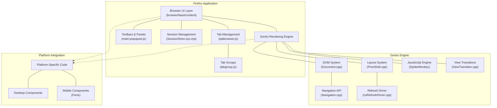
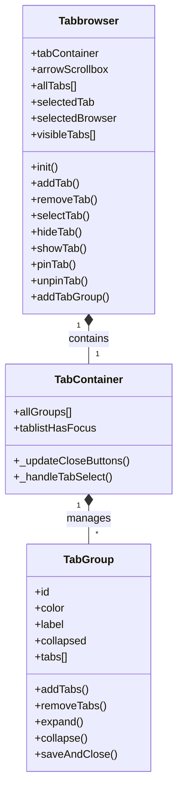
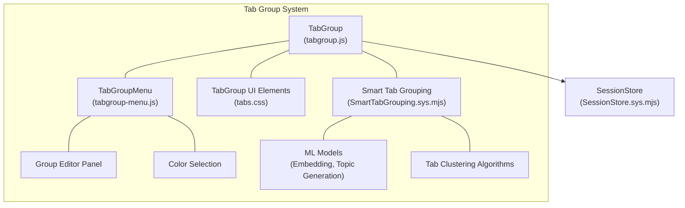
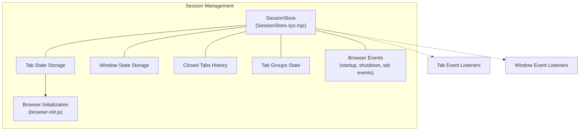
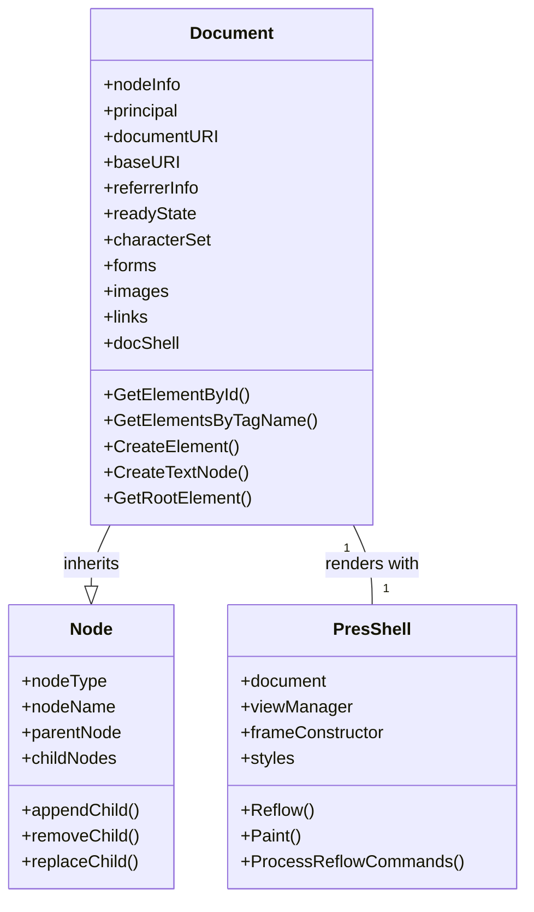
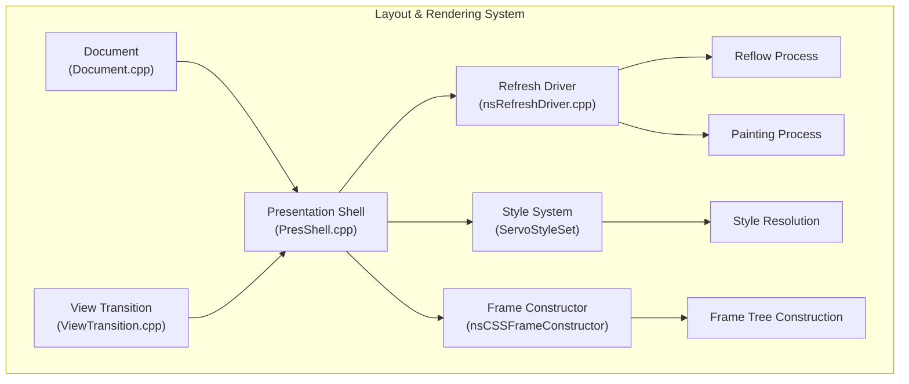
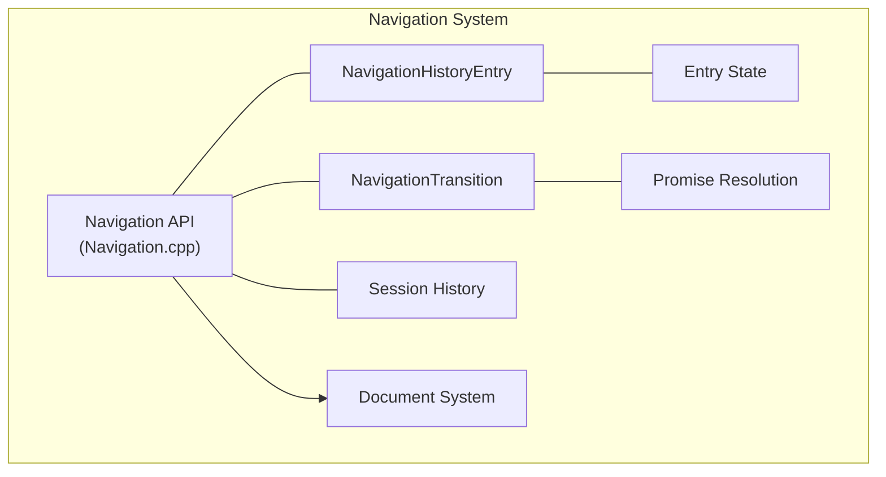
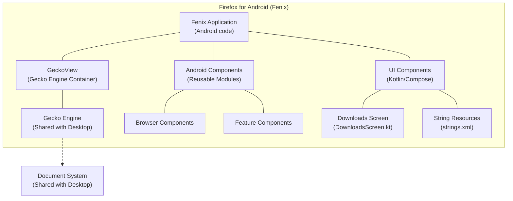
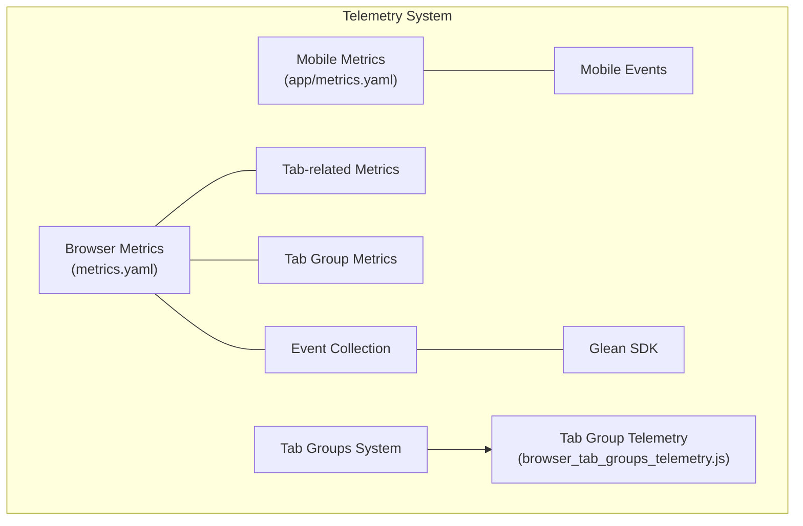
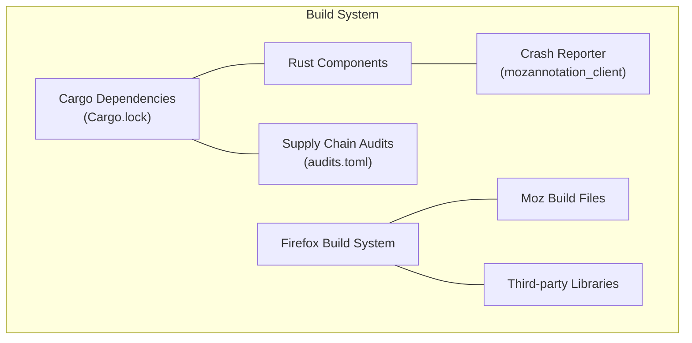

<!-- source: DeepWiki mcp.deepwiki.com · repo mozilla/gecko-dev · page 1 Firefox Architecture Overview · fetched 2026-10-09 -->

# Firefox Architecture Overview

<details>
<summary>Relevant source files</summary>

The following files were used as context for generating this wiki page:

- [Cargo.lock](Cargo.lock)
- [browser/actors/BlockedSiteParent.sys.mjs](browser/actors/BlockedSiteParent.sys.mjs)
- [browser/base/content/browser-init.js](browser/base/content/browser-init.js)
- [browser/base/content/browser-sync.js](browser/base/content/browser-sync.js)
- [browser/base/content/browser.js](browser/base/content/browser.js)
- [browser/base/content/browser.js.globals](browser/base/content/browser.js.globals)
- [browser/base/content/browser.xhtml](browser/base/content/browser.xhtml)
- [browser/base/content/main-popupset.js](browser/base/content/main-popupset.js)
- [browser/base/content/navigator-toolbox.inc.xhtml](browser/base/content/navigator-toolbox.inc.xhtml)
- [browser/base/content/navigator-toolbox.js](browser/base/content/navigator-toolbox.js)
- [browser/base/content/test/performance/browser_tabopen.js](browser/base/content/test/performance/browser_tabopen.js)
- [browser/base/content/test/sync/browser.toml](browser/base/content/test/sync/browser.toml)
- [browser/base/content/test/sync/browser_sync.js](browser/base/content/test/sync/browser_sync.js)
- [browser/components/firefoxview/tests/browser/browser_opentabs_pinned_tabs.js](browser/components/firefoxview/tests/browser/browser_opentabs_pinned_tabs.js)
- [browser/components/sessionstore/SessionStore.sys.mjs](browser/components/sessionstore/SessionStore.sys.mjs)
- [browser/components/sessionstore/TabGroupState.sys.mjs](browser/components/sessionstore/TabGroupState.sys.mjs)
- [browser/components/sessionstore/test/browser_tab_groups_save_on_window_close.js](browser/components/sessionstore/test/browser_tab_groups_save_on_window_close.js)
- [browser/components/sessionstore/test/marionette/test_restore_manually_with_tab_groups.py](browser/components/sessionstore/test/marionette/test_restore_manually_with_tab_groups.py)
- [browser/components/tabbrowser/GroupsList.sys.mjs](browser/components/tabbrowser/GroupsList.sys.mjs)
- [browser/components/tabbrowser/SmartTabGrouping.sys.mjs](browser/components/tabbrowser/SmartTabGrouping.sys.mjs)
- [browser/components/tabbrowser/TabMetrics.sys.mjs](browser/components/tabbrowser/TabMetrics.sys.mjs)
- [browser/components/tabbrowser/TabsList.sys.mjs](browser/components/tabbrowser/TabsList.sys.mjs)
- [browser/components/tabbrowser/content/tab.js](browser/components/tabbrowser/content/tab.js)
- [browser/components/tabbrowser/content/tabbrowser.js](browser/components/tabbrowser/content/tabbrowser.js)
- [browser/components/tabbrowser/content/tabgroup-menu.js](browser/components/tabbrowser/content/tabgroup-menu.js)
- [browser/components/tabbrowser/content/tabgroup.js](browser/components/tabbrowser/content/tabgroup.js)
- [browser/components/tabbrowser/content/tabs.js](browser/components/tabbrowser/content/tabs.js)
- [browser/components/tabbrowser/metrics.yaml](browser/components/tabbrowser/metrics.yaml)
- [browser/components/tabbrowser/moz.build](browser/components/tabbrowser/moz.build)
- [browser/components/tabbrowser/test/browser/smarttabgrouping/browser_tab_grouping_telemetry.js](browser/components/tabbrowser/test/browser/smarttabgrouping/browser_tab_grouping_telemetry.js)
- [browser/components/tabbrowser/test/browser/tabs/browser.toml](browser/components/tabbrowser/test/browser/tabs/browser.toml)
- [browser/components/tabbrowser/test/browser/tabs/browser_standalonePinnedTab.js](browser/components/tabbrowser/test/browser/tabs/browser_standalonePinnedTab.js)
- [browser/components/tabbrowser/test/browser/tabs/browser_tab_aria_level.js](browser/components/tabbrowser/test/browser/tabs/browser_tab_aria_level.js)
- [browser/components/tabbrowser/test/browser/tabs/browser_tab_aria_posinset_setsize.js](browser/components/tabbrowser/test/browser/tabs/browser_tab_aria_posinset_setsize.js)
- [browser/components/tabbrowser/test/browser/tabs/browser_tab_groups.js](browser/components/tabbrowser/test/browser/tabs/browser_tab_groups.js)
- [browser/components/tabbrowser/test/browser/tabs/browser_tab_groups_telemetry.js](browser/components/tabbrowser/test/browser/tabs/browser_tab_groups_telemetry.js)
- [browser/components/tabbrowser/test/browser/tabs/browser_tab_manager_close.js](browser/components/tabbrowser/test/browser/tabs/browser_tab_manager_close.js)
- [browser/components/tabbrowser/test/browser/tabs/browser_tab_manager_groups.js](browser/components/tabbrowser/test/browser/tabs/browser_tab_manager_groups.js)
- [browser/components/taskbartabs/TaskbarTabCmd.sys.mjs](browser/components/taskbartabs/TaskbarTabCmd.sys.mjs)
- [browser/components/taskbartabs/TaskbarTabs.sys.mjs](browser/components/taskbartabs/TaskbarTabs.sys.mjs)
- [browser/components/taskbartabs/components.conf](browser/components/taskbartabs/components.conf)
- [browser/components/taskbartabs/moz.build](browser/components/taskbartabs/moz.build)
- [browser/components/taskbartabs/test/browser/browser.toml](browser/components/taskbartabs/test/browser/browser.toml)
- [browser/components/taskbartabs/test/browser/browser_taskBarTabs_module.js](browser/components/taskbartabs/test/browser/browser_taskBarTabs_module.js)
- [browser/components/taskbartabs/test/browser/browser_taskbarTabs_chromeTest.js](browser/components/taskbartabs/test/browser/browser_taskbarTabs_chromeTest.js)
- [browser/components/taskbartabs/test/browser/dummy_page.html](browser/components/taskbartabs/test/browser/dummy_page.html)
- [browser/components/taskbartabs/test/browser/head.js](browser/components/taskbartabs/test/browser/head.js)
- [browser/components/urlbar/ActionsProviderTabGroups.sys.mjs](browser/components/urlbar/ActionsProviderTabGroups.sys.mjs)
- [browser/locales-preview/smartTabGroups.ftl](browser/locales-preview/smartTabGroups.ftl)
- [browser/locales-preview/taskbartabs.ftl](browser/locales-preview/taskbartabs.ftl)
- [browser/locales/en-US/browser/sync.ftl](browser/locales/en-US/browser/sync.ftl)
- [browser/locales/jar.mn](browser/locales/jar.mn)
- [browser/modules/BrowserDOMWindow.sys.mjs](browser/modules/BrowserDOMWindow.sys.mjs)
- [browser/modules/BrowserUsageTelemetry.sys.mjs](browser/modules/BrowserUsageTelemetry.sys.mjs)
- [browser/modules/HomePage.sys.mjs](browser/modules/HomePage.sys.mjs)
- [browser/modules/URILoadingHelper.sys.mjs](browser/modules/URILoadingHelper.sys.mjs)
- [browser/modules/moz.build](browser/modules/moz.build)
- [browser/themes/shared/customizableui/panelUI-shared.css](browser/themes/shared/customizableui/panelUI-shared.css)
- [browser/themes/shared/icons/taskbar-tabs-create-new.svg](browser/themes/shared/icons/taskbar-tabs-create-new.svg)
- [browser/themes/shared/tabbrowser/tabs.css](browser/themes/shared/tabbrowser/tabs.css)
- [browser/themes/shared/toolbarbuttons.css](browser/themes/shared/toolbarbuttons.css)
- [docshell/base/WindowContext.cpp](docshell/base/WindowContext.cpp)
- [docshell/base/WindowContext.h](docshell/base/WindowContext.h)
- [docshell/base/nsDocShell.cpp](docshell/base/nsDocShell.cpp)
- [docshell/base/nsIDocShell.idl](docshell/base/nsIDocShell.idl)
- [dom/base/Document.cpp](dom/base/Document.cpp)
- [dom/base/Document.h](dom/base/Document.h)
- [dom/base/FormData.cpp](dom/base/FormData.cpp)
- [dom/base/FormData.h](dom/base/FormData.h)
- [dom/base/VisualViewport.cpp](dom/base/VisualViewport.cpp)
- [dom/base/VisualViewport.h](dom/base/VisualViewport.h)
- [dom/base/nsHistory.h](dom/base/nsHistory.h)
- [dom/base/nsWrapperCache.h](dom/base/nsWrapperCache.h)
- [dom/bindings/BindingUtils.cpp](dom/bindings/BindingUtils.cpp)
- [dom/bindings/Codegen.py](dom/bindings/Codegen.py)
- [dom/bindings/DOMJSClass.h](dom/bindings/DOMJSClass.h)
- [dom/events/NavigateEvent.cpp](dom/events/NavigateEvent.cpp)
- [dom/events/NavigateEvent.h](dom/events/NavigateEvent.h)
- [dom/navigation/Navigation.cpp](dom/navigation/Navigation.cpp)
- [dom/navigation/Navigation.h](dom/navigation/Navigation.h)
- [dom/navigation/NavigationHistoryEntry.cpp](dom/navigation/NavigationHistoryEntry.cpp)
- [dom/navigation/NavigationHistoryEntry.h](dom/navigation/NavigationHistoryEntry.h)
- [dom/promise/Promise.cpp](dom/promise/Promise.cpp)
- [dom/promise/Promise.h](dom/promise/Promise.h)
- [dom/view-transitions/ViewTransition.cpp](dom/view-transitions/ViewTransition.cpp)
- [dom/view-transitions/ViewTransition.h](dom/view-transitions/ViewTransition.h)
- [gfx/layers/wr/WebRenderLayerManager.h](gfx/layers/wr/WebRenderLayerManager.h)
- [layout/base/PresShell.cpp](layout/base/PresShell.cpp)
- [layout/base/PresShell.h](layout/base/PresShell.h)
- [layout/base/PresShellForwards.h](layout/base/PresShellForwards.h)
- [layout/base/PresShellInlines.h](layout/base/PresShellInlines.h)
- [layout/base/RenderingPhase.h](layout/base/RenderingPhase.h)
- [layout/base/nsPresContext.cpp](layout/base/nsPresContext.cpp)
- [layout/base/nsPresContext.h](layout/base/nsPresContext.h)
- [layout/base/nsRefreshDriver.cpp](layout/base/nsRefreshDriver.cpp)
- [layout/base/nsRefreshDriver.h](layout/base/nsRefreshDriver.h)
- [layout/generic/ScrollContainerFrame.h](layout/generic/ScrollContainerFrame.h)
- [layout/style/ServoStyleSet.cpp](layout/style/ServoStyleSet.cpp)
- [mobile/android/android-components/components/feature/awesomebar/build.gradle](mobile/android/android-components/components/feature/awesomebar/build.gradle)
- [mobile/android/android-components/components/feature/awesomebar/src/main/java/mozilla/components/feature/awesomebar/facts/AwesomeBarFacts.kt](mobile/android/android-components/components/feature/awesomebar/src/main/java/mozilla/components/feature/awesomebar/facts/AwesomeBarFacts.kt)
- [mobile/android/android-components/components/feature/awesomebar/src/main/java/mozilla/components/feature/awesomebar/provider/RecentSearchSuggestionsProvider.kt](mobile/android/android-components/components/feature/awesomebar/src/main/java/mozilla/components/feature/awesomebar/provider/RecentSearchSuggestionsProvider.kt)
- [mobile/android/android-components/components/feature/awesomebar/src/main/java/mozilla/components/feature/awesomebar/provider/SearchTermSuggestionsProvider.kt](mobile/android/android-components/components/feature/awesomebar/src/main/java/mozilla/components/feature/awesomebar/provider/SearchTermSuggestionsProvider.kt)
- [mobile/android/android-components/components/feature/awesomebar/src/main/java/mozilla/components/feature/awesomebar/provider/TopSitesSuggestionProvider.kt](mobile/android/android-components/components/feature/awesomebar/src/main/java/mozilla/components/feature/awesomebar/provider/TopSitesSuggestionProvider.kt)
- [mobile/android/android-components/components/feature/awesomebar/src/main/java/mozilla/components/feature/awesomebar/provider/TrendingSearchProvider.kt](mobile/android/android-components/components/feature/awesomebar/src/main/java/mozilla/components/feature/awesomebar/provider/TrendingSearchProvider.kt)
- [mobile/android/android-components/components/feature/awesomebar/src/test/java/mozilla/components/feature/awesomebar/facts/AwesomeBarFactsTest.kt](mobile/android/android-components/components/feature/awesomebar/src/test/java/mozilla/components/feature/awesomebar/facts/AwesomeBarFactsTest.kt)
- [mobile/android/android-components/components/feature/awesomebar/src/test/java/mozilla/components/feature/awesomebar/provider/RecentSearchSuggestionsProviderTest.kt](mobile/android/android-components/components/feature/awesomebar/src/test/java/mozilla/components/feature/awesomebar/provider/RecentSearchSuggestionsProviderTest.kt)
- [mobile/android/android-components/components/feature/awesomebar/src/test/java/mozilla/components/feature/awesomebar/provider/SearchTermSuggestionsProviderTest.kt](mobile/android/android-components/components/feature/awesomebar/src/test/java/mozilla/components/feature/awesomebar/provider/SearchTermSuggestionsProviderTest.kt)
- [mobile/android/android-components/components/feature/awesomebar/src/test/java/mozilla/components/feature/awesomebar/provider/TopSitesSuggestionProviderTest.kt](mobile/android/android-components/components/feature/awesomebar/src/test/java/mozilla/components/feature/awesomebar/provider/TopSitesSuggestionProviderTest.kt)
- [mobile/android/android-components/components/feature/awesomebar/src/test/java/mozilla/components/feature/awesomebar/provider/TrendingSearchProviderTest.kt](mobile/android/android-components/components/feature/awesomebar/src/test/java/mozilla/components/feature/awesomebar/provider/TrendingSearchProviderTest.kt)
- [mobile/android/android-components/components/feature/search/src/main/java/mozilla/components/feature/search/trendingsearches/TrendingSearchClient.kt](mobile/android/android-components/components/feature/search/src/main/java/mozilla/components/feature/search/trendingsearches/TrendingSearchClient.kt)
- [mobile/android/android-components/components/feature/search/src/test/java/mozilla/components/feature/search/trendingsearches/TrendingSearchClientTest.kt](mobile/android/android-components/components/feature/search/src/test/java/mozilla/components/feature/search/trendingsearches/TrendingSearchClientTest.kt)
- [mobile/android/fenix/app/metrics.yaml](mobile/android/fenix/app/metrics.yaml)
- [mobile/android/fenix/app/src/main/java/org/mozilla/fenix/components/metrics/MetricController.kt](mobile/android/fenix/app/src/main/java/org/mozilla/fenix/components/metrics/MetricController.kt)
- [mobile/android/fenix/app/src/main/java/org/mozilla/fenix/downloads/listscreen/DownloadFragment.kt](mobile/android/fenix/app/src/main/java/org/mozilla/fenix/downloads/listscreen/DownloadFragment.kt)
- [mobile/android/fenix/app/src/main/java/org/mozilla/fenix/downloads/listscreen/DownloadsScreen.kt](mobile/android/fenix/app/src/main/java/org/mozilla/fenix/downloads/listscreen/DownloadsScreen.kt)
- [mobile/android/fenix/app/src/main/java/org/mozilla/fenix/downloads/listscreen/DownloadsTopAppBar.kt](mobile/android/fenix/app/src/main/java/org/mozilla/fenix/downloads/listscreen/DownloadsTopAppBar.kt)
- [mobile/android/fenix/app/src/main/java/org/mozilla/fenix/downloads/listscreen/middleware/DownloadTelemetryMiddleware.kt](mobile/android/fenix/app/src/main/java/org/mozilla/fenix/downloads/listscreen/middleware/DownloadTelemetryMiddleware.kt)
- [mobile/android/fenix/app/src/main/java/org/mozilla/fenix/downloads/listscreen/middleware/DownloadUIShareMiddleware.kt](mobile/android/fenix/app/src/main/java/org/mozilla/fenix/downloads/listscreen/middleware/DownloadUIShareMiddleware.kt)
- [mobile/android/fenix/app/src/main/java/org/mozilla/fenix/downloads/listscreen/store/DownloadListItem.kt](mobile/android/fenix/app/src/main/java/org/mozilla/fenix/downloads/listscreen/store/DownloadListItem.kt)
- [mobile/android/fenix/app/src/main/java/org/mozilla/fenix/downloads/listscreen/store/DownloadUIAction.kt](mobile/android/fenix/app/src/main/java/org/mozilla/fenix/downloads/listscreen/store/DownloadUIAction.kt)
- [mobile/android/fenix/app/src/main/java/org/mozilla/fenix/downloads/listscreen/store/DownloadUIState.kt](mobile/android/fenix/app/src/main/java/org/mozilla/fenix/downloads/listscreen/store/DownloadUIState.kt)
- [mobile/android/fenix/app/src/main/java/org/mozilla/fenix/downloads/listscreen/store/DownloadUIStore.kt](mobile/android/fenix/app/src/main/java/org/mozilla/fenix/downloads/listscreen/store/DownloadUIStore.kt)
- [mobile/android/fenix/app/src/main/java/org/mozilla/fenix/downloads/listscreen/store/FileItemToIconMapper.kt](mobile/android/fenix/app/src/main/java/org/mozilla/fenix/downloads/listscreen/store/FileItemToIconMapper.kt)
- [mobile/android/fenix/app/src/main/java/org/mozilla/fenix/downloads/listscreen/ui/DownloadSearchField.kt](mobile/android/fenix/app/src/main/java/org/mozilla/fenix/downloads/listscreen/ui/DownloadSearchField.kt)
- [mobile/android/fenix/app/src/main/java/org/mozilla/fenix/ext/String.kt](mobile/android/fenix/app/src/main/java/org/mozilla/fenix/ext/String.kt)
- [mobile/android/fenix/app/src/main/java/org/mozilla/fenix/settings/SettingsFragment.kt](mobile/android/fenix/app/src/main/java/org/mozilla/fenix/settings/SettingsFragment.kt)
- [mobile/android/fenix/app/src/main/res/values/strings.xml](mobile/android/fenix/app/src/main/res/values/strings.xml)
- [mobile/android/fenix/app/src/test/java/org/mozilla/fenix/components/metrics/MetricControllerTest.kt](mobile/android/fenix/app/src/test/java/org/mozilla/fenix/components/metrics/MetricControllerTest.kt)
- [mobile/android/fenix/app/src/test/java/org/mozilla/fenix/downloads/listscreen/middleware/DownloadTelemetryMiddlewareTest.kt](mobile/android/fenix/app/src/test/java/org/mozilla/fenix/downloads/listscreen/middleware/DownloadTelemetryMiddlewareTest.kt)
- [mobile/android/fenix/app/src/test/java/org/mozilla/fenix/downloads/listscreen/store/DownloadUIStateTest.kt](mobile/android/fenix/app/src/test/java/org/mozilla/fenix/downloads/listscreen/store/DownloadUIStateTest.kt)
- [mobile/android/fenix/app/src/test/java/org/mozilla/fenix/downloads/listscreen/store/DownloadUIStateTestData.kt](mobile/android/fenix/app/src/test/java/org/mozilla/fenix/downloads/listscreen/store/DownloadUIStateTestData.kt)
- [mobile/android/fenix/app/src/test/java/org/mozilla/fenix/downloads/listscreen/store/DownloadUIStoreTest.kt](mobile/android/fenix/app/src/test/java/org/mozilla/fenix/downloads/listscreen/store/DownloadUIStoreTest.kt)
- [mobile/android/fenix/app/src/test/java/org/mozilla/fenix/downloads/listscreen/store/FileItemTest.kt](mobile/android/fenix/app/src/test/java/org/mozilla/fenix/downloads/listscreen/store/FileItemTest.kt)
- [mobile/android/fenix/app/src/test/java/org/mozilla/fenix/downloads/listscreen/store/FileItemToIconMapperTest.kt](mobile/android/fenix/app/src/test/java/org/mozilla/fenix/downloads/listscreen/store/FileItemToIconMapperTest.kt)
- [mobile/android/fenix/app/src/test/java/org/mozilla/fenix/ext/StringTest.kt](mobile/android/fenix/app/src/test/java/org/mozilla/fenix/ext/StringTest.kt)
- [supply-chain/audits.toml](supply-chain/audits.toml)
- [testing/web-platform/meta/css/css-view-transitions/transition-in-hidden-page.html.ini](testing/web-platform/meta/css/css-view-transitions/transition-in-hidden-page.html.ini)
- [testing/web-platform/meta/css/cssom-view/scrollIntoView-sideways-lr-writing-mode.html.ini](testing/web-platform/meta/css/cssom-view/scrollIntoView-sideways-lr-writing-mode.html.ini)
- [testing/web-platform/tests/css/css-scroll-snap/snap-after-relayout/resnap-on-reconstructing-frame.html](testing/web-platform/tests/css/css-scroll-snap/snap-after-relayout/resnap-on-reconstructing-frame.html)
- [third_party/rust/memtest/.cargo-checksum.json](third_party/rust/memtest/.cargo-checksum.json)
- [third_party/rust/memtest/Cargo.lock](third_party/rust/memtest/Cargo.lock)
- [third_party/rust/memtest/Cargo.toml](third_party/rust/memtest/Cargo.toml)
- [third_party/rust/memtest/LICENSE](third_party/rust/memtest/LICENSE)
- [third_party/rust/memtest/README.md](third_party/rust/memtest/README.md)
- [third_party/rust/memtest/examples/usage.rs](third_party/rust/memtest/examples/usage.rs)
- [third_party/rust/memtest/src/lib.rs](third_party/rust/memtest/src/lib.rs)
- [third_party/rust/memtest/src/memtest.rs](third_party/rust/memtest/src/memtest.rs)
- [toolkit/actors/AboutHttpsOnlyErrorParent.sys.mjs](toolkit/actors/AboutHttpsOnlyErrorParent.sys.mjs)
- [toolkit/actors/NetErrorParent.sys.mjs](toolkit/actors/NetErrorParent.sys.mjs)
- [toolkit/components/url-classifier/tests/mochitest/test_reporturl.html](toolkit/components/url-classifier/tests/mochitest/test_reporturl.html)
- [toolkit/content/widgets/arrowscrollbox.js](toolkit/content/widgets/arrowscrollbox.js)
- [toolkit/crashreporter/breakpad-client/linux/crash_generation/crash_generation_server.cc](toolkit/crashreporter/breakpad-client/linux/crash_generation/crash_generation_server.cc)
- [toolkit/crashreporter/breakpad-client/linux/crash_generation/crash_generation_server.h](toolkit/crashreporter/breakpad-client/linux/crash_generation/crash_generation_server.h)
- [toolkit/crashreporter/breakpad-client/linux/handler/exception_handler.cc](toolkit/crashreporter/breakpad-client/linux/handler/exception_handler.cc)
- [toolkit/crashreporter/client/app/Cargo.toml](toolkit/crashreporter/client/app/Cargo.toml)
- [toolkit/crashreporter/client/app/src/memory_test.rs](toolkit/crashreporter/client/app/src/memory_test.rs)
- [toolkit/crashreporter/mozannotation_client/Cargo.toml](toolkit/crashreporter/mozannotation_client/Cargo.toml)
- [toolkit/crashreporter/mozannotation_client/cbindgen.toml](toolkit/crashreporter/mozannotation_client/cbindgen.toml)
- [toolkit/crashreporter/mozannotation_client/src/lib.rs](toolkit/crashreporter/mozannotation_client/src/lib.rs)
- [toolkit/crashreporter/mozannotation_server/src/lib.rs](toolkit/crashreporter/mozannotation_server/src/lib.rs)
- [toolkit/crashreporter/process_reader/src/lib.rs](toolkit/crashreporter/process_reader/src/lib.rs)
- [toolkit/crashreporter/process_reader/src/platform/linux.rs](toolkit/crashreporter/process_reader/src/platform/linux.rs)
- [toolkit/crashreporter/process_reader/src/platform/macos.rs](toolkit/crashreporter/process_reader/src/platform/macos.rs)
- [toolkit/crashreporter/process_reader/src/platform/windows.rs](toolkit/crashreporter/process_reader/src/platform/windows.rs)
- [toolkit/crashreporter/rust_minidump_writer_linux/src/lib.rs](toolkit/crashreporter/rust_minidump_writer_linux/src/lib.rs)
- [xpcom/ds/nsTArray.cpp](xpcom/ds/nsTArray.cpp)
- [xpcom/ds/nsTArray.h](xpcom/ds/nsTArray.h)

</details>


This document provides a high-level overview of the Firefox browser architecture, highlighting the main components, how they interact, and their responsibilities within the system. It aims to orient developers who are new to the Firefox codebase by explaining the fundamental structure and organization of the key systems.

For detailed information about specific components, please refer to the dedicated wiki pages linked in the relevant sections. This overview focuses on the desktop version of Firefox, though it briefly touches on the mobile architecture as well.

## Core Architecture Components

Firefox is built on a multi-process architecture with several key components that work together to deliver the browser experience.



Sources:
- [browser/components/tabbrowser/content/tabbrowser.js:1-1350]()
- [dom/base/Document.cpp:1-100]()
- [browser/components/sessionstore/SessionStore.sys.mjs:1-60]()
- [layout/base/PresShell.cpp:1-120]()
- [dom/navigation/Navigation.cpp:1-50]()
- [dom/view-transitions/ViewTransition.cpp:1-25]()
- [browser/base/content/browser.js:1-115]()

## Browser UI Framework

The Firefox UI is structured around a central tab browser component that manages the user's browsing sessions and provides the primary user interface.

### Tab Browser System

The tab browser (`tabbrowser.js`) is one of the core components that manages tabs, browsers, and their content. It's responsible for:

- Creating and destroying tabs
- Switching between tabs
- Managing tab state (loading, pinned, hidden)
- Coordinating with the session store
- Handling tab events and user interactions



Sources:
- [browser/components/tabbrowser/content/tabbrowser.js:94-446]()
- [browser/components/tabbrowser/content/tabs.js:26-143]()
- [browser/components/tabbrowser/content/tabgroup.js:9-15]()
- [browser/components/tabbrowser/GroupsList.sys.mjs:1-5]()

### Tab Groups

Tab Groups are a feature that allows users to organize related tabs together. The implementation includes:

- Tab group creation and management
- Group UI representation in the tab bar
- Group editing interface
- Group collapse/expand functionality
- Smart tab grouping with AI suggestions



Sources:
- [browser/components/tabbrowser/content/tabgroup.js:10-30]()
- [browser/components/tabbrowser/content/tabgroup-menu.js:24-50]()
- [browser/components/tabbrowser/SmartTabGrouping.sys.mjs:55-136]()
- [browser/themes/shared/tabbrowser/tabs.css:78-108]()
- [browser/components/sessionstore/SessionStore.sys.mjs:30-33]()

### Session Management

The Session Store system is responsible for persisting the user's browsing session across browser restarts and crashes. It handles:

- Saving and restoring window and tab state
- Managing closed tabs history
- Browser shutdown and startup restoration
- Tab group persistence



Sources:
- [browser/components/sessionstore/SessionStore.sys.mjs:1-100]()
- [browser/base/content/browser-init.js:11-18]()
- [browser/components/tabbrowser/test/browser/tabs/browser_tab_manager_groups.js:6-10]()

## Gecko Browser Engine

The core of Firefox is the Gecko rendering engine, which handles the parsing, layout, and rendering of web content.

### Document Object Model (DOM)

The Document class (`Document.cpp`) is a central component of the DOM system that represents a web page. It's responsible for:

- Managing the document's content tree
- Handling document events
- Managing document state
- Coordinating with the layout system
- Security and content policies



Sources:
- [dom/base/Document.cpp:1-150]()
- [dom/base/Document.cpp:485-670]()
- [dom/base/Document.h:1-120]()
- [layout/base/PresShell.cpp:1-50]()

### Layout and Rendering

The presentation shell (`PresShell.cpp`) is responsible for coordinating the layout and rendering of content. It works with:

- The refresh driver to schedule reflows and repaints
- The frame constructor to build the frame tree
- The view system to manage visual representation
- Style resolution and application



Sources:
- [layout/base/PresShell.cpp:1-125]()
- [layout/base/nsRefreshDriver.cpp:1-6]()
- [dom/view-transitions/ViewTransition.cpp:1-25]()

### Navigation System

The Navigation API (`Navigation.cpp`) provides a modern interface for browser navigation, working alongside the traditional history mechanisms:

- Handling navigation events
- Managing navigation entries
- Coordinating with the session history
- Supporting transitions between pages



Sources:
- [dom/navigation/Navigation.cpp:1-70]()

## Mobile Architecture (Firefox for Android)

Firefox for Android (Fenix) shares the Gecko engine with desktop Firefox but has a completely different UI layer built with Android components.



Sources:
- [mobile/android/fenix/app/src/main/java/org/mozilla/fenix/downloads/listscreen/DownloadsScreen.kt:1-15]()
- [mobile/android/fenix/app/src/main/res/values/strings.xml:1-50]()
- [mobile/android/fenix/app/metrics.yaml:1-42]()

## Telemetry and Metrics

Firefox includes comprehensive telemetry systems to collect usage data and metrics. The system is designed to respect user privacy while providing valuable insights for development.



Sources:
- [browser/components/tabbrowser/metrics.yaml:1-33]()
- [mobile/android/fenix/app/metrics.yaml:1-42]()
- [browser/components/tabbrowser/test/browser/tabs/browser_tab_groups_telemetry.js:1-4]()

## System Dependencies and Build Infrastructure

Firefox has a complex dependency graph managed through various build tools, including Cargo for Rust components.



Sources:
- [Cargo.lock:1-50]()
- [supply-chain/audits.toml:1-33]()
- [toolkit/crashreporter/mozannotation_client/src/lib.rs:1-3]()

## Integration Points and Communication Flows

The following diagram illustrates how the major systems in Firefox interact with each other:

```mermaid
graph TD
    subgraph "User Interface Layer"
        BrowserXUL["Browser Window<br>(browser.xhtml)"] --> Tabbrowser["Tabbrowser<br>(tabbrowser.js)"]
        BrowserXUL --> BrowserJS["Browser Logic<br>(browser.js)"]
        BrowserXUL --> Popups["Popups and Panels<br>(main-popupset.js)"]
        
        Tabbrowser --> TabGroup["Tab Groups<br>(tabgroup.js)"]
    end
    
    subgraph "Browser Services"
        SessionStore["Session Store<br>(SessionStore.sys.mjs)"] --> BrowserInit["Browser Init<br>(browser-init.js)"]
        TabGroup --> SmartGrouping["Smart Tab Grouping<br>(SmartTabGrouping.sys.mjs)"]
    end
    
    subgraph "Core Engine"
        GeckoEngine["Gecko Engine"] --> Document["Document<br>(Document.cpp)"]
        Document --> PresShell["PresShell<br>(PresShell.cpp)"]
        Document --> Navigation["Navigation API<br>(Navigation.cpp)"]
        PresShell --> ViewTransition["View Transition<br>(ViewTransition.cpp)"]
        PresShell --> RefreshDriver["Refresh Driver<br>(nsRefreshDriver.cpp)"]
    end
    
    Tabbrowser <--> SessionStore
    BrowserJS <--> GeckoEngine
    Tabbrowser --> GeckoEngine: "Creates and manages browser elements"
    
    class BrowserXUL,Tabbrowser,GeckoEngine,Document fontsize:14px;
```

Sources:
- [browser/base/content/browser.xhtml:1-4]()
- [browser/components/tabbrowser/content/tabbrowser.js:94-130]()
- [browser/base/content/browser.js:1-116]()
- [browser/base/content/main-popupset.js:1-2]()
- [browser/components/sessionstore/SessionStore.sys.mjs:1-60]()
- [dom/base/Document.cpp:1-50]()
- [layout/base/PresShell.cpp:1-50]()

## Key Architectural Principles

Firefox's architecture follows several key principles:

1. **Multi-process separation**: Browser UI runs in the parent process, while web content runs in child processes for security and stability.

2. **Component modularity**: Systems are designed as reusable modules with clear interfaces.

3. **Progressive enhancement**: Features like tab groups build on the basic browser functionality.

4. **Cross-platform core**: The Gecko engine is shared across desktop and mobile platforms, while UI layers are platform-specific.

5. **Extensibility**: The architecture supports extension through add-ons and internal feature modules.

## Table of Key Components and Responsibilities

| Component | Primary Files | Responsibilities |
|-----------|---------------|------------------|
| Tabbrowser | [browser/components/tabbrowser/content/tabbrowser.js]() | Tab creation, selection, management |
| Tab Groups | [browser/components/tabbrowser/content/tabgroup.js]() | Organizing tabs into logical groups |
| Document | [dom/base/Document.cpp]() | Managing web document structure and content |
| PresShell | [layout/base/PresShell.cpp]() | Coordinating layout and rendering |
| SessionStore | [browser/components/sessionstore/SessionStore.sys.mjs]() | Persisting session state across restarts |
| Navigation API | [dom/navigation/Navigation.cpp]() | Managing browser navigation |
| View Transition | [dom/view-transitions/ViewTransition.cpp]() | Smooth transitions between page states |
| Browser Init | [browser/base/content/browser-init.js]() | Browser startup sequence |
| Smart Tab Grouping | [browser/components/tabbrowser/SmartTabGrouping.sys.mjs]() | AI-powered tab organization |

This overview provides a foundation for understanding the Firefox codebase structure. For more detailed information on specific components, please refer to their dedicated wiki pages or explore the referenced source files.

---

