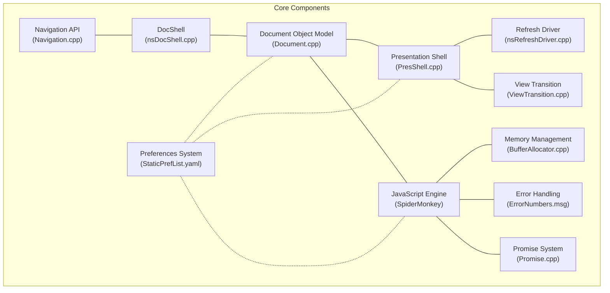
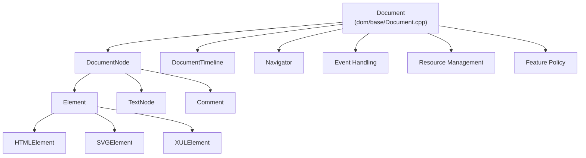
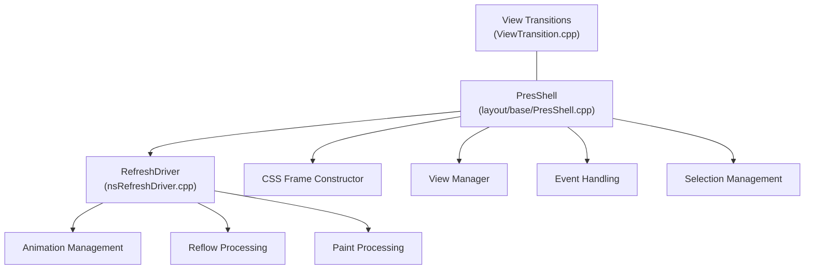
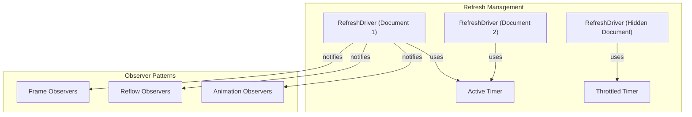
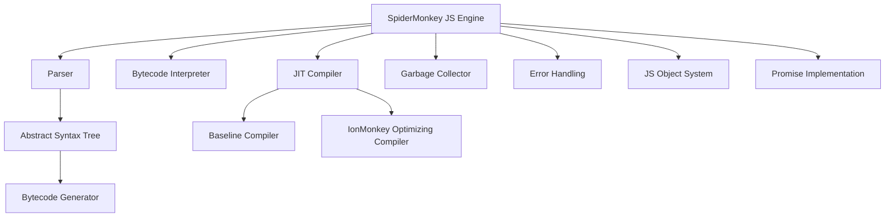
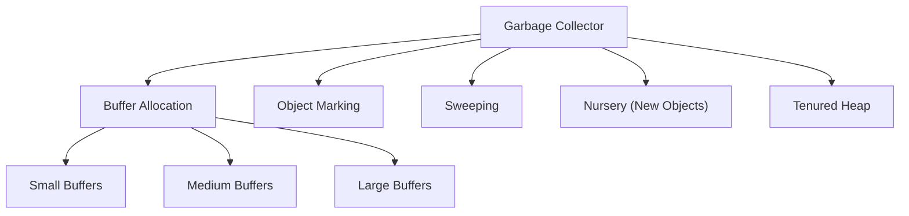
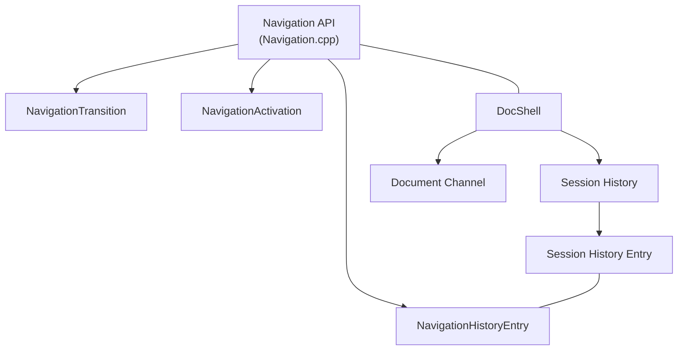
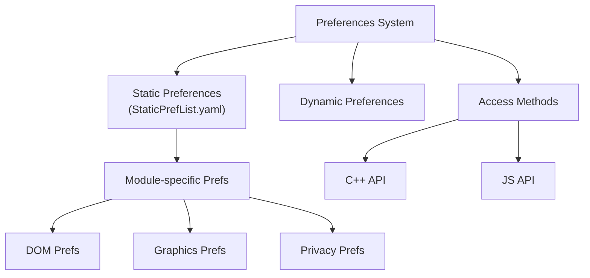
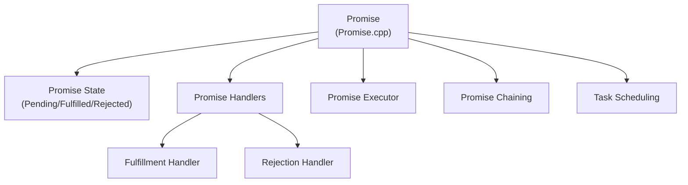
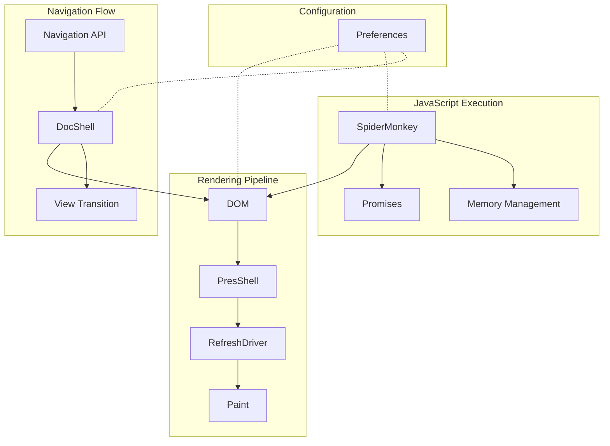

<!-- source: DeepWiki mcp.deepwiki.com · repo mozilla/gecko-dev · page 1.1 Core Components and Systems · fetched 2026-10-09 -->

# Core Components and Systems

<details>
<summary>Relevant source files</summary>

The following files were used as context for generating this wiki page:

- [docshell/base/WindowContext.cpp](docshell/base/WindowContext.cpp)
- [docshell/base/WindowContext.h](docshell/base/WindowContext.h)
- [docshell/base/nsDocShell.cpp](docshell/base/nsDocShell.cpp)
- [docshell/base/nsIDocShell.idl](docshell/base/nsIDocShell.idl)
- [dom/base/Document.cpp](dom/base/Document.cpp)
- [dom/base/Document.h](dom/base/Document.h)
- [dom/base/FormData.cpp](dom/base/FormData.cpp)
- [dom/base/FormData.h](dom/base/FormData.h)
- [dom/base/VisualViewport.cpp](dom/base/VisualViewport.cpp)
- [dom/base/VisualViewport.h](dom/base/VisualViewport.h)
- [dom/base/nsHistory.h](dom/base/nsHistory.h)
- [dom/base/nsWrapperCache.h](dom/base/nsWrapperCache.h)
- [dom/bindings/BindingUtils.cpp](dom/bindings/BindingUtils.cpp)
- [dom/bindings/Codegen.py](dom/bindings/Codegen.py)
- [dom/bindings/DOMJSClass.h](dom/bindings/DOMJSClass.h)
- [dom/events/NavigateEvent.cpp](dom/events/NavigateEvent.cpp)
- [dom/events/NavigateEvent.h](dom/events/NavigateEvent.h)
- [dom/navigation/Navigation.cpp](dom/navigation/Navigation.cpp)
- [dom/navigation/Navigation.h](dom/navigation/Navigation.h)
- [dom/navigation/NavigationHistoryEntry.cpp](dom/navigation/NavigationHistoryEntry.cpp)
- [dom/navigation/NavigationHistoryEntry.h](dom/navigation/NavigationHistoryEntry.h)
- [dom/promise/Promise.cpp](dom/promise/Promise.cpp)
- [dom/promise/Promise.h](dom/promise/Promise.h)
- [dom/view-transitions/ViewTransition.cpp](dom/view-transitions/ViewTransition.cpp)
- [dom/view-transitions/ViewTransition.h](dom/view-transitions/ViewTransition.h)
- [gfx/layers/wr/WebRenderLayerManager.h](gfx/layers/wr/WebRenderLayerManager.h)
- [js/public/ErrorReport.h](js/public/ErrorReport.h)
- [js/public/ProtoKey.h](js/public/ProtoKey.h)
- [js/public/friend/ErrorNumbers.msg](js/public/friend/ErrorNumbers.msg)
- [js/src/builtin/TestingFunctions.cpp](js/src/builtin/TestingFunctions.cpp)
- [js/src/builtin/temporal/TemporalParser.cpp](js/src/builtin/temporal/TemporalParser.cpp)
- [js/src/debugger/Source.cpp](js/src/debugger/Source.cpp)
- [js/src/fuzz-tests/testWasm.cpp](js/src/fuzz-tests/testWasm.cpp)
- [js/src/gc/Allocator.h](js/src/gc/Allocator.h)
- [js/src/gc/BufferAllocator-inl.h](js/src/gc/BufferAllocator-inl.h)
- [js/src/gc/BufferAllocator.cpp](js/src/gc/BufferAllocator.cpp)
- [js/src/gc/BufferAllocator.h](js/src/gc/BufferAllocator.h)
- [js/src/gc/Nursery.cpp](js/src/gc/Nursery.cpp)
- [js/src/gc/Nursery.h](js/src/gc/Nursery.h)
- [js/src/gc/Tracer.h](js/src/gc/Tracer.h)
- [js/src/jit-test/lib/asserts.js](js/src/jit-test/lib/asserts.js)
- [js/src/jit-test/lib/wasm-binary.js](js/src/jit-test/lib/wasm-binary.js)
- [js/src/jit-test/tests/wasm/binary.js](js/src/jit-test/tests/wasm/binary.js)
- [js/src/jit-test/tests/wasm/bug1951874.js](js/src/jit-test/tests/wasm/bug1951874.js)
- [js/src/jit-test/tests/wasm/js-promise-integration/js-promise-integration.new.js](js/src/jit-test/tests/wasm/js-promise-integration/js-promise-integration.new.js)
- [js/src/jit-test/tests/wasm/regress/bug1957544.js](js/src/jit-test/tests/wasm/regress/bug1957544.js)
- [js/src/jsapi-tests/testGCAllocator.cpp](js/src/jsapi-tests/testGCAllocator.cpp)
- [js/src/jsexn.h](js/src/jsexn.h)
- [js/src/jsmath.cpp](js/src/jsmath.cpp)
- [js/src/jsshell.msg](js/src/jsshell.msg)
- [js/src/moz.build](js/src/moz.build)
- [js/src/shell/js.cpp](js/src/shell/js.cpp)
- [js/src/vm/Compression.cpp](js/src/vm/Compression.cpp)
- [js/src/vm/ErrorObject.cpp](js/src/vm/ErrorObject.cpp)
- [js/src/vm/GlobalObject.cpp](js/src/vm/GlobalObject.cpp)
- [js/src/vm/JSObject.cpp](js/src/vm/JSObject.cpp)
- [js/src/vm/NativeObject.h](js/src/vm/NativeObject.h)
- [js/src/vm/TypedArrayObject.cpp](js/src/vm/TypedArrayObject.cpp)
- [js/src/vm/TypedArrayObject.h](js/src/vm/TypedArrayObject.h)
- [js/src/wasm/WasmBinary.cpp](js/src/wasm/WasmBinary.cpp)
- [js/src/wasm/WasmBinary.h](js/src/wasm/WasmBinary.h)
- [js/src/wasm/WasmBinaryTypes.h](js/src/wasm/WasmBinaryTypes.h)
- [js/src/wasm/WasmCompile.h](js/src/wasm/WasmCompile.h)
- [js/src/wasm/WasmCompileArgs.h](js/src/wasm/WasmCompileArgs.h)
- [js/src/wasm/WasmJS.cpp](js/src/wasm/WasmJS.cpp)
- [js/src/wasm/WasmModuleTypes.cpp](js/src/wasm/WasmModuleTypes.cpp)
- [js/src/wasm/WasmModuleTypes.h](js/src/wasm/WasmModuleTypes.h)
- [js/src/wasm/WasmValidate.cpp](js/src/wasm/WasmValidate.cpp)
- [js/src/wasm/WasmValidate.h](js/src/wasm/WasmValidate.h)
- [js/xpconnect/wrappers/XrayWrapper.cpp](js/xpconnect/wrappers/XrayWrapper.cpp)
- [layout/base/PresShell.cpp](layout/base/PresShell.cpp)
- [layout/base/PresShell.h](layout/base/PresShell.h)
- [layout/base/PresShellForwards.h](layout/base/PresShellForwards.h)
- [layout/base/PresShellInlines.h](layout/base/PresShellInlines.h)
- [layout/base/RenderingPhase.h](layout/base/RenderingPhase.h)
- [layout/base/nsPresContext.cpp](layout/base/nsPresContext.cpp)
- [layout/base/nsPresContext.h](layout/base/nsPresContext.h)
- [layout/base/nsRefreshDriver.cpp](layout/base/nsRefreshDriver.cpp)
- [layout/base/nsRefreshDriver.h](layout/base/nsRefreshDriver.h)
- [layout/generic/ScrollContainerFrame.h](layout/generic/ScrollContainerFrame.h)
- [layout/style/ServoStyleSet.cpp](layout/style/ServoStyleSet.cpp)
- [modules/libpref/init/StaticPrefList.yaml](modules/libpref/init/StaticPrefList.yaml)
- [testing/web-platform/meta/css/css-view-transitions/transition-in-hidden-page.html.ini](testing/web-platform/meta/css/css-view-transitions/transition-in-hidden-page.html.ini)
- [testing/web-platform/meta/css/cssom-view/scrollIntoView-sideways-lr-writing-mode.html.ini](testing/web-platform/meta/css/cssom-view/scrollIntoView-sideways-lr-writing-mode.html.ini)
- [testing/web-platform/tests/css/css-scroll-snap/snap-after-relayout/resnap-on-reconstructing-frame.html](testing/web-platform/tests/css/css-scroll-snap/snap-after-relayout/resnap-on-reconstructing-frame.html)
- [xpcom/ds/nsTArray.cpp](xpcom/ds/nsTArray.cpp)
- [xpcom/ds/nsTArray.h](xpcom/ds/nsTArray.h)

</details>


This document provides an overview of the fundamental components and systems that form the core architecture of the Firefox browser and Gecko rendering engine. Understanding these components is essential for working effectively with the codebase. This page focuses on the core architectural elements rather than specific features or UI elements.

For information about UI components, see [User Interface Architecture](#3). For extension-related systems, see [Experimentation and Telemetry Systems](#5).

## Core Architecture Overview

Firefox's architecture is composed of several interconnected systems that work together to render web content, execute JavaScript, manage resources, and provide browser functionality.



Sources: [dom/base/Document.cpp](). [layout/base/PresShell.cpp](). [js/src/shell/js.cpp](). [dom/navigation/Navigation.cpp](). [modules/libpref/init/StaticPrefList.yaml](). [js/src/gc/BufferAllocator.cpp](). [dom/promise/Promise.cpp](). [dom/view-transitions/ViewTransition.cpp]().

## Document Object Model (DOM)

The Document Object Model (DOM) is a programming interface for web documents. It represents the document as a tree of objects that can be manipulated through JavaScript or other programming languages.



### Document Implementation

The `Document` class is the central class for representing web documents in Firefox. It extends `DocumentOrShadowRoot` and implements multiple interfaces including `nsIScriptObjectPrincipal`, `nsISupports`, and others.

Key responsibilities include:

1. **Document Lifecycle Management**: Handling loading, unloading, and state transitions
2. **Node Management**: Creating, organizing, and managing DOM nodes
3. **Event Handling**: Dispatching and processing DOM events 
4. **Resource Management**: Controlling external resources, stylesheets, and images
5. **Security Enforcement**: Managing Content Security Policy and permissions

#### Document Structure

A Document manages multiple collections including:

- **Elements by ID/Name**: Fast lookups via `IdentifierMapEntry`
- **Stylesheets**: Both author and user stylesheets
- **Event Listeners**: For DOM events
- **External Resources**: Referenced by the document

```cpp
class Document : public DocumentOrShadowRoot,
                 public nsIScriptObjectPrincipal,
                 /* other interfaces */ {
  private:
    // Document state and flags
    mozilla::dom::DocumentTimeline* mDocumentTimeline;
    nsRefPtrHashtable<nsStringHashKey, mozilla::dom::DOMStringList> mLists;
    mozilla::dom::ExternalResourceMap mExternalResourceMap;
    // Many other fields...
}
```

Sources: [dom/base/Document.h:39-300](). [dom/base/Document.cpp:1-100](). [dom/base/Document.cpp:484-550]().

### Document Components

#### Headers and Content Type Management

Documents handle metadata through header fields, managing content types and character encoding:

```cpp
class Document::HeaderData {
  public:
    HeaderData(nsAtom* aField, const nsAString& aData)
        : mField(aField), mData(aData) {}
    
    RefPtr<nsAtom> mField;
    nsString mData;
    UniquePtr<HeaderData> mNext;
};
```

#### Content Collections

Documents maintain special collections for efficiently retrieving elements:

```cpp
class SimpleHTMLCollection : public nsSimpleContentList,
                             public nsIHTMLCollection {
  // Provides fast access to elements by ID or name
}
```

Sources: [dom/base/Document.cpp:485-505](). [dom/base/Document.cpp:675-795]().

## Presentation System

The presentation system is responsible for rendering web content to the screen. It consists of several key components including PresShell, RefreshDriver, and frame management.



### PresShell

`PresShell` is the core presentation component that manages layout and rendering. It connects the DOM to visual presentation.

Key responsibilities:
1. **Rendering Coordination**: Manages the process of laying out and painting content
2. **Event Handling**: Processes user interactions with rendered content
3. **Frame Management**: Manages the frame tree that represents visual elements
4. **Selection Management**: Handles text/element selection
5. **Reflow Control**: Coordinates the reflow process that computes layout

```cpp
class PresShell : public nsISelectionController {
  private:
    RefPtr<nsViewManager> mViewManager;
    RefPtr<nsPresContext> mPresContext;
    RefPtr<nsDocumentViewer> mDocumentViewer;
    // Many other fields...
};
```

Sources: [layout/base/PresShell.cpp:5-60](). [layout/base/PresShell.cpp:216-257](). [layout/base/PresShell.h:9-40]().

### RefreshDriver

The `RefreshDriver` orchestrates visual updates and animation processing, determining when to update the display.

Key responsibilities:
1. **Scheduling**: Maintains the refresh timing for animations and repainting
2. **Observer Notification**: Notifies registered observers about refresh cycles
3. **Paint Coordination**: Triggers paint operations at appropriate times
4. **Animation Timing**: Provides timing information for animations

```cpp
class nsRefreshDriver final : public mozilla::layers::TransactionIdAllocator,
                             public nsARefreshObserver {
  // Maintains refresh timing and coordinates visual updates
};
```

Each document has its own `RefreshDriver`, but multiple drivers can share the same timer to conserve resources:



Sources: [layout/base/nsRefreshDriver.cpp:12-186](). [layout/base/nsRefreshDriver.h:54-100]().

### View Transitions

The `ViewTransition` system provides smooth visual transitions between different UI states:

```cpp
class ViewTransition final : public nsISupports, public nsWrapperCache {
  // Manages CSS View Transitions API
};
```

Key components:
1. **Snapshot Management**: Captures the visual state before and after transitions
2. **Animation Control**: Manages the animation timing between states
3. **Element Tracking**: Tracks elements across transition states

Sources: [dom/view-transitions/ViewTransition.cpp:36-170](). [dom/view-transitions/ViewTransition.h:39-76]().

## JavaScript Engine (SpiderMonkey)

SpiderMonkey is Firefox's JavaScript engine, responsible for executing JavaScript code. It's a complex system with many components working together.



### JSObject System

The JSObject system provides the foundation for JavaScript objects:

```cpp
class JSObject : public js::gc::Cell {
  // Base class for all JavaScript objects
};
```

Key aspects:
1. **Property Access**: Manages property storage and access
2. **Prototype Chain**: Handles prototype-based inheritance
3. **Type Information**: Maintains type data for optimization

Sources: [js/src/vm/JSObject.cpp:11-141]().

### Error Handling

Error handling is a critical part of the JavaScript engine:

```cpp
// Error message definitions
MSG_DEF(JSMSG_NOT_AN_ERROR,            0, JSEXN_ERR, "<Error #0 is reserved>")
MSG_DEF(JSMSG_NOT_DEFINED,             1, JSEXN_REFERENCEERR, "{0} is not defined")
MSG_DEF(JSMSG_MORE_ARGS_NEEDED,        4, JSEXN_TYPEERR, "{0}: At least {1} argument{2} required, but only {3} passed")
```

The error system provides:
1. **Standardized Errors**: Consistent error messages across the engine
2. **Localization Support**: Error messages can be translated
3. **Formatted Messages**: Supports parameter substitution

Sources: [js/public/friend/ErrorNumbers.msg:1-50](). [js/src/vm/ErrorObject.cpp:1-30]().

### JS Runtime

The JS runtime manages JavaScript execution:

```cpp
// Core JS shell runtime
using namespace js;
using namespace js::cli;
using namespace js::shell;
```

Sources: [js/src/shell/js.cpp:220-247]().

## Memory Management

Memory management in Firefox is sophisticated, with specialized systems for different allocation patterns and requirements.



### Buffer Allocator

The `BufferAllocator` provides memory allocation services for the JavaScript engine:

```cpp
class BufferAllocator {
  // Allocates dynamically sized blocks of memory
};
```

Key features:
1. **Size-Optimized Allocation**: Different strategies based on allocation size
2. **GC Integration**: Allocations can be reclaimed by the garbage collector
3. **Explicit Management**: Supports explicit free and resize operations
4. **Memory Tracking**: Tracks allocations for GC and debugging purposes

The allocator divides memory into three categories:
- **Small Buffers**: Fixed-size allocations
- **Medium Buffers**: Medium-sized allocations managed in chunks
- **Large Buffers**: Large allocations managed directly

Sources: [js/src/gc/BufferAllocator.cpp:5-88](). [js/src/gc/BufferAllocator.h:52-100]().

## Navigation System

The Navigation system manages browser navigation, history, and the Navigation API.



### Navigation API

The `Navigation` class implements the Navigation API, providing a modern interface for controlling browser navigation:

```cpp
class Navigation final : public DOMEventTargetHelper {
  // Implements the Navigation API standard
};
```

Key capabilities:
1. **History Management**: Access to browser history entries
2. **Navigation Control**: Methods for traversing history and loading URLs
3. **State Management**: Supports state objects for history entries
4. **Event Handling**: Events for navigation state changes

```cpp
void Navigation::Entries(
    nsTArray<RefPtr<NavigationHistoryEntry>>& aResult) const {
  aResult = mEntries.Clone();
}

already_AddRefed<NavigationHistoryEntry> Navigation::GetCurrentEntry() const {
  if (HasEntriesAndEventsDisabled()) {
    return nullptr;
  }

  if (!mCurrentEntryIndex) {
    return nullptr;
  }

  RefPtr entry{mEntries[*mCurrentEntryIndex]};
  return entry.forget();
}
```

Sources: [dom/navigation/Navigation.cpp:39-137](). [dom/navigation/Navigation.h:40-75]().

### Navigation History Entry

Each history entry is represented by `NavigationHistoryEntry`:

```cpp
class NavigationHistoryEntry : public nsISupports, public nsWrapperCache {
  // Represents a single entry in the navigation history
};
```

Sources: [dom/navigation/NavigationHistoryEntry.h:1-15](). [dom/navigation/NavigationHistoryEntry.cpp:1-15]().

### DocShell

The `nsDocShell` class provides core browser functionality:

```cpp
class nsDocShell : public nsDocLoader,
                  /* many interfaces */ {
  // Core browser component responsible for loading content
};
```

Key responsibilities:
1. **Content Loading**: Manages the loading process for documents
2. **History Management**: Maintains browsing history
3. **Navigation Control**: Implements navigation operations (back, forward, etc.)
4. **Frame Management**: Handles iframe/frame relationships

Sources: [docshell/base/nsDocShell.cpp:7-173]().

## Preferences System

The preferences system manages user and application settings through a hierarchical key-value store.



### Static Preferences

Static preferences are defined in `StaticPrefList.yaml` and are compiled into the application:

```yaml
# This file defines static prefs, i.e. those that are defined at startup and
# used entirely or mostly from C++ and/or Rust code.

- name: accessibility.tabfocus
  type: int32_t
  value: 7
  mirror: always

- name: browser.cache.disk.enable
  type: RelaxedAtomicBool
  value: true
  mirror: always
```

Key concepts:
1. **Preference Types**: Bool, Int32, Float, String, etc.
2. **Mirroring Policy**: How preferences are mirrored to C++ variables
   - `never`: No C++ mirror variable
   - `once`: Mirrored only at startup
   - `always`: Always kept in sync

3. **Default Values**: Initial values for preferences
4. **Build Conditions**: Some preferences vary by build configuration

Sources: [modules/libpref/init/StaticPrefList.yaml:1-145](). [modules/libpref/init/StaticPrefList.yaml:229-296]().

## Promise Architecture

The Promise system provides asynchronous programming capabilities in Firefox.



### Promise Implementation

`Promise` is implemented as a DOM class:

```cpp
class Promise : public DOMEventTargetHelper {
  // Implementation of the JavaScript Promise object
};
```

Key aspects:
1. **State Management**: Tracks promise state (pending/fulfilled/rejected)
2. **Handler Registration**: Methods for adding fulfillment and rejection handlers
3. **Chaining Support**: Facilitates promise chaining
4. **Task Scheduling**: Schedules tasks appropriately in the event loop

Sources: [dom/promise/Promise.cpp:1-15](). [dom/promise/Promise.h:1-15]().

## Integration Between Systems

The core components are tightly integrated, working together to provide browser functionality:



Sources: [dom/base/Document.cpp](). [layout/base/PresShell.cpp](). [js/src/shell/js.cpp](). [dom/navigation/Navigation.cpp](). [dom/view-transitions/ViewTransition.cpp](). [modules/libpref/init/StaticPrefList.yaml]().

---

