<!-- source: DeepWiki mcp.deepwiki.com · repo mozilla/gecko-dev · page 2 Gecko Engine · fetched 2026-10-09 -->

# Gecko Engine

Relevant source files

The following files were used as context for generating this wiki page:

- [browser/extensions/formautofill/api.js](browser/extensions/formautofill/api.js)
- [browser/extensions/formautofill/test/browser/address/browser_autofill_whenhidden.js](browser/extensions/formautofill/test/browser/address/browser_autofill_whenhidden.js)
- [browser/extensions/formautofill/test/browser/browser.toml](browser/extensions/formautofill/test/browser/browser.toml)
- [browser/extensions/formautofill/test/browser/browser_autofill_address_select_match_isoid.js](browser/extensions/formautofill/test/browser/browser_autofill_address_select_match_isoid.js)
- [browser/extensions/formautofill/test/browser/browser_autofill_address_textarea.js](browser/extensions/formautofill/test/browser/browser_autofill_address_textarea.js)
- [browser/extensions/formautofill/test/browser/browser_dynamic_form_autocompletion.js](browser/extensions/formautofill/test/browser/browser_dynamic_form_autocompletion.js)
- [browser/extensions/formautofill/test/browser/browser_dynamic_form_detection.js](browser/extensions/formautofill/test/browser/browser_dynamic_form_detection.js)
- [browser/extensions/formautofill/test/browser/browser_dynamic_form_telemetry.js](browser/extensions/formautofill/test/browser/browser_dynamic_form_telemetry.js)
- [browser/extensions/formautofill/test/browser/browser_editAddressDialog.js](browser/extensions/formautofill/test/browser/browser_editAddressDialog.js)
- [browser/extensions/formautofill/test/browser/browser_form_changes.js](browser/extensions/formautofill/test/browser/browser_form_changes.js)
- [browser/extensions/formautofill/test/browser/head.js](browser/extensions/formautofill/test/browser/head.js)
- [browser/extensions/formautofill/test/fixtures/dynamic_form_changing_on_user_interaction.html](browser/extensions/formautofill/test/fixtures/dynamic_form_changing_on_user_interaction.html)
- [browser/extensions/formautofill/test/fixtures/dynamic_form_replacing_all_fields.html](browser/extensions/formautofill/test/fixtures/dynamic_form_replacing_all_fields.html)
- [browser/extensions/formautofill/test/fixtures/dynamic_formless_fields_updated_due_to_node_mutations.html](browser/extensions/formautofill/test/fixtures/dynamic_formless_fields_updated_due_to_node_mutations.html)
- [browser/extensions/formautofill/test/fixtures/dynamic_formless_fields_updated_due_to_visiblity_state_change.html](browser/extensions/formautofill/test/fixtures/dynamic_formless_fields_updated_due_to_visiblity_state_change.html)
- [browser/extensions/formautofill/test/fixtures/dynamic_forms.html](browser/extensions/formautofill/test/fixtures/dynamic_forms.html)
- [browser/extensions/formautofill/test/mochitest/formautofill_common.js](browser/extensions/formautofill/test/mochitest/formautofill_common.js)
- [browser/extensions/formautofill/test/mochitest/test_formautofill_preview_highlight.html](browser/extensions/formautofill/test/mochitest/test_formautofill_preview_highlight.html)
- [browser/extensions/formautofill/test/unit/xpcshell.toml](browser/extensions/formautofill/test/unit/xpcshell.toml)
- [docshell/base/WindowContext.cpp](docshell/base/WindowContext.cpp)
- [docshell/base/WindowContext.h](docshell/base/WindowContext.h)
- [docshell/base/nsDocShell.cpp](docshell/base/nsDocShell.cpp)
- [docshell/base/nsIDocShell.idl](docshell/base/nsIDocShell.idl)
- [dom/base/Document.cpp](dom/base/Document.cpp)
- [dom/base/Document.h](dom/base/Document.h)
- [dom/base/FormData.cpp](dom/base/FormData.cpp)
- [dom/base/FormData.h](dom/base/FormData.h)
- [dom/base/VisualViewport.cpp](dom/base/VisualViewport.cpp)
- [dom/base/VisualViewport.h](dom/base/VisualViewport.h)
- [dom/base/nsHistory.h](dom/base/nsHistory.h)
- [dom/base/nsWrapperCache.h](dom/base/nsWrapperCache.h)
- [dom/bindings/BindingUtils.cpp](dom/bindings/BindingUtils.cpp)
- [dom/bindings/Codegen.py](dom/bindings/Codegen.py)
- [dom/bindings/DOMJSClass.h](dom/bindings/DOMJSClass.h)
- [dom/events/NavigateEvent.cpp](dom/events/NavigateEvent.cpp)
- [dom/events/NavigateEvent.h](dom/events/NavigateEvent.h)
- [dom/navigation/Navigation.cpp](dom/navigation/Navigation.cpp)
- [dom/navigation/Navigation.h](dom/navigation/Navigation.h)
- [dom/navigation/NavigationHistoryEntry.cpp](dom/navigation/NavigationHistoryEntry.cpp)
- [dom/navigation/NavigationHistoryEntry.h](dom/navigation/NavigationHistoryEntry.h)
- [dom/promise/Promise.cpp](dom/promise/Promise.cpp)
- [dom/promise/Promise.h](dom/promise/Promise.h)
- [dom/security/nsContentSecurityUtils.cpp](dom/security/nsContentSecurityUtils.cpp)
- [dom/security/nsContentSecurityUtils.h](dom/security/nsContentSecurityUtils.h)
- [dom/view-transitions/ViewTransition.cpp](dom/view-transitions/ViewTransition.cpp)
- [dom/view-transitions/ViewTransition.h](dom/view-transitions/ViewTransition.h)
- [gfx/layers/wr/WebRenderLayerManager.h](gfx/layers/wr/WebRenderLayerManager.h)
- [js/public/ErrorReport.h](js/public/ErrorReport.h)
- [js/public/ProtoKey.h](js/public/ProtoKey.h)
- [js/public/friend/ErrorNumbers.msg](js/public/friend/ErrorNumbers.msg)
- [js/src/builtin/TestingFunctions.cpp](js/src/builtin/TestingFunctions.cpp)
- [js/src/builtin/temporal/TemporalParser.cpp](js/src/builtin/temporal/TemporalParser.cpp)
- [js/src/debugger/Source.cpp](js/src/debugger/Source.cpp)
- [js/src/fuzz-tests/testWasm.cpp](js/src/fuzz-tests/testWasm.cpp)
- [js/src/gc/Allocator.h](js/src/gc/Allocator.h)
- [js/src/gc/BufferAllocator-inl.h](js/src/gc/BufferAllocator-inl.h)
- [js/src/gc/BufferAllocator.cpp](js/src/gc/BufferAllocator.cpp)
- [js/src/gc/BufferAllocator.h](js/src/gc/BufferAllocator.h)
- [js/src/gc/Nursery.cpp](js/src/gc/Nursery.cpp)
- [js/src/gc/Nursery.h](js/src/gc/Nursery.h)
- [js/src/gc/Tracer.h](js/src/gc/Tracer.h)
- [js/src/jit-test/lib/asserts.js](js/src/jit-test/lib/asserts.js)
- [js/src/jit-test/lib/wasm-binary.js](js/src/jit-test/lib/wasm-binary.js)
- [js/src/jit-test/tests/wasm/binary.js](js/src/jit-test/tests/wasm/binary.js)
- [js/src/jit-test/tests/wasm/bug1951874.js](js/src/jit-test/tests/wasm/bug1951874.js)
- [js/src/jit-test/tests/wasm/js-promise-integration/js-promise-integration.new.js](js/src/jit-test/tests/wasm/js-promise-integration/js-promise-integration.new.js)
- [js/src/jit-test/tests/wasm/regress/bug1957544.js](js/src/jit-test/tests/wasm/regress/bug1957544.js)
- [js/src/jsapi-tests/testGCAllocator.cpp](js/src/jsapi-tests/testGCAllocator.cpp)
- [js/src/jsexn.h](js/src/jsexn.h)
- [js/src/jsmath.cpp](js/src/jsmath.cpp)
- [js/src/jsshell.msg](js/src/jsshell.msg)
- [js/src/moz.build](js/src/moz.build)
- [js/src/shell/js.cpp](js/src/shell/js.cpp)
- [js/src/vm/Compression.cpp](js/src/vm/Compression.cpp)
- [js/src/vm/ErrorObject.cpp](js/src/vm/ErrorObject.cpp)
- [js/src/vm/GlobalObject.cpp](js/src/vm/GlobalObject.cpp)
- [js/src/vm/JSObject.cpp](js/src/vm/JSObject.cpp)
- [js/src/vm/NativeObject.h](js/src/vm/NativeObject.h)
- [js/src/vm/TypedArrayObject.cpp](js/src/vm/TypedArrayObject.cpp)
- [js/src/vm/TypedArrayObject.h](js/src/vm/TypedArrayObject.h)
- [js/src/wasm/WasmBinary.cpp](js/src/wasm/WasmBinary.cpp)
- [js/src/wasm/WasmBinary.h](js/src/wasm/WasmBinary.h)
- [js/src/wasm/WasmBinaryTypes.h](js/src/wasm/WasmBinaryTypes.h)
- [js/src/wasm/WasmCompile.h](js/src/wasm/WasmCompile.h)
- [js/src/wasm/WasmCompileArgs.h](js/src/wasm/WasmCompileArgs.h)
- [js/src/wasm/WasmJS.cpp](js/src/wasm/WasmJS.cpp)
- [js/src/wasm/WasmModuleTypes.cpp](js/src/wasm/WasmModuleTypes.cpp)
- [js/src/wasm/WasmModuleTypes.h](js/src/wasm/WasmModuleTypes.h)
- [js/src/wasm/WasmValidate.cpp](js/src/wasm/WasmValidate.cpp)
- [js/src/wasm/WasmValidate.h](js/src/wasm/WasmValidate.h)
- [js/xpconnect/wrappers/XrayWrapper.cpp](js/xpconnect/wrappers/XrayWrapper.cpp)
- [layout/base/PresShell.cpp](layout/base/PresShell.cpp)
- [layout/base/PresShell.h](layout/base/PresShell.h)
- [layout/base/PresShellForwards.h](layout/base/PresShellForwards.h)
- [layout/base/PresShellInlines.h](layout/base/PresShellInlines.h)
- [layout/base/RenderingPhase.h](layout/base/RenderingPhase.h)
- [layout/base/nsPresContext.cpp](layout/base/nsPresContext.cpp)
- [layout/base/nsPresContext.h](layout/base/nsPresContext.h)
- [layout/base/nsRefreshDriver.cpp](layout/base/nsRefreshDriver.cpp)
- [layout/base/nsRefreshDriver.h](layout/base/nsRefreshDriver.h)
- [layout/generic/ScrollContainerFrame.h](layout/generic/ScrollContainerFrame.h)
- [layout/style/ServoStyleSet.cpp](layout/style/ServoStyleSet.cpp)
- [mobile/shared/chrome/geckoview/geckoview.js](mobile/shared/chrome/geckoview/geckoview.js)
- [mobile/shared/chrome/geckoview/geckoview.xhtml](mobile/shared/chrome/geckoview/geckoview.xhtml)
- [modules/libpref/init/StaticPrefList.yaml](modules/libpref/init/StaticPrefList.yaml)
- [modules/libpref/init/all.js](modules/libpref/init/all.js)
- [security/manager/ssl/nsSiteSecurityService.cpp](security/manager/ssl/nsSiteSecurityService.cpp)
- [security/manager/ssl/nsSiteSecurityService.h](security/manager/ssl/nsSiteSecurityService.h)
- [testing/profiles/unittest-required/user.js](testing/profiles/unittest-required/user.js)
- [testing/web-platform/meta/css/css-view-transitions/transition-in-hidden-page.html.ini](testing/web-platform/meta/css/css-view-transitions/transition-in-hidden-page.html.ini)
- [testing/web-platform/meta/css/cssom-view/scrollIntoView-sideways-lr-writing-mode.html.ini](testing/web-platform/meta/css/cssom-view/scrollIntoView-sideways-lr-writing-mode.html.ini)
- [testing/web-platform/tests/css/css-scroll-snap/snap-after-relayout/resnap-on-reconstructing-frame.html](testing/web-platform/tests/css/css-scroll-snap/snap-after-relayout/resnap-on-reconstructing-frame.html)
- [toolkit/components/formautofill/Constants.ios.mjs](toolkit/components/formautofill/Constants.ios.mjs)
- [toolkit/components/formautofill/FormAutofill.sys.mjs](toolkit/components/formautofill/FormAutofill.sys.mjs)
- [toolkit/components/formautofill/FormAutofillChild.sys.mjs](toolkit/components/formautofill/FormAutofillChild.sys.mjs)
- [toolkit/components/formautofill/FormAutofillParent.sys.mjs](toolkit/components/formautofill/FormAutofillParent.sys.mjs)
- [toolkit/components/formautofill/Helpers.ios.mjs](toolkit/components/formautofill/Helpers.ios.mjs)
- [toolkit/components/formautofill/shared/AutofillFormFactory.sys.mjs](toolkit/components/formautofill/shared/AutofillFormFactory.sys.mjs)
- [toolkit/components/formautofill/shared/FormAutofillHandler.sys.mjs](toolkit/components/formautofill/shared/FormAutofillHandler.sys.mjs)
- [toolkit/components/formautofill/shared/FormAutofillHeuristics.sys.mjs](toolkit/components/formautofill/shared/FormAutofillHeuristics.sys.mjs)
- [toolkit/components/formautofill/shared/FormAutofillUtils.sys.mjs](toolkit/components/formautofill/shared/FormAutofillUtils.sys.mjs)
- [toolkit/components/formautofill/shared/FormStateManager.sys.mjs](toolkit/components/formautofill/shared/FormStateManager.sys.mjs)
- [toolkit/content/neterror/supportpages/time-errors.html](toolkit/content/neterror/supportpages/time-errors.html)
- [toolkit/modules/FormLikeFactory.sys.mjs](toolkit/modules/FormLikeFactory.sys.mjs)
- [toolkit/mozapps/downloads/HelperAppDlg.sys.mjs](toolkit/mozapps/downloads/HelperAppDlg.sys.mjs)
- [toolkit/mozapps/downloads/content/unknownContentType.xhtml](toolkit/mozapps/downloads/content/unknownContentType.xhtml)
- [toolkit/profile/content/profileDowngrade.js](toolkit/profile/content/profileDowngrade.js)
- [toolkit/profile/content/profileDowngrade.xhtml](toolkit/profile/content/profileDowngrade.xhtml)
- [toolkit/profile/jar.mn](toolkit/profile/jar.mn)
- [xpcom/ds/nsTArray.cpp](xpcom/ds/nsTArray.cpp)
- [xpcom/ds/nsTArray.h](xpcom/ds/nsTArray.h)

The Gecko Engine is Mozilla's core web rendering engine that powers Firefox and other Mozilla applications. It's responsible for parsing, layout, rendering, JavaScript execution, and handling web standards. This document provides a technical overview of Gecko's architecture, components, and how they interact to transform web content into displayed pages.

For information about Mozilla's JavaScript engine specifically, see [SpiderMonkey JavaScript Engine](#2.2).

## 1. Architecture Overview

Gecko employs a modular architecture that separates concerns while maintaining performance. At its core, Gecko consists of several key systems that work together to render web content.

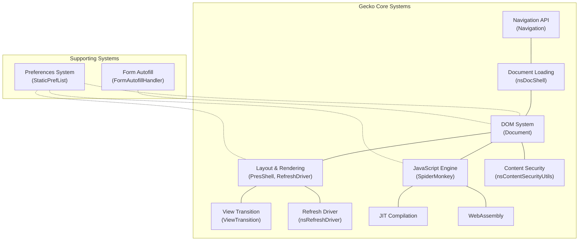

**Title: High-level Gecko Engine Architecture**

Sources: [dom/base/Document.cpp], [layout/base/PresShell.cpp], [dom/security/nsContentSecurityUtils.cpp], [js/src/shell/js.cpp], [dom/navigation/Navigation.cpp], [modules/libpref/init/StaticPrefList.yaml], [toolkit/components/formautofill/shared/FormAutofillHandler.sys.mjs]

### 1.1 Key Components and Data Flow

When a web page is loaded, Gecko processes it through several stages:

1. **Document Loading**: The DocShell initiates the loading process and creates a Document
2. **Parsing**: HTML/CSS/JS content is parsed into DOM and CSSOM
3. **Layout**: PresShell calculates positions and dimensions of elements
4. **Rendering**: Visual representation is created and displayed
5. **Event Handling**: User interactions trigger events processed by the DOM
6. **JavaScript Execution**: SpiderMonkey executes JavaScript code that can modify the DOM
7. **Refresh Cycle**: RefreshDriver coordinates updates to the display

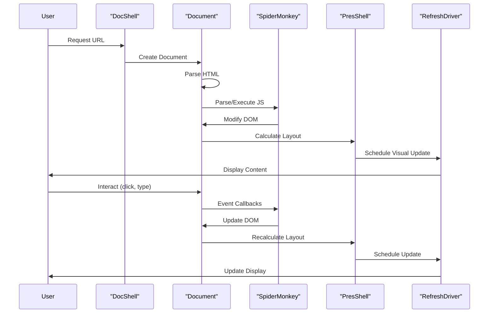

**Title: Gecko Page Processing Flow**

Sources: [dom/base/Document.cpp], [layout/base/PresShell.cpp], [layout/base/nsRefreshDriver.cpp], [docshell/base/nsDocShell.cpp], [js/src/shell/js.cpp]

## 2. Core Systems

### 2.1 DOM and Layout System

The Document Object Model (DOM) system is central to Gecko. It represents the parsed HTML document as a tree structure that can be manipulated. The Document class serves as the primary interface to this system.

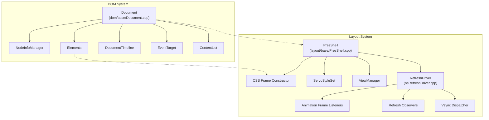

**Title: DOM and Layout System Architecture**

Sources: [dom/base/Document.cpp], [dom/base/Document.h], [layout/base/PresShell.cpp], [layout/base/PresShell.h], [layout/base/nsRefreshDriver.cpp]

The Document class functions as the core representation of web content and provides:

- Management of DOM nodes and elements
- Event handling and dispatching
- API implementations for web platform features
- Integration with other Gecko systems

The PresShell (Presentation Shell) handles:

- Converting DOM elements to frames (visual boxes)
- Calculating layout positions and dimensions
- Coordinating paint and display operations
- Managing user interaction with visual elements

The RefreshDriver manages timing for visual updates:

- Coordinates animation timing
- Schedules and triggers repaints
- Manages refresh rates
- Synchronizes visual updates with screen refresh rates (vsync)

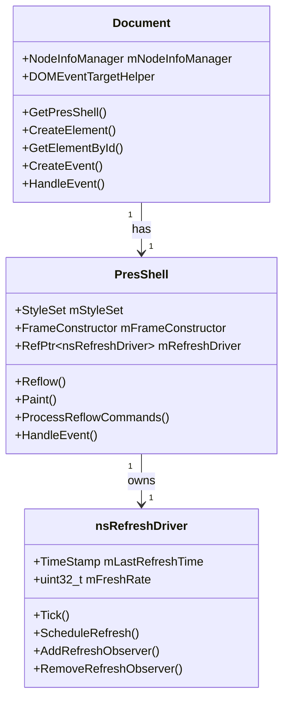

**Title: Core DOM and Layout Classes**

Sources: [dom/base/Document.cpp:8-11], [dom/base/Document.h:484-686], [layout/base/PresShell.cpp:8-12], [layout/base/PresShell.h], [layout/base/nsRefreshDriver.cpp:1-21], [layout/base/nsRefreshDriver.h]

### 2.2 JavaScript Engine (SpiderMonkey)

SpiderMonkey is Gecko's JavaScript engine, responsible for parsing and executing JavaScript code. It includes a JIT (Just-In-Time) compiler for performance optimization and WebAssembly support.

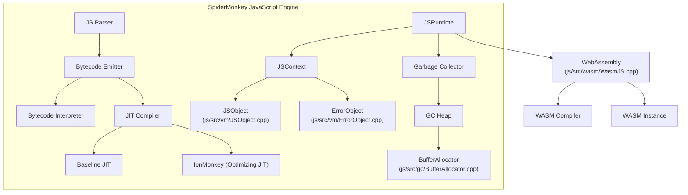

**Title: SpiderMonkey JavaScript Engine Architecture**

Sources: [js/src/shell/js.cpp], [js/src/vm/JSObject.cpp], [js/src/vm/ErrorObject.cpp], [js/src/gc/BufferAllocator.cpp], [js/src/wasm/WasmJS.cpp]

Key components of SpiderMonkey include:

1. **Parser/Compiler**: Converts JavaScript source code into bytecode or native machine code
2. **Runtime System**: Manages execution contexts and object lifetimes
3. **Object System**: Implements JavaScript objects and properties
4. **Type System**: Provides dynamic typing and type inference
5. **Memory Management**: Includes garbage collection and memory allocation
6. **JIT Compilation**: Optimizes code execution with multiple tiers of compilation
7. **WebAssembly**: Enables near-native performance for compiled languages

### 2.3 Content Security

Gecko integrates robust security mechanisms to protect against various web threats.

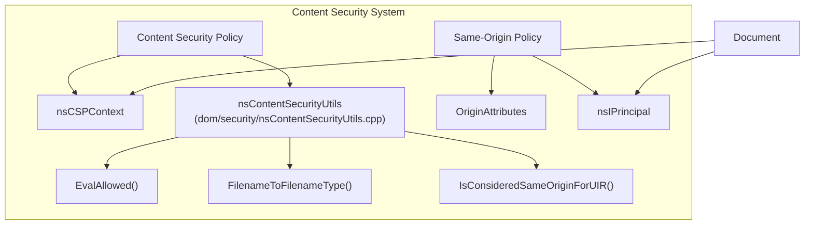

**Title: Content Security Architecture**

Sources: [dom/security/nsContentSecurityUtils.cpp]

The content security system in Gecko provides:

- Content Security Policy (CSP) implementation
- Protection against XSS, data injection, and other web attacks
- Script execution control
- Origin-based access control
- Resource load restrictions
- Defense against malicious content

The `nsContentSecurityUtils` class implements key security functions:

- Controlling code evaluation (`IsEvalAllowed`)
- Validating file operations
- Enforcing origin restrictions
- Implementing security policies

## 3. Browser Features

### 3.1 Navigation System

The Navigation API provides a programmatic interface for browser history navigation.

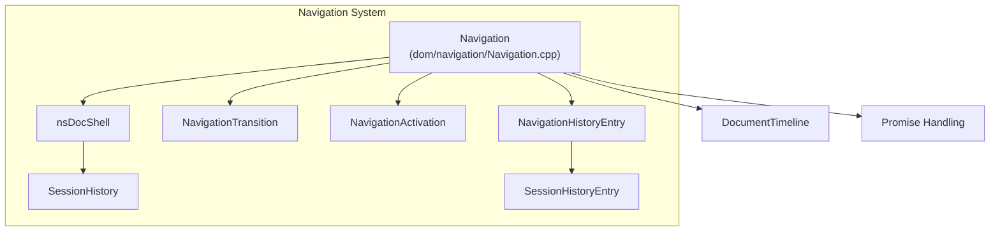

**Title: Navigation System Architecture**

Sources: [dom/navigation/Navigation.cpp], [dom/navigation/Navigation.h], [docshell/base/nsDocShell.cpp]

The Navigation API provides methods for:

- Navigating through browser history
- Accessing and managing history entries
- Tracking navigation states and transitions
- Programmatically navigating between pages
- Intercepting and modifying navigation actions

Key components include:

- `Navigation`: The main interface for history navigation
- `NavigationHistoryEntry`: Represents an entry in the browsing history
- `NavigationTransition`: Manages navigation state transitions
- Integration with the document loading system (`nsDocShell`)

### 3.2 View Transitions

View Transitions allow smooth visual transitions when navigating between pages or states.

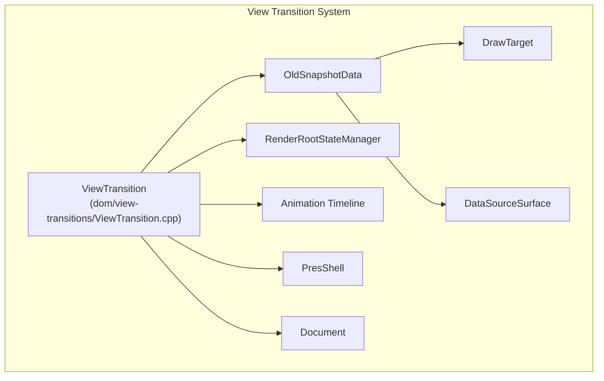

**Title: View Transition Architecture**

Sources: [dom/view-transitions/ViewTransition.cpp], [dom/view-transitions/ViewTransition.h]

The View Transition system enables:

- Smooth visual transitions between page states
- Capturing and displaying snapshots of page content
- Animation of content during page transitions
- Coordination with the rendering system
- Integration with CSS animations

### 3.3 Form Autofill System

The Form Autofill system detects, stores, and fills form data automatically.

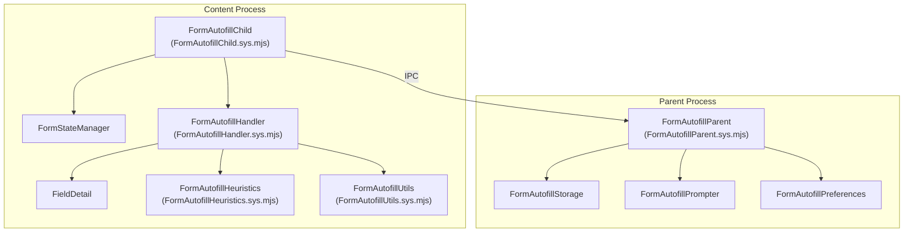

**Title: Form Autofill System Architecture**

Sources: [toolkit/components/formautofill/FormAutofillParent.sys.mjs], [toolkit/components/formautofill/FormAutofillChild.sys.mjs], [toolkit/components/formautofill/shared/FormAutofillHandler.sys.mjs], [toolkit/components/formautofill/shared/FormAutofillUtils.sys.mjs], [toolkit/components/formautofill/shared/FormAutofillHeuristics.sys.mjs]

The Form Autofill system splits responsibilities between parent and content processes:

**Parent Process Components**:
- `FormAutofillParent`: Manages storage and UI interactions
- `FormAutofillStorage`: Stores form profiles securely
- `FormAutofillPrompter`: Handles user interface for form selection

**Content Process Components**:
- `FormAutofillChild`: Coordinates form detection and filling
- `FormAutofillHandler`: Processes individual forms
- `FormAutofillHeuristics`: Analyzes and identifies form fields
- `FieldDetail`: Represents detected form fields

The system uses heuristics to identify form fields and handles:
- Address form detection and filling
- Credit card form detection and filling
- Field classification
- Form change detection
- User data management

## 4. System Integration

### 4.1 Preferences System

The Preferences system manages browser settings and feature configuration.

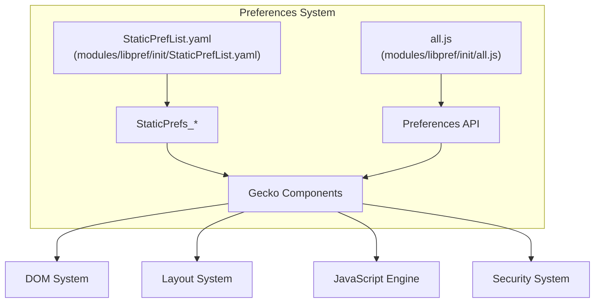

**Title: Preferences System Integration**

Sources: [modules/libpref/init/StaticPrefList.yaml], [modules/libpref/init/all.js]

The Preferences system uses two main approaches:

1. **Static Preferences**: Defined in `StaticPrefList.yaml`
   - Performance-critical preferences
   - Accessible via `StaticPrefs_*` generated code
   - Compiled into the browser code

2. **Dynamic Preferences**: Defined in `all.js` and other files
   - User-configurable settings
   - Accessible via Preferences API
   - Can be changed at runtime

Preferences control features across all Gecko systems:
- Layout behavior
- JavaScript execution settings
- Security policies
- Network configurations
- Media handling
- Performance tuning

### 4.2 Document Loading and DocShell

The DocShell handles document loading and navigation.

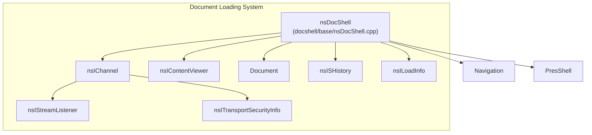

**Title: DocShell and Document Loading Architecture**

Sources: [docshell/base/nsDocShell.cpp]

The DocShell system provides:

- Document loading and navigation infrastructure
- History management
- Integration with the browser UI
- Security context for document loading
- Management of content viewers
- Coordination of document lifetime

Key interactions:
- Creates Document instances when loading content
- Manages navigation through history
- Provides security context for content loading
- Handles document transitions and state management
- Coordinates between browser UI and content rendering

## Summary

The Gecko Engine is a complex, modular system with specialized components that work together to render web content. The core systems—DOM, Layout, JavaScript, and Security—form the foundation, while features like Navigation, View Transitions, and Form Autofill build on this foundation to provide browser functionality. The Preferences system and DocShell integrate these components into a cohesive browser engine.

Understanding Gecko's architecture helps developers navigate the codebase and comprehend how web standards are implemented in Firefox.

---

