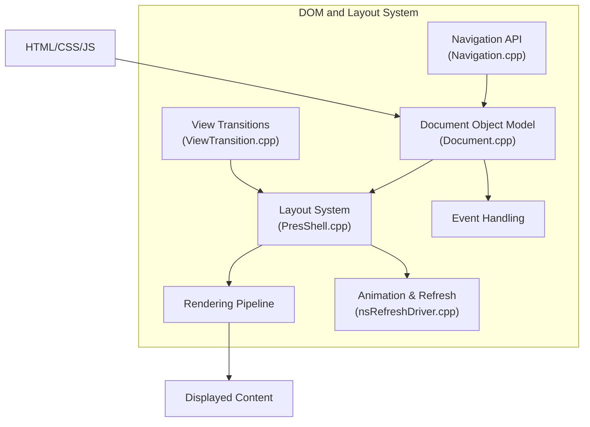
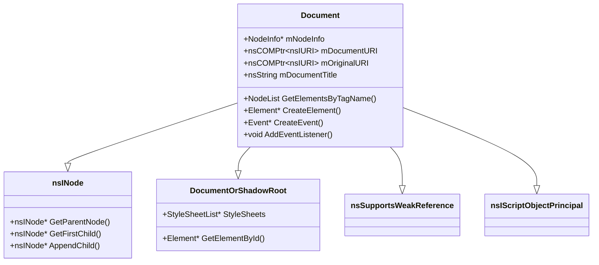
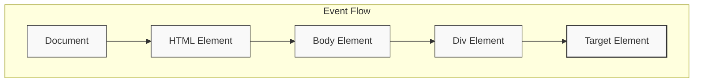
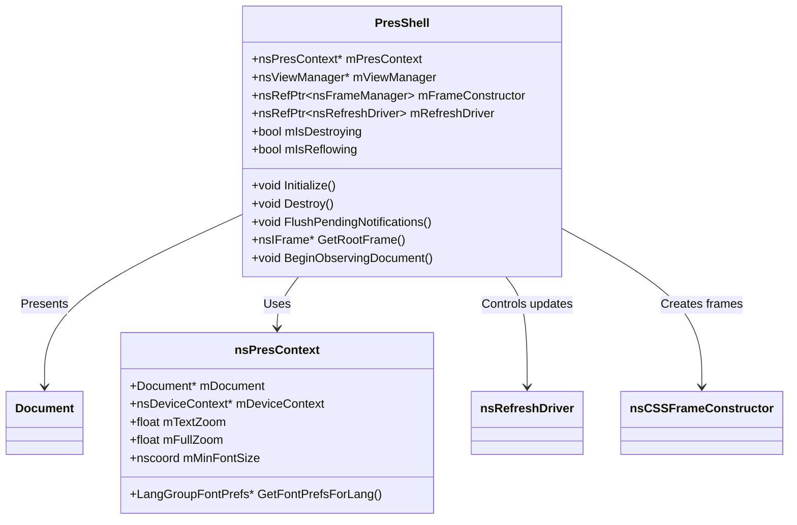
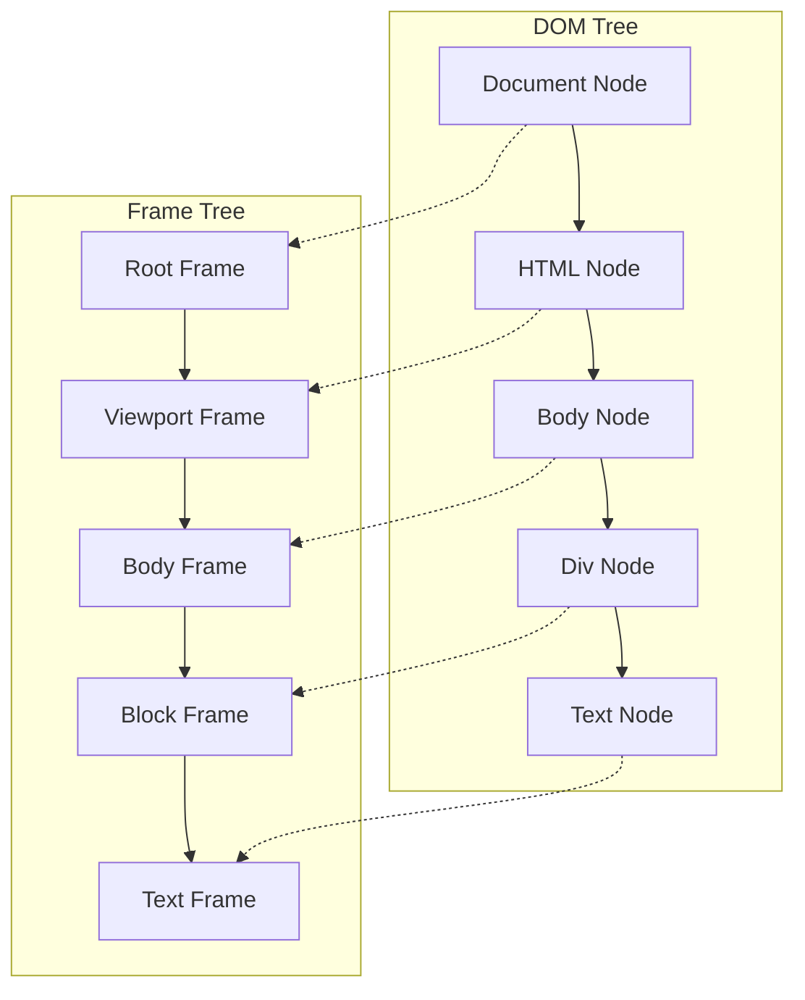
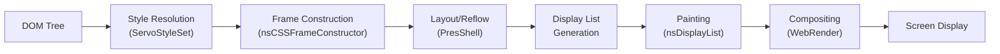
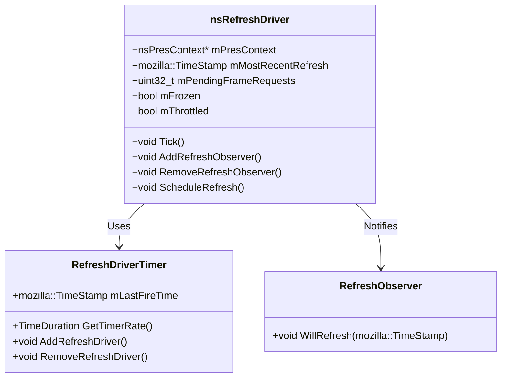
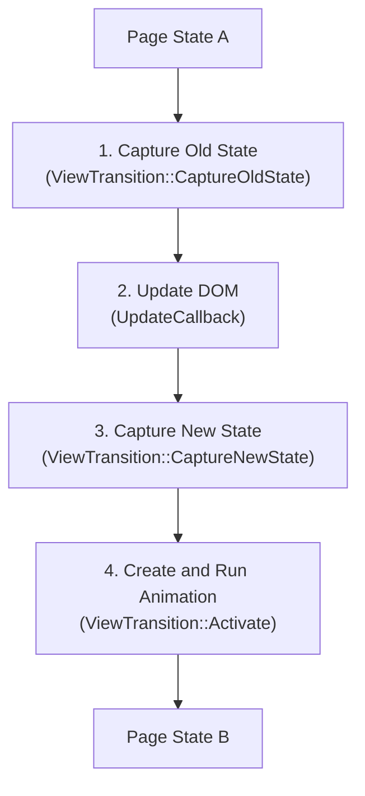
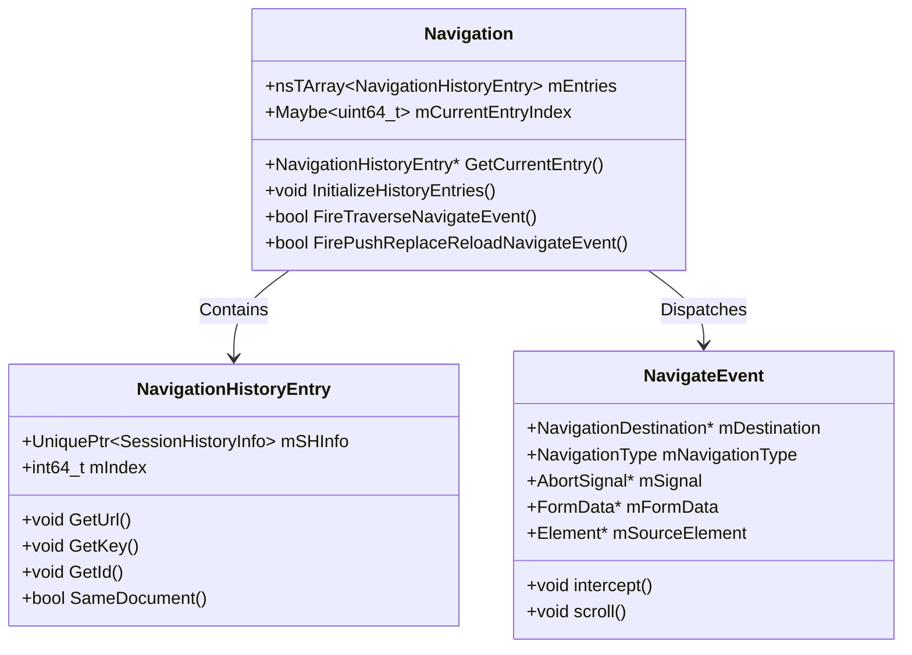
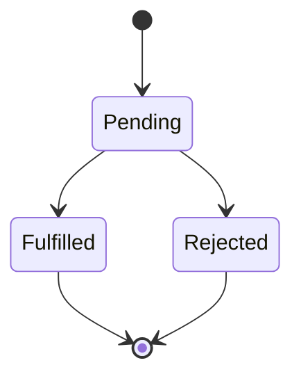

<!-- source: DeepWiki mcp.deepwiki.com · repo mozilla/gecko-dev · page 2.1 DOM and Layout System · fetched 2026-10-09 -->

# DOM and Layout System

<details>
<summary>Relevant source files</summary>

The following files were used as context for generating this wiki page:

- [docshell/base/WindowContext.cpp](docshell/base/WindowContext.cpp)
- [docshell/base/WindowContext.h](docshell/base/WindowContext.h)
- [docshell/base/nsDocShell.cpp](docshell/base/nsDocShell.cpp)
- [docshell/base/nsIDocShell.idl](docshell/base/nsIDocShell.idl)
- [dom/base/Document.cpp](dom/base/Document.cpp)
- [dom/base/Document.h](dom/base/Document.h)
- [dom/base/FormData.cpp](dom/base/FormData.cpp)
- [dom/base/FormData.h](dom/base/FormData.h)
- [dom/base/VisualViewport.cpp](dom/base/VisualViewport.cpp)
- [dom/base/VisualViewport.h](dom/base/VisualViewport.h)
- [dom/base/nsHistory.h](dom/base/nsHistory.h)
- [dom/base/nsWrapperCache.h](dom/base/nsWrapperCache.h)
- [dom/bindings/BindingUtils.cpp](dom/bindings/BindingUtils.cpp)
- [dom/bindings/Codegen.py](dom/bindings/Codegen.py)
- [dom/bindings/DOMJSClass.h](dom/bindings/DOMJSClass.h)
- [dom/events/NavigateEvent.cpp](dom/events/NavigateEvent.cpp)
- [dom/events/NavigateEvent.h](dom/events/NavigateEvent.h)
- [dom/navigation/Navigation.cpp](dom/navigation/Navigation.cpp)
- [dom/navigation/Navigation.h](dom/navigation/Navigation.h)
- [dom/navigation/NavigationHistoryEntry.cpp](dom/navigation/NavigationHistoryEntry.cpp)
- [dom/navigation/NavigationHistoryEntry.h](dom/navigation/NavigationHistoryEntry.h)
- [dom/promise/Promise.cpp](dom/promise/Promise.cpp)
- [dom/promise/Promise.h](dom/promise/Promise.h)
- [dom/view-transitions/ViewTransition.cpp](dom/view-transitions/ViewTransition.cpp)
- [dom/view-transitions/ViewTransition.h](dom/view-transitions/ViewTransition.h)
- [gfx/layers/wr/WebRenderLayerManager.h](gfx/layers/wr/WebRenderLayerManager.h)
- [layout/base/PresShell.cpp](layout/base/PresShell.cpp)
- [layout/base/PresShell.h](layout/base/PresShell.h)
- [layout/base/PresShellForwards.h](layout/base/PresShellForwards.h)
- [layout/base/PresShellInlines.h](layout/base/PresShellInlines.h)
- [layout/base/RenderingPhase.h](layout/base/RenderingPhase.h)
- [layout/base/nsPresContext.cpp](layout/base/nsPresContext.cpp)
- [layout/base/nsPresContext.h](layout/base/nsPresContext.h)
- [layout/base/nsRefreshDriver.cpp](layout/base/nsRefreshDriver.cpp)
- [layout/base/nsRefreshDriver.h](layout/base/nsRefreshDriver.h)
- [layout/generic/ScrollContainerFrame.h](layout/generic/ScrollContainerFrame.h)
- [layout/style/ServoStyleSet.cpp](layout/style/ServoStyleSet.cpp)
- [testing/web-platform/meta/css/css-view-transitions/transition-in-hidden-page.html.ini](testing/web-platform/meta/css/css-view-transitions/transition-in-hidden-page.html.ini)
- [testing/web-platform/meta/css/cssom-view/scrollIntoView-sideways-lr-writing-mode.html.ini](testing/web-platform/meta/css/cssom-view/scrollIntoView-sideways-lr-writing-mode.html.ini)
- [testing/web-platform/tests/css/css-scroll-snap/snap-after-relayout/resnap-on-reconstructing-frame.html](testing/web-platform/tests/css/css-scroll-snap/snap-after-relayout/resnap-on-reconstructing-frame.html)
- [xpcom/ds/nsTArray.cpp](xpcom/ds/nsTArray.cpp)
- [xpcom/ds/nsTArray.h](xpcom/ds/nsTArray.h)

</details>


This document describes the Document Object Model (DOM) and the Layout System in Firefox, explaining how web content is represented, rendered, and displayed on screen. For information about JavaScript execution, see [JavaScript Engine (SpiderMonkey)](#2.2).

## Overview

The DOM and Layout System form the core of Firefox's rendering pipeline, transforming HTML, CSS, and JavaScript into visible content. This system consists of several key components that work together:

1. The **DOM (Document Object Model)** represents the structure of web content as a tree of nodes
2. The **Layout System** converts the DOM into a visual representation by creating frames and computing their positions and properties
3. The **Rendering Pipeline** takes the layout information and draws it to the screen



Sources: [dom/base/Document.cpp](), [layout/base/PresShell.cpp](]), [dom/view-transitions/ViewTransition.cpp](), [dom/navigation/Navigation.cpp](), [layout/base/nsRefreshDriver.cpp]()

## DOM Architecture

The Document Object Model (DOM) is a programming interface for web documents. It represents the structure of a document as a tree of objects, allowing programs to manipulate the document's structure, style, and content.

### Document Class

At the center of the DOM implementation is the `Document` class, which represents an entire document (HTML, XML, SVG, etc.). It manages the document's content, handles events, and coordinates with the layout system.



Sources: [dom/base/Document.h:543-546]()), [dom/base/Document.h:560-605]()

The `Document` class inherits from several base classes:
- `nsINode`: Provides node functionality (parent/child relationships)
- `DocumentOrShadowRoot`: Provides methods common to both documents and shadow roots
- `nsSupportsWeakReference`: Allows weak references to the document
- `nsIScriptObjectPrincipal`: Provides security principals

### DOM Tree Structure

The DOM tree consists of various node types, all inheriting from `nsINode`:

- **Element nodes**: Represent HTML or XML elements
- **Text nodes**: Contain text content
- **Attribute nodes**: Represent element attributes
- **Comment nodes**: Represent HTML comments
- **Document nodes**: Represent the entire document

Elements in the DOM can be accessed and manipulated through various APIs, including:

- `getElementById()`
- `getElementsByTagName()`
- `querySelector()` and `querySelectorAll()`

The document provides methods to create new nodes:

```
Element* Document::CreateElement(const nsAString& aTagName)
Text* Document::CreateTextNode(const nsAString& aData)
```

Sources: [dom/base/Document.h:700-789](), [dom/base/Document.cpp:12-270]()

### Event Handling

The DOM implements an event system allowing scripts to register event listeners on nodes and respond to user actions. Events propagate through the DOM tree in three phases:

1. **Capture phase**: From the document root to the target
2. **Target phase**: At the target element
3. **Bubbling phase**: From the target back to the root



Events are processed by `EventDispatcher` which routes events to their appropriate targets and handles the event propagation phases.

Sources: [dom/base/Document.cpp:630-670]()

## Layout System Architecture

The Layout System transforms the DOM tree into a visual representation by creating and positioning frames. It handles reflowing (recalculating positions and sizes) and repainting when content changes.

### PresShell (Presentation Shell)

The `PresShell` class is the core of the layout system. It creates and manages the frame tree, facilitates communication between the DOM and layout systems, and coordinates reflows and repaints.



Sources: [layout/base/PresShell.h:151-196](), [layout/base/PresShell.cpp:756-824]()

The `PresShell` is responsible for:
- Creating frames for DOM nodes
- Managing the lifetime of the presentation
- Handling reflow operations when content changes
- Coordinating painting operations
- Processing events from the DOM
- Updating the display when animations run

### nsPresContext

The `nsPresContext` provides information about the presentation environment:
- Device-specific information (resolution, color depth)
- Font preferences and text zoom level
- User preferences related to display
- Unit conversion between different coordinate systems (app units, device pixels, etc.)

It serves as a bridge between the device-specific information and the layout process.

Sources: [layout/base/nsPresContext.h:9-42](), [layout/base/nsPresContext.cpp:129-207]()

### Frame Hierarchy

The layout system represents content visually through a hierarchy of frames. Each DOM node typically has a corresponding frame:



Different types of frames handle different types of content:
- Block frames for block-level elements
- Inline frames for inline elements
- Text frames for text content
- Table frames for table elements (with specialized sub-frames for rows/cells)

Sources: [layout/base/PresShell.cpp:310-400]()

## Rendering Pipeline

The rendering pipeline transforms the DOM into visible pixels on screen. This process involves several stages:

### 1. Style Resolution

Style resolution computes the CSS properties that apply to each element. It considers:
- Author stylesheets (from the web page)
- User stylesheets (user preferences)
- User agent stylesheets (browser defaults)
- Inline styles
- Style attributes
- Inherited styles

The Servo style system computes the final styles for each element, creating a `ComputedStyle` object.

Sources: [layout/style/ServoStyleSet.cpp:1-20]()

### 2. Frame Construction

Frame construction creates frames for DOM nodes based on their computed styles. The `nsCSSFrameConstructor` handles this process, creating appropriate frame types.

### 3. Layout (Reflow)

Layout calculates the exact position and size of each frame. This recursive process flows through the frame tree:
1. The root frame is reflowed with available space
2. Each frame determines its size and the position of its children
3. Children are reflowed with their allocated space
4. The process continues until all frames are positioned

Reflow is triggered by:
- DOM mutations
- Style changes
- Window resizing
- Font loading
- JavaScript operations affecting layout

Sources: [layout/base/PresShell.cpp:881-1000]()

### 4. Painting

Painting converts the frame tree into visual output:
1. The frame tree creates a display list (a list of drawing commands)
2. The display list is processed to generate drawing operations
3. The drawing operations are sent to the graphics system
4. The content is rendered to the screen



Sources: [layout/base/PresShell.cpp:162-200]()

## Dynamic Updates and Animations

### Refresh Driver

The `nsRefreshDriver` manages the timing of updates to the display. It:
- Schedules and triggers reflows and repaints
- Drives CSS animations and transitions
- Coordinates with the browser's refresh rate
- Manages requestAnimationFrame callbacks



The Refresh Driver operates in different modes:
- **Normal mode**: Refreshes at the standard rate (typically 60Hz)
- **Throttled mode**: Reduces refresh rate for hidden or inactive tabs
- **Frozen mode**: Stops refreshes entirely for completely inactive content

Sources: [layout/base/nsRefreshDriver.h:54-264](), [layout/base/nsRefreshDriver.cpp:114-160]()

### Animation and Transition Processing

CSS animations and transitions are handled by dedicated subsystems:
- `nsAnimationManager` for CSS animations
- `nsTransitionManager` for CSS transitions

These managers:
1. Track elements with active animations/transitions
2. Calculate intermediate values for animated properties
3. Schedule updates via the Refresh Driver
4. Apply animated styles to elements

### View Transitions

View transitions provide smooth transitions between different states of a document. The `ViewTransition` class manages this process:



A view transition involves:
1. Capturing the current state of elements (with `view-transition-name`)
2. Updating the DOM to its new state
3. Capturing the new state of elements
4. Creating animations between the old and new states

Sources: [dom/view-transitions/ViewTransition.h:76-168](), [dom/view-transitions/ViewTransition.cpp:125-200]()

## Navigation and History Management

### Navigation API

The Navigation API provides a programmatic interface for controlling navigation and accessing the session history. The main components are:



Navigation operations include:
- `navigate()`: Navigate to a URL
- `reload()`: Reload the current page
- `back()`, `forward()`: Navigate through history
- `traverseTo()`: Navigate to a specific history entry

Sources: [dom/navigation/Navigation.h:40-195](), [dom/navigation/Navigation.cpp:99-160]()

### History Entries

Each navigation creates a history entry, represented by `NavigationHistoryEntry`. These entries store:
- The URL of the page
- A unique key and ID
- State information
- Document compatibility information

History entries can be accessed via the Navigation API, allowing scripts to examine and manipulate the browsing history.

Sources: [dom/navigation/NavigationHistoryEntry.h:20-62](), [dom/navigation/NavigationHistoryEntry.cpp:26-79]()

### Navigation Events

Navigation operations trigger events that scripts can intercept:
- `navigate`: Fired before navigation occurs
- `navigatesuccess`: Fired when navigation completes successfully
- `navigateerror`: Fired when navigation fails
- `currententrychange`: Fired when the current history entry changes

The `navigate` event can be intercepted to:
- Prevent the navigation
- Modify the navigation
- Handle the navigation in a custom way
- Implement client-side routing

Sources: [dom/events/NavigateEvent.cpp:34-117](), [dom/events/NavigateEvent.h:27-52]()

## Asynchronous Operations

### Promise Implementation

The DOM and Layout systems make extensive use of promises for asynchronous operations. The `Promise` class implements the Promise/A+ specification:



Promises are used for:
- Fetching resources
- Animation completion
- View transition events
- Navigation operations

Sources: [dom/promise/Promise.h:38-194](), [dom/promise/Promise.cpp:79-104]()

### Handling Asynchronous Updates

The DOM and Layout systems handle asynchronous updates through several mechanisms:

1. **Microtask queue**: For promise resolution callbacks
2. **Task queue**: For setTimeout/setInterval callbacks
3. **Animation frame callbacks**: For synchronizing with display refreshes
4. **Mutation observers**: For reacting to DOM changes

These mechanisms ensure that asynchronous operations integrate properly with the rendering pipeline, providing a balance between responsiveness and performance.

## Summary

The DOM and Layout System in Firefox provides a comprehensive framework for representing, styling, and rendering web content. Understanding this system is crucial for developing browser features, fixing rendering bugs, and improving performance.

Key components include:
- The Document Object Model (DOM) for representing content
- The Layout System for visual arrangement
- The Refresh Driver for coordinating updates
- The Navigation API for history management

These components work together to transform web content into the visual display that users interact with.

---

