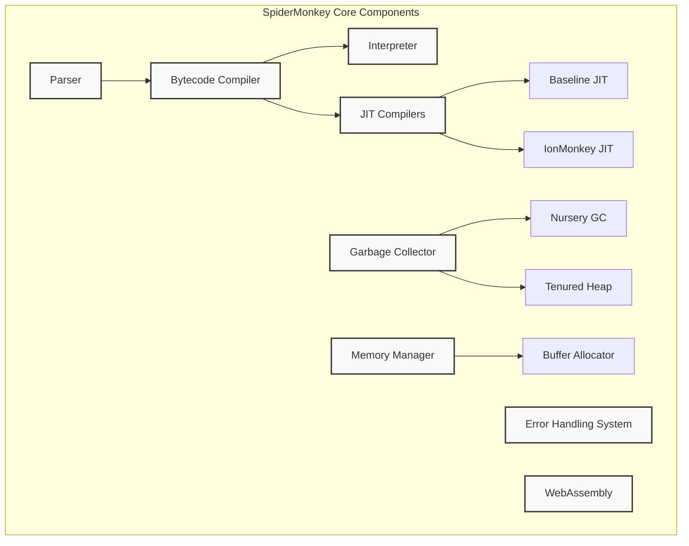
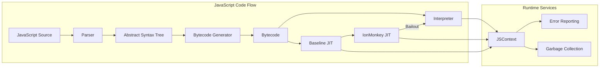
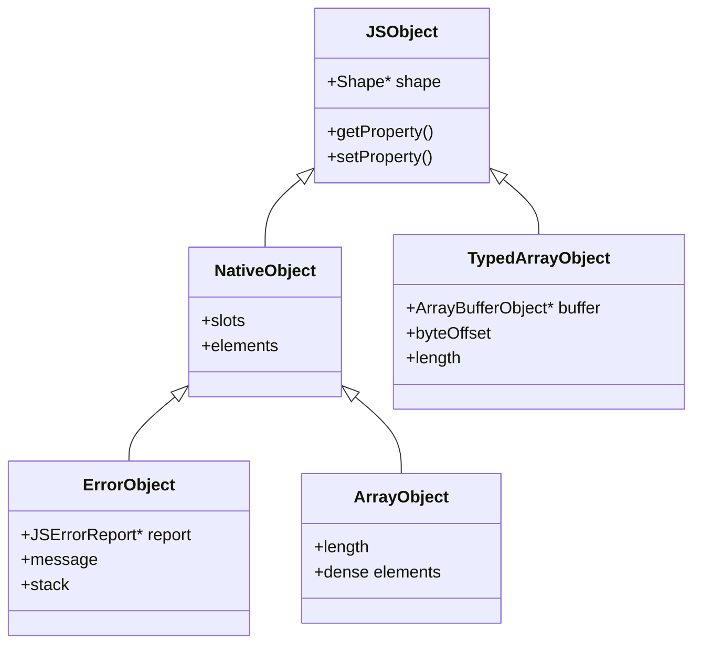
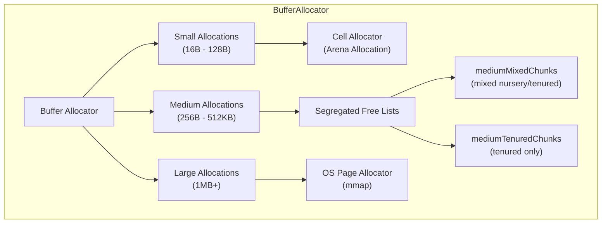
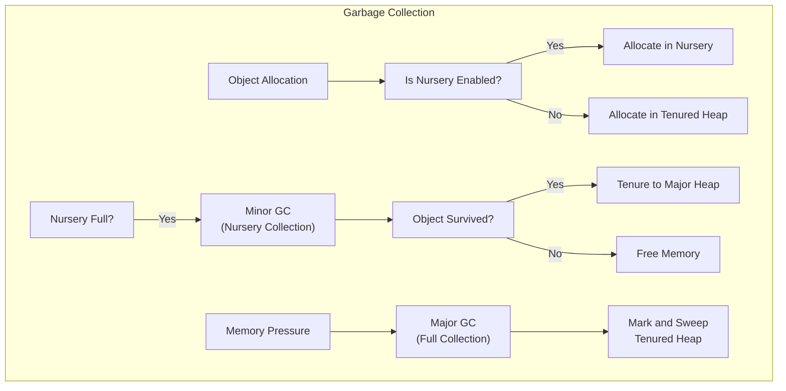
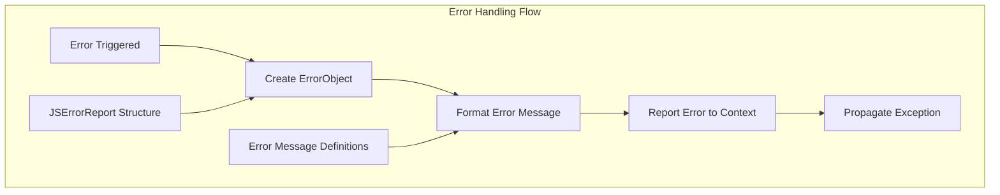
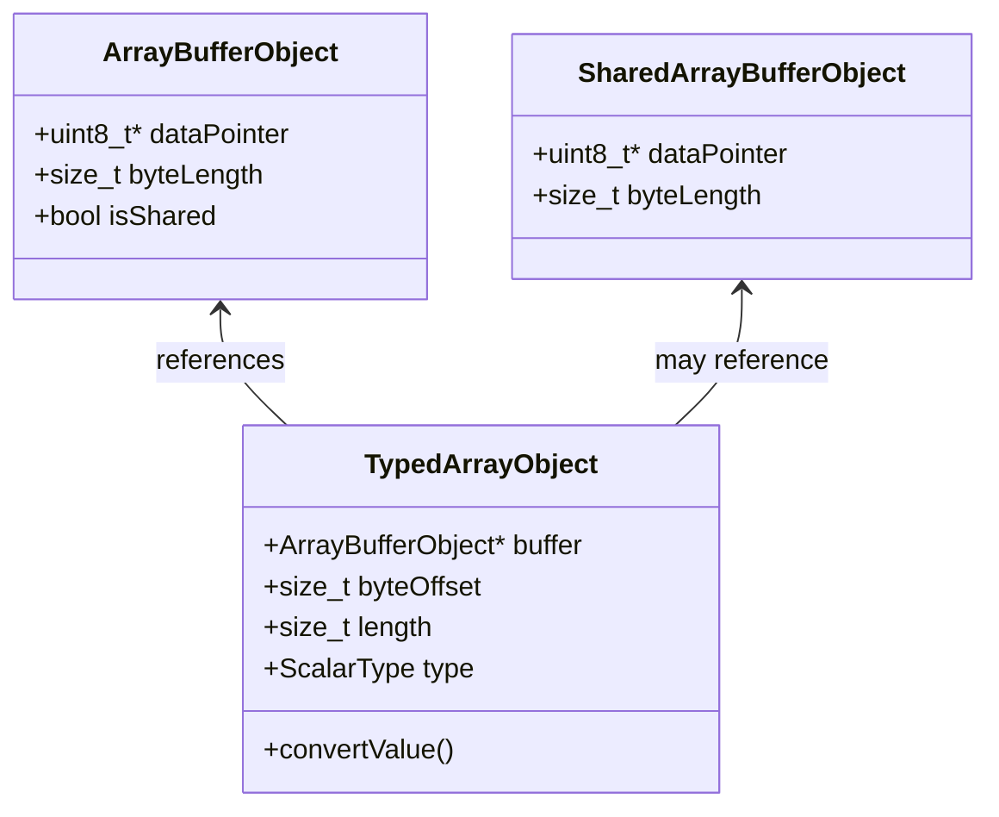
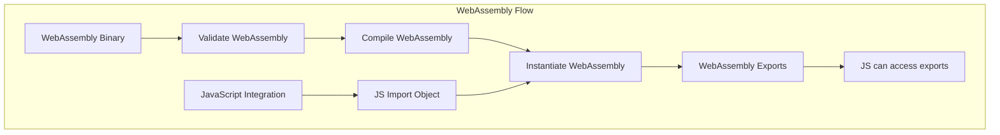
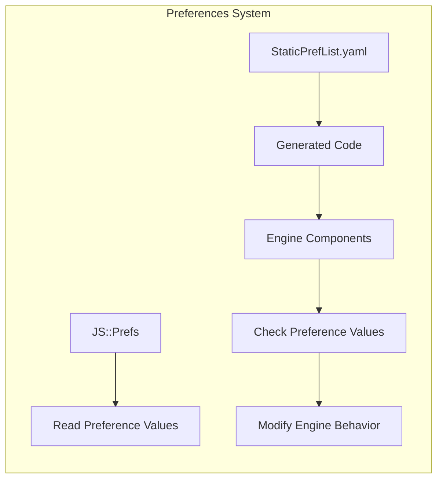
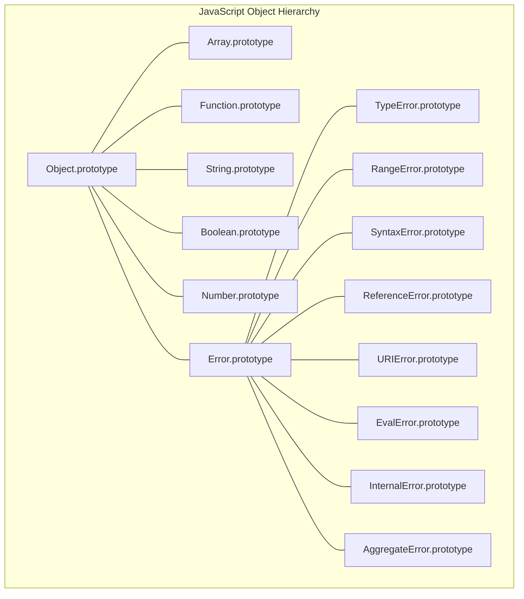

<!-- source: DeepWiki mcp.deepwiki.com · repo mozilla/gecko-dev · page 2.2 JavaScript Engine (SpiderMonkey) · fetched 2026-10-09 -->

# JavaScript Engine (SpiderMonkey)

<details>
<summary>Relevant source files</summary>

The following files were used as context for generating this wiki page:

- [js/public/ErrorReport.h](js/public/ErrorReport.h)
- [js/public/ProtoKey.h](js/public/ProtoKey.h)
- [js/public/friend/ErrorNumbers.msg](js/public/friend/ErrorNumbers.msg)
- [js/src/builtin/TestingFunctions.cpp](js/src/builtin/TestingFunctions.cpp)
- [js/src/builtin/temporal/TemporalParser.cpp](js/src/builtin/temporal/TemporalParser.cpp)
- [js/src/debugger/Source.cpp](js/src/debugger/Source.cpp)
- [js/src/fuzz-tests/testWasm.cpp](js/src/fuzz-tests/testWasm.cpp)
- [js/src/gc/Allocator.h](js/src/gc/Allocator.h)
- [js/src/gc/BufferAllocator-inl.h](js/src/gc/BufferAllocator-inl.h)
- [js/src/gc/BufferAllocator.cpp](js/src/gc/BufferAllocator.cpp)
- [js/src/gc/BufferAllocator.h](js/src/gc/BufferAllocator.h)
- [js/src/gc/Nursery.cpp](js/src/gc/Nursery.cpp)
- [js/src/gc/Nursery.h](js/src/gc/Nursery.h)
- [js/src/gc/Tracer.h](js/src/gc/Tracer.h)
- [js/src/jit-test/lib/asserts.js](js/src/jit-test/lib/asserts.js)
- [js/src/jit-test/lib/wasm-binary.js](js/src/jit-test/lib/wasm-binary.js)
- [js/src/jit-test/tests/wasm/binary.js](js/src/jit-test/tests/wasm/binary.js)
- [js/src/jit-test/tests/wasm/bug1951874.js](js/src/jit-test/tests/wasm/bug1951874.js)
- [js/src/jit-test/tests/wasm/js-promise-integration/js-promise-integration.new.js](js/src/jit-test/tests/wasm/js-promise-integration/js-promise-integration.new.js)
- [js/src/jit-test/tests/wasm/regress/bug1957544.js](js/src/jit-test/tests/wasm/regress/bug1957544.js)
- [js/src/jsapi-tests/testGCAllocator.cpp](js/src/jsapi-tests/testGCAllocator.cpp)
- [js/src/jsexn.h](js/src/jsexn.h)
- [js/src/jsmath.cpp](js/src/jsmath.cpp)
- [js/src/jsshell.msg](js/src/jsshell.msg)
- [js/src/moz.build](js/src/moz.build)
- [js/src/shell/js.cpp](js/src/shell/js.cpp)
- [js/src/vm/Compression.cpp](js/src/vm/Compression.cpp)
- [js/src/vm/ErrorObject.cpp](js/src/vm/ErrorObject.cpp)
- [js/src/vm/GlobalObject.cpp](js/src/vm/GlobalObject.cpp)
- [js/src/vm/JSObject.cpp](js/src/vm/JSObject.cpp)
- [js/src/vm/NativeObject.h](js/src/vm/NativeObject.h)
- [js/src/vm/TypedArrayObject.cpp](js/src/vm/TypedArrayObject.cpp)
- [js/src/vm/TypedArrayObject.h](js/src/vm/TypedArrayObject.h)
- [js/src/wasm/WasmBinary.cpp](js/src/wasm/WasmBinary.cpp)
- [js/src/wasm/WasmBinary.h](js/src/wasm/WasmBinary.h)
- [js/src/wasm/WasmBinaryTypes.h](js/src/wasm/WasmBinaryTypes.h)
- [js/src/wasm/WasmCompile.h](js/src/wasm/WasmCompile.h)
- [js/src/wasm/WasmCompileArgs.h](js/src/wasm/WasmCompileArgs.h)
- [js/src/wasm/WasmJS.cpp](js/src/wasm/WasmJS.cpp)
- [js/src/wasm/WasmModuleTypes.cpp](js/src/wasm/WasmModuleTypes.cpp)
- [js/src/wasm/WasmModuleTypes.h](js/src/wasm/WasmModuleTypes.h)
- [js/src/wasm/WasmValidate.cpp](js/src/wasm/WasmValidate.cpp)
- [js/src/wasm/WasmValidate.h](js/src/wasm/WasmValidate.h)
- [js/xpconnect/wrappers/XrayWrapper.cpp](js/xpconnect/wrappers/XrayWrapper.cpp)
- [modules/libpref/init/StaticPrefList.yaml](modules/libpref/init/StaticPrefList.yaml)

</details>


SpiderMonkey is Mozilla's JavaScript engine used within the Firefox browser and other Mozilla projects. This document provides an overview of the core components, architecture, and implementation details of the SpiderMonkey engine. It covers the JavaScript compilation pipeline, execution models, memory management systems, and error handling mechanisms.

## 1. Engine Architecture

SpiderMonkey is organized into several core components that work together to parse, compile, optimize, and execute JavaScript code. The engine also handles integration with WebAssembly, provides garbage collection, and supports various JavaScript language features.



Sources: 
- [js/src/moz.build:1-30]()
- [js/src/shell/js.cpp:1-200]()
- [js/src/vm/JSObject.cpp:1-100]()

## 2. SpiderMonkey's JavaScript Engine (Core)

The core JavaScript engine is responsible for parsing JavaScript source code, compiling it to bytecode, and executing it either through interpretation or JIT compilation. 



Sources:
- [js/src/shell/js.cpp:215-400]()
- [js/public/ProtoKey.h:1-100]()

### 2.1. JSContext

The `JSContext` is a central structure within SpiderMonkey that maintains the state necessary for executing JavaScript. It provides access to the garbage collector, error reporting mechanisms, and other essential services. Every JavaScript operation requires a `JSContext`.

```
+----------------------------+
| JSContext                  |
+----------------------------+
| - Runtime data             |
| - Current compartment      |
| - GC triggering            |
| - Error reporting          |
| - Exceptions               |
+----------------------------+
```

Sources:
- [js/src/vm/JSContext-inl.h]()
- [js/src/shell/js.cpp:220-250]()

### 2.2. JavaScript Objects

SpiderMonkey implements JavaScript objects using various specialized classes. The base class for all JavaScript objects is `JSObject`, which provides the fundamental object behaviors.



Sources:
- [js/src/vm/JSObject.cpp:1-150]()
- [js/src/vm/JSObject-inl.h]()
- [js/src/vm/ErrorObject.cpp:1-70]()
- [js/src/vm/TypedArrayObject.cpp:1-150]()

## 3. Memory Management

SpiderMonkey uses a sophisticated memory management system with a generational garbage collector, specialized allocators for different object sizes, and optimizations for common allocation patterns.

### 3.1. Buffer Allocator

The Buffer Allocator system manages dynamically sized memory allocations. It uses different strategies depending on the allocation size:



Sources:
- [js/src/gc/BufferAllocator.h:1-187]()
- [js/src/gc/BufferAllocator.cpp:1-400]()
- [js/src/gc/BufferAllocator-inl.h:1-20]()

The Buffer Allocator has three size classes:
1. **Small** (16B - 128B): Uses cell (arena) allocator
2. **Medium** (256B - 512KB): Uses a free list allocator with chunks
3. **Large** (1MB+): Uses the OS page allocator (e.g., mmap)

### 3.2. Garbage Collection

SpiderMonkey uses a generational garbage collector with a nursery for short-lived objects and a tenured heap for longer-lived objects.



Sources:
- [js/src/gc/Nursery.cpp:1-200]()
- [js/src/gc/GC.h]()
- [js/src/gc/BufferAllocator.cpp:430-500]()

## 4. Error Handling System

SpiderMonkey has a comprehensive error handling system for JavaScript exceptions, compilation errors, and runtime errors.

### 4.1. Error Types

SpiderMonkey implements various error types according to the ECMAScript specification:

```
+---------------------------+------------------------------+
| Error Type                | Class Implementation         |
+---------------------------+------------------------------+
| Error                     | ErrorObject                  |
| EvalError                 | ErrorObject (specialized)    |
| RangeError                | ErrorObject (specialized)    |
| ReferenceError            | ErrorObject (specialized)    |
| SyntaxError               | ErrorObject (specialized)    |
| TypeError                 | ErrorObject (specialized)    |
| URIError                  | ErrorObject (specialized)    |
| InternalError             | ErrorObject (specialized)    |
| AggregateError            | ErrorObject (specialized)    |
+---------------------------+------------------------------+
```

Sources:
- [js/src/vm/ErrorObject.cpp:60-144]()
- [js/public/ErrorReport.h:1-56]()
- [js/public/friend/ErrorNumbers.msg:1-50]()

### 4.2. Error Message Handling

SpiderMonkey defines error messages in a central file and provides mechanisms to format and report errors with proper context:



Sources:
- [js/public/friend/ErrorNumbers.msg:1-100]()
- [js/src/vm/ErrorObject.cpp:250-300]()
- [js/public/ErrorReport.h:60-120]()

## 5. JavaScript Type System

SpiderMonkey implements JavaScript's type system with specialized representations for different types.

### 5.1. Value Representation

JavaScript values are represented using the `JS::Value` type, which uses NaN-boxing to efficiently store different types:

```
+------------------------+------------------------------+
| JavaScript Type        | Internal Representation      |
+------------------------+------------------------------+
| undefined              | SpecialValue                 |
| null                   | SpecialValue                 |
| boolean                | SpecialValue                 |
| number (int32)         | Int32Value                   |
| number (double)        | DoubleValue                  |
| string                 | StringValue (pointer to GC)  |
| object                 | ObjectValue (pointer to GC)  |
| symbol                 | SymbolValue (pointer to GC)  |
| bigint                 | BigIntValue (pointer to GC)  |
+------------------------+------------------------------+
```

Sources:
- [js/src/vm/JSObject.cpp:110-140]()

### 5.2. Typed Arrays

SpiderMonkey implements JavaScript typed arrays with specialized code for efficient memory usage:



Sources:
- [js/src/vm/TypedArrayObject.cpp:1-120]()
- [js/src/vm/TypedArrayObject.h:1-50]()

## 6. WebAssembly Integration

SpiderMonkey provides full support for WebAssembly, allowing for efficient execution of WebAssembly modules and integration with JavaScript.



Sources:
- [js/src/wasm/WasmJS.cpp:1-150]()
- [js/src/wasm/WasmValidate.cpp:1-50]()
- [js/src/wasm/WasmBinary.cpp:1-20]()
- [js/src/jit-test/tests/wasm/js-promise-integration/js-promise-integration.new.js:1-30]()

### 6.1. WebAssembly Types and JavaScript Conversion

WebAssembly types are converted to and from JavaScript types according to specified conversion rules:

```
+----------------------+------------------------+
| WebAssembly Type     | JavaScript Type        |
+----------------------+------------------------+
| i32                  | Number                 |
| i64                  | BigInt                 |
| f32                  | Number                 |
| f64                  | Number                 |
| funcref              | Function or null       |
| externref            | Object reference       |
+----------------------+------------------------+
```

Sources:
- [js/src/wasm/WasmJS.cpp:230-350]()
- [js/src/wasm/WasmBinary.h:1-20]()

## 7. SpiderMonkey Preferences System

SpiderMonkey uses a preferences system to control engine behavior. These preferences can enable or disable features, control optimizations, and set various parameters.



Sources:
- [modules/libpref/init/StaticPrefList.yaml:1-200]()

## 8. JavaScript Language Features Implementation

SpiderMonkey implements all ECMAScript features specified in the standard, along with some Mozilla-specific extensions.

### 8.1. Built-in JavaScript Object Hierarchy

JavaScript's built-in objects are implemented as a hierarchy of prototypes:



Sources:
- [js/public/ProtoKey.h:60-100]()
- [js/src/vm/GlobalObject.cpp:90-190]()
- [js/src/vm/ErrorObject.cpp:60-90]()

## Conclusion

SpiderMonkey is a sophisticated JavaScript engine with a complex architecture designed for performance, correctness, and standard compliance. Its components work together to efficiently parse, compile, optimize, and execute JavaScript code while providing a robust environment that includes garbage collection, error handling, and WebAssembly integration.

---

