<!-- source: DeepWiki mcp.deepwiki.com · repo mozilla/gecko-dev · page 2.3 WebRTC Implementation · fetched 2026-10-09 -->

# WebRTC Implementation

Relevant source files

The following files were used as context for generating this wiki page:

- [third_party/libwebrtc/DEPS](third_party/libwebrtc/DEPS)
- [third_party/libwebrtc/README.mozilla.last-vendor](third_party/libwebrtc/README.mozilla.last-vendor)
- [third_party/libwebrtc/api/crypto/crypto_options.h](third_party/libwebrtc/api/crypto/crypto_options.h)
- [third_party/libwebrtc/call/version.cc](third_party/libwebrtc/call/version.cc)
- [third_party/libwebrtc/examples/androidjunit/src/org/appspot/apprtc/BluetoothManagerTest.java](third_party/libwebrtc/examples/androidjunit/src/org/appspot/apprtc/BluetoothManagerTest.java)
- [third_party/libwebrtc/experiments/field_trials.py](third_party/libwebrtc/experiments/field_trials.py)
- [third_party/libwebrtc/g3doc/abseil-in-webrtc.md](third_party/libwebrtc/g3doc/abseil-in-webrtc.md)
- [third_party/libwebrtc/media/BUILD.gn](third_party/libwebrtc/media/BUILD.gn)
- [third_party/libwebrtc/media/base/codec_list.cc](third_party/libwebrtc/media/base/codec_list.cc)
- [third_party/libwebrtc/media/base/codec_list.h](third_party/libwebrtc/media/base/codec_list.h)
- [third_party/libwebrtc/media/base/codec_list_unittest.cc](third_party/libwebrtc/media/base/codec_list_unittest.cc)
- [third_party/libwebrtc/modules/video_coding/codecs/av1/BUILD.gn](third_party/libwebrtc/modules/video_coding/codecs/av1/BUILD.gn)
- [third_party/libwebrtc/modules/video_coding/codecs/av1/libaom_av1_encoder.cc](third_party/libwebrtc/modules/video_coding/codecs/av1/libaom_av1_encoder.cc)
- [third_party/libwebrtc/modules/video_coding/codecs/av1/libaom_av1_encoder_unittest.cc](third_party/libwebrtc/modules/video_coding/codecs/av1/libaom_av1_encoder_unittest.cc)
- [third_party/libwebrtc/modules/video_coding/codecs/vp9/libvpx_vp9_encoder.cc](third_party/libwebrtc/modules/video_coding/codecs/vp9/libvpx_vp9_encoder.cc)
- [third_party/libwebrtc/modules/video_coding/codecs/vp9/libvpx_vp9_encoder.h](third_party/libwebrtc/modules/video_coding/codecs/vp9/libvpx_vp9_encoder.h)
- [third_party/libwebrtc/modules/video_coding/codecs/vp9/test/vp9_impl_unittest.cc](third_party/libwebrtc/modules/video_coding/codecs/vp9/test/vp9_impl_unittest.cc)
- [third_party/libwebrtc/moz-patch-stack/0001.patch](third_party/libwebrtc/moz-patch-stack/0001.patch)
- [third_party/libwebrtc/moz-patch-stack/0002.patch](third_party/libwebrtc/moz-patch-stack/0002.patch)
- [third_party/libwebrtc/moz-patch-stack/0003.patch](third_party/libwebrtc/moz-patch-stack/0003.patch)
- [third_party/libwebrtc/moz-patch-stack/0030.patch](third_party/libwebrtc/moz-patch-stack/0030.patch)
- [third_party/libwebrtc/moz-patch-stack/0032.patch](third_party/libwebrtc/moz-patch-stack/0032.patch)
- [third_party/libwebrtc/moz-patch-stack/0041.patch](third_party/libwebrtc/moz-patch-stack/0041.patch)
- [third_party/libwebrtc/moz-patch-stack/0053.patch](third_party/libwebrtc/moz-patch-stack/0053.patch)
- [third_party/libwebrtc/moz-patch-stack/0080.patch](third_party/libwebrtc/moz-patch-stack/0080.patch)
- [third_party/libwebrtc/moz-patch-stack/0101.patch](third_party/libwebrtc/moz-patch-stack/0101.patch)
- [third_party/libwebrtc/moz-patch-stack/0126.patch](third_party/libwebrtc/moz-patch-stack/0126.patch)
- [third_party/libwebrtc/moz-patch-stack/0128.patch](third_party/libwebrtc/moz-patch-stack/0128.patch)
- [third_party/libwebrtc/moz-patch-stack/0130.patch](third_party/libwebrtc/moz-patch-stack/0130.patch)
- [third_party/libwebrtc/moz-patch-stack/0131.patch](third_party/libwebrtc/moz-patch-stack/0131.patch)
- [third_party/libwebrtc/moz-patch-stack/0133.patch](third_party/libwebrtc/moz-patch-stack/0133.patch)
- [third_party/libwebrtc/moz-patch-stack/0136.patch](third_party/libwebrtc/moz-patch-stack/0136.patch)
- [third_party/libwebrtc/moz-patch-stack/0138.patch](third_party/libwebrtc/moz-patch-stack/0138.patch)
- [third_party/libwebrtc/moz-patch-stack/0139.patch](third_party/libwebrtc/moz-patch-stack/0139.patch)
- [third_party/libwebrtc/moz-patch-stack/0140.patch](third_party/libwebrtc/moz-patch-stack/0140.patch)
- [third_party/libwebrtc/moz-patch-stack/0141.patch](third_party/libwebrtc/moz-patch-stack/0141.patch)
- [third_party/libwebrtc/pc/BUILD.gn](third_party/libwebrtc/pc/BUILD.gn)
- [third_party/libwebrtc/pc/codec_vendor.cc](third_party/libwebrtc/pc/codec_vendor.cc)
- [third_party/libwebrtc/pc/codec_vendor.h](third_party/libwebrtc/pc/codec_vendor.h)
- [third_party/libwebrtc/pc/codec_vendor_unittest.cc](third_party/libwebrtc/pc/codec_vendor_unittest.cc)
- [third_party/libwebrtc/pc/media_session.cc](third_party/libwebrtc/pc/media_session.cc)
- [third_party/libwebrtc/pc/media_session.h](third_party/libwebrtc/pc/media_session.h)
- [third_party/libwebrtc/pc/media_session_unittest.cc](third_party/libwebrtc/pc/media_session_unittest.cc)
- [third_party/libwebrtc/pc/sdp_offer_answer_unittest.cc](third_party/libwebrtc/pc/sdp_offer_answer_unittest.cc)
- [third_party/libwebrtc/pc/test/fake_rtc_certificate_generator.h](third_party/libwebrtc/pc/test/fake_rtc_certificate_generator.h)
- [third_party/libwebrtc/pc/webrtc_sdp.cc](third_party/libwebrtc/pc/webrtc_sdp.cc)
- [third_party/libwebrtc/pc/webrtc_sdp_unittest.cc](third_party/libwebrtc/pc/webrtc_sdp_unittest.cc)
- [third_party/libwebrtc/rtc_base/openssl_stream_adapter.cc](third_party/libwebrtc/rtc_base/openssl_stream_adapter.cc)
- [third_party/libwebrtc/rtc_base/openssl_stream_adapter.h](third_party/libwebrtc/rtc_base/openssl_stream_adapter.h)
- [third_party/libwebrtc/rtc_base/ssl_identity_unittest.cc](third_party/libwebrtc/rtc_base/ssl_identity_unittest.cc)
- [third_party/libwebrtc/rtc_base/ssl_stream_adapter.cc](third_party/libwebrtc/rtc_base/ssl_stream_adapter.cc)
- [third_party/libwebrtc/rtc_base/ssl_stream_adapter.h](third_party/libwebrtc/rtc_base/ssl_stream_adapter.h)
- [third_party/libwebrtc/rtc_base/ssl_stream_adapter_unittest.cc](third_party/libwebrtc/rtc_base/ssl_stream_adapter_unittest.cc)
- [third_party/libwebrtc/test/fuzzers/vp9_encoder_references_fuzzer.cc](third_party/libwebrtc/test/fuzzers/vp9_encoder_references_fuzzer.cc)
- [third_party/libwebrtc/tools_webrtc/android/build_aar.py](third_party/libwebrtc/tools_webrtc/android/build_aar.py)
- [third_party/libwebrtc/tools_webrtc/get_landmines.py](third_party/libwebrtc/tools_webrtc/get_landmines.py)
- [third_party/libwebrtc/tools_webrtc/mb/mb_config.pyl](third_party/libwebrtc/tools_webrtc/mb/mb_config.pyl)
- [third_party/libwebrtc/video/full_stack_tests.cc](third_party/libwebrtc/video/full_stack_tests.cc)

This document provides an overview of how WebRTC (Web Real-Time Communication) is implemented in Firefox. It explains the architecture, components, and interactions that enable real-time audio, video, and data communication directly between browsers. For information about the JavaScript APIs exposed to web developers, see [JavaScript APIs](#4.1).

## 1. Overview

Firefox's WebRTC implementation is based on Google's libwebrtc, which is included as a third-party library within the Mozilla codebase. Mozilla maintains a vendored copy of libwebrtc in `third_party/libwebrtc` and applies custom patches to integrate it with Firefox and add Mozilla-specific enhancements.

The WebRTC implementation consists of several key layers:

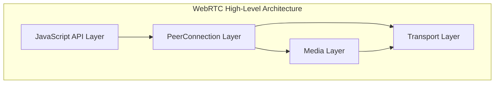

Sources: [third_party/libwebrtc/BUILD.gn](), [third_party/libwebrtc/moz-patch-stack/0030.patch]()

## 2. Core Components

### 2.1 PeerConnection Architecture

The PeerConnection is the central component of WebRTC, managing connections between peers and coordinating all aspects of communication.

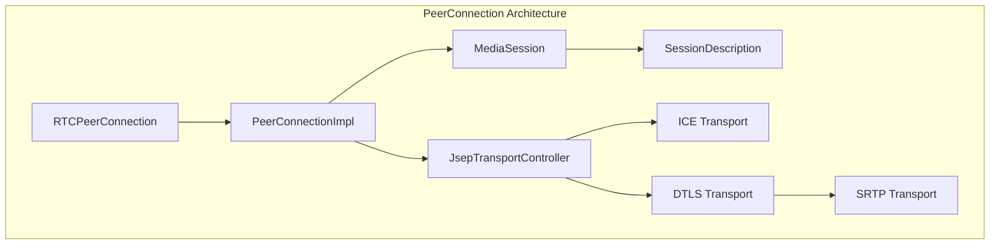

The key components include:

- **RTCPeerConnection**: The main interface exposed to web applications
- **PeerConnectionImpl**: The internal implementation of RTCPeerConnection
- **JsepTransportController**: Manages transport-related aspects (ICE, DTLS)
- **MediaSession**: Manages media-related aspects (codecs, streams)

Sources: [third_party/libwebrtc/pc/BUILD.gn](), [third_party/libwebrtc/pc/media_session.cc]()

### 2.2 Session Description Protocol (SDP)

SDP is used to negotiate media capabilities between peers. The SDP handling in Firefox's WebRTC implementation involves:

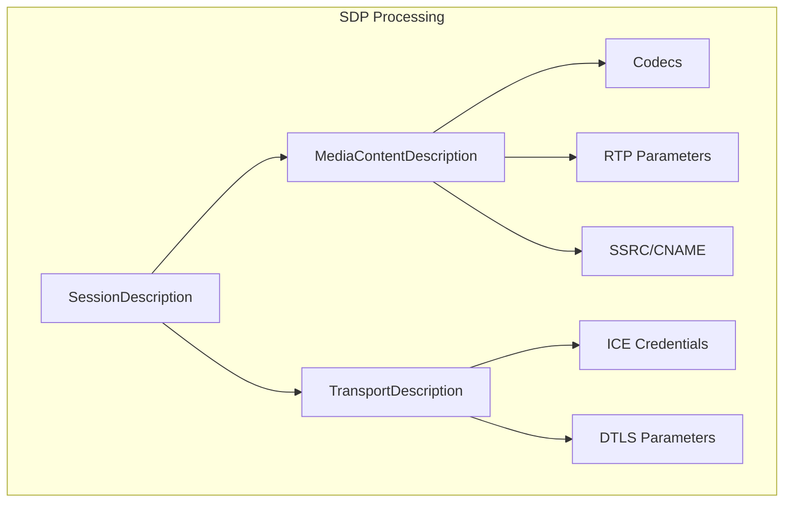

Key classes include:
- `SessionDescription`: Represents a complete SDP message
- `MediaContentDescription`: Describes media-specific aspects
- `TransportDescription`: Describes transport-specific aspects

Sources: [third_party/libwebrtc/pc/session_description.h](), [third_party/libwebrtc/pc/media_session.cc]()

### 2.3 Media Processing

WebRTC in Firefox includes components for processing audio and video:

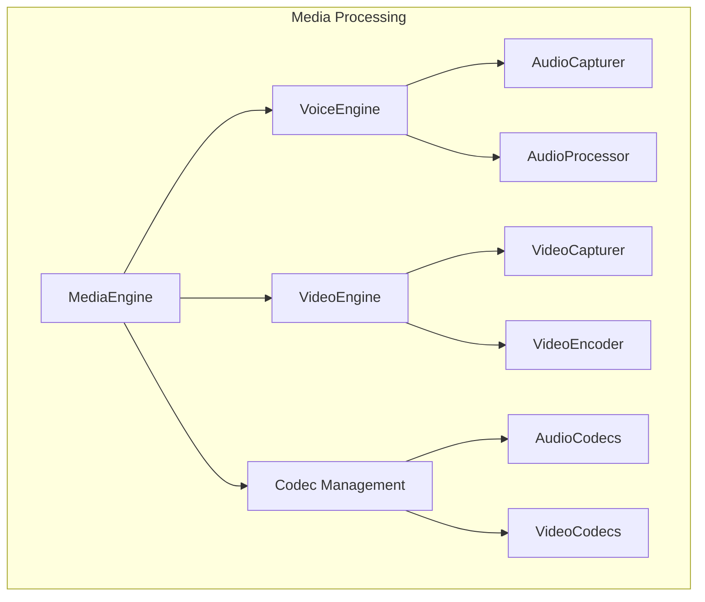

Components include:
- **MediaEngine**: Coordinates media processing
- **Codec Vendor**: Handles codec negotiation and capabilities
- **Media Channel**: Manages media flow between peers

Sources: [third_party/libwebrtc/media/BUILD.gn](), [third_party/libwebrtc/pc/codec_vendor.cc](), [third_party/libwebrtc/pc/codec_vendor.h]()

## 3. Transport and Security

### 3.1 ICE (Interactive Connectivity Establishment)

ICE is used to establish connectivity between peers, even when they are behind NATs or firewalls:

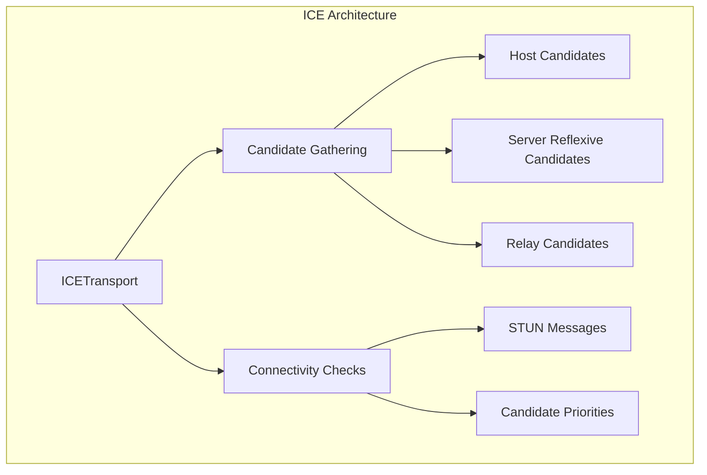

Sources: [third_party/libwebrtc/pc/jsep_transport_controller.h]()

### 3.2 DTLS and SRTP

Security in WebRTC is provided through DTLS for key exchange and SRTP for media encryption:

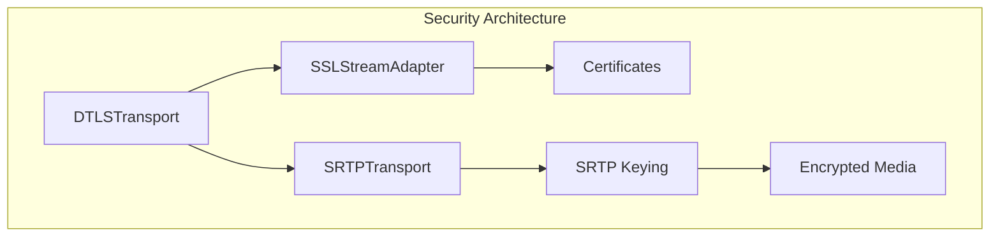

The key components include:
- **DTLSTransport**: Manages DTLS handshaking
- **SRTPTransport**: Encrypts and decrypts media using SRTP
- **OpenSSLStreamAdapter**: Provides OpenSSL-based implementation of SSL/TLS

Sources: [third_party/libwebrtc/rtc_base/openssl_stream_adapter.cc](), [third_party/libwebrtc/rtc_base/ssl_stream_adapter.h](), [third_party/libwebrtc/pc/dtls_transport.h]()

## 4. Mozilla-Specific Adaptations

Firefox has made several adaptations to the upstream libwebrtc implementation:

### 4.1 Build System Integration

Mozilla has modified the build system to integrate libwebrtc with Firefox's build system:

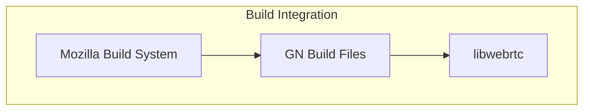

Sources: [third_party/libwebrtc/moz-patch-stack/0126.patch](), [third_party/libwebrtc/moz-patch-stack/0128.patch]()

### 4.2 Patch System

Mozilla maintains a series of patches that are applied to the upstream libwebrtc code:

| Patch Category | Purpose |
|----------------|---------|
| Build Fixes | Modify build files to work with Firefox |
| Bug Fixes | Fix issues in upstream code |
| Features | Add Mozilla-specific features |
| Security | Enhance security aspects |

Sources: [third_party/libwebrtc/moz-patch-stack/0001.patch](), [third_party/libwebrtc/moz-patch-stack/0030.patch](), [third_party/libwebrtc/moz-patch-stack/0126.patch]()

### 4.3 Field Trials

WebRTC uses "field trials" for feature flags and experimentation. Mozilla leverages this system for A/B testing and gradual feature rollout:

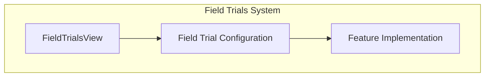

Examples of field trials:
- `WebRTC-Audio-GainController2`
- `WebRTC-ForceDtls13`
- `WebRTC-Aec3BufferingMaxAllowedExcessRenderBlocksOverride`

Sources: [third_party/libwebrtc/experiments/field_trials.py]()

## 5. Integration Points

### 5.1 Code Integration with Firefox

The WebRTC implementation integrates with Firefox in several key ways:

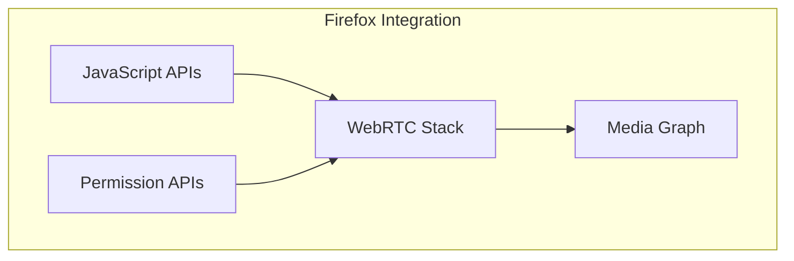

Sources: [third_party/libwebrtc/moz-patch-stack/0030.patch](), [third_party/libwebrtc/moz-patch-stack/0032.patch]()

### 5.2 Media Codecs

Firefox's WebRTC implementation supports various audio and video codecs:

| Audio Codecs | Video Codecs |
|--------------|--------------|
| Opus | H.264 |
| G.711 (PCMU/PCMA) | VP8 |
| iLBC | VP9 |
| CN (Comfort Noise) | AV1 |

Sources: [third_party/libwebrtc/media/BUILD.gn](), [third_party/libwebrtc/pc/codec_vendor.cc](), [third_party/libwebrtc/pc/media_session_unittest.cc]()

## 6. Testing and Maintenance

### 6.1 Test Framework

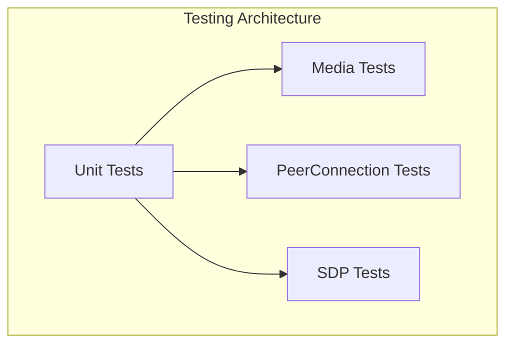

Sources: [third_party/libwebrtc/pc/media_session_unittest.cc](), [third_party/libwebrtc/pc/sdp_offer_answer_unittest.cc]()

### 6.2 WebRTC Version Management

Mozilla periodically updates the vendored copy of libwebrtc to incorporate upstream improvements:

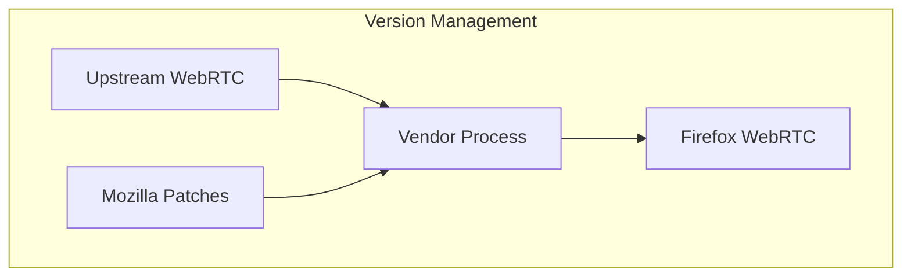

Sources: [third_party/libwebrtc/README.mozilla.last-vendor](), [third_party/libwebrtc/call/version.cc]()

## 7. Security Considerations

WebRTC in Firefox implements several security mechanisms:

1. **DTLS-SRTP**: All media is encrypted using SRTP with keys exchanged via DTLS
2. **Certificate Verification**: Certificates are verified during the DTLS handshake
3. **Permission Model**: Camera and microphone access require explicit user permissions

Sources: [third_party/libwebrtc/rtc_base/openssl_stream_adapter.cc](), [third_party/libwebrtc/rtc_base/ssl_stream_adapter.h]()

## 8. Performance Optimizations

Firefox's WebRTC implementation includes several performance optimizations:

1. **Adaptive Bitrate**: Automatically adjusts bitrate based on network conditions
2. **Hardware Acceleration**: Uses hardware encoders/decoders when available
3. **Bandwidth Estimation**: Sophisticated algorithms to estimate available bandwidth

Sources: [third_party/libwebrtc/experiments/field_trials.py]()

---

