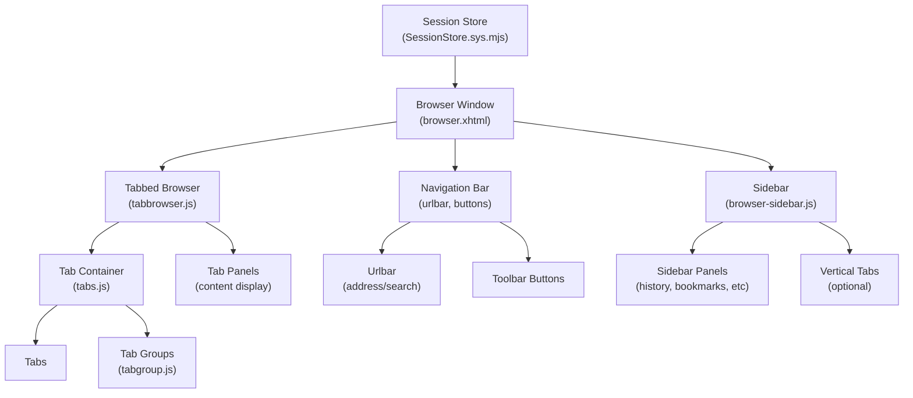
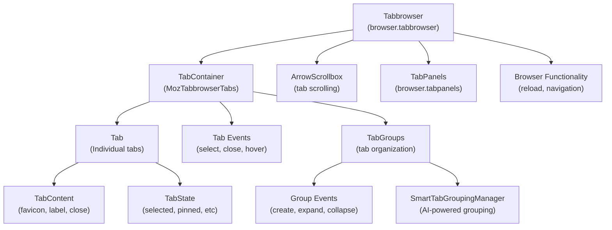
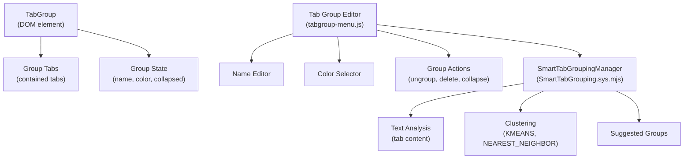
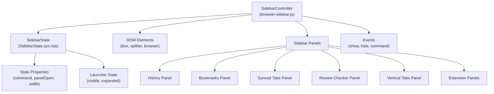
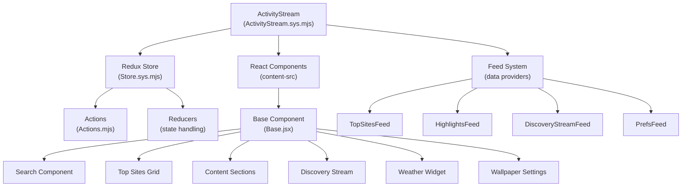
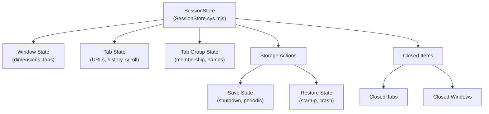

<!-- source: DeepWiki mcp.deepwiki.com · repo mozilla/gecko-dev · page 3 User Interface Architecture · fetched 2026-10-09 -->

# User Interface Architecture

Relevant source files

The following files were used as context for generating this wiki page:

- [browser/actors/BlockedSiteParent.sys.mjs](browser/actors/BlockedSiteParent.sys.mjs)
- [browser/app/profile/firefox.js](browser/app/profile/firefox.js)
- [browser/base/content/browser-box.inc.xhtml](browser/base/content/browser-box.inc.xhtml)
- [browser/base/content/browser-init.js](browser/base/content/browser-init.js)
- [browser/base/content/browser-sync.js](browser/base/content/browser-sync.js)
- [browser/base/content/browser.js](browser/base/content/browser.js)
- [browser/base/content/browser.js.globals](browser/base/content/browser.js.globals)
- [browser/base/content/browser.xhtml](browser/base/content/browser.xhtml)
- [browser/base/content/main-popupset.js](browser/base/content/main-popupset.js)
- [browser/base/content/navigator-toolbox.inc.xhtml](browser/base/content/navigator-toolbox.inc.xhtml)
- [browser/base/content/navigator-toolbox.js](browser/base/content/navigator-toolbox.js)
- [browser/base/content/test/general/browser_datachoices_notification.js](browser/base/content/test/general/browser_datachoices_notification.js)
- [browser/base/content/test/performance/browser_tabopen.js](browser/base/content/test/performance/browser_tabopen.js)
- [browser/base/content/test/sidebar/browser_sidebar_keys.js](browser/base/content/test/sidebar/browser_sidebar_keys.js)
- [browser/base/content/test/sidebar/browser_sidebar_move.js](browser/base/content/test/sidebar/browser_sidebar_move.js)
- [browser/base/content/test/sync/browser.toml](browser/base/content/test/sync/browser.toml)
- [browser/base/content/test/sync/browser_sync.js](browser/base/content/test/sync/browser_sync.js)
- [browser/components/asrouter/modules/OnboardingMessageProvider.sys.mjs](browser/components/asrouter/modules/OnboardingMessageProvider.sys.mjs)
- [browser/components/contextualidentity/test/browser/browser_newtabButton.js](browser/components/contextualidentity/test/browser/browser_newtabButton.js)
- [browser/components/customizableui/test/browser_sidebar_toggle.js](browser/components/customizableui/test/browser_sidebar_toggle.js)
- [browser/components/firefoxview/SyncedTabsController.sys.mjs](browser/components/firefoxview/SyncedTabsController.sys.mjs)
- [browser/components/firefoxview/tests/browser/browser.toml](browser/components/firefoxview/tests/browser/browser.toml)
- [browser/components/firefoxview/tests/browser/browser_opentabs_pinned_tabs.js](browser/components/firefoxview/tests/browser/browser_opentabs_pinned_tabs.js)
- [browser/components/firefoxview/tests/browser/browser_syncedtabs_firefoxview.js](browser/components/firefoxview/tests/browser/browser_syncedtabs_firefoxview.js)
- [browser/components/genai/tests/xpcshell/test_show_chat_entrypoint.js](browser/components/genai/tests/xpcshell/test_show_chat_entrypoint.js)
- [browser/components/newtab/metrics.yaml](browser/components/newtab/metrics.yaml)
- [browser/components/sessionstore/SessionStore.sys.mjs](browser/components/sessionstore/SessionStore.sys.mjs)
- [browser/components/sessionstore/TabGroupState.sys.mjs](browser/components/sessionstore/TabGroupState.sys.mjs)
- [browser/components/sessionstore/test/browser_tab_groups_save_on_window_close.js](browser/components/sessionstore/test/browser_tab_groups_save_on_window_close.js)
- [browser/components/sessionstore/test/marionette/test_restore_manually_with_tab_groups.py](browser/components/sessionstore/test/marionette/test_restore_manually_with_tab_groups.py)
- [browser/components/sessionstore/test/marionette/test_restore_sidebar.py](browser/components/sessionstore/test/marionette/test_restore_sidebar.py)
- [browser/components/sidebar/SidebarManager.sys.mjs](browser/components/sidebar/SidebarManager.sys.mjs)
- [browser/components/sidebar/SidebarState.sys.mjs](browser/components/sidebar/SidebarState.sys.mjs)
- [browser/components/sidebar/browser-sidebar.js](browser/components/sidebar/browser-sidebar.js)
- [browser/components/sidebar/docs/index.rst](browser/components/sidebar/docs/index.rst)
- [browser/components/sidebar/metrics.yaml](browser/components/sidebar/metrics.yaml)
- [browser/components/sidebar/moz.build](browser/components/sidebar/moz.build)
- [browser/components/sidebar/sidebar-customize.css](browser/components/sidebar/sidebar-customize.css)
- [browser/components/sidebar/sidebar-customize.mjs](browser/components/sidebar/sidebar-customize.mjs)
- [browser/components/sidebar/tests/browser/browser.toml](browser/components/sidebar/tests/browser/browser.toml)
- [browser/components/sidebar/tests/browser/browser_a11y_sidebar.js](browser/components/sidebar/tests/browser/browser_a11y_sidebar.js)
- [browser/components/sidebar/tests/browser/browser_customize_sidebar.js](browser/components/sidebar/tests/browser/browser_customize_sidebar.js)
- [browser/components/sidebar/tests/browser/browser_glean_sidebar.js](browser/components/sidebar/tests/browser/browser_glean_sidebar.js)
- [browser/components/sidebar/tests/browser/browser_resize_sidebar.js](browser/components/sidebar/tests/browser/browser_resize_sidebar.js)
- [browser/components/sidebar/tests/browser/browser_sidebar_collapsed_close_tab_button.js](browser/components/sidebar/tests/browser/browser_sidebar_collapsed_close_tab_button.js)
- [browser/components/sidebar/tests/browser/browser_sidebar_context_menu.js](browser/components/sidebar/tests/browser/browser_sidebar_context_menu.js)
- [browser/components/sidebar/tests/browser/browser_sidebar_expand_on_hover.js](browser/components/sidebar/tests/browser/browser_sidebar_expand_on_hover.js)
- [browser/components/sidebar/tests/browser/browser_sidebar_max_width.js](browser/components/sidebar/tests/browser/browser_sidebar_max_width.js)
- [browser/components/sidebar/tests/browser/browser_sidebar_menubar_item_commands.js](browser/components/sidebar/tests/browser/browser_sidebar_menubar_item_commands.js)
- [browser/components/sidebar/tests/browser/browser_sidebar_nimbus.js](browser/components/sidebar/tests/browser/browser_sidebar_nimbus.js)
- [browser/components/sidebar/tests/browser/browser_sidebar_position.js](browser/components/sidebar/tests/browser/browser_sidebar_position.js)
- [browser/components/sidebar/tests/browser/browser_sidebar_prefs.js](browser/components/sidebar/tests/browser/browser_sidebar_prefs.js)
- [browser/components/sidebar/tests/browser/browser_syncedtabs_sidebar.js](browser/components/sidebar/tests/browser/browser_syncedtabs_sidebar.js)
- [browser/components/sidebar/tests/browser/browser_toolbar_sidebar_button.js](browser/components/sidebar/tests/browser/browser_toolbar_sidebar_button.js)
- [browser/components/sidebar/tests/browser/browser_tools_migration.js](browser/components/sidebar/tests/browser/browser_tools_migration.js)
- [browser/components/sidebar/tests/browser/browser_vertical_tabs.js](browser/components/sidebar/tests/browser/browser_vertical_tabs.js)
- [browser/components/sidebar/tests/browser/head.js](browser/components/sidebar/tests/browser/head.js)
- [browser/components/sidebar/tests/unit/test_sidebar_state.js](browser/components/sidebar/tests/unit/test_sidebar_state.js)
- [browser/components/tabbrowser/GroupsList.sys.mjs](browser/components/tabbrowser/GroupsList.sys.mjs)
- [browser/components/tabbrowser/SmartTabGrouping.sys.mjs](browser/components/tabbrowser/SmartTabGrouping.sys.mjs)
- [browser/components/tabbrowser/TabMetrics.sys.mjs](browser/components/tabbrowser/TabMetrics.sys.mjs)
- [browser/components/tabbrowser/TabsList.sys.mjs](browser/components/tabbrowser/TabsList.sys.mjs)
- [browser/components/tabbrowser/content/tab.js](browser/components/tabbrowser/content/tab.js)
- [browser/components/tabbrowser/content/tabbrowser.js](browser/components/tabbrowser/content/tabbrowser.js)
- [browser/components/tabbrowser/content/tabgroup-menu.js](browser/components/tabbrowser/content/tabgroup-menu.js)
- [browser/components/tabbrowser/content/tabgroup.js](browser/components/tabbrowser/content/tabgroup.js)
- [browser/components/tabbrowser/content/tabs.js](browser/components/tabbrowser/content/tabs.js)
- [browser/components/tabbrowser/metrics.yaml](browser/components/tabbrowser/metrics.yaml)
- [browser/components/tabbrowser/moz.build](browser/components/tabbrowser/moz.build)
- [browser/components/tabbrowser/test/browser/smarttabgrouping/browser_tab_grouping_telemetry.js](browser/components/tabbrowser/test/browser/smarttabgrouping/browser_tab_grouping_telemetry.js)
- [browser/components/tabbrowser/test/browser/tabs/browser.toml](browser/components/tabbrowser/test/browser/tabs/browser.toml)
- [browser/components/tabbrowser/test/browser/tabs/browser_standalonePinnedTab.js](browser/components/tabbrowser/test/browser/tabs/browser_standalonePinnedTab.js)
- [browser/components/tabbrowser/test/browser/tabs/browser_tab_aria_level.js](browser/components/tabbrowser/test/browser/tabs/browser_tab_aria_level.js)
- [browser/components/tabbrowser/test/browser/tabs/browser_tab_aria_posinset_setsize.js](browser/components/tabbrowser/test/browser/tabs/browser_tab_aria_posinset_setsize.js)
- [browser/components/tabbrowser/test/browser/tabs/browser_tab_groups.js](browser/components/tabbrowser/test/browser/tabs/browser_tab_groups.js)
- [browser/components/tabbrowser/test/browser/tabs/browser_tab_groups_telemetry.js](browser/components/tabbrowser/test/browser/tabs/browser_tab_groups_telemetry.js)
- [browser/components/tabbrowser/test/browser/tabs/browser_tab_manager_close.js](browser/components/tabbrowser/test/browser/tabs/browser_tab_manager_close.js)
- [browser/components/tabbrowser/test/browser/tabs/browser_tab_manager_groups.js](browser/components/tabbrowser/test/browser/tabs/browser_tab_manager_groups.js)
- [browser/components/taskbartabs/TaskbarTabCmd.sys.mjs](browser/components/taskbartabs/TaskbarTabCmd.sys.mjs)
- [browser/components/taskbartabs/TaskbarTabs.sys.mjs](browser/components/taskbartabs/TaskbarTabs.sys.mjs)
- [browser/components/taskbartabs/components.conf](browser/components/taskbartabs/components.conf)
- [browser/components/taskbartabs/moz.build](browser/components/taskbartabs/moz.build)
- [browser/components/taskbartabs/test/browser/browser.toml](browser/components/taskbartabs/test/browser/browser.toml)
- [browser/components/taskbartabs/test/browser/browser_taskBarTabs_module.js](browser/components/taskbartabs/test/browser/browser_taskBarTabs_module.js)
- [browser/components/taskbartabs/test/browser/browser_taskbarTabs_chromeTest.js](browser/components/taskbartabs/test/browser/browser_taskbarTabs_chromeTest.js)
- [browser/components/taskbartabs/test/browser/dummy_page.html](browser/components/taskbartabs/test/browser/dummy_page.html)
- [browser/components/taskbartabs/test/browser/head.js](browser/components/taskbartabs/test/browser/head.js)
- [browser/components/tests/browser/browser_browserGlue_showModal_trigger.js](browser/components/tests/browser/browser_browserGlue_showModal_trigger.js)
- [browser/components/translations/tests/browser/browser_translations_full_page_telemetry_retranslate.js](browser/components/translations/tests/browser/browser_translations_full_page_telemetry_retranslate.js)
- [browser/components/translations/tests/browser/browser_translations_full_page_telemetry_translation_failure.js](browser/components/translations/tests/browser/browser_translations_full_page_telemetry_translation_failure.js)
- [browser/components/translations/tests/browser/browser_translations_full_page_telemetry_translation_request.js](browser/components/translations/tests/browser/browser_translations_full_page_telemetry_translation_request.js)
- [browser/components/urlbar/ActionsProviderTabGroups.sys.mjs](browser/components/urlbar/ActionsProviderTabGroups.sys.mjs)
- [browser/docs/BrowserStartup.md](browser/docs/BrowserStartup.md)
- [browser/docs/CategoryManagerIndirection.md](browser/docs/CategoryManagerIndirection.md)
- [browser/docs/index.rst](browser/docs/index.rst)
- [browser/extensions/newtab/common/Actions.mjs](browser/extensions/newtab/common/Actions.mjs)
- [browser/extensions/newtab/common/Reducers.sys.mjs](browser/extensions/newtab/common/Reducers.sys.mjs)
- [browser/extensions/newtab/content-src/components/Base/Base.jsx](browser/extensions/newtab/content-src/components/Base/Base.jsx)
- [browser/extensions/newtab/content-src/components/CustomizeMenu/ContentSection/ContentSection.jsx](browser/extensions/newtab/content-src/components/CustomizeMenu/ContentSection/ContentSection.jsx)
- [browser/extensions/newtab/content-src/components/CustomizeMenu/CustomizeMenu.jsx](browser/extensions/newtab/content-src/components/CustomizeMenu/CustomizeMenu.jsx)
- [browser/extensions/newtab/content-src/components/CustomizeMenu/_CustomizeMenu.scss](browser/extensions/newtab/content-src/components/CustomizeMenu/_CustomizeMenu.scss)
- [browser/extensions/newtab/content-src/components/DiscoveryStreamComponents/CardGrid/CardGrid.jsx](browser/extensions/newtab/content-src/components/DiscoveryStreamComponents/CardGrid/CardGrid.jsx)
- [browser/extensions/newtab/content-src/components/DiscoveryStreamComponents/CardSections/CardSections.jsx](browser/extensions/newtab/content-src/components/DiscoveryStreamComponents/CardSections/CardSections.jsx)
- [browser/extensions/newtab/content-src/components/DiscoveryStreamComponents/DSCard/DSCard.jsx](browser/extensions/newtab/content-src/components/DiscoveryStreamComponents/DSCard/DSCard.jsx)
- [browser/extensions/newtab/content-src/components/DiscoveryStreamComponents/DSCard/_DSCard.scss](browser/extensions/newtab/content-src/components/DiscoveryStreamComponents/DSCard/_DSCard.scss)
- [browser/extensions/newtab/content-src/components/DiscoveryStreamComponents/FeatureHighlight/FeatureHighlight.jsx](browser/extensions/newtab/content-src/components/DiscoveryStreamComponents/FeatureHighlight/FeatureHighlight.jsx)
- [browser/extensions/newtab/content-src/components/DiscoveryStreamComponents/FeatureHighlight/WallpaperFeatureHighlight.jsx](browser/extensions/newtab/content-src/components/DiscoveryStreamComponents/FeatureHighlight/WallpaperFeatureHighlight.jsx)
- [browser/extensions/newtab/content-src/components/DiscoveryStreamComponents/FeatureHighlight/_FeatureHighlight.scss](browser/extensions/newtab/content-src/components/DiscoveryStreamComponents/FeatureHighlight/_FeatureHighlight.scss)
- [browser/extensions/newtab/content-src/components/DiscoveryStreamComponents/FeatureHighlight/_WallpaperFeatureHighlight.scss](browser/extensions/newtab/content-src/components/DiscoveryStreamComponents/FeatureHighlight/_WallpaperFeatureHighlight.scss)
- [browser/extensions/newtab/content-src/components/DiscoveryStreamComponents/InterestPicker/InterestPicker.jsx](browser/extensions/newtab/content-src/components/DiscoveryStreamComponents/InterestPicker/InterestPicker.jsx)
- [browser/extensions/newtab/content-src/components/DiscoveryStreamComponents/PersonalizedCard/PersonalizedCard.jsx](browser/extensions/newtab/content-src/components/DiscoveryStreamComponents/PersonalizedCard/PersonalizedCard.jsx)
- [browser/extensions/newtab/content-src/components/DiscoveryStreamComponents/PersonalizedCard/_PersonalizedCard.scss](browser/extensions/newtab/content-src/components/DiscoveryStreamComponents/PersonalizedCard/_PersonalizedCard.scss)
- [browser/extensions/newtab/content-src/components/DiscoveryStreamImpressionStats/ImpressionStats.jsx](browser/extensions/newtab/content-src/components/DiscoveryStreamImpressionStats/ImpressionStats.jsx)
- [browser/extensions/newtab/content-src/components/MessageWrapper/MessageWrapper.jsx](browser/extensions/newtab/content-src/components/MessageWrapper/MessageWrapper.jsx)
- [browser/extensions/newtab/content-src/components/WallpapersSection/WallpaperCategories.jsx](browser/extensions/newtab/content-src/components/WallpapersSection/WallpaperCategories.jsx)
- [browser/extensions/newtab/content-src/components/WallpapersSection/_WallpapersSection.scss](browser/extensions/newtab/content-src/components/WallpapersSection/_WallpapersSection.scss)
- [browser/extensions/newtab/content-src/lib/link-menu-options.mjs](browser/extensions/newtab/content-src/lib/link-menu-options.mjs)
- [browser/extensions/newtab/content-src/lib/utils.jsx](browser/extensions/newtab/content-src/lib/utils.jsx)
- [browser/extensions/newtab/content-src/styles/_theme.scss](browser/extensions/newtab/content-src/styles/_theme.scss)
- [browser/extensions/newtab/content-src/styles/activity-stream.scss](browser/extensions/newtab/content-src/styles/activity-stream.scss)
- [browser/extensions/newtab/css/activity-stream.css](browser/extensions/newtab/css/activity-stream.css)
- [browser/extensions/newtab/data/content/activity-stream.bundle.js](browser/extensions/newtab/data/content/activity-stream.bundle.js)
- [browser/extensions/newtab/data/content/assets/custom-wp-highlight.png](browser/extensions/newtab/data/content/assets/custom-wp-highlight.png)
- [browser/extensions/newtab/data/content/assets/waving-fox.svg](browser/extensions/newtab/data/content/assets/waving-fox.svg)
- [browser/extensions/newtab/karma.mc.config.js](browser/extensions/newtab/karma.mc.config.js)
- [browser/extensions/newtab/lib/ActivityStream.sys.mjs](browser/extensions/newtab/lib/ActivityStream.sys.mjs)
- [browser/extensions/newtab/lib/DiscoveryStreamFeed.sys.mjs](browser/extensions/newtab/lib/DiscoveryStreamFeed.sys.mjs)
- [browser/extensions/newtab/lib/NewTabMessaging.sys.mjs](browser/extensions/newtab/lib/NewTabMessaging.sys.mjs)
- [browser/extensions/newtab/lib/TelemetryFeed.sys.mjs](browser/extensions/newtab/lib/TelemetryFeed.sys.mjs)
- [browser/extensions/newtab/lib/WallpaperFeed.sys.mjs](browser/extensions/newtab/lib/WallpaperFeed.sys.mjs)
- [browser/extensions/newtab/test/browser/browser_customize_menu_content.js](browser/extensions/newtab/test/browser/browser_customize_menu_content.js)
- [browser/extensions/newtab/test/unit/content-src/components/CustomiseMenu.test.jsx](browser/extensions/newtab/test/unit/content-src/components/CustomiseMenu.test.jsx)
- [browser/extensions/newtab/test/unit/content-src/components/DiscoveryStreamComponents/CollectionCardGrid.test.jsx](browser/extensions/newtab/test/unit/content-src/components/DiscoveryStreamComponents/CollectionCardGrid.test.jsx)
- [browser/extensions/newtab/test/unit/content-src/components/DiscoveryStreamComponents/DSCard.test.jsx](browser/extensions/newtab/test/unit/content-src/components/DiscoveryStreamComponents/DSCard.test.jsx)
- [browser/extensions/newtab/test/unit/content-src/components/DiscoveryStreamComponents/ImpressionStats.test.jsx](browser/extensions/newtab/test/unit/content-src/components/DiscoveryStreamComponents/ImpressionStats.test.jsx)
- [browser/extensions/newtab/test/unit/content-src/components/MessageWrapper.test.jsx](browser/extensions/newtab/test/unit/content-src/components/MessageWrapper.test.jsx)
- [browser/extensions/newtab/test/xpcshell/test_WallpaperFeed.js](browser/extensions/newtab/test/xpcshell/test_WallpaperFeed.js)
- [browser/locales-preview/smartTabGroups.ftl](browser/locales-preview/smartTabGroups.ftl)
- [browser/locales-preview/taskbartabs.ftl](browser/locales-preview/taskbartabs.ftl)
- [browser/locales/en-US/browser/newtab/newtab.ftl](browser/locales/en-US/browser/newtab/newtab.ftl)
- [browser/locales/en-US/browser/sync.ftl](browser/locales/en-US/browser/sync.ftl)
- [browser/locales/jar.mn](browser/locales/jar.mn)
- [browser/modules/BrowserDOMWindow.sys.mjs](browser/modules/BrowserDOMWindow.sys.mjs)
- [browser/modules/BrowserUsageTelemetry.sys.mjs](browser/modules/BrowserUsageTelemetry.sys.mjs)
- [browser/modules/HomePage.sys.mjs](browser/modules/HomePage.sys.mjs)
- [browser/modules/URILoadingHelper.sys.mjs](browser/modules/URILoadingHelper.sys.mjs)
- [browser/modules/WindowsJumpLists.sys.mjs](browser/modules/WindowsJumpLists.sys.mjs)
- [browser/modules/moz.build](browser/modules/moz.build)
- [browser/themes/shared/browser-shared.css](browser/themes/shared/browser-shared.css)
- [browser/themes/shared/customizableui/panelUI-shared.css](browser/themes/shared/customizableui/panelUI-shared.css)
- [browser/themes/shared/icons/taskbar-tabs-create-new.svg](browser/themes/shared/icons/taskbar-tabs-create-new.svg)
- [browser/themes/shared/sidebar.css](browser/themes/shared/sidebar.css)
- [browser/themes/shared/tabbrowser/content-area.css](browser/themes/shared/tabbrowser/content-area.css)
- [browser/themes/shared/tabbrowser/tabs.css](browser/themes/shared/tabbrowser/tabs.css)
- [browser/themes/shared/toolbarbuttons.css](browser/themes/shared/toolbarbuttons.css)
- [docs/conf.py](docs/conf.py)
- [docs/performance/dtrace.md](docs/performance/dtrace.md)
- [docs/performance/memory/basic_operations.md](docs/performance/memory/basic_operations.md)
- [docs/performance/memory/dominators_view.md](docs/performance/memory/dominators_view.md)
- [docs/rust-components/topic-guides/merino.md](docs/rust-components/topic-guides/merino.md)
- [docs/rust-components/topic-guides/relevancy.md](docs/rust-components/topic-guides/relevancy.md)
- [docs/rust-components/topic-guides/remote-settings.md](docs/rust-components/topic-guides/remote-settings.md)
- [docs/rust-components/topic-guides/suggest.md](docs/rust-components/topic-guides/suggest.md)
- [dom/performance/metrics.yaml](dom/performance/metrics.yaml)
- [mobile/shared/modules/geckoview/test/mochitest/test_geckoview_translations.html](mobile/shared/modules/geckoview/test/mochitest/test_geckoview_translations.html)
- [toolkit/actors/AboutHttpsOnlyErrorParent.sys.mjs](toolkit/actors/AboutHttpsOnlyErrorParent.sys.mjs)
- [toolkit/actors/NetErrorParent.sys.mjs](toolkit/actors/NetErrorParent.sys.mjs)
- [toolkit/components/glean/docs/dev/preferences.md](toolkit/components/glean/docs/dev/preferences.md)
- [toolkit/components/glean/tags.yaml](toolkit/components/glean/tags.yaml)
- [toolkit/components/nimbus/FeatureManifest.yaml](toolkit/components/nimbus/FeatureManifest.yaml)
- [toolkit/components/telemetry/app/TelemetryReportingPolicy.sys.mjs](toolkit/components/telemetry/app/TelemetryReportingPolicy.sys.mjs)
- [toolkit/components/telemetry/tests/unit/test_TelemetryReportingPolicy.js](toolkit/components/telemetry/tests/unit/test_TelemetryReportingPolicy.js)
- [toolkit/components/translations/TranslationsTelemetry.sys.mjs](toolkit/components/translations/TranslationsTelemetry.sys.mjs)
- [toolkit/components/translations/metrics.yaml](toolkit/components/translations/metrics.yaml)
- [toolkit/components/url-classifier/tests/mochitest/test_reporturl.html](toolkit/components/url-classifier/tests/mochitest/test_reporturl.html)
- [toolkit/content/widgets/arrowscrollbox.js](toolkit/content/widgets/arrowscrollbox.js)
- [toolkit/modules/BinarySearch.sys.mjs](toolkit/modules/BinarySearch.sys.mjs)

This document provides an overview of Firefox's user interface architecture, detailing the key UI components and their relationships. It covers the main browser window, tab management system, sidebar functionality, and the new tab page.

For information about the underlying browser engine, see [Gecko Engine](#2). For details about specific UI features like search, see their respective wiki pages.

## Browser UI Overview

Firefox's user interface consists of several major components working together:

Sources:
- [browser/base/content/browser.xhtml]()
- [browser/base/content/browser.js]()
- [browser/base/content/browser-init.js]()
- [browser/components/sessionstore/SessionStore.sys.mjs]()

## Main Browser Window Structure

The main browser window serves as the container for all UI elements. It is defined in `browser.xhtml` and initialized through the `gBrowserInit` object in `browser-init.js`.

Key browser window components:
- **XUL Window**: The top-level window container 
- **Navigator Toolbox**: Contains all browser toolbars
- **Tab Browser**: The main component that handles tabs and content viewing
- **Browser Content**: Where web page content appears
- **Sidebar**: Optional collapsible panel for auxiliary functionality

The initialization process follows this sequence:
1. `gBrowserInit.onLoad()` is called when the window loads
2. UI elements are initialized and connected
3. Command handlers are established
4. The initial browser state is restored from session storage
5. The delayed startup process completes additional initialization

Sources:
- [browser/base/content/browser.xhtml]()
- [browser/base/content/browser-init.js]()

## Tab Management System

The tab management system consists of several key components:

1. **Tabbrowser** (`browser.tabbrowser`): The main controller for browser tabs implemented in [browser/components/tabbrowser/content/tabbrowser.js]().

2. **TabContainer** (`MozTabbrowserTabs`): Manages the visual tab elements and tab interaction logic in [browser/components/tabbrowser/content/tabs.js](). Key methods include:
   - `addTab()`: Creates new tabs
   - `selectTab()`: Switches tab focus
   - `moveTabTo()`: Repositions tabs
   - `toggleMuteAudioOnTabs()`: Controls tab audio

3. **Individual Tabs**: Each tab is an XUL element containing:
   - Tab content (favicon, title, close button)
   - State attributes (selected, pinned, loading, etc.)
   - Associated browser element for content display

4. **Tab Groups**: A feature that allows users to organize tabs into collapsible groups
   - Implemented in [browser/components/tabbrowser/content/tabgroup.js]()
   - Supports create/expand/collapse operations
   - Offers AI-powered smart grouping via `SmartTabGroupingManager`

5. **Tab Events**: The tab system fires events for browser components to handle:
   - `TabSelect`: When a tab is selected
   - `TabOpen`: When a new tab is created
   - `TabClose`: When a tab is closed
   - `TabAttrModified`: When tab attributes change

Sources:
- [browser/components/tabbrowser/content/tabbrowser.js]()
- [browser/components/tabbrowser/content/tabs.js]()
- [browser/components/tabbrowser/content/tabgroup.js]()
- [browser/themes/shared/tabbrowser/tabs.css]()
- [browser/components/tabbrowser/SmartTabGrouping.sys.mjs]()

## Tab Groups

Tab Groups allow users to organize related tabs together. The key components are:

1. **TabGroup**: A DOM element that serves as a container for tabs.
   - Properties include: `id`, `name`, `color`, `collapsed`
   - Manages state for all contained tabs
   - Dispatches events like `TabGroupCreate`, `TabGroupCollapse`, `TabGroupExpand`

2. **Tab Group Editor**: A UI panel for creating and managing tab groups
   - Implemented in [browser/components/tabbrowser/content/tabgroup-menu.js]()
   - Provides name editing, color selection, and group actions

3. **Smart Tab Grouping**: AI-powered grouping suggestions
   - Implemented by `SmartTabGroupingManager` class
   - Uses text analysis and machine learning to identify related tabs
   - Supports different clustering methods (KMEANS, NEAREST_NEIGHBOR)

Sources:
- [browser/components/tabbrowser/content/tabgroup.js]()
- [browser/components/tabbrowser/content/tabgroup-menu.js]()
- [browser/components/tabbrowser/SmartTabGrouping.sys.mjs]()
- [browser/components/tabbrowser/test/browser/tabs/browser_tab_groups.js]()

## Sidebar Architecture

The sidebar provides access to various browser tools and can be configured in multiple ways:

1. **SidebarController**: Main controller implemented in [browser/components/sidebar/browser-sidebar.js]()
   - Manages sidebar visibility and panel selection
   - Handles sidebar UI events and user interactions
   - Provides API for extensions to create custom panels

2. **SidebarState**: Manages the reactive state of the sidebar
   - Implemented in [browser/components/sidebar/SidebarState.sys.mjs]()
   - Maintains state properties like `command`, `panelOpen`, `panelWidth`
   - Controls launcher visibility and expansion state

3. **Built-in Panels**:
   - History (`viewHistorySidebar`)
   - Bookmarks (`viewBookmarksSidebar`) 
   - Synced Tabs (`viewTabsSidebar`)
   - Review Checker (`viewReviewCheckerSidebar`) - for shopping features
   - AI Chat (`viewGenaiChatSidebar`) - for AI features when enabled
   - Vertical Tabs - alternative tab layout when enabled

4. **Operation Modes**:
   - The sidebar can be configured to always show, hide, or expand on hover
   - Vertical tabs mode repurposes the sidebar to display tabs vertically
   - Sidebar position can be on the left or right side of the browser window

Sources:
- [browser/components/sidebar/browser-sidebar.js]()
- [browser/components/sidebar/SidebarState.sys.mjs]()
- [browser/themes/shared/sidebar.css]()
- [browser/components/sidebar/tests/browser/browser_vertical_tabs.js]()

## New Tab Page (Activity Stream)

The New Tab Page (Activity Stream) displays personalized content when opening a new tab, including frequently visited sites, recent bookmarks, and recommended content.

Key components of the New Tab Page:

1. **ActivityStream**: Main system that initializes the new tab experience
   - Implemented in [browser/extensions/newtab/lib/ActivityStream.sys.mjs]()
   - Sets up the Redux store, feeds, and messaging

2. **React Components**: UI elements defined in JSX
   - Base component in [browser/extensions/newtab/content-src/components/Base/Base.jsx]()
   - Individual components for search, top sites, discovery stream, etc.

3. **Feed System**: Data providers that supply content to the UI
   - TopSitesFeed: Provides frequently visited sites
   - HighlightsFeed: Provides recent bookmarks and history
   - DiscoveryStreamFeed: Provides recommended content
   - PrefsFeed: Manages user preferences

4. **Actions and State**: Redux-like state management
   - Actions defined in [browser/extensions/newtab/data/content/activity-stream.bundle.js:73-577]()
   - State updates flow through reducers to update the UI

5. **Customization Options**:
   - Wallpaper selection in [browser/extensions/newtab/content-src/components/WallpapersSection/WallpaperCategories.jsx]()
   - Weather widget with location settings
   - Sponsored content preferences
   - Section visibility toggles

Sources:
- [browser/extensions/newtab/lib/ActivityStream.sys.mjs]()
- [browser/extensions/newtab/content-src/components/Base/Base.jsx]()
- [browser/extensions/newtab/data/content/activity-stream.bundle.js]()
- [browser/extensions/newtab/css/activity-stream.css]()

## UI State Management

Firefox uses several mechanisms to manage UI state:

### Session Storage

The Session Store is responsible for saving and restoring browser state across sessions.

Key functionality:
- Saves tab URLs, history, scroll positions, and form data
- Restores windows and tabs after browser restart
- Maintains recently closed tabs for undo/recovery
- Persists tab group information

Sources:
- [browser/components/sessionstore/SessionStore.sys.mjs]()

### Preference System

Firefox stores UI settings in preferences, which can be accessed through:
- Default preferences in [browser/app/profile/firefox.js]()
- User preferences in the profile directory
- Feature flags through Nimbus in [toolkit/components/nimbus/FeatureManifest.yaml]()

Important UI preferences include:
- `browser.tabs.groups.enabled`: Controls tab groups feature
- `browser.uidensity`: Controls UI density (compact, normal, touch)
- `sidebar.position_start`: Determines sidebar position (left/right)
- `sidebar.visibility`: Controls sidebar behavior modes
- `browser.tabs.tabMinWidth`: Sets minimum tab width

Sources:
- [browser/app/profile/firefox.js]()
- [toolkit/components/nimbus/FeatureManifest.yaml]()

## UI Communication Patterns

Firefox UI components communicate through several patterns:

1. **DOM Events**: Components dispatch and listen for events
   - Tab events: `TabSelect`, `TabClose`, `TabAttrModified`
   - Sidebar events: `SidebarItemChanged`
   - Window events: `resize`, `fullscreen`

2. **Actions**: Activity Stream uses an action-dispatcher system
   - Implemented in [browser/extensions/newtab/data/content/activity-stream.bundle.js:73-577]()
   - Supports cross-process communication via `BroadcastToContent` and `AlsoToMain`

3. **Services and Observer Notifications**: System-wide events
   - `SessionStore` watches for window events
   - `PlacesFeed` observes bookmark and history changes
   - `NimbusFeatures` provides feature flag notifications

4. **Direct Method Calls**: For tightly coupled components
   - `gBrowser.addTab()`, `gBrowser.removeTab()`
   - `SidebarController.show()`, `SidebarController.hide()`

Sources:
- [browser/components/tabbrowser/content/tabs.js:37-290]()
- [browser/components/sidebar/browser-sidebar.js:180-204]()
- [browser/extensions/newtab/data/content/activity-stream.bundle.js:73-577]()

## Conclusion

Firefox's UI architecture employs a modular, event-driven approach to create a flexible and customizable browsing experience. The tab management system, sidebar functionality, and new tab page are key components that work together under the coordination of the main browser window.

The use of reactive state patterns, well-defined component interfaces, and event-based communication allows for extension points where new functionality can be added or existing functionality can be modified by users, extensions, or Mozilla itself through feature experiments.

Understanding these architectural patterns is essential for contributors working on Firefox UI features or extensions that integrate with the browser interface.

---

