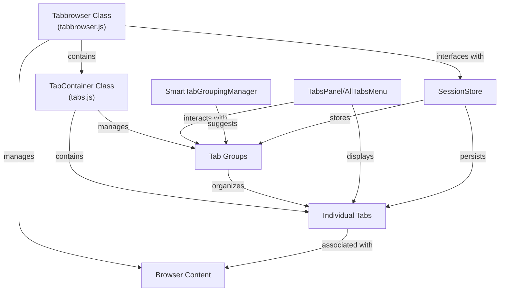
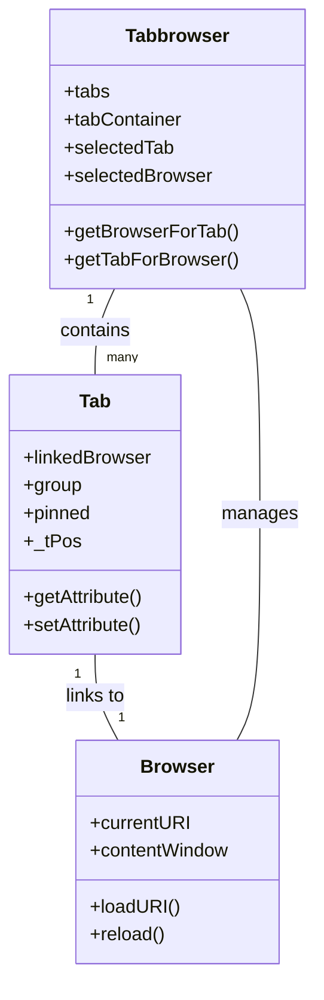
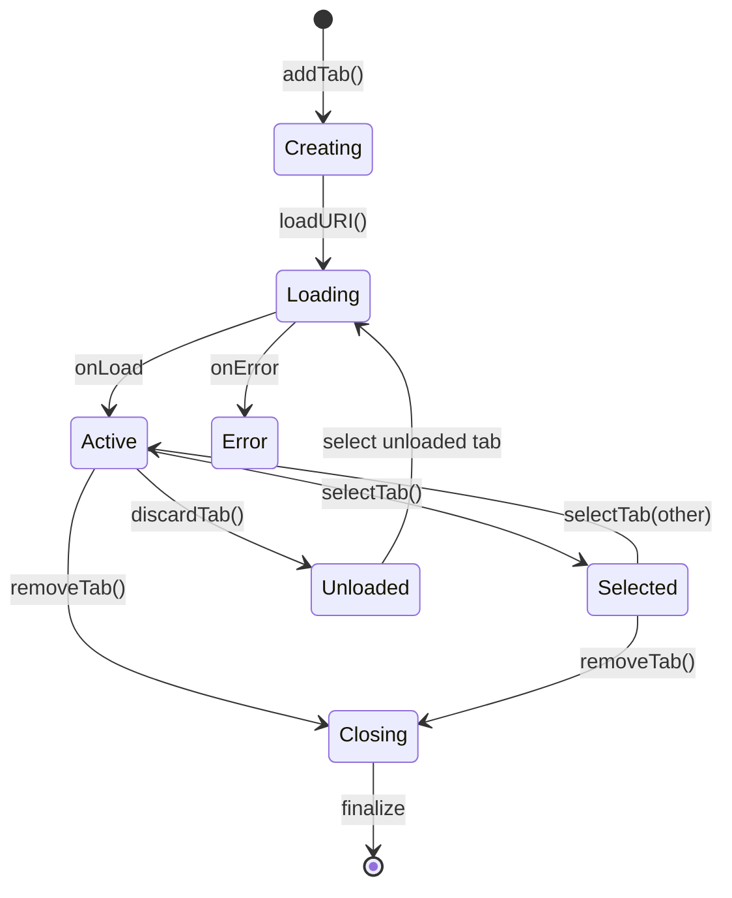
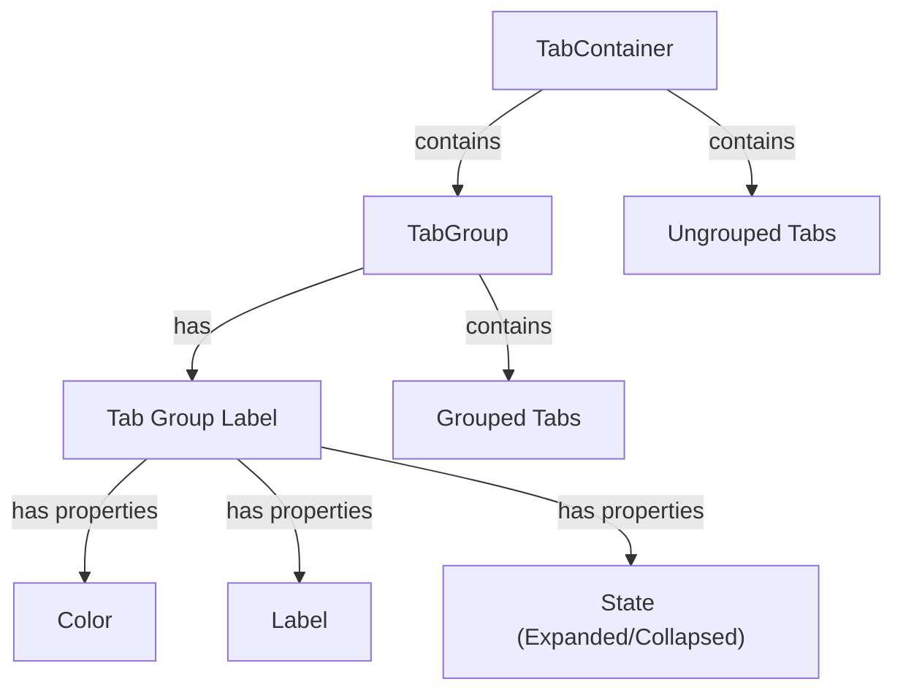
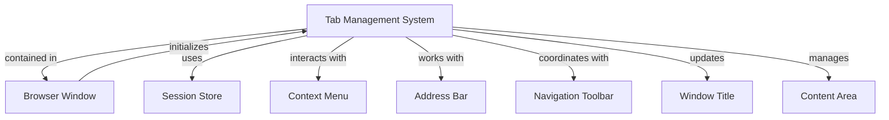

<!-- source: DeepWiki mcp.deepwiki.com · repo mozilla/gecko-dev · page 3.1 Tab Management System · fetched 2026-10-09 -->

# Tab Management System

Relevant source files

The following files were used as context for generating this wiki page:

- [browser/actors/BlockedSiteParent.sys.mjs](browser/actors/BlockedSiteParent.sys.mjs)
- [browser/base/content/browser-init.js](browser/base/content/browser-init.js)
- [browser/base/content/browser-sync.js](browser/base/content/browser-sync.js)
- [browser/base/content/browser.js](browser/base/content/browser.js)
- [browser/base/content/browser.js.globals](browser/base/content/browser.js.globals)
- [browser/base/content/browser.xhtml](browser/base/content/browser.xhtml)
- [browser/base/content/main-popupset.js](browser/base/content/main-popupset.js)
- [browser/base/content/navigator-toolbox.inc.xhtml](browser/base/content/navigator-toolbox.inc.xhtml)
- [browser/base/content/navigator-toolbox.js](browser/base/content/navigator-toolbox.js)
- [browser/base/content/test/performance/browser_tabopen.js](browser/base/content/test/performance/browser_tabopen.js)
- [browser/base/content/test/sync/browser.toml](browser/base/content/test/sync/browser.toml)
- [browser/base/content/test/sync/browser_sync.js](browser/base/content/test/sync/browser_sync.js)
- [browser/components/firefoxview/tests/browser/browser_opentabs_pinned_tabs.js](browser/components/firefoxview/tests/browser/browser_opentabs_pinned_tabs.js)
- [browser/components/sessionstore/SessionStore.sys.mjs](browser/components/sessionstore/SessionStore.sys.mjs)
- [browser/components/sessionstore/TabGroupState.sys.mjs](browser/components/sessionstore/TabGroupState.sys.mjs)
- [browser/components/sessionstore/test/browser_tab_groups_save_on_window_close.js](browser/components/sessionstore/test/browser_tab_groups_save_on_window_close.js)
- [browser/components/sessionstore/test/marionette/test_restore_manually_with_tab_groups.py](browser/components/sessionstore/test/marionette/test_restore_manually_with_tab_groups.py)
- [browser/components/tabbrowser/GroupsList.sys.mjs](browser/components/tabbrowser/GroupsList.sys.mjs)
- [browser/components/tabbrowser/SmartTabGrouping.sys.mjs](browser/components/tabbrowser/SmartTabGrouping.sys.mjs)
- [browser/components/tabbrowser/TabMetrics.sys.mjs](browser/components/tabbrowser/TabMetrics.sys.mjs)
- [browser/components/tabbrowser/TabsList.sys.mjs](browser/components/tabbrowser/TabsList.sys.mjs)
- [browser/components/tabbrowser/content/tab.js](browser/components/tabbrowser/content/tab.js)
- [browser/components/tabbrowser/content/tabbrowser.js](browser/components/tabbrowser/content/tabbrowser.js)
- [browser/components/tabbrowser/content/tabgroup-menu.js](browser/components/tabbrowser/content/tabgroup-menu.js)
- [browser/components/tabbrowser/content/tabgroup.js](browser/components/tabbrowser/content/tabgroup.js)
- [browser/components/tabbrowser/content/tabs.js](browser/components/tabbrowser/content/tabs.js)
- [browser/components/tabbrowser/metrics.yaml](browser/components/tabbrowser/metrics.yaml)
- [browser/components/tabbrowser/moz.build](browser/components/tabbrowser/moz.build)
- [browser/components/tabbrowser/test/browser/smarttabgrouping/browser_tab_grouping_telemetry.js](browser/components/tabbrowser/test/browser/smarttabgrouping/browser_tab_grouping_telemetry.js)
- [browser/components/tabbrowser/test/browser/tabs/browser.toml](browser/components/tabbrowser/test/browser/tabs/browser.toml)
- [browser/components/tabbrowser/test/browser/tabs/browser_standalonePinnedTab.js](browser/components/tabbrowser/test/browser/tabs/browser_standalonePinnedTab.js)
- [browser/components/tabbrowser/test/browser/tabs/browser_tab_aria_level.js](browser/components/tabbrowser/test/browser/tabs/browser_tab_aria_level.js)
- [browser/components/tabbrowser/test/browser/tabs/browser_tab_aria_posinset_setsize.js](browser/components/tabbrowser/test/browser/tabs/browser_tab_aria_posinset_setsize.js)
- [browser/components/tabbrowser/test/browser/tabs/browser_tab_groups.js](browser/components/tabbrowser/test/browser/tabs/browser_tab_groups.js)
- [browser/components/tabbrowser/test/browser/tabs/browser_tab_groups_telemetry.js](browser/components/tabbrowser/test/browser/tabs/browser_tab_groups_telemetry.js)
- [browser/components/tabbrowser/test/browser/tabs/browser_tab_manager_close.js](browser/components/tabbrowser/test/browser/tabs/browser_tab_manager_close.js)
- [browser/components/tabbrowser/test/browser/tabs/browser_tab_manager_groups.js](browser/components/tabbrowser/test/browser/tabs/browser_tab_manager_groups.js)
- [browser/components/taskbartabs/TaskbarTabCmd.sys.mjs](browser/components/taskbartabs/TaskbarTabCmd.sys.mjs)
- [browser/components/taskbartabs/TaskbarTabs.sys.mjs](browser/components/taskbartabs/TaskbarTabs.sys.mjs)
- [browser/components/taskbartabs/components.conf](browser/components/taskbartabs/components.conf)
- [browser/components/taskbartabs/moz.build](browser/components/taskbartabs/moz.build)
- [browser/components/taskbartabs/test/browser/browser.toml](browser/components/taskbartabs/test/browser/browser.toml)
- [browser/components/taskbartabs/test/browser/browser_taskBarTabs_module.js](browser/components/taskbartabs/test/browser/browser_taskBarTabs_module.js)
- [browser/components/taskbartabs/test/browser/browser_taskbarTabs_chromeTest.js](browser/components/taskbartabs/test/browser/browser_taskbarTabs_chromeTest.js)
- [browser/components/taskbartabs/test/browser/dummy_page.html](browser/components/taskbartabs/test/browser/dummy_page.html)
- [browser/components/taskbartabs/test/browser/head.js](browser/components/taskbartabs/test/browser/head.js)
- [browser/components/urlbar/ActionsProviderTabGroups.sys.mjs](browser/components/urlbar/ActionsProviderTabGroups.sys.mjs)
- [browser/locales-preview/smartTabGroups.ftl](browser/locales-preview/smartTabGroups.ftl)
- [browser/locales-preview/taskbartabs.ftl](browser/locales-preview/taskbartabs.ftl)
- [browser/locales/en-US/browser/sync.ftl](browser/locales/en-US/browser/sync.ftl)
- [browser/locales/jar.mn](browser/locales/jar.mn)
- [browser/modules/BrowserDOMWindow.sys.mjs](browser/modules/BrowserDOMWindow.sys.mjs)
- [browser/modules/BrowserUsageTelemetry.sys.mjs](browser/modules/BrowserUsageTelemetry.sys.mjs)
- [browser/modules/HomePage.sys.mjs](browser/modules/HomePage.sys.mjs)
- [browser/modules/URILoadingHelper.sys.mjs](browser/modules/URILoadingHelper.sys.mjs)
- [browser/modules/moz.build](browser/modules/moz.build)
- [browser/themes/shared/customizableui/panelUI-shared.css](browser/themes/shared/customizableui/panelUI-shared.css)
- [browser/themes/shared/icons/taskbar-tabs-create-new.svg](browser/themes/shared/icons/taskbar-tabs-create-new.svg)
- [browser/themes/shared/tabbrowser/tabs.css](browser/themes/shared/tabbrowser/tabs.css)
- [browser/themes/shared/toolbarbuttons.css](browser/themes/shared/toolbarbuttons.css)
- [toolkit/actors/AboutHttpsOnlyErrorParent.sys.mjs](toolkit/actors/AboutHttpsOnlyErrorParent.sys.mjs)
- [toolkit/actors/NetErrorParent.sys.mjs](toolkit/actors/NetErrorParent.sys.mjs)
- [toolkit/components/url-classifier/tests/mochitest/test_reporturl.html](toolkit/components/url-classifier/tests/mochitest/test_reporturl.html)
- [toolkit/content/widgets/arrowscrollbox.js](toolkit/content/widgets/arrowscrollbox.js)

This document provides a technical overview of Firefox's Tab Management System. The system is responsible for creating, displaying, managing, and persisting browser tabs throughout their lifecycle. It includes both the core tab functionality and advanced features like tab groups and tab session management.

For information about tab-related user interface components like the sidebar, see [Sidebar System](#3.2). For details on the New Tab page implementation, see [New Tab Page and Activity Stream](#3.3).

## Architecture Overview

Firefox's Tab Management System is built around several key components that work together to provide a cohesive tab experience.

Sources:
- [browser/components/tabbrowser/content/tabbrowser.js:95-293]()
- [browser/components/tabbrowser/content/tabs.js:26-64]()
- [browser/components/tabbrowser/content/tabgroup.js:14-84]()
- [browser/components/sessionstore/SessionStore.sys.mjs:212-264]()

## Core Components

### Tabbrowser

The `Tabbrowser` class is the central controller for tab management, handling tab creation, selection, navigation, and closing. It maintains references to all browser tabs and their associated content browsers.

Key properties and methods:

| Property/Method | Description |
|-----------------|-------------|
| `tabs` | Array-like object of all tab elements |
| `tabGroups` | Array of all tab groups in the tab strip |
| `visibleTabs` | Array of visible tabs (excluding tabs in collapsed groups) |
| `selectedTab` | Currently selected tab |
| `selectedBrowser` | Browser associated with selected tab |
| `addTab()` | Creates and adds a new tab |
| `removeTab()` | Removes a tab |
| `selectTab()` | Selects a tab |
| `moveTabTo()` | Moves a tab to a specified position |
| `addTabGroup()` | Creates a new tab group |
| `pinTab()/unpinTab()` | Pins/unpins a tab |

Sources:
- [browser/components/tabbrowser/content/tabbrowser.js:376-967]()
- [browser/components/tabbrowser/content/tabbrowser.js:833-876]()

### Tab Container

The `TabContainer` (implemented as `MozTabbrowserTabs`) manages the UI representation of tabs in the tab strip. It handles events like tab clicks, drags, and context menus.

Key responsibilities:
- Tab overflow handling
- Tab dragging and dropping
- Keyboard navigation between tabs
- Tab selection events
- Tab visibility management
- Tab focusing for accessibility

Sources:
- [browser/components/tabbrowser/content/tabs.js:26-145]()
- [browser/components/tabbrowser/content/tabs.js:622-671]()

### Tabs and Browsers Relationship

Each tab element is linked to a browser element that displays web content. This relationship is established when a tab is created.

The connection between tabs and browsers is maintained via:
- The `linkedBrowser` property on tab elements
- The `_tabForBrowser` WeakMap in the Tabbrowser class

Sources:
- [browser/components/tabbrowser/content/tabbrowser.js:255-259]()
- [browser/components/tabbrowser/content/tabbrowser.js:574-587]()
- [browser/components/tabbrowser/content/tabbrowser.js:907-909]()

## Tab Lifecycle

Tabs go through various states throughout their lifecycle, from creation to closing.

Sources:
- [browser/components/tabbrowser/content/tabbrowser.js:447-594]() (Tab initialization)
- [browser/components/tabbrowser/content/tabbrowser.js:1195-1245]() (Tab selection)

## Tab Creation and Management

### Tab Creation

New tabs can be created through:
- Direct API calls to `gBrowser.addTab()`
- The new tab button in the UI
- Opening links in new tabs (e.g., middle-click, Ctrl+click)
- Keyboard shortcuts (Ctrl+T)

During tab creation, the following happens:
1. A tab element is created
2. A browser element is created (or reused from a preloaded browser)
3. The tab and browser are linked
4. Event listeners are set up
5. The tab is positioned in the tab strip
6. The tab is selected if necessary

Sources:
- [browser/components/tabbrowser/content/tabbrowser.js:447-594]()
- [browser/components/tabbrowser/content/tabbrowser.js:574-587]()

### Tab Selection

When a tab is selected:
1. The previous selected tab is deselected
2. The new tab is marked as selected
3. The associated browser is shown in the content area
4. The window title is updated
5. Various UI elements are updated (e.g., address bar, site identity)
6. Events are fired to notify other systems

Sources:
- [browser/components/tabbrowser/content/tabbrowser.js:1195-1245]()
- [browser/components/tabbrowser/content/tabs.js:232-246]()

### Tab Closing

When a tab is closed:
1. Tab closing animations are triggered
2. The tab's state is saved to allow for undo
3. If it's the selected tab, another tab is selected
4. The tab and associated resources are cleaned up
5. The tab element is removed from the DOM

Sources:
- [browser/components/tabbrowser/content/tabbrowser.js:334-335]()
- [browser/base/content/main-popupset.js:18-46]() (Context menu actions)

## Tab Groups

Tab groups allow users to organize related tabs together, reducing clutter and making tab management easier. Firefox supports both manual tab grouping and AI-suggested grouping.

### Tab Group Structure

Tab groups are implemented as custom elements (`MozTabbrowserTabGroup`) that extend `MozXULElement`. They are inserted into the tab strip and contain the tabs that belong to the group.

Sources:
- [browser/components/tabbrowser/content/tabgroup.js:14-147]()
- [browser/components/tabbrowser/test/browser/tabs/browser_tab_groups.js:39-169]()

### Tab Group Operations

Key operations on tab groups include:
- Creating a new group
- Adding tabs to a group
- Removing tabs from a group
- Collapsing/expanding a group
- Moving a group to a new window
- Saving and closing a group

The tab group state is managed through the `TabGroupState` module and is persisted through the `SessionStore`.

Sources:
- [browser/components/tabbrowser/content/tabgroup.js:127-365]()
- [browser/components/tabbrowser/content/tabgroup-menu.js:469-471]()

### Smart Tab Grouping

Firefox includes an AI-powered smart tab grouping feature that can suggest related tabs to group together. This is implemented through the `SmartTabGroupingManager`.

Key capabilities:
- Generating embeddings for tab content
- Clustering tabs based on content similarity
- Finding nearest neighbors for similar tabs
- Suggesting group names based on content

The smart tab grouping interface is exposed through the tab group creation and editing UI.

Sources:
- [browser/components/tabbrowser/SmartTabGrouping.sys.mjs:128-369]()
- [browser/components/tabbrowser/content/tabgroup-menu.js:199-262]()
- [browser/locales-preview/smartTabGroups.ftl:5-28]()

## Session Management

The Tab Management System works closely with the Session Store to persist tab state across browser sessions.

### Tab State Persistence

Each tab's state includes:
- Current URL
- Navigation history
- Scroll position
- Form data
- Group membership
- Tab position

This state is regularly saved to disk and restored when the browser is restarted.

Sources:
- [browser/components/sessionstore/SessionStore.sys.mjs:212-264]()
- [browser/components/sessionstore/SessionStore.sys.mjs:376-425]()

### Tab Restoration

When the browser starts up, tabs are restored in the following order:
1. The session file is read
2. Windows are recreated
3. Tab elements are created
4. Tab state is restored
5. Selected tabs are chosen
6. Content is loaded (possibly lazily)

Tab groups are also restored, maintaining their membership, labels, and collapsed state.

Sources:
- [browser/components/sessionstore/SessionStore.sys.mjs:259-304]()
- [browser/components/sessionstore/SessionStore.sys.mjs:315-333]()

## Tab UI and Styling

Tab appearance is controlled through CSS, with different styles for various tab states.

### Tab Visual States

Tabs can be in various visual states:
- Normal
- Selected
- Loading
- Playing audio/muted
- Pinned
- Attention (highlighted)
- In a tab group

CSS classes are added to tabs based on their state, and transitions are used for smooth animations.

Sources:
- [browser/themes/shared/tabbrowser/tabs.css:176-833]()
- [browser/themes/shared/tabbrowser/tabs.css:834-876]()

### Tab Group Styling

Tab groups have their own distinct styling, including:
- Colored indicators
- Expand/collapse controls
- Group labels
- Visual separation from regular tabs

Each group can have a unique color from a predefined palette.

Sources:
- [browser/themes/shared/tabbrowser/tabs.css:877-1104]()
- [browser/components/tabbrowser/content/tabgroup-menu.js:25-48]()

## All Tabs Menu and Tab Management UI

Firefox provides a menu to view and manage all tabs, including grouped tabs.

Features include:
- List of all tabs with favicons and titles
- Grouped tabs shown under group headers
- Collapsed groups show only the group header
- Search functionality to find tabs
- Commands to manipulate tabs and groups

Sources:
- [browser/base/content/browser-sync.js:1-101]()
- [browser/components/tabbrowser/test/browser/tabs/browser_tab_manager_groups.js:15-128]()

## Telemetry and Performance Metrics

The Tab Management System includes extensive telemetry to monitor tab usage patterns and performance.

Key metrics include:
- Tab count
- Tab grouping usage
- Tab switching time
- Tab loading performance
- Tab group operations

This data helps Firefox developers understand how users interact with tabs and identify areas for improvement.

Sources:
- [browser/components/tabbrowser/metrics.yaml:13-265]()
- [browser/components/tabbrowser/test/browser/tabs/browser_tab_groups_telemetry.js:13-60]()
- [browser/components/tabbrowser/test/browser/smarttabgrouping/browser_tab_grouping_telemetry.js:1-32]()

## Integration with Browser Window

The Tab Management System is tightly integrated with the browser window and other browser systems.

The system is initialized during browser window startup and is responsible for setting up the initial tab and browser.

Sources:
- [browser/base/content/browser-init.js:11-134]()
- [browser/base/content/navigator-toolbox.inc.xhtml:1-36]()
- [browser/base/content/browser.xhtml:1-27]()

## Conclusion

Firefox's Tab Management System is a sophisticated component that handles all aspects of tab creation, management, grouping, and persistence. It provides both core tab functionality and advanced features like tab groups and smart grouping suggestions, all while maintaining performance and reliability.

The system's modular architecture allows for easy extension and customization, and its integration with the Session Store ensures that users can seamlessly continue their browsing across sessions.

---

