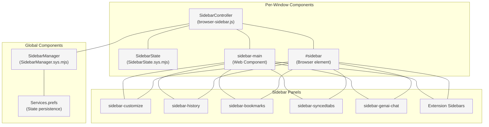
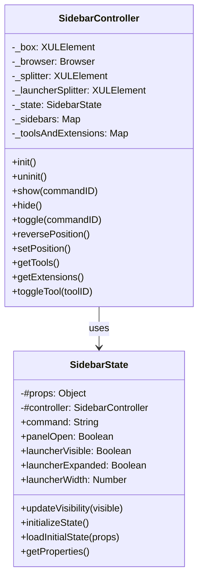
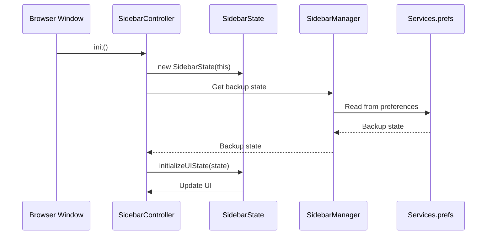
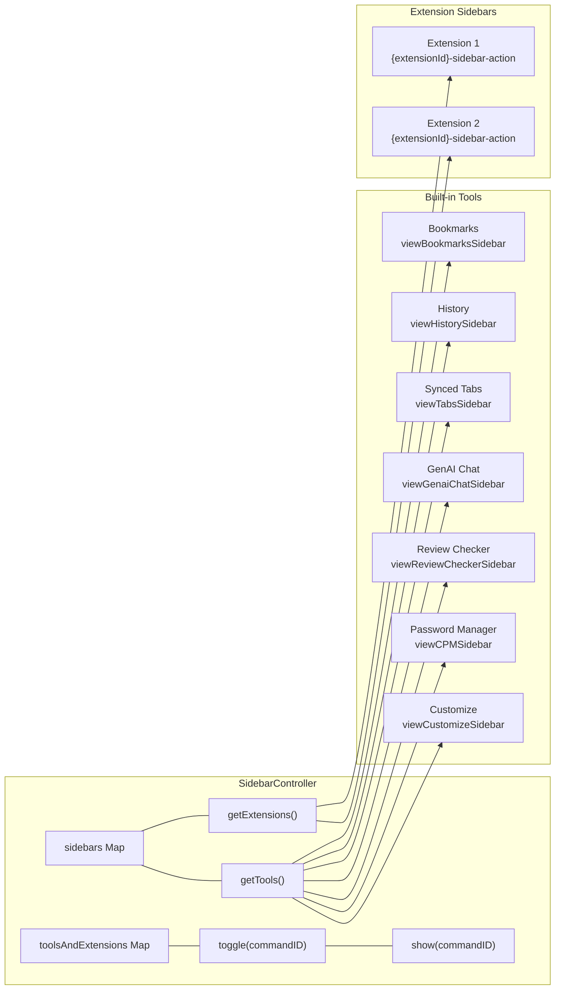
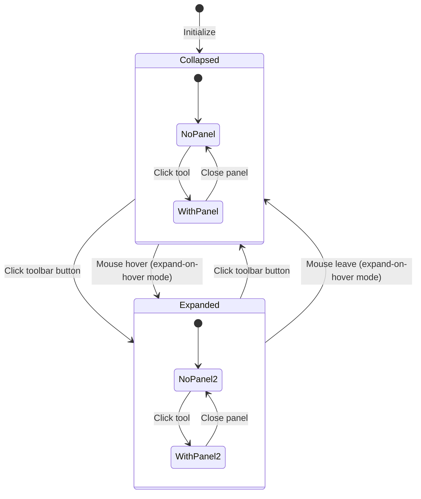
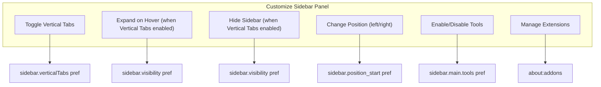
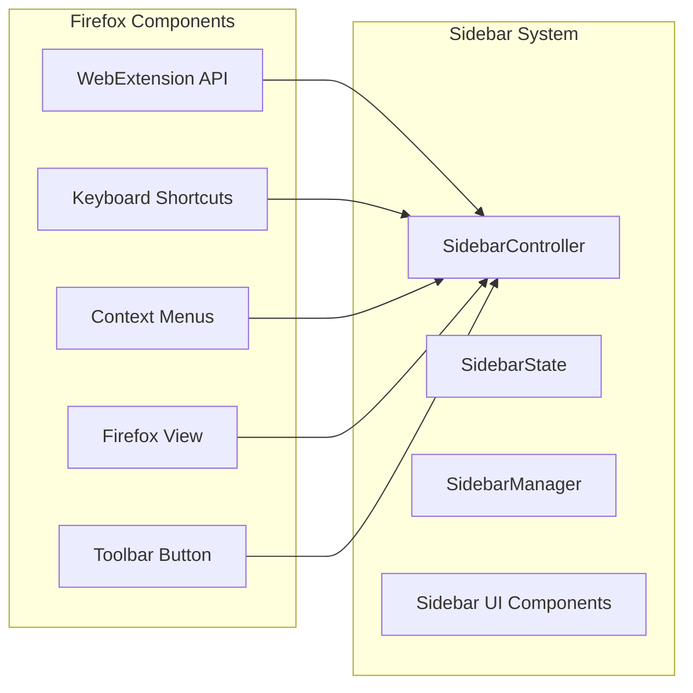

<!-- source: DeepWiki mcp.deepwiki.com · repo mozilla/gecko-dev · page 3.2 Sidebar System · fetched 2026-10-09 -->

# Sidebar System

<details>
<summary>Relevant source files</summary>

The following files were used as context for generating this wiki page:

- [browser/base/content/browser-box.inc.xhtml](browser/base/content/browser-box.inc.xhtml)
- [browser/base/content/test/sidebar/browser_sidebar_keys.js](browser/base/content/test/sidebar/browser_sidebar_keys.js)
- [browser/base/content/test/sidebar/browser_sidebar_move.js](browser/base/content/test/sidebar/browser_sidebar_move.js)
- [browser/components/contextualidentity/test/browser/browser_newtabButton.js](browser/components/contextualidentity/test/browser/browser_newtabButton.js)
- [browser/components/customizableui/test/browser_sidebar_toggle.js](browser/components/customizableui/test/browser_sidebar_toggle.js)
- [browser/components/firefoxview/SyncedTabsController.sys.mjs](browser/components/firefoxview/SyncedTabsController.sys.mjs)
- [browser/components/firefoxview/tests/browser/browser.toml](browser/components/firefoxview/tests/browser/browser.toml)
- [browser/components/firefoxview/tests/browser/browser_syncedtabs_firefoxview.js](browser/components/firefoxview/tests/browser/browser_syncedtabs_firefoxview.js)
- [browser/components/genai/tests/xpcshell/test_show_chat_entrypoint.js](browser/components/genai/tests/xpcshell/test_show_chat_entrypoint.js)
- [browser/components/sessionstore/test/marionette/test_restore_sidebar.py](browser/components/sessionstore/test/marionette/test_restore_sidebar.py)
- [browser/components/sidebar/SidebarManager.sys.mjs](browser/components/sidebar/SidebarManager.sys.mjs)
- [browser/components/sidebar/SidebarState.sys.mjs](browser/components/sidebar/SidebarState.sys.mjs)
- [browser/components/sidebar/browser-sidebar.js](browser/components/sidebar/browser-sidebar.js)
- [browser/components/sidebar/docs/index.rst](browser/components/sidebar/docs/index.rst)
- [browser/components/sidebar/metrics.yaml](browser/components/sidebar/metrics.yaml)
- [browser/components/sidebar/moz.build](browser/components/sidebar/moz.build)
- [browser/components/sidebar/sidebar-customize.css](browser/components/sidebar/sidebar-customize.css)
- [browser/components/sidebar/sidebar-customize.mjs](browser/components/sidebar/sidebar-customize.mjs)
- [browser/components/sidebar/tests/browser/browser.toml](browser/components/sidebar/tests/browser/browser.toml)
- [browser/components/sidebar/tests/browser/browser_a11y_sidebar.js](browser/components/sidebar/tests/browser/browser_a11y_sidebar.js)
- [browser/components/sidebar/tests/browser/browser_customize_sidebar.js](browser/components/sidebar/tests/browser/browser_customize_sidebar.js)
- [browser/components/sidebar/tests/browser/browser_glean_sidebar.js](browser/components/sidebar/tests/browser/browser_glean_sidebar.js)
- [browser/components/sidebar/tests/browser/browser_resize_sidebar.js](browser/components/sidebar/tests/browser/browser_resize_sidebar.js)
- [browser/components/sidebar/tests/browser/browser_sidebar_collapsed_close_tab_button.js](browser/components/sidebar/tests/browser/browser_sidebar_collapsed_close_tab_button.js)
- [browser/components/sidebar/tests/browser/browser_sidebar_context_menu.js](browser/components/sidebar/tests/browser/browser_sidebar_context_menu.js)
- [browser/components/sidebar/tests/browser/browser_sidebar_expand_on_hover.js](browser/components/sidebar/tests/browser/browser_sidebar_expand_on_hover.js)
- [browser/components/sidebar/tests/browser/browser_sidebar_max_width.js](browser/components/sidebar/tests/browser/browser_sidebar_max_width.js)
- [browser/components/sidebar/tests/browser/browser_sidebar_menubar_item_commands.js](browser/components/sidebar/tests/browser/browser_sidebar_menubar_item_commands.js)
- [browser/components/sidebar/tests/browser/browser_sidebar_nimbus.js](browser/components/sidebar/tests/browser/browser_sidebar_nimbus.js)
- [browser/components/sidebar/tests/browser/browser_sidebar_position.js](browser/components/sidebar/tests/browser/browser_sidebar_position.js)
- [browser/components/sidebar/tests/browser/browser_sidebar_prefs.js](browser/components/sidebar/tests/browser/browser_sidebar_prefs.js)
- [browser/components/sidebar/tests/browser/browser_syncedtabs_sidebar.js](browser/components/sidebar/tests/browser/browser_syncedtabs_sidebar.js)
- [browser/components/sidebar/tests/browser/browser_toolbar_sidebar_button.js](browser/components/sidebar/tests/browser/browser_toolbar_sidebar_button.js)
- [browser/components/sidebar/tests/browser/browser_tools_migration.js](browser/components/sidebar/tests/browser/browser_tools_migration.js)
- [browser/components/sidebar/tests/browser/browser_vertical_tabs.js](browser/components/sidebar/tests/browser/browser_vertical_tabs.js)
- [browser/components/sidebar/tests/browser/head.js](browser/components/sidebar/tests/browser/head.js)
- [browser/components/sidebar/tests/unit/test_sidebar_state.js](browser/components/sidebar/tests/unit/test_sidebar_state.js)
- [browser/components/translations/tests/browser/browser_translations_full_page_telemetry_retranslate.js](browser/components/translations/tests/browser/browser_translations_full_page_telemetry_retranslate.js)
- [browser/components/translations/tests/browser/browser_translations_full_page_telemetry_translation_failure.js](browser/components/translations/tests/browser/browser_translations_full_page_telemetry_translation_failure.js)
- [browser/components/translations/tests/browser/browser_translations_full_page_telemetry_translation_request.js](browser/components/translations/tests/browser/browser_translations_full_page_telemetry_translation_request.js)
- [browser/docs/BrowserStartup.md](browser/docs/BrowserStartup.md)
- [browser/docs/CategoryManagerIndirection.md](browser/docs/CategoryManagerIndirection.md)
- [browser/docs/index.rst](browser/docs/index.rst)
- [browser/themes/shared/browser-shared.css](browser/themes/shared/browser-shared.css)
- [browser/themes/shared/sidebar.css](browser/themes/shared/sidebar.css)
- [browser/themes/shared/tabbrowser/content-area.css](browser/themes/shared/tabbrowser/content-area.css)
- [docs/conf.py](docs/conf.py)
- [docs/performance/dtrace.md](docs/performance/dtrace.md)
- [docs/performance/memory/basic_operations.md](docs/performance/memory/basic_operations.md)
- [docs/performance/memory/dominators_view.md](docs/performance/memory/dominators_view.md)
- [docs/rust-components/topic-guides/merino.md](docs/rust-components/topic-guides/merino.md)
- [docs/rust-components/topic-guides/relevancy.md](docs/rust-components/topic-guides/relevancy.md)
- [docs/rust-components/topic-guides/remote-settings.md](docs/rust-components/topic-guides/remote-settings.md)
- [docs/rust-components/topic-guides/suggest.md](docs/rust-components/topic-guides/suggest.md)
- [dom/performance/metrics.yaml](dom/performance/metrics.yaml)
- [mobile/shared/modules/geckoview/test/mochitest/test_geckoview_translations.html](mobile/shared/modules/geckoview/test/mochitest/test_geckoview_translations.html)
- [toolkit/components/glean/tags.yaml](toolkit/components/glean/tags.yaml)
- [toolkit/components/translations/TranslationsTelemetry.sys.mjs](toolkit/components/translations/TranslationsTelemetry.sys.mjs)
- [toolkit/components/translations/metrics.yaml](toolkit/components/translations/metrics.yaml)
- [toolkit/modules/BinarySearch.sys.mjs](toolkit/modules/BinarySearch.sys.mjs)

</details>


The Sidebar System provides a framework for displaying and managing sidebar panels in Firefox. It enables users to access various browser features like bookmarks, history, synced tabs, as well as extension-provided sidebars, through a unified interface. This document describes the technical architecture and implementation of the sidebar system, focusing on its core components, state management, and integration points.

For information about specific sidebar panels like Bookmarks or History, see their respective documentation. For UI Customization which can affect sidebar placement, see [Customizable UI](#components/customizableui/docs/index).

## Architecture Overview

The Firefox Sidebar System follows a Model-View-Controller architecture pattern with reactive state management. It consists of several key components that work together to provide sidebar functionality.



Sources:
- [browser/components/sidebar/browser-sidebar.js]()
- [browser/components/sidebar/SidebarState.sys.mjs]()
- [browser/components/sidebar/SidebarManager.sys.mjs]()
- [browser/components/sidebar/sidebar-customize.mjs]()

## Core Components

### SidebarController

The `SidebarController` is the main entry point for sidebar functionality, handling initialization, event handling, showing/hiding panels, and managing the sidebar UI state. It's attached to each browser window and manages the sidebar for that specific window.

Key responsibilities:
- Initializing the sidebar UI
- Toggling sidebar visibility
- Loading and switching between sidebar panels
- Managing sidebar position (left/right)
- Handling UI events and animations
- Coordinating with the SidebarState



Sources:
- [browser/components/sidebar/browser-sidebar.js:30-1016]()
- [browser/components/sidebar/SidebarState.sys.mjs:54-483]()

### SidebarState

The `SidebarState` class provides reactive state management for the sidebar, handling state changes and triggering appropriate UI updates. It maintains properties like panel visibility, launcher state, and dimensions.

Key properties and their effects:
- `command`: The ID of the current sidebar panel
- `panelOpen`: Whether a panel is currently open
- `launcherVisible`: Whether the sidebar launcher is visible
- `launcherExpanded`: Whether the launcher is expanded (showing text labels)
- `launcherWidth`: Current width of the launcher

When these properties change, the `SidebarState` class updates the UI accordingly, making it a central piece of the reactive architecture.

Sources:
- [browser/components/sidebar/SidebarState.sys.mjs:54-483]()

### SidebarManager

The `SidebarManager` provides global sidebar state management across browser windows. It's responsible for:
- Persisting sidebar state across browser restarts
- Managing default sidebar tools
- Handling features controlled by Nimbus experiments
- Coordinating vertical tabs integration



Sources:
- [browser/components/sidebar/SidebarManager.sys.mjs:18-305]()

## Sidebar Panel Types and Management

The sidebar system supports multiple types of panels, managed through the `sidebars` and `toolsAndExtensions` maps in `SidebarController`.

### Built-in Tools

Firefox includes several built-in sidebar tools:
- Bookmarks (`viewBookmarksSidebar`)
- History (`viewHistorySidebar`)
- Synced Tabs (`viewTabsSidebar`)
- GenAI Chat (`viewGenaiChatSidebar`) - Controlled by the `browser.ml.chat.enabled` preference
- Review Checker (`viewReviewCheckerSidebar`) - Controlled by the `browser.shopping.experience2023.integratedSidebar` preference
- Password Manager (`viewCPMSidebar`) - Controlled by the `browser.contextual-password-manager.enabled` preference
- Customize (`viewCustomizeSidebar`) - Available in the revamped sidebar



Sources:
- [browser/components/sidebar/browser-sidebar.js:99-216]()
- [browser/components/sidebar/browser-sidebar.js:221-235]()

### Extension Integration

Firefox extensions can add their own sidebar panels through the WebExtension API. The `SidebarController` tracks these extensions and integrates them into the sidebar UI.

Extension sidebars are:
- Registered with the `browser.sidebarAction` API
- Added to the sidebar switcher menu
- Managed in the same way as built-in panels
- Can be enabled/disabled from the Customize panel

Sources:
- [browser/components/sidebar/tests/browser/browser_extensions_sidebar.js]()
- [browser/components/sidebar/tests/browser/browser_sidebar_context_menu.js:17-198]()

## UI Modes and States

The sidebar system supports various UI states and visibility modes:

### Visibility Modes

Controlled by the `sidebar.visibility` preference:
- `always-show`: Sidebar launcher is always visible
- `hide-sidebar`: Sidebar launcher can be toggled on/off
- `expand-on-hover`: Sidebar expands when the mouse hovers over it

### Position

The sidebar can be positioned on either side of the browser window:
- Left side (default in left-to-right locales)
- Right side (default in right-to-left locales)
- Controlled by the `sidebar.position_start` preference

### Launcher States

The sidebar launcher (new in the revamped sidebar) can be in two states:
- Collapsed: Shows only icons
- Expanded: Shows icons and labels



Sources:
- [browser/components/sidebar/SidebarState.sys.mjs:301-321]()
- [browser/components/sidebar/tests/browser/browser_sidebar_expand_on_hover.js]()
- [browser/components/sidebar/tests/browser/browser_toolbar_sidebar_button.js:66-305]()

## Vertical Tabs Integration

The sidebar system integrates with Firefox's vertical tabs feature, which moves the browser's tab strip into the sidebar area.

When vertical tabs are enabled:
- The horizontal tab strip is hidden
- Tab elements are moved into the sidebar container
- The sidebar launcher is expanded by default
- Double-clicking in the tab area creates new tabs
- Special UI for pinned tabs is displayed

```mermaid
flowchart TB
    subgraph "Regular Tabs Mode"
        direction LR
        hTabs["TabsToolbar (Horizontal)"] --- hContent["Content Area"]
        hLauncher["Sidebar Launcher"] --- hSidebar["Sidebar Panel (optional)"]
    end
    
    subgraph "Vertical Tabs Mode"
        direction LR
        vLauncher["Sidebar Launcher"] --- vTabs["Vertical Tabs Container"]
        vTabs --- vPinned["Pinned Tabs"]
        vTabs --- vRegular["Regular Tabs"]
        vSidebar["Sidebar Panel (optional)"] --- vContent["Content Area"]
    end
    
    RegularMode["sidebar.verticalTabs=false"] --> "Regular Tabs Mode"
    VerticalMode["sidebar.verticalTabs=true"] --> "Vertical Tabs Mode"
```

Sources:
- [browser/components/sidebar/tests/browser/browser_vertical_tabs.js:76-593]()
- [browser/themes/shared/browser-shared.css:58-77]()

## Customization

Users can customize the sidebar through the Customize panel (`viewCustomizeSidebar`), which allows:
- Enabling/disabling sidebar tools
- Toggling vertical tabs
- Changing the sidebar position
- Setting visibility mode
- Managing extension sidebars

The `sidebar-customize.mjs` component provides the user interface for these customizations.



Sources:
- [browser/components/sidebar/sidebar-customize.mjs:26-386]()
- [browser/components/sidebar/tests/browser/browser_customize_sidebar.js:51-259]()

## Animation and Interaction

The sidebar system includes animations for transitions between states:
- Opening/closing panels
- Expanding/collapsing the launcher
- Resizing the sidebar
- Expand-on-hover behavior

Key animation-related code:
- Animation duration is controlled by `sidebar.animation.enabled` preference
- The system uses CSS transitions and JavaScript animations
- Animation behavior varies based on the sidebar visibility mode

Sources:
- [browser/components/sidebar/browser-sidebar.js:1028-1164]()
- [browser/themes/shared/sidebar.css:230-341]()

## Telemetry and Metrics

The sidebar system collects telemetry to measure user engagement:
- Sidebar panel usage (open/close events)
- Sidebar width metrics
- Tool usage tracking
- Position and visibility preferences

These metrics are sent to Mozilla's telemetry system via Glean.

Sources:
- [browser/components/sidebar/tests/browser/browser_glean_sidebar.js:37-746]()
- [browser/components/sidebar/metrics.yaml:13-89]()

## Extension Points

The sidebar system provides several extension points for other browser components:
- WebExtension sidebar API for extensions
- Keyboard shortcuts for toggling sidebar panels
- Context menus for sidebar-related actions
- Integration with Firefox View for synced tabs
- Toolbar button for toggling the sidebar



Sources:
- [browser/components/sidebar/tests/browser/browser_extensions_sidebar.js]()
- [browser/components/sidebar/tests/browser/browser_sidebar_menubar_item_commands.js]()
- [browser/components/sidebar/tests/browser/browser_toolbar_sidebar_button.js]()
- [browser/components/firefoxview/tests/browser/browser_syncedtabs_firefoxview.js]()

## Browser Session Integration

The sidebar state is preserved across browser sessions through:
- Session store integration for window-specific state
- Preference-based backup state for last-used settings
- XUL store for certain UI properties

This ensures that users have a consistent experience when they restart their browser.

Sources:
- [browser/components/sessionstore/test/marionette/test_restore_sidebar.py]()
- [browser/components/sidebar/browser-sidebar.js:475-492]()

## Legacy vs. Revamped Sidebar

The sidebar system has undergone a revamp, with both the legacy and new implementations coexisting. The revamped sidebar is controlled by the `sidebar.revamp` preference.

Key differences:
- Legacy sidebar only has a panel without a launcher
- Revamped sidebar includes a collapsible launcher with icons
- Revamped sidebar supports expand-on-hover and vertical tabs
- UI components are different between the two implementations

The system includes code to handle transitions between the two modes.

Sources:
- [browser/components/sidebar/browser-sidebar.js:776-816]()
- [browser/themes/shared/sidebar.css:17-30]()

---

