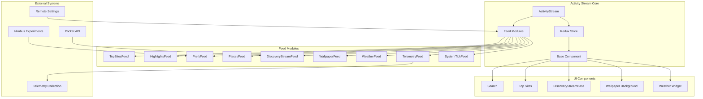
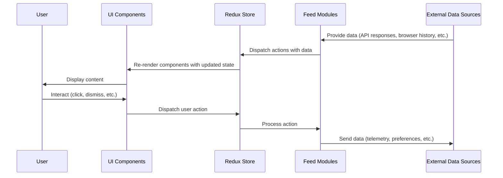
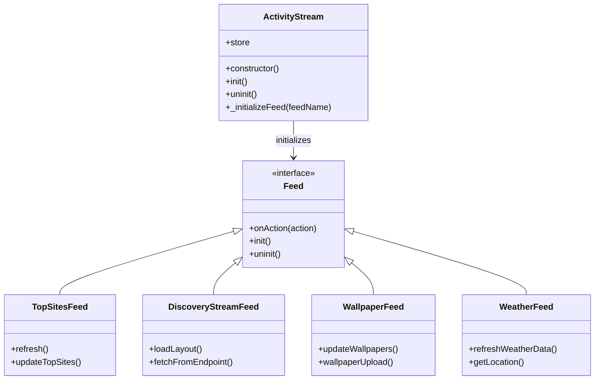
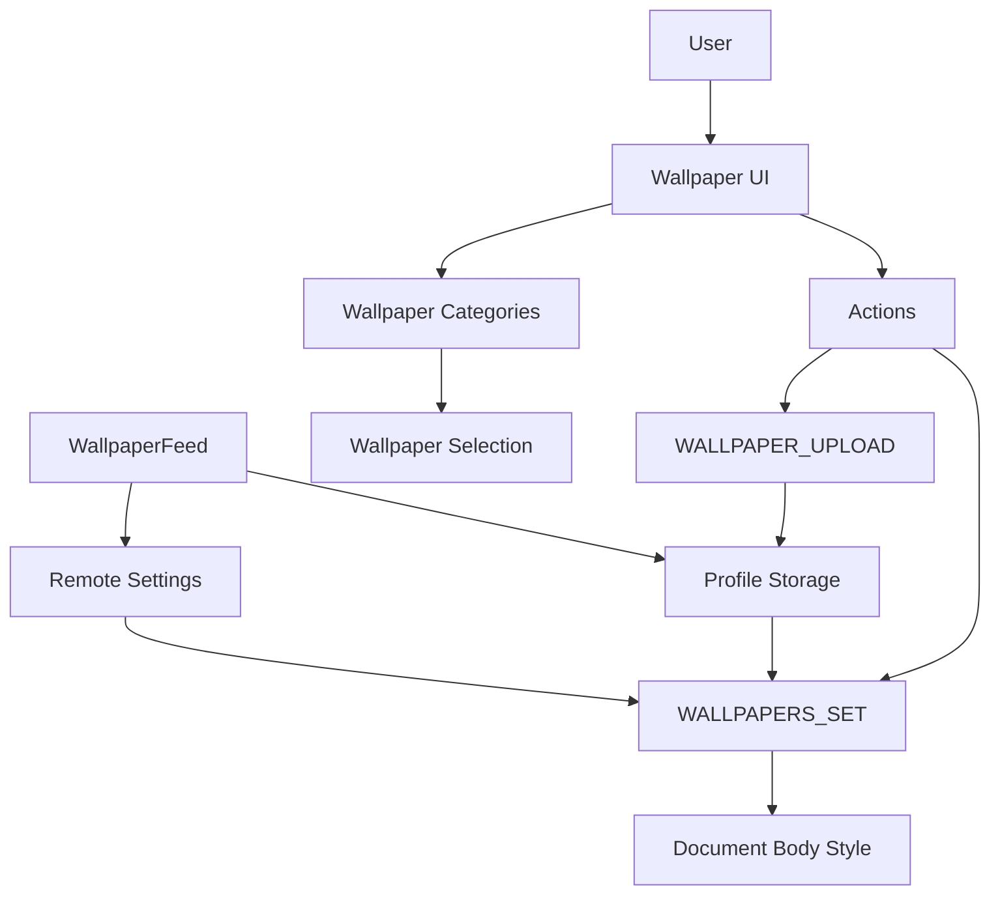
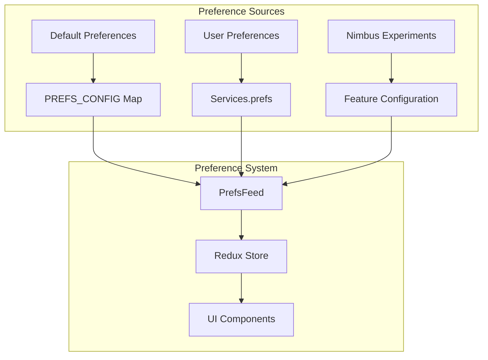
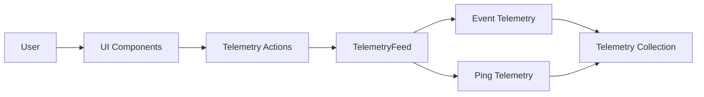
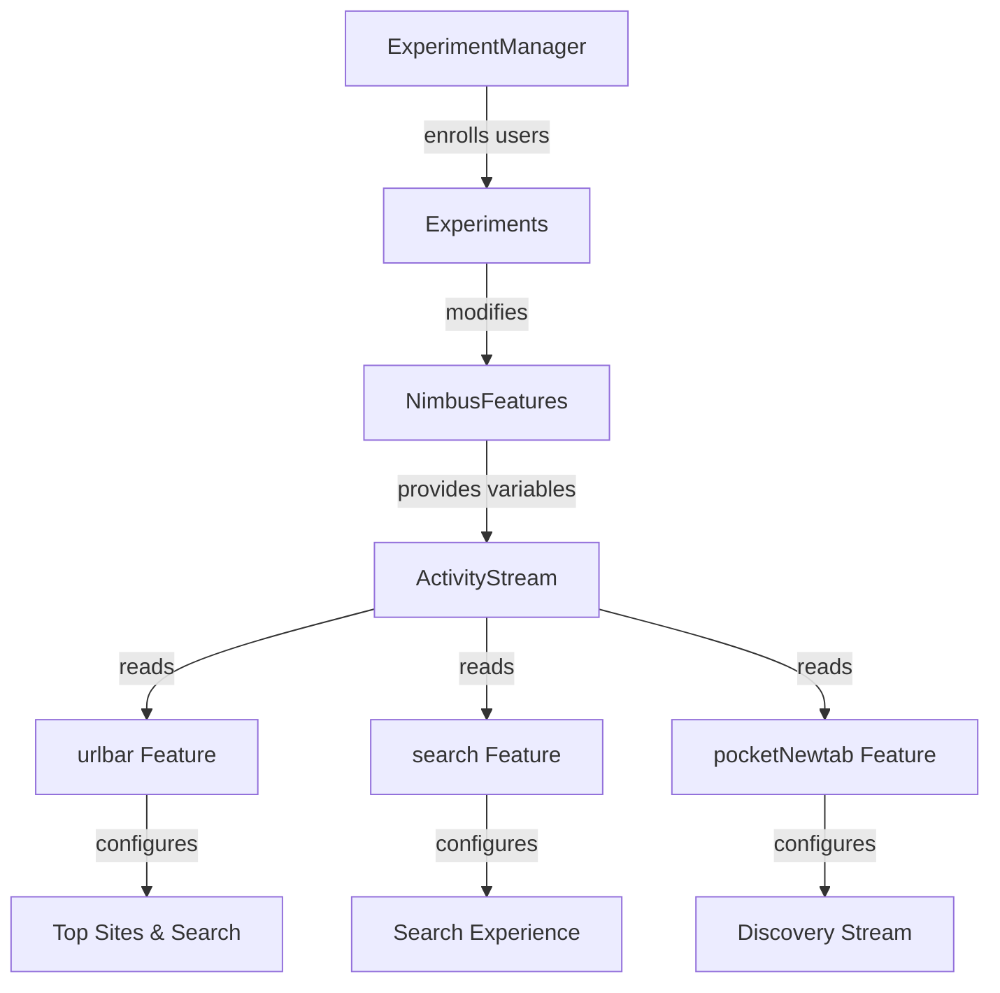

<!-- source: DeepWiki mcp.deepwiki.com · repo mozilla/gecko-dev · page 3.3 New Tab Page and Activity Stream · fetched 2026-10-09 -->

# New Tab Page and Activity Stream

Relevant source files

The following files were used as context for generating this wiki page:

- [browser/app/profile/firefox.js](browser/app/profile/firefox.js)
- [browser/base/content/test/general/browser_datachoices_notification.js](browser/base/content/test/general/browser_datachoices_notification.js)
- [browser/components/asrouter/modules/OnboardingMessageProvider.sys.mjs](browser/components/asrouter/modules/OnboardingMessageProvider.sys.mjs)
- [browser/components/newtab/metrics.yaml](browser/components/newtab/metrics.yaml)
- [browser/components/tests/browser/browser_browserGlue_showModal_trigger.js](browser/components/tests/browser/browser_browserGlue_showModal_trigger.js)
- [browser/extensions/newtab/common/Actions.mjs](browser/extensions/newtab/common/Actions.mjs)
- [browser/extensions/newtab/common/Reducers.sys.mjs](browser/extensions/newtab/common/Reducers.sys.mjs)
- [browser/extensions/newtab/content-src/components/Base/Base.jsx](browser/extensions/newtab/content-src/components/Base/Base.jsx)
- [browser/extensions/newtab/content-src/components/CustomizeMenu/ContentSection/ContentSection.jsx](browser/extensions/newtab/content-src/components/CustomizeMenu/ContentSection/ContentSection.jsx)
- [browser/extensions/newtab/content-src/components/CustomizeMenu/CustomizeMenu.jsx](browser/extensions/newtab/content-src/components/CustomizeMenu/CustomizeMenu.jsx)
- [browser/extensions/newtab/content-src/components/CustomizeMenu/_CustomizeMenu.scss](browser/extensions/newtab/content-src/components/CustomizeMenu/_CustomizeMenu.scss)
- [browser/extensions/newtab/content-src/components/DiscoveryStreamComponents/CardGrid/CardGrid.jsx](browser/extensions/newtab/content-src/components/DiscoveryStreamComponents/CardGrid/CardGrid.jsx)
- [browser/extensions/newtab/content-src/components/DiscoveryStreamComponents/CardSections/CardSections.jsx](browser/extensions/newtab/content-src/components/DiscoveryStreamComponents/CardSections/CardSections.jsx)
- [browser/extensions/newtab/content-src/components/DiscoveryStreamComponents/DSCard/DSCard.jsx](browser/extensions/newtab/content-src/components/DiscoveryStreamComponents/DSCard/DSCard.jsx)
- [browser/extensions/newtab/content-src/components/DiscoveryStreamComponents/DSCard/_DSCard.scss](browser/extensions/newtab/content-src/components/DiscoveryStreamComponents/DSCard/_DSCard.scss)
- [browser/extensions/newtab/content-src/components/DiscoveryStreamComponents/FeatureHighlight/FeatureHighlight.jsx](browser/extensions/newtab/content-src/components/DiscoveryStreamComponents/FeatureHighlight/FeatureHighlight.jsx)
- [browser/extensions/newtab/content-src/components/DiscoveryStreamComponents/FeatureHighlight/WallpaperFeatureHighlight.jsx](browser/extensions/newtab/content-src/components/DiscoveryStreamComponents/FeatureHighlight/WallpaperFeatureHighlight.jsx)
- [browser/extensions/newtab/content-src/components/DiscoveryStreamComponents/FeatureHighlight/_FeatureHighlight.scss](browser/extensions/newtab/content-src/components/DiscoveryStreamComponents/FeatureHighlight/_FeatureHighlight.scss)
- [browser/extensions/newtab/content-src/components/DiscoveryStreamComponents/FeatureHighlight/_WallpaperFeatureHighlight.scss](browser/extensions/newtab/content-src/components/DiscoveryStreamComponents/FeatureHighlight/_WallpaperFeatureHighlight.scss)
- [browser/extensions/newtab/content-src/components/DiscoveryStreamComponents/InterestPicker/InterestPicker.jsx](browser/extensions/newtab/content-src/components/DiscoveryStreamComponents/InterestPicker/InterestPicker.jsx)
- [browser/extensions/newtab/content-src/components/DiscoveryStreamComponents/PersonalizedCard/PersonalizedCard.jsx](browser/extensions/newtab/content-src/components/DiscoveryStreamComponents/PersonalizedCard/PersonalizedCard.jsx)
- [browser/extensions/newtab/content-src/components/DiscoveryStreamComponents/PersonalizedCard/_PersonalizedCard.scss](browser/extensions/newtab/content-src/components/DiscoveryStreamComponents/PersonalizedCard/_PersonalizedCard.scss)
- [browser/extensions/newtab/content-src/components/DiscoveryStreamImpressionStats/ImpressionStats.jsx](browser/extensions/newtab/content-src/components/DiscoveryStreamImpressionStats/ImpressionStats.jsx)
- [browser/extensions/newtab/content-src/components/MessageWrapper/MessageWrapper.jsx](browser/extensions/newtab/content-src/components/MessageWrapper/MessageWrapper.jsx)
- [browser/extensions/newtab/content-src/components/WallpapersSection/WallpaperCategories.jsx](browser/extensions/newtab/content-src/components/WallpapersSection/WallpaperCategories.jsx)
- [browser/extensions/newtab/content-src/components/WallpapersSection/_WallpapersSection.scss](browser/extensions/newtab/content-src/components/WallpapersSection/_WallpapersSection.scss)
- [browser/extensions/newtab/content-src/lib/link-menu-options.mjs](browser/extensions/newtab/content-src/lib/link-menu-options.mjs)
- [browser/extensions/newtab/content-src/lib/utils.jsx](browser/extensions/newtab/content-src/lib/utils.jsx)
- [browser/extensions/newtab/content-src/styles/_theme.scss](browser/extensions/newtab/content-src/styles/_theme.scss)
- [browser/extensions/newtab/content-src/styles/activity-stream.scss](browser/extensions/newtab/content-src/styles/activity-stream.scss)
- [browser/extensions/newtab/css/activity-stream.css](browser/extensions/newtab/css/activity-stream.css)
- [browser/extensions/newtab/data/content/activity-stream.bundle.js](browser/extensions/newtab/data/content/activity-stream.bundle.js)
- [browser/extensions/newtab/data/content/assets/custom-wp-highlight.png](browser/extensions/newtab/data/content/assets/custom-wp-highlight.png)
- [browser/extensions/newtab/data/content/assets/waving-fox.svg](browser/extensions/newtab/data/content/assets/waving-fox.svg)
- [browser/extensions/newtab/karma.mc.config.js](browser/extensions/newtab/karma.mc.config.js)
- [browser/extensions/newtab/lib/ActivityStream.sys.mjs](browser/extensions/newtab/lib/ActivityStream.sys.mjs)
- [browser/extensions/newtab/lib/DiscoveryStreamFeed.sys.mjs](browser/extensions/newtab/lib/DiscoveryStreamFeed.sys.mjs)
- [browser/extensions/newtab/lib/NewTabMessaging.sys.mjs](browser/extensions/newtab/lib/NewTabMessaging.sys.mjs)
- [browser/extensions/newtab/lib/TelemetryFeed.sys.mjs](browser/extensions/newtab/lib/TelemetryFeed.sys.mjs)
- [browser/extensions/newtab/lib/WallpaperFeed.sys.mjs](browser/extensions/newtab/lib/WallpaperFeed.sys.mjs)
- [browser/extensions/newtab/test/browser/browser_customize_menu_content.js](browser/extensions/newtab/test/browser/browser_customize_menu_content.js)
- [browser/extensions/newtab/test/unit/content-src/components/CustomiseMenu.test.jsx](browser/extensions/newtab/test/unit/content-src/components/CustomiseMenu.test.jsx)
- [browser/extensions/newtab/test/unit/content-src/components/DiscoveryStreamComponents/CollectionCardGrid.test.jsx](browser/extensions/newtab/test/unit/content-src/components/DiscoveryStreamComponents/CollectionCardGrid.test.jsx)
- [browser/extensions/newtab/test/unit/content-src/components/DiscoveryStreamComponents/DSCard.test.jsx](browser/extensions/newtab/test/unit/content-src/components/DiscoveryStreamComponents/DSCard.test.jsx)
- [browser/extensions/newtab/test/unit/content-src/components/DiscoveryStreamComponents/ImpressionStats.test.jsx](browser/extensions/newtab/test/unit/content-src/components/DiscoveryStreamComponents/ImpressionStats.test.jsx)
- [browser/extensions/newtab/test/unit/content-src/components/MessageWrapper.test.jsx](browser/extensions/newtab/test/unit/content-src/components/MessageWrapper.test.jsx)
- [browser/extensions/newtab/test/xpcshell/test_WallpaperFeed.js](browser/extensions/newtab/test/xpcshell/test_WallpaperFeed.js)
- [browser/locales/en-US/browser/newtab/newtab.ftl](browser/locales/en-US/browser/newtab/newtab.ftl)
- [browser/modules/WindowsJumpLists.sys.mjs](browser/modules/WindowsJumpLists.sys.mjs)
- [toolkit/components/glean/docs/dev/preferences.md](toolkit/components/glean/docs/dev/preferences.md)
- [toolkit/components/nimbus/FeatureManifest.yaml](toolkit/components/nimbus/FeatureManifest.yaml)
- [toolkit/components/telemetry/app/TelemetryReportingPolicy.sys.mjs](toolkit/components/telemetry/app/TelemetryReportingPolicy.sys.mjs)
- [toolkit/components/telemetry/tests/unit/test_TelemetryReportingPolicy.js](toolkit/components/telemetry/tests/unit/test_TelemetryReportingPolicy.js)

This document provides a technical overview of Firefox's New Tab Page and Activity Stream system. This is the infrastructure that powers what users see when they open a new tab in Firefox, including top sites, sponsored content, search, wallpapers, and recommended content through the Discovery Stream system.

For information about how users can customize the New Tab Page through preferences, see [Firefox UI Architecture](#3).

## Overview

The New Tab Page in Firefox is powered by a system called Activity Stream, which is a React-based application that displays personalized content to users. It serves as a central hub for quick access to frequently visited sites, search, and recommended content through Pocket integration.

Activity Stream is built using a Redux architecture for state management, with a set of "feed" modules that supply data to the UI components. The system is highly configurable through preferences and supports A/B testing via the Nimbus experimentation framework.

Sources:
- [browser/extensions/newtab/lib/ActivityStream.sys.mjs:42-42](browser/extensions/newtab/lib/ActivityStream.sys.mjs:42-42)
- [browser/extensions/newtab/content-src/components/Base/Base.jsx:62-117](browser/extensions/newtab/content-src/components/Base/Base.jsx:62-117)

## Architecture

### System Components

The Activity Stream architecture follows a modular design, with separation between data providers (feeds) and UI components. The system uses Redux for state management with a single store that all components read from. Data flows from various sources through the feeds into the store, and from there to the UI components.

Sources:
- [browser/extensions/newtab/lib/ActivityStream.sys.mjs:16-42](browser/extensions/newtab/lib/ActivityStream.sys.mjs:16-42)
- [browser/extensions/newtab/content-src/components/Base/Base.jsx:9-22](browser/extensions/newtab/content-src/components/Base/Base.jsx:9-22)

### Data Flow

Activity Stream uses a unidirectional data flow model, where data from external sources is processed by feed modules, which then dispatch actions to update the Redux store. UI components subscribe to the store and re-render when the state changes. User interactions trigger new actions, completing the cycle.

Sources:
- [browser/extensions/newtab/common/Actions.mjs:73-576](browser/extensions/newtab/common/Actions.mjs:73-576)
- [browser/extensions/newtab/common/Reducers.sys.mjs:17-64](browser/extensions/newtab/common/Reducers.sys.mjs:17-64)

## Core Components

### Base Component

The Base component is the root React component for the New Tab Page. It manages the overall layout and delegates rendering to more specific components like Search, Top Sites, and Discovery Stream. It also handles global events like scroll position changes for the fixed search bar and visibility changes.

Key features:
- Handles UI state like fixed search positioning
- Manages customization menu visibility
- Coordinates wallpaper and theme settings
- Controls feature highlight visibility

Sources:
- [browser/extensions/newtab/content-src/components/Base/Base.jsx:62-399](browser/extensions/newtab/content-src/components/Base/Base.jsx:62-399)

### Activity Stream Feed System

The ActivityStream object initializes and coordinates the various feed modules that provide data to the New Tab Page. Each feed is responsible for a specific aspect of functionality:

Feeds are initialized based on preferences and provide data to the Redux store through dispatched actions. They can also listen for actions to respond to user interactions.

Sources:
- [browser/extensions/newtab/lib/ActivityStream.sys.mjs:161-631](browser/extensions/newtab/lib/ActivityStream.sys.mjs:161-631)

## Feature Components

### Top Sites

The Top Sites feature displays a grid of frequently visited websites as well as pinned sites. It gets its data from the TopSitesFeed, which aggregates information from the browser's history and bookmarks, as well as sponsored content in some cases.

Key features:
- Displays frequently visited websites
- Supports manual pinning of sites
- Can include sponsored sites (configurable)
- Customizable number of rows and sites per row

Sources:
- [browser/extensions/newtab/lib/ActivityStream.sys.mjs:38](browser/extensions/newtab/lib/ActivityStream.sys.mjs:38)
- [browser/app/profile/firefox.js:623-624](browser/app/profile/firefox.js:623-624)

### Discovery Stream

The Discovery Stream is a content recommendation system that displays articles and other content on the New Tab Page. It is powered by Pocket and can include both organic and sponsored content.

Key features:
- Personalized content recommendations
- Integration with Pocket
- Support for sponsored content ("spocs")
- Multiple layout options with cards of different sizes
- Topic filtering and customization

The system is highly configurable through preferences and can be affected by Nimbus experiments.

Sources:
- [browser/extensions/newtab/lib/DiscoveryStreamFeed.sys.mjs:1-17](browser/extensions/newtab/lib/DiscoveryStreamFeed.sys.mjs:1-17)
- [browser/extensions/newtab/content-src/components/DiscoveryStreamComponents/CardSections/CardSections.jsx:16-43](browser/extensions/newtab/content-src/components/DiscoveryStreamComponents/CardSections/CardSections.jsx:16-43)
- [browser/extensions/newtab/content-src/components/DiscoveryStreamComponents/DSCard/DSCard.jsx:1-8](browser/extensions/newtab/content-src/components/DiscoveryStreamComponents/DSCard/DSCard.jsx:1-8)

### Wallpaper Feature

The Wallpaper feature allows users to customize the background of their New Tab Page. It supports both built-in wallpapers from remote settings and custom user-uploaded wallpapers.

Key features:
- Remote settings integration for built-in wallpapers
- Support for user-uploaded custom wallpapers
- Categorized wallpaper selection interface
- Custom solid colors as wallpapers

Sources:
- [browser/extensions/newtab/lib/WallpaperFeed.sys.mjs:37-412](browser/extensions/newtab/lib/WallpaperFeed.sys.mjs:37-412)
- [browser/extensions/newtab/content-src/components/WallpapersSection/WallpaperCategories.jsx:38-612](browser/extensions/newtab/content-src/components/WallpapersSection/WallpaperCategories.jsx:38-612)
- [browser/extensions/newtab/content-src/components/WallpapersSection/_WallpapersSection.scss:1-16](browser/extensions/newtab/content-src/components/WallpapersSection/_WallpapersSection.scss:1-16)

### Weather Widget

The Weather feature displays current weather information on the New Tab Page. It retrieves weather data based on the user's location or a manually entered location.

Key features:
- Current temperature and conditions
- Location-based weather information
- Manual location search
- Temperature unit selection (C/F)
- Display options (simple/detailed)

The Weather Widget is conditionally displayed based on preferences and can be enabled/disabled by the user.

Sources:
- [browser/extensions/newtab/lib/ActivityStream.sys.mjs:41](browser/extensions/newtab/lib/ActivityStream.sys.mjs:41)
- [browser/extensions/newtab/lib/ActivityStream.sys.mjs:320-362](browser/extensions/newtab/lib/ActivityStream.sys.mjs:320-362)

### Search

The Search component provides a search box on the New Tab Page. It integrates with the browser's default search engine and includes various features like search suggestions.

Key features:
- Integration with default search engine
- Configurable appearance and behavior
- Support for search suggestions
- Fixed position when scrolling (optional)

Sources:
- [browser/extensions/newtab/content-src/components/Base/Base.jsx:249-262](browser/extensions/newtab/content-src/components/Base/Base.jsx:249-262)
- [browser/app/profile/firefox.js:383-486](browser/app/profile/firefox.js:383-486)

## Configuration and Preferences

Activity Stream is highly configurable through a comprehensive preference system. Preferences control which features are enabled, how they appear, and how they behave.

### Preference Configuration

The preference system uses a combination of:
- Default preferences defined in `PREFS_CONFIG`
- User preferences stored in the browser's preference system
- Experiment-defined preferences from Nimbus

All these preferences are consolidated by the PrefsFeed and provided to the UI components through the Redux store.

Key preference categories:
- Feature toggles (enable/disable features)
- Layout preferences (rows, columns, etc.)
- Visual preferences (themes, wallpapers, etc.)
- Content preferences (show/hide certain types of content)
- Telemetry preferences (data collection)

Sources:
- [browser/extensions/newtab/lib/ActivityStream.sys.mjs:159-544](browser/extensions/newtab/lib/ActivityStream.sys.mjs:159-544)
- [browser/app/profile/firefox.js:3-810](browser/app/profile/firefox.js:3-810)
- [toolkit/components/nimbus/FeatureManifest.yaml:180-579](toolkit/components/nimbus/FeatureManifest.yaml:180-579)

## Telemetry and Data Collection

Activity Stream includes a telemetry system that collects data about user interactions with the New Tab Page. This data is used to improve the feature and measure its effectiveness.

The telemetry system uses various types of events and metrics:
- User events (clicks, dismissals, etc.)
- Impression stats (what content was displayed)
- Session data (performance, error rates, etc.)
- Feature usage metrics

The data collection is governed by the user's telemetry preferences and follows Mozilla's data collection policies.

Sources:
- [browser/extensions/newtab/lib/TelemetryFeed.sys.mjs:1-42](browser/extensions/newtab/lib/TelemetryFeed.sys.mjs:1-42)
- [browser/components/newtab/metrics.yaml:13-68](browser/components/newtab/metrics.yaml:13-68)
- [toolkit/components/telemetry/app/TelemetryReportingPolicy.sys.mjs:111-188](toolkit/components/telemetry/app/TelemetryReportingPolicy.sys.mjs:111-188)

## Experimentation with Nimbus

Activity Stream integrates with Mozilla's Nimbus experimentation platform, allowing for A/B testing of new features and configurations.

Nimbus allows Mozilla to test different configurations of the New Tab Page with different user groups. This includes:
- Enabling/disabling features
- Modifying UI layouts and appearance
- Testing new content recommendations
- Experimenting with sponsored content display
- Trying different default preferences

The experiments are defined in the `FeatureManifest.yaml` file and can modify various aspects of the Activity Stream system.

Sources:
- [toolkit/components/nimbus/FeatureManifest.yaml:180-579](toolkit/components/nimbus/FeatureManifest.yaml:180-579)
- [browser/extensions/newtab/lib/ActivityStream.sys.mjs:102-115](browser/extensions/newtab/lib/ActivityStream.sys.mjs:102-115)
- [toolkit/components/telemetry/tests/unit/test_TelemetryReportingPolicy.js:147-165](toolkit/components/telemetry/tests/unit/test_TelemetryReportingPolicy.js:147-165)

## Future Development

The Activity Stream system is designed to be extensible and configurable, allowing for easy addition of new features and experiments. The modular architecture, with separate feed modules and UI components, makes it straightforward to add or modify functionality without affecting the entire system.

The integration with Nimbus allows for safe testing of new features with limited user populations before wider rollout. This enables continuous improvement of the New Tab Page experience based on real user data.

---

