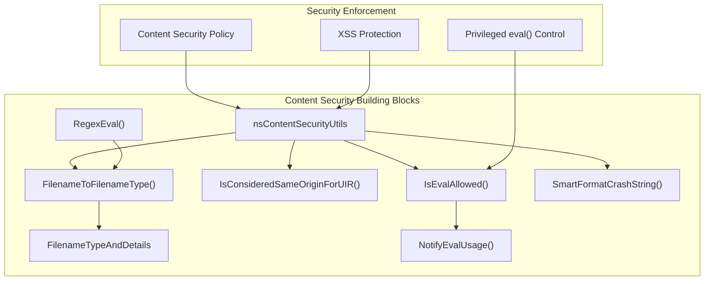
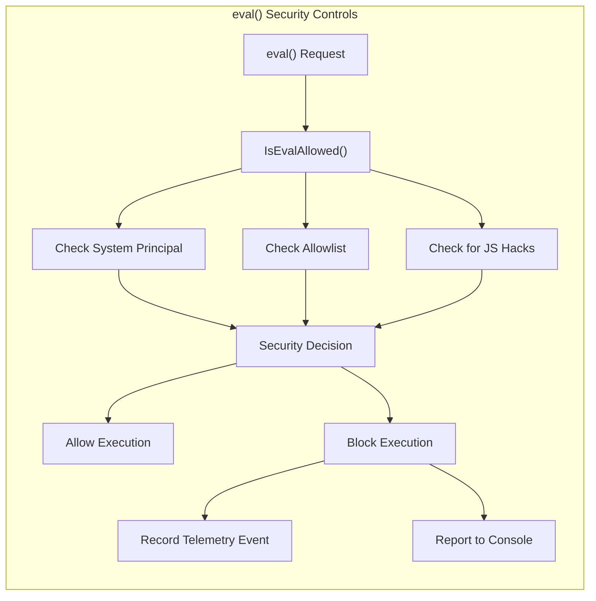
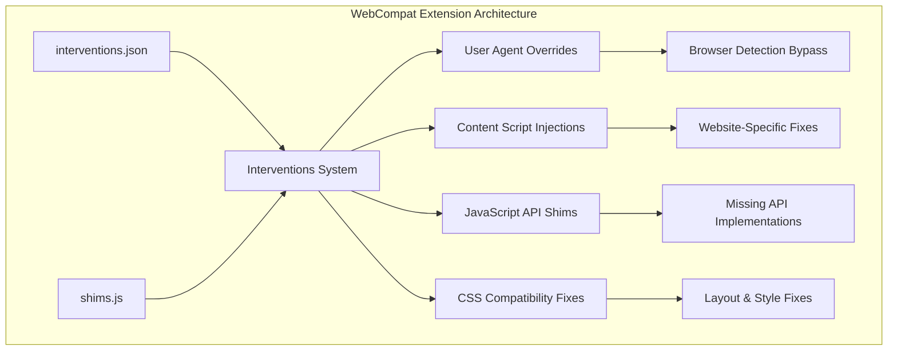
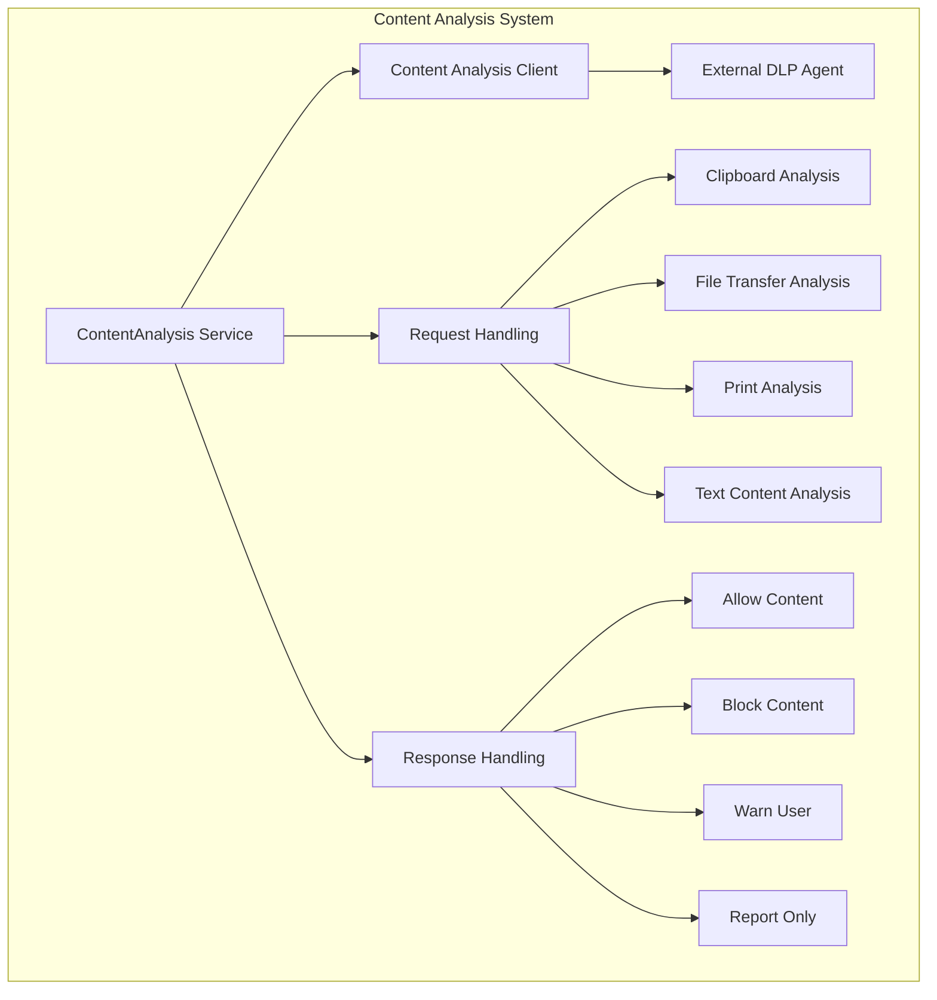
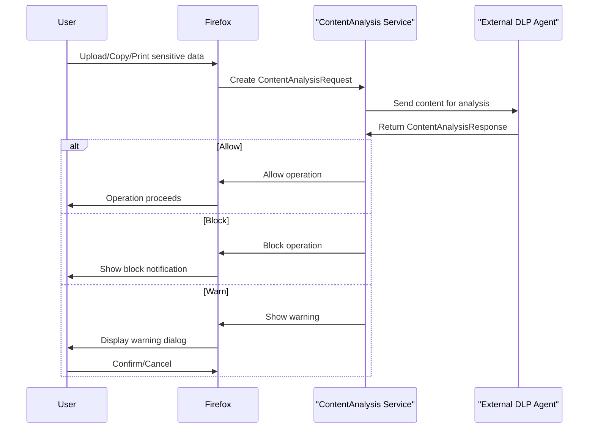
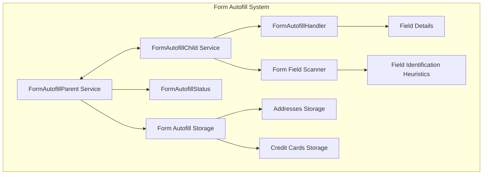
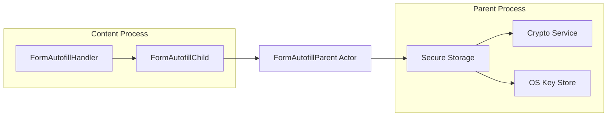

<!-- source: DeepWiki mcp.deepwiki.com · repo mozilla/gecko-dev · page 4 Security and Privacy Features · fetched 2026-10-09 -->

# Security and Privacy Features

<details>
<summary>Relevant source files</summary>

The following files were used as context for generating this wiki page:

- [browser/components/contentanalysis/content/ContentAnalysis.sys.mjs](browser/components/contentanalysis/content/ContentAnalysis.sys.mjs)
- [browser/components/contentanalysis/content/tsconfig.json](browser/components/contentanalysis/content/tsconfig.json)
- [browser/components/contentanalysis/moz.build](browser/components/contentanalysis/moz.build)
- [browser/components/genai/GenAI.sys.mjs](browser/components/genai/GenAI.sys.mjs)
- [browser/components/genai/GenAIChild.sys.mjs](browser/components/genai/GenAIChild.sys.mjs)
- [browser/components/genai/tests/browser/browser_chat_shortcuts.js](browser/components/genai/tests/browser/browser_chat_shortcuts.js)
- [browser/components/genai/tests/browser/browser_genai_init.js](browser/components/genai/tests/browser/browser_genai_init.js)
- [browser/extensions/formautofill/api.js](browser/extensions/formautofill/api.js)
- [browser/extensions/formautofill/test/browser/address/browser_autofill_whenhidden.js](browser/extensions/formautofill/test/browser/address/browser_autofill_whenhidden.js)
- [browser/extensions/formautofill/test/browser/browser.toml](browser/extensions/formautofill/test/browser/browser.toml)
- [browser/extensions/formautofill/test/browser/browser_autofill_address_select_match_isoid.js](browser/extensions/formautofill/test/browser/browser_autofill_address_select_match_isoid.js)
- [browser/extensions/formautofill/test/browser/browser_autofill_address_textarea.js](browser/extensions/formautofill/test/browser/browser_autofill_address_textarea.js)
- [browser/extensions/formautofill/test/browser/browser_dynamic_form_autocompletion.js](browser/extensions/formautofill/test/browser/browser_dynamic_form_autocompletion.js)
- [browser/extensions/formautofill/test/browser/browser_dynamic_form_detection.js](browser/extensions/formautofill/test/browser/browser_dynamic_form_detection.js)
- [browser/extensions/formautofill/test/browser/browser_dynamic_form_telemetry.js](browser/extensions/formautofill/test/browser/browser_dynamic_form_telemetry.js)
- [browser/extensions/formautofill/test/browser/browser_editAddressDialog.js](browser/extensions/formautofill/test/browser/browser_editAddressDialog.js)
- [browser/extensions/formautofill/test/browser/browser_form_changes.js](browser/extensions/formautofill/test/browser/browser_form_changes.js)
- [browser/extensions/formautofill/test/browser/head.js](browser/extensions/formautofill/test/browser/head.js)
- [browser/extensions/formautofill/test/fixtures/dynamic_form_changing_on_user_interaction.html](browser/extensions/formautofill/test/fixtures/dynamic_form_changing_on_user_interaction.html)
- [browser/extensions/formautofill/test/fixtures/dynamic_form_replacing_all_fields.html](browser/extensions/formautofill/test/fixtures/dynamic_form_replacing_all_fields.html)
- [browser/extensions/formautofill/test/fixtures/dynamic_formless_fields_updated_due_to_node_mutations.html](browser/extensions/formautofill/test/fixtures/dynamic_formless_fields_updated_due_to_node_mutations.html)
- [browser/extensions/formautofill/test/fixtures/dynamic_formless_fields_updated_due_to_visiblity_state_change.html](browser/extensions/formautofill/test/fixtures/dynamic_formless_fields_updated_due_to_visiblity_state_change.html)
- [browser/extensions/formautofill/test/fixtures/dynamic_forms.html](browser/extensions/formautofill/test/fixtures/dynamic_forms.html)
- [browser/extensions/formautofill/test/mochitest/formautofill_common.js](browser/extensions/formautofill/test/mochitest/formautofill_common.js)
- [browser/extensions/formautofill/test/mochitest/test_formautofill_preview_highlight.html](browser/extensions/formautofill/test/mochitest/test_formautofill_preview_highlight.html)
- [browser/extensions/formautofill/test/unit/xpcshell.toml](browser/extensions/formautofill/test/unit/xpcshell.toml)
- [browser/extensions/webcompat/data/interventions.json](browser/extensions/webcompat/data/interventions.json)
- [browser/extensions/webcompat/data/shims.js](browser/extensions/webcompat/data/shims.js)
- [browser/extensions/webcompat/experiment-apis/appConstants.js](browser/extensions/webcompat/experiment-apis/appConstants.js)
- [browser/extensions/webcompat/experiment-apis/appConstants.json](browser/extensions/webcompat/experiment-apis/appConstants.json)
- [browser/extensions/webcompat/experiment-apis/testUtils.js](browser/extensions/webcompat/experiment-apis/testUtils.js)
- [browser/extensions/webcompat/experiment-apis/testUtils.json](browser/extensions/webcompat/experiment-apis/testUtils.json)
- [browser/extensions/webcompat/experiment-apis/trackingProtection.js](browser/extensions/webcompat/experiment-apis/trackingProtection.js)
- [browser/extensions/webcompat/experiment-apis/trackingProtection.json](browser/extensions/webcompat/experiment-apis/trackingProtection.json)
- [browser/extensions/webcompat/injections/css/bug1845299-docs.google.com-hide-extra-scrollbar-on-speaker-notes.css](browser/extensions/webcompat/injections/css/bug1845299-docs.google.com-hide-extra-scrollbar-on-speaker-notes.css)
- [browser/extensions/webcompat/injections/css/bug1925937-gazetasp.com.br-hide-extra-scrollbars.css](browser/extensions/webcompat/injections/css/bug1925937-gazetasp.com.br-hide-extra-scrollbars.css)
- [browser/extensions/webcompat/injections/css/bug1926506-aliexpress.com-hide-extra-scrollbars.css](browser/extensions/webcompat/injections/css/bug1926506-aliexpress.com-hide-extra-scrollbars.css)
- [browser/extensions/webcompat/injections/css/bug1947105-pexels.com-nudge-thanks-popup-onscreen.css](browser/extensions/webcompat/injections/css/bug1947105-pexels.com-nudge-thanks-popup-onscreen.css)
- [browser/extensions/webcompat/injections/css/bug1947979-shazam.com-hide-extra-scrollbars.css](browser/extensions/webcompat/injections/css/bug1947979-shazam.com-hide-extra-scrollbars.css)
- [browser/extensions/webcompat/injections/css/bug1948047-lovers.cacaushow.com.br-nudge-login-popup-onscreen.css](browser/extensions/webcompat/injections/css/bug1948047-lovers.cacaushow.com.br-nudge-login-popup-onscreen.css)
- [browser/extensions/webcompat/injections/css/bug1950053-omegleapp.me-fix-scrollbars.css](browser/extensions/webcompat/injections/css/bug1950053-omegleapp.me-fix-scrollbars.css)
- [browser/extensions/webcompat/injections/js/bug1724868-news.yahoo.co.jp-ua-override.js](browser/extensions/webcompat/injections/js/bug1724868-news.yahoo.co.jp-ua-override.js)
- [browser/extensions/webcompat/injections/js/bug1956165-www.youtube.com-picture-in-picture-fix.js](browser/extensions/webcompat/injections/js/bug1956165-www.youtube.com-picture-in-picture-fix.js)
- [browser/extensions/webcompat/injections/js/log_message.js](browser/extensions/webcompat/injections/js/log_message.js)
- [browser/extensions/webcompat/lib/about_compat_broker.js](browser/extensions/webcompat/lib/about_compat_broker.js)
- [browser/extensions/webcompat/lib/custom_functions.js](browser/extensions/webcompat/lib/custom_functions.js)
- [browser/extensions/webcompat/lib/intervention_helpers.js](browser/extensions/webcompat/lib/intervention_helpers.js)
- [browser/extensions/webcompat/lib/interventions.js](browser/extensions/webcompat/lib/interventions.js)
- [browser/extensions/webcompat/lib/shims.js](browser/extensions/webcompat/lib/shims.js)
- [browser/extensions/webcompat/lib/ua_helpers.js](browser/extensions/webcompat/lib/ua_helpers.js)
- [browser/extensions/webcompat/manifest.json](browser/extensions/webcompat/manifest.json)
- [browser/extensions/webcompat/moz.build](browser/extensions/webcompat/moz.build)
- [browser/extensions/webcompat/run.js](browser/extensions/webcompat/run.js)
- [browser/extensions/webcompat/shims/aliexpress-language.js](browser/extensions/webcompat/shims/aliexpress-language.js)
- [browser/extensions/webcompat/shims/embed-test-shim.js](browser/extensions/webcompat/shims/embed-test-shim.js)
- [browser/extensions/webcompat/shims/instagram-embed.js](browser/extensions/webcompat/shims/instagram-embed.js)
- [browser/extensions/webcompat/shims/jira-zendesk-support.js](browser/extensions/webcompat/shims/jira-zendesk-support.js)
- [browser/extensions/webcompat/shims/microsoftAccountIcon.js](browser/extensions/webcompat/shims/microsoftAccountIcon.js)
- [browser/extensions/webcompat/shims/stackoverflow-login.js](browser/extensions/webcompat/shims/stackoverflow-login.js)
- [browser/extensions/webcompat/shims/tiktok-embed.js](browser/extensions/webcompat/shims/tiktok-embed.js)
- [browser/extensions/webcompat/shims/zendesk-asana-support.js](browser/extensions/webcompat/shims/zendesk-asana-support.js)
- [browser/extensions/webcompat/tests/browser/browser.toml](browser/extensions/webcompat/tests/browser/browser.toml)
- [browser/extensions/webcompat/tests/browser/browser_aboutcompat.js](browser/extensions/webcompat/tests/browser/browser_aboutcompat.js)
- [browser/extensions/webcompat/tests/browser/browser_console_messages.js](browser/extensions/webcompat/tests/browser/browser_console_messages.js)
- [browser/extensions/webcompat/tests/browser/browser_interventions.js](browser/extensions/webcompat/tests/browser/browser_interventions.js)
- [browser/extensions/webcompat/tests/browser/browser_smartblockembeds.js](browser/extensions/webcompat/tests/browser/browser_smartblockembeds.js)
- [browser/extensions/webcompat/tests/browser/browser_smartblockembeds_mutation.js](browser/extensions/webcompat/tests/browser/browser_smartblockembeds_mutation.js)
- [browser/extensions/webcompat/tests/browser/browser_ua_helpers.js](browser/extensions/webcompat/tests/browser/browser_ua_helpers.js)
- [browser/extensions/webcompat/tests/browser/head.js](browser/extensions/webcompat/tests/browser/head.js)
- [dom/security/nsContentSecurityUtils.cpp](dom/security/nsContentSecurityUtils.cpp)
- [dom/security/nsContentSecurityUtils.h](dom/security/nsContentSecurityUtils.h)
- [dom/webidl/Document.webidl](dom/webidl/Document.webidl)
- [mobile/shared/chrome/geckoview/geckoview.js](mobile/shared/chrome/geckoview/geckoview.js)
- [mobile/shared/chrome/geckoview/geckoview.xhtml](mobile/shared/chrome/geckoview/geckoview.xhtml)
- [modules/libpref/init/all.js](modules/libpref/init/all.js)
- [security/manager/ssl/nsSiteSecurityService.cpp](security/manager/ssl/nsSiteSecurityService.cpp)
- [security/manager/ssl/nsSiteSecurityService.h](security/manager/ssl/nsSiteSecurityService.h)
- [testing/modules/MockRegistrar.sys.mjs](testing/modules/MockRegistrar.sys.mjs)
- [testing/profiles/unittest-required/user.js](testing/profiles/unittest-required/user.js)
- [testing/webcompat/client.py](testing/webcompat/client.py)
- [testing/webcompat/fixtures.py](testing/webcompat/fixtures.py)
- [testing/webcompat/interventions/conftest.py](testing/webcompat/interventions/conftest.py)
- [testing/webcompat/interventions/pytest.ini](testing/webcompat/interventions/pytest.ini)
- [testing/webcompat/interventions/tests/test_1724868_news_yahoo_co_jp.py](testing/webcompat/interventions/tests/test_1724868_news_yahoo_co_jp.py)
- [testing/webcompat/interventions/tests/test_1793761_schoolnutritionandfitness_com.py](testing/webcompat/interventions/tests/test_1793761_schoolnutritionandfitness_com.py)
- [testing/webcompat/interventions/tests/test_1830739_1902452_eternalslots_com.py](testing/webcompat/interventions/tests/test_1830739_1902452_eternalslots_com.py)
- [testing/webcompat/interventions/tests/test_1845299_docs_google_com_presentation.py](testing/webcompat/interventions/tests/test_1845299_docs_google_com_presentation.py)
- [testing/webcompat/interventions/tests/test_1902403_musicstore_auone_jp.py](testing/webcompat/interventions/tests/test_1902403_musicstore_auone_jp.py)
- [testing/webcompat/interventions/tests/test_1918609_zara_com.py](testing/webcompat/interventions/tests/test_1918609_zara_com.py)
- [testing/webcompat/interventions/tests/test_1925937_gazetasp_com_br.py](testing/webcompat/interventions/tests/test_1925937_gazetasp_com_br.py)
- [testing/webcompat/interventions/tests/test_1926506_aliexpress_com.py](testing/webcompat/interventions/tests/test_1926506_aliexpress_com.py)
- [testing/webcompat/interventions/tests/test_1947979_shazam_com.py](testing/webcompat/interventions/tests/test_1947979_shazam_com.py)
- [testing/webcompat/interventions/tests/test_1948047_lovers_cacaushow_com_br.py](testing/webcompat/interventions/tests/test_1948047_lovers_cacaushow_com_br.py)
- [testing/webcompat/interventions/tests/test_1950100_aylak_com.py](testing/webcompat/interventions/tests/test_1950100_aylak_com.py)
- [testing/webcompat/interventions/tests/test_1956165_m_youtube_com.py](testing/webcompat/interventions/tests/test_1956165_m_youtube_com.py)
- [third_party/content_analysis_sdk/add_delayms.patch](third_party/content_analysis_sdk/add_delayms.patch)
- [third_party/content_analysis_sdk/demo/agent.cc](third_party/content_analysis_sdk/demo/agent.cc)
- [third_party/content_analysis_sdk/demo/handler.h](third_party/content_analysis_sdk/demo/handler.h)
- [third_party/content_analysis_sdk/larger_read_buffer.patch](third_party/content_analysis_sdk/larger_read_buffer.patch)
- [third_party/content_analysis_sdk/moz.yaml](third_party/content_analysis_sdk/moz.yaml)
- [toolkit/components/contentanalysis/ContentAnalysis.cpp](toolkit/components/contentanalysis/ContentAnalysis.cpp)
- [toolkit/components/contentanalysis/ContentAnalysis.h](toolkit/components/contentanalysis/ContentAnalysis.h)
- [toolkit/components/contentanalysis/ContentAnalysisUtils.sys.mjs](toolkit/components/contentanalysis/ContentAnalysisUtils.sys.mjs)
- [toolkit/components/contentanalysis/moz.build](toolkit/components/contentanalysis/moz.build)
- [toolkit/components/contentanalysis/nsIContentAnalysis.idl](toolkit/components/contentanalysis/nsIContentAnalysis.idl)
- [toolkit/components/contentanalysis/tests/browser/browser.toml](toolkit/components/contentanalysis/tests/browser/browser.toml)
- [toolkit/components/contentanalysis/tests/browser/browser_clipboard_content_analysis.js](toolkit/components/contentanalysis/tests/browser/browser_clipboard_content_analysis.js)
- [toolkit/components/contentanalysis/tests/browser/browser_clipboard_paste_changingclipboardexternal_content_analysis.js](toolkit/components/contentanalysis/tests/browser/browser_clipboard_paste_changingclipboardexternal_content_analysis.js)
- [toolkit/components/contentanalysis/tests/browser/browser_clipboard_paste_changingclipboardinternal_content_analysis.js](toolkit/components/contentanalysis/tests/browser/browser_clipboard_paste_changingclipboardinternal_content_analysis.js)
- [toolkit/components/contentanalysis/tests/browser/browser_clipboard_paste_chat_shortcuts.js](toolkit/components/contentanalysis/tests/browser/browser_clipboard_paste_chat_shortcuts.js)
- [toolkit/components/contentanalysis/tests/browser/browser_clipboard_paste_file_content_analysis.js](toolkit/components/contentanalysis/tests/browser/browser_clipboard_paste_file_content_analysis.js)
- [toolkit/components/contentanalysis/tests/browser/browser_clipboard_paste_inputandtextarea_content_analysis.js](toolkit/components/contentanalysis/tests/browser/browser_clipboard_paste_inputandtextarea_content_analysis.js)
- [toolkit/components/contentanalysis/tests/browser/browser_clipboard_paste_inputandtextarea_iframe_content_analysis.js](toolkit/components/contentanalysis/tests/browser/browser_clipboard_paste_inputandtextarea_iframe_content_analysis.js)
- [toolkit/components/contentanalysis/tests/browser/browser_clipboard_paste_noformatting_content_analysis.js](toolkit/components/contentanalysis/tests/browser/browser_clipboard_paste_noformatting_content_analysis.js)
- [toolkit/components/contentanalysis/tests/browser/browser_clipboard_paste_prompt_content_analysis.js](toolkit/components/contentanalysis/tests/browser/browser_clipboard_paste_prompt_content_analysis.js)
- [toolkit/components/contentanalysis/tests/browser/browser_clipboard_read_async_content_analysis.js](toolkit/components/contentanalysis/tests/browser/browser_clipboard_read_async_content_analysis.js)
- [toolkit/components/contentanalysis/tests/browser/browser_content_analysis_dnd_diff_origin.js](toolkit/components/contentanalysis/tests/browser/browser_content_analysis_dnd_diff_origin.js)
- [toolkit/components/contentanalysis/tests/browser/browser_content_analysis_dnd_same_origin.js](toolkit/components/contentanalysis/tests/browser/browser_content_analysis_dnd_same_origin.js)
- [toolkit/components/contentanalysis/tests/browser/browser_content_analysis_dnd_shadow.js](toolkit/components/contentanalysis/tests/browser/browser_content_analysis_dnd_shadow.js)
- [toolkit/components/contentanalysis/tests/browser/browser_content_analysis_quit_confirmation_dialog.js](toolkit/components/contentanalysis/tests/browser/browser_content_analysis_quit_confirmation_dialog.js)
- [toolkit/components/contentanalysis/tests/browser/browser_print_changing_page_content_analysis.js](toolkit/components/contentanalysis/tests/browser/browser_print_changing_page_content_analysis.js)
- [toolkit/components/contentanalysis/tests/browser/browser_print_iframe_content_analysis.js](toolkit/components/contentanalysis/tests/browser/browser_print_iframe_content_analysis.js)
- [toolkit/components/contentanalysis/tests/browser/clipboard_paste_chat_shortcuts.html](toolkit/components/contentanalysis/tests/browser/clipboard_paste_chat_shortcuts.html)
- [toolkit/components/contentanalysis/tests/browser/clipboard_read_async.html](toolkit/components/contentanalysis/tests/browser/clipboard_read_async.html)
- [toolkit/components/contentanalysis/tests/browser/head.js](toolkit/components/contentanalysis/tests/browser/head.js)
- [toolkit/components/contentanalysis/tests/gtest/TestContentAnalysis.cpp](toolkit/components/contentanalysis/tests/gtest/TestContentAnalysis.cpp)
- [toolkit/components/contentanalysis/tests/gtest/TestContentAnalysisUtils.cpp](toolkit/components/contentanalysis/tests/gtest/TestContentAnalysisUtils.cpp)
- [toolkit/components/contentanalysis/tests/gtest/TestContentAnalysisUtils.h](toolkit/components/contentanalysis/tests/gtest/TestContentAnalysisUtils.h)
- [toolkit/components/contentanalysis/tests/gtest/allowedFile1.txt](toolkit/components/contentanalysis/tests/gtest/allowedFile1.txt)
- [toolkit/components/contentanalysis/tests/gtest/allowedFile2.txt](toolkit/components/contentanalysis/tests/gtest/allowedFile2.txt)
- [toolkit/components/contentanalysis/tests/gtest/moz.build](toolkit/components/contentanalysis/tests/gtest/moz.build)
- [toolkit/components/contentanalysis/tsconfig.json](toolkit/components/contentanalysis/tsconfig.json)
- [toolkit/components/formautofill/Constants.ios.mjs](toolkit/components/formautofill/Constants.ios.mjs)
- [toolkit/components/formautofill/FormAutofill.sys.mjs](toolkit/components/formautofill/FormAutofill.sys.mjs)
- [toolkit/components/formautofill/FormAutofillChild.sys.mjs](toolkit/components/formautofill/FormAutofillChild.sys.mjs)
- [toolkit/components/formautofill/FormAutofillParent.sys.mjs](toolkit/components/formautofill/FormAutofillParent.sys.mjs)
- [toolkit/components/formautofill/Helpers.ios.mjs](toolkit/components/formautofill/Helpers.ios.mjs)
- [toolkit/components/formautofill/shared/AutofillFormFactory.sys.mjs](toolkit/components/formautofill/shared/AutofillFormFactory.sys.mjs)
- [toolkit/components/formautofill/shared/FormAutofillHandler.sys.mjs](toolkit/components/formautofill/shared/FormAutofillHandler.sys.mjs)
- [toolkit/components/formautofill/shared/FormAutofillHeuristics.sys.mjs](toolkit/components/formautofill/shared/FormAutofillHeuristics.sys.mjs)
- [toolkit/components/formautofill/shared/FormAutofillUtils.sys.mjs](toolkit/components/formautofill/shared/FormAutofillUtils.sys.mjs)
- [toolkit/components/formautofill/shared/FormStateManager.sys.mjs](toolkit/components/formautofill/shared/FormStateManager.sys.mjs)
- [toolkit/components/prompts/content/commonDialog.js](toolkit/components/prompts/content/commonDialog.js)
- [toolkit/content/neterror/supportpages/time-errors.html](toolkit/content/neterror/supportpages/time-errors.html)
- [toolkit/content/widgets/browser-custom-element.js](toolkit/content/widgets/browser-custom-element.js)
- [toolkit/locales/en-US/toolkit/contentanalysis/contentanalysis.ftl](toolkit/locales/en-US/toolkit/contentanalysis/contentanalysis.ftl)
- [toolkit/modules/FormLikeFactory.sys.mjs](toolkit/modules/FormLikeFactory.sys.mjs)
- [toolkit/mozapps/downloads/HelperAppDlg.sys.mjs](toolkit/mozapps/downloads/HelperAppDlg.sys.mjs)
- [toolkit/mozapps/downloads/content/unknownContentType.xhtml](toolkit/mozapps/downloads/content/unknownContentType.xhtml)
- [toolkit/profile/content/profileDowngrade.js](toolkit/profile/content/profileDowngrade.js)
- [toolkit/profile/content/profileDowngrade.xhtml](toolkit/profile/content/profileDowngrade.xhtml)
- [toolkit/profile/jar.mn](toolkit/profile/jar.mn)
- [widget/ClipboardContentAnalysisParent.cpp](widget/ClipboardContentAnalysisParent.cpp)
- [widget/nsBaseClipboard.cpp](widget/nsBaseClipboard.cpp)
- [widget/windows/nsFilePicker.cpp](widget/windows/nsFilePicker.cpp)
- [widget/windows/nsFilePicker.h](widget/windows/nsFilePicker.h)

</details>


This page provides an overview of the core security and privacy features in Firefox. It covers the browser's content security system, web compatibility interventions, content analysis capabilities, and secure form handling. For detailed information about specific implementations, see [Content Security System](#4.1), [Form Autofill System](#4.2), [Content Analysis and DLP](#4.3), and [Web Compatibility System](#4.4).

## Content Security System

Firefox implements a robust content security system to protect users from various web threats. The system includes Content Security Policy (CSP) enforcement, cross-site scripting (XSS) protection, and privileged code execution controls.

### Content Security Utilities

At the core of Firefox's security model is the `nsContentSecurityUtils` namespace, which provides utilities for implementing security checks throughout the codebase.



Sources: [dom/security/nsContentSecurityUtils.cpp:9-147](), [dom/security/nsContentSecurityUtils.cpp:310-504](), [dom/security/nsContentSecurityUtils.cpp:598-752]()

### Privileged Code Execution Controls

Firefox strictly controls the execution of privileged JavaScript code, particularly the use of `eval()` and similar functions in system contexts. This is implemented through a series of checks and allowlists to prevent potential security vulnerabilities.



The security system maintains an allowlist of scripts that are permitted to use `eval()` in privileged contexts:

```
evalAllowlist = [
  "resource://testing-common/sinon-7.2.7.js",
  "resource://testing-common/content-task.js",
  "resource://gre/modules/translations/cld-worker.js",
  "resource://gre/modules/workers/require.js",
  "resource://devtools/client/performance-new/shared/symbolication.sys.mjs",
  "debugger"
]
```

Sources: [dom/security/nsContentSecurityUtils.cpp:598-752]()

### Path and URL Security

Firefox includes utilities for identifying and handling different types of file paths and URLs securely. The `FilenameToFilenameType` function categorizes sources to help with security reporting and telemetry.

| File Type | Description | Example |
|-----------|-------------|---------|
| chromeuri | Chrome browser resources | chrome://browser/content/browser.xhtml |
| resourceuri | Resource protocol URLs | resource://gre/modules/Services.jsm |
| bloburi | Blob URLs for file-like objects | blob:https://example.com/uuid |
| datauri | Data URLs with embedded content | data:text/plain,Hello |
| mozillaextension_file | Mozilla-signed extensions | extensions/addon@mozilla.org!file.js |
| otherextension_file | Third-party extensions | extensions/addon@example.com!file.js |
| suspectedUserChromeJS | Potential userChrome.js customizations | chrome://userscripts/content/script.js |

Sources: [dom/security/nsContentSecurityUtils.cpp:310-504]()

## Web Compatibility System

Firefox's web compatibility system provides mechanisms to fix compatibility issues with websites while maintaining security boundaries. This is primarily implemented through the WebCompat extension.

### Intervention System

The WebCompat extension uses a structured intervention system to apply targeted fixes for specific websites without compromising overall browser security.



The WebCompat extension uses a declarative configuration to define interventions for specific sites:

```
interventions = {
  "bug-id": {
    "label": "site-name",
    "bugs": { 
      "bug-id": {
        "issue": "issue-type",
        "matches": ["*://example.com/*"]
      }
    },
    "interventions": [
      {
        "platforms": ["desktop"],
        "content_scripts": {
          "js": ["bug-fix-script.js"]
        }
      }
    ]
  }
}
```

Sources: [browser/extensions/webcompat/data/interventions.json:1-100](), [browser/extensions/webcompat/manifest.json:1-60](), [browser/extensions/webcompat/data/shims.js:1-100]()

### Common Compatibility Issues

The WebCompat extension addresses several categories of website compatibility issues that could otherwise impact security:

1. Tracking protection compatibility - Shims for functionality broken by tracking protections
2. Browser user-agent detection - Overriding user-agent strings for sites that block Firefox
3. Missing API implementations - Providing compatibility implementations of non-standard APIs
4. Layout and rendering fixes - CSS fixes for visual compatibility issues

Sources: [browser/extensions/webcompat/data/interventions.json:100-300](), [browser/extensions/webcompat/data/shims.js:100-200]()

## Content Analysis and Data Loss Prevention (DLP)

Firefox includes enterprise-oriented content analysis capabilities (Windows-only) that allow organizations to implement Data Loss Prevention (DLP) policies by monitoring sensitive data flows.

### Content Analysis Architecture



Sources: [toolkit/components/contentanalysis/ContentAnalysis.cpp:50-250](), [toolkit/components/contentanalysis/ContentAnalysis.h:50-180]()

### Data Analysis Flow

The Content Analysis system processes different types of user operations that might contain sensitive data:

1. **Request Creation**: When a user tries to copy/paste, upload, download, or print content
2. **Agent Analysis**: Content is sent to an external DLP agent via named pipe
3. **Response Handling**: Based on agent response, Firefox allows, blocks, or warns about the operation



Sources: [toolkit/components/contentanalysis/ContentAnalysis.cpp:250-450](), [toolkit/components/contentanalysis/nsIContentAnalysis.idl:30-65]()

### Analysis Request Types

Firefox's Content Analysis system can analyze different types of content:

| Analysis Type | Description | Trigger |
|--------------|-------------|---------|
| FileTransfer | Files being uploaded or downloaded | File picker, drag-and-drop |
| DataTransfer | Text or HTML content | Copy/paste operations |
| Print | Document printing | Print dialog |
| TextContent | Text entered in forms | Form submission |

Sources: [toolkit/components/contentanalysis/nsIContentAnalysis.idl:100-130](), [toolkit/components/contentanalysis/ContentAnalysis.h:80-165]()

## Form Autofill Security

Firefox implements a secure form autofill system that handles sensitive user data like addresses and credit card information. The system is designed with privacy and security in mind.

### Form Autofill Architecture



Sources: [toolkit/components/formautofill/FormAutofillParent.sys.mjs:35-90](), [toolkit/components/formautofill/FormAutofillChild.sys.mjs:35-90]()

### Security Features for Form Data

Form Autofill includes several security and privacy features:

1. **Process Separation**: Storage in parent process, detection in content process
2. **Selective Enabling**: Users can enable/disable address and credit card separately
3. **Privacy Controls**: Private browsing protection, form submission control
4. **Credit Card Security**: Optional OS-level secure storage for credit card data



Sources: [toolkit/components/formautofill/FormAutofillParent.sys.mjs:200-300](), [toolkit/components/formautofill/shared/FormAutofillHandler.sys.mjs:100-200]()

### Field Detection Security

Firefox carefully identifies form fields to avoid security issues when autofilling:

1. Applies heuristics to identify field types (credit card vs. address)
2. Uses field states (NORMAL, AUTO_FILLED, AUTOFILL_PREVIEWED) to track filled data
3. Sanitizes and transforms field data when previewing/filling
4. Requires minimum thresholds of identified fields before enabling autofill

Sources: [toolkit/components/formautofill/shared/FormAutofillHandler.sys.mjs:300-400](), [toolkit/components/formautofill/shared/FormAutofillUtils.sys.mjs:300-400]()

## Cross-cutting Security Concepts

Several security concepts apply across multiple areas of Firefox's security architecture.

### Preference-Controlled Security Features

Many security features are controlled through preferences, allowing for customization in different environments:

| Preference | Description | Default |
|------------|-------------|---------|
| security.default_personal_cert | Personal certificate selection behavior | Ask Every Time |
| security.signed_app_signatures.policy | Signature verification policy for add-ons | 2 |
| security.pki.mitm_canary_issuer.enabled | MITM proxy detection | true |
| dom.keyboardevent.keypress.hack.* | Keyboard event handling security | varies |
| browser.contentanalysis.enabled | Data Loss Prevention features | false |
| browser.send_pings | Whether to allow ping attribute on links | false |

Sources: [modules/libpref/init/all.js:20-100]()

### Security Permissions Model

Firefox implements a layered permissions model that controls what operations different code sources can perform:

1. **System Principal**: Highest privilege level for browser chrome code
2. **Content Principal**: Standard web content with origin-based restrictions
3. **Expanded Principal**: Special principal for extension content scripts
4. **Null Principal**: Highly restricted principal for untrusted content

This permissions model is enforced throughout the browser's security systems.

Sources: [dom/security/nsContentSecurityUtils.cpp:90-150]()

---

