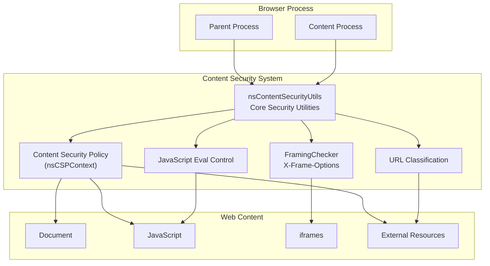
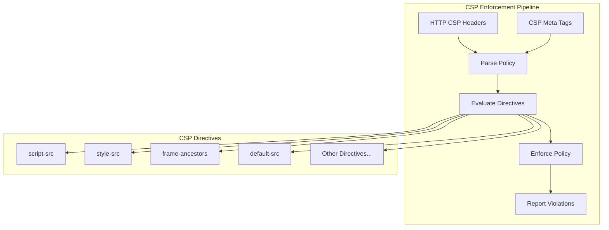
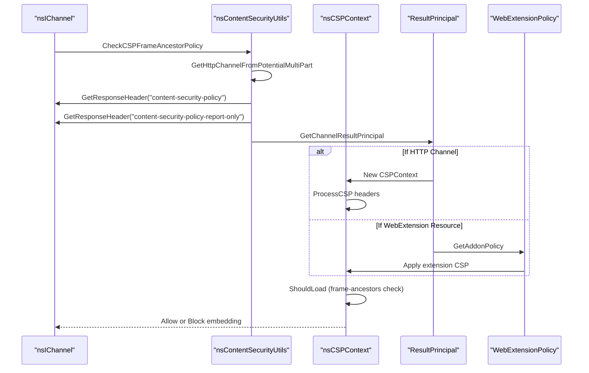
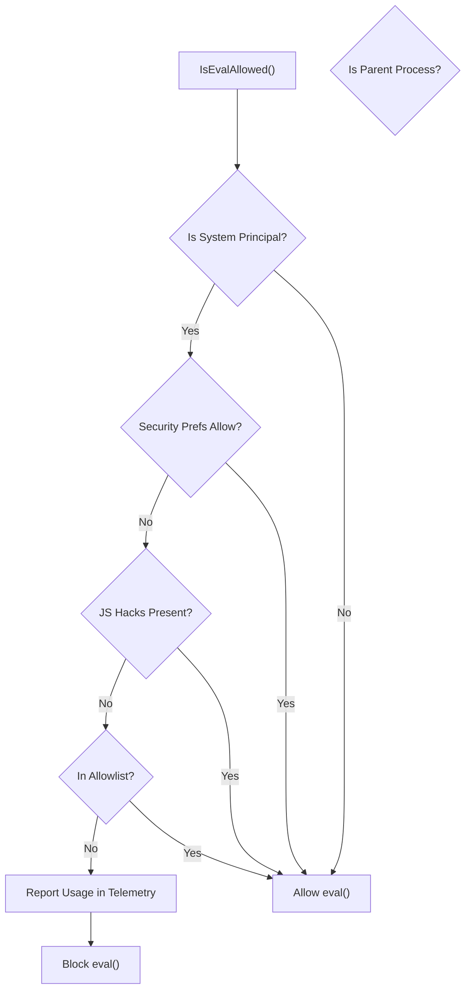
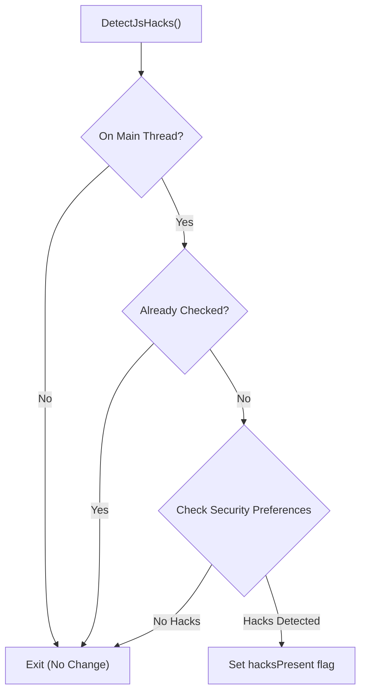
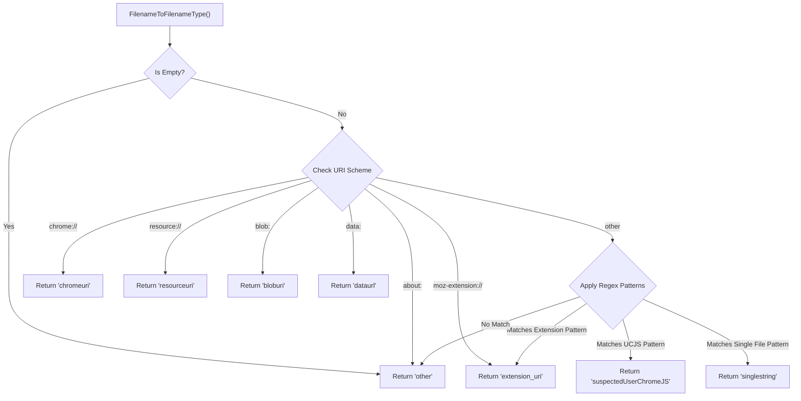
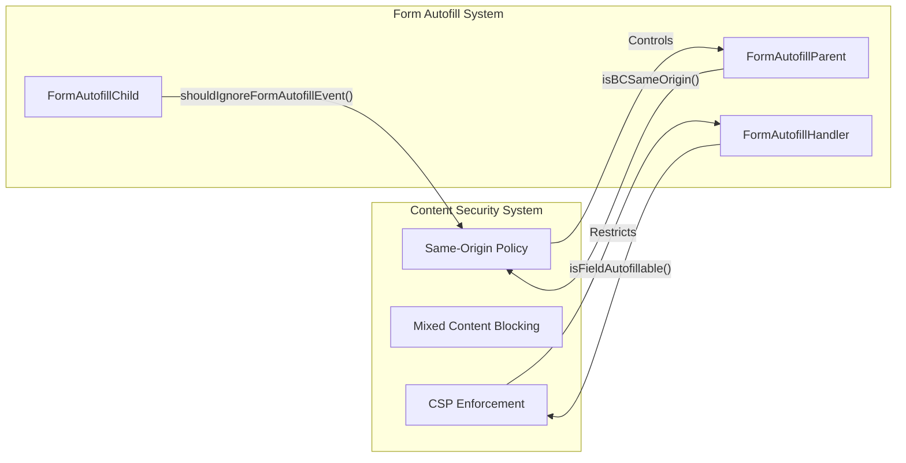
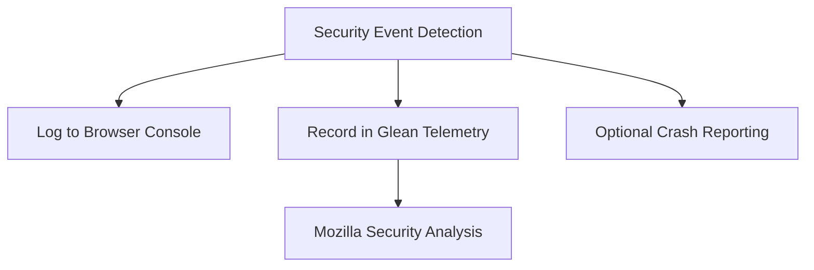

<!-- source: DeepWiki mcp.deepwiki.com · repo mozilla/gecko-dev · page 4.1 Content Security System · fetched 2026-10-09 -->

# Content Security System

Relevant source files

The following files were used as context for generating this wiki page:

- [browser/extensions/formautofill/api.js](browser/extensions/formautofill/api.js)
- [browser/extensions/formautofill/test/browser/address/browser_autofill_whenhidden.js](browser/extensions/formautofill/test/browser/address/browser_autofill_whenhidden.js)
- [browser/extensions/formautofill/test/browser/browser.toml](browser/extensions/formautofill/test/browser/browser.toml)
- [browser/extensions/formautofill/test/browser/browser_autofill_address_select_match_isoid.js](browser/extensions/formautofill/test/browser/browser_autofill_address_select_match_isoid.js)
- [browser/extensions/formautofill/test/browser/browser_autofill_address_textarea.js](browser/extensions/formautofill/test/browser/browser_autofill_address_textarea.js)
- [browser/extensions/formautofill/test/browser/browser_dynamic_form_autocompletion.js](browser/extensions/formautofill/test/browser/browser_dynamic_form_autocompletion.js)
- [browser/extensions/formautofill/test/browser/browser_dynamic_form_detection.js](browser/extensions/formautofill/test/browser/browser_dynamic_form_detection.js)
- [browser/extensions/formautofill/test/browser/browser_dynamic_form_telemetry.js](browser/extensions/formautofill/test/browser/browser_dynamic_form_telemetry.js)
- [browser/extensions/formautofill/test/browser/browser_editAddressDialog.js](browser/extensions/formautofill/test/browser/browser_editAddressDialog.js)
- [browser/extensions/formautofill/test/browser/browser_form_changes.js](browser/extensions/formautofill/test/browser/browser_form_changes.js)
- [browser/extensions/formautofill/test/browser/head.js](browser/extensions/formautofill/test/browser/head.js)
- [browser/extensions/formautofill/test/fixtures/dynamic_form_changing_on_user_interaction.html](browser/extensions/formautofill/test/fixtures/dynamic_form_changing_on_user_interaction.html)
- [browser/extensions/formautofill/test/fixtures/dynamic_form_replacing_all_fields.html](browser/extensions/formautofill/test/fixtures/dynamic_form_replacing_all_fields.html)
- [browser/extensions/formautofill/test/fixtures/dynamic_formless_fields_updated_due_to_node_mutations.html](browser/extensions/formautofill/test/fixtures/dynamic_formless_fields_updated_due_to_node_mutations.html)
- [browser/extensions/formautofill/test/fixtures/dynamic_formless_fields_updated_due_to_visiblity_state_change.html](browser/extensions/formautofill/test/fixtures/dynamic_formless_fields_updated_due_to_visiblity_state_change.html)
- [browser/extensions/formautofill/test/fixtures/dynamic_forms.html](browser/extensions/formautofill/test/fixtures/dynamic_forms.html)
- [browser/extensions/formautofill/test/mochitest/formautofill_common.js](browser/extensions/formautofill/test/mochitest/formautofill_common.js)
- [browser/extensions/formautofill/test/mochitest/test_formautofill_preview_highlight.html](browser/extensions/formautofill/test/mochitest/test_formautofill_preview_highlight.html)
- [browser/extensions/formautofill/test/unit/xpcshell.toml](browser/extensions/formautofill/test/unit/xpcshell.toml)
- [dom/security/nsContentSecurityUtils.cpp](dom/security/nsContentSecurityUtils.cpp)
- [dom/security/nsContentSecurityUtils.h](dom/security/nsContentSecurityUtils.h)
- [mobile/shared/chrome/geckoview/geckoview.js](mobile/shared/chrome/geckoview/geckoview.js)
- [mobile/shared/chrome/geckoview/geckoview.xhtml](mobile/shared/chrome/geckoview/geckoview.xhtml)
- [modules/libpref/init/all.js](modules/libpref/init/all.js)
- [security/manager/ssl/nsSiteSecurityService.cpp](security/manager/ssl/nsSiteSecurityService.cpp)
- [security/manager/ssl/nsSiteSecurityService.h](security/manager/ssl/nsSiteSecurityService.h)
- [testing/profiles/unittest-required/user.js](testing/profiles/unittest-required/user.js)
- [toolkit/components/formautofill/Constants.ios.mjs](toolkit/components/formautofill/Constants.ios.mjs)
- [toolkit/components/formautofill/FormAutofill.sys.mjs](toolkit/components/formautofill/FormAutofill.sys.mjs)
- [toolkit/components/formautofill/FormAutofillChild.sys.mjs](toolkit/components/formautofill/FormAutofillChild.sys.mjs)
- [toolkit/components/formautofill/FormAutofillParent.sys.mjs](toolkit/components/formautofill/FormAutofillParent.sys.mjs)
- [toolkit/components/formautofill/Helpers.ios.mjs](toolkit/components/formautofill/Helpers.ios.mjs)
- [toolkit/components/formautofill/shared/AutofillFormFactory.sys.mjs](toolkit/components/formautofill/shared/AutofillFormFactory.sys.mjs)
- [toolkit/components/formautofill/shared/FormAutofillHandler.sys.mjs](toolkit/components/formautofill/shared/FormAutofillHandler.sys.mjs)
- [toolkit/components/formautofill/shared/FormAutofillHeuristics.sys.mjs](toolkit/components/formautofill/shared/FormAutofillHeuristics.sys.mjs)
- [toolkit/components/formautofill/shared/FormAutofillUtils.sys.mjs](toolkit/components/formautofill/shared/FormAutofillUtils.sys.mjs)
- [toolkit/components/formautofill/shared/FormStateManager.sys.mjs](toolkit/components/formautofill/shared/FormStateManager.sys.mjs)
- [toolkit/content/neterror/supportpages/time-errors.html](toolkit/content/neterror/supportpages/time-errors.html)
- [toolkit/modules/FormLikeFactory.sys.mjs](toolkit/modules/FormLikeFactory.sys.mjs)
- [toolkit/mozapps/downloads/HelperAppDlg.sys.mjs](toolkit/mozapps/downloads/HelperAppDlg.sys.mjs)
- [toolkit/mozapps/downloads/content/unknownContentType.xhtml](toolkit/mozapps/downloads/content/unknownContentType.xhtml)
- [toolkit/profile/content/profileDowngrade.js](toolkit/profile/content/profileDowngrade.js)
- [toolkit/profile/content/profileDowngrade.xhtml](toolkit/profile/content/profileDowngrade.xhtml)
- [toolkit/profile/jar.mn](toolkit/profile/jar.mn)

This document provides a technical overview of Firefox's Content Security System, a set of mechanisms and utilities that help enforce security policies, protect against cross-site scripting (XSS), control resource loading, and prevent potentially dangerous script execution. This system is foundational to Firefox's security model, providing both built-in protections and programmatic APIs for website developers to enhance their site's security.

For security issues related to Form Autofill, please see [Form Autofill System](#4.2). For information about the broader Security and Privacy Features, see [Security and Privacy Features](#4).

## 1. Overview

The Content Security System in Firefox encompasses several interconnected components that work together to enforce security boundaries and mitigate various web security threats. The system's primary goals are to:

1. Enforce Content Security Policies (CSP)
2. Protect against unsafe script execution
3. Control frame navigation and embedding
4. Provide utilities for secure content handling
5. Detect potentially malicious content

The core functionality is implemented in the `nsContentSecurityUtils` namespace, which provides static utility functions for security-related operations across the browser.

Sources: [dom/security/nsContentSecurityUtils.cpp:7-65](), [dom/security/nsContentSecurityUtils.h:7-11]()

## 2. Architecture and Key Components

The diagram above illustrates the main components of the Content Security System and their relationships. `nsContentSecurityUtils` serves as the central utility class that provides security functionality to both the parent and content processes.

Sources: [dom/security/nsContentSecurityUtils.cpp:7-65](), [dom/security/nsContentSecurityUtils.h:9-15]()

### 2.1 Key Security Utilities

The Content Security System provides several important utility functions:

| Function | Purpose |
|----------|---------|
| `IsConsideredSameOriginForUIR` | Determines if two principals should be considered same-origin for user-interface resources |
| `RegexEval` | Safely evaluates regular expressions with proper error handling |
| `FilenameToFilenameType` | Analyzes and categorizes filenames for security purposes |
| `IsEvalAllowed` | Checks if JavaScript eval() execution is allowed in a given context |
| `DetectJsHacks` | Identifies JavaScript hacks or workarounds that might affect security |
| `CheckCSPFrameAncestorPolicy` | Enforces CSP frame-ancestor policies for embedded content |

Sources: [dom/security/nsContentSecurityUtils.cpp:90-117](), [dom/security/nsContentSecurityUtils.cpp:311-504](), [dom/security/nsContentSecurityUtils.cpp:599-752]()

## 3. Content Security Policy Enforcement

Content Security Policy (CSP) is a critical web security mechanism that helps protect against various attacks, including cross-site scripting (XSS) and data injection attacks. Firefox's Content Security System provides robust implementation of CSP.

### 3.1 Frame Ancestors Policy

The Content Security System includes specialized handling for the CSP `frame-ancestors` directive, which controls which parent documents can embed the current document in frames, iframes, objects, etc.

The `CheckCSPFrameAncestorPolicy` function is central to this enforcement:

The process checks both standard and report-only CSP headers, creates an appropriate CSP context, and evaluates whether the current navigation should be allowed based on the frame-ancestors directive.

Sources: [dom/security/nsContentSecurityUtils.cpp:976-1012]()

## 4. JavaScript Security Controls

One of the most critical security features is the control over JavaScript's `eval()` and similar functions that can execute strings as code, which pose security risks when misused.

### 4.1 Eval Restrictions

The Content Security System implements a sophisticated system to control the use of `eval()` and similar functions in privileged contexts:

The system restricts `eval()` usage in privileged contexts (system principal) and in the parent process, with exceptions for:
- Explicitly whitelisted files
- Specific allowed code patterns
- Cases where preferences explicitly allow it
- Testing environments

This protection helps prevent privileged code injection vulnerabilities that could lead to severe security breaches.

Sources: [dom/security/nsContentSecurityUtils.cpp:599-752]()

### 4.2 JavaScript Hacks Detection

The system also includes mechanisms to detect JavaScript hacks or workarounds that might change the security posture:

The system monitors for specific configurations that might indicate legacy add-ons or customizations that could affect security boundaries. This helps ensure that security restrictions aren't inadvertently bypassed.

Sources: [dom/security/nsContentSecurityUtils.cpp:840-918]()

## 5. File and URL Security Analysis

The Content Security System includes advanced mechanisms to analyze and categorize file and URL sources for security purposes.

### 5.1 Filename Analysis

The `FilenameToFilenameType` function provides sophisticated analysis of filenames to categorize them for security assessment:

This system helps identify potentially problematic content sources, such as user Chrome JS files that might affect browser security, or to properly handle different types of URIs securely.

Sources: [dom/security/nsContentSecurityUtils.cpp:311-504]()

### 5.2 Integration with Form Autofill

The Content Security System integrates with Firefox's Form Autofill system to ensure that sensitive data like addresses and credit cards are handled securely:

The Form Autofill system relies on the Content Security System to enforce security boundaries and prevent cross-origin data access. Methods like `isBCSameOrigin()` ensure that autofill operations respect the same-origin policy.

Sources: [toolkit/components/formautofill/FormAutofillParent.sys.mjs:393-397](), [toolkit/components/formautofill/FormAutofillChild.sys.mjs:425-447]()

## 6. Configuration and Preferences

The Content Security System's behavior can be configured through various preferences:

| Preference | Purpose | Default |
|------------|---------|---------|
| `security.allow_unsafe_dangerous_privileged_evil_eval` | Master switch for eval in privileged contexts | false |
| `security.allow_eval_with_system_principal` | Controls eval with system principal | false |
| `security.allow_eval_in_parent_process` | Controls eval in parent process | false |
| `security.css.hacks.enabled` | Allows certain CSS hacks | false |
| `security.crash_tracking.js_load_1.maxCrashes` | Controls crash reporting for JS loads | 1 |
| `security.pki.mitm_canary_issuer.enabled` | Detects MITM proxies | true |

The preferences system allows for fine-tuning security features for different environments (development, testing, production) and special use cases.

Sources: [modules/libpref/init/all.js:72-74](), [dom/security/nsContentSecurityUtils.cpp:649-671]()

## 7. Telemetry and Monitoring

The Content Security System includes comprehensive telemetry to track security-relevant events and potential violations:

The system records events such as:
- Attempts to use eval() in privileged contexts
- CSP violations
- Suspicious file sources
- MITM detection events

This telemetry helps Mozilla's security team identify potential security issues and improve protections over time.

Sources: [dom/security/nsContentSecurityUtils.cpp:754-816](), [dom/security/nsContentSecurityUtils.cpp:507-567]()

## 8. Conclusion

Firefox's Content Security System provides a robust, multi-layered defense against web security threats. By combining Content Security Policy enforcement, JavaScript execution controls, and sophisticated file and URL analysis, the system significantly reduces the attack surface for potential exploits.

The modular design allows for integration with other browser systems like Form Autofill while maintaining strong security boundaries. The preference system enables configurability for different environments, and comprehensive telemetry helps drive ongoing security improvements.

Developers building on Firefox can utilize these security mechanisms to enhance the security of their extensions and integrations, while web developers can rely on Firefox's strong CSP implementation to enforce their site's security policies.

---

