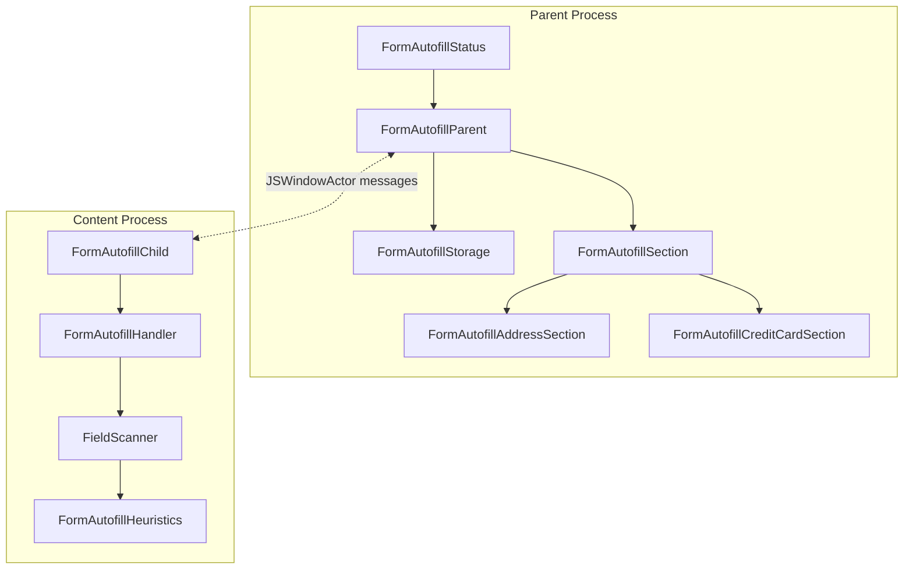
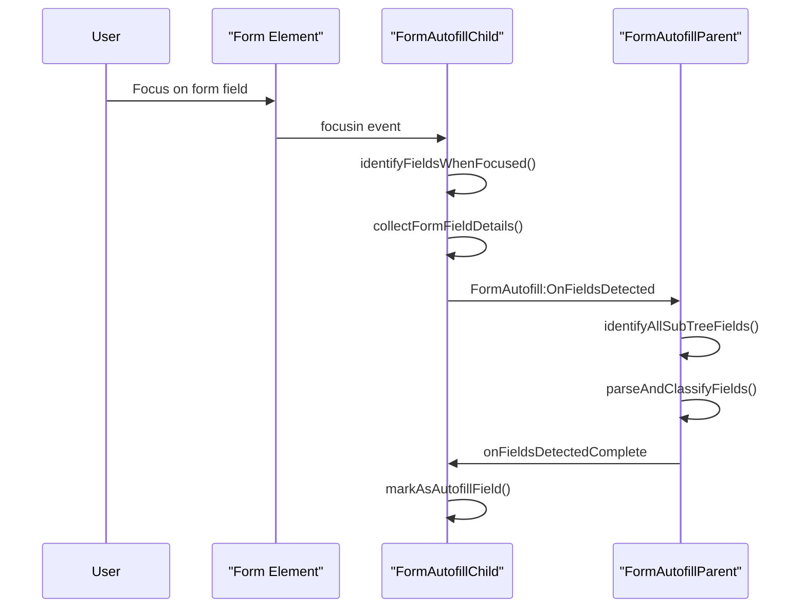
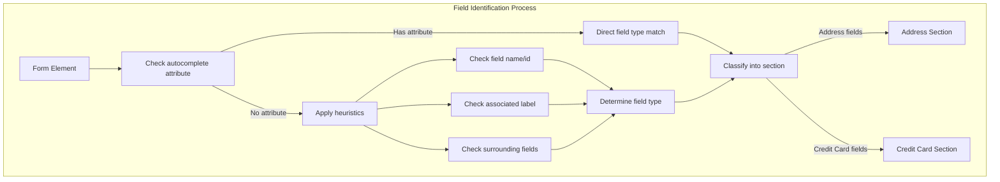
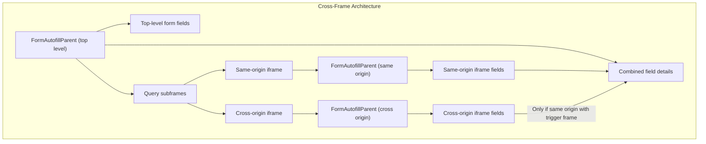
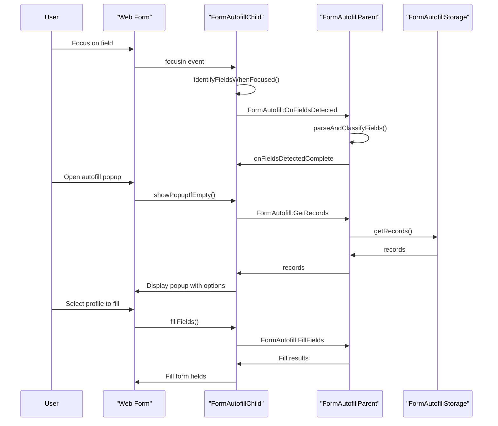
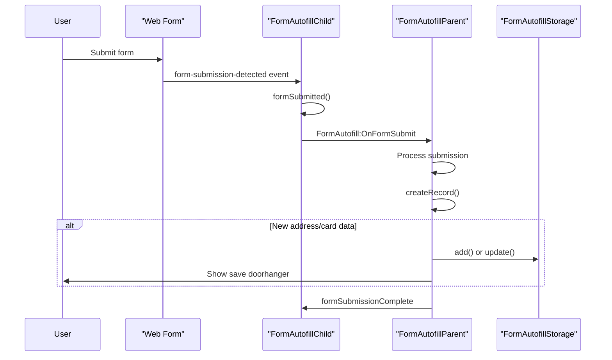
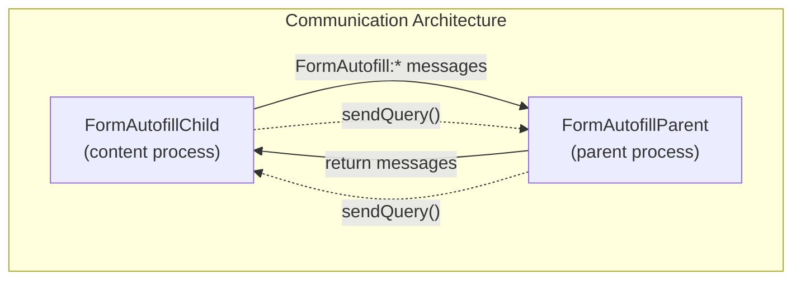

<!-- source: DeepWiki mcp.deepwiki.com · repo mozilla/gecko-dev · page 4.2 Form Autofill System · fetched 2026-10-09 -->

# Form Autofill System

<details>
<summary>Relevant source files</summary>

The following files were used as context for generating this wiki page:

- [browser/extensions/formautofill/api.js](browser/extensions/formautofill/api.js)
- [browser/extensions/formautofill/test/browser/address/browser_autofill_whenhidden.js](browser/extensions/formautofill/test/browser/address/browser_autofill_whenhidden.js)
- [browser/extensions/formautofill/test/browser/browser.toml](browser/extensions/formautofill/test/browser/browser.toml)
- [browser/extensions/formautofill/test/browser/browser_autofill_address_select_match_isoid.js](browser/extensions/formautofill/test/browser/browser_autofill_address_select_match_isoid.js)
- [browser/extensions/formautofill/test/browser/browser_autofill_address_textarea.js](browser/extensions/formautofill/test/browser/browser_autofill_address_textarea.js)
- [browser/extensions/formautofill/test/browser/browser_dynamic_form_autocompletion.js](browser/extensions/formautofill/test/browser/browser_dynamic_form_autocompletion.js)
- [browser/extensions/formautofill/test/browser/browser_dynamic_form_detection.js](browser/extensions/formautofill/test/browser/browser_dynamic_form_detection.js)
- [browser/extensions/formautofill/test/browser/browser_dynamic_form_telemetry.js](browser/extensions/formautofill/test/browser/browser_dynamic_form_telemetry.js)
- [browser/extensions/formautofill/test/browser/browser_editAddressDialog.js](browser/extensions/formautofill/test/browser/browser_editAddressDialog.js)
- [browser/extensions/formautofill/test/browser/browser_form_changes.js](browser/extensions/formautofill/test/browser/browser_form_changes.js)
- [browser/extensions/formautofill/test/browser/head.js](browser/extensions/formautofill/test/browser/head.js)
- [browser/extensions/formautofill/test/fixtures/dynamic_form_changing_on_user_interaction.html](browser/extensions/formautofill/test/fixtures/dynamic_form_changing_on_user_interaction.html)
- [browser/extensions/formautofill/test/fixtures/dynamic_form_replacing_all_fields.html](browser/extensions/formautofill/test/fixtures/dynamic_form_replacing_all_fields.html)
- [browser/extensions/formautofill/test/fixtures/dynamic_formless_fields_updated_due_to_node_mutations.html](browser/extensions/formautofill/test/fixtures/dynamic_formless_fields_updated_due_to_node_mutations.html)
- [browser/extensions/formautofill/test/fixtures/dynamic_formless_fields_updated_due_to_visiblity_state_change.html](browser/extensions/formautofill/test/fixtures/dynamic_formless_fields_updated_due_to_visiblity_state_change.html)
- [browser/extensions/formautofill/test/fixtures/dynamic_forms.html](browser/extensions/formautofill/test/fixtures/dynamic_forms.html)
- [browser/extensions/formautofill/test/mochitest/formautofill_common.js](browser/extensions/formautofill/test/mochitest/formautofill_common.js)
- [browser/extensions/formautofill/test/mochitest/test_formautofill_preview_highlight.html](browser/extensions/formautofill/test/mochitest/test_formautofill_preview_highlight.html)
- [browser/extensions/formautofill/test/unit/xpcshell.toml](browser/extensions/formautofill/test/unit/xpcshell.toml)
- [dom/security/nsContentSecurityUtils.cpp](dom/security/nsContentSecurityUtils.cpp)
- [dom/security/nsContentSecurityUtils.h](dom/security/nsContentSecurityUtils.h)
- [mobile/shared/chrome/geckoview/geckoview.js](mobile/shared/chrome/geckoview/geckoview.js)
- [mobile/shared/chrome/geckoview/geckoview.xhtml](mobile/shared/chrome/geckoview/geckoview.xhtml)
- [modules/libpref/init/all.js](modules/libpref/init/all.js)
- [security/manager/ssl/nsSiteSecurityService.cpp](security/manager/ssl/nsSiteSecurityService.cpp)
- [security/manager/ssl/nsSiteSecurityService.h](security/manager/ssl/nsSiteSecurityService.h)
- [testing/profiles/unittest-required/user.js](testing/profiles/unittest-required/user.js)
- [toolkit/components/formautofill/Constants.ios.mjs](toolkit/components/formautofill/Constants.ios.mjs)
- [toolkit/components/formautofill/FormAutofill.sys.mjs](toolkit/components/formautofill/FormAutofill.sys.mjs)
- [toolkit/components/formautofill/FormAutofillChild.sys.mjs](toolkit/components/formautofill/FormAutofillChild.sys.mjs)
- [toolkit/components/formautofill/FormAutofillParent.sys.mjs](toolkit/components/formautofill/FormAutofillParent.sys.mjs)
- [toolkit/components/formautofill/Helpers.ios.mjs](toolkit/components/formautofill/Helpers.ios.mjs)
- [toolkit/components/formautofill/shared/AutofillFormFactory.sys.mjs](toolkit/components/formautofill/shared/AutofillFormFactory.sys.mjs)
- [toolkit/components/formautofill/shared/FormAutofillHandler.sys.mjs](toolkit/components/formautofill/shared/FormAutofillHandler.sys.mjs)
- [toolkit/components/formautofill/shared/FormAutofillHeuristics.sys.mjs](toolkit/components/formautofill/shared/FormAutofillHeuristics.sys.mjs)
- [toolkit/components/formautofill/shared/FormAutofillUtils.sys.mjs](toolkit/components/formautofill/shared/FormAutofillUtils.sys.mjs)
- [toolkit/components/formautofill/shared/FormStateManager.sys.mjs](toolkit/components/formautofill/shared/FormStateManager.sys.mjs)
- [toolkit/content/neterror/supportpages/time-errors.html](toolkit/content/neterror/supportpages/time-errors.html)
- [toolkit/modules/FormLikeFactory.sys.mjs](toolkit/modules/FormLikeFactory.sys.mjs)
- [toolkit/mozapps/downloads/HelperAppDlg.sys.mjs](toolkit/mozapps/downloads/HelperAppDlg.sys.mjs)
- [toolkit/mozapps/downloads/content/unknownContentType.xhtml](toolkit/mozapps/downloads/content/unknownContentType.xhtml)
- [toolkit/profile/content/profileDowngrade.js](toolkit/profile/content/profileDowngrade.js)
- [toolkit/profile/content/profileDowngrade.xhtml](toolkit/profile/content/profileDowngrade.xhtml)
- [toolkit/profile/jar.mn](toolkit/profile/jar.mn)

</details>


## Purpose and Scope

This document describes Firefox's Form Autofill system, which automatically populates web forms with user data such as addresses and credit card information. The system handles detecting forms, identifying fields, securely storing user data, and filling forms across different browsing contexts. For information about password management, see the Password Manager documentation instead.

## System Architecture Overview

The Form Autofill system uses a parent-child architecture that separates storage and security-sensitive operations from content-facing interactions:



Sources:
- [toolkit/components/formautofill/FormAutofillParent.sys.mjs:1-262](toolkit/components/formautofill/FormAutofillParent.sys.mjs:1-262)
- [toolkit/components/formautofill/FormAutofillChild.sys.mjs:1-37](toolkit/components/formautofill/FormAutofillChild.sys.mjs:1-37)
- [toolkit/components/formautofill/shared/FormAutofillHandler.sys.mjs:1-24](toolkit/components/formautofill/shared/FormAutofillHandler.sys.mjs:1-24)

### Parent Side Components

1. **FormAutofillStatus** - Manages the overall enabled state of the feature based on preferences and available data.
2. **FormAutofillParent** - The parent process actor that communicates with content processes, manages storage access, coordinates form operations, and handles form submissions.
3. **FormAutofillStorage** - Stores and manages address and credit card information in the profile directory.

Sources:
- [toolkit/components/formautofill/FormAutofillParent.sys.mjs:30-54](toolkit/components/formautofill/FormAutofillParent.sys.mjs:30-54)
- [toolkit/components/formautofill/FormAutofillParent.sys.mjs:68-237](toolkit/components/formautofill/FormAutofillParent.sys.mjs:68-237)
- [toolkit/components/formautofill/FormAutofillParent.sys.mjs:239-253](toolkit/components/formautofill/FormAutofillParent.sys.mjs:239-253)

### Content Side Components

1. **FormAutofillChild** - The content process actor that detects forms, identifies fields, and communicates with the parent process.
2. **FormAutofillHandler** - Manages the autofill process for a specific form, including collecting field details and handling field state changes.
3. **FieldScanner** - Scans forms for autofillable fields and collects details about them.
4. **FormAutofillHeuristics** - Implements heuristics for identifying field types based on attributes, content, and context.
5. **FormStateManager** - Tracks the state of detected forms and fields.

Sources:
- [toolkit/components/formautofill/FormAutofillChild.sys.mjs:37-58](toolkit/components/formautofill/FormAutofillChild.sys.mjs:37-58)
- [toolkit/components/formautofill/shared/FormAutofillHandler.sys.mjs:35-117](toolkit/components/formautofill/shared/FormAutofillHandler.sys.mjs:35-117)
- [toolkit/components/formautofill/shared/FormStateManager.sys.mjs:14-21](toolkit/components/formautofill/shared/FormStateManager.sys.mjs:14-21)

## Form Detection and Field Identification

### Form Detection Process



Sources:
- [toolkit/components/formautofill/FormAutofillChild.sys.mjs:427-457](toolkit/components/formautofill/FormAutofillChild.sys.mjs:427-457)
- [toolkit/components/formautofill/FormAutofillParent.sys.mjs:433-473](toolkit/components/formautofill/FormAutofillParent.sys.mjs:433-473)
- [toolkit/components/formautofill/FormAutofillParent.sys.mjs:492-498](toolkit/components/formautofill/FormAutofillParent.sys.mjs:492-498)

### Field Identification and Heuristics

The system identifies form fields using a combination of methods:

1. **Explicit autocomplete attributes** - Fields with attributes like `autocomplete="cc-number"` are directly identified
2. **Heuristic identification** - For fields without explicit attributes, the system applies heuristics based on:
   - Field names, IDs, and labels
   - Element types (input, select, textarea)
   - Context within the form
   - Pattern recognition for specific field formats



Sources:
- [toolkit/components/formautofill/shared/FormAutofillHeuristics.sys.mjs:34-170](toolkit/components/formautofill/shared/FormAutofillHeuristics.sys.mjs:34-170)
- [toolkit/components/formautofill/shared/FormAutofillUtils.sys.mjs:134-164](toolkit/components/formautofill/shared/FormAutofillUtils.sys.mjs:134-164)

## Cross-Frame Support

The Form Autofill system supports forms that span multiple frames, including both same-origin and cross-origin iframes (with security restrictions).



For security reasons, cross-origin frames are only filled when they're same-origin with the frame that triggered autofill.

Sources:
- [toolkit/components/formautofill/FormAutofillParent.sys.mjs:392-396](toolkit/components/formautofill/FormAutofillParent.sys.mjs:392-396)
- [toolkit/components/formautofill/FormAutofillParent.sys.mjs:433-473](toolkit/components/formautofill/FormAutofillParent.sys.mjs:433-473)
- [toolkit/components/formautofill/FormAutofillChild.sys.mjs:307-345](toolkit/components/formautofill/FormAutofillChild.sys.mjs:307-345)

## Autofill Process Flow

### Main Autofill Flow



Sources:
- [toolkit/components/formautofill/FormAutofillChild.sys.mjs:427-457](toolkit/components/formautofill/FormAutofillChild.sys.mjs:427-457)
- [toolkit/components/formautofill/FormAutofillChild.sys.mjs:347-356](toolkit/components/formautofill/FormAutofillChild.sys.mjs:347-356)
- [toolkit/components/formautofill/FormAutofillParent.sys.mjs:299-317](toolkit/components/formautofill/FormAutofillParent.sys.mjs:299-317)
- [toolkit/components/formautofill/shared/FormAutofillHandler.sys.mjs:456-512](toolkit/components/formautofill/shared/FormAutofillHandler.sys.mjs:456-512)

### Field Preview and Fill States

Form fields can have different visual states during the autofill process:

| State | Description | Implementation |
|-------|-------------|---------------|
| `NORMAL` | Default state, no autofill applied | Cleared styling |
| `PREVIEW` | Showing a preview of what would be filled | Gray styling with preview value |
| `AUTO_FILLED` | Field has been autofilled | Green styling with filled value |

Sources:
- [toolkit/components/formautofill/shared/FormAutofillUtils.sys.mjs:92-96](toolkit/components/formautofill/shared/FormAutofillUtils.sys.mjs:92-96)
- [toolkit/components/formautofill/shared/FormAutofillHandler.sys.mjs:372-396](toolkit/components/formautofill/shared/FormAutofillHandler.sys.mjs:372-396)
- [toolkit/components/formautofill/shared/FormAutofillHandler.sys.mjs:405-445](toolkit/components/formautofill/shared/FormAutofillHandler.sys.mjs:405-445)

## Form Capture and Submission

When a user submits a form containing autofillable fields, the system can capture the entered data for future use.



The system supports several form submission heuristics:

1. **Form submit event** - Standard form submission
2. **Form removal after fetch** - Detection of form removal after XHR/fetch
3. **Iframe pagehide** - Capture from iframes when they're unloaded
4. **Page navigation** - Capture on navigation away from page

Sources:
- [toolkit/components/formautofill/FormAutofillChild.sys.mjs:382-402](toolkit/components/formautofill/FormAutofillChild.sys.mjs:382-402)
- [toolkit/components/formautofill/FormAutofillParent.sys.mjs:622-735](toolkit/components/formautofill/FormAutofillParent.sys.mjs:622-735)
- [toolkit/components/formautofill/shared/FormAutofillUtils.sys.mjs:97-102](toolkit/components/formautofill/shared/FormAutofillUtils.sys.mjs:97-102)

## Security and Privacy Features

The Form Autofill system incorporates several security features:

1. **Separate storage for sensitive data** - Addresses and credit cards are stored separately
2. **Credit card protection** - Credit card numbers are encrypted at rest
3. **OS authentication** - OS-level authentication can be required before filling credit cards
4. **Per-site saving** - Users can choose which sites can save their data

Sources:
- [toolkit/components/formautofill/FormAutofillParent.sys.mjs:362-376](toolkit/components/formautofill/FormAutofillParent.sys.mjs:362-376)
- [toolkit/components/formautofill/shared/FormAutofillUtils.sys.mjs:229-296](toolkit/components/formautofill/shared/FormAutofillUtils.sys.mjs:229-296)

## Dynamic Form Changes Support

The Form Autofill system can detect and handle dynamic form changes, which are common in modern web applications.

```mermaid
graph TD
    subgraph "Dynamic Form Change Handling"
        FormChange["Form change detected"] --> ChangeType["Determine change type"]
        
        ChangeType -->|"Nodes added/removed"| SendEvent["Send form-change event"]
        ChangeType -->|"Element visibility change"| SendEvent
        ChangeType -->|"Select options changed"| SendEvent
        
        SendEvent --> FormAutofillChild["FormAutofillChild.onFormChange()"]
        FormAutofillChild --> RedetectFields["Re-run field detection"]
        RedetectFields --> SendToParent["Send updated fields to parent"]
        
        SendToParent --> Reclassify["Reclassify sections"]
        Reclassify --> NotifyChildren["Notify all children of updates"]
        
        alt "Change shortly after autofill"
            NotifyChildren --> RefillFields["Re-fill affected fields"]
        end
    end
```

Dynamic form change detection works by:
1. Using mutation observers to detect when form elements are added, removed, or changed
2. Monitoring visibility state changes of form elements
3. Detecting select element option changes 
4. Re-running field detection when changes are detected
5. Re-filling forms if changes happen immediately after an autofill operation

Sources:
- [toolkit/components/formautofill/FormAutofillChild.sys.mjs:518-568](toolkit/components/formautofill/FormAutofillChild.sys.mjs:518-568)
- [toolkit/components/formautofill/FormAutofillParent.sys.mjs:511-573](toolkit/components/formautofill/FormAutofillParent.sys.mjs:511-573)
- [toolkit/components/formautofill/FormAutofillParent.sys.mjs:583-602](toolkit/components/formautofill/FormAutofillParent.sys.mjs:583-602)
- [toolkit/components/formautofill/shared/FormAutofillHandler.sys.mjs:23-30](toolkit/components/formautofill/shared/FormAutofillHandler.sys.mjs:23-30)

## Configuration and Preferences

The Form Autofill system can be configured through several preferences:

| Preference | Description | Default |
|------------|-------------|---------|
| `extensions.formautofill.addresses.enabled` | Enable address autofill | true |
| `extensions.formautofill.creditCards.enabled` | Enable credit card autofill | true |
| `extensions.formautofill.addresses.capture.enabled` | Enable capturing addresses from forms | false |
| `extensions.formautofill.creditCards.reauth.optout` | Require OS authentication for credit cards | false |
| `extensions.formautofill.heuristics.detectDynamicFormChanges` | Enable dynamic form detection | true |
| `extensions.formautofill.heuristics.captureOnFormRemoval` | Enable form capture on removal | false |
| `extensions.formautofill.heuristics.captureOnPageNavigation` | Enable form capture on navigation | false |

Sources:
- [toolkit/components/formautofill/FormAutofill.sys.mjs:9-47](toolkit/components/formautofill/FormAutofill.sys.mjs:9-47)
- [modules/libpref/init/all.js:382-386](modules/libpref/init/all.js:382-386)

## JSWindowActor Communication Model

The Form Autofill system uses Firefox's JSWindowActor model for parent-child communication:



Key messages include:
- `FormAutofill:OnFieldsDetected` - Sends detected fields to parent
- `FormAutofill:GetRecords` - Requests stored data from parent
- `FormAutofill:OnFormSubmit` - Notifies parent of form submission
- `FormAutofill:FillFields` - Commands filling fields with specified data
- `FormAutofill:FieldFilledModified` - Notifies when filled field is modified

Sources:
- [toolkit/components/formautofill/FormAutofillChild.sys.mjs:299-390](toolkit/components/formautofill/FormAutofillChild.sys.mjs:299-390)
- [toolkit/components/formautofill/FormAutofillParent.sys.mjs:299-389](toolkit/components/formautofill/FormAutofillParent.sys.mjs:299-389)

## Integration with Browser Features

The Form Autofill system integrates with several other browser features:

1. **Browser preferences** - Managed through the Privacy preferences panel
2. **Content Security** - Respects same-origin policies for cross-frame interactions
3. **OS Key Store** - Integration for secure storage and authentication
4. **Firefox Relay** - Integration for email masking services

Sources:
- [toolkit/components/formautofill/FormAutofillParent.sys.mjs:50-54](toolkit/components/formautofill/FormAutofillParent.sys.mjs:50-54)
- [toolkit/components/formautofill/FormAutofillParent.sys.mjs:202-211](toolkit/components/formautofill/FormAutofillParent.sys.mjs:202-211)

## Testing Framework

The Form Autofill system includes extensive browser tests to verify functionality:

- Unit tests for individual components
- Browser tests for end-to-end functionality
- Tests for specific features like address and credit card handling
- Tests for cross-frame interactions
- Tests for dynamic form changes

Sources:
- [browser/extensions/formautofill/test/browser/browser.toml:1-136](browser/extensions/formautofill/test/browser/browser.toml:1-136)
- [browser/extensions/formautofill/test/browser/head.js:1-195](browser/extensions/formautofill/test/browser/head.js:1-195)

## Future Improvements

The codebase comments indicate several areas for potential improvement:

1. Improved heuristics for field identification
2. Better handling of dynamic forms
3. Enhanced cross-origin frame support
4. Machine learning-based field recognition

An experimental ML-based field identification system is already in development, as indicated by references to `MLAutofill` in the codebase.

Sources:
- [toolkit/components/formautofill/FormAutofillParent.sys.mjs:52](toolkit/components/formautofill/FormAutofillParent.sys.mjs:52)
- [toolkit/components/formautofill/FormAutofillParent.sys.mjs:545-547](toolkit/components/formautofill/FormAutofillParent.sys.mjs:545-547)

---

