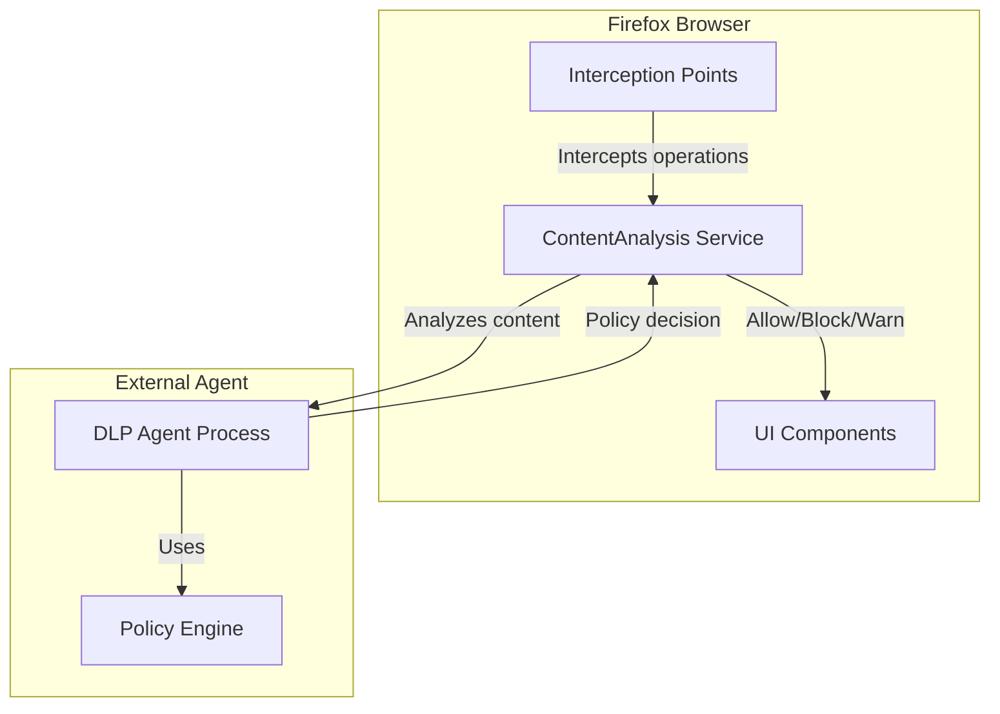
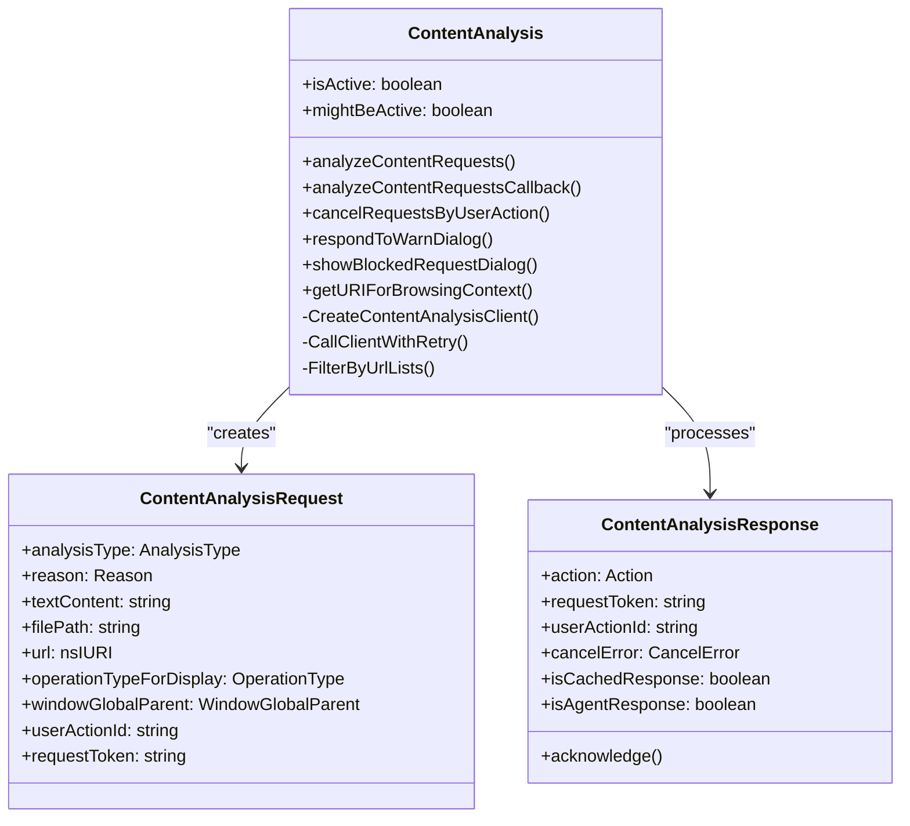
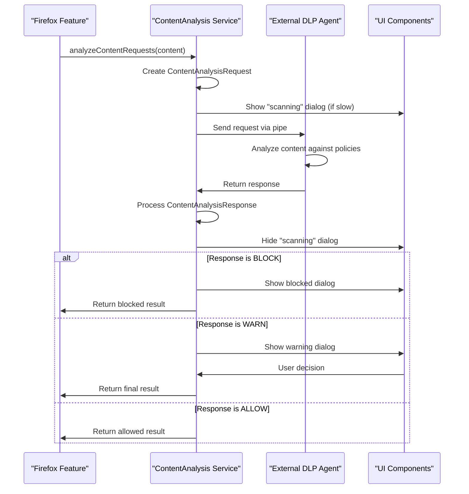
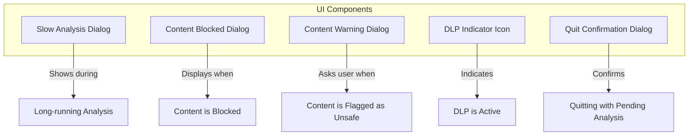
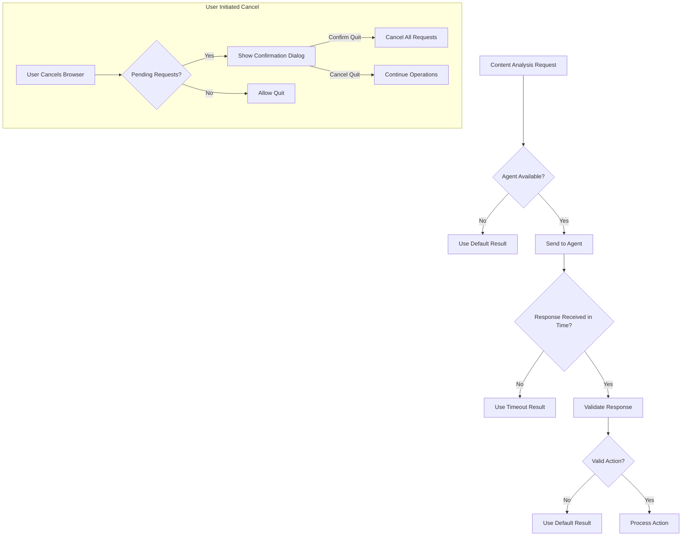

<!-- source: DeepWiki mcp.deepwiki.com · repo mozilla/gecko-dev · page 4.3 Content Analysis and DLP · fetched 2026-10-09 -->

# Content Analysis and DLP

<details>
<summary>Relevant source files</summary>

The following files were used as context for generating this wiki page:

- [browser/components/contentanalysis/content/ContentAnalysis.sys.mjs](browser/components/contentanalysis/content/ContentAnalysis.sys.mjs)
- [browser/components/contentanalysis/content/tsconfig.json](browser/components/contentanalysis/content/tsconfig.json)
- [browser/components/contentanalysis/moz.build](browser/components/contentanalysis/moz.build)
- [browser/components/genai/GenAI.sys.mjs](browser/components/genai/GenAI.sys.mjs)
- [browser/components/genai/GenAIChild.sys.mjs](browser/components/genai/GenAIChild.sys.mjs)
- [browser/components/genai/tests/browser/browser_chat_shortcuts.js](browser/components/genai/tests/browser/browser_chat_shortcuts.js)
- [browser/components/genai/tests/browser/browser_genai_init.js](browser/components/genai/tests/browser/browser_genai_init.js)
- [testing/modules/MockRegistrar.sys.mjs](testing/modules/MockRegistrar.sys.mjs)
- [third_party/content_analysis_sdk/add_delayms.patch](third_party/content_analysis_sdk/add_delayms.patch)
- [third_party/content_analysis_sdk/demo/agent.cc](third_party/content_analysis_sdk/demo/agent.cc)
- [third_party/content_analysis_sdk/demo/handler.h](third_party/content_analysis_sdk/demo/handler.h)
- [third_party/content_analysis_sdk/larger_read_buffer.patch](third_party/content_analysis_sdk/larger_read_buffer.patch)
- [third_party/content_analysis_sdk/moz.yaml](third_party/content_analysis_sdk/moz.yaml)
- [toolkit/components/contentanalysis/ContentAnalysis.cpp](toolkit/components/contentanalysis/ContentAnalysis.cpp)
- [toolkit/components/contentanalysis/ContentAnalysis.h](toolkit/components/contentanalysis/ContentAnalysis.h)
- [toolkit/components/contentanalysis/ContentAnalysisUtils.sys.mjs](toolkit/components/contentanalysis/ContentAnalysisUtils.sys.mjs)
- [toolkit/components/contentanalysis/moz.build](toolkit/components/contentanalysis/moz.build)
- [toolkit/components/contentanalysis/nsIContentAnalysis.idl](toolkit/components/contentanalysis/nsIContentAnalysis.idl)
- [toolkit/components/contentanalysis/tests/browser/browser.toml](toolkit/components/contentanalysis/tests/browser/browser.toml)
- [toolkit/components/contentanalysis/tests/browser/browser_clipboard_content_analysis.js](toolkit/components/contentanalysis/tests/browser/browser_clipboard_content_analysis.js)
- [toolkit/components/contentanalysis/tests/browser/browser_clipboard_paste_changingclipboardexternal_content_analysis.js](toolkit/components/contentanalysis/tests/browser/browser_clipboard_paste_changingclipboardexternal_content_analysis.js)
- [toolkit/components/contentanalysis/tests/browser/browser_clipboard_paste_changingclipboardinternal_content_analysis.js](toolkit/components/contentanalysis/tests/browser/browser_clipboard_paste_changingclipboardinternal_content_analysis.js)
- [toolkit/components/contentanalysis/tests/browser/browser_clipboard_paste_chat_shortcuts.js](toolkit/components/contentanalysis/tests/browser/browser_clipboard_paste_chat_shortcuts.js)
- [toolkit/components/contentanalysis/tests/browser/browser_clipboard_paste_file_content_analysis.js](toolkit/components/contentanalysis/tests/browser/browser_clipboard_paste_file_content_analysis.js)
- [toolkit/components/contentanalysis/tests/browser/browser_clipboard_paste_inputandtextarea_content_analysis.js](toolkit/components/contentanalysis/tests/browser/browser_clipboard_paste_inputandtextarea_content_analysis.js)
- [toolkit/components/contentanalysis/tests/browser/browser_clipboard_paste_inputandtextarea_iframe_content_analysis.js](toolkit/components/contentanalysis/tests/browser/browser_clipboard_paste_inputandtextarea_iframe_content_analysis.js)
- [toolkit/components/contentanalysis/tests/browser/browser_clipboard_paste_noformatting_content_analysis.js](toolkit/components/contentanalysis/tests/browser/browser_clipboard_paste_noformatting_content_analysis.js)
- [toolkit/components/contentanalysis/tests/browser/browser_clipboard_paste_prompt_content_analysis.js](toolkit/components/contentanalysis/tests/browser/browser_clipboard_paste_prompt_content_analysis.js)
- [toolkit/components/contentanalysis/tests/browser/browser_clipboard_read_async_content_analysis.js](toolkit/components/contentanalysis/tests/browser/browser_clipboard_read_async_content_analysis.js)
- [toolkit/components/contentanalysis/tests/browser/browser_content_analysis_dnd_diff_origin.js](toolkit/components/contentanalysis/tests/browser/browser_content_analysis_dnd_diff_origin.js)
- [toolkit/components/contentanalysis/tests/browser/browser_content_analysis_dnd_same_origin.js](toolkit/components/contentanalysis/tests/browser/browser_content_analysis_dnd_same_origin.js)
- [toolkit/components/contentanalysis/tests/browser/browser_content_analysis_dnd_shadow.js](toolkit/components/contentanalysis/tests/browser/browser_content_analysis_dnd_shadow.js)
- [toolkit/components/contentanalysis/tests/browser/browser_content_analysis_quit_confirmation_dialog.js](toolkit/components/contentanalysis/tests/browser/browser_content_analysis_quit_confirmation_dialog.js)
- [toolkit/components/contentanalysis/tests/browser/browser_print_changing_page_content_analysis.js](toolkit/components/contentanalysis/tests/browser/browser_print_changing_page_content_analysis.js)
- [toolkit/components/contentanalysis/tests/browser/browser_print_iframe_content_analysis.js](toolkit/components/contentanalysis/tests/browser/browser_print_iframe_content_analysis.js)
- [toolkit/components/contentanalysis/tests/browser/clipboard_paste_chat_shortcuts.html](toolkit/components/contentanalysis/tests/browser/clipboard_paste_chat_shortcuts.html)
- [toolkit/components/contentanalysis/tests/browser/clipboard_read_async.html](toolkit/components/contentanalysis/tests/browser/clipboard_read_async.html)
- [toolkit/components/contentanalysis/tests/browser/head.js](toolkit/components/contentanalysis/tests/browser/head.js)
- [toolkit/components/contentanalysis/tests/gtest/TestContentAnalysis.cpp](toolkit/components/contentanalysis/tests/gtest/TestContentAnalysis.cpp)
- [toolkit/components/contentanalysis/tests/gtest/TestContentAnalysisUtils.cpp](toolkit/components/contentanalysis/tests/gtest/TestContentAnalysisUtils.cpp)
- [toolkit/components/contentanalysis/tests/gtest/TestContentAnalysisUtils.h](toolkit/components/contentanalysis/tests/gtest/TestContentAnalysisUtils.h)
- [toolkit/components/contentanalysis/tests/gtest/allowedFile1.txt](toolkit/components/contentanalysis/tests/gtest/allowedFile1.txt)
- [toolkit/components/contentanalysis/tests/gtest/allowedFile2.txt](toolkit/components/contentanalysis/tests/gtest/allowedFile2.txt)
- [toolkit/components/contentanalysis/tests/gtest/moz.build](toolkit/components/contentanalysis/tests/gtest/moz.build)
- [toolkit/components/contentanalysis/tsconfig.json](toolkit/components/contentanalysis/tsconfig.json)
- [toolkit/components/prompts/content/commonDialog.js](toolkit/components/prompts/content/commonDialog.js)
- [toolkit/content/widgets/browser-custom-element.js](toolkit/content/widgets/browser-custom-element.js)
- [toolkit/locales/en-US/toolkit/contentanalysis/contentanalysis.ftl](toolkit/locales/en-US/toolkit/contentanalysis/contentanalysis.ftl)
- [widget/ClipboardContentAnalysisParent.cpp](widget/ClipboardContentAnalysisParent.cpp)
- [widget/nsBaseClipboard.cpp](widget/nsBaseClipboard.cpp)
- [widget/windows/nsFilePicker.cpp](widget/windows/nsFilePicker.cpp)
- [widget/windows/nsFilePicker.h](widget/windows/nsFilePicker.h)

</details>


This page documents Firefox's Content Analysis and Data Loss Prevention (DLP) system, which allows enterprises to enforce data protection policies by integrating with external DLP agents. The system can analyze and optionally block clipboard operations, file uploads/downloads, drag-and-drop actions, and printing based on content policies.

For information on security systems in general, see [Security and Safety Infrastructure](#4).

## Overview

Firefox's Content Analysis and DLP system provides a bridge between the browser and external DLP agents. It intercepts sensitive content operations, sends the content to an external agent for analysis, and then either allows or blocks the operation based on the agent's response.

The system is primarily designed for enterprise environments where data protection is critical, allowing organizations to prevent sensitive information from leaving the browser through various channels.



Sources: [toolkit/components/contentanalysis/ContentAnalysis.cpp]()/[toolkit/components/contentanalysis/ContentAnalysis.h]()/[browser/components/contentanalysis/content/ContentAnalysis.sys.mjs]()

## Core Components

### ContentAnalysis Service

The central service (`ContentAnalysis`) manages communication with the external DLP agent, processing requests and responses, and enforcing policy decisions.



Sources: [toolkit/components/contentanalysis/ContentAnalysis.cpp:179-489]()/[toolkit/components/contentanalysis/ContentAnalysis.h:186-490]()

The service implements the `nsIContentAnalysis` interface and provides methods for:
- Analyzing content through `analyzeContentRequests` and `analyzeContentRequestsCallback`
- Canceling requests with `cancelRequestsByUserAction` or `cancelRequestsByRequestToken`
- Handling user responses to warning dialogs with `respondToWarnDialog`
- Checking if content analysis is active with `isActive` and `mightBeActive` properties

### Request Handling

Content Analysis requests are processed through a chain of operations:



Sources: [toolkit/components/contentanalysis/ContentAnalysis.cpp:296-313]()/[toolkit/components/contentanalysis/ContentAnalysis.cpp:879-937]()

The request flow includes:
1. Creating a `ContentAnalysisRequest` with details about the content operation
2. Potentially showing a "scanning" dialog if the analysis takes time
3. Sending the request to the external agent
4. Processing the agent's response
5. Taking appropriate action based on the response (allow, block, or warn)

### User Interface Components

Firefox provides UI elements to handle DLP interactions, notifications, and dialogs:



Sources: [browser/components/contentanalysis/content/ContentAnalysis.sys.mjs:152-397]()/[toolkit/locales/en-US/toolkit/contentanalysis/contentanalysis.ftl]()

Key UI components include:
- Slow analysis dialog: Shown when analysis is taking time
- Blocked dialog: Informs the user that content was blocked
- Warning dialog: Asks the user whether to proceed with potentially unsafe content
- DLP indicator icon: Shows that DLP is active in the browser
- Quit confirmation dialog: Warns when quitting with pending analysis operations

## Interception Points

Firefox intercepts content operations at various points to enable DLP analysis:

### Clipboard Operations

```mermaid
flowchart LR
    subgraph "Clipboard Flow"
        Direction LR
        Paste["Paste Event"] --> Intercept["Intercept Content"]
        Intercept --> Analyze["Analyze with DLP Agent"]
        Analyze --> Decision{"Allow or Block"}
        Decision -->|"Allow"| Complete["Complete Paste"]
        Decision -->|"Block"| Notify["Notify User"]
    end
```

Sources: [toolkit/components/contentanalysis/tests/browser/browser_clipboard_content_analysis.js]()/[toolkit/components/contentanalysis/ContentAnalysisUtils.sys.mjs:16-105]()

### File Operations

```mermaid
flowchart LR
    subgraph "File Operations"
        Direction LR
        FileAction["File Upload/Download"] --> Intercept["Intercept File"]
        Intercept --> Analyze["Analyze with DLP Agent"]
        Analyze --> Decision{"Allow or Block"}
        Decision -->|"Allow"| Complete["Complete Operation"]
        Decision -->|"Block"| Notify["Show Blocked Dialog"]
    end
```

Sources: [widget/windows/nsFilePicker.cpp:649-697]()

### Drag and Drop

```mermaid
flowchart LR
    subgraph "Drag and Drop"
        Direction LR
        DragStart["Drag Start"] --> DragOver["Drag Over Target"]
        DragOver --> Intercept["Intercept Content"]
        Intercept --> Analyze["Analyze with DLP Agent"]
        Analyze --> Decision{"Allow or Block"}
        Decision -->|"Allow"| DropEvent["Complete Drop"]
        Decision -->|"Block"| CancelDrop["Cancel Drop"]
    end
```

Sources: [toolkit/components/contentanalysis/tests/browser/browser_content_analysis_dnd_same_origin.js]()/[toolkit/components/contentanalysis/tests/browser/browser_content_analysis_dnd_diff_origin.js]()

### Printing

```mermaid
flowchart LR
    subgraph "Print Operation"
        Direction LR
        PrintCommand["Print Command"] --> Intercept["Intercept Print Data"]
        Intercept --> Analyze["Analyze with DLP Agent"]
        Analyze --> Decision{"Allow or Block"}
        Decision -->|"Allow"| CompletePrint["Complete Print"]
        Decision -->|"Block"| Notify["Show Blocked Dialog"]
    end
```

### Special Integration: Prompts and GenAI

```mermaid
flowchart LR
    subgraph "Special Integrations"
        Direction LR
        PromptPaste["Paste in Prompt Dialog"] --> Analyze["Analyze with DLP Agent"]
        GenAIPaste["Paste in GenAI Chat"] --> Analyze
        Analyze --> Decision{"Allow or Block"}
        Decision -->|"Allow"| Complete["Complete Paste"]
        Decision -->|"Block"| Notify["Block Operation"]
    end
```

Sources: [toolkit/components/prompts/content/commonDialog.js:156-161]()/[browser/components/genai/GenAI.sys.mjs]()/[toolkit/components/contentanalysis/tests/browser/browser_clipboard_paste_chat_shortcuts.js]()

## Request and Response Types

### Analysis Types

The DLP system supports different types of content analysis:

| Analysis Type | Description | Use Cases |
|--------------|-------------|-----------|
| `eUnspecified` | Default unspecified type | - |
| `eFileDownloaded` | Analysis for downloaded files | File downloads |
| `eFileAttached` | Analysis for file attachments | File uploads, attachments |
| `eBulkDataEntry` | Analysis for text content | Clipboard, drag-and-drop |
| `ePrint` | Analysis for print operations | Printing documents |
| `eFileTransfer` | Analysis for file transfers | File uploads, downloads |

Sources: [toolkit/components/contentanalysis/nsIContentAnalysis.idl:144-151]()

### Response Actions

The DLP agent can respond with different actions:

| Action | Description | Result |
|--------|-------------|--------|
| `eUnspecified` | Default unspecified action | Default policy applied |
| `eReportOnly` | Report but allow the content | Content allowed with logging |
| `eWarn` | Warn the user about the content | User prompted to make decision |
| `eBlock` | Block the content | Content operation blocked |
| `eAllow` | Allow the content | Content operation allowed |
| `eCanceled` | Operation was canceled | Content operation stopped |

Sources: [toolkit/components/contentanalysis/nsIContentAnalysis.idl:55-63]()

## Configuration

The Content Analysis system is highly configurable through Firefox preferences:

| Preference | Description |
|------------|-------------|
| `browser.contentanalysis.enabled` | Master switch for enabling/disabling DLP |
| `browser.contentanalysis.pipe_path_name` | Named pipe to communicate with DLP agent |
| `browser.contentanalysis.client_signature` | Expected signature of DLP agent |
| `browser.contentanalysis.allow_url_regex_list` | URLs to bypass DLP checks |
| `browser.contentanalysis.deny_url_regex_list` | URLs to always apply DLP checks |
| `browser.contentanalysis.default_result` | Default action if agent can't be reached |
| `browser.contentanalysis.timeout_result` | Action to take if agent times out |
| `browser.contentanalysis.agent_timeout` | Timeout for agent responses |
| `browser.contentanalysis.max_connections` | Maximum concurrent connections to agent |

Sources: [toolkit/components/contentanalysis/ContentAnalysis.cpp:74-95]()/[toolkit/components/contentanalysis/tests/gtest/TestContentAnalysis.cpp:30-38]()

## Error Handling and Edge Cases

The system handles various error conditions:



Sources: [toolkit/components/contentanalysis/ContentAnalysis.cpp:1135-1224]()/[browser/components/contentanalysis/content/ContentAnalysis.sys.mjs:216-286]()

Key error handling features:
- Configurable default actions when agent can't be reached
- Timeout handling for slow agent responses
- User confirmation when quitting with pending analysis
- Error notifications and fallbacks

## Performance Considerations

The Content Analysis system is designed to minimize performance impact:

1. Thread pooling: Uses a thread pool for agent communications to keep UI responsive
2. Caching: Caches clipboard analysis results for repeated operations
3. URL filtering: Can bypass analysis for trusted URLs
4. Same-tab operations: Option to bypass checks for same-origin operations

Sources: [toolkit/components/contentanalysis/ContentAnalysis.h:280-284]()/[toolkit/components/contentanalysis/ContentAnalysis.cpp:344-345]()

---

