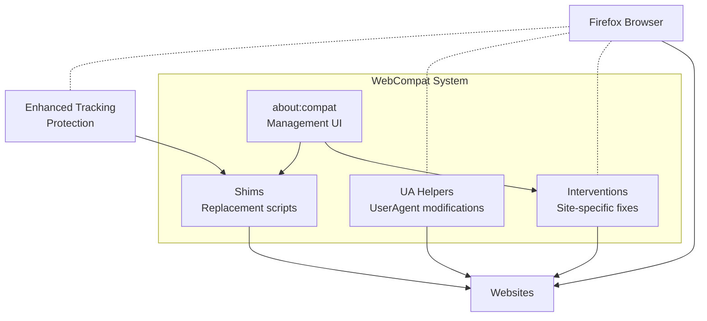
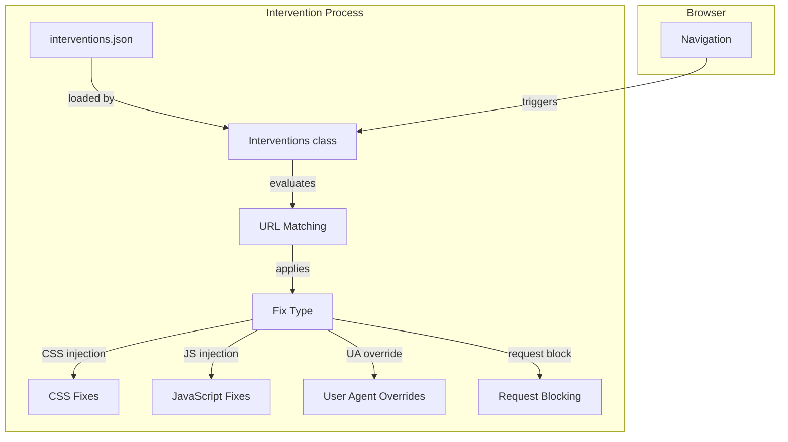
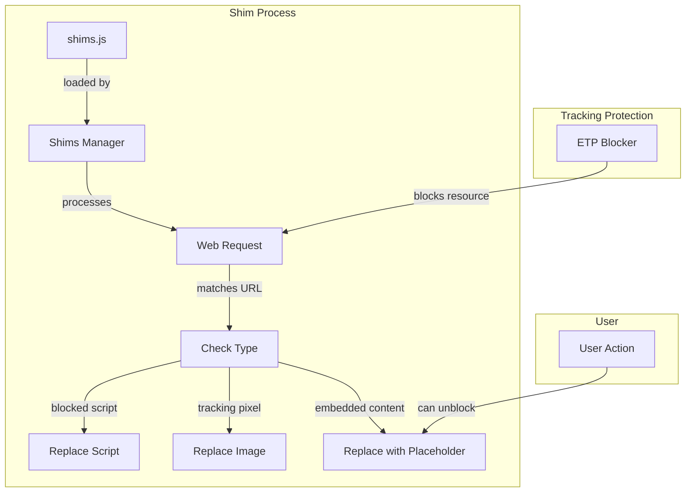
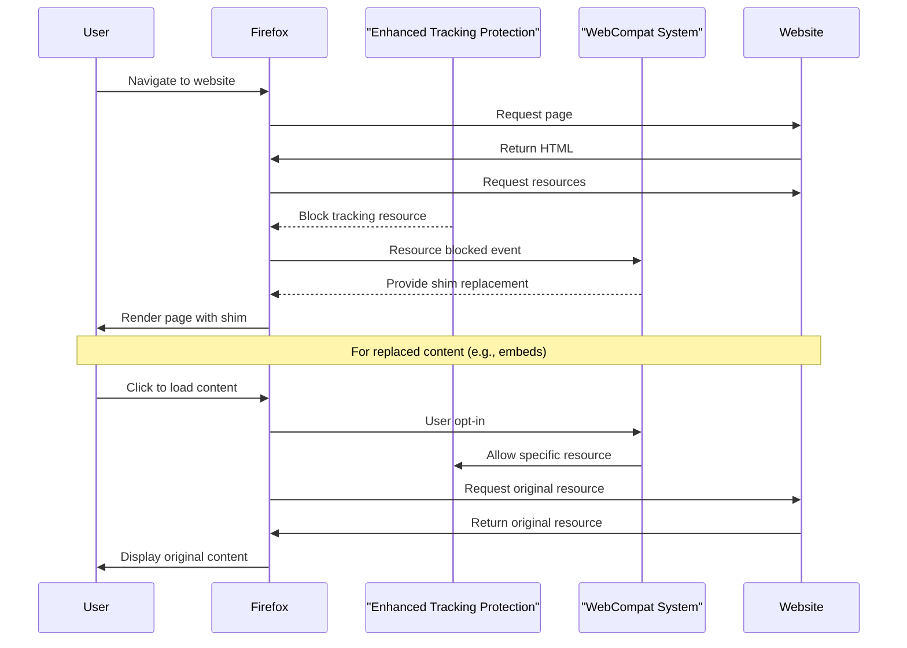
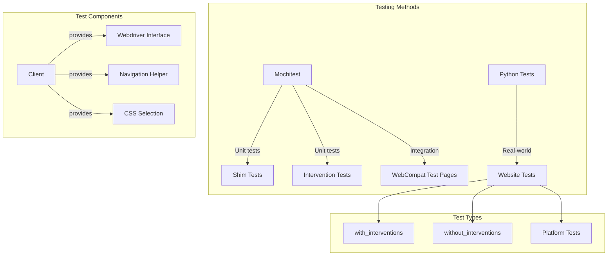

<!-- source: DeepWiki mcp.deepwiki.com · repo mozilla/gecko-dev · page 4.4 Web Compatibility System · fetched 2026-10-09 -->

# Web Compatibility System

<details>
<summary>Relevant source files</summary>

The following files were used as context for generating this wiki page:

- [browser/extensions/webcompat/data/interventions.json](browser/extensions/webcompat/data/interventions.json)
- [browser/extensions/webcompat/data/shims.js](browser/extensions/webcompat/data/shims.js)
- [browser/extensions/webcompat/experiment-apis/appConstants.js](browser/extensions/webcompat/experiment-apis/appConstants.js)
- [browser/extensions/webcompat/experiment-apis/appConstants.json](browser/extensions/webcompat/experiment-apis/appConstants.json)
- [browser/extensions/webcompat/experiment-apis/testUtils.js](browser/extensions/webcompat/experiment-apis/testUtils.js)
- [browser/extensions/webcompat/experiment-apis/testUtils.json](browser/extensions/webcompat/experiment-apis/testUtils.json)
- [browser/extensions/webcompat/experiment-apis/trackingProtection.js](browser/extensions/webcompat/experiment-apis/trackingProtection.js)
- [browser/extensions/webcompat/experiment-apis/trackingProtection.json](browser/extensions/webcompat/experiment-apis/trackingProtection.json)
- [browser/extensions/webcompat/injections/css/bug1845299-docs.google.com-hide-extra-scrollbar-on-speaker-notes.css](browser/extensions/webcompat/injections/css/bug1845299-docs.google.com-hide-extra-scrollbar-on-speaker-notes.css)
- [browser/extensions/webcompat/injections/css/bug1925937-gazetasp.com.br-hide-extra-scrollbars.css](browser/extensions/webcompat/injections/css/bug1925937-gazetasp.com.br-hide-extra-scrollbars.css)
- [browser/extensions/webcompat/injections/css/bug1926506-aliexpress.com-hide-extra-scrollbars.css](browser/extensions/webcompat/injections/css/bug1926506-aliexpress.com-hide-extra-scrollbars.css)
- [browser/extensions/webcompat/injections/css/bug1947105-pexels.com-nudge-thanks-popup-onscreen.css](browser/extensions/webcompat/injections/css/bug1947105-pexels.com-nudge-thanks-popup-onscreen.css)
- [browser/extensions/webcompat/injections/css/bug1947979-shazam.com-hide-extra-scrollbars.css](browser/extensions/webcompat/injections/css/bug1947979-shazam.com-hide-extra-scrollbars.css)
- [browser/extensions/webcompat/injections/css/bug1948047-lovers.cacaushow.com.br-nudge-login-popup-onscreen.css](browser/extensions/webcompat/injections/css/bug1948047-lovers.cacaushow.com.br-nudge-login-popup-onscreen.css)
- [browser/extensions/webcompat/injections/css/bug1950053-omegleapp.me-fix-scrollbars.css](browser/extensions/webcompat/injections/css/bug1950053-omegleapp.me-fix-scrollbars.css)
- [browser/extensions/webcompat/injections/js/bug1724868-news.yahoo.co.jp-ua-override.js](browser/extensions/webcompat/injections/js/bug1724868-news.yahoo.co.jp-ua-override.js)
- [browser/extensions/webcompat/injections/js/bug1956165-www.youtube.com-picture-in-picture-fix.js](browser/extensions/webcompat/injections/js/bug1956165-www.youtube.com-picture-in-picture-fix.js)
- [browser/extensions/webcompat/injections/js/log_message.js](browser/extensions/webcompat/injections/js/log_message.js)
- [browser/extensions/webcompat/lib/about_compat_broker.js](browser/extensions/webcompat/lib/about_compat_broker.js)
- [browser/extensions/webcompat/lib/custom_functions.js](browser/extensions/webcompat/lib/custom_functions.js)
- [browser/extensions/webcompat/lib/intervention_helpers.js](browser/extensions/webcompat/lib/intervention_helpers.js)
- [browser/extensions/webcompat/lib/interventions.js](browser/extensions/webcompat/lib/interventions.js)
- [browser/extensions/webcompat/lib/shims.js](browser/extensions/webcompat/lib/shims.js)
- [browser/extensions/webcompat/lib/ua_helpers.js](browser/extensions/webcompat/lib/ua_helpers.js)
- [browser/extensions/webcompat/manifest.json](browser/extensions/webcompat/manifest.json)
- [browser/extensions/webcompat/moz.build](browser/extensions/webcompat/moz.build)
- [browser/extensions/webcompat/run.js](browser/extensions/webcompat/run.js)
- [browser/extensions/webcompat/shims/aliexpress-language.js](browser/extensions/webcompat/shims/aliexpress-language.js)
- [browser/extensions/webcompat/shims/embed-test-shim.js](browser/extensions/webcompat/shims/embed-test-shim.js)
- [browser/extensions/webcompat/shims/instagram-embed.js](browser/extensions/webcompat/shims/instagram-embed.js)
- [browser/extensions/webcompat/shims/jira-zendesk-support.js](browser/extensions/webcompat/shims/jira-zendesk-support.js)
- [browser/extensions/webcompat/shims/microsoftAccountIcon.js](browser/extensions/webcompat/shims/microsoftAccountIcon.js)
- [browser/extensions/webcompat/shims/stackoverflow-login.js](browser/extensions/webcompat/shims/stackoverflow-login.js)
- [browser/extensions/webcompat/shims/tiktok-embed.js](browser/extensions/webcompat/shims/tiktok-embed.js)
- [browser/extensions/webcompat/shims/zendesk-asana-support.js](browser/extensions/webcompat/shims/zendesk-asana-support.js)
- [browser/extensions/webcompat/tests/browser/browser.toml](browser/extensions/webcompat/tests/browser/browser.toml)
- [browser/extensions/webcompat/tests/browser/browser_aboutcompat.js](browser/extensions/webcompat/tests/browser/browser_aboutcompat.js)
- [browser/extensions/webcompat/tests/browser/browser_console_messages.js](browser/extensions/webcompat/tests/browser/browser_console_messages.js)
- [browser/extensions/webcompat/tests/browser/browser_interventions.js](browser/extensions/webcompat/tests/browser/browser_interventions.js)
- [browser/extensions/webcompat/tests/browser/browser_smartblockembeds.js](browser/extensions/webcompat/tests/browser/browser_smartblockembeds.js)
- [browser/extensions/webcompat/tests/browser/browser_smartblockembeds_mutation.js](browser/extensions/webcompat/tests/browser/browser_smartblockembeds_mutation.js)
- [browser/extensions/webcompat/tests/browser/browser_ua_helpers.js](browser/extensions/webcompat/tests/browser/browser_ua_helpers.js)
- [browser/extensions/webcompat/tests/browser/head.js](browser/extensions/webcompat/tests/browser/head.js)
- [dom/webidl/Document.webidl](dom/webidl/Document.webidl)
- [testing/webcompat/client.py](testing/webcompat/client.py)
- [testing/webcompat/fixtures.py](testing/webcompat/fixtures.py)
- [testing/webcompat/interventions/conftest.py](testing/webcompat/interventions/conftest.py)
- [testing/webcompat/interventions/pytest.ini](testing/webcompat/interventions/pytest.ini)
- [testing/webcompat/interventions/tests/test_1724868_news_yahoo_co_jp.py](testing/webcompat/interventions/tests/test_1724868_news_yahoo_co_jp.py)
- [testing/webcompat/interventions/tests/test_1793761_schoolnutritionandfitness_com.py](testing/webcompat/interventions/tests/test_1793761_schoolnutritionandfitness_com.py)
- [testing/webcompat/interventions/tests/test_1830739_1902452_eternalslots_com.py](testing/webcompat/interventions/tests/test_1830739_1902452_eternalslots_com.py)
- [testing/webcompat/interventions/tests/test_1845299_docs_google_com_presentation.py](testing/webcompat/interventions/tests/test_1845299_docs_google_com_presentation.py)
- [testing/webcompat/interventions/tests/test_1902403_musicstore_auone_jp.py](testing/webcompat/interventions/tests/test_1902403_musicstore_auone_jp.py)
- [testing/webcompat/interventions/tests/test_1918609_zara_com.py](testing/webcompat/interventions/tests/test_1918609_zara_com.py)
- [testing/webcompat/interventions/tests/test_1925937_gazetasp_com_br.py](testing/webcompat/interventions/tests/test_1925937_gazetasp_com_br.py)
- [testing/webcompat/interventions/tests/test_1926506_aliexpress_com.py](testing/webcompat/interventions/tests/test_1926506_aliexpress_com.py)
- [testing/webcompat/interventions/tests/test_1947979_shazam_com.py](testing/webcompat/interventions/tests/test_1947979_shazam_com.py)
- [testing/webcompat/interventions/tests/test_1948047_lovers_cacaushow_com_br.py](testing/webcompat/interventions/tests/test_1948047_lovers_cacaushow_com_br.py)
- [testing/webcompat/interventions/tests/test_1950100_aylak_com.py](testing/webcompat/interventions/tests/test_1950100_aylak_com.py)
- [testing/webcompat/interventions/tests/test_1956165_m_youtube_com.py](testing/webcompat/interventions/tests/test_1956165_m_youtube_com.py)

</details>


The Web Compatibility System is a framework within Firefox that addresses website compatibility issues through targeted interventions, script replacements, and user agent modifications. It's implemented as a built-in extension (webcompat@mozilla.org) that identifies and fixes compatibility problems with specific websites to ensure Firefox users have a smooth browsing experience without requiring changes to the websites themselves. For information about related privacy features like Enhanced Tracking Protection, see [Security and Privacy Features](#4).

## Architecture Overview

The Web Compatibility System consists of three main components that work together to provide compatibility fixes:



### Components:

1. **Interventions**: Site-specific CSS and JavaScript fixes for known compatibility issues
2. **Shims**: Replacement scripts for third-party resources that may be blocked by Firefox's tracking protection
3. **User Agent Helpers**: Utilities for modifying the browser's user agent string sent to websites
4. **Management Interface**: The about:compat page for controlling interventions and shims

Sources:
- [browser/extensions/webcompat/moz.build]()
- [browser/extensions/webcompat/manifest.json]()
- [browser/extensions/webcompat/run.js]()

## Interventions System

Interventions are targeted fixes for specific websites with Firefox compatibility issues. These are defined in a JSON configuration file that specifies what sites need fixes and what type of fixes to apply.



### Intervention Types:

1. **CSS Injections**: Fix layout issues by applying custom CSS rules
2. **JavaScript Injections**: Fix functionality issues by executing custom JavaScript
3. **User Agent Overrides**: Bypass browser detection by modifying the user agent string
4. **Request Blocking**: Block problematic requests that cause issues

### Intervention Structure:

Each intervention in the configuration file includes:
- A unique identifier (often a bug number)
- The website label (domain it affects)
- Issue description and URL patterns to match
- Platform constraints (desktop, Android, etc.)
- The specific fix to apply

Sources:
- [browser/extensions/webcompat/data/interventions.json]()
- [browser/extensions/webcompat/lib/interventions.js]()
- [browser/extensions/webcompat/lib/intervention_helpers.js]()

## Shims System

Shims are replacement scripts that provide alternative implementations for third-party resources that might be blocked by Firefox's Enhanced Tracking Protection. These provide limited functionality to maintain site compatibility while preserving privacy protections.



### Common Shim Scenarios:

1. **Analytics Scripts**: Replace blocked analytics scripts with minimal implementations
2. **Social Media Embeds**: Replace with placeholders that can be activated on demand
3. **Tracking Pixels**: Replace with non-tracking alternatives
4. **Ad-Related Scripts**: Provide minimal implementations to prevent site breakage

### Key Shim Features:

- **On-demand activation**: Users can choose to load the original content if needed
- **Smartblock embedding**: Special handling for common embedded content like Facebook or Instagram posts
- **Conditional activation**: Only activate when content is actually blocked by ETP

Sources:
- [browser/extensions/webcompat/data/shims.js]()
- [browser/extensions/webcompat/lib/shims.js]()
- [browser/extensions/webcompat/shims/embed-test-shim.js]()

## User Agent Modifications

Many websites use browser detection to determine feature support or restrict access to certain browsers. The WebCompat system can modify the user agent string sent to specific websites to bypass these restrictions.

### Common UA Modifications:

| Modification Type | Function | Purpose |
|-------------------|----------|---------|
| Add Chrome | `add_Chrome` | Add Chrome and WebKit identifiers to Firefox UA |
| Change Firefox name | `change_Firefox_to_FireFox` | Bypass simple string matching |
| Cap version number | `cap_Version_to_99` | Support sites that don't recognize newer Firefox versions |
| Platform spoofing | `change_OS_to_Windows` | Fix sites that only support specific platforms |
| Mobile user agents | `addSamsungForSamsungDevices` | Improve compatibility on mobile websites |

### Intervention-based UA override example:

```json
{
  "1574564": {
    "label": "ceskatelevize.cz",
    "bugs": {
      "1574564": {
        "issue": "broken-videos",
        "matches": ["*://*.ceskatelevize.cz/*"]
      }
    },
    "interventions": [
      {
        "platforms": ["android"],
        "ua_string": ["add_Chrome"]
      }
    ]
  }
}
```

Sources:
- [browser/extensions/webcompat/lib/ua_helpers.js]()
- [browser/extensions/webcompat/injections/js/bug1724868-news.yahoo.co.jp-ua-override.js]()

## Integration with Enhanced Tracking Protection

The Web Compatibility System integrates closely with Firefox's Enhanced Tracking Protection (ETP) to ensure that privacy features don't break website functionality.

### Shim-ETP Integration:



### Key Integration Points:

1. **Shim Activation**: Shims are only activated when ETP blocks a resource matching a shim pattern
2. **Smartblock Embeds**: Special handling for social media embeds with user-controlled unblocking
3. **Storage Access API**: Some shims use the Storage Access API to handle third-party cookies in a privacy-preserving way

Sources:
- [browser/extensions/webcompat/experiment-apis/trackingProtection.js]()
- [browser/extensions/webcompat/tests/browser/browser_smartblockembeds.js]()

## Configuration and Management

### about:compat Page

Firefox includes an `about:compat` page that provides an interface for:
- Viewing active interventions and shims
- Enabling or disabling specific interventions
- Testing the effects of interventions

### Preferences System

The Web Compatibility System uses several preferences to control its behavior:

| Preference | Description |
|------------|-------------|
| `extensions.webcompat.perform_injections` | Controls whether interventions are applied |
| `extensions.webcompat.perform_ua_overrides` | Controls user agent modifications |
| `extensions.webcompat.enable_shims` | Controls whether shims are used |
| `extensions.webcompat.enable_picture_in_picture_overrides` | Controls PiP compatibility fixes |

Sources:
- [browser/extensions/webcompat/tests/browser/browser_aboutcompat.js]()
- [browser/extensions/webcompat/lib/interventions.js:11-13]()

## Testing Framework

The Web Compatibility System includes a comprehensive testing framework to verify that interventions and shims work correctly:



### Test Components:

1. **Browser-based tests**: Using Mochitest to test interventions and shims
2. **Website tests**: Using Python and Webdriver to test against real websites
3. **Conditional tests**: Testing with and without interventions to verify effects

Sources:
- [testing/webcompat/client.py]()
- [testing/webcompat/fixtures.py]()
- [testing/webcompat/interventions/tests/test_1926506_aliexpress_com.py]()

## Real-World Applications

### Scrollbar Visibility Fixes

Several interventions fix scrollbar visibility issues caused by non-standard `-webkit-scrollbar` CSS:

```css
/* Example from bug1926506-aliexpress.com-hide-extra-scrollbars.css */
.aec-scrollview {
  scrollbar-width: none;
}
```

### YouTube Picture-in-Picture Fix

A complex intervention for YouTube that prevents the site from canceling Firefox's picture-in-picture mode:

```javascript
/* From bug1956165-www.youtube.com-picture-in-picture-fix.js */
const originalExitFullscreen = win.Document.prototype.exitFullscreen;

const newExitFullscreen = exportFunction(function () {
  if (this.inAndroidPipMode) {
    return undefined;
  }
  return originalExitFullscreen.apply(this);
}, window);
```

### Login Support for Third-Party Services

Some shims help with login flows across domains by leveraging the Storage Access API:

```javascript
/* Example from zendesk-asana-support.js */
document.requestStorageAccessForOrigin(STORAGE_ACCESS_ORIGIN);
```

Sources:
- [browser/extensions/webcompat/injections/css/bug1926506-aliexpress.com-hide-extra-scrollbars.css]()
- [browser/extensions/webcompat/injections/js/bug1956165-www.youtube.com-picture-in-picture-fix.js]()
- [browser/extensions/webcompat/shims/zendesk-asana-support.js]()

## Development Process

### Adding New Interventions

The process for adding a new intervention typically follows these steps:

1. Identify a website compatibility issue (often via user reports)
2. Create a Bugzilla bug in the Web Compatibility component
3. Develop and test a fix (CSS, JavaScript, or UA override)
4. Add the intervention to the configuration
5. Submit for review and eventual inclusion in Firefox

### Common Intervention Categories

| Issue Type | Common Fix | Example |
|------------|------------|---------|
| Scrollbar Issues | CSS fixes using `scrollbar-width` | [bug1926506-aliexpress.com-hide-extra-scrollbars.css]() |
| Browser Detection | UA overrides to appear as Chrome | [bug1724868-news.yahoo.co.jp-ua-override.js]() |
| Layout Problems | CSS fixes for specific elements | [bug1948047-lovers.cacaushow.com.br-nudge-login-popup-onscreen.css]() |
| Broken Functionality | JavaScript shims/fixes | [bug1819476-axisbank.com-webkitSpeechRecognition-shim.js]() |
| Version Number Issues | Cap Firefox version to 99 | Intervention with `cap_Version_to_99` setting |

Sources:
- [browser/extensions/webcompat/tests/browser/browser_interventions.js]()
- [browser/extensions/webcompat/data/interventions.json:142-148]()

---

