<!-- source: DeepWiki mcp.deepwiki.com · repo mozilla/gecko-dev · page 5 Experimentation and Telemetry · fetched 2026-10-09 -->

# Experimentation and Telemetry

<details>
<summary>Relevant source files</summary>

The following files were used as context for generating this wiki page:

- [browser/app/profile/firefox.js](browser/app/profile/firefox.js)
- [browser/base/content/test/general/browser_datachoices_notification.js](browser/base/content/test/general/browser_datachoices_notification.js)
- [browser/components/asrouter/modules/OnboardingMessageProvider.sys.mjs](browser/components/asrouter/modules/OnboardingMessageProvider.sys.mjs)
- [browser/components/newtab/metrics.yaml](browser/components/newtab/metrics.yaml)
- [browser/components/tests/browser/browser_browserGlue_showModal_trigger.js](browser/components/tests/browser/browser_browserGlue_showModal_trigger.js)
- [browser/extensions/newtab/common/Actions.mjs](browser/extensions/newtab/common/Actions.mjs)
- [browser/extensions/newtab/common/Reducers.sys.mjs](browser/extensions/newtab/common/Reducers.sys.mjs)
- [browser/extensions/newtab/content-src/components/Base/Base.jsx](browser/extensions/newtab/content-src/components/Base/Base.jsx)
- [browser/extensions/newtab/content-src/components/CustomizeMenu/ContentSection/ContentSection.jsx](browser/extensions/newtab/content-src/components/CustomizeMenu/ContentSection/ContentSection.jsx)
- [browser/extensions/newtab/content-src/components/CustomizeMenu/CustomizeMenu.jsx](browser/extensions/newtab/content-src/components/CustomizeMenu/CustomizeMenu.jsx)
- [browser/extensions/newtab/content-src/components/CustomizeMenu/_CustomizeMenu.scss](browser/extensions/newtab/content-src/components/CustomizeMenu/_CustomizeMenu.scss)
- [browser/extensions/newtab/content-src/components/DiscoveryStreamComponents/CardGrid/CardGrid.jsx](browser/extensions/newtab/content-src/components/DiscoveryStreamComponents/CardGrid/CardGrid.jsx)
- [browser/extensions/newtab/content-src/components/DiscoveryStreamComponents/CardSections/CardSections.jsx](browser/extensions/newtab/content-src/components/DiscoveryStreamComponents/CardSections/CardSections.jsx)
- [browser/extensions/newtab/content-src/components/DiscoveryStreamComponents/DSCard/DSCard.jsx](browser/extensions/newtab/content-src/components/DiscoveryStreamComponents/DSCard/DSCard.jsx)
- [browser/extensions/newtab/content-src/components/DiscoveryStreamComponents/DSCard/_DSCard.scss](browser/extensions/newtab/content-src/components/DiscoveryStreamComponents/DSCard/_DSCard.scss)
- [browser/extensions/newtab/content-src/components/DiscoveryStreamComponents/FeatureHighlight/FeatureHighlight.jsx](browser/extensions/newtab/content-src/components/DiscoveryStreamComponents/FeatureHighlight/FeatureHighlight.jsx)
- [browser/extensions/newtab/content-src/components/DiscoveryStreamComponents/FeatureHighlight/WallpaperFeatureHighlight.jsx](browser/extensions/newtab/content-src/components/DiscoveryStreamComponents/FeatureHighlight/WallpaperFeatureHighlight.jsx)
- [browser/extensions/newtab/content-src/components/DiscoveryStreamComponents/FeatureHighlight/_FeatureHighlight.scss](browser/extensions/newtab/content-src/components/DiscoveryStreamComponents/FeatureHighlight/_FeatureHighlight.scss)
- [browser/extensions/newtab/content-src/components/DiscoveryStreamComponents/FeatureHighlight/_WallpaperFeatureHighlight.scss](browser/extensions/newtab/content-src/components/DiscoveryStreamComponents/FeatureHighlight/_WallpaperFeatureHighlight.scss)
- [browser/extensions/newtab/content-src/components/DiscoveryStreamComponents/InterestPicker/InterestPicker.jsx](browser/extensions/newtab/content-src/components/DiscoveryStreamComponents/InterestPicker/InterestPicker.jsx)
- [browser/extensions/newtab/content-src/components/DiscoveryStreamComponents/PersonalizedCard/PersonalizedCard.jsx](browser/extensions/newtab/content-src/components/DiscoveryStreamComponents/PersonalizedCard/PersonalizedCard.jsx)
- [browser/extensions/newtab/content-src/components/DiscoveryStreamComponents/PersonalizedCard/_PersonalizedCard.scss](browser/extensions/newtab/content-src/components/DiscoveryStreamComponents/PersonalizedCard/_PersonalizedCard.scss)
- [browser/extensions/newtab/content-src/components/DiscoveryStreamImpressionStats/ImpressionStats.jsx](browser/extensions/newtab/content-src/components/DiscoveryStreamImpressionStats/ImpressionStats.jsx)
- [browser/extensions/newtab/content-src/components/MessageWrapper/MessageWrapper.jsx](browser/extensions/newtab/content-src/components/MessageWrapper/MessageWrapper.jsx)
- [browser/extensions/newtab/content-src/components/WallpapersSection/WallpaperCategories.jsx](browser/extensions/newtab/content-src/components/WallpapersSection/WallpaperCategories.jsx)
- [browser/extensions/newtab/content-src/components/WallpapersSection/_WallpapersSection.scss](browser/extensions/newtab/content-src/components/WallpapersSection/_WallpapersSection.scss)
- [browser/extensions/newtab/content-src/lib/link-menu-options.mjs](browser/extensions/newtab/content-src/lib/link-menu-options.mjs)
- [browser/extensions/newtab/content-src/lib/utils.jsx](browser/extensions/newtab/content-src/lib/utils.jsx)
- [browser/extensions/newtab/content-src/styles/_theme.scss](browser/extensions/newtab/content-src/styles/_theme.scss)
- [browser/extensions/newtab/content-src/styles/activity-stream.scss](browser/extensions/newtab/content-src/styles/activity-stream.scss)
- [browser/extensions/newtab/css/activity-stream.css](browser/extensions/newtab/css/activity-stream.css)
- [browser/extensions/newtab/data/content/activity-stream.bundle.js](browser/extensions/newtab/data/content/activity-stream.bundle.js)
- [browser/extensions/newtab/data/content/assets/custom-wp-highlight.png](browser/extensions/newtab/data/content/assets/custom-wp-highlight.png)
- [browser/extensions/newtab/data/content/assets/waving-fox.svg](browser/extensions/newtab/data/content/assets/waving-fox.svg)
- [browser/extensions/newtab/karma.mc.config.js](browser/extensions/newtab/karma.mc.config.js)
- [browser/extensions/newtab/lib/ActivityStream.sys.mjs](browser/extensions/newtab/lib/ActivityStream.sys.mjs)
- [browser/extensions/newtab/lib/DiscoveryStreamFeed.sys.mjs](browser/extensions/newtab/lib/DiscoveryStreamFeed.sys.mjs)
- [browser/extensions/newtab/lib/NewTabMessaging.sys.mjs](browser/extensions/newtab/lib/NewTabMessaging.sys.mjs)
- [browser/extensions/newtab/lib/TelemetryFeed.sys.mjs](browser/extensions/newtab/lib/TelemetryFeed.sys.mjs)
- [browser/extensions/newtab/lib/WallpaperFeed.sys.mjs](browser/extensions/newtab/lib/WallpaperFeed.sys.mjs)
- [browser/extensions/newtab/test/browser/browser_customize_menu_content.js](browser/extensions/newtab/test/browser/browser_customize_menu_content.js)
- [browser/extensions/newtab/test/unit/content-src/components/CustomiseMenu.test.jsx](browser/extensions/newtab/test/unit/content-src/components/CustomiseMenu.test.jsx)
- [browser/extensions/newtab/test/unit/content-src/components/DiscoveryStreamComponents/CollectionCardGrid.test.jsx](browser/extensions/newtab/test/unit/content-src/components/DiscoveryStreamComponents/CollectionCardGrid.test.jsx)
- [browser/extensions/newtab/test/unit/content-src/components/DiscoveryStreamComponents/DSCard.test.jsx](browser/extensions/newtab/test/unit/content-src/components/DiscoveryStreamComponents/DSCard.test.jsx)
- [browser/extensions/newtab/test/unit/content-src/components/DiscoveryStreamComponents/ImpressionStats.test.jsx](browser/extensions/newtab/test/unit/content-src/components/DiscoveryStreamComponents/ImpressionStats.test.jsx)
- [browser/extensions/newtab/test/unit/content-src/components/MessageWrapper.test.jsx](browser/extensions/newtab/test/unit/content-src/components/MessageWrapper.test.jsx)
- [browser/extensions/newtab/test/xpcshell/test_WallpaperFeed.js](browser/extensions/newtab/test/xpcshell/test_WallpaperFeed.js)
- [browser/locales/en-US/browser/newtab/newtab.ftl](browser/locales/en-US/browser/newtab/newtab.ftl)
- [browser/modules/WindowsJumpLists.sys.mjs](browser/modules/WindowsJumpLists.sys.mjs)
- [toolkit/components/glean/docs/dev/preferences.md](toolkit/components/glean/docs/dev/preferences.md)
- [toolkit/components/nimbus/ExperimentAPI.sys.mjs](toolkit/components/nimbus/ExperimentAPI.sys.mjs)
- [toolkit/components/nimbus/FeatureManifest.yaml](toolkit/components/nimbus/FeatureManifest.yaml)
- [toolkit/components/nimbus/generate/generate_feature_manifest.py](toolkit/components/nimbus/generate/generate_feature_manifest.py)
- [toolkit/components/nimbus/lib/ExperimentManager.sys.mjs](toolkit/components/nimbus/lib/ExperimentManager.sys.mjs)
- [toolkit/components/nimbus/lib/ExperimentStore.sys.mjs](toolkit/components/nimbus/lib/ExperimentStore.sys.mjs)
- [toolkit/components/nimbus/lib/Migrations.sys.mjs](toolkit/components/nimbus/lib/Migrations.sys.mjs)
- [toolkit/components/nimbus/lib/RemoteSettingsExperimentLoader.sys.mjs](toolkit/components/nimbus/lib/RemoteSettingsExperimentLoader.sys.mjs)
- [toolkit/components/nimbus/lib/SharedDataMap.sys.mjs](toolkit/components/nimbus/lib/SharedDataMap.sys.mjs)
- [toolkit/components/nimbus/lib/TargetingContextRecorder.sys.mjs](toolkit/components/nimbus/lib/TargetingContextRecorder.sys.mjs)
- [toolkit/components/nimbus/lib/Telemetry.sys.mjs](toolkit/components/nimbus/lib/Telemetry.sys.mjs)
- [toolkit/components/nimbus/metrics.yaml](toolkit/components/nimbus/metrics.yaml)
- [toolkit/components/nimbus/test/NimbusTestUtils.sys.mjs](toolkit/components/nimbus/test/NimbusTestUtils.sys.mjs)
- [toolkit/components/nimbus/test/browser/browser_experiment_evaluate_jexl.js](toolkit/components/nimbus/test/browser/browser_experiment_evaluate_jexl.js)
- [toolkit/components/nimbus/test/browser/browser_prefs.js](toolkit/components/nimbus/test/browser/browser_prefs.js)
- [toolkit/components/nimbus/test/browser/browser_remotesettings_experiment_enroll.js](toolkit/components/nimbus/test/browser/browser_remotesettings_experiment_enroll.js)
- [toolkit/components/nimbus/test/browser/browser_remotesettingsexperimentloader_force_enrollment.js](toolkit/components/nimbus/test/browser/browser_remotesettingsexperimentloader_force_enrollment.js)
- [toolkit/components/nimbus/test/browser/browser_remotesettingsexperimentloader_init.js](toolkit/components/nimbus/test/browser/browser_remotesettingsexperimentloader_init.js)
- [toolkit/components/nimbus/test/browser/browser_remotesettingsexperimentloader_remote_defaults.js](toolkit/components/nimbus/test/browser/browser_remotesettingsexperimentloader_remote_defaults.js)
- [toolkit/components/nimbus/test/python/dump-targeting-context.js](toolkit/components/nimbus/test/python/dump-targeting-context.js)
- [toolkit/components/nimbus/test/unit/head.js](toolkit/components/nimbus/test/unit/head.js)
- [toolkit/components/nimbus/test/unit/test_ExperimentAPI.js](toolkit/components/nimbus/test/unit/test_ExperimentAPI.js)
- [toolkit/components/nimbus/test/unit/test_ExperimentAPI_ExperimentFeature.js](toolkit/components/nimbus/test/unit/test_ExperimentAPI_ExperimentFeature.js)
- [toolkit/components/nimbus/test/unit/test_ExperimentAPI_ExperimentFeature_getAllVariables.js](toolkit/components/nimbus/test/unit/test_ExperimentAPI_ExperimentFeature_getAllVariables.js)
- [toolkit/components/nimbus/test/unit/test_ExperimentAPI_ExperimentFeature_getVariable.js](toolkit/components/nimbus/test/unit/test_ExperimentAPI_ExperimentFeature_getVariable.js)
- [toolkit/components/nimbus/test/unit/test_ExperimentAPI_NimbusFeatures.js](toolkit/components/nimbus/test/unit/test_ExperimentAPI_NimbusFeatures.js)
- [toolkit/components/nimbus/test/unit/test_ExperimentManager_enroll.js](toolkit/components/nimbus/test/unit/test_ExperimentManager_enroll.js)
- [toolkit/components/nimbus/test/unit/test_ExperimentManager_lifecycle.js](toolkit/components/nimbus/test/unit/test_ExperimentManager_lifecycle.js)
- [toolkit/components/nimbus/test/unit/test_ExperimentManager_prefs.js](toolkit/components/nimbus/test/unit/test_ExperimentManager_prefs.js)
- [toolkit/components/nimbus/test/unit/test_ExperimentManager_unenroll.js](toolkit/components/nimbus/test/unit/test_ExperimentManager_unenroll.js)
- [toolkit/components/nimbus/test/unit/test_ExperimentStore.js](toolkit/components/nimbus/test/unit/test_ExperimentStore.js)
- [toolkit/components/nimbus/test/unit/test_FirefoxLabs.js](toolkit/components/nimbus/test/unit/test_FirefoxLabs.js)
- [toolkit/components/nimbus/test/unit/test_Migrations.js](toolkit/components/nimbus/test/unit/test_Migrations.js)
- [toolkit/components/nimbus/test/unit/test_RemoteSettingsExperimentLoader.js](toolkit/components/nimbus/test/unit/test_RemoteSettingsExperimentLoader.js)
- [toolkit/components/nimbus/test/unit/test_RemoteSettingsExperimentLoader_updateRecipes.js](toolkit/components/nimbus/test/unit/test_RemoteSettingsExperimentLoader_updateRecipes.js)
- [toolkit/components/nimbus/test/unit/test_TargetingContextRecorder.js](toolkit/components/nimbus/test/unit/test_TargetingContextRecorder.js)
- [toolkit/components/nimbus/test/unit/test_localization.js](toolkit/components/nimbus/test/unit/test_localization.js)
- [toolkit/components/nimbus/test/unit/test_nimbusTelemetry.js](toolkit/components/nimbus/test/unit/test_nimbusTelemetry.js)
- [toolkit/components/nimbus/test/unit/test_prefFlips.js](toolkit/components/nimbus/test/unit/test_prefFlips.js)
- [toolkit/components/telemetry/app/TelemetryControllerParent.sys.mjs](toolkit/components/telemetry/app/TelemetryControllerParent.sys.mjs)
- [toolkit/components/telemetry/app/TelemetryReportingPolicy.sys.mjs](toolkit/components/telemetry/app/TelemetryReportingPolicy.sys.mjs)
- [toolkit/components/telemetry/app/TelemetrySend.sys.mjs](toolkit/components/telemetry/app/TelemetrySend.sys.mjs)
- [toolkit/components/telemetry/app/TelemetryStorage.sys.mjs](toolkit/components/telemetry/app/TelemetryStorage.sys.mjs)
- [toolkit/components/telemetry/core/TelemetryEvent.cpp](toolkit/components/telemetry/core/TelemetryEvent.cpp)
- [toolkit/components/telemetry/metrics.yaml](toolkit/components/telemetry/metrics.yaml)
- [toolkit/components/telemetry/pings.yaml](toolkit/components/telemetry/pings.yaml)
- [toolkit/components/telemetry/pings/EventPing.sys.mjs](toolkit/components/telemetry/pings/EventPing.sys.mjs)
- [toolkit/components/telemetry/tests/unit/test_TelemetryReportingPolicy.js](toolkit/components/telemetry/tests/unit/test_TelemetryReportingPolicy.js)
- [toolkit/components/telemetry/tests/unit/test_client_id.js](toolkit/components/telemetry/tests/unit/test_client_id.js)

</details>


Firefox includes an experimentation and telemetry system that allows Mozilla to conduct experiments with new features, measure user engagement, and collect usage data. This document describes the architecture and components of this system, focusing on the Nimbus experimentation framework and how telemetry is collected and processed.

## Overview

The Firefox experimentation and telemetry system consists of two primary components:

1. **Nimbus**: A framework for running feature experiments and rollouts on Firefox clients
2. **Telemetry**: A system for collecting, processing, and analyzing usage data

Together, these systems enable data-driven decision making while respecting user privacy and preferences.

## Nimbus Experimentation Framework

Nimbus is Mozilla's experimentation platform that enables controlled rollout of features to subsets of users. It allows Firefox to test new features with a portion of users before wide release.

### Architecture

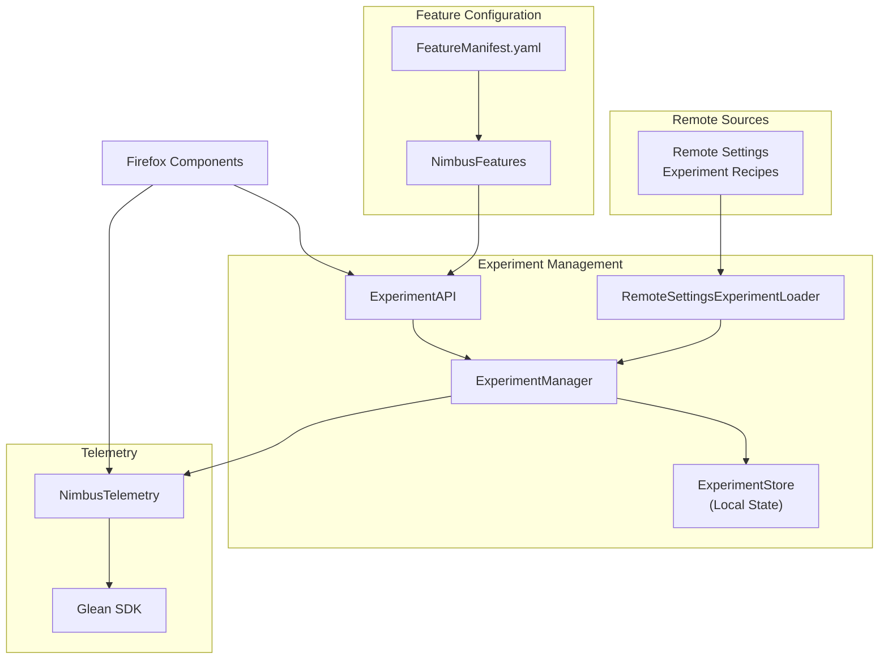

Sources: [toolkit/components/nimbus/ExperimentAPI.sys.mjs](), [toolkit/components/nimbus/lib/ExperimentManager.sys.mjs](), [toolkit/components/nimbus/lib/RemoteSettingsExperimentLoader.sys.mjs](), [toolkit/components/nimbus/FeatureManifest.yaml](), [toolkit/components/nimbus/lib/Telemetry.sys.mjs]()

### Key Components

#### ExperimentManager

The `ExperimentManager` is responsible for:
- Processing experiment recipes
- Managing enrollment and unenrollment of users
- Ensuring feature conflicts don't occur
- Applying feature configurations

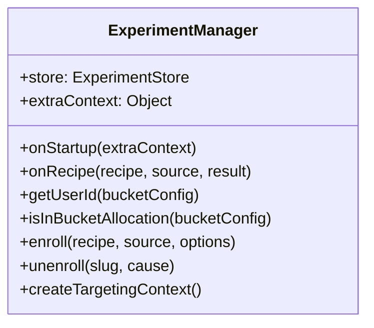

Sources: [toolkit/components/nimbus/lib/ExperimentManager.sys.mjs:105-1260]()

#### ExperimentAPI

The `ExperimentAPI` provides a public interface for Firefox components to interact with experiments:

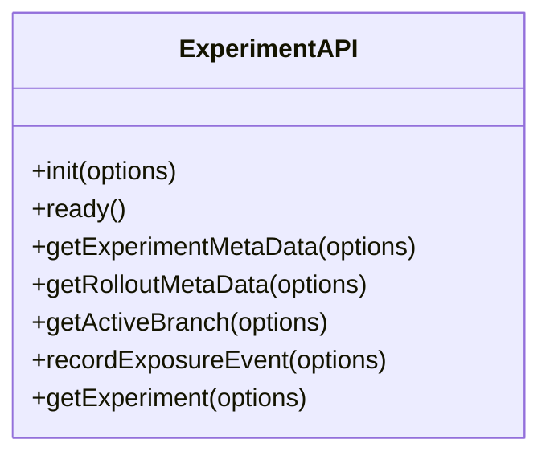

Components interact with experiments using the `NimbusFeatures` interface:

```javascript
// Example of how a component uses an experimental feature
const value = NimbusFeatures.featureX.getVariable("variableName");
```

Sources: [toolkit/components/nimbus/ExperimentAPI.sys.mjs:75-600]()

#### RemoteSettingsExperimentLoader

The `RemoteSettingsExperimentLoader` fetches experiment recipes from Remote Settings and processes them:

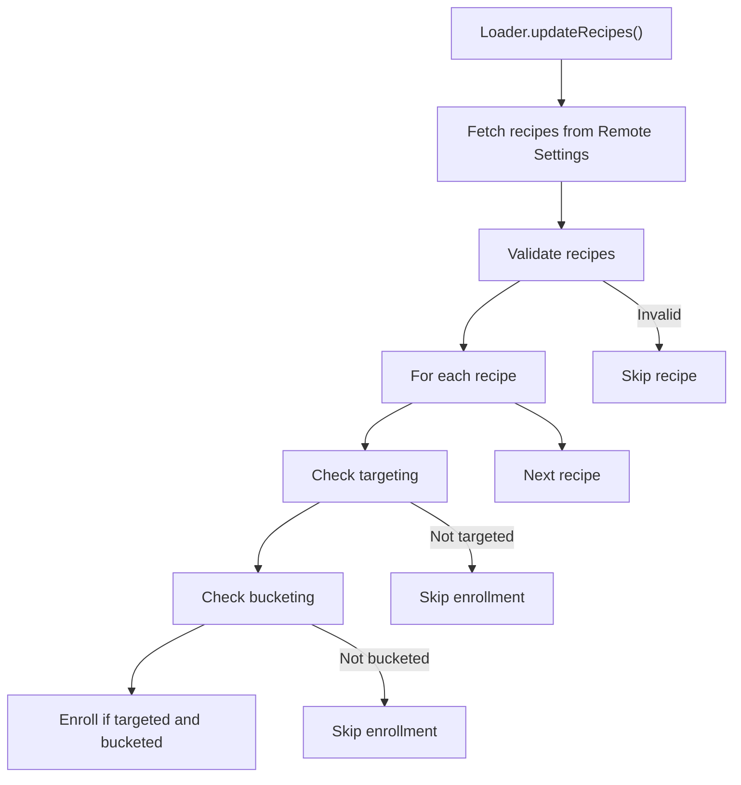

Sources: [toolkit/components/nimbus/lib/RemoteSettingsExperimentLoader.sys.mjs:597-870]()

#### Feature Manifest

Features that can be controlled by experiments are defined in the Feature Manifest:

```yaml
# Example feature definition
search:
  description: Search service related features.
  owner: search-and-suggest-program@mozilla.com
  hasExposure: false
  variables:
    scotchBonnetEnableOverride:
      type: boolean
      setPref:
        branch: default
        pref: browser.urlbar.scotchBonnet.enableOverride
      description: Whether or not enabling scotch bonnet feature.
```

Sources: [toolkit/components/nimbus/FeatureManifest.yaml:82-118]()

### Enrollment Process

The enrollment process determines whether a user should be enrolled in an experiment:

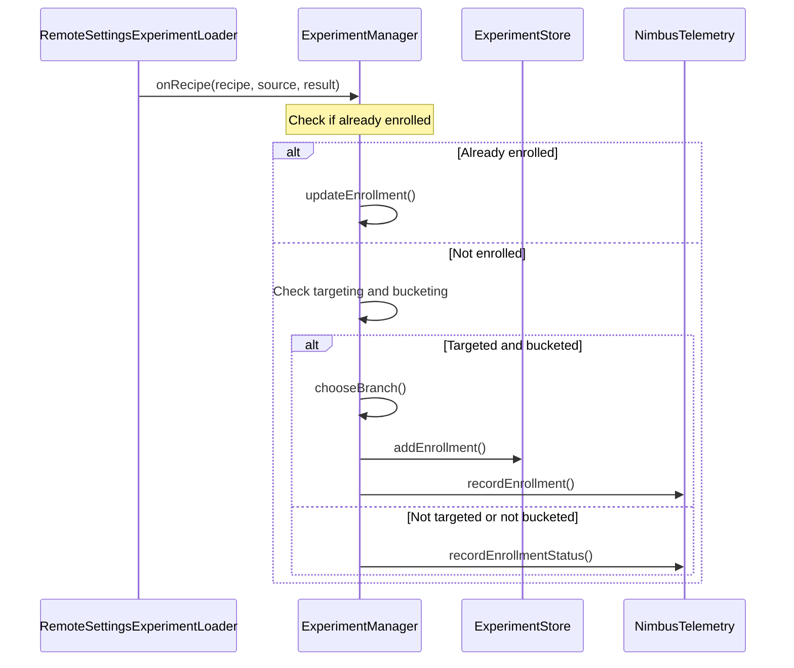

Sources: [toolkit/components/nimbus/lib/ExperimentManager.sys.mjs:290-350](), [toolkit/components/nimbus/lib/ExperimentManager.sys.mjs:490-546]()

## Telemetry System

Firefox's telemetry system collects and transmits data about browser usage and performance to Mozilla.

### Architecture

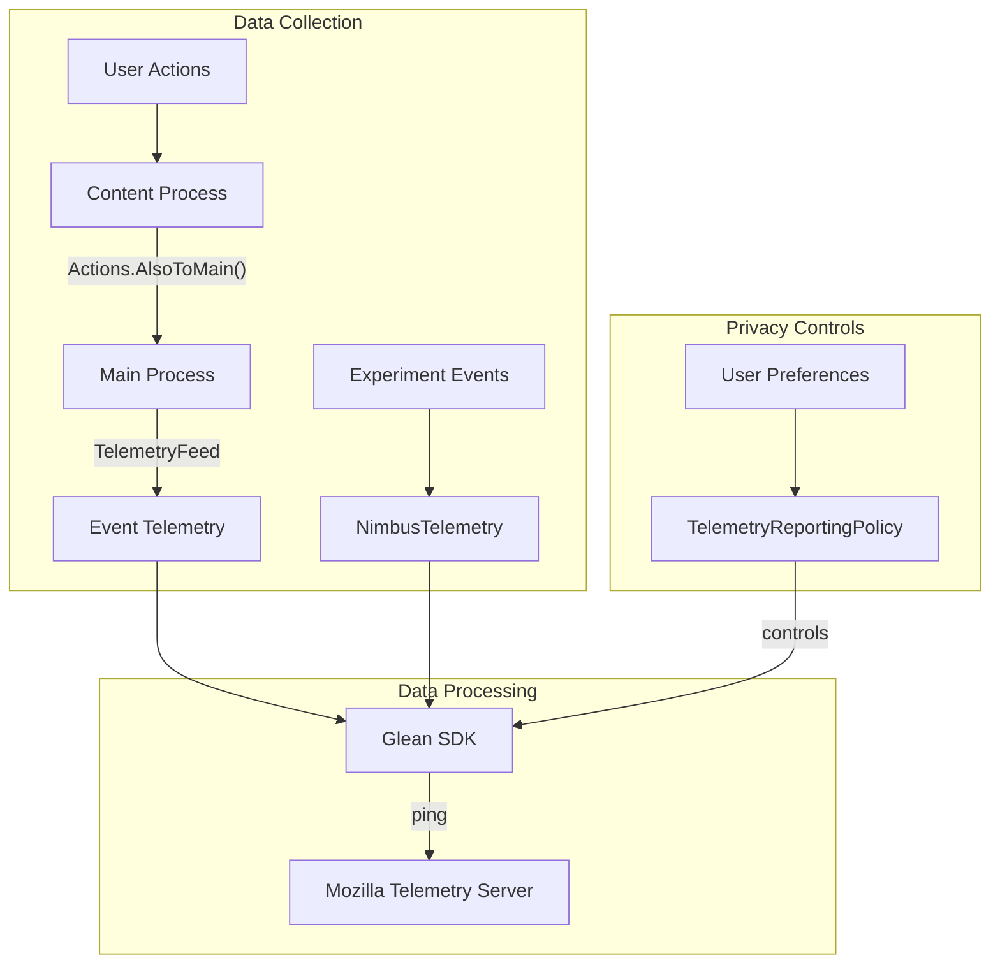

Sources: [toolkit/components/nimbus/lib/Telemetry.sys.mjs](), [browser/extensions/newtab/lib/TelemetryFeed.sys.mjs](), [browser/components/newtab/metrics.yaml](), [toolkit/components/telemetry/app/TelemetryReportingPolicy.sys.mjs]()

### Nimbus Telemetry

`NimbusTelemetry` records experiment-related events:

1. **Enrollment**: When a user is enrolled in an experiment
2. **Exposure**: When a user sees or interacts with an experimental feature
3. **Unenrollment**: When a user is removed from an experiment

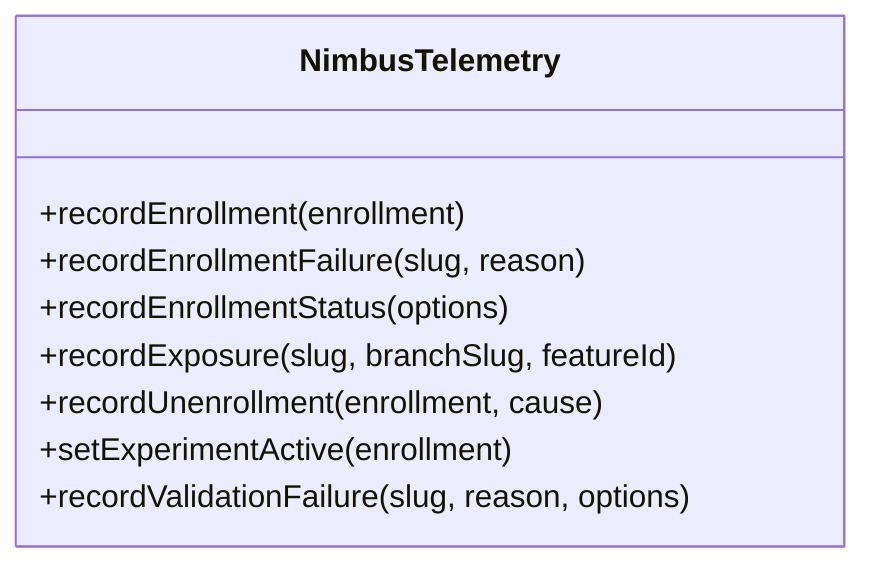

Sources: [toolkit/components/nimbus/lib/Telemetry.sys.mjs:81-312]()

### Activity Stream Telemetry

The Firefox New Tab page (Activity Stream) uses the telemetry system to record user interactions:

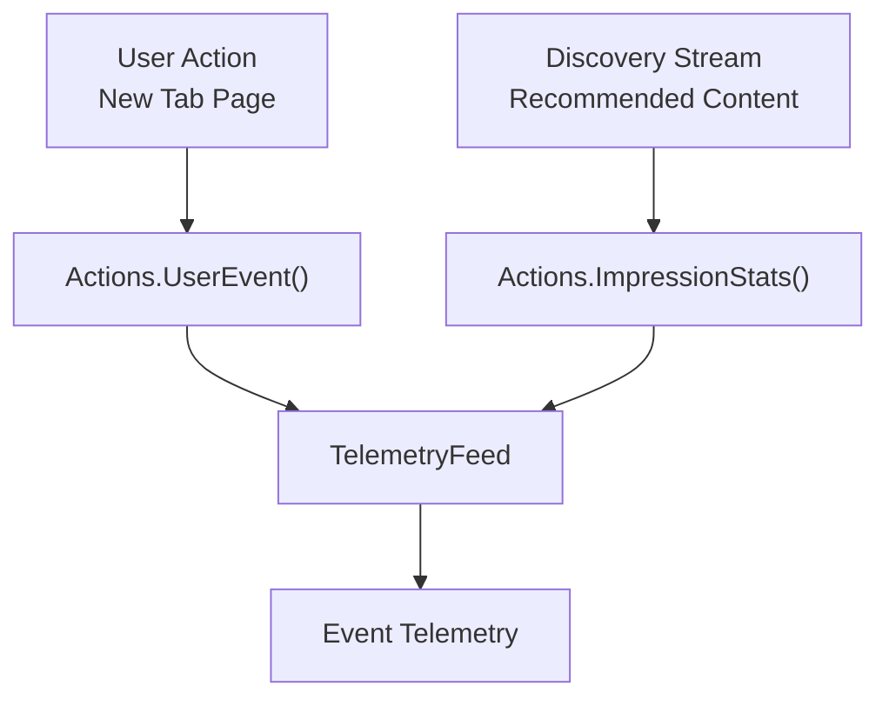

Sources: [browser/extensions/newtab/common/Actions.mjs:419-489](), [browser/extensions/newtab/lib/TelemetryFeed.sys.mjs]()

## Integration with Firefox UI

### New Tab Page (Activity Stream)

The New Tab page integrates with Nimbus for feature experiments and telemetry:

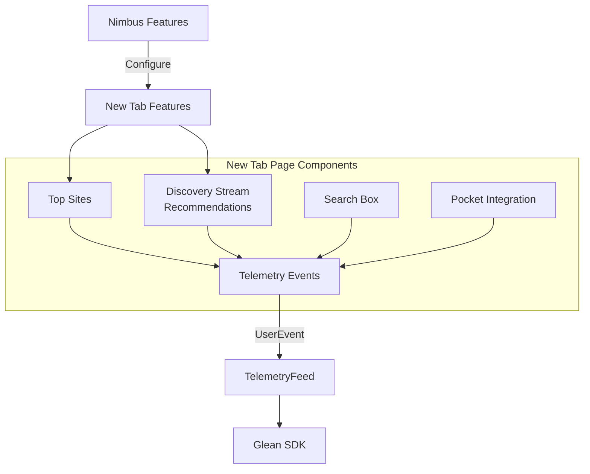

The New Tab page uses `NimbusFeatures` to determine if features should be enabled:

```javascript
// Example from ActivityStream.sys.mjs
function showSpocs({ geo }) {
  const spocsGeoString =
    lazy.NimbusFeatures.pocketNewtab.getVariable("regionSpocsConfig") || "";
  const spocsGeo = spocsGeoString.split(",").map(s => s.trim());
  return spocsGeo.includes(geo);
}
```

Sources: [browser/extensions/newtab/lib/ActivityStream.sys.mjs:102-115](), [browser/extensions/newtab/content-src/components/Base/Base.jsx]()

### Wallpaper Feature Example

The wallpaper feature in the New Tab page demonstrates how features can be experimentally deployed:

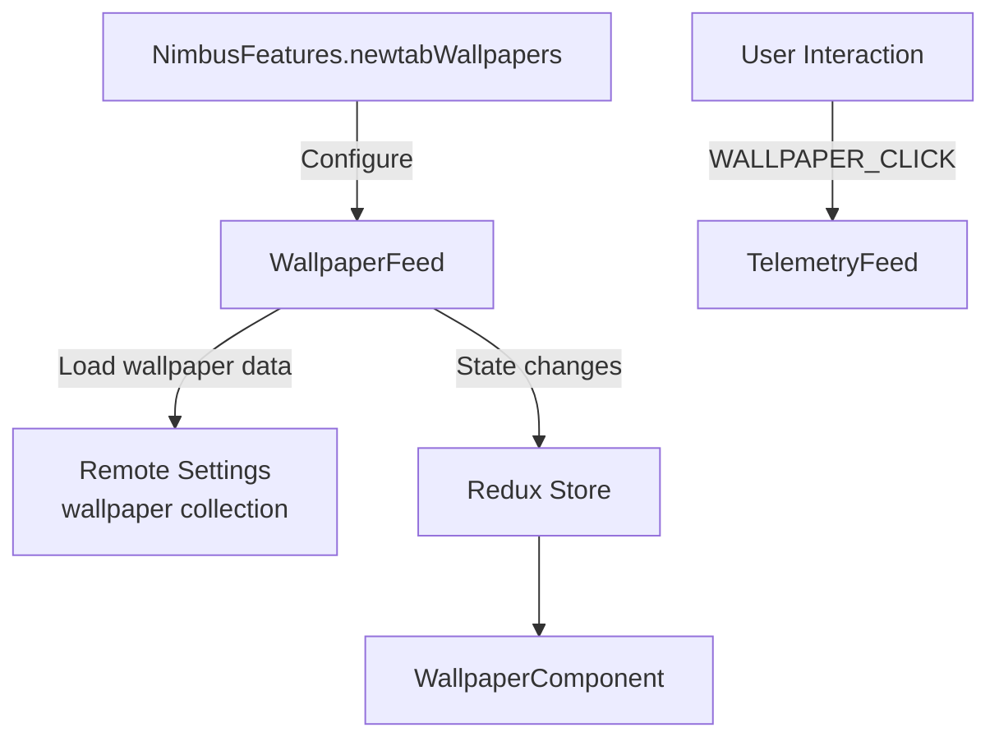

Sources: [browser/extensions/newtab/lib/WallpaperFeed.sys.mjs](), [browser/extensions/newtab/content-src/components/WallpapersSection/WallpaperCategories.jsx:126-138]()

## Privacy Controls

Users can opt out of telemetry and experimentation through various settings:

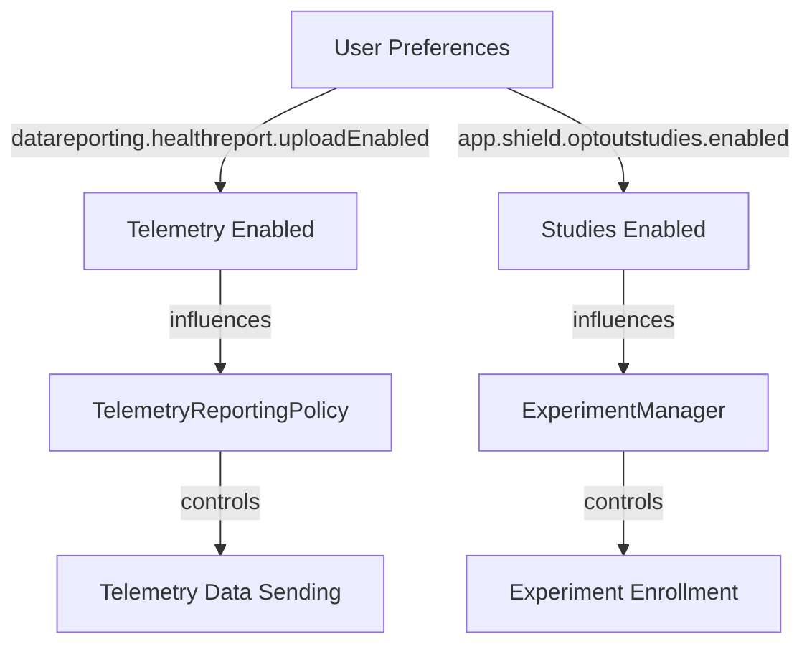

When a user opts out of studies:

```javascript
// From ExperimentManager.sys.mjs
async _handleStudiesOptOut() {
  const enrollments = this.store.getAllActiveExperiments();
  for (const experiment of enrollments) {
    await this.unenroll(experiment.slug, cause);
  }
}
```

Sources: [toolkit/components/nimbus/lib/ExperimentManager.sys.mjs:246-250](), [toolkit/components/telemetry/app/TelemetryReportingPolicy.sys.mjs]()

## Metrics Collection

The metrics collected are defined in `metrics.yaml` files:

```yaml
# Example from toolkit/components/nimbus/metrics.yaml
nimbus_events:
  enrollment:
    type: event
    description: >
      Recorded when a user is enrolled in a Nimbus experiment.
    bugs:
      - https://bugzilla.mozilla.org/show_bug.cgi?id=1685956
    data_reviews:
      - https://bugzilla.mozilla.org/show_bug.cgi?id=1685956
    notification_emails:
      - tglek@mozilla.com
    expires: never
    extra_keys:
      experiment:
        description: The experiment slug.
        type: string
      branch:
        description: The branch slug.
        type: string
      experiment_type:
        description: The experiment type.
        type: string
```

Sources: [toolkit/components/nimbus/metrics.yaml:90-112](), [browser/components/newtab/metrics.yaml]()

## Conclusion

Firefox's experimentation and telemetry system provides a comprehensive framework for testing new features and collecting usage data to improve the browser. The Nimbus framework enables controlled rollout of features, while the telemetry system collects data in accordance with user privacy preferences.

Understanding these systems is crucial for Firefox developers who want to implement new features that can be experimentally deployed and evaluated based on user data.

---

