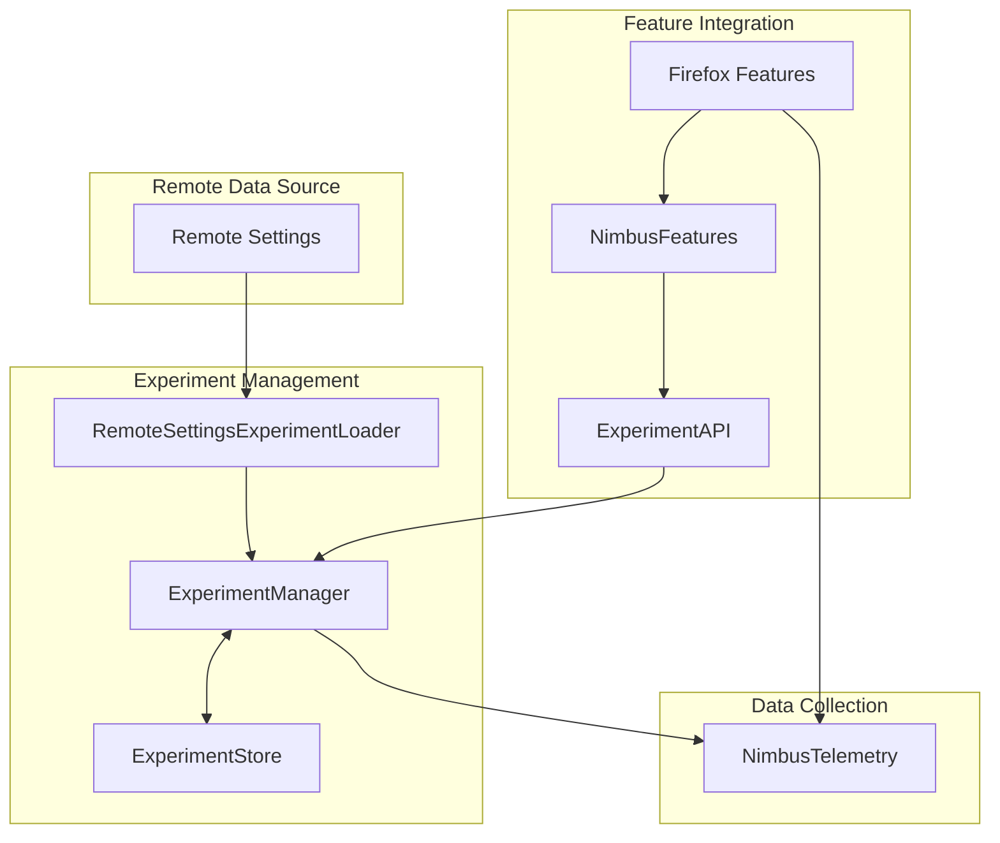
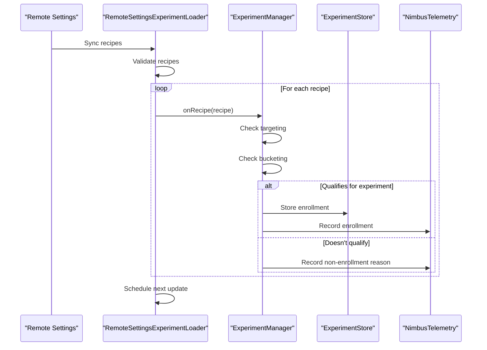
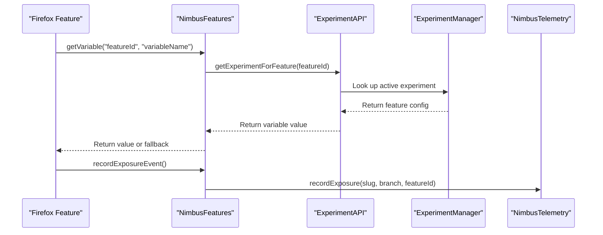
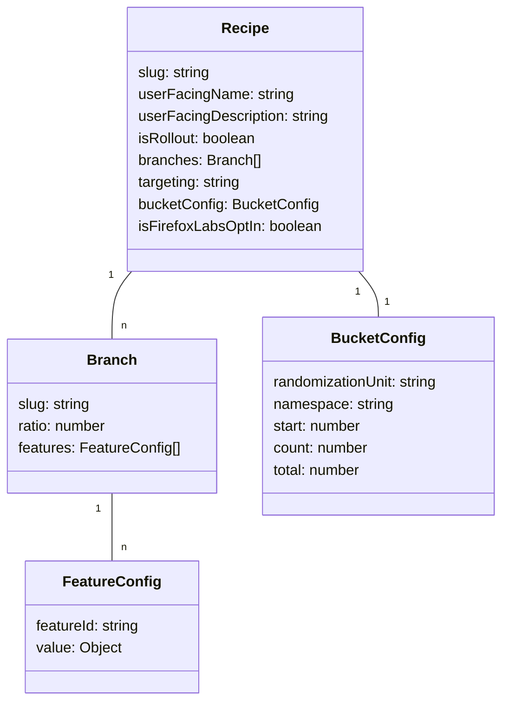

<!-- source: DeepWiki mcp.deepwiki.com · repo mozilla/gecko-dev · page 5.1 Nimbus Experimentation System · fetched 2026-10-09 -->

# Nimbus Experimentation System

Relevant source files

The following files were used as context for generating this wiki page:

- [toolkit/components/nimbus/ExperimentAPI.sys.mjs](toolkit/components/nimbus/ExperimentAPI.sys.mjs)
- [toolkit/components/nimbus/generate/generate_feature_manifest.py](toolkit/components/nimbus/generate/generate_feature_manifest.py)
- [toolkit/components/nimbus/lib/ExperimentManager.sys.mjs](toolkit/components/nimbus/lib/ExperimentManager.sys.mjs)
- [toolkit/components/nimbus/lib/ExperimentStore.sys.mjs](toolkit/components/nimbus/lib/ExperimentStore.sys.mjs)
- [toolkit/components/nimbus/lib/Migrations.sys.mjs](toolkit/components/nimbus/lib/Migrations.sys.mjs)
- [toolkit/components/nimbus/lib/RemoteSettingsExperimentLoader.sys.mjs](toolkit/components/nimbus/lib/RemoteSettingsExperimentLoader.sys.mjs)
- [toolkit/components/nimbus/lib/SharedDataMap.sys.mjs](toolkit/components/nimbus/lib/SharedDataMap.sys.mjs)
- [toolkit/components/nimbus/lib/TargetingContextRecorder.sys.mjs](toolkit/components/nimbus/lib/TargetingContextRecorder.sys.mjs)
- [toolkit/components/nimbus/lib/Telemetry.sys.mjs](toolkit/components/nimbus/lib/Telemetry.sys.mjs)
- [toolkit/components/nimbus/metrics.yaml](toolkit/components/nimbus/metrics.yaml)
- [toolkit/components/nimbus/test/NimbusTestUtils.sys.mjs](toolkit/components/nimbus/test/NimbusTestUtils.sys.mjs)
- [toolkit/components/nimbus/test/browser/browser_experiment_evaluate_jexl.js](toolkit/components/nimbus/test/browser/browser_experiment_evaluate_jexl.js)
- [toolkit/components/nimbus/test/browser/browser_prefs.js](toolkit/components/nimbus/test/browser/browser_prefs.js)
- [toolkit/components/nimbus/test/browser/browser_remotesettings_experiment_enroll.js](toolkit/components/nimbus/test/browser/browser_remotesettings_experiment_enroll.js)
- [toolkit/components/nimbus/test/browser/browser_remotesettingsexperimentloader_force_enrollment.js](toolkit/components/nimbus/test/browser/browser_remotesettingsexperimentloader_force_enrollment.js)
- [toolkit/components/nimbus/test/browser/browser_remotesettingsexperimentloader_init.js](toolkit/components/nimbus/test/browser/browser_remotesettingsexperimentloader_init.js)
- [toolkit/components/nimbus/test/browser/browser_remotesettingsexperimentloader_remote_defaults.js](toolkit/components/nimbus/test/browser/browser_remotesettingsexperimentloader_remote_defaults.js)
- [toolkit/components/nimbus/test/python/dump-targeting-context.js](toolkit/components/nimbus/test/python/dump-targeting-context.js)
- [toolkit/components/nimbus/test/unit/head.js](toolkit/components/nimbus/test/unit/head.js)
- [toolkit/components/nimbus/test/unit/test_ExperimentAPI.js](toolkit/components/nimbus/test/unit/test_ExperimentAPI.js)
- [toolkit/components/nimbus/test/unit/test_ExperimentAPI_ExperimentFeature.js](toolkit/components/nimbus/test/unit/test_ExperimentAPI_ExperimentFeature.js)
- [toolkit/components/nimbus/test/unit/test_ExperimentAPI_ExperimentFeature_getAllVariables.js](toolkit/components/nimbus/test/unit/test_ExperimentAPI_ExperimentFeature_getAllVariables.js)
- [toolkit/components/nimbus/test/unit/test_ExperimentAPI_ExperimentFeature_getVariable.js](toolkit/components/nimbus/test/unit/test_ExperimentAPI_ExperimentFeature_getVariable.js)
- [toolkit/components/nimbus/test/unit/test_ExperimentAPI_NimbusFeatures.js](toolkit/components/nimbus/test/unit/test_ExperimentAPI_NimbusFeatures.js)
- [toolkit/components/nimbus/test/unit/test_ExperimentManager_enroll.js](toolkit/components/nimbus/test/unit/test_ExperimentManager_enroll.js)
- [toolkit/components/nimbus/test/unit/test_ExperimentManager_lifecycle.js](toolkit/components/nimbus/test/unit/test_ExperimentManager_lifecycle.js)
- [toolkit/components/nimbus/test/unit/test_ExperimentManager_prefs.js](toolkit/components/nimbus/test/unit/test_ExperimentManager_prefs.js)
- [toolkit/components/nimbus/test/unit/test_ExperimentManager_unenroll.js](toolkit/components/nimbus/test/unit/test_ExperimentManager_unenroll.js)
- [toolkit/components/nimbus/test/unit/test_ExperimentStore.js](toolkit/components/nimbus/test/unit/test_ExperimentStore.js)
- [toolkit/components/nimbus/test/unit/test_FirefoxLabs.js](toolkit/components/nimbus/test/unit/test_FirefoxLabs.js)
- [toolkit/components/nimbus/test/unit/test_Migrations.js](toolkit/components/nimbus/test/unit/test_Migrations.js)
- [toolkit/components/nimbus/test/unit/test_RemoteSettingsExperimentLoader.js](toolkit/components/nimbus/test/unit/test_RemoteSettingsExperimentLoader.js)
- [toolkit/components/nimbus/test/unit/test_RemoteSettingsExperimentLoader_updateRecipes.js](toolkit/components/nimbus/test/unit/test_RemoteSettingsExperimentLoader_updateRecipes.js)
- [toolkit/components/nimbus/test/unit/test_TargetingContextRecorder.js](toolkit/components/nimbus/test/unit/test_TargetingContextRecorder.js)
- [toolkit/components/nimbus/test/unit/test_localization.js](toolkit/components/nimbus/test/unit/test_localization.js)
- [toolkit/components/nimbus/test/unit/test_nimbusTelemetry.js](toolkit/components/nimbus/test/unit/test_nimbusTelemetry.js)
- [toolkit/components/nimbus/test/unit/test_prefFlips.js](toolkit/components/nimbus/test/unit/test_prefFlips.js)
- [toolkit/components/telemetry/app/TelemetryControllerParent.sys.mjs](toolkit/components/telemetry/app/TelemetryControllerParent.sys.mjs)
- [toolkit/components/telemetry/app/TelemetrySend.sys.mjs](toolkit/components/telemetry/app/TelemetrySend.sys.mjs)
- [toolkit/components/telemetry/app/TelemetryStorage.sys.mjs](toolkit/components/telemetry/app/TelemetryStorage.sys.mjs)
- [toolkit/components/telemetry/core/TelemetryEvent.cpp](toolkit/components/telemetry/core/TelemetryEvent.cpp)
- [toolkit/components/telemetry/metrics.yaml](toolkit/components/telemetry/metrics.yaml)
- [toolkit/components/telemetry/pings.yaml](toolkit/components/telemetry/pings.yaml)
- [toolkit/components/telemetry/pings/EventPing.sys.mjs](toolkit/components/telemetry/pings/EventPing.sys.mjs)
- [toolkit/components/telemetry/tests/unit/test_client_id.js](toolkit/components/telemetry/tests/unit/test_client_id.js)

This document provides an overview of the Nimbus Experimentation System, Firefox's platform for conducting experiments and gradual feature rollouts. For information about telemetry collection and metrics, see [Telemetry Collection](#5.2).

## Purpose and Scope

Nimbus enables Firefox product teams to:
- Run A/B experiments to test feature variations with users
- Gradually roll out new features to the user population
- Configure feature behavior remotely without shipping new code
- Collect telemetry about experiment performance and user behavior

The system manages the entire experiment lifecycle, from loading experiment definitions (recipes) from Remote Settings, determining which users qualify for experiments, enrolling users in experiments, and providing experiment configuration to Firefox features.

Sources:
- [toolkit/components/nimbus/lib/ExperimentManager.sys.mjs:101-116](). 
- [toolkit/components/nimbus/ExperimentAPI.sys.mjs:75-119]().

## Core Concepts

### Experiments vs. Rollouts

Nimbus supports two types of enrollments:

1. **Experiments**: Traditional A/B tests that assign users to different branches (variants) to measure differences in behavior or outcomes.

2. **Rollouts**: Gradual releases of features or configurations to the user population without experimental comparison groups.

A user can be enrolled in both an experiment and a rollout for the same feature, but the experiment's configuration takes precedence.

Sources:
- [toolkit/components/nimbus/lib/ExperimentManager.sys.mjs:456-567](). 
- [toolkit/components/nimbus/lib/ExperimentManager.sys.mjs:617-668]().

### Recipes

Experiments and rollouts are defined by "recipes" stored in Remote Settings. A recipe contains:

- **Metadata**: Slug (identifier), description, etc.
- **Targeting**: JEXL expressions that determine who's eligible for the experiment
- **Bucketing Configuration**: Parameters that determine what percentage of eligible users get enrolled
- **Branches**: Different variations of the experiment (e.g., "control" and "treatment")

Sources:
- [toolkit/components/nimbus/lib/RemoteSettingsExperimentLoader.sys.mjs:285-418]().
- [toolkit/components/nimbus/test/unit/test_ExperimentManager_enroll.js:38-88]().

### Features and Variables

Nimbus experiments modify the behavior of Firefox features by setting feature variables. Features are defined in the `FeatureManifest.yaml` file, which specifies:

- What variables a feature supports
- Their data types
- Default values via preferences
- Whether features can be co-enrolled in multiple experiments

Sources:
- [toolkit/components/nimbus/ExperimentAPI.sys.mjs:310-366]().
- [toolkit/components/nimbus/test/unit/test_ExperimentAPI_ExperimentFeature.js:11-23]().

## System Architecture

### High-Level Architecture

Sources:
- [toolkit/components/nimbus/ExperimentAPI.sys.mjs:143-203]().
- [toolkit/components/nimbus/lib/ExperimentManager.sys.mjs:101-251]().
- [toolkit/components/nimbus/lib/RemoteSettingsExperimentLoader.sys.mjs:165-316]().

### Key Components

#### ExperimentManager

The core component that manages experiment enrollment, unenrollment, and lifecycle. It:
- Evaluates whether users qualify for experiments
- Assigns users to experiment branches
- Handles conflicts between experiments
- Restores experiments on startup

Sources:
- [toolkit/components/nimbus/lib/ExperimentManager.sys.mjs:105-140]().
- [toolkit/components/nimbus/lib/ExperimentManager.sys.mjs:456-567]().

#### RemoteSettingsExperimentLoader

Loads experiment recipes from Remote Settings and processes them with ExperimentManager. It:
- Periodically updates recipes from Remote Settings
- Validates recipes against schemas
- Checks targeting and bucketing for each recipe
- Handles experiment updates and removals

Sources:
- [toolkit/components/nimbus/lib/RemoteSettingsExperimentLoader.sys.mjs:166-257]().
- [toolkit/components/nimbus/lib/RemoteSettingsExperimentLoader.sys.mjs:296-418]().

#### ExperimentStore

Stores enrollment data persistently in preferences. It:
- Maintains the list of active and inactive enrollments
- Persists enrollment data across browser restarts
- Provides methods to query enrollments by slug or feature

Sources:
- [toolkit/components/nimbus/lib/ExperimentStore.sys.mjs:15-97]().
- [toolkit/components/nimbus/test/unit/test_ExperimentStore.js:21-64]().

#### ExperimentAPI

Public API for accessing experiment data and integrating with Firefox features. It:
- Provides methods to get experiment metadata
- Initializes the experiment system
- Connects to the experiment manager and store

Sources:
- [toolkit/components/nimbus/ExperimentAPI.sys.mjs:75-119]().
- [toolkit/components/nimbus/ExperimentAPI.sys.mjs:159-203]().

#### NimbusFeatures

Provides feature-specific access to experiment configurations. It:
- Allows features to access their experimental values
- Records experiment exposure events
- Handles localization of feature values

Sources:
- [toolkit/components/nimbus/ExperimentAPI.sys.mjs:311-461]().
- [toolkit/components/nimbus/ExperimentAPI.sys.mjs:585-683]().

#### NimbusTelemetry

Records telemetry about experiments, including:
- Enrollment and unenrollment events
- Experiment exposure events
- Enrollment failures

Sources:
- [toolkit/components/nimbus/lib/Telemetry.sys.mjs:81-257]().
- [toolkit/components/nimbus/metrics.yaml:17-311]().

## Experiment Lifecycle

### Loading and Evaluation Process

Sources:
- [toolkit/components/nimbus/lib/RemoteSettingsExperimentLoader.sys.mjs:296-418]().
- [toolkit/components/nimbus/lib/ExperimentManager.sys.mjs:285-356]().

### Enrollment Process

The enrollment process determines whether a user should be included in an experiment and which branch they should receive:

1. **Targeting**: Evaluates JEXL expressions against user attributes to determine eligibility
2. **Bucketing**: Uses a hash of the user ID and recipe namespace to deterministically assign users to branches
3. **Branch Selection**: For qualifying users, selects a branch based on the branch ratios
4. **Preference Setting**: Sets the necessary preferences for the feature variables
5. **Telemetry**: Records enrollment events

Sources:
- [toolkit/components/nimbus/lib/ExperimentManager.sys.mjs:140-143]().
- [toolkit/components/nimbus/lib/ExperimentManager.sys.mjs:450-466]().
- [toolkit/components/nimbus/lib/ExperimentManager.sys.mjs:490-566]().

### Unenrollment Scenarios

Users may be unenrolled from experiments for various reasons:

1. **Recipe Removed**: The experiment recipe is no longer available in Remote Settings
2. **Targeting Mismatch**: The user no longer matches the targeting criteria
3. **Bucketing Mismatch**: The user no longer falls into the bucketing allocation
4. **Opt-Out**: The user has disabled studies in preferences
5. **Feature Conflict**: Another experiment/rollout with higher priority takes precedence
6. **Manual Unenrollment**: The user manually opts out of an experiment

Sources:
- [toolkit/components/nimbus/lib/ExperimentManager.sys.mjs:714-777]().
- [toolkit/components/nimbus/lib/ExperimentManager.sys.mjs:843-861]().
- [toolkit/components/nimbus/lib/ExperimentManager.sys.mjs:879-904]().

### Feature Integration

Sources:
- [toolkit/components/nimbus/ExperimentAPI.sys.mjs:366-460]().
- [toolkit/components/nimbus/ExperimentAPI.sys.mjs:513-545]().

## Integration Points

### Feature Development

To make a Firefox feature configurable via Nimbus:

1. **Define the Feature**: Add an entry to `FeatureManifest.yaml` with variables and types
2. **Access Variables**: Use `NimbusFeatures.[featureId].getVariable("variableName")` to get experiment values
3. **Record Exposure**: Call `NimbusFeatures.[featureId].recordExposureEvent()` when the feature is shown to users

Sources:
- [toolkit/components/nimbus/ExperimentAPI.sys.mjs:314-327]().
- [toolkit/components/nimbus/ExperimentAPI.sys.mjs:414-460]().
- [toolkit/components/nimbus/ExperimentAPI.sys.mjs:513-545]().

### Remote Settings Integration

Nimbus loads experiment recipes from two Remote Settings collections:
- `nimbus-desktop-experiments`: General experiments
- `nimbus-secure-experiments`: Security-sensitive experiments (e.g., preference flips)

Sources:
- [toolkit/components/nimbus/lib/RemoteSettingsExperimentLoader.sys.mjs:39-67]().
- [toolkit/components/nimbus/lib/RemoteSettingsExperimentLoader.sys.mjs:188-203]().

### Preference Integration

Nimbus can modify Firefox preferences in two ways:

1. **Feature Variables with setPref**: Feature variables can be configured to set specific preferences
2. **PrefFlips Feature**: A special feature that can flip arbitrary preferences in experiments

Preferences are restored to their original values when experiments end.

Sources:
- [toolkit/components/nimbus/lib/ExperimentManager.sys.mjs:1049-1129]().
- [toolkit/components/nimbus/lib/ExperimentManager.sys.mjs:1147-1193]().

### Firefox Labs Integration

Firefox Labs is a UI for users to opt into experimental features. It integrates with Nimbus by:
- Displaying available opt-in experiments
- Allowing users to manually enroll in specific branches
- Managing opt-in/opt-out

Sources:
- [toolkit/components/nimbus/lib/ExperimentManager.sys.mjs:380-427]().
- [toolkit/components/nimbus/test/unit/test_FirefoxLabs.js:12-94]().

## Data Model

### Recipe Structure

Sources:
- [toolkit/components/nimbus/test/unit/test_RemoteSettingsExperimentLoader_updateRecipes.js:101-124]().
- [toolkit/components/nimbus/test/unit/test_ExperimentManager_enroll.js:38-88]().

### Enrollment Storage

Enrollments are stored in preferences with the following structure:

| Storage Type | Prefix | Usage |
|--------------|--------|-------|
| User prefs | `nimbus.syncdatastore.` | Stores experiment data and feature values |
| Default prefs | `nimbus.syncdefaultsstore.` | Stores rollout data and feature values |

Sources:
- [toolkit/components/nimbus/lib/ExperimentStore.sys.mjs:15-35]().
- [toolkit/components/nimbus/test/unit/test_ExperimentManager_enroll.js:624-663]().

## Telemetry and Monitoring

Nimbus records various telemetry events throughout the experiment lifecycle:

### Enrollment Events

- `enrollment`: When a user is successfully enrolled in an experiment
- `enrollFailed`: When enrollment fails (with reason)
- `enrollmentStatus`: Detailed status of enrollment attempts

Sources:
- [toolkit/components/nimbus/lib/Telemetry.sys.mjs:90-142]().
- [toolkit/components/nimbus/metrics.yaml:768-839]().

### Exposure Events

- `exposure`: When a user sees or interacts with an experimental feature

Sources:
- [toolkit/components/nimbus/lib/Telemetry.sys.mjs:144-155]().
- [toolkit/components/nimbus/ExperimentAPI.sys.mjs:513-545]().

### Unenrollment Events

- `unenrollment`: When a user is unenrolled from an experiment (with reason)
- `unenrollFailed`: When unenrollment fails (with reason)

Sources:
- [toolkit/components/nimbus/lib/Telemetry.sys.mjs:169-268]().
- [toolkit/components/nimbus/metrics.yaml:840-891]().

## Common Operational Patterns

### Conflict Resolution

When multiple experiments target the same feature, Nimbus resolves conflicts using these rules:

1. Experiments take precedence over rollouts
2. Only one experiment can be active for a feature at a time (unless `allowCoenrollment` is true)
3. If an experiment with higher priority targets a feature, existing enrollments may be unenrolled

Sources:
- [toolkit/components/nimbus/lib/ExperimentManager.sys.mjs:554-567]().
- [toolkit/components/nimbus/ExperimentAPI.sys.mjs:369-385]().

### Feature Configuration Access

Features can access their experimental configuration in two ways:

1. **Single Variable**: `NimbusFeatures.[featureId].getVariable("variableName")`
2. **All Variables**: `NimbusFeatures.[featureId].getAllVariables()`

Both methods check for experiment values first, then rollout values, and finally fall back to preference values.

Sources:
- [toolkit/components/nimbus/ExperimentAPI.sys.mjs:414-460]().
- [toolkit/components/nimbus/ExperimentAPI.sys.mjs:378-412]().

### Localization Support

Nimbus supports localization of experiment values with:

1. Recipe-provided localizations for different locales
2. Automatic substitution of localized strings in feature values
3. Fallback to default values if localization is missing

Sources:
- [toolkit/components/nimbus/ExperimentAPI.sys.mjs:585-683]().
- [toolkit/components/nimbus/test/unit/test_localization.js:11-71]().

## Debugging and Testing

Nimbus provides debugging options through preferences:

- `nimbus.debug`: Enables additional debug logging and testing features
- `messaging-system.log`: Controls logging level for the messaging system

For testing Nimbus enrollments, use:
- `ExperimentAPI.getRecipe(slug)`: Get a recipe by slug
- `ExperimentAPI.getAllBranches(slug)`: Get all branches for a recipe
- `ExperimentManager.generateTestIds(recipe)`: Generate IDs that enroll in specific branches

Sources:
- [toolkit/components/nimbus/lib/RemoteSettingsExperimentLoader.sys.mjs:78-80]().
- [toolkit/components/nimbus/ExperimentAPI.sys.mjs:259-304]().
- [toolkit/components/nimbus/lib/ExperimentManager.sys.mjs:947-1004]().

---

