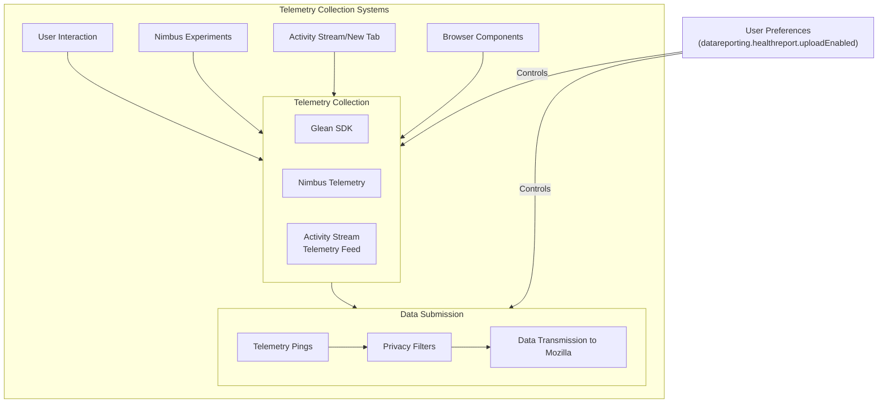
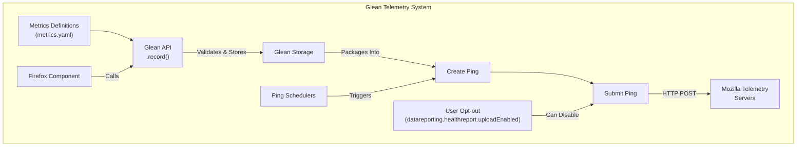
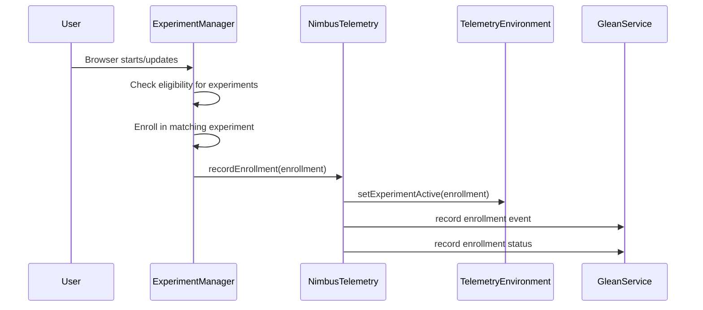
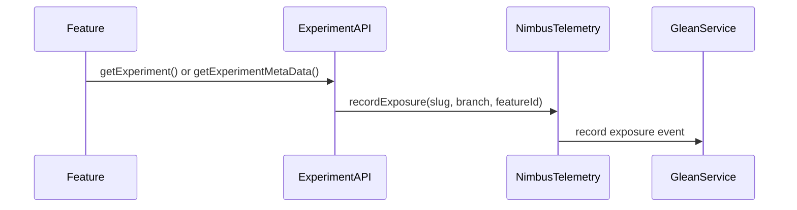
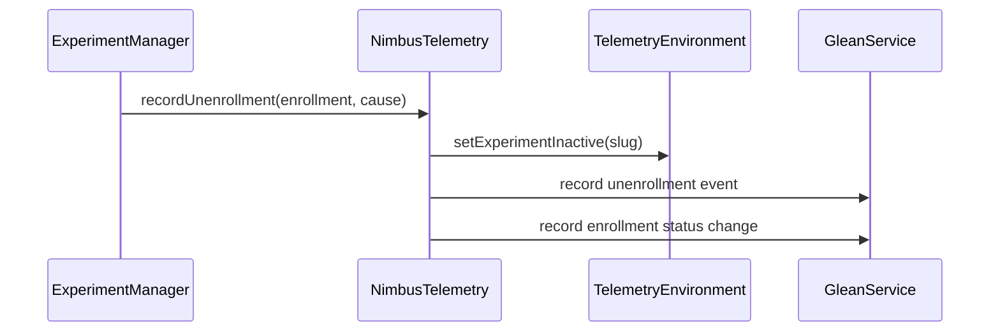
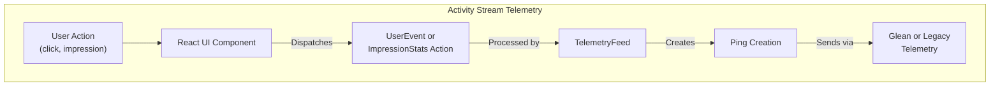
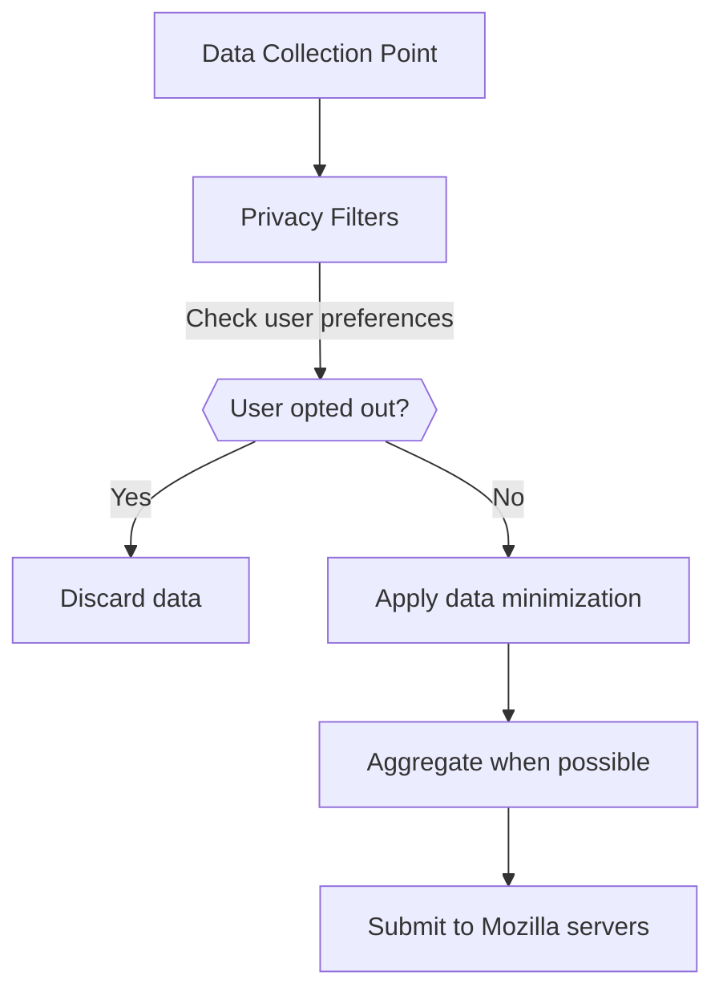
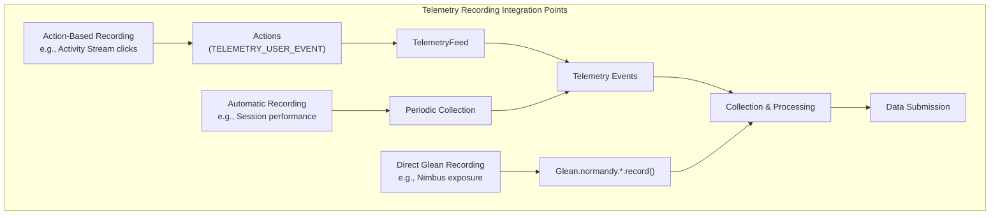
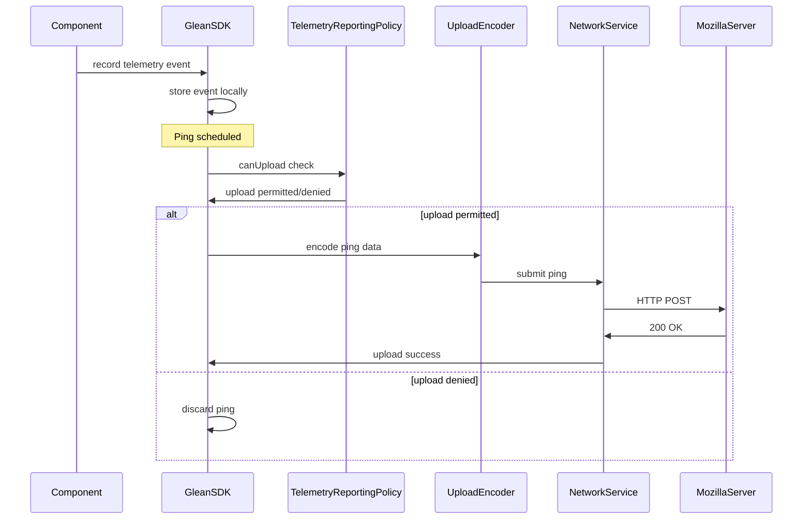

<!-- source: DeepWiki mcp.deepwiki.com · repo mozilla/gecko-dev · page 5.2 Telemetry Collection · fetched 2026-10-09 -->

# Telemetry Collection

<details>
<summary>Relevant source files</summary>

The following files were used as context for generating this wiki page:

- [browser/app/profile/firefox.js](browser/app/profile/firefox.js)
- [browser/base/content/test/general/browser_datachoices_notification.js](browser/base/content/test/general/browser_datachoices_notification.js)
- [browser/components/asrouter/modules/OnboardingMessageProvider.sys.mjs](browser/components/asrouter/modules/OnboardingMessageProvider.sys.mjs)
- [browser/components/newtab/metrics.yaml](browser/components/newtab/metrics.yaml)
- [browser/components/tests/browser/browser_browserGlue_showModal_trigger.js](browser/components/tests/browser/browser_browserGlue_showModal_trigger.js)
- [browser/extensions/newtab/common/Actions.mjs](browser/extensions/newtab/common/Actions.mjs)
- [browser/extensions/newtab/common/Reducers.sys.mjs](browser/extensions/newtab/common/Reducers.sys.mjs)
- [browser/extensions/newtab/content-src/components/Base/Base.jsx](browser/extensions/newtab/content-src/components/Base/Base.jsx)
- [browser/extensions/newtab/content-src/components/CustomizeMenu/ContentSection/ContentSection.jsx](browser/extensions/newtab/content-src/components/CustomizeMenu/ContentSection/ContentSection.jsx)
- [browser/extensions/newtab/content-src/components/CustomizeMenu/CustomizeMenu.jsx](browser/extensions/newtab/content-src/components/CustomizeMenu/CustomizeMenu.jsx)
- [browser/extensions/newtab/content-src/components/CustomizeMenu/_CustomizeMenu.scss](browser/extensions/newtab/content-src/components/CustomizeMenu/_CustomizeMenu.scss)
- [browser/extensions/newtab/content-src/components/DiscoveryStreamComponents/CardGrid/CardGrid.jsx](browser/extensions/newtab/content-src/components/DiscoveryStreamComponents/CardGrid/CardGrid.jsx)
- [browser/extensions/newtab/content-src/components/DiscoveryStreamComponents/CardSections/CardSections.jsx](browser/extensions/newtab/content-src/components/DiscoveryStreamComponents/CardSections/CardSections.jsx)
- [browser/extensions/newtab/content-src/components/DiscoveryStreamComponents/DSCard/DSCard.jsx](browser/extensions/newtab/content-src/components/DiscoveryStreamComponents/DSCard/DSCard.jsx)
- [browser/extensions/newtab/content-src/components/DiscoveryStreamComponents/DSCard/_DSCard.scss](browser/extensions/newtab/content-src/components/DiscoveryStreamComponents/DSCard/_DSCard.scss)
- [browser/extensions/newtab/content-src/components/DiscoveryStreamComponents/FeatureHighlight/FeatureHighlight.jsx](browser/extensions/newtab/content-src/components/DiscoveryStreamComponents/FeatureHighlight/FeatureHighlight.jsx)
- [browser/extensions/newtab/content-src/components/DiscoveryStreamComponents/FeatureHighlight/WallpaperFeatureHighlight.jsx](browser/extensions/newtab/content-src/components/DiscoveryStreamComponents/FeatureHighlight/WallpaperFeatureHighlight.jsx)
- [browser/extensions/newtab/content-src/components/DiscoveryStreamComponents/FeatureHighlight/_FeatureHighlight.scss](browser/extensions/newtab/content-src/components/DiscoveryStreamComponents/FeatureHighlight/_FeatureHighlight.scss)
- [browser/extensions/newtab/content-src/components/DiscoveryStreamComponents/FeatureHighlight/_WallpaperFeatureHighlight.scss](browser/extensions/newtab/content-src/components/DiscoveryStreamComponents/FeatureHighlight/_WallpaperFeatureHighlight.scss)
- [browser/extensions/newtab/content-src/components/DiscoveryStreamComponents/InterestPicker/InterestPicker.jsx](browser/extensions/newtab/content-src/components/DiscoveryStreamComponents/InterestPicker/InterestPicker.jsx)
- [browser/extensions/newtab/content-src/components/DiscoveryStreamComponents/PersonalizedCard/PersonalizedCard.jsx](browser/extensions/newtab/content-src/components/DiscoveryStreamComponents/PersonalizedCard/PersonalizedCard.jsx)
- [browser/extensions/newtab/content-src/components/DiscoveryStreamComponents/PersonalizedCard/_PersonalizedCard.scss](browser/extensions/newtab/content-src/components/DiscoveryStreamComponents/PersonalizedCard/_PersonalizedCard.scss)
- [browser/extensions/newtab/content-src/components/DiscoveryStreamImpressionStats/ImpressionStats.jsx](browser/extensions/newtab/content-src/components/DiscoveryStreamImpressionStats/ImpressionStats.jsx)
- [browser/extensions/newtab/content-src/components/MessageWrapper/MessageWrapper.jsx](browser/extensions/newtab/content-src/components/MessageWrapper/MessageWrapper.jsx)
- [browser/extensions/newtab/content-src/components/WallpapersSection/WallpaperCategories.jsx](browser/extensions/newtab/content-src/components/WallpapersSection/WallpaperCategories.jsx)
- [browser/extensions/newtab/content-src/components/WallpapersSection/_WallpapersSection.scss](browser/extensions/newtab/content-src/components/WallpapersSection/_WallpapersSection.scss)
- [browser/extensions/newtab/content-src/lib/link-menu-options.mjs](browser/extensions/newtab/content-src/lib/link-menu-options.mjs)
- [browser/extensions/newtab/content-src/lib/utils.jsx](browser/extensions/newtab/content-src/lib/utils.jsx)
- [browser/extensions/newtab/content-src/styles/_theme.scss](browser/extensions/newtab/content-src/styles/_theme.scss)
- [browser/extensions/newtab/content-src/styles/activity-stream.scss](browser/extensions/newtab/content-src/styles/activity-stream.scss)
- [browser/extensions/newtab/css/activity-stream.css](browser/extensions/newtab/css/activity-stream.css)
- [browser/extensions/newtab/data/content/activity-stream.bundle.js](browser/extensions/newtab/data/content/activity-stream.bundle.js)
- [browser/extensions/newtab/data/content/assets/custom-wp-highlight.png](browser/extensions/newtab/data/content/assets/custom-wp-highlight.png)
- [browser/extensions/newtab/data/content/assets/waving-fox.svg](browser/extensions/newtab/data/content/assets/waving-fox.svg)
- [browser/extensions/newtab/karma.mc.config.js](browser/extensions/newtab/karma.mc.config.js)
- [browser/extensions/newtab/lib/ActivityStream.sys.mjs](browser/extensions/newtab/lib/ActivityStream.sys.mjs)
- [browser/extensions/newtab/lib/DiscoveryStreamFeed.sys.mjs](browser/extensions/newtab/lib/DiscoveryStreamFeed.sys.mjs)
- [browser/extensions/newtab/lib/NewTabMessaging.sys.mjs](browser/extensions/newtab/lib/NewTabMessaging.sys.mjs)
- [browser/extensions/newtab/lib/TelemetryFeed.sys.mjs](browser/extensions/newtab/lib/TelemetryFeed.sys.mjs)
- [browser/extensions/newtab/lib/WallpaperFeed.sys.mjs](browser/extensions/newtab/lib/WallpaperFeed.sys.mjs)
- [browser/extensions/newtab/test/browser/browser_customize_menu_content.js](browser/extensions/newtab/test/browser/browser_customize_menu_content.js)
- [browser/extensions/newtab/test/unit/content-src/components/CustomiseMenu.test.jsx](browser/extensions/newtab/test/unit/content-src/components/CustomiseMenu.test.jsx)
- [browser/extensions/newtab/test/unit/content-src/components/DiscoveryStreamComponents/CollectionCardGrid.test.jsx](browser/extensions/newtab/test/unit/content-src/components/DiscoveryStreamComponents/CollectionCardGrid.test.jsx)
- [browser/extensions/newtab/test/unit/content-src/components/DiscoveryStreamComponents/DSCard.test.jsx](browser/extensions/newtab/test/unit/content-src/components/DiscoveryStreamComponents/DSCard.test.jsx)
- [browser/extensions/newtab/test/unit/content-src/components/DiscoveryStreamComponents/ImpressionStats.test.jsx](browser/extensions/newtab/test/unit/content-src/components/DiscoveryStreamComponents/ImpressionStats.test.jsx)
- [browser/extensions/newtab/test/unit/content-src/components/MessageWrapper.test.jsx](browser/extensions/newtab/test/unit/content-src/components/MessageWrapper.test.jsx)
- [browser/extensions/newtab/test/xpcshell/test_WallpaperFeed.js](browser/extensions/newtab/test/xpcshell/test_WallpaperFeed.js)
- [browser/locales/en-US/browser/newtab/newtab.ftl](browser/locales/en-US/browser/newtab/newtab.ftl)
- [browser/modules/WindowsJumpLists.sys.mjs](browser/modules/WindowsJumpLists.sys.mjs)
- [toolkit/components/glean/docs/dev/preferences.md](toolkit/components/glean/docs/dev/preferences.md)
- [toolkit/components/nimbus/ExperimentAPI.sys.mjs](toolkit/components/nimbus/ExperimentAPI.sys.mjs)
- [toolkit/components/nimbus/FeatureManifest.yaml](toolkit/components/nimbus/FeatureManifest.yaml)
- [toolkit/components/nimbus/generate/generate_feature_manifest.py](toolkit/components/nimbus/generate/generate_feature_manifest.py)
- [toolkit/components/nimbus/lib/ExperimentManager.sys.mjs](toolkit/components/nimbus/lib/ExperimentManager.sys.mjs)
- [toolkit/components/nimbus/lib/ExperimentStore.sys.mjs](toolkit/components/nimbus/lib/ExperimentStore.sys.mjs)
- [toolkit/components/nimbus/lib/Migrations.sys.mjs](toolkit/components/nimbus/lib/Migrations.sys.mjs)
- [toolkit/components/nimbus/lib/RemoteSettingsExperimentLoader.sys.mjs](toolkit/components/nimbus/lib/RemoteSettingsExperimentLoader.sys.mjs)
- [toolkit/components/nimbus/lib/SharedDataMap.sys.mjs](toolkit/components/nimbus/lib/SharedDataMap.sys.mjs)
- [toolkit/components/nimbus/lib/TargetingContextRecorder.sys.mjs](toolkit/components/nimbus/lib/TargetingContextRecorder.sys.mjs)
- [toolkit/components/nimbus/lib/Telemetry.sys.mjs](toolkit/components/nimbus/lib/Telemetry.sys.mjs)
- [toolkit/components/nimbus/metrics.yaml](toolkit/components/nimbus/metrics.yaml)
- [toolkit/components/nimbus/test/NimbusTestUtils.sys.mjs](toolkit/components/nimbus/test/NimbusTestUtils.sys.mjs)
- [toolkit/components/nimbus/test/browser/browser_experiment_evaluate_jexl.js](toolkit/components/nimbus/test/browser/browser_experiment_evaluate_jexl.js)
- [toolkit/components/nimbus/test/browser/browser_prefs.js](toolkit/components/nimbus/test/browser/browser_prefs.js)
- [toolkit/components/nimbus/test/browser/browser_remotesettings_experiment_enroll.js](toolkit/components/nimbus/test/browser/browser_remotesettings_experiment_enroll.js)
- [toolkit/components/nimbus/test/browser/browser_remotesettingsexperimentloader_force_enrollment.js](toolkit/components/nimbus/test/browser/browser_remotesettingsexperimentloader_force_enrollment.js)
- [toolkit/components/nimbus/test/browser/browser_remotesettingsexperimentloader_init.js](toolkit/components/nimbus/test/browser/browser_remotesettingsexperimentloader_init.js)
- [toolkit/components/nimbus/test/browser/browser_remotesettingsexperimentloader_remote_defaults.js](toolkit/components/nimbus/test/browser/browser_remotesettingsexperimentloader_remote_defaults.js)
- [toolkit/components/nimbus/test/python/dump-targeting-context.js](toolkit/components/nimbus/test/python/dump-targeting-context.js)
- [toolkit/components/nimbus/test/unit/head.js](toolkit/components/nimbus/test/unit/head.js)
- [toolkit/components/nimbus/test/unit/test_ExperimentAPI.js](toolkit/components/nimbus/test/unit/test_ExperimentAPI.js)
- [toolkit/components/nimbus/test/unit/test_ExperimentAPI_ExperimentFeature.js](toolkit/components/nimbus/test/unit/test_ExperimentAPI_ExperimentFeature.js)
- [toolkit/components/nimbus/test/unit/test_ExperimentAPI_ExperimentFeature_getAllVariables.js](toolkit/components/nimbus/test/unit/test_ExperimentAPI_ExperimentFeature_getAllVariables.js)
- [toolkit/components/nimbus/test/unit/test_ExperimentAPI_ExperimentFeature_getVariable.js](toolkit/components/nimbus/test/unit/test_ExperimentAPI_ExperimentFeature_getVariable.js)
- [toolkit/components/nimbus/test/unit/test_ExperimentAPI_NimbusFeatures.js](toolkit/components/nimbus/test/unit/test_ExperimentAPI_NimbusFeatures.js)
- [toolkit/components/nimbus/test/unit/test_ExperimentManager_enroll.js](toolkit/components/nimbus/test/unit/test_ExperimentManager_enroll.js)
- [toolkit/components/nimbus/test/unit/test_ExperimentManager_lifecycle.js](toolkit/components/nimbus/test/unit/test_ExperimentManager_lifecycle.js)
- [toolkit/components/nimbus/test/unit/test_ExperimentManager_prefs.js](toolkit/components/nimbus/test/unit/test_ExperimentManager_prefs.js)
- [toolkit/components/nimbus/test/unit/test_ExperimentManager_unenroll.js](toolkit/components/nimbus/test/unit/test_ExperimentManager_unenroll.js)
- [toolkit/components/nimbus/test/unit/test_ExperimentStore.js](toolkit/components/nimbus/test/unit/test_ExperimentStore.js)
- [toolkit/components/nimbus/test/unit/test_FirefoxLabs.js](toolkit/components/nimbus/test/unit/test_FirefoxLabs.js)
- [toolkit/components/nimbus/test/unit/test_Migrations.js](toolkit/components/nimbus/test/unit/test_Migrations.js)
- [toolkit/components/nimbus/test/unit/test_RemoteSettingsExperimentLoader.js](toolkit/components/nimbus/test/unit/test_RemoteSettingsExperimentLoader.js)
- [toolkit/components/nimbus/test/unit/test_RemoteSettingsExperimentLoader_updateRecipes.js](toolkit/components/nimbus/test/unit/test_RemoteSettingsExperimentLoader_updateRecipes.js)
- [toolkit/components/nimbus/test/unit/test_TargetingContextRecorder.js](toolkit/components/nimbus/test/unit/test_TargetingContextRecorder.js)
- [toolkit/components/nimbus/test/unit/test_localization.js](toolkit/components/nimbus/test/unit/test_localization.js)
- [toolkit/components/nimbus/test/unit/test_nimbusTelemetry.js](toolkit/components/nimbus/test/unit/test_nimbusTelemetry.js)
- [toolkit/components/nimbus/test/unit/test_prefFlips.js](toolkit/components/nimbus/test/unit/test_prefFlips.js)
- [toolkit/components/telemetry/app/TelemetryControllerParent.sys.mjs](toolkit/components/telemetry/app/TelemetryControllerParent.sys.mjs)
- [toolkit/components/telemetry/app/TelemetryReportingPolicy.sys.mjs](toolkit/components/telemetry/app/TelemetryReportingPolicy.sys.mjs)
- [toolkit/components/telemetry/app/TelemetrySend.sys.mjs](toolkit/components/telemetry/app/TelemetrySend.sys.mjs)
- [toolkit/components/telemetry/app/TelemetryStorage.sys.mjs](toolkit/components/telemetry/app/TelemetryStorage.sys.mjs)
- [toolkit/components/telemetry/core/TelemetryEvent.cpp](toolkit/components/telemetry/core/TelemetryEvent.cpp)
- [toolkit/components/telemetry/metrics.yaml](toolkit/components/telemetry/metrics.yaml)
- [toolkit/components/telemetry/pings.yaml](toolkit/components/telemetry/pings.yaml)
- [toolkit/components/telemetry/pings/EventPing.sys.mjs](toolkit/components/telemetry/pings/EventPing.sys.mjs)
- [toolkit/components/telemetry/tests/unit/test_TelemetryReportingPolicy.js](toolkit/components/telemetry/tests/unit/test_TelemetryReportingPolicy.js)
- [toolkit/components/telemetry/tests/unit/test_client_id.js](toolkit/components/telemetry/tests/unit/test_client_id.js)

</details>


This page documents how Firefox collects and manages telemetry data, focusing on the systems that record, process, and transmit usage data. For information about analyzing telemetry data, see [Telemetry Analysis](#5.3). For information about experiment metrics specifically, see [Nimbus Experimentation System](#5.1).

## Overview

Firefox includes a telemetry system that collects technical and interaction data about browser usage. This data helps Mozilla understand how people use Firefox, improve performance, fix problems, and build better features. The telemetry system is composed of several components working together to collect, process, and submit data while respecting user privacy choices.

The primary telemetry systems in Firefox include:

1. **Glean** - Mozilla's modern telemetry SDK that provides a consistent cross-platform API
2. **Nimbus Telemetry** - Records data about experiment enrollments and exposures
3. **Activity Stream Telemetry** - Collects interaction data from the new tab page
4. **Crash Reporter** - Records information about crashes (partially integrated with telemetry)

All telemetry collection is controlled by user preferences and respects the user's choices about data sharing.



Sources: [browser/app/profile/firefox.js:74-79]()), [toolkit/components/nimbus/lib/Telemetry.sys.mjs:21-24]()), [browser/extensions/newtab/lib/TelemetryFeed.sys.mjs]()), [toolkit/components/telemetry/app/TelemetryReportingPolicy.sys.mjs:1-15]())

## Glean Telemetry Framework

Firefox uses Glean, Mozilla's modern cross-platform telemetry SDK, for most new telemetry collection. Glean provides built-in privacy controls, a consistent API across components, and a robust validation system.

### Key Components of Glean

- **Metric Types** - Predefined data types (counters, strings, events, etc.)
- **Pings** - Packages of metrics submitted to Mozilla's telemetry servers
- **Metrics Definitions** - YAML files defining what can be collected



Sources: [toolkit/components/nimbus/metrics.yaml:1-47]()), [toolkit/components/nimbus/lib/Telemetry.sys.mjs:90-112]()), [toolkit/components/telemetry/app/TelemetryReportingPolicy.sys.mjs:1-17]())

### Firefox-Specific Metrics

Firefox defines telemetry metrics in YAML files that specify what data can be collected and how it's categorized. These definitions include:

- Metric name and type
- Description and purpose
- Data sensitivity categorization
- Expiration policy

For example, the Nimbus experiment system defines metrics for recording experiment enrollments, exposures, and targeting information:

```mermaid
classDiagram
    class "Glean Metrics" {
        +Counters
        +Events
        +Strings
        +Booleans
        +Timing
        +UUIDs
    }

    class "Nimbus Metrics" {
        +enrollNimbusExperiment()
        +unenrollNimbusExperiment()
        +exposeNimbusExperiment()
        +migration()
    }

    class "Activity Stream Metrics" {
        +impression_events
        +user_events
        +session_duration
        +tab_impression
    }

    "Glean Metrics" <|-- "Nimbus Metrics"
    "Glean Metrics" <|-- "Activity Stream Metrics"
```

Sources: [toolkit/components/nimbus/metrics.yaml:10-92]()), [browser/components/newtab/metrics.yaml]()), [toolkit/components/nimbus/lib/Telemetry.sys.mjs:90-124]())

## Nimbus Experiment Telemetry

Nimbus is Firefox's experimentation platform, and it includes a comprehensive telemetry system to record experiments and their impact.

### Enrollment Telemetry

When a user is enrolled in an experiment, Nimbus records:

1. The experiment slug (identifier)
2. The branch the user is assigned to
3. The experiment type (e.g., "nimbus", "rollout")
4. Enrollment status and reason

This data is recorded both in older Telemetry Environment properties and in the newer Glean system.



Sources: [toolkit/components/nimbus/lib/Telemetry.sys.mjs:90-113]()), [toolkit/components/nimbus/lib/ExperimentManager.sys.mjs:229-247]())

### Exposure Telemetry

Exposure telemetry is recorded when a user actually encounters a feature modified by an experiment:



Sources: [toolkit/components/nimbus/lib/Telemetry.sys.mjs:144-156]()), [toolkit/components/nimbus/ExperimentAPI.sys.mjs:644-659]())

### Unenrollment Telemetry

When a user is unenrolled from an experiment (due to experiment end, targeting changes, user opt-out, etc.), Nimbus records:

1. The experiment slug
2. The branch the user was in
3. The reason for unenrollment



Sources: [toolkit/components/nimbus/lib/Telemetry.sys.mjs:169-257]()), [toolkit/components/nimbus/lib/ExperimentManager.sys.mjs:684-690]())

## Activity Stream Telemetry

Activity Stream (the new tab page) implements its own telemetry system that records user interactions with the page content.

### Activity Stream Telemetry Architecture



Sources: [browser/extensions/newtab/content-src/components/Base/Base.jsx:135-189]()), [browser/extensions/newtab/lib/TelemetryFeed.sys.mjs]()), [browser/extensions/newtab/lib/ActivityStream.sys.mjs:36-41]()), [browser/extensions/newtab/common/Actions.mjs:412-471]())

### Types of Activity Stream Telemetry

1. **User Events** - Clicks, searches, and explicit user actions
2. **Impression Stats** - Passive impressions of content like Pocket recommendations
3. **Session Data** - Performance and general usage metrics

```mermaid
classDiagram
    class "Activity Stream Telemetry" {
        +UserEvent
        +ImpressionStats
        +DiscoveryStreamUserEvent
        +DiscoveryStreamImpressionStats
    }

    class "UserEvent" {
        +event: string
        +source: string
        +page: string
        +action_position: number
    }

    class "ImpressionStats" {
        +source: string
        +tile_id: string
        +tiles: array
    }

    "Activity Stream Telemetry" o-- "UserEvent"
    "Activity Stream Telemetry" o-- "ImpressionStats"
```

Sources: [browser/extensions/newtab/common/Actions.mjs:412-471]()), [browser/extensions/newtab/lib/TelemetryFeed.sys.mjs]())

## Telemetry Configuration and Preferences

Firefox provides several preferences that control telemetry collection. The main preferences that govern whether telemetry can be collected are:

| Preference | Description | Default |
|------------|-------------|---------|
| `datareporting.healthreport.uploadEnabled` | Master switch for sending data to Mozilla | Varies by channel |
| `app.shield.optoutstudies.enabled` | Controls participation in Nimbus experiments | Varies by channel |
| `browser.discovery.enabled` | Controls Discovery/Recommendations telemetry | `true` |
| `nimbus.telemetry.targetingContextEnabled` | Controls collection of targeting context data | `false` |

Firefox also includes several environment variables and settings to enable detailed telemetry logging for debugging.

Sources: [browser/app/profile/firefox.js:34-36]()), [toolkit/components/nimbus/lib/ExperimentManager.sys.mjs:36-38]()), [toolkit/components/nimbus/lib/RemoteSettingsExperimentLoader.sys.mjs:41-43]())

## Privacy Protections in Telemetry

Firefox's telemetry system includes several privacy protections:

1. **Respecting user preferences** - All telemetry respects the primary opt-out preference
2. **Data minimization** - Only collecting what's needed for specific purposes
3. **No personal browsing history** - Core telemetry doesn't include browsing history
4. **Transparency** - Metrics are documented and reviewable in the source code

The telemetry system also implements several technical safeguards:



Sources: [toolkit/components/telemetry/app/TelemetryReportingPolicy.sys.mjs]()), [toolkit/components/nimbus/lib/ExperimentManager.sys.mjs:133-140]()), [browser/app/profile/firefox.js:74-79]())

## Technical Implementation Details

### Telemetry Recording Integration Points

Telemetry is recorded at various points in the Firefox codebase:

1. **Direct Glean recording** - Components call Glean APIs directly
2. **Action-based telemetry** - Components dispatch actions that are processed by telemetry feeds
3. **Automatic recording** - Some telemetry (like performance metrics) is recorded automatically



Sources: [toolkit/components/nimbus/lib/Telemetry.sys.mjs:90-113]()), [browser/extensions/newtab/common/Actions.mjs:412-471]()), [browser/extensions/newtab/lib/ActivityStream.sys.mjs:36-41]())

### Telemetry Submission Flow

When telemetry data is ready to be submitted:

1. The data is packaged into a "ping" format
2. User preferences are checked to ensure data submission is allowed
3. Data is sent to Mozilla's telemetry servers via HTTPS
4. The server responds with a success or failure code



Sources: [toolkit/components/telemetry/app/TelemetryReportingPolicy.sys.mjs]()), [browser/extensions/newtab/lib/TelemetryFeed.sys.mjs]())

## Debugging Telemetry

Firefox provides several methods for debugging telemetry:

1. Setting `browser.ping-centre.log` to `true` for ping logging
2. Using `Services.fog.testGetValue()` for Glean telemetry
3. Using browser tooling in `about:telemetry`

Testing telemetry requires initializing FOG (Firefox's Glean implementation):

```javascript
Services.fog.initializeFOG();
```

Sources: [toolkit/components/nimbus/test/unit/test_ExperimentAPI.js:11-13]()), [toolkit/components/nimbus/test/unit/test_ExperimentManager_enroll.js:28-30]())

## Conclusion

Firefox's telemetry collection system is comprehensive but privacy-respecting. It combines modern Glean-based telemetry with specialized systems for experiments and user interactions. All telemetry collection is governed by user preferences and includes privacy protections by design.

Understanding this system is essential for Firefox developers who need to add telemetry to features, experiment owners who need to measure feature effectiveness, and anyone interested in how Firefox collects usage data while respecting user privacy.

---

