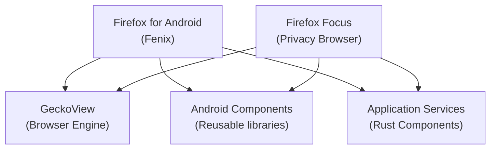
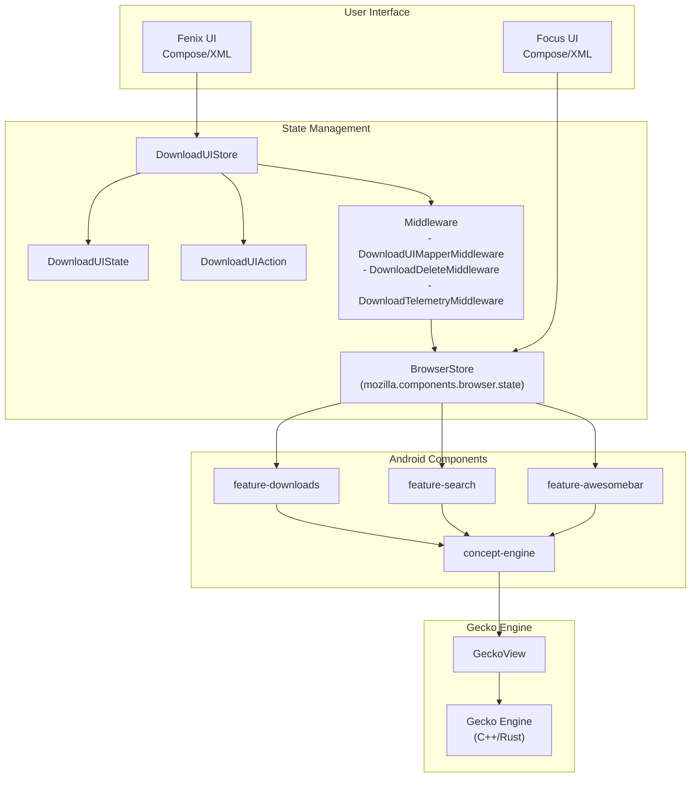
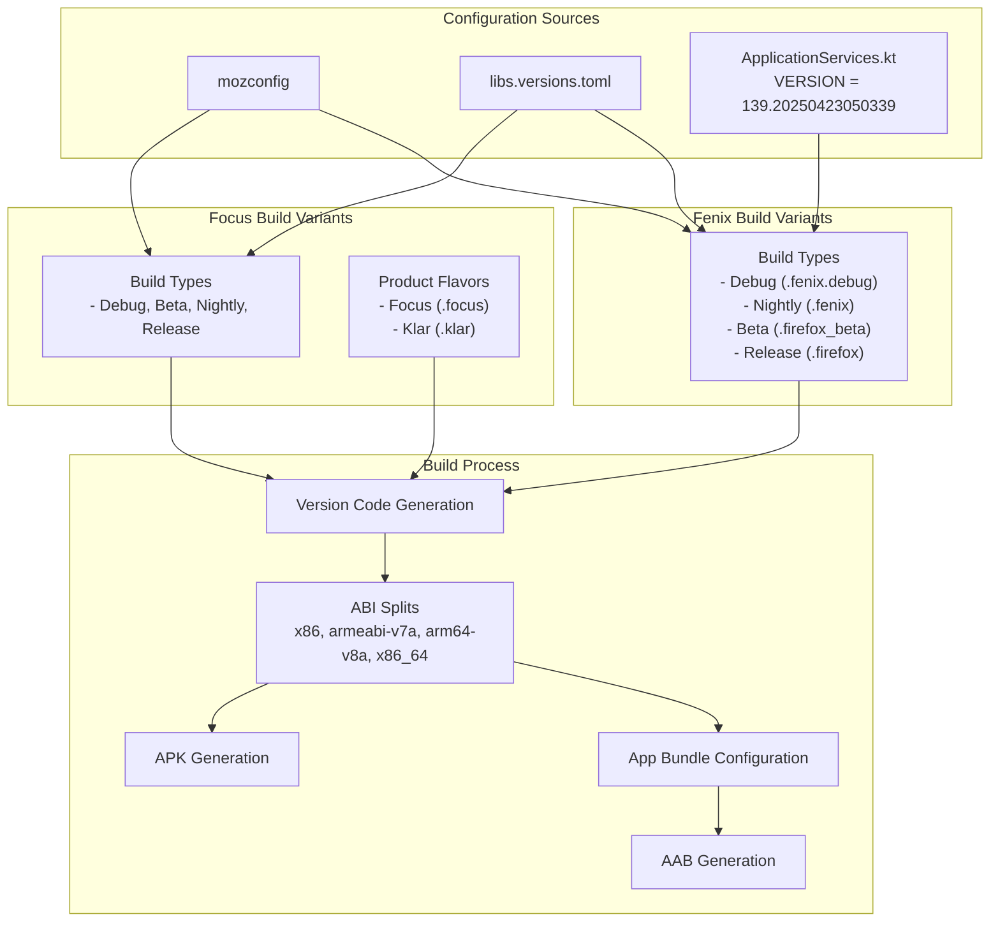
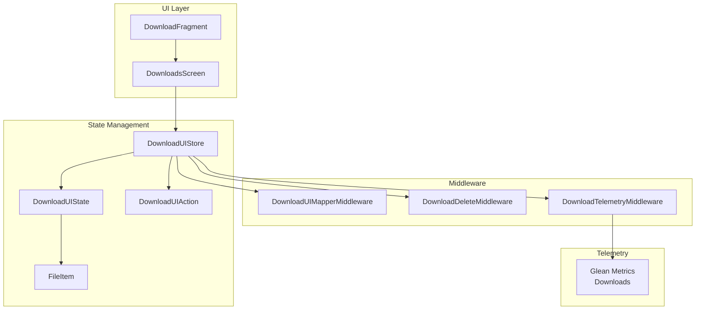

<!-- source: DeepWiki mcp.deepwiki.com · repo mozilla/gecko-dev · page 6 Mobile Platforms · fetched 2026-10-09 -->

# Mobile Platforms

<details>
<summary>Relevant source files</summary>

The following files were used as context for generating this wiki page:

- [build.gradle](build.gradle)
- [gradle/libs.versions.toml](gradle/libs.versions.toml)
- [mobile/android/android-components/android-lint.gradle](mobile/android/android-components/android-lint.gradle)
- [mobile/android/android-components/components/feature/awesomebar/build.gradle](mobile/android/android-components/components/feature/awesomebar/build.gradle)
- [mobile/android/android-components/components/feature/awesomebar/src/main/java/mozilla/components/feature/awesomebar/facts/AwesomeBarFacts.kt](mobile/android/android-components/components/feature/awesomebar/src/main/java/mozilla/components/feature/awesomebar/facts/AwesomeBarFacts.kt)
- [mobile/android/android-components/components/feature/awesomebar/src/main/java/mozilla/components/feature/awesomebar/provider/RecentSearchSuggestionsProvider.kt](mobile/android/android-components/components/feature/awesomebar/src/main/java/mozilla/components/feature/awesomebar/provider/RecentSearchSuggestionsProvider.kt)
- [mobile/android/android-components/components/feature/awesomebar/src/main/java/mozilla/components/feature/awesomebar/provider/SearchTermSuggestionsProvider.kt](mobile/android/android-components/components/feature/awesomebar/src/main/java/mozilla/components/feature/awesomebar/provider/SearchTermSuggestionsProvider.kt)
- [mobile/android/android-components/components/feature/awesomebar/src/main/java/mozilla/components/feature/awesomebar/provider/TopSitesSuggestionProvider.kt](mobile/android/android-components/components/feature/awesomebar/src/main/java/mozilla/components/feature/awesomebar/provider/TopSitesSuggestionProvider.kt)
- [mobile/android/android-components/components/feature/awesomebar/src/main/java/mozilla/components/feature/awesomebar/provider/TrendingSearchProvider.kt](mobile/android/android-components/components/feature/awesomebar/src/main/java/mozilla/components/feature/awesomebar/provider/TrendingSearchProvider.kt)
- [mobile/android/android-components/components/feature/awesomebar/src/test/java/mozilla/components/feature/awesomebar/facts/AwesomeBarFactsTest.kt](mobile/android/android-components/components/feature/awesomebar/src/test/java/mozilla/components/feature/awesomebar/facts/AwesomeBarFactsTest.kt)
- [mobile/android/android-components/components/feature/awesomebar/src/test/java/mozilla/components/feature/awesomebar/provider/RecentSearchSuggestionsProviderTest.kt](mobile/android/android-components/components/feature/awesomebar/src/test/java/mozilla/components/feature/awesomebar/provider/RecentSearchSuggestionsProviderTest.kt)
- [mobile/android/android-components/components/feature/awesomebar/src/test/java/mozilla/components/feature/awesomebar/provider/SearchTermSuggestionsProviderTest.kt](mobile/android/android-components/components/feature/awesomebar/src/test/java/mozilla/components/feature/awesomebar/provider/SearchTermSuggestionsProviderTest.kt)
- [mobile/android/android-components/components/feature/awesomebar/src/test/java/mozilla/components/feature/awesomebar/provider/TopSitesSuggestionProviderTest.kt](mobile/android/android-components/components/feature/awesomebar/src/test/java/mozilla/components/feature/awesomebar/provider/TopSitesSuggestionProviderTest.kt)
- [mobile/android/android-components/components/feature/awesomebar/src/test/java/mozilla/components/feature/awesomebar/provider/TrendingSearchProviderTest.kt](mobile/android/android-components/components/feature/awesomebar/src/test/java/mozilla/components/feature/awesomebar/provider/TrendingSearchProviderTest.kt)
- [mobile/android/android-components/components/feature/search/src/main/java/mozilla/components/feature/search/trendingsearches/TrendingSearchClient.kt](mobile/android/android-components/components/feature/search/src/main/java/mozilla/components/feature/search/trendingsearches/TrendingSearchClient.kt)
- [mobile/android/android-components/components/feature/search/src/test/java/mozilla/components/feature/search/trendingsearches/TrendingSearchClientTest.kt](mobile/android/android-components/components/feature/search/src/test/java/mozilla/components/feature/search/trendingsearches/TrendingSearchClientTest.kt)
- [mobile/android/android-components/components/support/test/src/main/java/mozilla/components/support/test/Matchers.kt](mobile/android/android-components/components/support/test/src/main/java/mozilla/components/support/test/Matchers.kt)
- [mobile/android/android-components/components/support/test/src/main/java/mozilla/components/support/test/robolectric/shadow/PixelCopyShadow.kt](mobile/android/android-components/components/support/test/src/main/java/mozilla/components/support/test/robolectric/shadow/PixelCopyShadow.kt)
- [mobile/android/android-components/plugins/config/build.gradle](mobile/android/android-components/plugins/config/build.gradle)
- [mobile/android/android-components/plugins/dependencies/build.gradle](mobile/android/android-components/plugins/dependencies/build.gradle)
- [mobile/android/android-components/plugins/dependencies/src/main/java/ApplicationServices.kt](mobile/android/android-components/plugins/dependencies/src/main/java/ApplicationServices.kt)
- [mobile/android/android-components/plugins/dependencies/src/main/java/moz.yaml](mobile/android/android-components/plugins/dependencies/src/main/java/moz.yaml)
- [mobile/android/android-components/plugins/publicsuffixlist/build.gradle](mobile/android/android-components/plugins/publicsuffixlist/build.gradle)
- [mobile/android/android-components/samples/browser/build.gradle](mobile/android/android-components/samples/browser/build.gradle)
- [mobile/android/annotations/build.gradle](mobile/android/annotations/build.gradle)
- [mobile/android/docs/fenix.rst](mobile/android/docs/fenix.rst)
- [mobile/android/examples/messaging_example/app/build.gradle](mobile/android/examples/messaging_example/app/build.gradle)
- [mobile/android/examples/port_messaging_example/app/build.gradle](mobile/android/examples/port_messaging_example/app/build.gradle)
- [mobile/android/exoplayer2/build.gradle](mobile/android/exoplayer2/build.gradle)
- [mobile/android/fenix/app/build.gradle](mobile/android/fenix/app/build.gradle)
- [mobile/android/fenix/app/lint-baseline.xml](mobile/android/fenix/app/lint-baseline.xml)
- [mobile/android/fenix/app/metrics.yaml](mobile/android/fenix/app/metrics.yaml)
- [mobile/android/fenix/app/src/main/java/org/mozilla/fenix/components/NotificationManager.kt](mobile/android/fenix/app/src/main/java/org/mozilla/fenix/components/NotificationManager.kt)
- [mobile/android/fenix/app/src/main/java/org/mozilla/fenix/components/metrics/GleanUsageReportingMetricsService.kt](mobile/android/fenix/app/src/main/java/org/mozilla/fenix/components/metrics/GleanUsageReportingMetricsService.kt)
- [mobile/android/fenix/app/src/main/java/org/mozilla/fenix/components/metrics/MetricController.kt](mobile/android/fenix/app/src/main/java/org/mozilla/fenix/components/metrics/MetricController.kt)
- [mobile/android/fenix/app/src/main/java/org/mozilla/fenix/downloads/listscreen/DownloadFragment.kt](mobile/android/fenix/app/src/main/java/org/mozilla/fenix/downloads/listscreen/DownloadFragment.kt)
- [mobile/android/fenix/app/src/main/java/org/mozilla/fenix/downloads/listscreen/DownloadsScreen.kt](mobile/android/fenix/app/src/main/java/org/mozilla/fenix/downloads/listscreen/DownloadsScreen.kt)
- [mobile/android/fenix/app/src/main/java/org/mozilla/fenix/downloads/listscreen/DownloadsTopAppBar.kt](mobile/android/fenix/app/src/main/java/org/mozilla/fenix/downloads/listscreen/DownloadsTopAppBar.kt)
- [mobile/android/fenix/app/src/main/java/org/mozilla/fenix/downloads/listscreen/middleware/DownloadTelemetryMiddleware.kt](mobile/android/fenix/app/src/main/java/org/mozilla/fenix/downloads/listscreen/middleware/DownloadTelemetryMiddleware.kt)
- [mobile/android/fenix/app/src/main/java/org/mozilla/fenix/downloads/listscreen/middleware/DownloadUIShareMiddleware.kt](mobile/android/fenix/app/src/main/java/org/mozilla/fenix/downloads/listscreen/middleware/DownloadUIShareMiddleware.kt)
- [mobile/android/fenix/app/src/main/java/org/mozilla/fenix/downloads/listscreen/store/DownloadListItem.kt](mobile/android/fenix/app/src/main/java/org/mozilla/fenix/downloads/listscreen/store/DownloadListItem.kt)
- [mobile/android/fenix/app/src/main/java/org/mozilla/fenix/downloads/listscreen/store/DownloadUIAction.kt](mobile/android/fenix/app/src/main/java/org/mozilla/fenix/downloads/listscreen/store/DownloadUIAction.kt)
- [mobile/android/fenix/app/src/main/java/org/mozilla/fenix/downloads/listscreen/store/DownloadUIState.kt](mobile/android/fenix/app/src/main/java/org/mozilla/fenix/downloads/listscreen/store/DownloadUIState.kt)
- [mobile/android/fenix/app/src/main/java/org/mozilla/fenix/downloads/listscreen/store/DownloadUIStore.kt](mobile/android/fenix/app/src/main/java/org/mozilla/fenix/downloads/listscreen/store/DownloadUIStore.kt)
- [mobile/android/fenix/app/src/main/java/org/mozilla/fenix/downloads/listscreen/store/FileItemToIconMapper.kt](mobile/android/fenix/app/src/main/java/org/mozilla/fenix/downloads/listscreen/store/FileItemToIconMapper.kt)
- [mobile/android/fenix/app/src/main/java/org/mozilla/fenix/downloads/listscreen/ui/DownloadSearchField.kt](mobile/android/fenix/app/src/main/java/org/mozilla/fenix/downloads/listscreen/ui/DownloadSearchField.kt)
- [mobile/android/fenix/app/src/main/java/org/mozilla/fenix/ext/String.kt](mobile/android/fenix/app/src/main/java/org/mozilla/fenix/ext/String.kt)
- [mobile/android/fenix/app/src/main/java/org/mozilla/fenix/home/toolbar/FenixHomeToolbar.kt](mobile/android/fenix/app/src/main/java/org/mozilla/fenix/home/toolbar/FenixHomeToolbar.kt)
- [mobile/android/fenix/app/src/main/java/org/mozilla/fenix/home/toolbar/HomeToolbarView.kt](mobile/android/fenix/app/src/main/java/org/mozilla/fenix/home/toolbar/HomeToolbarView.kt)
- [mobile/android/fenix/app/src/main/java/org/mozilla/fenix/home/toolbar/SearchSelectorBinding.kt](mobile/android/fenix/app/src/main/java/org/mozilla/fenix/home/toolbar/SearchSelectorBinding.kt)
- [mobile/android/fenix/app/src/main/java/org/mozilla/fenix/home/toolbar/TabCounterView.kt](mobile/android/fenix/app/src/main/java/org/mozilla/fenix/home/toolbar/TabCounterView.kt)
- [mobile/android/fenix/app/src/main/java/org/mozilla/fenix/search/SearchDialogInteractor.kt](mobile/android/fenix/app/src/main/java/org/mozilla/fenix/search/SearchDialogInteractor.kt)
- [mobile/android/fenix/app/src/main/java/org/mozilla/fenix/settings/SettingsFragment.kt](mobile/android/fenix/app/src/main/java/org/mozilla/fenix/settings/SettingsFragment.kt)
- [mobile/android/fenix/app/src/main/java/org/mozilla/fenix/settings/TextPercentageSeekBarPreference.kt](mobile/android/fenix/app/src/main/java/org/mozilla/fenix/settings/TextPercentageSeekBarPreference.kt)
- [mobile/android/fenix/app/src/main/res/layout/account_share_list_item.xml](mobile/android/fenix/app/src/main/res/layout/account_share_list_item.xml)
- [mobile/android/fenix/app/src/main/res/layout/app_share_list_item.xml](mobile/android/fenix/app/src/main/res/layout/app_share_list_item.xml)
- [mobile/android/fenix/app/src/main/res/values/strings.xml](mobile/android/fenix/app/src/main/res/values/strings.xml)
- [mobile/android/fenix/app/src/test/java/org/mozilla/fenix/components/metrics/MetricControllerTest.kt](mobile/android/fenix/app/src/test/java/org/mozilla/fenix/components/metrics/MetricControllerTest.kt)
- [mobile/android/fenix/app/src/test/java/org/mozilla/fenix/components/toolbar/BrowserHomeToolbarViewTest.kt](mobile/android/fenix/app/src/test/java/org/mozilla/fenix/components/toolbar/BrowserHomeToolbarViewTest.kt)
- [mobile/android/fenix/app/src/test/java/org/mozilla/fenix/downloads/listscreen/middleware/DownloadTelemetryMiddlewareTest.kt](mobile/android/fenix/app/src/test/java/org/mozilla/fenix/downloads/listscreen/middleware/DownloadTelemetryMiddlewareTest.kt)
- [mobile/android/fenix/app/src/test/java/org/mozilla/fenix/downloads/listscreen/store/DownloadUIStateTest.kt](mobile/android/fenix/app/src/test/java/org/mozilla/fenix/downloads/listscreen/store/DownloadUIStateTest.kt)
- [mobile/android/fenix/app/src/test/java/org/mozilla/fenix/downloads/listscreen/store/DownloadUIStateTestData.kt](mobile/android/fenix/app/src/test/java/org/mozilla/fenix/downloads/listscreen/store/DownloadUIStateTestData.kt)
- [mobile/android/fenix/app/src/test/java/org/mozilla/fenix/downloads/listscreen/store/DownloadUIStoreTest.kt](mobile/android/fenix/app/src/test/java/org/mozilla/fenix/downloads/listscreen/store/DownloadUIStoreTest.kt)
- [mobile/android/fenix/app/src/test/java/org/mozilla/fenix/downloads/listscreen/store/FileItemTest.kt](mobile/android/fenix/app/src/test/java/org/mozilla/fenix/downloads/listscreen/store/FileItemTest.kt)
- [mobile/android/fenix/app/src/test/java/org/mozilla/fenix/downloads/listscreen/store/FileItemToIconMapperTest.kt](mobile/android/fenix/app/src/test/java/org/mozilla/fenix/downloads/listscreen/store/FileItemToIconMapperTest.kt)
- [mobile/android/fenix/app/src/test/java/org/mozilla/fenix/ext/StringTest.kt](mobile/android/fenix/app/src/test/java/org/mozilla/fenix/ext/StringTest.kt)
- [mobile/android/fenix/app/src/test/java/org/mozilla/fenix/home/InstrumentedHomeFragmentTest.kt](mobile/android/fenix/app/src/test/java/org/mozilla/fenix/home/InstrumentedHomeFragmentTest.kt)
- [mobile/android/fenix/app/src/test/java/org/mozilla/fenix/home/toolbar/TabCounterViewTest.kt](mobile/android/fenix/app/src/test/java/org/mozilla/fenix/home/toolbar/TabCounterViewTest.kt)
- [mobile/android/fenix/plugins/apksize/build.gradle](mobile/android/fenix/plugins/apksize/build.gradle)
- [mobile/android/focus-android/app/build.gradle](mobile/android/focus-android/app/build.gradle)
- [mobile/android/focus-android/app/lint-baseline.xml](mobile/android/focus-android/app/lint-baseline.xml)
- [mobile/android/geckoview/build.gradle](mobile/android/geckoview/build.gradle)
- [mobile/android/geckoview_example/build.gradle](mobile/android/geckoview_example/build.gradle)
- [mobile/android/test_runner/build.gradle](mobile/android/test_runner/build.gradle)

</details>


This page provides an overview of Mozilla's mobile applications and platform components that power Firefox on Android. It covers the architecture, key components, and relationships between different mobile products in the Firefox ecosystem. For detailed information about specific components, see:
- [Firefox for Android (Fenix)](#6.1)
- [Android Components](#6.2)
- [GeckoView](#6.3)

## Mobile Platform Ecosystem

Mozilla maintains several mobile products and platform components that work together to deliver Firefox browser experiences on Android devices:

### Mobile Platform Components Overview



Sources:
- [mobile/android/fenix/app/build.gradle]()
- [mobile/android/focus-android/app/build.gradle]()
- [mobile/android/android-components/plugins/dependencies/src/main/java/ApplicationServices.kt]()

## Firefox for Android (Fenix)

Firefox for Android, codenamed Fenix, is Mozilla's flagship mobile browser for Android. It replaced the legacy Firefox for Android (codenamed Fennec) in 2020.

Key characteristics:
- Application ID: `org.mozilla.firefox` for release builds
- Built using modern Android architecture components and Jetpack libraries
- Implements a component-based architecture with Android Components
- Powered by the GeckoView engine
- Supports features like collections, enhanced tracking protection, and add-ons

Build variants:
- Debug: `org.mozilla.fenix.debug`
- Nightly: `org.mozilla.fenix`
- Beta: `org.mozilla.firefox_beta`
- Release: `org.mozilla.firefox`

Sources:
- [mobile/android/fenix/app/build.gradle:57-57]()
- [mobile/android/fenix/app/build.gradle:114-163]()

## Firefox Focus

Firefox Focus is Mozilla's privacy-focused browser for Android, offering a streamlined browsing experience with built-in tracking protection and easy history clearing.

Key characteristics:
- Smaller code footprint than Fenix
- Emphasizes privacy with automatic tracker blocking
- Allows one-tap history clearing with the "erase" button
- Two product flavors: Focus and Klar (Klar is the name used in German-speaking markets)

Build configuration:
- Product Flavors: Focus (`.focus`), Klar (`.klar`)
- Build Types: Debug, Beta, Nightly, Release

Sources:
- [mobile/android/focus-android/app/build.gradle:37-38]()
- [mobile/android/focus-android/app/build.gradle:130-146]()
- [mobile/android/focus-android/app/build.gradle:170-179]()

## Architecture Overview

The architecture of Firefox mobile products follows a modern, layered approach with shared components:

### Mobile Architecture



Sources:
- [mobile/android/fenix/app/src/main/java/org/mozilla/fenix/downloads/listscreen/DownloadFragment.kt]()
- [mobile/android/fenix/app/src/main/java/org/mozilla/fenix/downloads/listscreen/store/DownloadUIStore.kt]()
- [mobile/android/geckoview/build.gradle]()

## Key Components

### GeckoView

GeckoView is Mozilla's browser engine for Android, built on the same Gecko engine that powers Firefox desktop. It provides the rendering capabilities for both Fenix and Focus.

Key features:
- Complete browser engine implementation
- Independent of Android's WebView
- Provides full control over the browsing experience
- Supports modern web standards and Firefox's privacy features

Source:
- [mobile/android/geckoview/build.gradle]()

### Android Components

Android Components is a collection of independent Android libraries that make it easy to build browsers or browser-like applications. These components form the foundation of both Fenix and Focus.

Key component categories:
- Browser components: session, state, toolbar, icons
- Concept components: interfaces that define browser functionality
- Feature components: implementations of browser features
- Support components: utility functions
- UI components: reusable UI elements

The components follow a consistent naming convention:

| Component Type | Purpose |
|----------------|---------|
| browser-* | Core browser functionality |
| concept-* | Interfaces defining browser features |
| feature-* | Feature implementations |
| support-* | Utility functions and helpers |
| ui-* | Reusable UI components |

Sources:
- [mobile/android/fenix/app/build.gradle:542-645]()
- [mobile/android/focus-android/app/build.gradle:279-333]()

### Application Services

Application Services provides cross-platform implementations of Firefox services in Rust, with bindings for Android. These services support critical browser functionality:

- Sync: synchronization of browser data across devices
- Places: history and bookmarks database
- Login storage: secure storage of user credentials
- Push notifications: support for web push notifications

Current version: `139.20250423050339`

Source:
- [mobile/android/android-components/plugins/dependencies/src/main/java/ApplicationServices.kt:6-7]()

## Build System

The mobile platforms use Gradle with custom Mozilla configurations for building:

### Build System Architecture



Sources:
- [mobile/android/fenix/app/build.gradle:47-188]()
- [mobile/android/fenix/app/build.gradle:290-444]()
- [mobile/android/focus-android/app/build.gradle:29-191]()
- [build.gradle:90-245]()

### Version Code Generation

Version codes are generated based on the application version with specific rules for each ABI:
- Fenix: Reuses the Fennec version code generator across all channels
- Focus: Implements a similar approach with a time-based version code

Both applications generate different version codes for different ABIs to ensure the Google Play Store can distinguish between them.

Sources:
- [mobile/android/fenix/app/build.gradle:306-331]()
- [mobile/android/focus-android/app/build.gradle:392-425]()

## Feature Example: Downloads Management in Fenix

The Downloads management feature in Fenix demonstrates the architectural patterns used across Firefox mobile platforms:

### Downloads Component Architecture



This feature demonstrates:
- MVI (Model-View-Intent) architecture with Redux-like state management
- Jetpack Compose for the modern UI
- Middleware pattern for side effects and separation of concerns
- Integration with Glean for telemetry
- Component-based structure for maintainability

Sources:
- [mobile/android/fenix/app/src/main/java/org/mozilla/fenix/downloads/listscreen/DownloadFragment.kt]()
- [mobile/android/fenix/app/src/main/java/org/mozilla/fenix/downloads/listscreen/store/DownloadUIStore.kt]()
- [mobile/android/fenix/app/src/main/java/org/mozilla/fenix/downloads/listscreen/store/DownloadUIAction.kt]()
- [mobile/android/fenix/app/src/main/java/org/mozilla/fenix/downloads/listscreen/store/DownloadUIState.kt]()
- [mobile/android/fenix/app/src/main/java/org/mozilla/fenix/downloads/listscreen/middleware/DownloadTelemetryMiddleware.kt]()

## Telemetry and Metrics

Both Fenix and Focus include comprehensive telemetry systems built on Glean, Mozilla's telemetry collection library:

- Event recording: User actions such as opening the app, tapping UI elements, etc.
- Metrics collection: Usage data like page views, search engine usage
- Component-specific telemetry: Feature-specific data collection like downloads

Telemetry collection in the mobile platforms follows a consistent pattern:
1. Define metrics in `.yaml` files
2. Generate Kotlin code using the Glean Gradle plugin
3. Record metrics using middleware or direct API calls

Sources:
- [mobile/android/fenix/app/metrics.yaml]()
- [mobile/android/fenix/app/src/main/java/org/mozilla/fenix/downloads/listscreen/middleware/DownloadTelemetryMiddleware.kt]()
- [mobile/android/fenix/app/src/test/java/org/mozilla/fenix/downloads/listscreen/middleware/DownloadTelemetryMiddlewareTest.kt]()

## Development and Building

Building Firefox for Android requires:
- Java Development Kit (JDK) 
- Android SDK
- Mozilla build environment setup

Developers can build the applications using:
- Mozilla's `mach` command-line tool (recommended)
- Gradle directly (for component-specific development)

Building Fenix or Focus with `mach`:

```
./mach build
./mach android package
```

For local development, the build process creates APKs for all supported architectures by default, but this can be customized for testing specific configurations.

Source:
- [mobile/android/docs/fenix.rst]()

## Dependencies Management

All dependencies across Mozilla's Android projects are centrally managed in the `libs.versions.toml` file, which defines:
- Version numbers for all libraries and tools
- Library definitions with group and artifact IDs
- Gradle plugins

This ensures consistency across all mobile platform components and simplifies dependency updates.

Key dependencies include:
- AndroidX libraries for modern Android development
- Kotlin and coroutines for asynchronous programming
- Compose for modern UI development
- Various Google and third-party libraries

Source:
- [gradle/libs.versions.toml]()

---

