<!-- source: DeepWiki mcp.deepwiki.com · repo mozilla/gecko-dev · page 6.1 Firefox for Android (Fenix) · fetched 2026-10-09 -->

# Firefox for Android (Fenix)

Relevant source files

The following files were used as context for generating this wiki page:

- [build.gradle](build.gradle)
- [gradle/libs.versions.toml](gradle/libs.versions.toml)
- [mobile/android/android-components/android-lint.gradle](mobile/android/android-components/android-lint.gradle)
- [mobile/android/android-components/components/feature/awesomebar/build.gradle](mobile/android/android-components/components/feature/awesomebar/build.gradle)
- [mobile/android/android-components/components/feature/awesomebar/src/main/java/mozilla/components/feature/awesomebar/facts/AwesomeBarFacts.kt](mobile/android/android-components/components/feature/awesomebar/src/main/java/mozilla/components/feature/awesomebar/facts/AwesomeBarFacts.kt)
- [mobile/android/android-components/components/feature/awesomebar/src/main/java/mozilla/components/feature/awesomebar/provider/RecentSearchSuggestionsProvider.kt](mobile/android/android-components/components/feature/awesomebar/src/main/java/mozilla/components/feature/awesomebar/provider/RecentSearchSuggestionsProvider.kt)
- [mobile/android/android-components/components/feature/awesomebar/src/main/java/mozilla/components/feature/awesomebar/provider/SearchTermSuggestionsProvider.kt](mobile/android/android-components/components/feature/awesomebar/src/main/java/mozilla/components/feature/awesomebar/provider/SearchTermSuggestionsProvider.kt)
- [mobile/android/android-components/components/feature/awesomebar/src/main/java/mozilla/components/feature/awesomebar/provider/TopSitesSuggestionProvider.kt](mobile/android/android-components/components/feature/awesomebar/src/main/java/mozilla/components/feature/awesomebar/provider/TopSitesSuggestionProvider.kt)
- [mobile/android/android-components/components/feature/awesomebar/src/main/java/mozilla/components/feature/awesomebar/provider/TrendingSearchProvider.kt](mobile/android/android-components/components/feature/awesomebar/src/main/java/mozilla/components/feature/awesomebar/provider/TrendingSearchProvider.kt)
- [mobile/android/android-components/components/feature/awesomebar/src/test/java/mozilla/components/feature/awesomebar/facts/AwesomeBarFactsTest.kt](mobile/android/android-components/components/feature/awesomebar/src/test/java/mozilla/components/feature/awesomebar/facts/AwesomeBarFactsTest.kt)
- [mobile/android/android-components/components/feature/awesomebar/src/test/java/mozilla/components/feature/awesomebar/provider/RecentSearchSuggestionsProviderTest.kt](mobile/android/android-components/components/feature/awesomebar/src/test/java/mozilla/components/feature/awesomebar/provider/RecentSearchSuggestionsProviderTest.kt)
- [mobile/android/android-components/components/feature/awesomebar/src/test/java/mozilla/components/feature/awesomebar/provider/SearchTermSuggestionsProviderTest.kt](mobile/android/android-components/components/feature/awesomebar/src/test/java/mozilla/components/feature/awesomebar/provider/SearchTermSuggestionsProviderTest.kt)
- [mobile/android/android-components/components/feature/awesomebar/src/test/java/mozilla/components/feature/awesomebar/provider/TopSitesSuggestionProviderTest.kt](mobile/android/android-components/components/feature/awesomebar/src/test/java/mozilla/components/feature/awesomebar/provider/TopSitesSuggestionProviderTest.kt)
- [mobile/android/android-components/components/feature/awesomebar/src/test/java/mozilla/components/feature/awesomebar/provider/TrendingSearchProviderTest.kt](mobile/android/android-components/components/feature/awesomebar/src/test/java/mozilla/components/feature/awesomebar/provider/TrendingSearchProviderTest.kt)
- [mobile/android/android-components/components/feature/search/src/main/java/mozilla/components/feature/search/trendingsearches/TrendingSearchClient.kt](mobile/android/android-components/components/feature/search/src/main/java/mozilla/components/feature/search/trendingsearches/TrendingSearchClient.kt)
- [mobile/android/android-components/components/feature/search/src/test/java/mozilla/components/feature/search/trendingsearches/TrendingSearchClientTest.kt](mobile/android/android-components/components/feature/search/src/test/java/mozilla/components/feature/search/trendingsearches/TrendingSearchClientTest.kt)
- [mobile/android/android-components/components/support/test/src/main/java/mozilla/components/support/test/Matchers.kt](mobile/android/android-components/components/support/test/src/main/java/mozilla/components/support/test/Matchers.kt)
- [mobile/android/android-components/components/support/test/src/main/java/mozilla/components/support/test/robolectric/shadow/PixelCopyShadow.kt](mobile/android/android-components/components/support/test/src/main/java/mozilla/components/support/test/robolectric/shadow/PixelCopyShadow.kt)
- [mobile/android/android-components/plugins/config/build.gradle](mobile/android/android-components/plugins/config/build.gradle)
- [mobile/android/android-components/plugins/dependencies/build.gradle](mobile/android/android-components/plugins/dependencies/build.gradle)
- [mobile/android/android-components/plugins/publicsuffixlist/build.gradle](mobile/android/android-components/plugins/publicsuffixlist/build.gradle)
- [mobile/android/android-components/samples/browser/build.gradle](mobile/android/android-components/samples/browser/build.gradle)
- [mobile/android/annotations/build.gradle](mobile/android/annotations/build.gradle)
- [mobile/android/docs/fenix.rst](mobile/android/docs/fenix.rst)
- [mobile/android/examples/messaging_example/app/build.gradle](mobile/android/examples/messaging_example/app/build.gradle)
- [mobile/android/examples/port_messaging_example/app/build.gradle](mobile/android/examples/port_messaging_example/app/build.gradle)
- [mobile/android/exoplayer2/build.gradle](mobile/android/exoplayer2/build.gradle)
- [mobile/android/fenix/app/build.gradle](mobile/android/fenix/app/build.gradle)
- [mobile/android/fenix/app/lint-baseline.xml](mobile/android/fenix/app/lint-baseline.xml)
- [mobile/android/fenix/app/metrics.yaml](mobile/android/fenix/app/metrics.yaml)
- [mobile/android/fenix/app/src/main/java/org/mozilla/fenix/components/NotificationManager.kt](mobile/android/fenix/app/src/main/java/org/mozilla/fenix/components/NotificationManager.kt)
- [mobile/android/fenix/app/src/main/java/org/mozilla/fenix/components/metrics/GleanUsageReportingMetricsService.kt](mobile/android/fenix/app/src/main/java/org/mozilla/fenix/components/metrics/GleanUsageReportingMetricsService.kt)
- [mobile/android/fenix/app/src/main/java/org/mozilla/fenix/components/metrics/MetricController.kt](mobile/android/fenix/app/src/main/java/org/mozilla/fenix/components/metrics/MetricController.kt)
- [mobile/android/fenix/app/src/main/java/org/mozilla/fenix/downloads/listscreen/DownloadFragment.kt](mobile/android/fenix/app/src/main/java/org/mozilla/fenix/downloads/listscreen/DownloadFragment.kt)
- [mobile/android/fenix/app/src/main/java/org/mozilla/fenix/downloads/listscreen/DownloadsScreen.kt](mobile/android/fenix/app/src/main/java/org/mozilla/fenix/downloads/listscreen/DownloadsScreen.kt)
- [mobile/android/fenix/app/src/main/java/org/mozilla/fenix/downloads/listscreen/DownloadsTopAppBar.kt](mobile/android/fenix/app/src/main/java/org/mozilla/fenix/downloads/listscreen/DownloadsTopAppBar.kt)
- [mobile/android/fenix/app/src/main/java/org/mozilla/fenix/downloads/listscreen/middleware/DownloadTelemetryMiddleware.kt](mobile/android/fenix/app/src/main/java/org/mozilla/fenix/downloads/listscreen/middleware/DownloadTelemetryMiddleware.kt)
- [mobile/android/fenix/app/src/main/java/org/mozilla/fenix/downloads/listscreen/middleware/DownloadUIShareMiddleware.kt](mobile/android/fenix/app/src/main/java/org/mozilla/fenix/downloads/listscreen/middleware/DownloadUIShareMiddleware.kt)
- [mobile/android/fenix/app/src/main/java/org/mozilla/fenix/downloads/listscreen/store/DownloadListItem.kt](mobile/android/fenix/app/src/main/java/org/mozilla/fenix/downloads/listscreen/store/DownloadListItem.kt)
- [mobile/android/fenix/app/src/main/java/org/mozilla/fenix/downloads/listscreen/store/DownloadUIAction.kt](mobile/android/fenix/app/src/main/java/org/mozilla/fenix/downloads/listscreen/store/DownloadUIAction.kt)
- [mobile/android/fenix/app/src/main/java/org/mozilla/fenix/downloads/listscreen/store/DownloadUIState.kt](mobile/android/fenix/app/src/main/java/org/mozilla/fenix/downloads/listscreen/store/DownloadUIState.kt)
- [mobile/android/fenix/app/src/main/java/org/mozilla/fenix/downloads/listscreen/store/DownloadUIStore.kt](mobile/android/fenix/app/src/main/java/org/mozilla/fenix/downloads/listscreen/store/DownloadUIStore.kt)
- [mobile/android/fenix/app/src/main/java/org/mozilla/fenix/downloads/listscreen/store/FileItemToIconMapper.kt](mobile/android/fenix/app/src/main/java/org/mozilla/fenix/downloads/listscreen/store/FileItemToIconMapper.kt)
- [mobile/android/fenix/app/src/main/java/org/mozilla/fenix/downloads/listscreen/ui/DownloadSearchField.kt](mobile/android/fenix/app/src/main/java/org/mozilla/fenix/downloads/listscreen/ui/DownloadSearchField.kt)
- [mobile/android/fenix/app/src/main/java/org/mozilla/fenix/ext/String.kt](mobile/android/fenix/app/src/main/java/org/mozilla/fenix/ext/String.kt)
- [mobile/android/fenix/app/src/main/java/org/mozilla/fenix/home/toolbar/FenixHomeToolbar.kt](mobile/android/fenix/app/src/main/java/org/mozilla/fenix/home/toolbar/FenixHomeToolbar.kt)
- [mobile/android/fenix/app/src/main/java/org/mozilla/fenix/home/toolbar/HomeToolbarView.kt](mobile/android/fenix/app/src/main/java/org/mozilla/fenix/home/toolbar/HomeToolbarView.kt)
- [mobile/android/fenix/app/src/main/java/org/mozilla/fenix/home/toolbar/SearchSelectorBinding.kt](mobile/android/fenix/app/src/main/java/org/mozilla/fenix/home/toolbar/SearchSelectorBinding.kt)
- [mobile/android/fenix/app/src/main/java/org/mozilla/fenix/home/toolbar/TabCounterView.kt](mobile/android/fenix/app/src/main/java/org/mozilla/fenix/home/toolbar/TabCounterView.kt)
- [mobile/android/fenix/app/src/main/java/org/mozilla/fenix/search/SearchDialogInteractor.kt](mobile/android/fenix/app/src/main/java/org/mozilla/fenix/search/SearchDialogInteractor.kt)
- [mobile/android/fenix/app/src/main/java/org/mozilla/fenix/settings/SettingsFragment.kt](mobile/android/fenix/app/src/main/java/org/mozilla/fenix/settings/SettingsFragment.kt)
- [mobile/android/fenix/app/src/main/java/org/mozilla/fenix/settings/TextPercentageSeekBarPreference.kt](mobile/android/fenix/app/src/main/java/org/mozilla/fenix/settings/TextPercentageSeekBarPreference.kt)
- [mobile/android/fenix/app/src/main/res/layout/account_share_list_item.xml](mobile/android/fenix/app/src/main/res/layout/account_share_list_item.xml)
- [mobile/android/fenix/app/src/main/res/layout/app_share_list_item.xml](mobile/android/fenix/app/src/main/res/layout/app_share_list_item.xml)
- [mobile/android/fenix/app/src/main/res/values/strings.xml](mobile/android/fenix/app/src/main/res/values/strings.xml)
- [mobile/android/fenix/app/src/test/java/org/mozilla/fenix/components/metrics/MetricControllerTest.kt](mobile/android/fenix/app/src/test/java/org/mozilla/fenix/components/metrics/MetricControllerTest.kt)
- [mobile/android/fenix/app/src/test/java/org/mozilla/fenix/components/toolbar/BrowserHomeToolbarViewTest.kt](mobile/android/fenix/app/src/test/java/org/mozilla/fenix/components/toolbar/BrowserHomeToolbarViewTest.kt)
- [mobile/android/fenix/app/src/test/java/org/mozilla/fenix/downloads/listscreen/middleware/DownloadTelemetryMiddlewareTest.kt](mobile/android/fenix/app/src/test/java/org/mozilla/fenix/downloads/listscreen/middleware/DownloadTelemetryMiddlewareTest.kt)
- [mobile/android/fenix/app/src/test/java/org/mozilla/fenix/downloads/listscreen/store/DownloadUIStateTest.kt](mobile/android/fenix/app/src/test/java/org/mozilla/fenix/downloads/listscreen/store/DownloadUIStateTest.kt)
- [mobile/android/fenix/app/src/test/java/org/mozilla/fenix/downloads/listscreen/store/DownloadUIStateTestData.kt](mobile/android/fenix/app/src/test/java/org/mozilla/fenix/downloads/listscreen/store/DownloadUIStateTestData.kt)
- [mobile/android/fenix/app/src/test/java/org/mozilla/fenix/downloads/listscreen/store/DownloadUIStoreTest.kt](mobile/android/fenix/app/src/test/java/org/mozilla/fenix/downloads/listscreen/store/DownloadUIStoreTest.kt)
- [mobile/android/fenix/app/src/test/java/org/mozilla/fenix/downloads/listscreen/store/FileItemTest.kt](mobile/android/fenix/app/src/test/java/org/mozilla/fenix/downloads/listscreen/store/FileItemTest.kt)
- [mobile/android/fenix/app/src/test/java/org/mozilla/fenix/downloads/listscreen/store/FileItemToIconMapperTest.kt](mobile/android/fenix/app/src/test/java/org/mozilla/fenix/downloads/listscreen/store/FileItemToIconMapperTest.kt)
- [mobile/android/fenix/app/src/test/java/org/mozilla/fenix/ext/StringTest.kt](mobile/android/fenix/app/src/test/java/org/mozilla/fenix/ext/StringTest.kt)
- [mobile/android/fenix/app/src/test/java/org/mozilla/fenix/home/InstrumentedHomeFragmentTest.kt](mobile/android/fenix/app/src/test/java/org/mozilla/fenix/home/InstrumentedHomeFragmentTest.kt)
- [mobile/android/fenix/app/src/test/java/org/mozilla/fenix/home/toolbar/TabCounterViewTest.kt](mobile/android/fenix/app/src/test/java/org/mozilla/fenix/home/toolbar/TabCounterViewTest.kt)
- [mobile/android/fenix/plugins/apksize/build.gradle](mobile/android/fenix/plugins/apksize/build.gradle)
- [mobile/android/focus-android/app/build.gradle](mobile/android/focus-android/app/build.gradle)
- [mobile/android/focus-android/app/lint-baseline.xml](mobile/android/focus-android/app/lint-baseline.xml)
- [mobile/android/geckoview/build.gradle](mobile/android/geckoview/build.gradle)
- [mobile/android/geckoview_example/build.gradle](mobile/android/geckoview_example/build.gradle)
- [mobile/android/test_runner/build.gradle](mobile/android/test_runner/build.gradle)

Firefox for Android (Fenix) is Mozilla's modern Android browser implementation. This document provides a technical overview of the architecture, components, and key systems of Fenix. For information about GeckoView, the browser engine that powers Fenix, see [GeckoView](#6.3). For details about the shared Android Components library, see [Android Components](#6.2).

## Architecture Overview

Fenix follows a modern Android architecture with Kotlin as its primary language. It employs a component-based approach where features are modularized for better maintainability and testability.

### High-Level Architecture

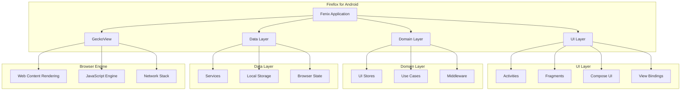

Sources:
- [mobile/android/fenix/app/build.gradle:47-288]()
- [mobile/android/fenix/app/build.gradle:542-584]()
- [mobile/android/geckoview/build.gradle:14-116]()

### Component Architecture

Fenix is built on top of a collection of reusable components known as Android Components, which provide the foundational browser functionality.

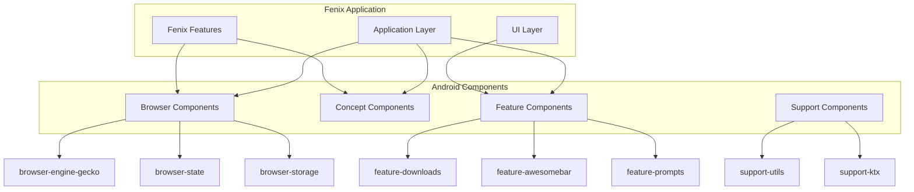

Sources:
- [mobile/android/fenix/app/build.gradle:542-584]()

## State Management

Fenix uses a unidirectional data flow pattern for state management through the concept of Stores. Each major feature typically has its own Store that manages state through actions and reducers.

### Store Architecture

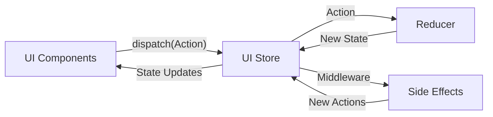

Sources:
- [mobile/android/fenix/app/src/main/java/org/mozilla/fenix/downloads/listscreen/store/DownloadUIStore.kt:15-27]()
- [mobile/android/fenix/app/src/main/java/org/mozilla/fenix/downloads/listscreen/store/DownloadUIAction.kt:12-93]()

### Downloads Feature Example

The Downloads management feature demonstrates Fenix's implementation of the Store pattern:

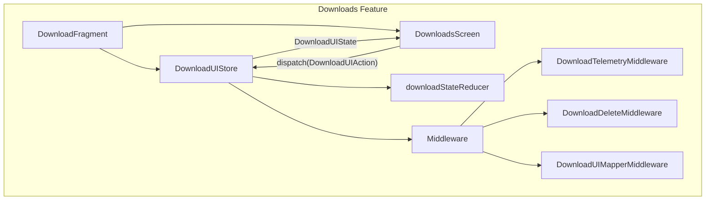

Sources:
- [mobile/android/fenix/app/src/main/java/org/mozilla/fenix/downloads/listscreen/DownloadFragment.kt:37-170]()
- [mobile/android/fenix/app/src/main/java/org/mozilla/fenix/downloads/listscreen/store/DownloadUIStore.kt:15-92]()
- [mobile/android/fenix/app/src/main/java/org/mozilla/fenix/downloads/listscreen/middleware/DownloadTelemetryMiddleware.kt:18-50]()

## UI Architecture

Fenix uses a combination of traditional Android Views and Jetpack Compose for its UI. The application is structured around fragments for navigation with increasing adoption of Compose for modern UI components.

### Screen Navigation

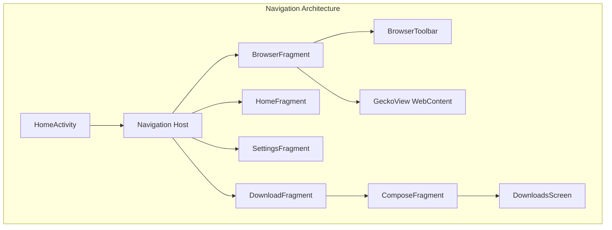

Sources:
- [mobile/android/fenix/app/src/main/java/org/mozilla/fenix/downloads/listscreen/DownloadFragment.kt:37-170]()
- [mobile/android/fenix/app/src/main/java/org/mozilla/fenix/settings/SettingsFragment.kt:78-780]()

### Compose UI Example

The Downloads screen demonstrates Fenix's use of Jetpack Compose for modern UI components:

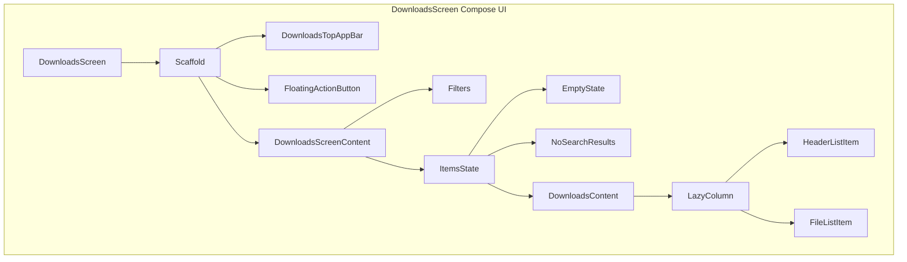

Sources:
- [mobile/android/fenix/app/src/main/java/org/mozilla/fenix/downloads/listscreen/DownloadsScreen.kt:94-412]()

## Build System

Fenix uses Gradle for its build system and supports multiple build types and product flavors to create different application variants.

### Build Types and Application IDs

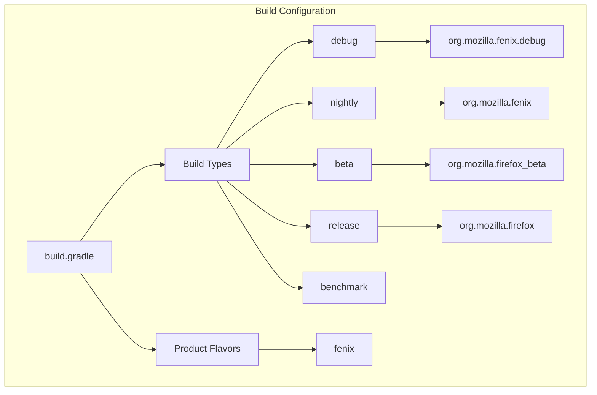

Sources:
- [mobile/android/fenix/app/build.gradle:112-170]()
- [mobile/android/fenix/app/build.gradle:195-201]()
- [mobile/android/fenix/app/build.gradle:290-338]()

### Version Management

Fenix handles version codes and names differently between debug and release builds:

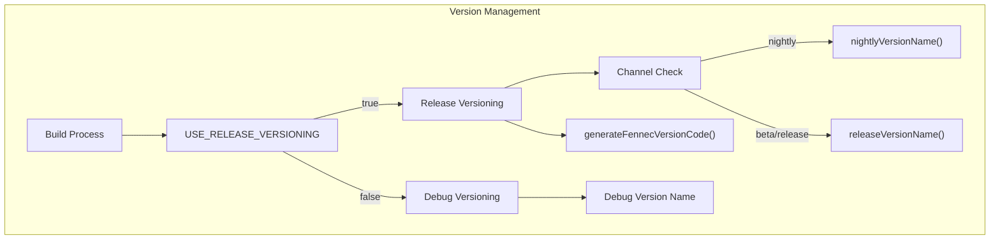

Sources:
- [mobile/android/fenix/app/build.gradle:306-338]()
- [build.gradle:210-245]()

## Telemetry and Metrics

Fenix uses Mozilla's Glean library for telemetry data collection. Metrics are defined in YAML files and are automatically generated into Kotlin code at build time.

### Telemetry Architecture

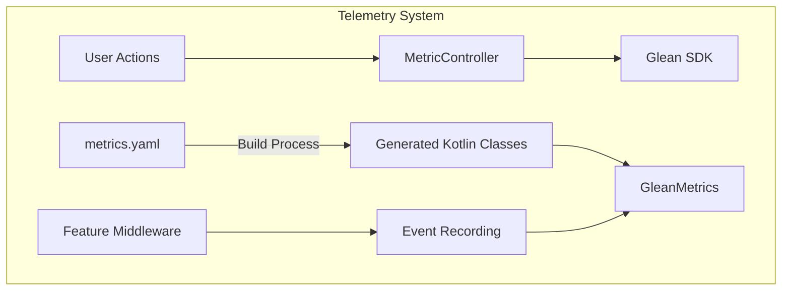

Sources:
- [mobile/android/fenix/app/metrics.yaml:1-795]()
- [mobile/android/fenix/app/src/main/java/org/mozilla/fenix/components/metrics/MetricController.kt:1-30]()
- [mobile/android/fenix/app/src/main/java/org/mozilla/fenix/downloads/listscreen/middleware/DownloadTelemetryMiddleware.kt:18-50]()
- [mobile/android/fenix/app/build.gradle:502-509]()

### Example: Download Feature Telemetry

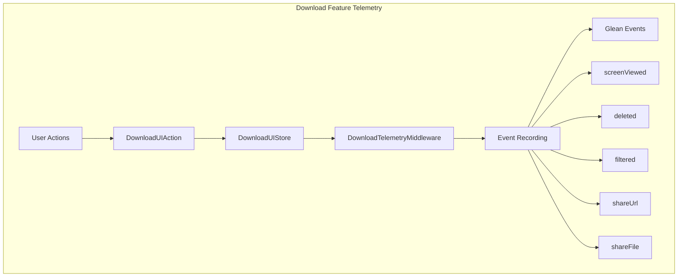

Sources:
- [mobile/android/fenix/app/src/main/java/org/mozilla/fenix/downloads/listscreen/middleware/DownloadTelemetryMiddleware.kt:18-50]()
- [mobile/android/fenix/app/src/test/java/org/mozilla/fenix/downloads/listscreen/middleware/DownloadTelemetryMiddlewareTest.kt:18-85]()

## Downloads Feature: In-Depth Look

The Downloads feature in Fenix provides a complete example of how features are implemented in the application.

### Data Model

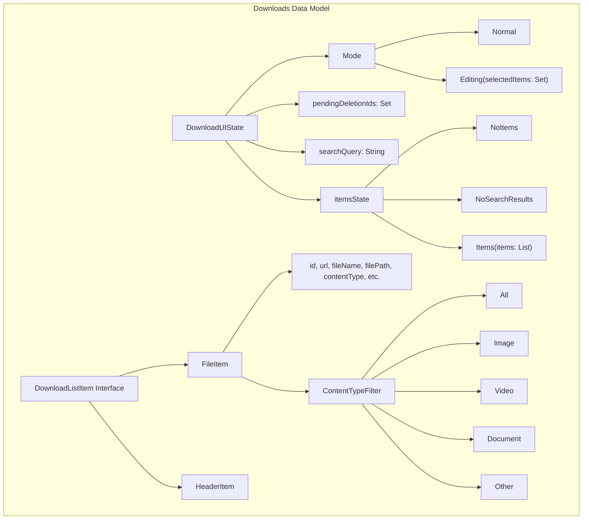

Sources:
- [mobile/android/fenix/app/src/main/java/org/mozilla/fenix/downloads/listscreen/store/DownloadUIState.kt:23-161]()
- [mobile/android/fenix/app/src/main/java/org/mozilla/fenix/downloads/listscreen/store/DownloadListItem.kt:15-147]()
- [mobile/android/fenix/app/src/test/java/org/mozilla/fenix/downloads/listscreen/store/DownloadUIStateTest.kt:10-86]()

### Actions and Reducer

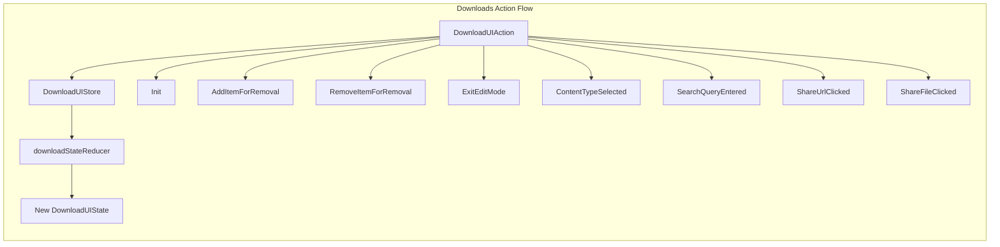

Sources:
- [mobile/android/fenix/app/src/main/java/org/mozilla/fenix/downloads/listscreen/store/DownloadUIAction.kt:12-93]()
- [mobile/android/fenix/app/src/main/java/org/mozilla/fenix/downloads/listscreen/store/DownloadUIStore.kt:32-92]()
- [mobile/android/fenix/app/src/test/java/org/mozilla/fenix/downloads/listscreen/store/DownloadUIStoreTest.kt:35-138]()

### UI Implementation

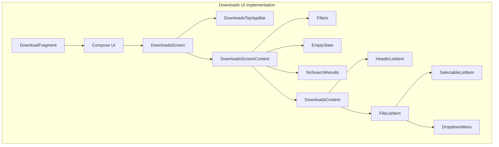

Sources:
- [mobile/android/fenix/app/src/main/java/org/mozilla/fenix/downloads/listscreen/DownloadFragment.kt:37-170]()
- [mobile/android/fenix/app/src/main/java/org/mozilla/fenix/downloads/listscreen/DownloadsScreen.kt:94-412]()

## Firefox for Android vs Firefox Focus

Mozilla maintains two main Firefox products for Android: Firefox for Android (Fenix) and Firefox Focus, a privacy-focused lightweight browser.

### Product Relationship

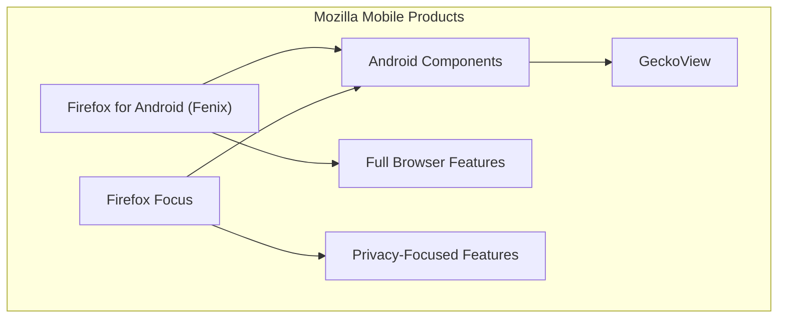

Sources:
- [mobile/android/fenix/app/build.gradle:36-63]()
- [mobile/android/focus-android/app/build.gradle:36-70]()
- [mobile/android/focus-android/app/build.gradle:129-147]()

### Build Configuration Comparison

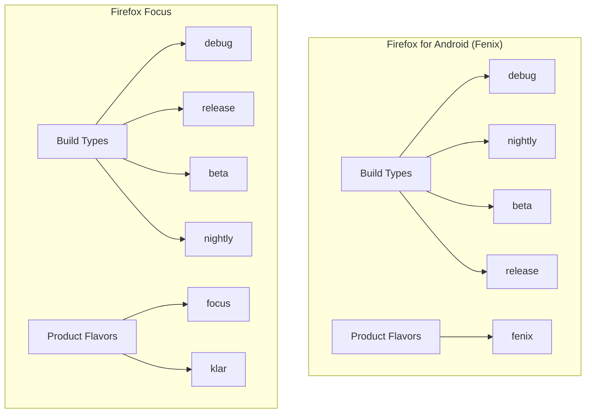

Sources:
- [mobile/android/fenix/app/build.gradle:112-170]()
- [mobile/android/fenix/app/build.gradle:195-201]()
- [mobile/android/focus-android/app/build.gradle:70-112]()
- [mobile/android/focus-android/app/build.gradle:129-147]()

## Settings and Preferences

Fenix uses Android's PreferenceFragmentCompat system for managing user settings and integrates with Mozilla accounts for sync functionality.

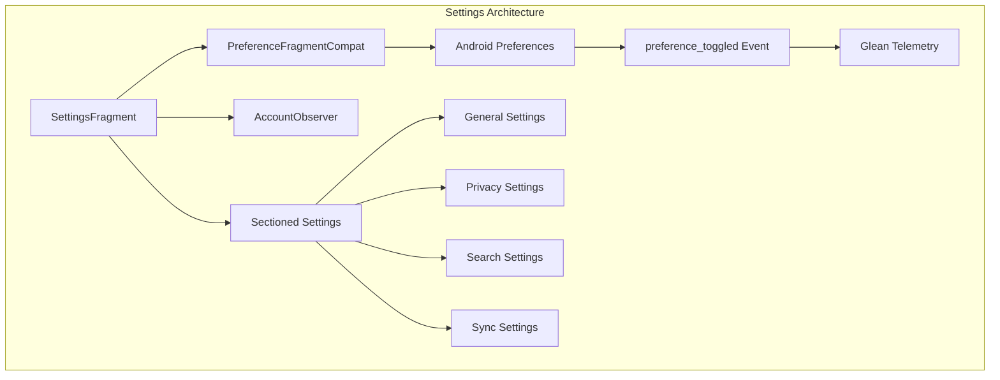

Sources:
- [mobile/android/fenix/app/src/main/java/org/mozilla/fenix/settings/SettingsFragment.kt:78-780]()
- [mobile/android/fenix/app/metrics.yaml:307-354]()

## Integration with GeckoView

Fenix uses GeckoView as its browser engine, which is responsible for web content rendering, JavaScript execution, and network operations.

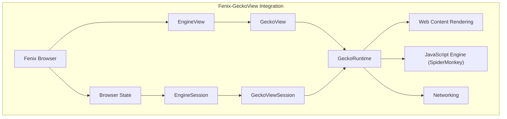

Sources:
- [mobile/android/geckoview/build.gradle:14-116]()
- [mobile/android/fenix/app/build.gradle:542-584]()

## Conclusion

Firefox for Android (Fenix) represents Mozilla's modern approach to mobile browsing. Built on a component-based architecture, it leverages GeckoView for rendering web content and employs contemporary Android development practices like Kotlin, Jetpack Compose, and a unidirectional data flow pattern for state management. This architecture provides modularity, testability, and a solid foundation for ongoing feature development and performance improvements.

---

