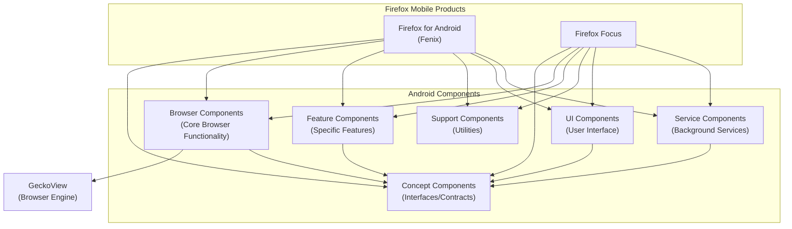
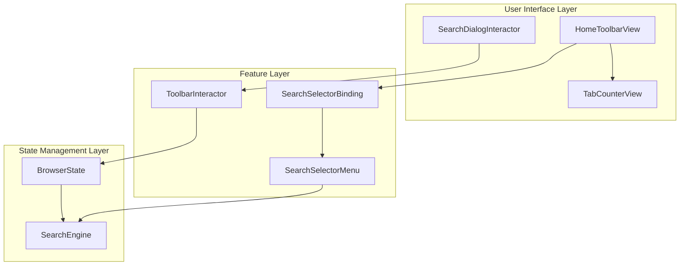
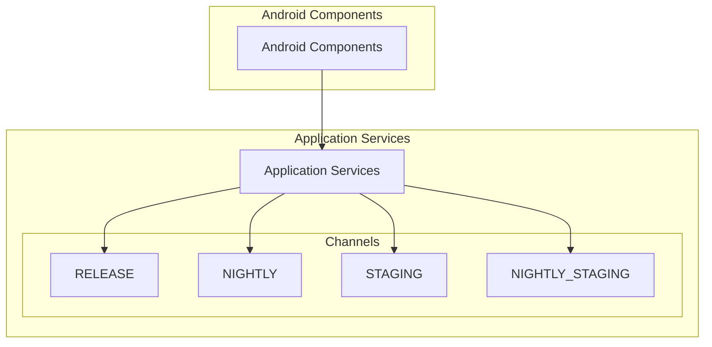

<!-- source: DeepWiki mcp.deepwiki.com · repo mozilla/gecko-dev · page 6.2 Android Components · fetched 2026-10-09 -->

# Android Components

Relevant source files

The following files were used as context for generating this wiki page:

- [build.gradle](build.gradle)
- [gradle/libs.versions.toml](gradle/libs.versions.toml)
- [mobile/android/android-components/android-lint.gradle](mobile/android/android-components/android-lint.gradle)
- [mobile/android/android-components/components/support/test/src/main/java/mozilla/components/support/test/Matchers.kt](mobile/android/android-components/components/support/test/src/main/java/mozilla/components/support/test/Matchers.kt)
- [mobile/android/android-components/components/support/test/src/main/java/mozilla/components/support/test/robolectric/shadow/PixelCopyShadow.kt](mobile/android/android-components/components/support/test/src/main/java/mozilla/components/support/test/robolectric/shadow/PixelCopyShadow.kt)
- [mobile/android/android-components/plugins/config/build.gradle](mobile/android/android-components/plugins/config/build.gradle)
- [mobile/android/android-components/plugins/dependencies/build.gradle](mobile/android/android-components/plugins/dependencies/build.gradle)
- [mobile/android/android-components/plugins/dependencies/src/main/java/ApplicationServices.kt](mobile/android/android-components/plugins/dependencies/src/main/java/ApplicationServices.kt)
- [mobile/android/android-components/plugins/dependencies/src/main/java/moz.yaml](mobile/android/android-components/plugins/dependencies/src/main/java/moz.yaml)
- [mobile/android/android-components/plugins/publicsuffixlist/build.gradle](mobile/android/android-components/plugins/publicsuffixlist/build.gradle)
- [mobile/android/android-components/samples/browser/build.gradle](mobile/android/android-components/samples/browser/build.gradle)
- [mobile/android/annotations/build.gradle](mobile/android/annotations/build.gradle)
- [mobile/android/docs/fenix.rst](mobile/android/docs/fenix.rst)
- [mobile/android/examples/messaging_example/app/build.gradle](mobile/android/examples/messaging_example/app/build.gradle)
- [mobile/android/examples/port_messaging_example/app/build.gradle](mobile/android/examples/port_messaging_example/app/build.gradle)
- [mobile/android/exoplayer2/build.gradle](mobile/android/exoplayer2/build.gradle)
- [mobile/android/fenix/app/build.gradle](mobile/android/fenix/app/build.gradle)
- [mobile/android/fenix/app/lint-baseline.xml](mobile/android/fenix/app/lint-baseline.xml)
- [mobile/android/fenix/app/src/main/java/org/mozilla/fenix/components/NotificationManager.kt](mobile/android/fenix/app/src/main/java/org/mozilla/fenix/components/NotificationManager.kt)
- [mobile/android/fenix/app/src/main/java/org/mozilla/fenix/components/metrics/GleanUsageReportingMetricsService.kt](mobile/android/fenix/app/src/main/java/org/mozilla/fenix/components/metrics/GleanUsageReportingMetricsService.kt)
- [mobile/android/fenix/app/src/main/java/org/mozilla/fenix/home/toolbar/FenixHomeToolbar.kt](mobile/android/fenix/app/src/main/java/org/mozilla/fenix/home/toolbar/FenixHomeToolbar.kt)
- [mobile/android/fenix/app/src/main/java/org/mozilla/fenix/home/toolbar/HomeToolbarView.kt](mobile/android/fenix/app/src/main/java/org/mozilla/fenix/home/toolbar/HomeToolbarView.kt)
- [mobile/android/fenix/app/src/main/java/org/mozilla/fenix/home/toolbar/SearchSelectorBinding.kt](mobile/android/fenix/app/src/main/java/org/mozilla/fenix/home/toolbar/SearchSelectorBinding.kt)
- [mobile/android/fenix/app/src/main/java/org/mozilla/fenix/home/toolbar/TabCounterView.kt](mobile/android/fenix/app/src/main/java/org/mozilla/fenix/home/toolbar/TabCounterView.kt)
- [mobile/android/fenix/app/src/main/java/org/mozilla/fenix/search/SearchDialogInteractor.kt](mobile/android/fenix/app/src/main/java/org/mozilla/fenix/search/SearchDialogInteractor.kt)
- [mobile/android/fenix/app/src/main/java/org/mozilla/fenix/settings/TextPercentageSeekBarPreference.kt](mobile/android/fenix/app/src/main/java/org/mozilla/fenix/settings/TextPercentageSeekBarPreference.kt)
- [mobile/android/fenix/app/src/main/res/layout/account_share_list_item.xml](mobile/android/fenix/app/src/main/res/layout/account_share_list_item.xml)
- [mobile/android/fenix/app/src/main/res/layout/app_share_list_item.xml](mobile/android/fenix/app/src/main/res/layout/app_share_list_item.xml)
- [mobile/android/fenix/app/src/test/java/org/mozilla/fenix/components/toolbar/BrowserHomeToolbarViewTest.kt](mobile/android/fenix/app/src/test/java/org/mozilla/fenix/components/toolbar/BrowserHomeToolbarViewTest.kt)
- [mobile/android/fenix/app/src/test/java/org/mozilla/fenix/home/InstrumentedHomeFragmentTest.kt](mobile/android/fenix/app/src/test/java/org/mozilla/fenix/home/InstrumentedHomeFragmentTest.kt)
- [mobile/android/fenix/app/src/test/java/org/mozilla/fenix/home/toolbar/TabCounterViewTest.kt](mobile/android/fenix/app/src/test/java/org/mozilla/fenix/home/toolbar/TabCounterViewTest.kt)
- [mobile/android/fenix/plugins/apksize/build.gradle](mobile/android/fenix/plugins/apksize/build.gradle)
- [mobile/android/focus-android/app/build.gradle](mobile/android/focus-android/app/build.gradle)
- [mobile/android/focus-android/app/lint-baseline.xml](mobile/android/focus-android/app/lint-baseline.xml)
- [mobile/android/geckoview/build.gradle](mobile/android/geckoview/build.gradle)
- [mobile/android/geckoview_example/build.gradle](mobile/android/geckoview_example/build.gradle)
- [mobile/android/test_runner/build.gradle](mobile/android/test_runner/build.gradle)

Android Components is a collection of reusable Android libraries that form the building blocks for Mozilla's Android-based products, specifically Firefox for Android (Fenix) and Firefox Focus. These components are designed to be modular, reusable, and composable, allowing developers to select only the components they need for specific browser functionality.

For information about GeckoView, the browser engine used by these components, see [GeckoView](#6.3). For details about Firefox for Android (Fenix), see [Firefox for Android (Fenix)](#6.1).

## Architecture Overview

Android Components follows a modular architecture organized into several distinct categories:

Sources:
- [mobile/android/fenix/app/build.gradle:542-637]()
- [mobile/android/focus-android/app/build.gradle:279-334]()

## Component Categories

Android Components are organized into several categories, each serving a different purpose in the browser architecture:

### Concept Components

Concept components define the core abstractions and interfaces that the rest of the components implement.

| Component | Description |
|-----------|-------------|
| `concept-awesomebar` | Interface for address bar implementations |
| `concept-engine` | Abstraction layer for the browser engine |
| `concept-menu` | Interface for menu implementations |
| `concept-toolbar` | Interface for browser toolbar implementations |
| `concept-tabstray` | Interface for browser tabs tray implementations |

Sources:
- [mobile/android/fenix/app/build.gradle:555-564]()

### Browser Components

Browser components provide core browser functionality by implementing the interfaces defined in the concept components.

| Component | Description |
|-----------|-------------|
| `browser-domains` | Domain-related functionality |
| `browser-icons` | Component for loading and storing website icons |
| `browser-menu` | Implementation of browser menus |
| `browser-state` | Component for managing browser state |
| `browser-toolbar` | Implementation of a browser toolbar |

Sources:
- [mobile/android/fenix/app/build.gradle:565-574]()

### Feature Components

Feature components implement specific browser features, typically depending on concept and browser components.

| Component | Description |
|-----------|-------------|
| `feature-addons` | Support for browser extensions |
| `feature-downloads` | Components for handling downloads |
| `feature-search` | Search functionality |
| `feature-tabs` | Components for working with tabs |
| `feature-webcompat` | Web compatibility features |

Sources:
- [mobile/android/fenix/app/build.gradle:576-609]()

### Service Components

Service components provide background services and integrations with external systems.

| Component | Description |
|-----------|-------------|
| `service-firefox-accounts` | Integration with Firefox Accounts |
| `service-glean` | Integration with Mozilla's Glean telemetry service |
| `service-location` | Location-related services |
| `service-nimbus` | Integration with Nimbus experimentation system |

Sources:
- [mobile/android/fenix/app/build.gradle:611-620]()

### Support Components

Support components are utility libraries that enable the other components.

| Component | Description |
|-----------|-------------|
| `support-base` | Base components and utilities |
| `support-ktx` | Kotlin extensions |
| `support-utils` | Generic utility functions |
| `support-rustlog` | Rust logging utilities |

Sources:
- [mobile/android/fenix/app/build.gradle:622-631]()

### UI Components

UI components provide reusable UI elements specific to browsers.

| Component | Description |
|-----------|-------------|
| `ui-colors` | Colors used by the browser UI |
| `ui-icons` | Icons used by the browser UI |
| `ui-tabcounter` | Component for displaying the number of open tabs |

Sources:
- [mobile/android/fenix/app/build.gradle:632-636]()

## Component Relationships

The following diagram illustrates how some specific components relate to each other, focusing on the search and toolbar functionality:

Sources:
- [mobile/android/fenix/app/src/main/java/org/mozilla/fenix/home/toolbar/HomeToolbarView.kt]()
- [mobile/android/fenix/app/src/main/java/org/mozilla/fenix/home/toolbar/TabCounterView.kt]()
- [mobile/android/fenix/app/src/main/java/org/mozilla/fenix/home/toolbar/SearchSelectorBinding.kt]()
- [mobile/android/fenix/app/src/main/java/org/mozilla/fenix/search/SearchDialogInteractor.kt]()

## Build System and Dependencies

### Dependency Management

Android Components uses a centralized dependency management approach with the `gradle/libs.versions.toml` file defining all dependency versions. This ensures consistent versions across all components and simplifies updates.

The `libs.versions.toml` file is organized into three main sections:

| Section | Purpose |
|---------|---------|
| `[versions]` | Defines version numbers for all dependencies |
| `[libraries]` | Defines library dependencies with their group, name, and version reference |
| `[plugins]` | Defines Gradle plugins used in the project |

Key dependencies include:
- AndroidX libraries (activities, fragments, lifecycle components)
- Kotlin coroutines and serialization
- Mozilla-specific libraries (GeckoView, Glean)
- Third-party libraries (OkHttp, Sentry)

Sources:
- [gradle/libs.versions.toml:1-261]()

### Application Services Integration

Android Components integrates with Mozilla's Application Services, which provides Rust-based implementations of various services like sync, storage, and accounts.

The integration is configured through the `ApplicationServices.kt` file, which defines:
- The version to use (e.g., "139.20250423050339")
- The channel (RELEASE, NIGHTLY, STAGING, NIGHTLY_STAGING)
- The Maven group ID based on the channel

Sources:
- [mobile/android/plugins/dependencies/src/main/java/ApplicationServices.kt:1-36]()
- [mobile/android/plugins/dependencies/src/main/java/moz.yaml:1-75]()

### Gradle Plugins

Android Components uses several custom Gradle plugins:

| Plugin | Purpose |
|--------|---------|
| `mozac.ConfigPlugin` | Configuration plugin for Android Components |
| `mozac.PublicSuffixListPlugin` | Plugin for managing the public suffix list |
| `mozac.DependenciesPlugin` | Plugin for managing dependencies |
| `ApkSizePlugin` | Plugin for monitoring APK size |

Sources:
- [mobile/android/android-components/plugins/config/build.gradle:1-27]()
- [mobile/android/android-components/plugins/publicsuffixlist/build.gradle:1-33]()
- [mobile/android/android-components/plugins/dependencies/build.gradle:1-28]()
- [mobile/android/fenix/plugins/apksize/build.gradle:1-32]()

## Key Component Examples

### Home Toolbar System

The home toolbar in Firefox is implemented through several key components:

| Component | Role |
|-----------|------|
| `FenixHomeToolbar` | Interface defining the toolbar behavior |
| `HomeToolbarView` | Implementation of the toolbar view |
| `TabCounterView` | Component for displaying and managing tabs |
| `SearchSelectorBinding` | Binding for the search engine selector |

The toolbar handles:
- Address bar interactions
- Search engine selection
- Tab counting and management
- Menu interactions

Sources:
- [mobile/android/fenix/app/src/main/java/org/mozilla/fenix/home/toolbar/FenixHomeToolbar.kt:1-54]()
- [mobile/android/fenix/app/src/main/java/org/mozilla/fenix/home/toolbar/HomeToolbarView.kt:1-173]()
- [mobile/android/fenix/app/src/main/java/org/mozilla/fenix/home/toolbar/TabCounterView.kt:1-89]()
- [mobile/android/fenix/app/src/main/java/org/mozilla/fenix/home/toolbar/SearchSelectorBinding.kt:1-89]()

### Notification System

The `NotificationManager` component handles creating notification channels and displaying notifications for:
- Synced tabs that were closed
- Tabs received from other devices

It creates appropriate notification channels based on Android version and manages notification display, including proper icons, text, and actions.

Sources:
- [mobile/android/fenix/app/src/main/java/org/mozilla/fenix/components/NotificationManager.kt:1-223]()

### UI Components

Android Components provides reusable UI elements through XML layouts and view classes:

| Component | Purpose |
|-----------|---------|
| `app_share_list_item.xml` | Layout for app sharing items |
| `account_share_list_item.xml` | Layout for account device sharing items |
| `TextPercentageSeekBarPreference` | Custom preference for text size adjustment |

Sources:
- [mobile/android/fenix/app/src/main/res/layout/app_share_list_item.xml:1-46]()
- [mobile/android/fenix/app/src/main/res/layout/account_share_list_item.xml:1-49]()
- [mobile/android/fenix/app/src/main/java/org/mozilla/fenix/settings/TextPercentageSeekBarPreference.kt:1-130]()

## Testing Framework

Android Components includes comprehensive testing utilities:

| Component | Purpose |
|-----------|---------|
| `Matchers.kt` | Custom matchers for Mockito to make testing easier |
| `PixelCopyShadow.kt` | Shadow class for Robolectric testing |
| `robolectric.testContext` | Test context utilities |

These utilities simplify unit testing and instrumentation testing of components by providing:
- Custom Mockito matchers that work well with Kotlin code
- Shadow classes for Android-specific functionality
- Helper methods for test contexts

Sources:
- [mobile/android/android-components/components/support/test/src/main/java/mozilla/components/support/test/Matchers.kt:1-54]()
- [mobile/android/android-components/components/support/test/src/main/java/mozilla/components/support/test/robolectric/shadow/PixelCopyShadow.kt:1-42]()
- [mobile/android/fenix/app/src/test/java/org/mozilla/fenix/home/InstrumentedHomeFragmentTest.kt:1-104]()

## Conclusion

Android Components provides a modular, reusable set of components for building browser applications on Android. By separating concerns into different components, Firefox for Android and Firefox Focus can share code and functionality while maintaining their unique identities.

The modular design enables:
- Code reuse across different Firefox mobile products
- Independent development and testing of components
- Flexible configuration for different product needs
- Integration with Mozilla services through Application Services

This modular approach is a key part of Mozilla's mobile strategy, allowing for consistency across browser products while maintaining flexibility and customization options.

---

