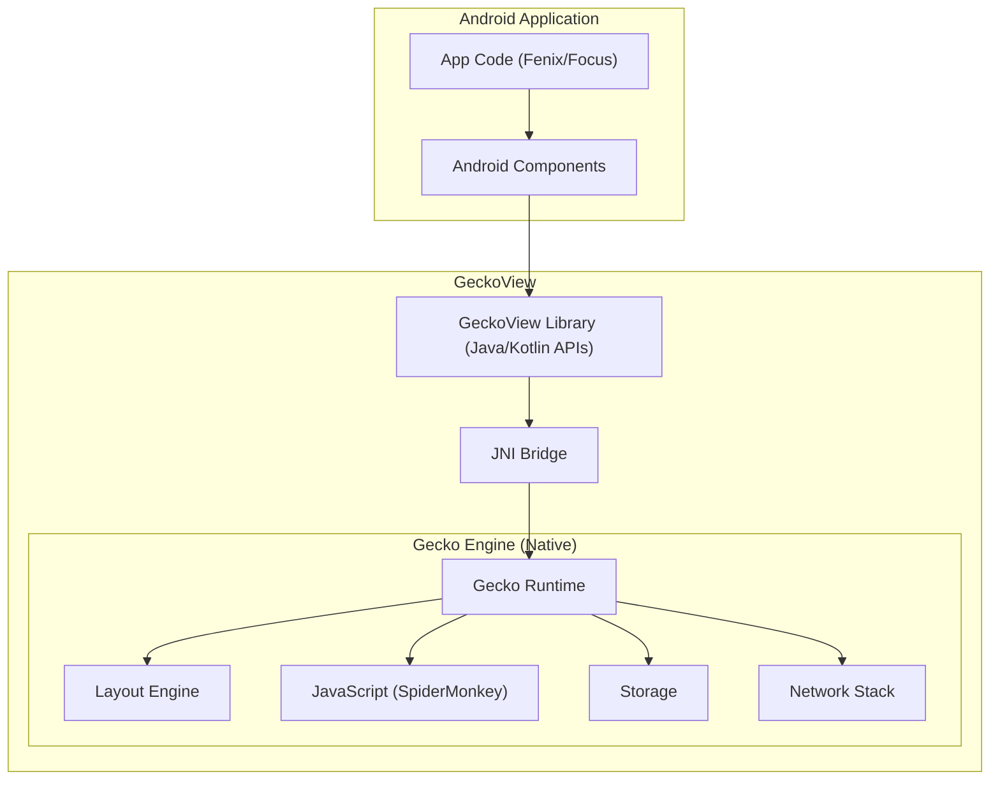
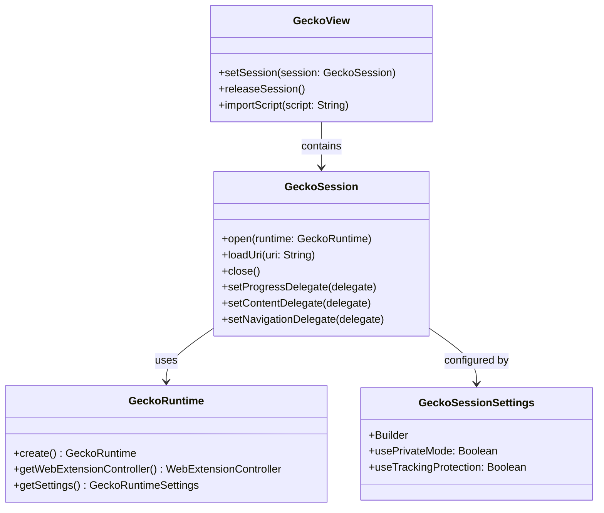
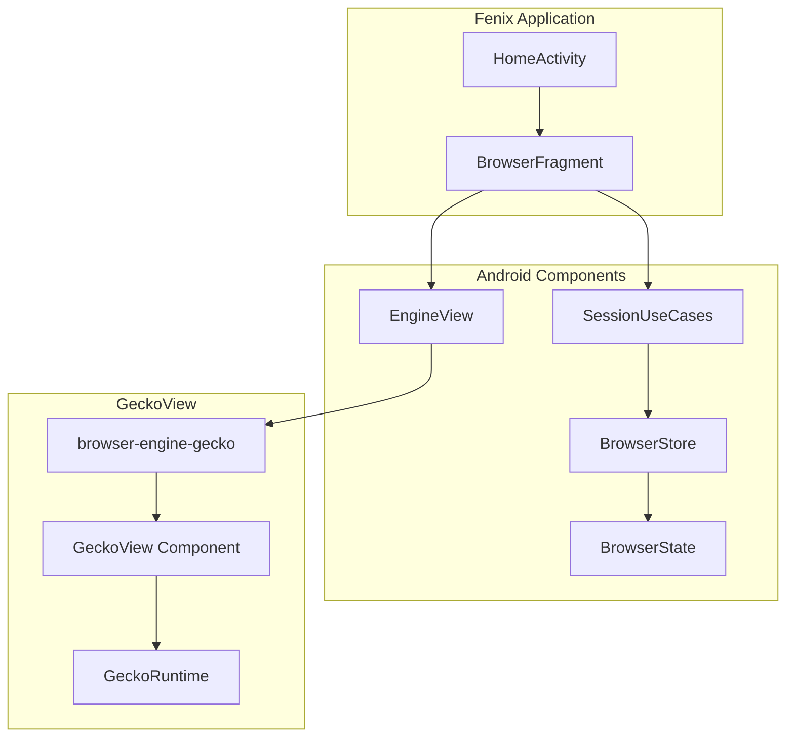
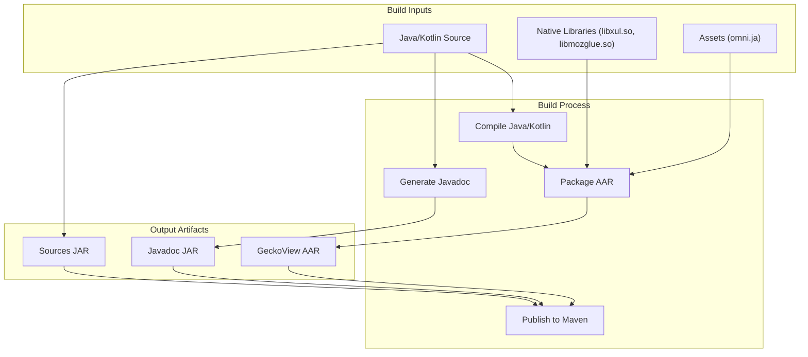
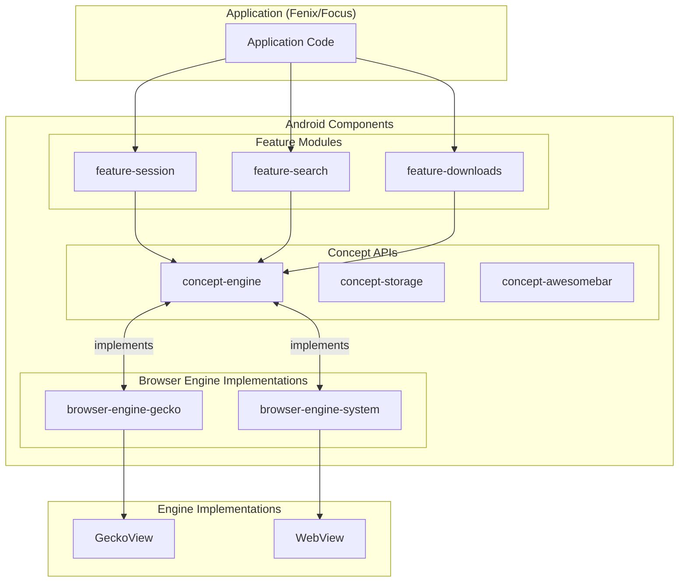
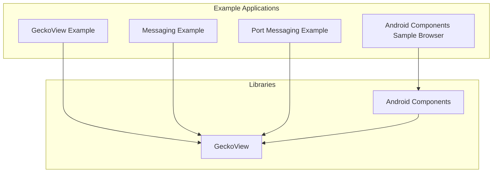

<!-- source: DeepWiki mcp.deepwiki.com · repo mozilla/gecko-dev · page 6.3 GeckoView · fetched 2026-10-09 -->

# GeckoView

Relevant source files

The following files were used as context for generating this wiki page:

- [build.gradle](build.gradle)
- [gradle/libs.versions.toml](gradle/libs.versions.toml)
- [mobile/android/android-components/android-lint.gradle](mobile/android/android-components/android-lint.gradle)
- [mobile/android/android-components/components/support/test/src/main/java/mozilla/components/support/test/Matchers.kt](mobile/android/android-components/components/support/test/src/main/java/mozilla/components/support/test/Matchers.kt)
- [mobile/android/android-components/components/support/test/src/main/java/mozilla/components/support/test/robolectric/shadow/PixelCopyShadow.kt](mobile/android/android-components/components/support/test/src/main/java/mozilla/components/support/test/robolectric/shadow/PixelCopyShadow.kt)
- [mobile/android/android-components/plugins/config/build.gradle](mobile/android/android-components/plugins/config/build.gradle)
- [mobile/android/android-components/plugins/dependencies/build.gradle](mobile/android/android-components/plugins/dependencies/build.gradle)
- [mobile/android/android-components/plugins/publicsuffixlist/build.gradle](mobile/android/android-components/plugins/publicsuffixlist/build.gradle)
- [mobile/android/android-components/samples/browser/build.gradle](mobile/android/android-components/samples/browser/build.gradle)
- [mobile/android/annotations/build.gradle](mobile/android/annotations/build.gradle)
- [mobile/android/docs/fenix.rst](mobile/android/docs/fenix.rst)
- [mobile/android/examples/messaging_example/app/build.gradle](mobile/android/examples/messaging_example/app/build.gradle)
- [mobile/android/examples/port_messaging_example/app/build.gradle](mobile/android/examples/port_messaging_example/app/build.gradle)
- [mobile/android/exoplayer2/build.gradle](mobile/android/exoplayer2/build.gradle)
- [mobile/android/fenix/app/build.gradle](mobile/android/fenix/app/build.gradle)
- [mobile/android/fenix/app/lint-baseline.xml](mobile/android/fenix/app/lint-baseline.xml)
- [mobile/android/fenix/app/src/main/java/org/mozilla/fenix/components/NotificationManager.kt](mobile/android/fenix/app/src/main/java/org/mozilla/fenix/components/NotificationManager.kt)
- [mobile/android/fenix/app/src/main/java/org/mozilla/fenix/components/metrics/GleanUsageReportingMetricsService.kt](mobile/android/fenix/app/src/main/java/org/mozilla/fenix/components/metrics/GleanUsageReportingMetricsService.kt)
- [mobile/android/fenix/app/src/main/java/org/mozilla/fenix/home/toolbar/FenixHomeToolbar.kt](mobile/android/fenix/app/src/main/java/org/mozilla/fenix/home/toolbar/FenixHomeToolbar.kt)
- [mobile/android/fenix/app/src/main/java/org/mozilla/fenix/home/toolbar/HomeToolbarView.kt](mobile/android/fenix/app/src/main/java/org/mozilla/fenix/home/toolbar/HomeToolbarView.kt)
- [mobile/android/fenix/app/src/main/java/org/mozilla/fenix/home/toolbar/SearchSelectorBinding.kt](mobile/android/fenix/app/src/main/java/org/mozilla/fenix/home/toolbar/SearchSelectorBinding.kt)
- [mobile/android/fenix/app/src/main/java/org/mozilla/fenix/home/toolbar/TabCounterView.kt](mobile/android/fenix/app/src/main/java/org/mozilla/fenix/home/toolbar/TabCounterView.kt)
- [mobile/android/fenix/app/src/main/java/org/mozilla/fenix/search/SearchDialogInteractor.kt](mobile/android/fenix/app/src/main/java/org/mozilla/fenix/search/SearchDialogInteractor.kt)
- [mobile/android/fenix/app/src/main/java/org/mozilla/fenix/settings/TextPercentageSeekBarPreference.kt](mobile/android/fenix/app/src/main/java/org/mozilla/fenix/settings/TextPercentageSeekBarPreference.kt)
- [mobile/android/fenix/app/src/main/res/layout/account_share_list_item.xml](mobile/android/fenix/app/src/main/res/layout/account_share_list_item.xml)
- [mobile/android/fenix/app/src/main/res/layout/app_share_list_item.xml](mobile/android/fenix/app/src/main/res/layout/app_share_list_item.xml)
- [mobile/android/fenix/app/src/test/java/org/mozilla/fenix/components/toolbar/BrowserHomeToolbarViewTest.kt](mobile/android/fenix/app/src/test/java/org/mozilla/fenix/components/toolbar/BrowserHomeToolbarViewTest.kt)
- [mobile/android/fenix/app/src/test/java/org/mozilla/fenix/home/InstrumentedHomeFragmentTest.kt](mobile/android/fenix/app/src/test/java/org/mozilla/fenix/home/InstrumentedHomeFragmentTest.kt)
- [mobile/android/fenix/app/src/test/java/org/mozilla/fenix/home/toolbar/TabCounterViewTest.kt](mobile/android/fenix/app/src/test/java/org/mozilla/fenix/home/toolbar/TabCounterViewTest.kt)
- [mobile/android/fenix/plugins/apksize/build.gradle](mobile/android/fenix/plugins/apksize/build.gradle)
- [mobile/android/focus-android/app/build.gradle](mobile/android/focus-android/app/build.gradle)
- [mobile/android/focus-android/app/lint-baseline.xml](mobile/android/focus-android/app/lint-baseline.xml)
- [mobile/android/geckoview/build.gradle](mobile/android/geckoview/build.gradle)
- [mobile/android/geckoview_example/build.gradle](mobile/android/geckoview_example/build.gradle)
- [mobile/android/test_runner/build.gradle](mobile/android/test_runner/build.gradle)

GeckoView is Mozilla's browser engine component for Android applications. It provides a reusable Android library that embedders can use to integrate Gecko's rendering capabilities, JavaScript execution, and other web platform features into their Android applications. GeckoView serves as the foundation for Mozilla's mobile browsers including Firefox for Android (Fenix) and Firefox Focus.

For information about how to build Firefox for Android using GeckoView, see [Firefox for Android](#6.1).

## 1. Overview and Architecture

GeckoView is designed as an embeddable component that provides a complete browser engine with full web platform support. Unlike WebView (Android's built-in web component), GeckoView uses Mozilla's Gecko rendering engine, which provides consistent rendering across platforms, more powerful privacy features, and better standards compliance.

Sources:
- [mobile/android/fenix/app/build.gradle:542-543]()
- [mobile/android/focus-android/app/build.gradle:279-281]()
- [mobile/android/geckoview/build.gradle:1-148]()

## 2. Component Structure

GeckoView consists of a Java/Kotlin API layer that communicates with the native Gecko engine through JNI (Java Native Interface). The component is structured to provide a clean API for Android applications while handling the complexity of the browser engine internally.

Sources:
- [mobile/android/geckoview/build.gradle:1-148]()
- [mobile/android/geckoview_example/build.gradle:1-55]()

## 3. Integration with Android Applications

GeckoView is integrated into Firefox for Android (Fenix) and Firefox Focus as a dependency. Both applications use GeckoView through the Android Components abstraction layer, which provides higher-level browser functionality on top of GeckoView.

Sources:
- [mobile/android/fenix/app/build.gradle:542-543]()
- [mobile/android/fenix/app/build.gradle:576-610]()
- [mobile/android/focus-android/app/build.gradle:279-281]()

## 4. Building and Packaging

GeckoView is built as an Android Archive (AAR) that includes Java/Kotlin API classes and native libraries. The build process is managed by Gradle and involves compiling both the Java/Kotlin code and packaging the native Gecko libraries.

### 4.1 Build Configuration

GeckoView's build configuration is primarily defined in `geckoview/build.gradle`. This configuration includes:

- Version information derived from the Mozilla build system
- Native library packaging
- AndroidManifest configuration
- Javadoc and source JAR generation for publishing

### 4.2 Variants and Flavors

GeckoView supports different build variants:
- Regular vs. "lite" versions
- Channel-specific versions (nightly, beta, release)
- Architecture-specific builds (arm64-v8a, armeabi-v7a, x86, x86_64)

### 4.3 Publishing

GeckoView is published as a Maven artifact with multiple variants. Each variant includes:
- The AAR with Java/Kotlin classes and native libraries
- Javadoc JAR for documentation
- Sources JAR for source code

Sources:
- [mobile/android/geckoview/build.gradle:246-384]()
- [mobile/android/geckoview/build.gradle:385-508]()
- [build.gradle:90-107]()

## 5. Integration with Android Components

Android Components is a collection of Android libraries that provide browser functionality. GeckoView is integrated with Android Components through the `browser-engine-gecko` component, which provides an implementation of the engine interface using GeckoView.

### 5.1 Engine Interface

Android Components defines a browser engine abstraction that can be implemented by different engines (GeckoView, WebView, etc.). This allows applications to use a common API regardless of the underlying engine.

### 5.2 Feature Modules

Android Components includes various feature modules that build on top of the engine abstraction to provide higher-level browser functionality:

- Session management
- Downloads
- Search
- Content blocking
- History and bookmarks
- WebExtensions support

### 5.3 Usage in Applications

Fenix and Focus use Android Components to interact with GeckoView, rather than using GeckoView directly. This provides a more convenient API and additional functionality.

Sources:
- [mobile/android/fenix/app/build.gradle:542-563]()
- [mobile/android/fenix/app/build.gradle:576-610]()
- [mobile/android/focus-android/app/build.gradle:279-331]()

## 6. Tooling and Development

GeckoView includes various tools and APIs to support development and debugging:

### 6.1 Logging and Debugging

GeckoView provides mechanisms for logging and debugging, including:
- Runtime debugging flags
- Log output configuration
- Remote debugging support

### 6.2 Extensions and Customization

GeckoView supports WebExtensions and provides APIs for customizing browser behavior:
- Content blocking configuration
- JavaScript settings
- Network request handling

### 6.3 Testing

GeckoView includes instrumentation tests and supports testing of applications that use GeckoView:
- `test_runner` application for running tests
- Test utilities for mocking and testing GeckoView components

## 7. Usage in Example Applications

Mozilla provides example applications that demonstrate how to use GeckoView:

### 7.1 GeckoView Example

A simple browser application that shows how to use GeckoView directly.

### 7.2 Messaging Examples

Example applications that demonstrate communication between web content and the Android application using GeckoView:
- Direct messaging example
- Port-based messaging example

Sources:
- [mobile/android/geckoview_example/build.gradle:1-55]()
- [mobile/android/examples/messaging_example/app/build.gradle:1-46]()
- [mobile/android/examples/port_messaging_example/app/build.gradle:1-46]()
- [mobile/android/android-components/samples/browser/build.gradle:1-178]()

## 8. Relationship with Other Systems

GeckoView interacts with several other systems within the Mozilla ecosystem:

### 8.1 Relationship with Gecko

GeckoView is an Android-specific wrapper around the Gecko rendering engine. It provides a Java/Kotlin API that communicates with the native Gecko engine through JNI.

### 8.2 Relationship with Firefox for Android

Firefox for Android (Fenix) and Firefox Focus use GeckoView as their browser engine. They interact with GeckoView through Android Components.

### 8.3 Relationship with WebExtensions

GeckoView supports WebExtensions, allowing extensions to be used in Android applications that use GeckoView.

## 9. Performance Considerations

GeckoView is designed to provide good performance on Android devices. Some key performance considerations include:

### 9.1 Memory Management

GeckoView manages memory for both the Java/Kotlin and native components. Proper memory management is important for maintaining good performance.

### 9.2 Startup Time

GeckoView is designed to minimize startup time, which is particularly important for mobile applications.

### 9.3 Rendering Performance

GeckoView provides efficient rendering of web content, with support for hardware acceleration and optimized drawing.

## 10. Conclusion

GeckoView is a powerful browser engine component for Android that provides a complete implementation of the web platform. It serves as the foundation for Firefox for Android browsers and can be used by other Android applications to provide web browsing capabilities. Its modular design and comprehensive API make it a flexible and powerful tool for developers building web-enabled Android applications.

Sources:
- [mobile/android/geckoview/build.gradle:1-148]()
- [mobile/android/fenix/app/build.gradle:542-563]()
- [mobile/android/focus-android/app/build.gradle:279-281]()

---

