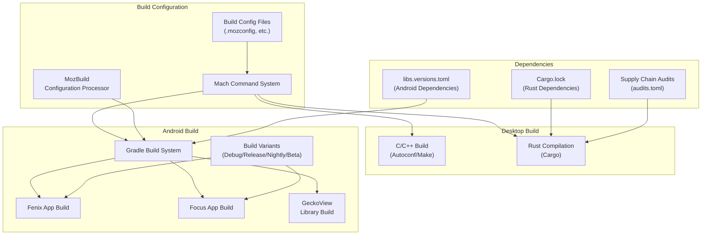
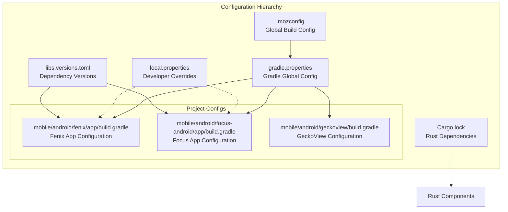
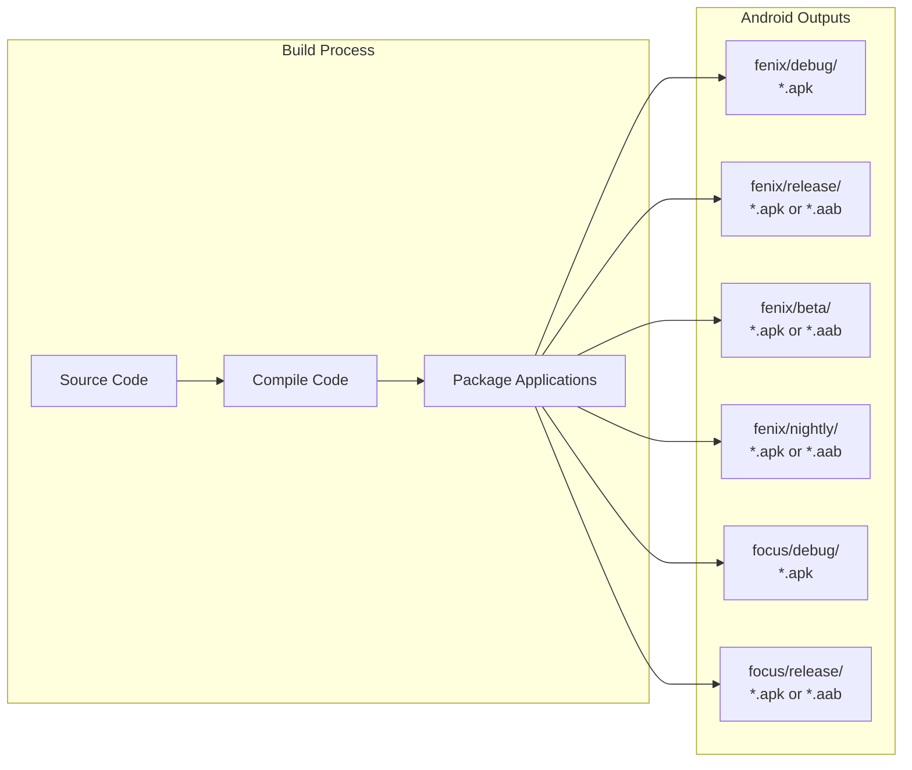
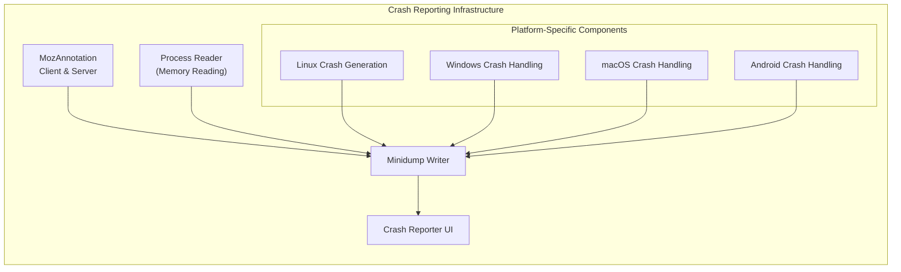

<!-- source: DeepWiki mcp.deepwiki.com · repo mozilla/gecko-dev · page 7 Build System and Infrastructure · fetched 2026-10-09 -->

# Build System and Infrastructure

<details>
<summary>Relevant source files</summary>

The following files were used as context for generating this wiki page:

- [Cargo.lock](Cargo.lock)
- [build.gradle](build.gradle)
- [gradle/libs.versions.toml](gradle/libs.versions.toml)
- [mobile/android/android-components/android-lint.gradle](mobile/android/android-components/android-lint.gradle)
- [mobile/android/android-components/components/support/test/src/main/java/mozilla/components/support/test/Matchers.kt](mobile/android/android-components/components/support/test/src/main/java/mozilla/components/support/test/Matchers.kt)
- [mobile/android/android-components/components/support/test/src/main/java/mozilla/components/support/test/robolectric/shadow/PixelCopyShadow.kt](mobile/android/android-components/components/support/test/src/main/java/mozilla/components/support/test/robolectric/shadow/PixelCopyShadow.kt)
- [mobile/android/android-components/plugins/config/build.gradle](mobile/android/android-components/plugins/config/build.gradle)
- [mobile/android/android-components/plugins/dependencies/build.gradle](mobile/android/android-components/plugins/dependencies/build.gradle)
- [mobile/android/android-components/plugins/publicsuffixlist/build.gradle](mobile/android/android-components/plugins/publicsuffixlist/build.gradle)
- [mobile/android/android-components/samples/browser/build.gradle](mobile/android/android-components/samples/browser/build.gradle)
- [mobile/android/annotations/build.gradle](mobile/android/annotations/build.gradle)
- [mobile/android/docs/fenix.rst](mobile/android/docs/fenix.rst)
- [mobile/android/examples/messaging_example/app/build.gradle](mobile/android/examples/messaging_example/app/build.gradle)
- [mobile/android/examples/port_messaging_example/app/build.gradle](mobile/android/examples/port_messaging_example/app/build.gradle)
- [mobile/android/exoplayer2/build.gradle](mobile/android/exoplayer2/build.gradle)
- [mobile/android/fenix/app/build.gradle](mobile/android/fenix/app/build.gradle)
- [mobile/android/fenix/app/lint-baseline.xml](mobile/android/fenix/app/lint-baseline.xml)
- [mobile/android/fenix/app/src/main/java/org/mozilla/fenix/components/NotificationManager.kt](mobile/android/fenix/app/src/main/java/org/mozilla/fenix/components/NotificationManager.kt)
- [mobile/android/fenix/app/src/main/java/org/mozilla/fenix/components/metrics/GleanUsageReportingMetricsService.kt](mobile/android/fenix/app/src/main/java/org/mozilla/fenix/components/metrics/GleanUsageReportingMetricsService.kt)
- [mobile/android/fenix/app/src/main/java/org/mozilla/fenix/home/toolbar/FenixHomeToolbar.kt](mobile/android/fenix/app/src/main/java/org/mozilla/fenix/home/toolbar/FenixHomeToolbar.kt)
- [mobile/android/fenix/app/src/main/java/org/mozilla/fenix/home/toolbar/HomeToolbarView.kt](mobile/android/fenix/app/src/main/java/org/mozilla/fenix/home/toolbar/HomeToolbarView.kt)
- [mobile/android/fenix/app/src/main/java/org/mozilla/fenix/home/toolbar/SearchSelectorBinding.kt](mobile/android/fenix/app/src/main/java/org/mozilla/fenix/home/toolbar/SearchSelectorBinding.kt)
- [mobile/android/fenix/app/src/main/java/org/mozilla/fenix/home/toolbar/TabCounterView.kt](mobile/android/fenix/app/src/main/java/org/mozilla/fenix/home/toolbar/TabCounterView.kt)
- [mobile/android/fenix/app/src/main/java/org/mozilla/fenix/search/SearchDialogInteractor.kt](mobile/android/fenix/app/src/main/java/org/mozilla/fenix/search/SearchDialogInteractor.kt)
- [mobile/android/fenix/app/src/main/java/org/mozilla/fenix/settings/TextPercentageSeekBarPreference.kt](mobile/android/fenix/app/src/main/java/org/mozilla/fenix/settings/TextPercentageSeekBarPreference.kt)
- [mobile/android/fenix/app/src/main/res/layout/account_share_list_item.xml](mobile/android/fenix/app/src/main/res/layout/account_share_list_item.xml)
- [mobile/android/fenix/app/src/main/res/layout/app_share_list_item.xml](mobile/android/fenix/app/src/main/res/layout/app_share_list_item.xml)
- [mobile/android/fenix/app/src/test/java/org/mozilla/fenix/components/toolbar/BrowserHomeToolbarViewTest.kt](mobile/android/fenix/app/src/test/java/org/mozilla/fenix/components/toolbar/BrowserHomeToolbarViewTest.kt)
- [mobile/android/fenix/app/src/test/java/org/mozilla/fenix/home/InstrumentedHomeFragmentTest.kt](mobile/android/fenix/app/src/test/java/org/mozilla/fenix/home/InstrumentedHomeFragmentTest.kt)
- [mobile/android/fenix/app/src/test/java/org/mozilla/fenix/home/toolbar/TabCounterViewTest.kt](mobile/android/fenix/app/src/test/java/org/mozilla/fenix/home/toolbar/TabCounterViewTest.kt)
- [mobile/android/fenix/plugins/apksize/build.gradle](mobile/android/fenix/plugins/apksize/build.gradle)
- [mobile/android/focus-android/app/build.gradle](mobile/android/focus-android/app/build.gradle)
- [mobile/android/focus-android/app/lint-baseline.xml](mobile/android/focus-android/app/lint-baseline.xml)
- [mobile/android/geckoview/build.gradle](mobile/android/geckoview/build.gradle)
- [mobile/android/geckoview_example/build.gradle](mobile/android/geckoview_example/build.gradle)
- [mobile/android/test_runner/build.gradle](mobile/android/test_runner/build.gradle)
- [supply-chain/audits.toml](supply-chain/audits.toml)
- [third_party/rust/memtest/.cargo-checksum.json](third_party/rust/memtest/.cargo-checksum.json)
- [third_party/rust/memtest/Cargo.lock](third_party/rust/memtest/Cargo.lock)
- [third_party/rust/memtest/Cargo.toml](third_party/rust/memtest/Cargo.toml)
- [third_party/rust/memtest/LICENSE](third_party/rust/memtest/LICENSE)
- [third_party/rust/memtest/README.md](third_party/rust/memtest/README.md)
- [third_party/rust/memtest/examples/usage.rs](third_party/rust/memtest/examples/usage.rs)
- [third_party/rust/memtest/src/lib.rs](third_party/rust/memtest/src/lib.rs)
- [third_party/rust/memtest/src/memtest.rs](third_party/rust/memtest/src/memtest.rs)
- [toolkit/crashreporter/breakpad-client/linux/crash_generation/crash_generation_server.cc](toolkit/crashreporter/breakpad-client/linux/crash_generation/crash_generation_server.cc)
- [toolkit/crashreporter/breakpad-client/linux/crash_generation/crash_generation_server.h](toolkit/crashreporter/breakpad-client/linux/crash_generation/crash_generation_server.h)
- [toolkit/crashreporter/breakpad-client/linux/handler/exception_handler.cc](toolkit/crashreporter/breakpad-client/linux/handler/exception_handler.cc)
- [toolkit/crashreporter/client/app/Cargo.toml](toolkit/crashreporter/client/app/Cargo.toml)
- [toolkit/crashreporter/client/app/src/memory_test.rs](toolkit/crashreporter/client/app/src/memory_test.rs)
- [toolkit/crashreporter/mozannotation_client/Cargo.toml](toolkit/crashreporter/mozannotation_client/Cargo.toml)
- [toolkit/crashreporter/mozannotation_client/cbindgen.toml](toolkit/crashreporter/mozannotation_client/cbindgen.toml)
- [toolkit/crashreporter/mozannotation_client/src/lib.rs](toolkit/crashreporter/mozannotation_client/src/lib.rs)
- [toolkit/crashreporter/mozannotation_server/src/lib.rs](toolkit/crashreporter/mozannotation_server/src/lib.rs)
- [toolkit/crashreporter/process_reader/src/lib.rs](toolkit/crashreporter/process_reader/src/lib.rs)
- [toolkit/crashreporter/process_reader/src/platform/linux.rs](toolkit/crashreporter/process_reader/src/platform/linux.rs)
- [toolkit/crashreporter/process_reader/src/platform/macos.rs](toolkit/crashreporter/process_reader/src/platform/macos.rs)
- [toolkit/crashreporter/process_reader/src/platform/windows.rs](toolkit/crashreporter/process_reader/src/platform/windows.rs)
- [toolkit/crashreporter/rust_minidump_writer_linux/src/lib.rs](toolkit/crashreporter/rust_minidump_writer_linux/src/lib.rs)

</details>


This page provides an overview of the Firefox build system and infrastructure, explaining how code is compiled, packaged, and delivered across different platforms. It covers the core build tools, configuration mechanisms, and build processes that transform source code into the final Firefox products. For information about specific crash reporting systems, see [Crash Reporting System](#7.1).

## Overview of Build System Components

The Firefox build system consists of several interconnected components that work together to compile, package, and deliver Firefox across desktop and mobile platforms. The build system is designed to handle cross-platform development, supporting various target operating systems including Windows, macOS, Linux, and Android.



The build system is designed around modularity, with specialized components handling different parts of the codebase. The main entry point is the `mach` command system, which orchestrates the various build tools and processes.

Sources: [build.gradle:1-194](build.gradle:1-194), [Cargo.lock:1-100](Cargo.lock:1-100), [gradle/libs.versions.toml:1-50](gradle/libs.versions.toml:1-50), [supply-chain/audits.toml:1-50](supply-chain/audits.toml:1-50)

## Core Build System Structure

### Mach Command System

The `mach` command is the main interface to the Firefox build system. It provides a unified command-line interface for various build tasks, including configuring the build environment, building the application, running tests, and packaging the application for distribution.

### Build Configuration

Firefox uses a variety of configuration files to control the build process:

- **`.mozconfig`**: The primary build configuration file that specifies build options, paths, and flags
- **`build.gradle`**: Root-level Gradle configuration for Android projects
- **`Cargo.toml`/`Cargo.lock`**: Configuration for Rust components
- **`libs.versions.toml`**: Centralized dependency version management for Android projects



Sources: [build.gradle:90-117](build.gradle:90-117), [mobile/android/fenix/app/build.gradle:47-67](mobile/android/fenix/app/build.gradle:47-67), [mobile/android/focus-android/app/build.gradle:28-45](mobile/android/focus-android/app/build.gradle:28-45)

## Rust Build Infrastructure

Firefox uses Rust for many components, with a dedicated build infrastructure based on Cargo.

### Dependency Management

Rust dependencies are managed through `Cargo.lock`, which pins exact versions of all dependencies to ensure reproducible builds. The `Cargo.lock` file lists all dependencies, their sources, and their versions.

### Supply Chain Security

Firefox implements supply chain security for Rust dependencies through audits defined in `audits.toml`. These audits document who reviewed each dependency, the criteria for the audit, and the period of validity.

```
[[wildcard-audits.audio_thread_priority]]
who = "Paul Adenot <paul@paul.cx>"
criteria = "safe-to-deploy"
user-id = 1258 # Paul Adenot (padenot)
start = "2019-05-09"
end = "2026-02-01"
```

These audits help ensure the security and reliability of third-party dependencies used in Firefox.

Sources: [Cargo.lock:1-200](Cargo.lock:1-200), [supply-chain/audits.toml:1-100](supply-chain/audits.toml:1-100)

## Android Build Infrastructure

Firefox for Android (Fenix and Focus) uses a Gradle-based build system. This system is integrated with the overall Firefox build infrastructure through custom Gradle plugins and configuration.

### Build System Components

```mermaid
flowchart TB
    subgraph "Android Build System"
        direction TB
        
        RootBuild["Root build.gradle<br>Global Configuration"]
        LibsVersions["libs.versions.toml<br>Dependency Versions"]
        
        subgraph "Firefox for Android Apps"
            Fenix["Fenix App<br>(Firefox for Android)"]
            Focus["Focus App<br>(Firefox Focus)"]
        end
        
        subgraph "Build Infrastructure"
            GeckoView["GeckoView<br>Browser Engine Library"]
            AndroidComponents["Android Components<br>Reusable Modules"]
            Plugins["Gradle Plugins<br>(Custom Build Logic)"]
            
            subgraph "Build Variants"
                Debug["Debug"]
                Release["Release"]
                Beta["Beta"]
                Nightly["Nightly"]
            end
            
            subgraph "Product Flavors"
                FenixFlavor["Fenix Flavor"]
                KlarFlavor["Klar Flavor<br>(Focus in Some Regions)"]
            end
        end
    end
    
    RootBuild --> Fenix
    RootBuild --> Focus
    RootBuild --> GeckoView
    RootBuild --> AndroidComponents
    
    LibsVersions --> Fenix
    LibsVersions --> Focus
    LibsVersions --> AndroidComponents
    
    GeckoView --> Fenix
    GeckoView --> Focus
    
    AndroidComponents --> Fenix
    AndroidComponents --> Focus
    
    Plugins --> Fenix
    Plugins --> Focus
    
    Build Variants --- Fenix
    Build Variants --- Focus
    
    Product Flavors --- Focus
```

Sources: [mobile/android/fenix/app/build.gradle:1-50](mobile/android/fenix/app/build.gradle:1-50), [mobile/android/focus-android/app/build.gradle:1-50](mobile/android/focus-android/app/build.gradle:1-50), [mobile/android/geckoview/build.gradle:1-50](mobile/android/geckoview/build.gradle:1-50)

### Dependency Management

Android dependencies are centrally managed in the `gradle/libs.versions.toml` file, which provides a single source of truth for dependency versions across all Android projects. This approach, known as version catalogs, helps maintain consistency and simplifies updates.

The file defines:
- Version constants (`[versions]` section)
- Library definitions (`[libraries]` section)
- Plugin definitions (`[plugins]` section)

```
[versions]
android-gradle-plugin = "8.9.2"
kotlin = "2.1.20"
mozilla-glean = "64.1.1"

[libraries]
androidx-activity = { group = "androidx.activity", name = "activity", version.ref = "activity" }
mozilla-glean = { group = "org.mozilla.telemetry", name = "glean", version.ref = "mozilla-glean" }

[plugins]
kotlin-android = { id = "org.jetbrains.kotlin.android", version.ref = "kotlin" }
```

Sources: [gradle/libs.versions.toml:1-269](gradle/libs.versions.toml:1-269)

### Build Variants and Product Flavors

Firefox for Android apps use build variants and product flavors to create different versions of the app from the same codebase:

#### Build Variants (Build Types)
- **Debug**: Development builds with debugging enabled
- **Release**: Production builds with optimizations
- **Beta**: Pre-release builds for beta testing
- **Nightly**: Daily builds from the latest code

#### Product Flavors
- **Fenix**: Standard Firefox for Android
- **Klar**: Firefox Focus/Klar (privacy-focused browser)

This configuration allows for building multiple variants of the app with different features, branding, and configurations.

```
buildTypes {
    debug {
        applicationIdSuffix ".fenix.debug"
        resValue "bool", "IS_DEBUG", "true"
    }
    nightly {
        applicationIdSuffix ".fenix"
        buildConfigField "boolean", "USE_RELEASE_VERSIONING", "true"
    }
    beta {
        applicationIdSuffix ".firefox_beta"
    }
    release {
        applicationIdSuffix ".firefox"
    }
}

flavorDimensions.add("product")

productFlavors {
    fenix {
        dimension "product"
    }
}
```

Sources: [mobile/android/fenix/app/build.gradle:113-168](mobile/android/fenix/app/build.gradle:113-168), [mobile/android/focus-android/app/build.gradle:69-146](mobile/android/focus-android/app/build.gradle:69-146)

## Version Management

Firefox uses a sophisticated version management system that handles version codes, version names, and build IDs across all platforms.

### Version Code Generation

For Android apps, version codes are generated dynamically based on the app version, build type, and architecture. This ensures that each build has a unique version code that follows Google Play Store requirements.

```
def versionName = variant.buildType.name == 'nightly' ?
        "${Config.nightlyVersionName(project)}" :
        "${Config.releaseVersionName(project)}"

variant.outputs.each { output ->
    def abi = output.getFilter(FilterConfiguration.FilterType.ABI.name())
    def versionCodeOverride = Config.generateFennecVersionCode(abi, isAppBundle)
    
    output.versionNameOverride = versionName
    output.versionCodeOverride = versionCodeOverride
}
```

Sources: [mobile/android/fenix/app/build.gradle:306-331](mobile/android/fenix/app/build.gradle:306-331), [mobile/android/focus-android/app/build.gradle:391-412](mobile/android/focus-android/app/build.gradle:391-412), [build.gradle:212-245](build.gradle:212-245)

### Build ID and Channel

Firefox builds are identified by a build ID (typically based on date and time) and a channel (release, beta, nightly, etc.). These identifiers are used for update checks, telemetry, and other purposes.

```
// Mimic Python: open(os.path.join(buildconfig.topobjdir, 'buildid.h')).readline().split()[2]
def getBuildId() {
    return file("${topobjdir}/buildid.h").getText('utf-8').split()[2]
}
```

Sources: [build.gradle:251-254](build.gradle:251-254), [mobile/android/geckoview/build.gradle:33-50](mobile/android/geckoview/build.gradle:33-50)

## Build Outputs and Packaging

The build system produces various outputs depending on the target platform and build configuration.

### Android Build Outputs

For Android builds, the system generates APK files or App Bundles (AAB) for distribution. These artifacts are organized by build type, product flavor, and architecture.



The system also handles architecture-specific builds, creating separate APKs for different CPU architectures (arm64-v8a, armeabi-v7a, x86, x86_64) or bundling them together in an App Bundle.

```
splits {
    abi {
        enable = !isAppBundle
        reset()
        include "x86", "armeabi-v7a", "arm64-v8a", "x86_64"
    }
}
```

Sources: [mobile/android/fenix/app/build.gradle:214-229](mobile/android/fenix/app/build.gradle:214-229), [mobile/android/focus-android/app/build.gradle:149-157](mobile/android/focus-android/app/build.gradle:149-157)

## Build Infrastructure Components

In addition to the core build system, Firefox includes several supporting infrastructure components for tasks like crash reporting, telemetry, and experimentation.

### Telemetry and Experimentation

Firefox uses Glean for telemetry and Nimbus for experimentation. These systems are integrated into the build process:

```
// -------------------------------------------------------------------------------------------------
// Glean: Read custom server URL from local.properties of a local file if it exists
// -------------------------------------------------------------------------------------------------

if (gradle.hasProperty("localProperties.glean.custom.server.url")) {
    def url=gradle.getProperty("localProperties.glean.custom.server.url")
    buildConfigField 'String', 'GLEAN_CUSTOM_URL', url
} else {
    buildConfigField 'String', 'GLEAN_CUSTOM_URL', 'null'
}

// -------------------------------------------------------------------------------------------------
// Nimbus: Read endpoint from local.properties of a local file if it exists
// -------------------------------------------------------------------------------------------------

if (!isDebug) {
    try {
        def url = new File("${rootDir}/.nimbus").text.trim()
        buildConfigField 'String', 'NIMBUS_ENDPOINT', '"' + url + '"'
    } catch (FileNotFoundException ignored) {
        buildConfigField 'String', 'NIMBUS_ENDPOINT', 'null'
    }
} else if (gradle.hasProperty("localProperties.nimbus.remote-settings.url")) {
    def url=gradle.getProperty("localProperties.nimbus.remote-settings.url")
    buildConfigField 'String', 'NIMBUS_ENDPOINT', '"' + url + '"'
} else {
    buildConfigField 'String', 'NIMBUS_ENDPOINT', 'null'
}
```

Sources: [mobile/android/fenix/app/build.gradle:433-443](mobile/android/fenix/app/build.gradle:433-443), [mobile/android/fenix/app/build.gradle:410-428](mobile/android/fenix/app/build.gradle:410-428)

### Crash Reporting Components

The crash reporting infrastructure includes components for capturing, processing, and submitting crash reports:



These components work together to capture crash information, generate minidump files, and submit them to Mozilla's crash reporting servers.

Sources: [toolkit/crashreporter/mozannotation_client/src/lib.rs:1-100](toolkit/crashreporter/mozannotation_client/src/lib.rs:1-100), [toolkit/crashreporter/mozannotation_server/src/lib.rs:1-100](toolkit/crashreporter/mozannotation_server/src/lib.rs:1-100), [toolkit/crashreporter/process_reader/src/lib.rs:1-50](toolkit/crashreporter/process_reader/src/lib.rs:1-50)

## Development Workflow

The typical development workflow using the Firefox build system involves:

1. **Configure**: Set up build configuration in `.mozconfig`
2. **Build**: Run `./mach build` to build the desktop version or `./mach gradle fenix:assembleDebug` for Android
3. **Test**: Run tests using `./mach test`
4. **Package**: Create distributable packages using appropriate commands

For Android development specifically:

```
# Build Fenix (Firefox for Android)
./mach gradle fenix:assembleDebug

# Build Focus (Firefox Focus for Android)
./mach gradle focus:assembleDebug
```

Sources: [mobile/android/docs/fenix.rst:25-35](mobile/android/docs/fenix.rst:25-35)

## Summary

The Firefox build system is a complex, multi-platform infrastructure that handles building desktop and mobile versions of Firefox. It combines traditional C/C++ build tools, Rust's Cargo system, and Gradle for Android to create a unified build process across platforms. The system is designed to be modular, extensible, and configurable, allowing for different build types, product flavors, and target architectures.

Key components include:
- Mach command system for unified interface
- Cargo for Rust components
- Gradle for Android components
- Centralized dependency management
- Sophisticated version control
- Integrated crash reporting infrastructure

This infrastructure enables Firefox to maintain a consistent build process across platforms while accommodating the unique requirements of each target environment.

---

