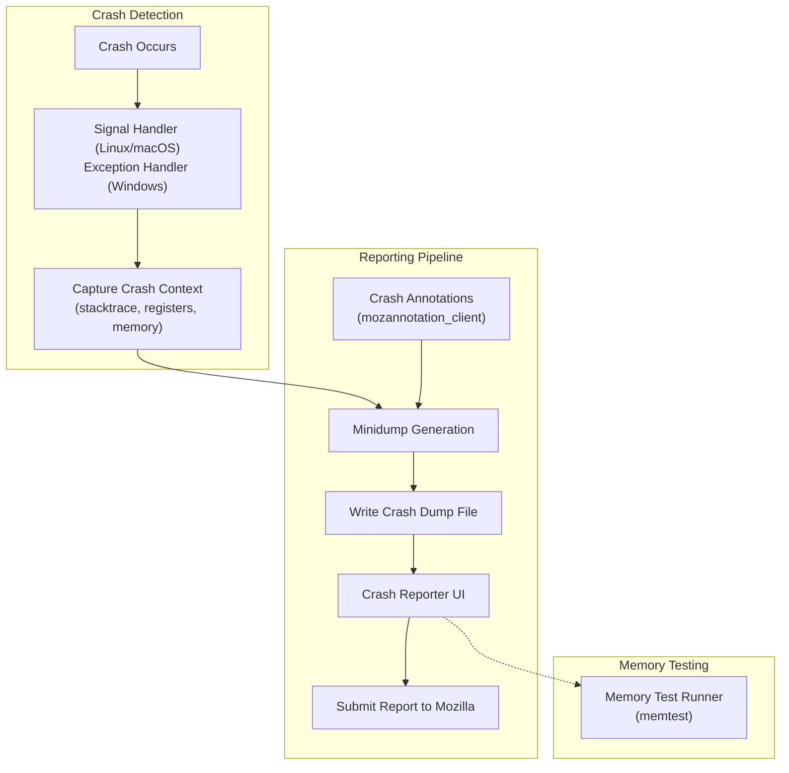
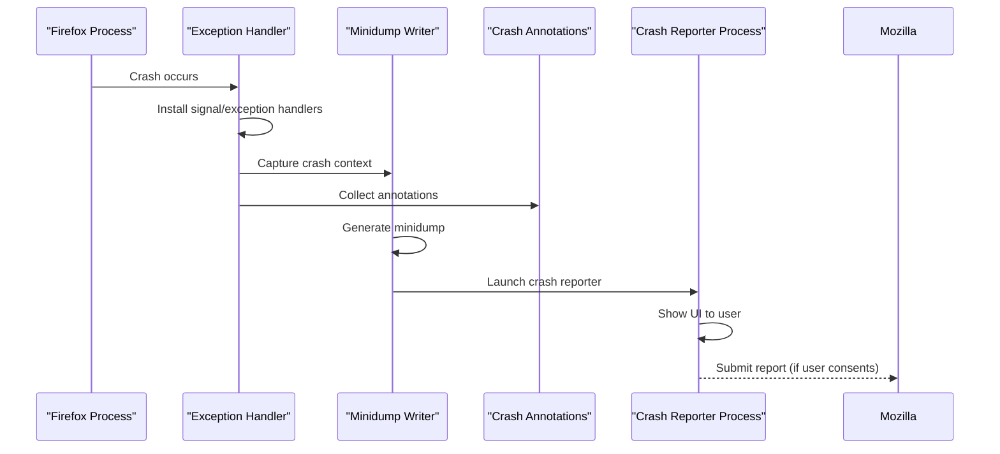
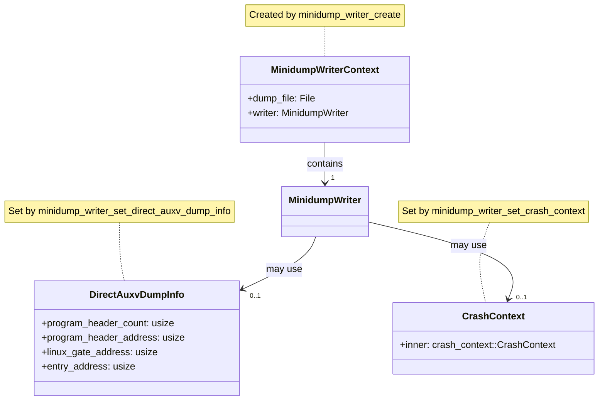
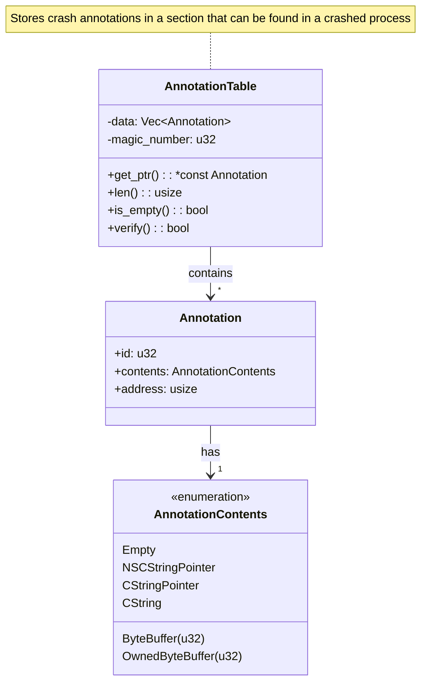
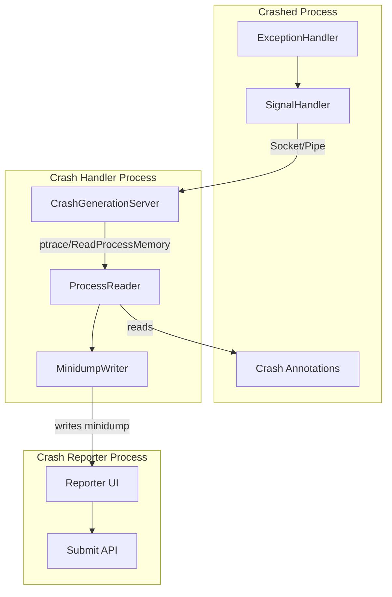
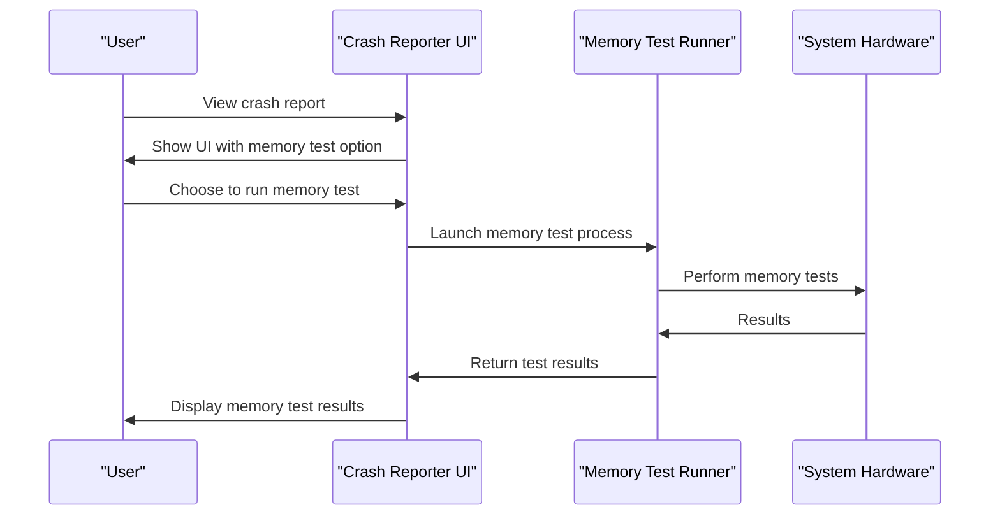
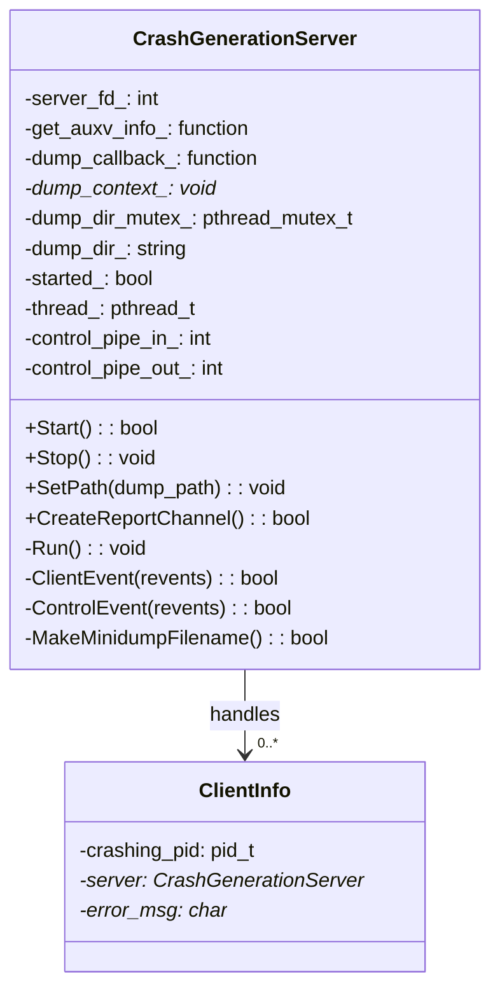

<!-- source: DeepWiki mcp.deepwiki.com · repo mozilla/gecko-dev · page 7.1 Crash Reporting System · fetched 2026-10-09 -->

# Crash Reporting System

<details>
<summary>Relevant source files</summary>

The following files were used as context for generating this wiki page:

- [Cargo.lock](Cargo.lock)
- [supply-chain/audits.toml](supply-chain/audits.toml)
- [third_party/rust/memtest/.cargo-checksum.json](third_party/rust/memtest/.cargo-checksum.json)
- [third_party/rust/memtest/Cargo.lock](third_party/rust/memtest/Cargo.lock)
- [third_party/rust/memtest/Cargo.toml](third_party/rust/memtest/Cargo.toml)
- [third_party/rust/memtest/LICENSE](third_party/rust/memtest/LICENSE)
- [third_party/rust/memtest/README.md](third_party/rust/memtest/README.md)
- [third_party/rust/memtest/examples/usage.rs](third_party/rust/memtest/examples/usage.rs)
- [third_party/rust/memtest/src/lib.rs](third_party/rust/memtest/src/lib.rs)
- [third_party/rust/memtest/src/memtest.rs](third_party/rust/memtest/src/memtest.rs)
- [toolkit/crashreporter/breakpad-client/linux/crash_generation/crash_generation_server.cc](toolkit/crashreporter/breakpad-client/linux/crash_generation/crash_generation_server.cc)
- [toolkit/crashreporter/breakpad-client/linux/crash_generation/crash_generation_server.h](toolkit/crashreporter/breakpad-client/linux/crash_generation/crash_generation_server.h)
- [toolkit/crashreporter/breakpad-client/linux/handler/exception_handler.cc](toolkit/crashreporter/breakpad-client/linux/handler/exception_handler.cc)
- [toolkit/crashreporter/client/app/Cargo.toml](toolkit/crashreporter/client/app/Cargo.toml)
- [toolkit/crashreporter/client/app/src/memory_test.rs](toolkit/crashreporter/client/app/src/memory_test.rs)
- [toolkit/crashreporter/mozannotation_client/Cargo.toml](toolkit/crashreporter/mozannotation_client/Cargo.toml)
- [toolkit/crashreporter/mozannotation_client/cbindgen.toml](toolkit/crashreporter/mozannotation_client/cbindgen.toml)
- [toolkit/crashreporter/mozannotation_client/src/lib.rs](toolkit/crashreporter/mozannotation_client/src/lib.rs)
- [toolkit/crashreporter/mozannotation_server/src/lib.rs](toolkit/crashreporter/mozannotation_server/src/lib.rs)
- [toolkit/crashreporter/process_reader/src/lib.rs](toolkit/crashreporter/process_reader/src/lib.rs)
- [toolkit/crashreporter/process_reader/src/platform/linux.rs](toolkit/crashreporter/process_reader/src/platform/linux.rs)
- [toolkit/crashreporter/process_reader/src/platform/macos.rs](toolkit/crashreporter/process_reader/src/platform/macos.rs)
- [toolkit/crashreporter/process_reader/src/platform/windows.rs](toolkit/crashreporter/process_reader/src/platform/windows.rs)
- [toolkit/crashreporter/rust_minidump_writer_linux/src/lib.rs](toolkit/crashreporter/rust_minidump_writer_linux/src/lib.rs)

</details>


The Crash Reporting System in Firefox is responsible for detecting, capturing, and reporting crashes that occur during browser operation. It facilitates post-mortem analysis by generating crash dumps (minidumps) that can be analyzed to identify root causes. This page documents the architecture, components, and operation of the crash reporting system.

For information about collecting telemetry data, see [Telemetry Collection](#5.2). For information about the build system integration, see [Build System and Infrastructure](#7).

## Overview

The Firefox Crash Reporting System uses a client-server architecture based on a modified version of Google's Breakpad crash reporting library. When Firefox crashes, the system captures relevant information, writes a minidump file, and sends the crash report data to Mozilla's servers for analysis.

The system provides:
- Low-level crash detection and handling
- Context collection for crash analysis
- Minidump generation with stack traces and memory state
- Crash annotations for additional diagnostic information
- Cross-platform support (Windows, macOS, Linux, Android)
- Memory testing capabilities to identify hardware issues



Sources: [toolkit/crashreporter/breakpad-client/linux/handler/exception_handler.cc](), [toolkit/crashreporter/mozannotation_client/src/lib.rs](), [toolkit/crashreporter/client/app/src/memory_test.rs](), [toolkit/crashreporter/rust_minidump_writer_linux/src/lib.rs]()

## Core Components

The crash reporting system consists of several key components that work together to detect and handle crashes.

### Crash Detection and Handling

The system installs signal handlers (on Unix-based systems) or exception handlers (on Windows) to intercept crashes. When a crash occurs, these handlers capture the execution context, including register values, stack trace, and memory state.



Sources: [toolkit/crashreporter/breakpad-client/linux/handler/exception_handler.cc](), [toolkit/crashreporter/breakpad-client/linux/crash_generation/crash_generation_server.cc]()

### Crash Context and Minidump Generation

The crash reporting system captures a variety of information about the crash, including:

- CPU register state at the time of crash
- Stack memory for each thread
- List of loaded modules
- System information
- Crash-specific annotations

This information is written to a minidump file, which follows a standardized format that can be analyzed by Mozilla's crash processing tools.

On Linux, the `rust_minidump_writer_linux` component handles writing minidumps:



Sources: [toolkit/crashreporter/rust_minidump_writer_linux/src/lib.rs]()

### Crash Annotations System

The crash annotations system provides a way to attach additional diagnostic information to crash reports. It's implemented in the `mozannotation_client` and `mozannotation_server` components.



The annotations are stored in a special section of the binary that can be located in memory even after a crash. The `mozannotation_client` provides APIs to register different types of annotations, while the `mozannotation_server` retrieves those annotations from the crashed process.

Annotations are registered with functions like:
- `mozannotation_register_nscstring`
- `mozannotation_register_cstring`
- `mozannotation_register_bytebuffer`

Sources: [toolkit/crashreporter/mozannotation_client/src/lib.rs](), [toolkit/crashreporter/mozannotation_server/src/lib.rs]()

### Process Reading

The `process_reader` component provides functionality to read memory from another process, which is essential for crash reporting. It has platform-specific implementations for Windows, Linux, and macOS.

| Platform | Module Finding Method | Memory Reading Method |
|----------|------------------------|------------------------|
| Windows  | `K32EnumProcessModules` | `ReadProcessMemory` |
| Linux    | Parse `/proc/{pid}/maps` | `ptrace` |
| macOS    | Task info / Mach VM APIs | `mach_vm_read_overwrite` |

This component enables the crash reporting system to:
- Find modules (executables/libraries) loaded in the crashed process
- Read memory from the crashed process
- Locate specific sections in binaries
- Extract strings and other data from the crashed process's memory

Sources: [toolkit/crashreporter/process_reader/src/lib.rs](), [toolkit/crashreporter/process_reader/src/platform/windows.rs](), [toolkit/crashreporter/process_reader/src/platform/linux.rs](), [toolkit/crashreporter/process_reader/src/platform/macos.rs]()

### Memory Testing

The crash reporting system includes a memory testing component (`memtest`) that can be used to detect hardware memory issues that might cause crashes. This component provides various memory test algorithms to check for issues like:

- Stuck bits
- Address line problems
- Data line problems
- Pattern sensitivity issues

```mermaid
classDiagram
    class MemtestKind {
        <<enumeration>>
        OwnAddressBasic
        OwnAddressRepeat
        RandomVal
        Xor
        Sub
        Mul
        Div
        Or
        And
        SeqInc
        SolidBits
        Checkerboard
        BlockSeq
        MovInvFixedBlock
        MovInvFixedBit
        MovInvFixedRandom
        MovInvWalk
        BlockMove
        MovInvRandom
        Modulo20
    }
    
    class MemtestRunner {
        -test_kinds: Vec~MemtestKind~
        -timeout: Duration
        -mem_lock_mode: MemLockMode
        -allow_working_set_resize: bool
        -allow_multithread: bool
        -allow_early_termination: bool
        +run(): Result~MemtestReportList~
    }
    
    class MemtestOutcome {
        <<enumeration>>
        Pass
        Fail(MemtestFailure)
    }
    
    class MemtestFailure {
        <<enumeration>>
        UnexpectedValue{address, expected, actual}
        MismatchedValues{address1, value1, address2, value2}
    }
    
    MemtestRunner --> "*" MemtestKind: runs
    MemtestKind --> "1" MemtestOutcome: produces
    MemtestOutcome --> "0..1" MemtestFailure: may contain
```

The memory tests can be triggered from the crash reporter UI when appropriate, helping users identify if their crashes are related to hardware issues.

Sources: [toolkit/crashreporter/client/app/src/memory_test.rs](), [third_party/rust/memtest/src/lib.rs](), [third_party/rust/memtest/src/memtest.rs]()

## Cross-Process Communication

The crash reporting system uses various mechanisms for cross-process communication, which is crucial since the crashed process can't directly generate its own crash report.



Key cross-process mechanisms include:

1. **Socket Communication**: On Linux, the `CrashGenerationServer` class creates a socket pair using `socketpair()` to communicate between the crashed process and the crash handler. The crash handler server listens for messages on this socket and receives crash information from the crashed process.

2. **Process Reading**: The `ProcessReader` component uses platform-specific APIs (ptrace on Linux, ReadProcessMemory on Windows, mach_vm_read on macOS) to read memory from the crashed process.

3. **Annotations**: The crash annotations system places annotations in a special section of the binary that can be located and read even after a crash. On Linux, this uses the ELF program header notes section.

4. **Shared Memory**: In some cases, shared memory is used to efficiently communicate information between processes.

Sources: [toolkit/crashreporter/breakpad-client/linux/crash_generation/crash_generation_server.cc:152-170](), [toolkit/crashreporter/process_reader/src/platform/linux.rs:156-201](), [toolkit/crashreporter/mozannotation_client/src/lib.rs:142-197]()

## Platform-Specific Implementation Details

The crash reporting system has platform-specific implementations to account for the differences in how crashes are handled on different operating systems.

### Windows Implementation

On Windows, the crash reporting system uses the Windows debugging APIs to handle exceptions and generate minidumps. Key components include:

- Windows exception handling via SEH (Structured Exception Handling)
- Windows API `ReadProcessMemory` for reading from the crashed process
- Windows API `K32EnumProcessModules` and related functions for finding loaded modules
- Windows-specific sections for storing annotations (mozannot section)

### Linux Implementation

On Linux, the crash reporting system uses signals and ptrace to handle crashes and generate minidumps:

- Signal handlers for catching segmentation faults, bus errors, etc.
- Ptrace API for reading memory from the crashed process
- ELF program headers and notes for locating annotations
- Socket pair communication between the crashed process and crash handler
- Integration with `rust_minidump_writer_linux` for generating minidumps

### macOS Implementation

On macOS, the crash reporting system uses Mach exception handling and related APIs:

- Mach exception handling for catching crashes
- Mach VM APIs for reading memory from the crashed process
- Mach-O binary format parsing for finding annotations
- Task information APIs for enumerating loaded modules

Sources: [toolkit/crashreporter/process_reader/src/platform/windows.rs](), [toolkit/crashreporter/process_reader/src/platform/linux.rs](), [toolkit/crashreporter/process_reader/src/platform/macos.rs](), [toolkit/crashreporter/mozannotation_client/src/lib.rs:84-91]()

## Memory Testing Integration

The crash reporting system includes memory testing capabilities to help identify hardware issues that might cause crashes. The memory testing functionality is integrated into the crash reporter UI and can be triggered when appropriate.



The memory test component provides a set of algorithms to test for various memory issues:

| Test Category | Description | Test Types |
|---------------|-------------|------------|
| Basic Tests | Tests basic memory operations | OwnAddressBasic, OwnAddressRepeat, RandomVal |
| Pattern Tests | Tests pattern sensitivity | Checkerboard, SolidBits, BlockSeq |
| Arithmetic Tests | Tests arithmetic operations | Xor, Sub, Mul, Div, Or, And |
| Moving Inversion Tests | Tests moving patterns | MovInvFixedBlock, MovInvFixedBit, MovInvFixedRandom, MovInvRandom |
| Special Tests | Tests specific patterns | Modulo20, BlockMove |

The memory test runner can be configured with different options:
- Memory size to test
- Timeout duration
- Memory locking mode
- Early termination on failure

Sources: [toolkit/crashreporter/client/app/src/memory_test.rs](), [third_party/rust/memtest/src/lib.rs:15-48](), [third_party/rust/memtest/src/memtest.rs:80-100]()

## Crash Generation Server

The `CrashGenerationServer` is a key component of the crash reporting system, particularly on Linux. It handles receiving crash signals from crashed processes, collecting crash information, and generating minidumps.



Key functions of the crash generation server:

1. **Creating the report channel**: Uses `socketpair()` to create a communication channel between the crashed process and the crash handler.
2. **Starting the server**: Starts a background thread that listens for crash signals.
3. **Handling client events**: When a crash occurs, receives crash information and generates a minidump.
4. **Callback mechanism**: Invokes a callback function with the crash information and minidump file path.

Sources: [toolkit/crashreporter/breakpad-client/linux/crash_generation/crash_generation_server.h](), [toolkit/crashreporter/breakpad-client/linux/crash_generation/crash_generation_server.cc]()

## Conclusion

The Firefox Crash Reporting System is a sophisticated, cross-platform solution for detecting, handling, and reporting crashes. It uses a combination of platform-specific APIs, shared memory techniques, and specialized components to capture comprehensive information about crashes, helping developers identify and fix issues.

The system's modular design allows for platform-specific implementations while maintaining a consistent overall architecture. The integration of memory testing capabilities provides additional diagnostic information to help identify hardware-related issues.

By understanding the components and interactions of the crash reporting system, developers can more effectively debug crashes and improve the stability of Firefox.

---

