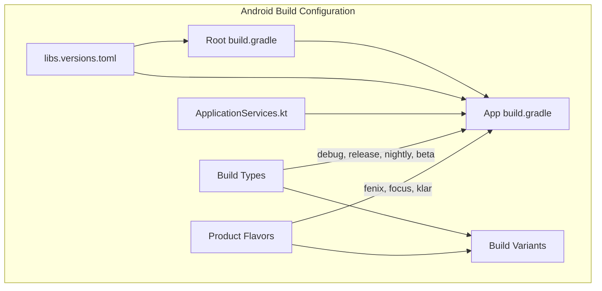
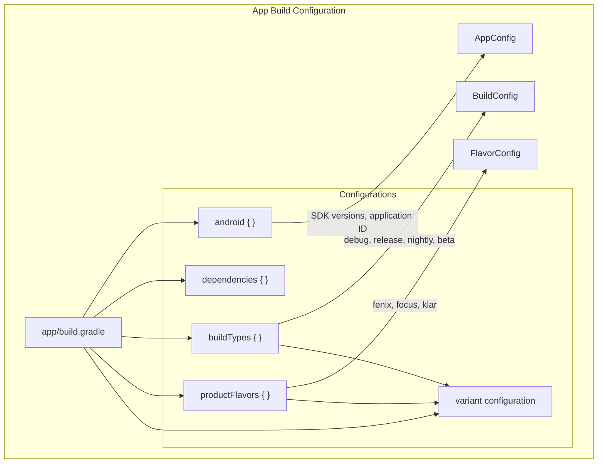
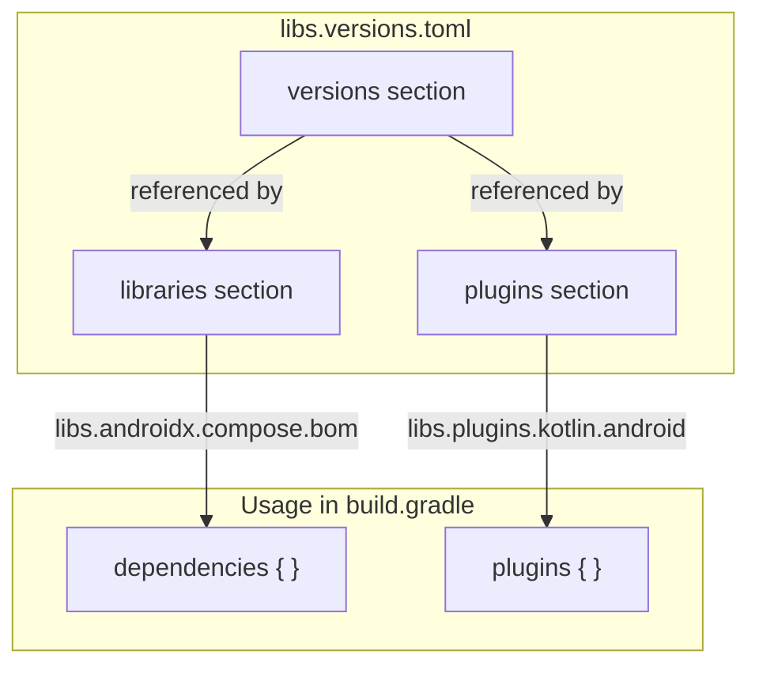
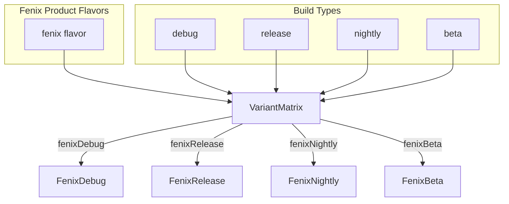
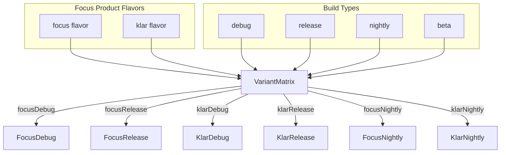
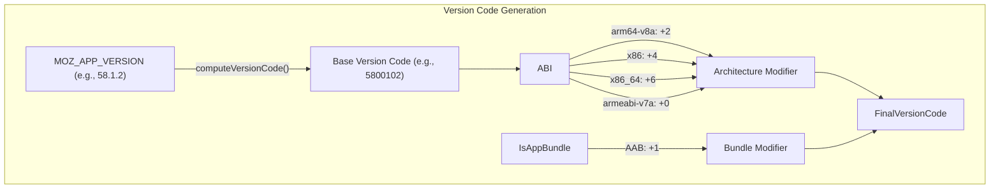
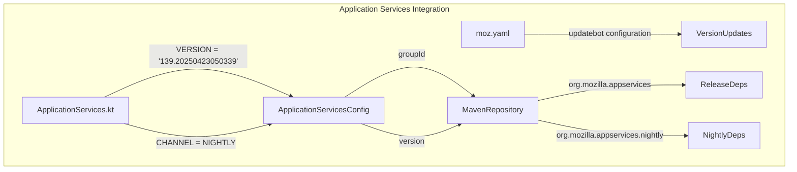
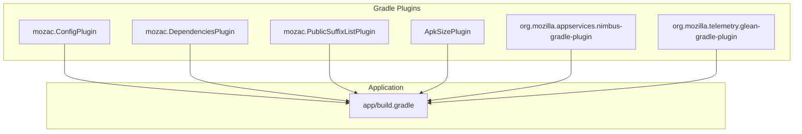

<!-- source: DeepWiki mcp.deepwiki.com · repo mozilla/gecko-dev · page 7.2 Android Build Configuration · fetched 2026-10-09 -->

# Android Build Configuration

<details>
<summary>Relevant source files</summary>

The following files were used as context for generating this wiki page:

- [build.gradle](build.gradle)
- [gradle/libs.versions.toml](gradle/libs.versions.toml)
- [mobile/android/android-components/android-lint.gradle](mobile/android/android-components/android-lint.gradle)
- [mobile/android/android-components/components/support/test/src/main/java/mozilla/components/support/test/Matchers.kt](mobile/android/android-components/components/support/test/src/main/java/mozilla/components/support/test/Matchers.kt)
- [mobile/android/android-components/components/support/test/src/main/java/mozilla/components/support/test/robolectric/shadow/PixelCopyShadow.kt](mobile/android/android-components/components/support/test/src/main/java/mozilla/components/support/test/robolectric/shadow/PixelCopyShadow.kt)
- [mobile/android/android-components/plugins/config/build.gradle](mobile/android/android-components/plugins/config/build.gradle)
- [mobile/android/android-components/plugins/dependencies/build.gradle](mobile/android/android-components/plugins/dependencies/build.gradle)
- [mobile/android/android-components/plugins/dependencies/src/main/java/ApplicationServices.kt](mobile/android/android-components/plugins/dependencies/src/main/java/ApplicationServices.kt)
- [mobile/android/android-components/plugins/dependencies/src/main/java/moz.yaml](mobile/android/android-components/plugins/dependencies/src/main/java/moz.yaml)
- [mobile/android/android-components/plugins/publicsuffixlist/build.gradle](mobile/android/android-components/plugins/publicsuffixlist/build.gradle)
- [mobile/android/android-components/samples/browser/build.gradle](mobile/android/android-components/samples/browser/build.gradle)
- [mobile/android/annotations/build.gradle](mobile/android/annotations/build.gradle)
- [mobile/android/docs/fenix.rst](mobile/android/docs/fenix.rst)
- [mobile/android/examples/messaging_example/app/build.gradle](mobile/android/examples/messaging_example/app/build.gradle)
- [mobile/android/examples/port_messaging_example/app/build.gradle](mobile/android/examples/port_messaging_example/app/build.gradle)
- [mobile/android/exoplayer2/build.gradle](mobile/android/exoplayer2/build.gradle)
- [mobile/android/fenix/app/build.gradle](mobile/android/fenix/app/build.gradle)
- [mobile/android/fenix/app/lint-baseline.xml](mobile/android/fenix/app/lint-baseline.xml)
- [mobile/android/fenix/app/src/main/java/org/mozilla/fenix/components/NotificationManager.kt](mobile/android/fenix/app/src/main/java/org/mozilla/fenix/components/NotificationManager.kt)
- [mobile/android/fenix/app/src/main/java/org/mozilla/fenix/components/metrics/GleanUsageReportingMetricsService.kt](mobile/android/fenix/app/src/main/java/org/mozilla/fenix/components/metrics/GleanUsageReportingMetricsService.kt)
- [mobile/android/fenix/app/src/main/java/org/mozilla/fenix/home/toolbar/FenixHomeToolbar.kt](mobile/android/fenix/app/src/main/java/org/mozilla/fenix/home/toolbar/FenixHomeToolbar.kt)
- [mobile/android/fenix/app/src/main/java/org/mozilla/fenix/home/toolbar/HomeToolbarView.kt](mobile/android/fenix/app/src/main/java/org/mozilla/fenix/home/toolbar/HomeToolbarView.kt)
- [mobile/android/fenix/app/src/main/java/org/mozilla/fenix/home/toolbar/SearchSelectorBinding.kt](mobile/android/fenix/app/src/main/java/org/mozilla/fenix/home/toolbar/SearchSelectorBinding.kt)
- [mobile/android/fenix/app/src/main/java/org/mozilla/fenix/home/toolbar/TabCounterView.kt](mobile/android/fenix/app/src/main/java/org/mozilla/fenix/home/toolbar/TabCounterView.kt)
- [mobile/android/fenix/app/src/main/java/org/mozilla/fenix/search/SearchDialogInteractor.kt](mobile/android/fenix/app/src/main/java/org/mozilla/fenix/search/SearchDialogInteractor.kt)
- [mobile/android/fenix/app/src/main/java/org/mozilla/fenix/settings/TextPercentageSeekBarPreference.kt](mobile/android/fenix/app/src/main/java/org/mozilla/fenix/settings/TextPercentageSeekBarPreference.kt)
- [mobile/android/fenix/app/src/main/res/layout/account_share_list_item.xml](mobile/android/fenix/app/src/main/res/layout/account_share_list_item.xml)
- [mobile/android/fenix/app/src/main/res/layout/app_share_list_item.xml](mobile/android/fenix/app/src/main/res/layout/app_share_list_item.xml)
- [mobile/android/fenix/app/src/test/java/org/mozilla/fenix/components/toolbar/BrowserHomeToolbarViewTest.kt](mobile/android/fenix/app/src/test/java/org/mozilla/fenix/components/toolbar/BrowserHomeToolbarViewTest.kt)
- [mobile/android/fenix/app/src/test/java/org/mozilla/fenix/home/InstrumentedHomeFragmentTest.kt](mobile/android/fenix/app/src/test/java/org/mozilla/fenix/home/InstrumentedHomeFragmentTest.kt)
- [mobile/android/fenix/app/src/test/java/org/mozilla/fenix/home/toolbar/TabCounterViewTest.kt](mobile/android/fenix/app/src/test/java/org/mozilla/fenix/home/toolbar/TabCounterViewTest.kt)
- [mobile/android/fenix/plugins/apksize/build.gradle](mobile/android/fenix/plugins/apksize/build.gradle)
- [mobile/android/focus-android/app/build.gradle](mobile/android/focus-android/app/build.gradle)
- [mobile/android/focus-android/app/lint-baseline.xml](mobile/android/focus-android/app/lint-baseline.xml)
- [mobile/android/geckoview/build.gradle](mobile/android/geckoview/build.gradle)
- [mobile/android/geckoview_example/build.gradle](mobile/android/geckoview_example/build.gradle)
- [mobile/android/test_runner/build.gradle](mobile/android/test_runner/build.gradle)

</details>


This document explains how the Android build system is configured for Mozilla Firefox for Android (Fenix) and Focus for Android projects. It covers the Gradle build system setup, dependency management, build variants, versioning strategies, and customization options used in the Mozilla Android ecosystem.

## Overview of Android Build System

The Firefox for Android projects use Gradle as their build system, with a sophisticated configuration that supports multiple build variants, product flavors, and centralized dependency management. This setup enables the development team to maintain different release channels (Nightly, Beta, Release) while sharing the common codebase.



Sources: 
- [build.gradle]()
- [mobile/android/fenix/app/build.gradle]()
- [mobile/android/focus-android/app/build.gradle]()
- [gradle/libs.versions.toml]()
- [mobile/android/android-components/plugins/dependencies/src/main/java/ApplicationServices.kt]()

## Gradle Configuration Structure

The Android build configuration is organized across several key Gradle files:

| File | Purpose |
|------|---------|
| Root `build.gradle` | Global project configuration, repositories, and common configurations |
| App-level `build.gradle` | App-specific configuration, build types, flavors, dependencies |
| `gradle/libs.versions.toml` | Centralized dependency version management |
| `settings.gradle` | Project structure and included modules |
| Plugin build files | Custom Gradle plugins for build tasks |

### Root `build.gradle`

The root build.gradle file provides common configuration for all projects, including:
- Repository configuration
- Shared properties and extension functions
- Global versioning logic
- Common build tasks

Sources: 
- [build.gradle:5-139]()
- [build.gradle:270-245]()

### App-level Build Files

Each application (Fenix, Focus) has its own build.gradle file that defines app-specific configurations:



Sources:
- [mobile/android/fenix/app/build.gradle:47-171]()
- [mobile/android/focus-android/app/build.gradle:30-171]()

## Dependency Management with libs.versions.toml

One of the key features of the Android build configuration is centralized dependency management via the `libs.versions.toml` file. This TOML format file defines all dependency versions in a single place, making version management more consistent and maintainable.

### Structure of libs.versions.toml



The file is structured into three main sections:
1. `[versions]` - Defines version constants for all dependencies
2. `[libraries]` - Defines library coordinates using versions from the versions section
3. `[plugins]` - Defines Gradle plugins

Sources:
- [gradle/libs.versions.toml:1-52]() - Versions section
- [gradle/libs.versions.toml:107-259]() - Libraries section
- [gradle/libs.versions.toml:261-269]() - Plugins section

### Using Catalog Dependencies

Dependencies are referenced in build.gradle files using the `libs` extension:

```
dependencies {
    implementation libs.androidx.activity
    implementation libs.kotlin.coroutines
    implementation platform(libs.androidx.compose.bom)
}

plugins {
    alias(libs.plugins.kotlin.android)
}
```

Sources:
- [mobile/android/fenix/app/build.gradle:539-646]()
- [mobile/android/focus-android/app/build.gradle:240-377]()

## Build Types

Firefox for Android projects define several build types for different release channels:

| Build Type | Purpose | Configuration |
|------------|---------|--------------|
| `debug` | Development builds | Debugging enabled, no minification |
| `release` | Production releases | Minified, optimized for performance |
| `nightly` | Nightly releases | Built daily with the latest features |
| `beta` | Beta channel releases | Pre-release testing builds |
| `benchmark` | Performance benchmarking | Special configuration for performance testing |

Sources:
- [mobile/android/fenix/app/build.gradle:113-171]()
- [mobile/android/focus-android/app/build.gradle:69-111]()

### Build Type Configuration Example

Here's how build types are configured in the Fenix app:

```
buildTypes {
    debug {
        shrinkResources = false
        minifyEnabled = false
        applicationIdSuffix ".fenix.debug"
        resValue "bool", "IS_DEBUG", "true"
        pseudoLocalesEnabled = true
    }
    nightly {
        applicationIdSuffix ".fenix"
        buildConfigField "boolean", "USE_RELEASE_VERSIONING", "true"
        def deepLinkSchemeValue = "fenix-nightly"
        buildConfigField "String", "DEEP_LINK_SCHEME", "\"$deepLinkSchemeValue\""
        // Additional nightly-specific configurations...
    }
    // Other build types...
}
```

Sources:
- [mobile/android/fenix/app/build.gradle:113-171]()

## Product Flavors

Product flavors are used to create different variants of the app:

### Fenix Flavors



Sources:
- [mobile/android/fenix/app/build.gradle:197-201]()

### Focus Flavors



Sources:
- [mobile/android/focus-android/app/build.gradle:129-147]()

## Version Management

The build system manages version codes and version names differently for various build types:

### Version Code Generation

Version codes are generated based on:
1. The app version from `MOZ_APP_VERSION`
2. The build type (release, nightly, etc.)
3. The architecture (arm, x86, etc.) for APK builds
4. Whether the build is an App Bundle (AAB) or an APK

For Fenix:


For Focus:
```
// Ensure baseVersionCode is an even number (for APKs)
if (baseVersionCode % 2) {
    baseVersionCode = baseVersionCode + 1
}

// For different architectures and AAB
if (abi == "AAB") {
    // AAB version code is odd
    versionCodeOverride = versionCodeOverride + 1
} else if (abi == "x86_64") {
    versionCodeOverride = versionCodeOverride + 6
} else if (abi == "x86") {
    versionCodeOverride = versionCodeOverride + 4
} else if (abi == "arm64-v8a") {
    versionCodeOverride = versionCodeOverride + 2
} else if (abi == "armeabi-v7a") {
    versionCodeOverride = versionCodeOverride + 0
}
```

Sources:
- [mobile/android/fenix/app/build.gradle:290-338]()
- [mobile/android/focus-android/app/build.gradle:380-448]()
- [build.gradle:213-245]()

### Version Name Generation

Version names are generated differently for debug vs. release builds:

```
def versionName = variant.buildType.name == 'nightly' ?
        "${Config.nightlyVersionName(project)}" :
        "${Config.releaseVersionName(project)}"
```

Sources:
- [mobile/android/fenix/app/build.gradle:311-313]()
- [mobile/android/focus-android/app/build.gradle:393-395]()

## Application Services Integration

Firefox for Android integrates with Application Services, a collection of Rust components providing core functionality. The integration is managed through:



Sources:
- [mobile/android/android-components/plugins/dependencies/src/main/java/ApplicationServices.kt:1-35]()
- [mobile/android/android-components/plugins/dependencies/src/main/java/moz.yaml:1-75]()

## Build Customization

The build system supports various customization options through properties:

| Property | Description | Impact |
|----------|-------------|--------|
| `testBuildType` | Configure test build type | Changes which build variant is used for tests |
| `disableOptimization` | Disable code minification | Used for UI testing of non-debug builds |
| `autosignReleaseWithDebugKey` | Auto-sign with debug key | Simplifies local development |
| `coverage` | Enable code coverage | Adds instrumentation for code coverage reporting |
| `benchmarkTest` | Enable benchmark mode | Configures app for benchmark testing |

Sources:
- [mobile/android/fenix/app/build.gradle:49-53]()
- [mobile/android/fenix/app/build.gradle:87-96]()
- [mobile/android/fenix/app/build.gradle:764-806]()
- [mobile/android/focus-android/app/build.gradle:30-34]()

## Lint Configuration

Android lint is configured to ensure code quality:

```
android {
    lint {
        warningsAsErrors = true
        abortOnError = true
        
        // Exceptions for specific rules
        disable 'MissingTranslation',
                'ExtraTranslation',
                'TypographyEllipsis',
                // Other disabled rules...
    }
}
```

The lint baseline files track existing lint issues that are exempted from checks.

Sources:
- [mobile/android/android-components/android-lint.gradle:1-19]()
- [mobile/android/fenix/app/lint-baseline.xml]()
- [mobile/android/focus-android/app/lint-baseline.xml]()

## Common Build Tasks

Here are some common build tasks used in Firefox for Android development:

| Task | Purpose |
|------|---------|
| `./mach gradle fenix:assembleDebug` | Build a debug version of Fenix |
| `./mach run --app=fenix` | Launch an emulator and install/run Fenix |
| `./mach test` | Run tests |
| `./mach lint -l android-fenix` | Lint Fenix code |
| `./mach try --preset fenix` | Run Fenix test suites on Mozilla's try server |

Sources:
- [mobile/android/docs/fenix.rst:20-102]()

## Plugin System

Firefox for Android uses several custom Gradle plugins to handle specialized build tasks:



Sources:
- [mobile/android/android-components/plugins/config/build.gradle:1-28]()
- [mobile/android/android-components/plugins/dependencies/build.gradle:1-28]()
- [mobile/android/android-components/plugins/publicsuffixlist/build.gradle:1-33]()
- [mobile/android/fenix/plugins/apksize/build.gradle:1-32]()
- [mobile/android/fenix/app/build.gradle:509-532]() (Nimbus and Glean plugins)

## Conclusion

The Android build configuration in Firefox is a complex but well-organized system that enables the development team to manage multiple build variants, dependencies, and customizations efficiently. By centralizing dependency management, providing clear build type definitions, and supporting different product flavors, the build system facilitates the development and release of Firefox for Android across multiple channels and configurations.

For more information about the Android development environment setup, see [Building Firefox for Android](#6.1).

---

