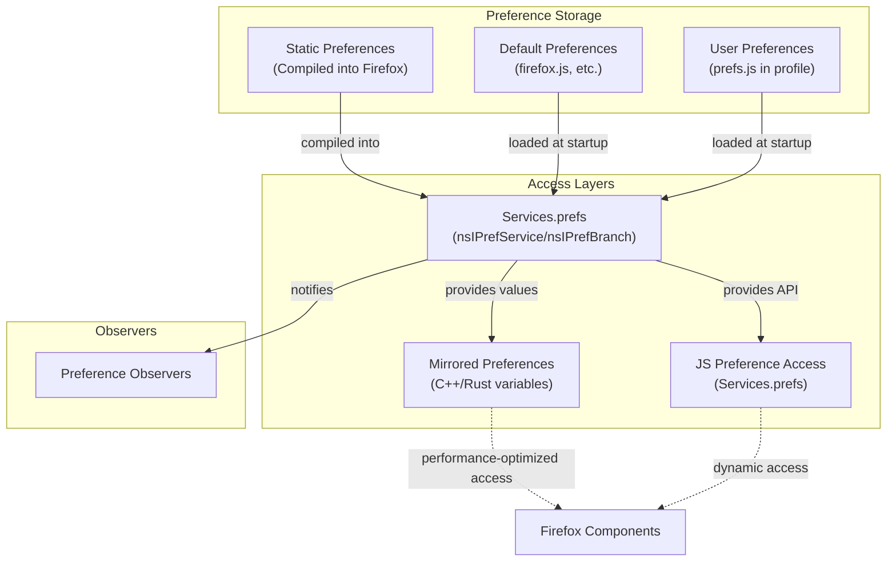
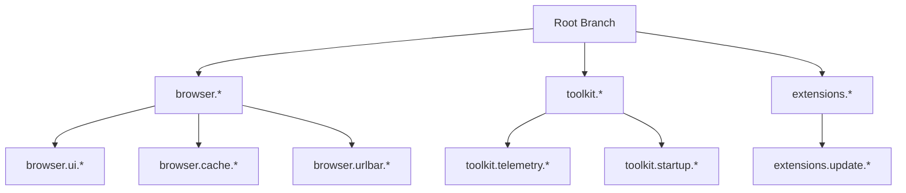
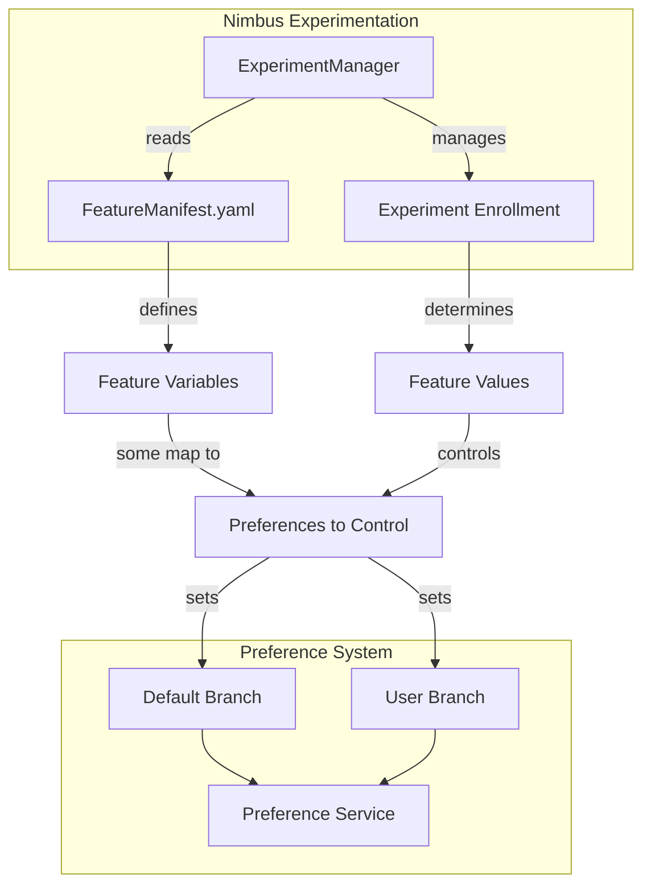
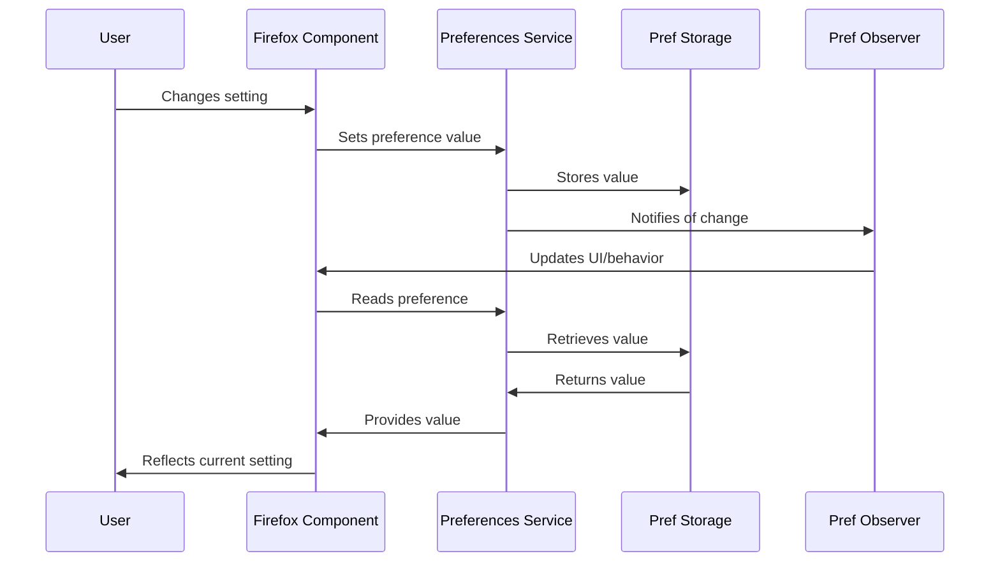

<!-- source: DeepWiki mcp.deepwiki.com · repo mozilla/gecko-dev · page 7.3 Preferences System · fetched 2026-10-09 -->

# Preferences System

<details>
<summary>Relevant source files</summary>

The following files were used as context for generating this wiki page:

- [browser/app/profile/firefox.js](browser/app/profile/firefox.js)
- [browser/base/content/test/general/browser_datachoices_notification.js](browser/base/content/test/general/browser_datachoices_notification.js)
- [browser/components/asrouter/modules/OnboardingMessageProvider.sys.mjs](browser/components/asrouter/modules/OnboardingMessageProvider.sys.mjs)
- [browser/components/newtab/metrics.yaml](browser/components/newtab/metrics.yaml)
- [browser/components/tests/browser/browser_browserGlue_showModal_trigger.js](browser/components/tests/browser/browser_browserGlue_showModal_trigger.js)
- [browser/extensions/newtab/common/Actions.mjs](browser/extensions/newtab/common/Actions.mjs)
- [browser/extensions/newtab/common/Reducers.sys.mjs](browser/extensions/newtab/common/Reducers.sys.mjs)
- [browser/extensions/newtab/content-src/components/Base/Base.jsx](browser/extensions/newtab/content-src/components/Base/Base.jsx)
- [browser/extensions/newtab/content-src/components/CustomizeMenu/ContentSection/ContentSection.jsx](browser/extensions/newtab/content-src/components/CustomizeMenu/ContentSection/ContentSection.jsx)
- [browser/extensions/newtab/content-src/components/CustomizeMenu/CustomizeMenu.jsx](browser/extensions/newtab/content-src/components/CustomizeMenu/CustomizeMenu.jsx)
- [browser/extensions/newtab/content-src/components/CustomizeMenu/_CustomizeMenu.scss](browser/extensions/newtab/content-src/components/CustomizeMenu/_CustomizeMenu.scss)
- [browser/extensions/newtab/content-src/components/DiscoveryStreamComponents/CardGrid/CardGrid.jsx](browser/extensions/newtab/content-src/components/DiscoveryStreamComponents/CardGrid/CardGrid.jsx)
- [browser/extensions/newtab/content-src/components/DiscoveryStreamComponents/CardSections/CardSections.jsx](browser/extensions/newtab/content-src/components/DiscoveryStreamComponents/CardSections/CardSections.jsx)
- [browser/extensions/newtab/content-src/components/DiscoveryStreamComponents/DSCard/DSCard.jsx](browser/extensions/newtab/content-src/components/DiscoveryStreamComponents/DSCard/DSCard.jsx)
- [browser/extensions/newtab/content-src/components/DiscoveryStreamComponents/DSCard/_DSCard.scss](browser/extensions/newtab/content-src/components/DiscoveryStreamComponents/DSCard/_DSCard.scss)
- [browser/extensions/newtab/content-src/components/DiscoveryStreamComponents/FeatureHighlight/FeatureHighlight.jsx](browser/extensions/newtab/content-src/components/DiscoveryStreamComponents/FeatureHighlight/FeatureHighlight.jsx)
- [browser/extensions/newtab/content-src/components/DiscoveryStreamComponents/FeatureHighlight/WallpaperFeatureHighlight.jsx](browser/extensions/newtab/content-src/components/DiscoveryStreamComponents/FeatureHighlight/WallpaperFeatureHighlight.jsx)
- [browser/extensions/newtab/content-src/components/DiscoveryStreamComponents/FeatureHighlight/_FeatureHighlight.scss](browser/extensions/newtab/content-src/components/DiscoveryStreamComponents/FeatureHighlight/_FeatureHighlight.scss)
- [browser/extensions/newtab/content-src/components/DiscoveryStreamComponents/FeatureHighlight/_WallpaperFeatureHighlight.scss](browser/extensions/newtab/content-src/components/DiscoveryStreamComponents/FeatureHighlight/_WallpaperFeatureHighlight.scss)
- [browser/extensions/newtab/content-src/components/DiscoveryStreamComponents/InterestPicker/InterestPicker.jsx](browser/extensions/newtab/content-src/components/DiscoveryStreamComponents/InterestPicker/InterestPicker.jsx)
- [browser/extensions/newtab/content-src/components/DiscoveryStreamComponents/PersonalizedCard/PersonalizedCard.jsx](browser/extensions/newtab/content-src/components/DiscoveryStreamComponents/PersonalizedCard/PersonalizedCard.jsx)
- [browser/extensions/newtab/content-src/components/DiscoveryStreamComponents/PersonalizedCard/_PersonalizedCard.scss](browser/extensions/newtab/content-src/components/DiscoveryStreamComponents/PersonalizedCard/_PersonalizedCard.scss)
- [browser/extensions/newtab/content-src/components/DiscoveryStreamImpressionStats/ImpressionStats.jsx](browser/extensions/newtab/content-src/components/DiscoveryStreamImpressionStats/ImpressionStats.jsx)
- [browser/extensions/newtab/content-src/components/MessageWrapper/MessageWrapper.jsx](browser/extensions/newtab/content-src/components/MessageWrapper/MessageWrapper.jsx)
- [browser/extensions/newtab/content-src/components/WallpapersSection/WallpaperCategories.jsx](browser/extensions/newtab/content-src/components/WallpapersSection/WallpaperCategories.jsx)
- [browser/extensions/newtab/content-src/components/WallpapersSection/_WallpapersSection.scss](browser/extensions/newtab/content-src/components/WallpapersSection/_WallpapersSection.scss)
- [browser/extensions/newtab/content-src/lib/link-menu-options.mjs](browser/extensions/newtab/content-src/lib/link-menu-options.mjs)
- [browser/extensions/newtab/content-src/lib/utils.jsx](browser/extensions/newtab/content-src/lib/utils.jsx)
- [browser/extensions/newtab/content-src/styles/_theme.scss](browser/extensions/newtab/content-src/styles/_theme.scss)
- [browser/extensions/newtab/content-src/styles/activity-stream.scss](browser/extensions/newtab/content-src/styles/activity-stream.scss)
- [browser/extensions/newtab/css/activity-stream.css](browser/extensions/newtab/css/activity-stream.css)
- [browser/extensions/newtab/data/content/activity-stream.bundle.js](browser/extensions/newtab/data/content/activity-stream.bundle.js)
- [browser/extensions/newtab/data/content/assets/custom-wp-highlight.png](browser/extensions/newtab/data/content/assets/custom-wp-highlight.png)
- [browser/extensions/newtab/data/content/assets/waving-fox.svg](browser/extensions/newtab/data/content/assets/waving-fox.svg)
- [browser/extensions/newtab/karma.mc.config.js](browser/extensions/newtab/karma.mc.config.js)
- [browser/extensions/newtab/lib/ActivityStream.sys.mjs](browser/extensions/newtab/lib/ActivityStream.sys.mjs)
- [browser/extensions/newtab/lib/DiscoveryStreamFeed.sys.mjs](browser/extensions/newtab/lib/DiscoveryStreamFeed.sys.mjs)
- [browser/extensions/newtab/lib/NewTabMessaging.sys.mjs](browser/extensions/newtab/lib/NewTabMessaging.sys.mjs)
- [browser/extensions/newtab/lib/TelemetryFeed.sys.mjs](browser/extensions/newtab/lib/TelemetryFeed.sys.mjs)
- [browser/extensions/newtab/lib/WallpaperFeed.sys.mjs](browser/extensions/newtab/lib/WallpaperFeed.sys.mjs)
- [browser/extensions/newtab/test/browser/browser_customize_menu_content.js](browser/extensions/newtab/test/browser/browser_customize_menu_content.js)
- [browser/extensions/newtab/test/unit/content-src/components/CustomiseMenu.test.jsx](browser/extensions/newtab/test/unit/content-src/components/CustomiseMenu.test.jsx)
- [browser/extensions/newtab/test/unit/content-src/components/DiscoveryStreamComponents/CollectionCardGrid.test.jsx](browser/extensions/newtab/test/unit/content-src/components/DiscoveryStreamComponents/CollectionCardGrid.test.jsx)
- [browser/extensions/newtab/test/unit/content-src/components/DiscoveryStreamComponents/DSCard.test.jsx](browser/extensions/newtab/test/unit/content-src/components/DiscoveryStreamComponents/DSCard.test.jsx)
- [browser/extensions/newtab/test/unit/content-src/components/DiscoveryStreamComponents/ImpressionStats.test.jsx](browser/extensions/newtab/test/unit/content-src/components/DiscoveryStreamComponents/ImpressionStats.test.jsx)
- [browser/extensions/newtab/test/unit/content-src/components/MessageWrapper.test.jsx](browser/extensions/newtab/test/unit/content-src/components/MessageWrapper.test.jsx)
- [browser/extensions/newtab/test/xpcshell/test_WallpaperFeed.js](browser/extensions/newtab/test/xpcshell/test_WallpaperFeed.js)
- [browser/locales/en-US/browser/newtab/newtab.ftl](browser/locales/en-US/browser/newtab/newtab.ftl)
- [browser/modules/WindowsJumpLists.sys.mjs](browser/modules/WindowsJumpLists.sys.mjs)
- [js/public/ErrorReport.h](js/public/ErrorReport.h)
- [js/public/ProtoKey.h](js/public/ProtoKey.h)
- [js/public/friend/ErrorNumbers.msg](js/public/friend/ErrorNumbers.msg)
- [js/src/builtin/TestingFunctions.cpp](js/src/builtin/TestingFunctions.cpp)
- [js/src/builtin/temporal/TemporalParser.cpp](js/src/builtin/temporal/TemporalParser.cpp)
- [js/src/debugger/Source.cpp](js/src/debugger/Source.cpp)
- [js/src/fuzz-tests/testWasm.cpp](js/src/fuzz-tests/testWasm.cpp)
- [js/src/gc/Allocator.h](js/src/gc/Allocator.h)
- [js/src/gc/BufferAllocator-inl.h](js/src/gc/BufferAllocator-inl.h)
- [js/src/gc/BufferAllocator.cpp](js/src/gc/BufferAllocator.cpp)
- [js/src/gc/BufferAllocator.h](js/src/gc/BufferAllocator.h)
- [js/src/gc/Nursery.cpp](js/src/gc/Nursery.cpp)
- [js/src/gc/Nursery.h](js/src/gc/Nursery.h)
- [js/src/gc/Tracer.h](js/src/gc/Tracer.h)
- [js/src/jit-test/lib/asserts.js](js/src/jit-test/lib/asserts.js)
- [js/src/jit-test/lib/wasm-binary.js](js/src/jit-test/lib/wasm-binary.js)
- [js/src/jit-test/tests/wasm/binary.js](js/src/jit-test/tests/wasm/binary.js)
- [js/src/jit-test/tests/wasm/bug1951874.js](js/src/jit-test/tests/wasm/bug1951874.js)
- [js/src/jit-test/tests/wasm/js-promise-integration/js-promise-integration.new.js](js/src/jit-test/tests/wasm/js-promise-integration/js-promise-integration.new.js)
- [js/src/jit-test/tests/wasm/regress/bug1957544.js](js/src/jit-test/tests/wasm/regress/bug1957544.js)
- [js/src/jsapi-tests/testGCAllocator.cpp](js/src/jsapi-tests/testGCAllocator.cpp)
- [js/src/jsexn.h](js/src/jsexn.h)
- [js/src/jsmath.cpp](js/src/jsmath.cpp)
- [js/src/jsshell.msg](js/src/jsshell.msg)
- [js/src/moz.build](js/src/moz.build)
- [js/src/shell/js.cpp](js/src/shell/js.cpp)
- [js/src/vm/Compression.cpp](js/src/vm/Compression.cpp)
- [js/src/vm/ErrorObject.cpp](js/src/vm/ErrorObject.cpp)
- [js/src/vm/GlobalObject.cpp](js/src/vm/GlobalObject.cpp)
- [js/src/vm/JSObject.cpp](js/src/vm/JSObject.cpp)
- [js/src/vm/NativeObject.h](js/src/vm/NativeObject.h)
- [js/src/vm/TypedArrayObject.cpp](js/src/vm/TypedArrayObject.cpp)
- [js/src/vm/TypedArrayObject.h](js/src/vm/TypedArrayObject.h)
- [js/src/wasm/WasmBinary.cpp](js/src/wasm/WasmBinary.cpp)
- [js/src/wasm/WasmBinary.h](js/src/wasm/WasmBinary.h)
- [js/src/wasm/WasmBinaryTypes.h](js/src/wasm/WasmBinaryTypes.h)
- [js/src/wasm/WasmCompile.h](js/src/wasm/WasmCompile.h)
- [js/src/wasm/WasmCompileArgs.h](js/src/wasm/WasmCompileArgs.h)
- [js/src/wasm/WasmJS.cpp](js/src/wasm/WasmJS.cpp)
- [js/src/wasm/WasmModuleTypes.cpp](js/src/wasm/WasmModuleTypes.cpp)
- [js/src/wasm/WasmModuleTypes.h](js/src/wasm/WasmModuleTypes.h)
- [js/src/wasm/WasmValidate.cpp](js/src/wasm/WasmValidate.cpp)
- [js/src/wasm/WasmValidate.h](js/src/wasm/WasmValidate.h)
- [js/xpconnect/wrappers/XrayWrapper.cpp](js/xpconnect/wrappers/XrayWrapper.cpp)
- [modules/libpref/init/StaticPrefList.yaml](modules/libpref/init/StaticPrefList.yaml)
- [toolkit/components/glean/docs/dev/preferences.md](toolkit/components/glean/docs/dev/preferences.md)
- [toolkit/components/nimbus/FeatureManifest.yaml](toolkit/components/nimbus/FeatureManifest.yaml)
- [toolkit/components/telemetry/app/TelemetryReportingPolicy.sys.mjs](toolkit/components/telemetry/app/TelemetryReportingPolicy.sys.mjs)
- [toolkit/components/telemetry/tests/unit/test_TelemetryReportingPolicy.js](toolkit/components/telemetry/tests/unit/test_TelemetryReportingPolicy.js)

</details>


The Preferences System in Firefox provides a mechanism for storing, retrieving, and observing configuration values across the application. It serves as a central repository for settings that control Firefox's behavior, appearance, and functionality. This document explains the architecture, components, and usage patterns of the preferences system, focusing on how preferences are defined, accessed, and modified throughout the codebase.

For information about user-facing preferences UI, see [AboutPreferences](#7.1).

## 1. Preference System Architecture

The Firefox preferences system consists of several layers that work together to provide a unified interface for accessing and modifying settings.

### Preference Storage Hierarchy



Sources: [modules/libpref/init/StaticPrefList.yaml:1-200](). [browser/app/profile/firefox.js:1-100]()

### Preference Types and Mirroring Modes

Preferences are stored in different ways based on their types and usage patterns:

| Type | Description | Example |
|------|-------------|---------|
| Boolean | True/false values | `browser.tabs.closeWindowWithLastTab` |
| Integer (int32_t, uint32_t) | Numeric values | `browser.startup.page` |
| Float | Floating-point values | `apz.fling_friction` |
| String | Text values | `browser.startup.homepage` |

Preferences can also be "mirrored" into C++/Rust variables with different update policies:

| Mirror Mode | Description |
|-------------|-------------|
| never | No C++ mirror variable, access only via the standard libpref API |
| once | Mirrored at startup, mirror doesn't change even if pref changes |
| always | Mirror variable is kept in sync with pref value changes |

Sources: [modules/libpref/init/StaticPrefList.yaml:33-108]()

## 2. Defining Preferences

### Static Preferences

Static preferences are defined in `StaticPrefList.yaml` and are compiled directly into Firefox. These preferences are primarily accessed from C++ and Rust code.

A static preference definition includes:

```yaml
- name: preference.name
  type: data_type
  value: default_value
  mirror: mirroring_mode
  # Optional fields
  do_not_use_directly: true/false
  include: header_file
  rust: true/false
```

Static preference getters follow naming conventions based on the preference name and mirror mode:

```
preference_name() - Standard getter
preference_name_AtStartup() - For 'once' mirrored prefs
preference_name_DoNotUseDirectly() - When explicitly marked
```

Sources: [modules/libpref/init/StaticPrefList.yaml:32-120]()

### Default Preferences

Default preferences are defined in JavaScript files like `firefox.js` and set default values that can be overridden by user preferences:

```javascript
pref("browser.startup.page", 1);
pref("browser.startup.homepage", "about:home");
```

Sources: [browser/app/profile/firefox.js:320-325]()

### Preference Branch Organization

Preferences are organized in hierarchical branches, with related preferences grouped under common prefixes:



Sources: [browser/app/profile/firefox.js:1-400]()

## 3. Accessing Preferences

### From JavaScript

JavaScript code can access preferences through the Services.prefs interface:

```javascript
// Read preferences
const myBoolPref = Services.prefs.getBoolPref("preference.name");
const myIntPref = Services.prefs.getIntPref("preference.name");
const myStringPref = Services.prefs.getStringPref("preference.name");

// Check if a preference exists
const exists = Services.prefs.prefHasUserValue("preference.name");

// Write preferences
Services.prefs.setBoolPref("preference.name", true);
Services.prefs.setIntPref("preference.name", 42);
Services.prefs.setStringPref("preference.name", "value");

// Clear a user preference
Services.prefs.clearUserPref("preference.name");
```

Sources: [browser/extensions/newtab/lib/ActivityStream.sys.mjs:91-98]()

### From C++ and Rust

C++ and Rust code can access mirrored preferences directly through generated getters:

```cpp
// C++ access to mirrored preferences
if (browser_tabs_closeWindowWithLastTab()) {
  // Use the preference value
}
```

For preferences marked with `mirror: never`, code must use the standard API:

```cpp
bool value;
Preferences::GetBool("preference.name", &value);
```

Rust code can access mirrored preferences using the `static_prefs::pref!` macro:

```rust
let value = static_prefs::pref!("layout.css.cross-fade.enabled");
```

Sources: [modules/libpref/init/StaticPrefList.yaml:97-101]()

## 4. Preference Observers

The preferences system includes a notification mechanism that allows components to observe and react to preference changes.

### JavaScript Observers

```javascript
// Register an observer
const observer = {
  observe(subject, topic, data) {
    if (topic === "nsPref:changed" && data === "preference.name") {
      // React to the preference change
    }
  }
};

Services.prefs.addObserver("preference.name", observer);

// Remove the observer when done
Services.prefs.removeObserver("preference.name", observer);
```

Sources: [browser/extensions/newtab/lib/PrefsFeed.sys.mjs]()

### C++ Observers

```cpp
class PrefObserver : public nsIObserver {
public:
  NS_DECL_ISUPPORTS
  NS_DECL_NSIOBSERVER

  void Observe(nsISupports* aSubject, const char* aTopic, const char16_t* aData) override {
    if (!strcmp(aTopic, NS_PREFBRANCH_PREFCHANGE_TOPIC_ID)) {
      // React to the preference change
    }
  }
};

// Register and unregister
Preferences::AddStrongObserver(observer, "preference.name");
Preferences::RemoveObserver(observer, "preference.name");
```

## 5. Integration with Experimentation System

Firefox's Nimbus experimentation system can control preferences as part of feature experiments. This is defined in the Feature Manifest.



A feature definition in the manifest can define variables that set preferences:

```yaml
featureName:
  description: Feature description
  variables:
    enabled:
      type: boolean
      setPref:
        branch: default  # or "user"
        pref: feature.enabled
```

When an experiment is applied, the preference is automatically set to the value provided by the experiment.

Sources: [toolkit/components/nimbus/FeatureManifest.yaml:79-96](), [toolkit/components/nimbus/FeatureManifest.yaml:180-226]()

## 6. Preference System Interaction Flow

This diagram illustrates how different components interact with the preferences system:



## 7. Best Practices

### Naming Conventions

- Use lowercase letters and dots as separators
- Group related preferences under common prefixes
- Use descriptive names that indicate the purpose

### Documentation

All preferences should be documented with:
- What the preference controls
- Expected values and their effects
- Default value and reasoning
- Whether it's user-configurable or internal

### Performance Considerations

- Use mirrored preferences (`mirror: always` or `mirror: once`) for frequently accessed preferences
- Consider using `once` for preferences that shouldn't change during runtime
- Be cautious with observers as they can impact performance if triggered frequently

### Security Implications

- Avoid storing sensitive data in preferences
- Be careful with preferences that control security features
- Consider whether preferences should be user-accessible or restricted

Sources: [modules/libpref/init/StaticPrefList.yaml:12-29]()

## 8. Examples of Preference Usage

### Browser Startup Preferences

```javascript
// Define default startup behavior
pref("browser.startup.page", 1); // 0=blank, 1=home, 2=last visited, 3=resume session
pref("browser.startup.homepage", "about:home");
pref("browser.startup.homepage.abouthome_cache.enabled", true);
```

Sources: [browser/app/profile/firefox.js:320-325]()

### New Tab Page Preferences

```javascript
// Control features on the New Tab page
pref("browser.newtabpage.activity-stream.feeds.topsites", true);
pref("browser.newtabpage.activity-stream.showSponsored", true);
pref("browser.newtabpage.activity-stream.feeds.section.topstories", true);
```

Sources: [browser/extensions/newtab/lib/ActivityStream.sys.mjs:161-295]()

### Access Pattern in Components

```javascript
// Reading preferences to determine component behavior
let showSponsored = this.store.getState().Prefs.values["showSponsored"];
let systemShowSponsored = this.store.getState().Prefs.values["system.showSponsored"];
// Only show sponsored content if both prefs are true
let shouldShowSponsored = showSponsored && systemShowSponsored;
```

Sources: [browser/extensions/newtab/lib/ActivityStream.sys.mjs:200-225]()

## 9. Troubleshooting and Debugging

### Viewing All Preferences

- Navigate to `about:config` in Firefox
- Use the search box to filter preferences
- Modify values directly (with caution)

### Common Issues

- Preferences not being applied: Check if they're being overridden by user prefs
- Performance issues: Look for excessive preference accesses or observers
- Unexpected behavior: Check for experiment-controlled preferences

### Development Tools

- Use Browser Console to observe preference changes
- Set `browser.dom.window.dump.enabled` to `true` to enable console logging
- Use Remote Settings viewer to check for experiment-controlled preferences

Sources: [toolkit/components/telemetry/app/TelemetryReportingPolicy.sys.mjs:31-47]()