# Page: Firefox Architecture Overview

# Firefox Architecture Overview

<details>
<summary>Relevant source files</summary>

The following files were used as context for generating this wiki page:

- [Cargo.lock](Cargo.lock)
- [browser/actors/BlockedSiteParent.sys.mjs](browser/actors/BlockedSiteParent.sys.mjs)
- [browser/base/content/browser-init.js](browser/base/content/browser-init.js)
- [browser/base/content/browser-sync.js](browser/base/content/browser-sync.js)
- [browser/base/content/browser.js](browser/base/content/browser.js)
- [browser/base/content/browser.js.globals](browser/base/content/browser.js.globals)
- [browser/base/content/browser.xhtml](browser/base/content/browser.xhtml)
- [browser/base/content/main-popupset.js](browser/base/content/main-popupset.js)
- [browser/base/content/navigator-toolbox.inc.xhtml](browser/base/content/navigator-toolbox.inc.xhtml)
- [browser/base/content/navigator-toolbox.js](browser/base/content/navigator-toolbox.js)
- [browser/base/content/test/performance/browser_tabopen.js](browser/base/content/test/performance/browser_tabopen.js)
- [browser/base/content/test/sync/browser.toml](browser/base/content/test/sync/browser.toml)
- [browser/base/content/test/sync/browser_sync.js](browser/base/content/test/sync/browser_sync.js)
- [browser/components/firefoxview/tests/browser/browser_opentabs_pinned_tabs.js](browser/components/firefoxview/tests/browser/browser_opentabs_pinned_tabs.js)
- [browser/components/sessionstore/SessionStore.sys.mjs](browser/components/sessionstore/SessionStore.sys.mjs)
- [browser/components/sessionstore/TabGroupState.sys.mjs](browser/components/sessionstore/TabGroupState.sys.mjs)
- [browser/components/sessionstore/test/browser_tab_groups_save_on_window_close.js](browser/components/sessionstore/test/browser_tab_groups_save_on_window_close.js)
- [browser/components/sessionstore/test/marionette/test_restore_manually_with_tab_groups.py](browser/components/sessionstore/test/marionette/test_restore_manually_with_tab_groups.py)
- [browser/components/tabbrowser/GroupsList.sys.mjs](browser/components/tabbrowser/GroupsList.sys.mjs)
- [browser/components/tabbrowser/SmartTabGrouping.sys.mjs](browser/components/tabbrowser/SmartTabGrouping.sys.mjs)
- [browser/components/tabbrowser/TabMetrics.sys.mjs](browser/components/tabbrowser/TabMetrics.sys.mjs)
- [browser/components/tabbrowser/TabsList.sys.mjs](browser/components/tabbrowser/TabsList.sys.mjs)
- [browser/components/tabbrowser/content/tab.js](browser/components/tabbrowser/content/tab.js)
- [browser/components/tabbrowser/content/tabbrowser.js](browser/components/tabbrowser/content/tabbrowser.js)
- [browser/components/tabbrowser/content/tabgroup-menu.js](browser/components/tabbrowser/content/tabgroup-menu.js)
- [browser/components/tabbrowser/content/tabgroup.js](browser/components/tabbrowser/content/tabgroup.js)
- [browser/components/tabbrowser/content/tabs.js](browser/components/tabbrowser/content/tabs.js)
- [browser/components/tabbrowser/metrics.yaml](browser/components/tabbrowser/metrics.yaml)
- [browser/components/tabbrowser/moz.build](browser/components/tabbrowser/moz.build)
- [browser/components/tabbrowser/test/browser/smarttabgrouping/browser_tab_grouping_telemetry.js](browser/components/tabbrowser/test/browser/smarttabgrouping/browser_tab_grouping_telemetry.js)
- [browser/components/tabbrowser/test/browser/tabs/browser.toml](browser/components/tabbrowser/test/browser/tabs/browser.toml)
- [browser/components/tabbrowser/test/browser/tabs/browser_standalonePinnedTab.js](browser/components/tabbrowser/test/browser/tabs/browser_standalonePinnedTab.js)
- [browser/components/tabbrowser/test/browser/tabs/browser_tab_aria_level.js](browser/components/tabbrowser/test/browser/tabs/browser_tab_aria_level.js)
- [browser/components/tabbrowser/test/browser/tabs/browser_tab_aria_posinset_setsize.js](browser/components/tabbrowser/test/browser/tabs/browser_tab_aria_posinset_setsize.js)
- [browser/components/tabbrowser/test/browser/tabs/browser_tab_groups.js](browser/components/tabbrowser/test/browser/tabs/browser_tab_groups.js)
- [browser/components/tabbrowser/test/browser/tabs/browser_tab_groups_telemetry.js](browser/components/tabbrowser/test/browser/tabs/browser_tab_groups_telemetry.js)
- [browser/components/tabbrowser/test/browser/tabs/browser_tab_manager_close.js](browser/components/tabbrowser/test/browser/tabs/browser_tab_manager_close.js)
- [browser/components/tabbrowser/test/browser/tabs/browser_tab_manager_groups.js](browser/components/tabbrowser/test/browser/tabs/browser_tab_manager_groups.js)
- [browser/components/taskbartabs/TaskbarTabCmd.sys.mjs](browser/components/taskbartabs/TaskbarTabCmd.sys.mjs)
- [browser/components/taskbartabs/TaskbarTabs.sys.mjs](browser/components/taskbartabs/TaskbarTabs.sys.mjs)
- [browser/components/taskbartabs/components.conf](browser/components/taskbartabs/components.conf)
- [browser/components/taskbartabs/moz.build](browser/components/taskbartabs/moz.build)
- [browser/components/taskbartabs/test/browser/browser.toml](browser/components/taskbartabs/test/browser/browser.toml)
- [browser/components/taskbartabs/test/browser/browser_taskBarTabs_module.js](browser/components/taskbartabs/test/browser/browser_taskBarTabs_module.js)
- [browser/components/taskbartabs/test/browser/browser_taskbarTabs_chromeTest.js](browser/components/taskbartabs/test/browser/browser_taskbarTabs_chromeTest.js)
- [browser/components/taskbartabs/test/browser/dummy_page.html](browser/components/taskbartabs/test/browser/dummy_page.html)
- [browser/components/taskbartabs/test/browser/head.js](browser/components/taskbartabs/test/browser/head.js)
- [browser/components/urlbar/ActionsProviderTabGroups.sys.mjs](browser/components/urlbar/ActionsProviderTabGroups.sys.mjs)
- [browser/locales-preview/smartTabGroups.ftl](browser/locales-preview/smartTabGroups.ftl)
- [browser/locales-preview/taskbartabs.ftl](browser/locales-preview/taskbartabs.ftl)
- [browser/locales/en-US/browser/sync.ftl](browser/locales/en-US/browser/sync.ftl)
- [browser/locales/jar.mn](browser/locales/jar.mn)
- [browser/modules/BrowserDOMWindow.sys.mjs](browser/modules/BrowserDOMWindow.sys.mjs)
- [browser/modules/BrowserUsageTelemetry.sys.mjs](browser/modules/BrowserUsageTelemetry.sys.mjs)
- [browser/modules/HomePage.sys.mjs](browser/modules/HomePage.sys.mjs)
- [browser/modules/URILoadingHelper.sys.mjs](browser/modules/URILoadingHelper.sys.mjs)
- [browser/modules/moz.build](browser/modules/moz.build)
- [browser/themes/shared/customizableui/panelUI-shared.css](browser/themes/shared/customizableui/panelUI-shared.css)
- [browser/themes/shared/icons/taskbar-tabs-create-new.svg](browser/themes/shared/icons/taskbar-tabs-create-new.svg)
- [browser/themes/shared/tabbrowser/tabs.css](browser/themes/shared/tabbrowser/tabs.css)
- [browser/themes/shared/toolbarbuttons.css](browser/themes/shared/toolbarbuttons.css)
- [docshell/base/WindowContext.cpp](docshell/base/WindowContext.cpp)
- [docshell/base/WindowContext.h](docshell/base/WindowContext.h)
- [docshell/base/nsDocShell.cpp](docshell/base/nsDocShell.cpp)
- [docshell/base/nsIDocShell.idl](docshell/base/nsIDocShell.idl)
- [dom/base/Document.cpp](dom/base/Document.cpp)
- [dom/base/Document.h](dom/base/Document.h)
- [dom/base/FormData.cpp](dom/base/FormData.cpp)
- [dom/base/FormData.h](dom/base/FormData.h)
- [dom/base/VisualViewport.cpp](dom/base/VisualViewport.cpp)
- [dom/base/VisualViewport.h](dom/base/VisualViewport.h)
- [dom/base/nsHistory.h](dom/base/nsHistory.h)
- [dom/base/nsWrapperCache.h](dom/base/nsWrapperCache.h)
- [dom/bindings/BindingUtils.cpp](dom/bindings/BindingUtils.cpp)
- [dom/bindings/Codegen.py](dom/bindings/Codegen.py)
- [dom/bindings/DOMJSClass.h](dom/bindings/DOMJSClass.h)
- [dom/events/NavigateEvent.cpp](dom/events/NavigateEvent.cpp)
- [dom/events/NavigateEvent.h](dom/events/NavigateEvent.h)
- [dom/navigation/Navigation.cpp](dom/navigation/Navigation.cpp)
- [dom/navigation/Navigation.h](dom/navigation/Navigation.h)
- [dom/navigation/NavigationHistoryEntry.cpp](dom/navigation/NavigationHistoryEntry.cpp)
- [dom/navigation/NavigationHistoryEntry.h](dom/navigation/NavigationHistoryEntry.h)
- [dom/promise/Promise.cpp](dom/promise/Promise.cpp)
- [dom/promise/Promise.h](dom/promise/Promise.h)
- [dom/view-transitions/ViewTransition.cpp](dom/view-transitions/ViewTransition.cpp)
- [dom/view-transitions/ViewTransition.h](dom/view-transitions/ViewTransition.h)
- [gfx/layers/wr/WebRenderLayerManager.h](gfx/layers/wr/WebRenderLayerManager.h)
- [layout/base/PresShell.cpp](layout/base/PresShell.cpp)
- [layout/base/PresShell.h](layout/base/PresShell.h)
- [layout/base/PresShellForwards.h](layout/base/PresShellForwards.h)
- [layout/base/PresShellInlines.h](layout/base/PresShellInlines.h)
- [layout/base/RenderingPhase.h](layout/base/RenderingPhase.h)
- [layout/base/nsPresContext.cpp](layout/base/nsPresContext.cpp)
- [layout/base/nsPresContext.h](layout/base/nsPresContext.h)
- [layout/base/nsRefreshDriver.cpp](layout/base/nsRefreshDriver.cpp)
- [layout/base/nsRefreshDriver.h](layout/base/nsRefreshDriver.h)
- [layout/generic/ScrollContainerFrame.h](layout/generic/ScrollContainerFrame.h)
- [layout/style/ServoStyleSet.cpp](layout/style/ServoStyleSet.cpp)
- [mobile/android/android-components/components/feature/awesomebar/build.gradle](mobile/android/android-components/components/feature/awesomebar/build.gradle)
- [mobile/android/android-components/components/feature/awesomebar/src/main/java/mozilla/components/feature/awesomebar/facts/AwesomeBarFacts.kt](mobile/android/android-components/components/feature/awesomebar/src/main/java/mozilla/components/feature/awesomebar/facts/AwesomeBarFacts.kt)
- [mobile/android/android-components/components/feature/awesomebar/src/main/java/mozilla/components/feature/awesomebar/provider/RecentSearchSuggestionsProvider.kt](mobile/android/android-components/components/feature/awesomebar/src/main/java/mozilla/components/feature/awesomebar/provider/RecentSearchSuggestionsProvider.kt)
- [mobile/android/android-components/components/feature/awesomebar/src/main/java/mozilla/components/feature/awesomebar/provider/SearchTermSuggestionsProvider.kt](mobile/android/android-components/components/feature/awesomebar/src/main/java/mozilla/components/feature/awesomebar/provider/SearchTermSuggestionsProvider.kt)
- [mobile/android/android-components/components/feature/awesomebar/src/main/java/mozilla/components/feature/awesomebar/provider/TopSitesSuggestionProvider.kt](mobile/android/android-components/components/feature/awesomebar/src/main/java/mozilla/components/feature/awesomebar/provider/TopSitesSuggestionProvider.kt)
- [mobile/android/android-components/components/feature/awesomebar/src/main/java/mozilla/components/feature/awesomebar/provider/TrendingSearchProvider.kt](mobile/android/android-components/components/feature/awesomebar/src/main/java/mozilla/components/feature/awesomebar/provider/TrendingSearchProvider.kt)
- [mobile/android/android-components/components/feature/awesomebar/src/test/java/mozilla/components/feature/awesomebar/facts/AwesomeBarFactsTest.kt](mobile/android/android-components/components/feature/awesomebar/src/test/java/mozilla/components/feature/awesomebar/facts/AwesomeBarFactsTest.kt)
- [mobile/android/android-components/components/feature/awesomebar/src/test/java/mozilla/components/feature/awesomebar/provider/RecentSearchSuggestionsProviderTest.kt](mobile/android/android-components/components/feature/awesomebar/src/test/java/mozilla/components/feature/awesomebar/provider/RecentSearchSuggestionsProviderTest.kt)
- [mobile/android/android-components/components/feature/awesomebar/src/test/java/mozilla/components/feature/awesomebar/provider/SearchTermSuggestionsProviderTest.kt](mobile/android/android-components/components/feature/awesomebar/src/test/java/mozilla/components/feature/awesomebar/provider/SearchTermSuggestionsProviderTest.kt)
- [mobile/android/android-components/components/feature/awesomebar/src/test/java/mozilla/components/feature/awesomebar/provider/TopSitesSuggestionProviderTest.kt](mobile/android/android-components/components/feature/awesomebar/src/test/java/mozilla/components/feature/awesomebar/provider/TopSitesSuggestionProviderTest.kt)
- [mobile/android/android-components/components/feature/awesomebar/src/test/java/mozilla/components/feature/awesomebar/provider/TrendingSearchProviderTest.kt](mobile/android/android-components/components/feature/awesomebar/src/test/java/mozilla/components/feature/awesomebar/provider/TrendingSearchProviderTest.kt)
- [mobile/android/android-components/components/feature/search/src/main/java/mozilla/components/feature/search/trendingsearches/TrendingSearchClient.kt](mobile/android/android-components/components/feature/search/src/main/java/mozilla/components/feature/search/trendingsearches/TrendingSearchClient.kt)
- [mobile/android/android-components/components/feature/search/src/test/java/mozilla/components/feature/search/trendingsearches/TrendingSearchClientTest.kt](mobile/android/android-components/components/feature/search/src/test/java/mozilla/components/feature/search/trendingsearches/TrendingSearchClientTest.kt)
- [mobile/android/fenix/app/metrics.yaml](mobile/android/fenix/app/metrics.yaml)
- [mobile/android/fenix/app/src/main/java/org/mozilla/fenix/components/metrics/MetricController.kt](mobile/android/fenix/app/src/main/java/org/mozilla/fenix/components/metrics/MetricController.kt)
- [mobile/android/fenix/app/src/main/java/org/mozilla/fenix/downloads/listscreen/DownloadFragment.kt](mobile/android/fenix/app/src/main/java/org/mozilla/fenix/downloads/listscreen/DownloadFragment.kt)
- [mobile/android/fenix/app/src/main/java/org/mozilla/fenix/downloads/listscreen/DownloadsScreen.kt](mobile/android/fenix/app/src/main/java/org/mozilla/fenix/downloads/listscreen/DownloadsScreen.kt)
- [mobile/android/fenix/app/src/main/java/org/mozilla/fenix/downloads/listscreen/DownloadsTopAppBar.kt](mobile/android/fenix/app/src/main/java/org/mozilla/fenix/downloads/listscreen/DownloadsTopAppBar.kt)
- [mobile/android/fenix/app/src/main/java/org/mozilla/fenix/downloads/listscreen/middleware/DownloadTelemetryMiddleware.kt](mobile/android/fenix/app/src/main/java/org/mozilla/fenix/downloads/listscreen/middleware/DownloadTelemetryMiddleware.kt)
- [mobile/android/fenix/app/src/main/java/org/mozilla/fenix/downloads/listscreen/middleware/DownloadUIShareMiddleware.kt](mobile/android/fenix/app/src/main/java/org/mozilla/fenix/downloads/listscreen/middleware/DownloadUIShareMiddleware.kt)
- [mobile/android/fenix/app/src/main/java/org/mozilla/fenix/downloads/listscreen/store/DownloadListItem.kt](mobile/android/fenix/app/src/main/java/org/mozilla/fenix/downloads/listscreen/store/DownloadListItem.kt)
- [mobile/android/fenix/app/src/main/java/org/mozilla/fenix/downloads/listscreen/store/DownloadUIAction.kt](mobile/android/fenix/app/src/main/java/org/mozilla/fenix/downloads/listscreen/store/DownloadUIAction.kt)
- [mobile/android/fenix/app/src/main/java/org/mozilla/fenix/downloads/listscreen/store/DownloadUIState.kt](mobile/android/fenix/app/src/main/java/org/mozilla/fenix/downloads/listscreen/store/DownloadUIState.kt)
- [mobile/android/fenix/app/src/main/java/org/mozilla/fenix/downloads/listscreen/store/DownloadUIStore.kt](mobile/android/fenix/app/src/main/java/org/mozilla/fenix/downloads/listscreen/store/DownloadUIStore.kt)
- [mobile/android/fenix/app/src/main/java/org/mozilla/fenix/downloads/listscreen/store/FileItemToIconMapper.kt](mobile/android/fenix/app/src/main/java/org/mozilla/fenix/downloads/listscreen/store/FileItemToIconMapper.kt)
- [mobile/android/fenix/app/src/main/java/org/mozilla/fenix/downloads/listscreen/ui/DownloadSearchField.kt](mobile/android/fenix/app/src/main/java/org/mozilla/fenix/downloads/listscreen/ui/DownloadSearchField.kt)
- [mobile/android/fenix/app/src/main/java/org/mozilla/fenix/ext/String.kt](mobile/android/fenix/app/src/main/java/org/mozilla/fenix/ext/String.kt)
- [mobile/android/fenix/app/src/main/java/org/mozilla/fenix/settings/SettingsFragment.kt](mobile/android/fenix/app/src/main/java/org/mozilla/fenix/settings/SettingsFragment.kt)
- [mobile/android/fenix/app/src/main/res/values/strings.xml](mobile/android/fenix/app/src/main/res/values/strings.xml)
- [mobile/android/fenix/app/src/test/java/org/mozilla/fenix/components/metrics/MetricControllerTest.kt](mobile/android/fenix/app/src/test/java/org/mozilla/fenix/components/metrics/MetricControllerTest.kt)
- [mobile/android/fenix/app/src/test/java/org/mozilla/fenix/downloads/listscreen/middleware/DownloadTelemetryMiddlewareTest.kt](mobile/android/fenix/app/src/test/java/org/mozilla/fenix/downloads/listscreen/middleware/DownloadTelemetryMiddlewareTest.kt)
- [mobile/android/fenix/app/src/test/java/org/mozilla/fenix/downloads/listscreen/store/DownloadUIStateTest.kt](mobile/android/fenix/app/src/test/java/org/mozilla/fenix/downloads/listscreen/store/DownloadUIStateTest.kt)
- [mobile/android/fenix/app/src/test/java/org/mozilla/fenix/downloads/listscreen/store/DownloadUIStateTestData.kt](mobile/android/fenix/app/src/test/java/org/mozilla/fenix/downloads/listscreen/store/DownloadUIStateTestData.kt)
- [mobile/android/fenix/app/src/test/java/org/mozilla/fenix/downloads/listscreen/store/DownloadUIStoreTest.kt](mobile/android/fenix/app/src/test/java/org/mozilla/fenix/downloads/listscreen/store/DownloadUIStoreTest.kt)
- [mobile/android/fenix/app/src/test/java/org/mozilla/fenix/downloads/listscreen/store/FileItemTest.kt](mobile/android/fenix/app/src/test/java/org/mozilla/fenix/downloads/listscreen/store/FileItemTest.kt)
- [mobile/android/fenix/app/src/test/java/org/mozilla/fenix/downloads/listscreen/store/FileItemToIconMapperTest.kt](mobile/android/fenix/app/src/test/java/org/mozilla/fenix/downloads/listscreen/store/FileItemToIconMapperTest.kt)
- [mobile/android/fenix/app/src/test/java/org/mozilla/fenix/ext/StringTest.kt](mobile/android/fenix/app/src/test/java/org/mozilla/fenix/ext/StringTest.kt)
- [supply-chain/audits.toml](supply-chain/audits.toml)
- [testing/web-platform/meta/css/css-view-transitions/transition-in-hidden-page.html.ini](testing/web-platform/meta/css/css-view-transitions/transition-in-hidden-page.html.ini)
- [testing/web-platform/meta/css/cssom-view/scrollIntoView-sideways-lr-writing-mode.html.ini](testing/web-platform/meta/css/cssom-view/scrollIntoView-sideways-lr-writing-mode.html.ini)
- [testing/web-platform/tests/css/css-scroll-snap/snap-after-relayout/resnap-on-reconstructing-frame.html](testing/web-platform/tests/css/css-scroll-snap/snap-after-relayout/resnap-on-reconstructing-frame.html)
- [third_party/rust/memtest/.cargo-checksum.json](third_party/rust/memtest/.cargo-checksum.json)
- [third_party/rust/memtest/Cargo.lock](third_party/rust/memtest/Cargo.lock)
- [third_party/rust/memtest/Cargo.toml](third_party/rust/memtest/Cargo.toml)
- [third_party/rust/memtest/LICENSE](third_party/rust/memtest/LICENSE)
- [third_party/rust/memtest/README.md](third_party/rust/memtest/README.md)
- [third_party/rust/memtest/examples/usage.rs](third_party/rust/memtest/examples/usage.rs)
- [third_party/rust/memtest/src/lib.rs](third_party/rust/memtest/src/lib.rs)
- [third_party/rust/memtest/src/memtest.rs](third_party/rust/memtest/src/memtest.rs)
- [toolkit/actors/AboutHttpsOnlyErrorParent.sys.mjs](toolkit/actors/AboutHttpsOnlyErrorParent.sys.mjs)
- [toolkit/actors/NetErrorParent.sys.mjs](toolkit/actors/NetErrorParent.sys.mjs)
- [toolkit/components/url-classifier/tests/mochitest/test_reporturl.html](toolkit/components/url-classifier/tests/mochitest/test_reporturl.html)
- [toolkit/content/widgets/arrowscrollbox.js](toolkit/content/widgets/arrowscrollbox.js)
- [toolkit/crashreporter/breakpad-client/linux/crash_generation/crash_generation_server.cc](toolkit/crashreporter/breakpad-client/linux/crash_generation/crash_generation_server.cc)
- [toolkit/crashreporter/breakpad-client/linux/crash_generation/crash_generation_server.h](toolkit/crashreporter/breakpad-client/linux/crash_generation/crash_generation_server.h)
- [toolkit/crashreporter/breakpad-client/linux/handler/exception_handler.cc](toolkit/crashreporter/breakpad-client/linux/handler/exception_handler.cc)
- [toolkit/crashreporter/client/app/Cargo.toml](toolkit/crashreporter/client/app/Cargo.toml)
- [toolkit/crashreporter/client/app/src/memory_test.rs](toolkit/crashreporter/client/app/src/memory_test.rs)
- [toolkit/crashreporter/mozannotation_client/Cargo.toml](toolkit/crashreporter/mozannotation_client/Cargo.toml)
- [toolkit/crashreporter/mozannotation_client/cbindgen.toml](toolkit/crashreporter/mozannotation_client/cbindgen.toml)
- [toolkit/crashreporter/mozannotation_client/src/lib.rs](toolkit/crashreporter/mozannotation_client/src/lib.rs)
- [toolkit/crashreporter/mozannotation_server/src/lib.rs](toolkit/crashreporter/mozannotation_server/src/lib.rs)
- [toolkit/crashreporter/process_reader/src/lib.rs](toolkit/crashreporter/process_reader/src/lib.rs)
- [toolkit/crashreporter/process_reader/src/platform/linux.rs](toolkit/crashreporter/process_reader/src/platform/linux.rs)
- [toolkit/crashreporter/process_reader/src/platform/macos.rs](toolkit/crashreporter/process_reader/src/platform/macos.rs)
- [toolkit/crashreporter/process_reader/src/platform/windows.rs](toolkit/crashreporter/process_reader/src/platform/windows.rs)
- [toolkit/crashreporter/rust_minidump_writer_linux/src/lib.rs](toolkit/crashreporter/rust_minidump_writer_linux/src/lib.rs)
- [xpcom/ds/nsTArray.cpp](xpcom/ds/nsTArray.cpp)
- [xpcom/ds/nsTArray.h](xpcom/ds/nsTArray.h)

</details>


This document provides a high-level overview of the Firefox browser architecture, highlighting the main components, how they interact, and their responsibilities within the system. It aims to orient developers who are new to the Firefox codebase by explaining the fundamental structure and organization of the key systems.

For detailed information about specific components, please refer to the dedicated wiki pages linked in the relevant sections. This overview focuses on the desktop version of Firefox, though it briefly touches on the mobile architecture as well.

## Core Architecture Components

Firefox is built on a multi-process architecture with several key components that work together to deliver the browser experience.

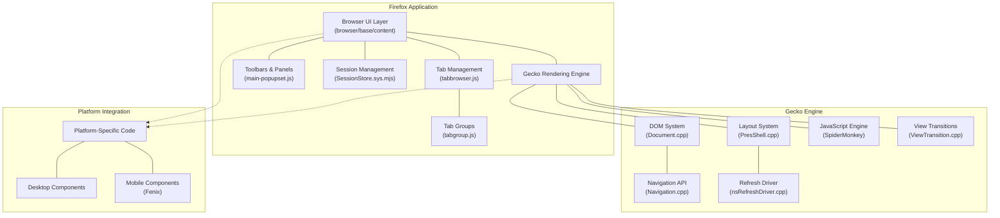

Sources:
- [browser/components/tabbrowser/content/tabbrowser.js:1-1350]()
- [dom/base/Document.cpp:1-100]()
- [browser/components/sessionstore/SessionStore.sys.mjs:1-60]()
- [layout/base/PresShell.cpp:1-120]()
- [dom/navigation/Navigation.cpp:1-50]()
- [dom/view-transitions/ViewTransition.cpp:1-25]()
- [browser/base/content/browser.js:1-115]()

## Browser UI Framework

The Firefox UI is structured around a central tab browser component that manages the user's browsing sessions and provides the primary user interface.

### Tab Browser System

The tab browser (`tabbrowser.js`) is one of the core components that manages tabs, browsers, and their content. It's responsible for:

- Creating and destroying tabs
- Switching between tabs
- Managing tab state (loading, pinned, hidden)
- Coordinating with the session store
- Handling tab events and user interactions

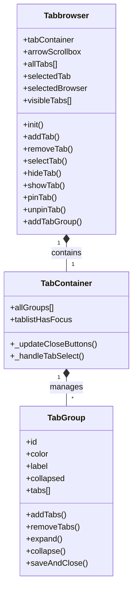

Sources:
- [browser/components/tabbrowser/content/tabbrowser.js:94-446]()
- [browser/components/tabbrowser/content/tabs.js:26-143]()
- [browser/components/tabbrowser/content/tabgroup.js:9-15]()
- [browser/components/tabbrowser/GroupsList.sys.mjs:1-5]()

### Tab Groups

Tab Groups are a feature that allows users to organize related tabs together. The implementation includes:

- Tab group creation and management
- Group UI representation in the tab bar
- Group editing interface
- Group collapse/expand functionality
- Smart tab grouping with AI suggestions

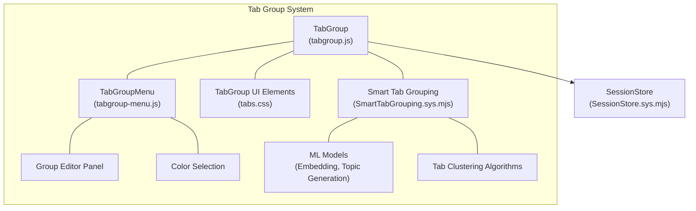

Sources:
- [browser/components/tabbrowser/content/tabgroup.js:10-30]()
- [browser/components/tabbrowser/content/tabgroup-menu.js:24-50]()
- [browser/components/tabbrowser/SmartTabGrouping.sys.mjs:55-136]()
- [browser/themes/shared/tabbrowser/tabs.css:78-108]()
- [browser/components/sessionstore/SessionStore.sys.mjs:30-33]()

### Session Management

The Session Store system is responsible for persisting the user's browsing session across browser restarts and crashes. It handles:

- Saving and restoring window and tab state
- Managing closed tabs history
- Browser shutdown and startup restoration
- Tab group persistence

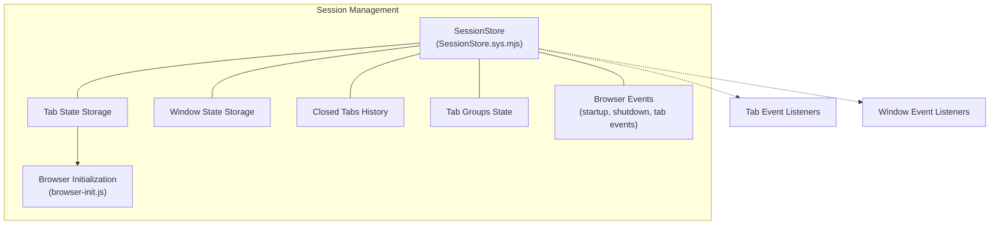

Sources:
- [browser/components/sessionstore/SessionStore.sys.mjs:1-100]()
- [browser/base/content/browser-init.js:11-18]()
- [browser/components/tabbrowser/test/browser/tabs/browser_tab_manager_groups.js:6-10]()

## Gecko Browser Engine

The core of Firefox is the Gecko rendering engine, which handles the parsing, layout, and rendering of web content.

### Document Object Model (DOM)

The Document class (`Document.cpp`) is a central component of the DOM system that represents a web page. It's responsible for:

- Managing the document's content tree
- Handling document events
- Managing document state
- Coordinating with the layout system
- Security and content policies

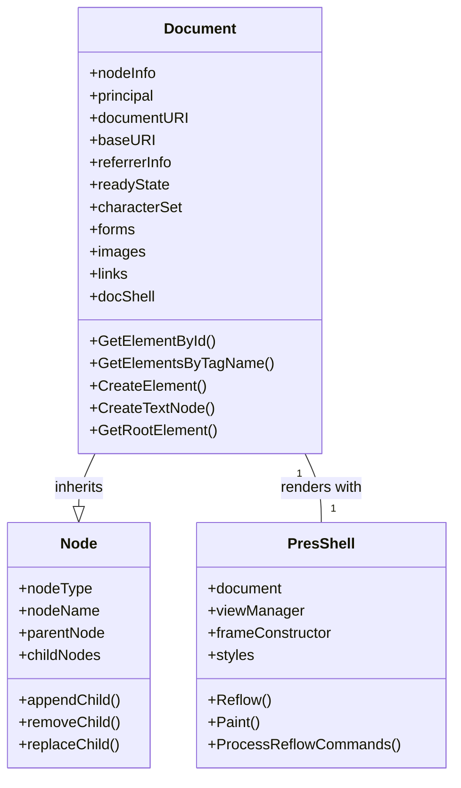

Sources:
- [dom/base/Document.cpp:1-150]()
- [dom/base/Document.cpp:485-670]()
- [dom/base/Document.h:1-120]()
- [layout/base/PresShell.cpp:1-50]()

### Layout and Rendering

The presentation shell (`PresShell.cpp`) is responsible for coordinating the layout and rendering of content. It works with:

- The refresh driver to schedule reflows and repaints
- The frame constructor to build the frame tree
- The view system to manage visual representation
- Style resolution and application

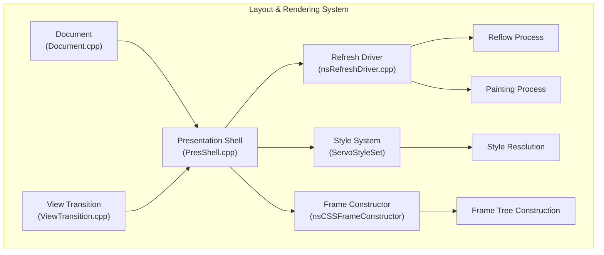

Sources:
- [layout/base/PresShell.cpp:1-125]()
- [layout/base/nsRefreshDriver.cpp:1-6]()
- [dom/view-transitions/ViewTransition.cpp:1-25]()

### Navigation System

The Navigation API (`Navigation.cpp`) provides a modern interface for browser navigation, working alongside the traditional history mechanisms:

- Handling navigation events
- Managing navigation entries
- Coordinating with the session history
- Supporting transitions between pages

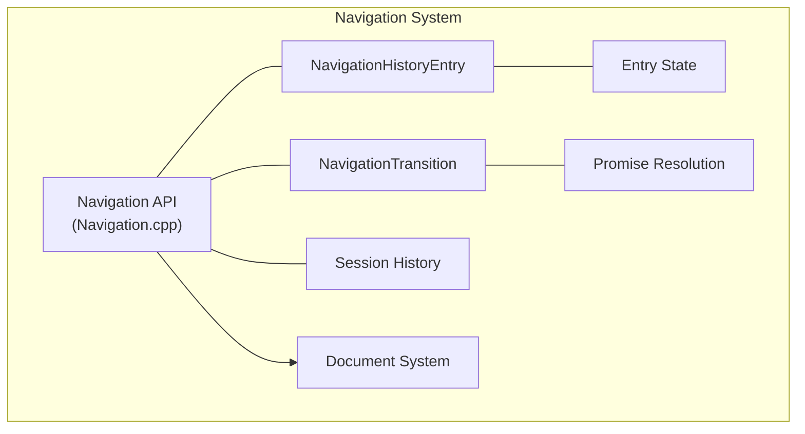

Sources:
- [dom/navigation/Navigation.cpp:1-70]()

## Mobile Architecture (Firefox for Android)

Firefox for Android (Fenix) shares the Gecko engine with desktop Firefox but has a completely different UI layer built with Android components.

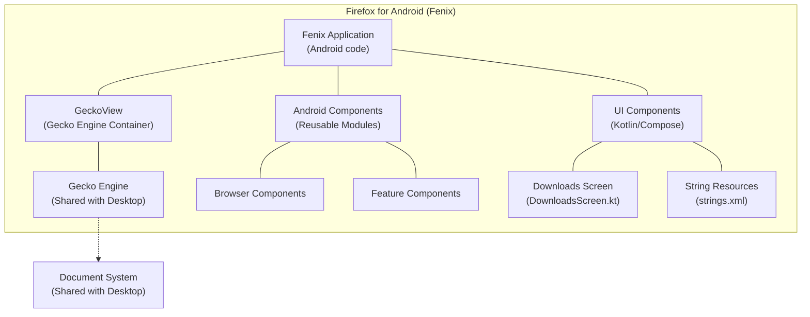

Sources:
- [mobile/android/fenix/app/src/main/java/org/mozilla/fenix/downloads/listscreen/DownloadsScreen.kt:1-15]()
- [mobile/android/fenix/app/src/main/res/values/strings.xml:1-50]()
- [mobile/android/fenix/app/metrics.yaml:1-42]()

## Telemetry and Metrics

Firefox includes comprehensive telemetry systems to collect usage data and metrics. The system is designed to respect user privacy while providing valuable insights for development.

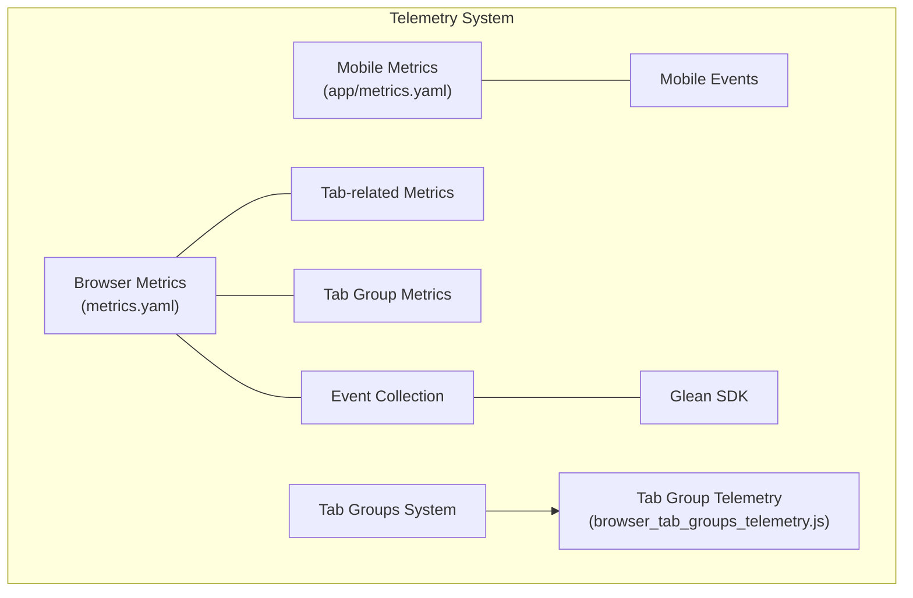

Sources:
- [browser/components/tabbrowser/metrics.yaml:1-33]()
- [mobile/android/fenix/app/metrics.yaml:1-42]()
- [browser/components/tabbrowser/test/browser/tabs/browser_tab_groups_telemetry.js:1-4]()

## System Dependencies and Build Infrastructure

Firefox has a complex dependency graph managed through various build tools, including Cargo for Rust components.

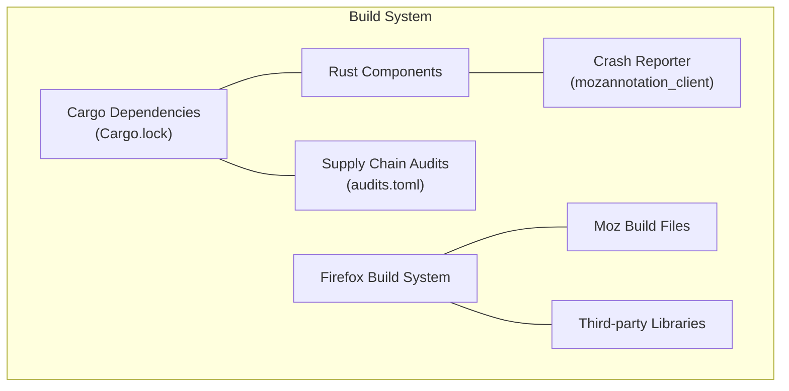

Sources:
- [Cargo.lock:1-50]()
- [supply-chain/audits.toml:1-33]()
- [toolkit/crashreporter/mozannotation_client/src/lib.rs:1-3]()

## Integration Points and Communication Flows

The following diagram illustrates how the major systems in Firefox interact with each other:

```mermaid
graph TD
    subgraph "User Interface Layer"
        BrowserXUL["Browser Window<br>(browser.xhtml)"] --> Tabbrowser["Tabbrowser<br>(tabbrowser.js)"]
        BrowserXUL --> BrowserJS["Browser Logic<br>(browser.js)"]
        BrowserXUL --> Popups["Popups and Panels<br>(main-popupset.js)"]
        
        Tabbrowser --> TabGroup["Tab Groups<br>(tabgroup.js)"]
    end
    
    subgraph "Browser Services"
        SessionStore["Session Store<br>(SessionStore.sys.mjs)"] --> BrowserInit["Browser Init<br>(browser-init.js)"]
        TabGroup --> SmartGrouping["Smart Tab Grouping<br>(SmartTabGrouping.sys.mjs)"]
    end
    
    subgraph "Core Engine"
        GeckoEngine["Gecko Engine"] --> Document["Document<br>(Document.cpp)"]
        Document --> PresShell["PresShell<br>(PresShell.cpp)"]
        Document --> Navigation["Navigation API<br>(Navigation.cpp)"]
        PresShell --> ViewTransition["View Transition<br>(ViewTransition.cpp)"]
        PresShell --> RefreshDriver["Refresh Driver<br>(nsRefreshDriver.cpp)"]
    end
    
    Tabbrowser <--> SessionStore
    BrowserJS <--> GeckoEngine
    Tabbrowser --> GeckoEngine: "Creates and manages browser elements"
    
    class BrowserXUL,Tabbrowser,GeckoEngine,Document fontsize:14px;
```

Sources:
- [browser/base/content/browser.xhtml:1-4]()
- [browser/components/tabbrowser/content/tabbrowser.js:94-130]()
- [browser/base/content/browser.js:1-116]()
- [browser/base/content/main-popupset.js:1-2]()
- [browser/components/sessionstore/SessionStore.sys.mjs:1-60]()
- [dom/base/Document.cpp:1-50]()
- [layout/base/PresShell.cpp:1-50]()

## Key Architectural Principles

Firefox's architecture follows several key principles:

1. **Multi-process separation**: Browser UI runs in the parent process, while web content runs in child processes for security and stability.

2. **Component modularity**: Systems are designed as reusable modules with clear interfaces.

3. **Progressive enhancement**: Features like tab groups build on the basic browser functionality.

4. **Cross-platform core**: The Gecko engine is shared across desktop and mobile platforms, while UI layers are platform-specific.

5. **Extensibility**: The architecture supports extension through add-ons and internal feature modules.

## Table of Key Components and Responsibilities

| Component | Primary Files | Responsibilities |
|-----------|---------------|------------------|
| Tabbrowser | [browser/components/tabbrowser/content/tabbrowser.js]() | Tab creation, selection, management |
| Tab Groups | [browser/components/tabbrowser/content/tabgroup.js]() | Organizing tabs into logical groups |
| Document | [dom/base/Document.cpp]() | Managing web document structure and content |
| PresShell | [layout/base/PresShell.cpp]() | Coordinating layout and rendering |
| SessionStore | [browser/components/sessionstore/SessionStore.sys.mjs]() | Persisting session state across restarts |
| Navigation API | [dom/navigation/Navigation.cpp]() | Managing browser navigation |
| View Transition | [dom/view-transitions/ViewTransition.cpp]() | Smooth transitions between page states |
| Browser Init | [browser/base/content/browser-init.js]() | Browser startup sequence |
| Smart Tab Grouping | [browser/components/tabbrowser/SmartTabGrouping.sys.mjs]() | AI-powered tab organization |

This overview provides a foundation for understanding the Firefox codebase structure. For more detailed information on specific components, please refer to their dedicated wiki pages or explore the referenced source files.

---

# Page: Core Components and Systems

# Core Components and Systems

<details>
<summary>Relevant source files</summary>

The following files were used as context for generating this wiki page:

- [docshell/base/WindowContext.cpp](docshell/base/WindowContext.cpp)
- [docshell/base/WindowContext.h](docshell/base/WindowContext.h)
- [docshell/base/nsDocShell.cpp](docshell/base/nsDocShell.cpp)
- [docshell/base/nsIDocShell.idl](docshell/base/nsIDocShell.idl)
- [dom/base/Document.cpp](dom/base/Document.cpp)
- [dom/base/Document.h](dom/base/Document.h)
- [dom/base/FormData.cpp](dom/base/FormData.cpp)
- [dom/base/FormData.h](dom/base/FormData.h)
- [dom/base/VisualViewport.cpp](dom/base/VisualViewport.cpp)
- [dom/base/VisualViewport.h](dom/base/VisualViewport.h)
- [dom/base/nsHistory.h](dom/base/nsHistory.h)
- [dom/base/nsWrapperCache.h](dom/base/nsWrapperCache.h)
- [dom/bindings/BindingUtils.cpp](dom/bindings/BindingUtils.cpp)
- [dom/bindings/Codegen.py](dom/bindings/Codegen.py)
- [dom/bindings/DOMJSClass.h](dom/bindings/DOMJSClass.h)
- [dom/events/NavigateEvent.cpp](dom/events/NavigateEvent.cpp)
- [dom/events/NavigateEvent.h](dom/events/NavigateEvent.h)
- [dom/navigation/Navigation.cpp](dom/navigation/Navigation.cpp)
- [dom/navigation/Navigation.h](dom/navigation/Navigation.h)
- [dom/navigation/NavigationHistoryEntry.cpp](dom/navigation/NavigationHistoryEntry.cpp)
- [dom/navigation/NavigationHistoryEntry.h](dom/navigation/NavigationHistoryEntry.h)
- [dom/promise/Promise.cpp](dom/promise/Promise.cpp)
- [dom/promise/Promise.h](dom/promise/Promise.h)
- [dom/view-transitions/ViewTransition.cpp](dom/view-transitions/ViewTransition.cpp)
- [dom/view-transitions/ViewTransition.h](dom/view-transitions/ViewTransition.h)
- [gfx/layers/wr/WebRenderLayerManager.h](gfx/layers/wr/WebRenderLayerManager.h)
- [js/public/ErrorReport.h](js/public/ErrorReport.h)
- [js/public/ProtoKey.h](js/public/ProtoKey.h)
- [js/public/friend/ErrorNumbers.msg](js/public/friend/ErrorNumbers.msg)
- [js/src/builtin/TestingFunctions.cpp](js/src/builtin/TestingFunctions.cpp)
- [js/src/builtin/temporal/TemporalParser.cpp](js/src/builtin/temporal/TemporalParser.cpp)
- [js/src/debugger/Source.cpp](js/src/debugger/Source.cpp)
- [js/src/fuzz-tests/testWasm.cpp](js/src/fuzz-tests/testWasm.cpp)
- [js/src/gc/Allocator.h](js/src/gc/Allocator.h)
- [js/src/gc/BufferAllocator-inl.h](js/src/gc/BufferAllocator-inl.h)
- [js/src/gc/BufferAllocator.cpp](js/src/gc/BufferAllocator.cpp)
- [js/src/gc/BufferAllocator.h](js/src/gc/BufferAllocator.h)
- [js/src/gc/Nursery.cpp](js/src/gc/Nursery.cpp)
- [js/src/gc/Nursery.h](js/src/gc/Nursery.h)
- [js/src/gc/Tracer.h](js/src/gc/Tracer.h)
- [js/src/jit-test/lib/asserts.js](js/src/jit-test/lib/asserts.js)
- [js/src/jit-test/lib/wasm-binary.js](js/src/jit-test/lib/wasm-binary.js)
- [js/src/jit-test/tests/wasm/binary.js](js/src/jit-test/tests/wasm/binary.js)
- [js/src/jit-test/tests/wasm/bug1951874.js](js/src/jit-test/tests/wasm/bug1951874.js)
- [js/src/jit-test/tests/wasm/js-promise-integration/js-promise-integration.new.js](js/src/jit-test/tests/wasm/js-promise-integration/js-promise-integration.new.js)
- [js/src/jit-test/tests/wasm/regress/bug1957544.js](js/src/jit-test/tests/wasm/regress/bug1957544.js)
- [js/src/jsapi-tests/testGCAllocator.cpp](js/src/jsapi-tests/testGCAllocator.cpp)
- [js/src/jsexn.h](js/src/jsexn.h)
- [js/src/jsmath.cpp](js/src/jsmath.cpp)
- [js/src/jsshell.msg](js/src/jsshell.msg)
- [js/src/moz.build](js/src/moz.build)
- [js/src/shell/js.cpp](js/src/shell/js.cpp)
- [js/src/vm/Compression.cpp](js/src/vm/Compression.cpp)
- [js/src/vm/ErrorObject.cpp](js/src/vm/ErrorObject.cpp)
- [js/src/vm/GlobalObject.cpp](js/src/vm/GlobalObject.cpp)
- [js/src/vm/JSObject.cpp](js/src/vm/JSObject.cpp)
- [js/src/vm/NativeObject.h](js/src/vm/NativeObject.h)
- [js/src/vm/TypedArrayObject.cpp](js/src/vm/TypedArrayObject.cpp)
- [js/src/vm/TypedArrayObject.h](js/src/vm/TypedArrayObject.h)
- [js/src/wasm/WasmBinary.cpp](js/src/wasm/WasmBinary.cpp)
- [js/src/wasm/WasmBinary.h](js/src/wasm/WasmBinary.h)
- [js/src/wasm/WasmBinaryTypes.h](js/src/wasm/WasmBinaryTypes.h)
- [js/src/wasm/WasmCompile.h](js/src/wasm/WasmCompile.h)
- [js/src/wasm/WasmCompileArgs.h](js/src/wasm/WasmCompileArgs.h)
- [js/src/wasm/WasmJS.cpp](js/src/wasm/WasmJS.cpp)
- [js/src/wasm/WasmModuleTypes.cpp](js/src/wasm/WasmModuleTypes.cpp)
- [js/src/wasm/WasmModuleTypes.h](js/src/wasm/WasmModuleTypes.h)
- [js/src/wasm/WasmValidate.cpp](js/src/wasm/WasmValidate.cpp)
- [js/src/wasm/WasmValidate.h](js/src/wasm/WasmValidate.h)
- [js/xpconnect/wrappers/XrayWrapper.cpp](js/xpconnect/wrappers/XrayWrapper.cpp)
- [layout/base/PresShell.cpp](layout/base/PresShell.cpp)
- [layout/base/PresShell.h](layout/base/PresShell.h)
- [layout/base/PresShellForwards.h](layout/base/PresShellForwards.h)
- [layout/base/PresShellInlines.h](layout/base/PresShellInlines.h)
- [layout/base/RenderingPhase.h](layout/base/RenderingPhase.h)
- [layout/base/nsPresContext.cpp](layout/base/nsPresContext.cpp)
- [layout/base/nsPresContext.h](layout/base/nsPresContext.h)
- [layout/base/nsRefreshDriver.cpp](layout/base/nsRefreshDriver.cpp)
- [layout/base/nsRefreshDriver.h](layout/base/nsRefreshDriver.h)
- [layout/generic/ScrollContainerFrame.h](layout/generic/ScrollContainerFrame.h)
- [layout/style/ServoStyleSet.cpp](layout/style/ServoStyleSet.cpp)
- [modules/libpref/init/StaticPrefList.yaml](modules/libpref/init/StaticPrefList.yaml)
- [testing/web-platform/meta/css/css-view-transitions/transition-in-hidden-page.html.ini](testing/web-platform/meta/css/css-view-transitions/transition-in-hidden-page.html.ini)
- [testing/web-platform/meta/css/cssom-view/scrollIntoView-sideways-lr-writing-mode.html.ini](testing/web-platform/meta/css/cssom-view/scrollIntoView-sideways-lr-writing-mode.html.ini)
- [testing/web-platform/tests/css/css-scroll-snap/snap-after-relayout/resnap-on-reconstructing-frame.html](testing/web-platform/tests/css/css-scroll-snap/snap-after-relayout/resnap-on-reconstructing-frame.html)
- [xpcom/ds/nsTArray.cpp](xpcom/ds/nsTArray.cpp)
- [xpcom/ds/nsTArray.h](xpcom/ds/nsTArray.h)

</details>


This document provides an overview of the fundamental components and systems that form the core architecture of the Firefox browser and Gecko rendering engine. Understanding these components is essential for working effectively with the codebase. This page focuses on the core architectural elements rather than specific features or UI elements.

For information about UI components, see [User Interface Architecture](#3). For extension-related systems, see [Experimentation and Telemetry Systems](#5).

## Core Architecture Overview

Firefox's architecture is composed of several interconnected systems that work together to render web content, execute JavaScript, manage resources, and provide browser functionality.

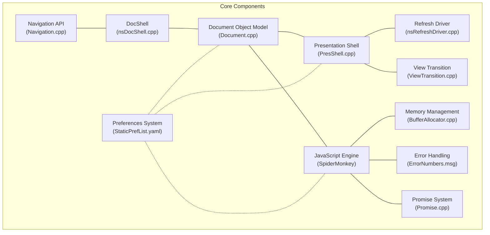

Sources: [dom/base/Document.cpp](). [layout/base/PresShell.cpp](). [js/src/shell/js.cpp](). [dom/navigation/Navigation.cpp](). [modules/libpref/init/StaticPrefList.yaml](). [js/src/gc/BufferAllocator.cpp](). [dom/promise/Promise.cpp](). [dom/view-transitions/ViewTransition.cpp]().

## Document Object Model (DOM)

The Document Object Model (DOM) is a programming interface for web documents. It represents the document as a tree of objects that can be manipulated through JavaScript or other programming languages.

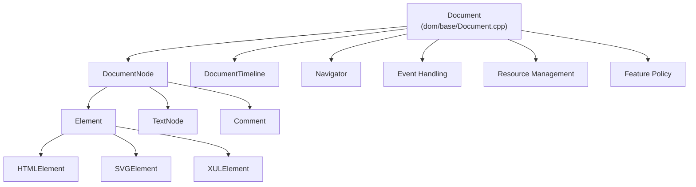

### Document Implementation

The `Document` class is the central class for representing web documents in Firefox. It extends `DocumentOrShadowRoot` and implements multiple interfaces including `nsIScriptObjectPrincipal`, `nsISupports`, and others.

Key responsibilities include:

1. **Document Lifecycle Management**: Handling loading, unloading, and state transitions
2. **Node Management**: Creating, organizing, and managing DOM nodes
3. **Event Handling**: Dispatching and processing DOM events 
4. **Resource Management**: Controlling external resources, stylesheets, and images
5. **Security Enforcement**: Managing Content Security Policy and permissions

#### Document Structure

A Document manages multiple collections including:

- **Elements by ID/Name**: Fast lookups via `IdentifierMapEntry`
- **Stylesheets**: Both author and user stylesheets
- **Event Listeners**: For DOM events
- **External Resources**: Referenced by the document

```cpp
class Document : public DocumentOrShadowRoot,
                 public nsIScriptObjectPrincipal,
                 /* other interfaces */ {
  private:
    // Document state and flags
    mozilla::dom::DocumentTimeline* mDocumentTimeline;
    nsRefPtrHashtable<nsStringHashKey, mozilla::dom::DOMStringList> mLists;
    mozilla::dom::ExternalResourceMap mExternalResourceMap;
    // Many other fields...
}
```

Sources: [dom/base/Document.h:39-300](). [dom/base/Document.cpp:1-100](). [dom/base/Document.cpp:484-550]().

### Document Components

#### Headers and Content Type Management

Documents handle metadata through header fields, managing content types and character encoding:

```cpp
class Document::HeaderData {
  public:
    HeaderData(nsAtom* aField, const nsAString& aData)
        : mField(aField), mData(aData) {}
    
    RefPtr<nsAtom> mField;
    nsString mData;
    UniquePtr<HeaderData> mNext;
};
```

#### Content Collections

Documents maintain special collections for efficiently retrieving elements:

```cpp
class SimpleHTMLCollection : public nsSimpleContentList,
                             public nsIHTMLCollection {
  // Provides fast access to elements by ID or name
}
```

Sources: [dom/base/Document.cpp:485-505](). [dom/base/Document.cpp:675-795]().

## Presentation System

The presentation system is responsible for rendering web content to the screen. It consists of several key components including PresShell, RefreshDriver, and frame management.

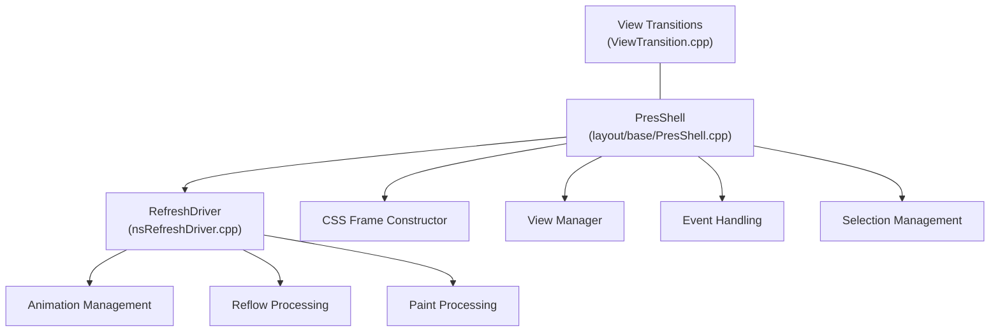

### PresShell

`PresShell` is the core presentation component that manages layout and rendering. It connects the DOM to visual presentation.

Key responsibilities:
1. **Rendering Coordination**: Manages the process of laying out and painting content
2. **Event Handling**: Processes user interactions with rendered content
3. **Frame Management**: Manages the frame tree that represents visual elements
4. **Selection Management**: Handles text/element selection
5. **Reflow Control**: Coordinates the reflow process that computes layout

```cpp
class PresShell : public nsISelectionController {
  private:
    RefPtr<nsViewManager> mViewManager;
    RefPtr<nsPresContext> mPresContext;
    RefPtr<nsDocumentViewer> mDocumentViewer;
    // Many other fields...
};
```

Sources: [layout/base/PresShell.cpp:5-60](). [layout/base/PresShell.cpp:216-257](). [layout/base/PresShell.h:9-40]().

### RefreshDriver

The `RefreshDriver` orchestrates visual updates and animation processing, determining when to update the display.

Key responsibilities:
1. **Scheduling**: Maintains the refresh timing for animations and repainting
2. **Observer Notification**: Notifies registered observers about refresh cycles
3. **Paint Coordination**: Triggers paint operations at appropriate times
4. **Animation Timing**: Provides timing information for animations

```cpp
class nsRefreshDriver final : public mozilla::layers::TransactionIdAllocator,
                             public nsARefreshObserver {
  // Maintains refresh timing and coordinates visual updates
};
```

Each document has its own `RefreshDriver`, but multiple drivers can share the same timer to conserve resources:

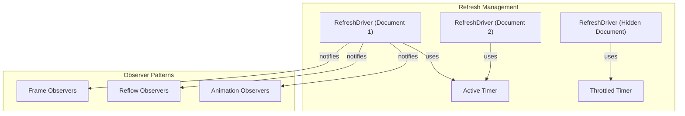

Sources: [layout/base/nsRefreshDriver.cpp:12-186](). [layout/base/nsRefreshDriver.h:54-100]().

### View Transitions

The `ViewTransition` system provides smooth visual transitions between different UI states:

```cpp
class ViewTransition final : public nsISupports, public nsWrapperCache {
  // Manages CSS View Transitions API
};
```

Key components:
1. **Snapshot Management**: Captures the visual state before and after transitions
2. **Animation Control**: Manages the animation timing between states
3. **Element Tracking**: Tracks elements across transition states

Sources: [dom/view-transitions/ViewTransition.cpp:36-170](). [dom/view-transitions/ViewTransition.h:39-76]().

## JavaScript Engine (SpiderMonkey)

SpiderMonkey is Firefox's JavaScript engine, responsible for executing JavaScript code. It's a complex system with many components working together.

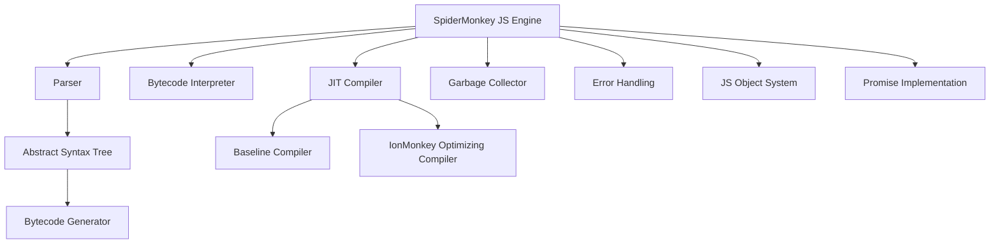

### JSObject System

The JSObject system provides the foundation for JavaScript objects:

```cpp
class JSObject : public js::gc::Cell {
  // Base class for all JavaScript objects
};
```

Key aspects:
1. **Property Access**: Manages property storage and access
2. **Prototype Chain**: Handles prototype-based inheritance
3. **Type Information**: Maintains type data for optimization

Sources: [js/src/vm/JSObject.cpp:11-141]().

### Error Handling

Error handling is a critical part of the JavaScript engine:

```cpp
// Error message definitions
MSG_DEF(JSMSG_NOT_AN_ERROR,            0, JSEXN_ERR, "<Error #0 is reserved>")
MSG_DEF(JSMSG_NOT_DEFINED,             1, JSEXN_REFERENCEERR, "{0} is not defined")
MSG_DEF(JSMSG_MORE_ARGS_NEEDED,        4, JSEXN_TYPEERR, "{0}: At least {1} argument{2} required, but only {3} passed")
```

The error system provides:
1. **Standardized Errors**: Consistent error messages across the engine
2. **Localization Support**: Error messages can be translated
3. **Formatted Messages**: Supports parameter substitution

Sources: [js/public/friend/ErrorNumbers.msg:1-50](). [js/src/vm/ErrorObject.cpp:1-30]().

### JS Runtime

The JS runtime manages JavaScript execution:

```cpp
// Core JS shell runtime
using namespace js;
using namespace js::cli;
using namespace js::shell;
```

Sources: [js/src/shell/js.cpp:220-247]().

## Memory Management

Memory management in Firefox is sophisticated, with specialized systems for different allocation patterns and requirements.

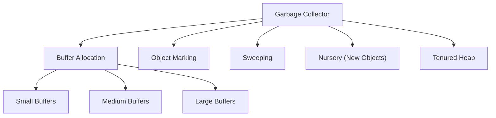

### Buffer Allocator

The `BufferAllocator` provides memory allocation services for the JavaScript engine:

```cpp
class BufferAllocator {
  // Allocates dynamically sized blocks of memory
};
```

Key features:
1. **Size-Optimized Allocation**: Different strategies based on allocation size
2. **GC Integration**: Allocations can be reclaimed by the garbage collector
3. **Explicit Management**: Supports explicit free and resize operations
4. **Memory Tracking**: Tracks allocations for GC and debugging purposes

The allocator divides memory into three categories:
- **Small Buffers**: Fixed-size allocations
- **Medium Buffers**: Medium-sized allocations managed in chunks
- **Large Buffers**: Large allocations managed directly

Sources: [js/src/gc/BufferAllocator.cpp:5-88](). [js/src/gc/BufferAllocator.h:52-100]().

## Navigation System

The Navigation system manages browser navigation, history, and the Navigation API.

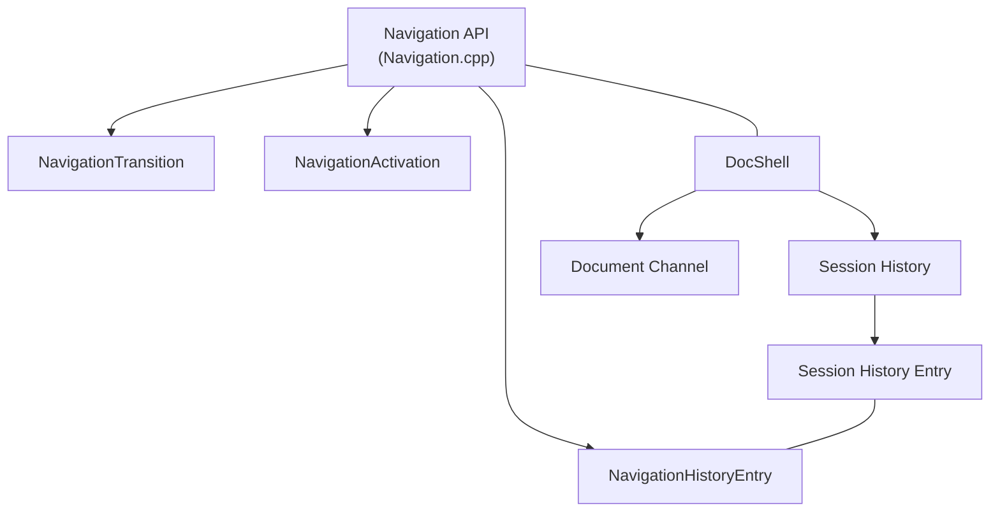

### Navigation API

The `Navigation` class implements the Navigation API, providing a modern interface for controlling browser navigation:

```cpp
class Navigation final : public DOMEventTargetHelper {
  // Implements the Navigation API standard
};
```

Key capabilities:
1. **History Management**: Access to browser history entries
2. **Navigation Control**: Methods for traversing history and loading URLs
3. **State Management**: Supports state objects for history entries
4. **Event Handling**: Events for navigation state changes

```cpp
void Navigation::Entries(
    nsTArray<RefPtr<NavigationHistoryEntry>>& aResult) const {
  aResult = mEntries.Clone();
}

already_AddRefed<NavigationHistoryEntry> Navigation::GetCurrentEntry() const {
  if (HasEntriesAndEventsDisabled()) {
    return nullptr;
  }

  if (!mCurrentEntryIndex) {
    return nullptr;
  }

  RefPtr entry{mEntries[*mCurrentEntryIndex]};
  return entry.forget();
}
```

Sources: [dom/navigation/Navigation.cpp:39-137](). [dom/navigation/Navigation.h:40-75]().

### Navigation History Entry

Each history entry is represented by `NavigationHistoryEntry`:

```cpp
class NavigationHistoryEntry : public nsISupports, public nsWrapperCache {
  // Represents a single entry in the navigation history
};
```

Sources: [dom/navigation/NavigationHistoryEntry.h:1-15](). [dom/navigation/NavigationHistoryEntry.cpp:1-15]().

### DocShell

The `nsDocShell` class provides core browser functionality:

```cpp
class nsDocShell : public nsDocLoader,
                  /* many interfaces */ {
  // Core browser component responsible for loading content
};
```

Key responsibilities:
1. **Content Loading**: Manages the loading process for documents
2. **History Management**: Maintains browsing history
3. **Navigation Control**: Implements navigation operations (back, forward, etc.)
4. **Frame Management**: Handles iframe/frame relationships

Sources: [docshell/base/nsDocShell.cpp:7-173]().

## Preferences System

The preferences system manages user and application settings through a hierarchical key-value store.

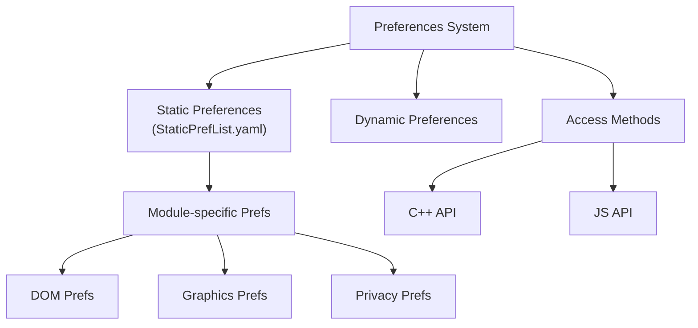

### Static Preferences

Static preferences are defined in `StaticPrefList.yaml` and are compiled into the application:

```yaml
# This file defines static prefs, i.e. those that are defined at startup and
# used entirely or mostly from C++ and/or Rust code.

- name: accessibility.tabfocus
  type: int32_t
  value: 7
  mirror: always

- name: browser.cache.disk.enable
  type: RelaxedAtomicBool
  value: true
  mirror: always
```

Key concepts:
1. **Preference Types**: Bool, Int32, Float, String, etc.
2. **Mirroring Policy**: How preferences are mirrored to C++ variables
   - `never`: No C++ mirror variable
   - `once`: Mirrored only at startup
   - `always`: Always kept in sync

3. **Default Values**: Initial values for preferences
4. **Build Conditions**: Some preferences vary by build configuration

Sources: [modules/libpref/init/StaticPrefList.yaml:1-145](). [modules/libpref/init/StaticPrefList.yaml:229-296]().

## Promise Architecture

The Promise system provides asynchronous programming capabilities in Firefox.

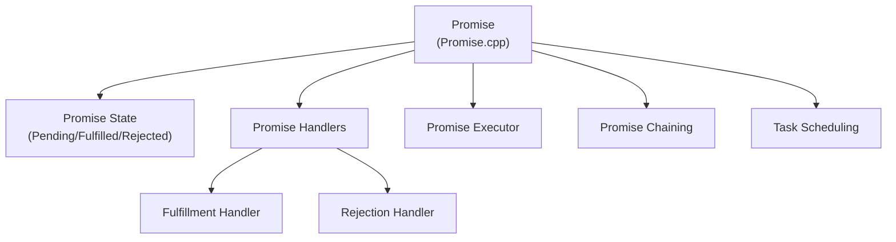

### Promise Implementation

`Promise` is implemented as a DOM class:

```cpp
class Promise : public DOMEventTargetHelper {
  // Implementation of the JavaScript Promise object
};
```

Key aspects:
1. **State Management**: Tracks promise state (pending/fulfilled/rejected)
2. **Handler Registration**: Methods for adding fulfillment and rejection handlers
3. **Chaining Support**: Facilitates promise chaining
4. **Task Scheduling**: Schedules tasks appropriately in the event loop

Sources: [dom/promise/Promise.cpp:1-15](). [dom/promise/Promise.h:1-15]().

## Integration Between Systems

The core components are tightly integrated, working together to provide browser functionality:

```mermaid
graph TD
    subgraph "Rendering Pipeline"
        DOM["DOM"] --> PresShell["PresShell"]
        PresShell --> RefreshDriver["RefreshDriver"]
        RefreshDriver --> Paint["Paint"]
    end
    
    subgraph "JavaScript Execution"
        JSEngine["SpiderMonkey"] --> DOM
        JSEngine --> Promises["Promises"]
        JSEngine --> GC["Memory Management"]
    end
    
    subgraph "Navigation Flow"
        Navigation["Navigation API"] --> DocShell["DocShell"]
        DocShell --> DOM
        DocShell --> ViewTransition["View Transition"]
    end
    
    subgraph "Configuration"
        Prefs["Preferences"] -.- DOM
        Prefs -.- JSEngine
        Prefs -.- DocShell
    end
```

Sources: [dom/base/Document.cpp](). [layout/base/PresShell.cpp](). [js/src/shell/js.cpp](). [dom/navigation/Navigation.cpp](). [dom/view-transitions/ViewTransition.cpp](). [modules/libpref/init/StaticPrefList.yaml]().

---

# Page: Gecko Engine

# Gecko Engine

<details>
<summary>Relevant source files</summary>

The following files were used as context for generating this wiki page:

- [browser/extensions/formautofill/api.js](browser/extensions/formautofill/api.js)
- [browser/extensions/formautofill/test/browser/address/browser_autofill_whenhidden.js](browser/extensions/formautofill/test/browser/address/browser_autofill_whenhidden.js)
- [browser/extensions/formautofill/test/browser/browser.toml](browser/extensions/formautofill/test/browser/browser.toml)
- [browser/extensions/formautofill/test/browser/browser_autofill_address_select_match_isoid.js](browser/extensions/formautofill/test/browser/browser_autofill_address_select_match_isoid.js)
- [browser/extensions/formautofill/test/browser/browser_autofill_address_textarea.js](browser/extensions/formautofill/test/browser/browser_autofill_address_textarea.js)
- [browser/extensions/formautofill/test/browser/browser_dynamic_form_autocompletion.js](browser/extensions/formautofill/test/browser/browser_dynamic_form_autocompletion.js)
- [browser/extensions/formautofill/test/browser/browser_dynamic_form_detection.js](browser/extensions/formautofill/test/browser/browser_dynamic_form_detection.js)
- [browser/extensions/formautofill/test/browser/browser_dynamic_form_telemetry.js](browser/extensions/formautofill/test/browser/browser_dynamic_form_telemetry.js)
- [browser/extensions/formautofill/test/browser/browser_editAddressDialog.js](browser/extensions/formautofill/test/browser/browser_editAddressDialog.js)
- [browser/extensions/formautofill/test/browser/browser_form_changes.js](browser/extensions/formautofill/test/browser/browser_form_changes.js)
- [browser/extensions/formautofill/test/browser/head.js](browser/extensions/formautofill/test/browser/head.js)
- [browser/extensions/formautofill/test/fixtures/dynamic_form_changing_on_user_interaction.html](browser/extensions/formautofill/test/fixtures/dynamic_form_changing_on_user_interaction.html)
- [browser/extensions/formautofill/test/fixtures/dynamic_form_replacing_all_fields.html](browser/extensions/formautofill/test/fixtures/dynamic_form_replacing_all_fields.html)
- [browser/extensions/formautofill/test/fixtures/dynamic_formless_fields_updated_due_to_node_mutations.html](browser/extensions/formautofill/test/fixtures/dynamic_formless_fields_updated_due_to_node_mutations.html)
- [browser/extensions/formautofill/test/fixtures/dynamic_formless_fields_updated_due_to_visiblity_state_change.html](browser/extensions/formautofill/test/fixtures/dynamic_formless_fields_updated_due_to_visiblity_state_change.html)
- [browser/extensions/formautofill/test/fixtures/dynamic_forms.html](browser/extensions/formautofill/test/fixtures/dynamic_forms.html)
- [browser/extensions/formautofill/test/mochitest/formautofill_common.js](browser/extensions/formautofill/test/mochitest/formautofill_common.js)
- [browser/extensions/formautofill/test/mochitest/test_formautofill_preview_highlight.html](browser/extensions/formautofill/test/mochitest/test_formautofill_preview_highlight.html)
- [browser/extensions/formautofill/test/unit/xpcshell.toml](browser/extensions/formautofill/test/unit/xpcshell.toml)
- [docshell/base/WindowContext.cpp](docshell/base/WindowContext.cpp)
- [docshell/base/WindowContext.h](docshell/base/WindowContext.h)
- [docshell/base/nsDocShell.cpp](docshell/base/nsDocShell.cpp)
- [docshell/base/nsIDocShell.idl](docshell/base/nsIDocShell.idl)
- [dom/base/Document.cpp](dom/base/Document.cpp)
- [dom/base/Document.h](dom/base/Document.h)
- [dom/base/FormData.cpp](dom/base/FormData.cpp)
- [dom/base/FormData.h](dom/base/FormData.h)
- [dom/base/VisualViewport.cpp](dom/base/VisualViewport.cpp)
- [dom/base/VisualViewport.h](dom/base/VisualViewport.h)
- [dom/base/nsHistory.h](dom/base/nsHistory.h)
- [dom/base/nsWrapperCache.h](dom/base/nsWrapperCache.h)
- [dom/bindings/BindingUtils.cpp](dom/bindings/BindingUtils.cpp)
- [dom/bindings/Codegen.py](dom/bindings/Codegen.py)
- [dom/bindings/DOMJSClass.h](dom/bindings/DOMJSClass.h)
- [dom/events/NavigateEvent.cpp](dom/events/NavigateEvent.cpp)
- [dom/events/NavigateEvent.h](dom/events/NavigateEvent.h)
- [dom/navigation/Navigation.cpp](dom/navigation/Navigation.cpp)
- [dom/navigation/Navigation.h](dom/navigation/Navigation.h)
- [dom/navigation/NavigationHistoryEntry.cpp](dom/navigation/NavigationHistoryEntry.cpp)
- [dom/navigation/NavigationHistoryEntry.h](dom/navigation/NavigationHistoryEntry.h)
- [dom/promise/Promise.cpp](dom/promise/Promise.cpp)
- [dom/promise/Promise.h](dom/promise/Promise.h)
- [dom/security/nsContentSecurityUtils.cpp](dom/security/nsContentSecurityUtils.cpp)
- [dom/security/nsContentSecurityUtils.h](dom/security/nsContentSecurityUtils.h)
- [dom/view-transitions/ViewTransition.cpp](dom/view-transitions/ViewTransition.cpp)
- [dom/view-transitions/ViewTransition.h](dom/view-transitions/ViewTransition.h)
- [gfx/layers/wr/WebRenderLayerManager.h](gfx/layers/wr/WebRenderLayerManager.h)
- [js/public/ErrorReport.h](js/public/ErrorReport.h)
- [js/public/ProtoKey.h](js/public/ProtoKey.h)
- [js/public/friend/ErrorNumbers.msg](js/public/friend/ErrorNumbers.msg)
- [js/src/builtin/TestingFunctions.cpp](js/src/builtin/TestingFunctions.cpp)
- [js/src/builtin/temporal/TemporalParser.cpp](js/src/builtin/temporal/TemporalParser.cpp)
- [js/src/debugger/Source.cpp](js/src/debugger/Source.cpp)
- [js/src/fuzz-tests/testWasm.cpp](js/src/fuzz-tests/testWasm.cpp)
- [js/src/gc/Allocator.h](js/src/gc/Allocator.h)
- [js/src/gc/BufferAllocator-inl.h](js/src/gc/BufferAllocator-inl.h)
- [js/src/gc/BufferAllocator.cpp](js/src/gc/BufferAllocator.cpp)
- [js/src/gc/BufferAllocator.h](js/src/gc/BufferAllocator.h)
- [js/src/gc/Nursery.cpp](js/src/gc/Nursery.cpp)
- [js/src/gc/Nursery.h](js/src/gc/Nursery.h)
- [js/src/gc/Tracer.h](js/src/gc/Tracer.h)
- [js/src/jit-test/lib/asserts.js](js/src/jit-test/lib/asserts.js)
- [js/src/jit-test/lib/wasm-binary.js](js/src/jit-test/lib/wasm-binary.js)
- [js/src/jit-test/tests/wasm/binary.js](js/src/jit-test/tests/wasm/binary.js)
- [js/src/jit-test/tests/wasm/bug1951874.js](js/src/jit-test/tests/wasm/bug1951874.js)
- [js/src/jit-test/tests/wasm/js-promise-integration/js-promise-integration.new.js](js/src/jit-test/tests/wasm/js-promise-integration/js-promise-integration.new.js)
- [js/src/jit-test/tests/wasm/regress/bug1957544.js](js/src/jit-test/tests/wasm/regress/bug1957544.js)
- [js/src/jsapi-tests/testGCAllocator.cpp](js/src/jsapi-tests/testGCAllocator.cpp)
- [js/src/jsexn.h](js/src/jsexn.h)
- [js/src/jsmath.cpp](js/src/jsmath.cpp)
- [js/src/jsshell.msg](js/src/jsshell.msg)
- [js/src/moz.build](js/src/moz.build)
- [js/src/shell/js.cpp](js/src/shell/js.cpp)
- [js/src/vm/Compression.cpp](js/src/vm/Compression.cpp)
- [js/src/vm/ErrorObject.cpp](js/src/vm/ErrorObject.cpp)
- [js/src/vm/GlobalObject.cpp](js/src/vm/GlobalObject.cpp)
- [js/src/vm/JSObject.cpp](js/src/vm/JSObject.cpp)
- [js/src/vm/NativeObject.h](js/src/vm/NativeObject.h)
- [js/src/vm/TypedArrayObject.cpp](js/src/vm/TypedArrayObject.cpp)
- [js/src/vm/TypedArrayObject.h](js/src/vm/TypedArrayObject.h)
- [js/src/wasm/WasmBinary.cpp](js/src/wasm/WasmBinary.cpp)
- [js/src/wasm/WasmBinary.h](js/src/wasm/WasmBinary.h)
- [js/src/wasm/WasmBinaryTypes.h](js/src/wasm/WasmBinaryTypes.h)
- [js/src/wasm/WasmCompile.h](js/src/wasm/WasmCompile.h)
- [js/src/wasm/WasmCompileArgs.h](js/src/wasm/WasmCompileArgs.h)
- [js/src/wasm/WasmJS.cpp](js/src/wasm/WasmJS.cpp)
- [js/src/wasm/WasmModuleTypes.cpp](js/src/wasm/WasmModuleTypes.cpp)
- [js/src/wasm/WasmModuleTypes.h](js/src/wasm/WasmModuleTypes.h)
- [js/src/wasm/WasmValidate.cpp](js/src/wasm/WasmValidate.cpp)
- [js/src/wasm/WasmValidate.h](js/src/wasm/WasmValidate.h)
- [js/xpconnect/wrappers/XrayWrapper.cpp](js/xpconnect/wrappers/XrayWrapper.cpp)
- [layout/base/PresShell.cpp](layout/base/PresShell.cpp)
- [layout/base/PresShell.h](layout/base/PresShell.h)
- [layout/base/PresShellForwards.h](layout/base/PresShellForwards.h)
- [layout/base/PresShellInlines.h](layout/base/PresShellInlines.h)
- [layout/base/RenderingPhase.h](layout/base/RenderingPhase.h)
- [layout/base/nsPresContext.cpp](layout/base/nsPresContext.cpp)
- [layout/base/nsPresContext.h](layout/base/nsPresContext.h)
- [layout/base/nsRefreshDriver.cpp](layout/base/nsRefreshDriver.cpp)
- [layout/base/nsRefreshDriver.h](layout/base/nsRefreshDriver.h)
- [layout/generic/ScrollContainerFrame.h](layout/generic/ScrollContainerFrame.h)
- [layout/style/ServoStyleSet.cpp](layout/style/ServoStyleSet.cpp)
- [mobile/shared/chrome/geckoview/geckoview.js](mobile/shared/chrome/geckoview/geckoview.js)
- [mobile/shared/chrome/geckoview/geckoview.xhtml](mobile/shared/chrome/geckoview/geckoview.xhtml)
- [modules/libpref/init/StaticPrefList.yaml](modules/libpref/init/StaticPrefList.yaml)
- [modules/libpref/init/all.js](modules/libpref/init/all.js)
- [security/manager/ssl/nsSiteSecurityService.cpp](security/manager/ssl/nsSiteSecurityService.cpp)
- [security/manager/ssl/nsSiteSecurityService.h](security/manager/ssl/nsSiteSecurityService.h)
- [testing/profiles/unittest-required/user.js](testing/profiles/unittest-required/user.js)
- [testing/web-platform/meta/css/css-view-transitions/transition-in-hidden-page.html.ini](testing/web-platform/meta/css/css-view-transitions/transition-in-hidden-page.html.ini)
- [testing/web-platform/meta/css/cssom-view/scrollIntoView-sideways-lr-writing-mode.html.ini](testing/web-platform/meta/css/cssom-view/scrollIntoView-sideways-lr-writing-mode.html.ini)
- [testing/web-platform/tests/css/css-scroll-snap/snap-after-relayout/resnap-on-reconstructing-frame.html](testing/web-platform/tests/css/css-scroll-snap/snap-after-relayout/resnap-on-reconstructing-frame.html)
- [toolkit/components/formautofill/Constants.ios.mjs](toolkit/components/formautofill/Constants.ios.mjs)
- [toolkit/components/formautofill/FormAutofill.sys.mjs](toolkit/components/formautofill/FormAutofill.sys.mjs)
- [toolkit/components/formautofill/FormAutofillChild.sys.mjs](toolkit/components/formautofill/FormAutofillChild.sys.mjs)
- [toolkit/components/formautofill/FormAutofillParent.sys.mjs](toolkit/components/formautofill/FormAutofillParent.sys.mjs)
- [toolkit/components/formautofill/Helpers.ios.mjs](toolkit/components/formautofill/Helpers.ios.mjs)
- [toolkit/components/formautofill/shared/AutofillFormFactory.sys.mjs](toolkit/components/formautofill/shared/AutofillFormFactory.sys.mjs)
- [toolkit/components/formautofill/shared/FormAutofillHandler.sys.mjs](toolkit/components/formautofill/shared/FormAutofillHandler.sys.mjs)
- [toolkit/components/formautofill/shared/FormAutofillHeuristics.sys.mjs](toolkit/components/formautofill/shared/FormAutofillHeuristics.sys.mjs)
- [toolkit/components/formautofill/shared/FormAutofillUtils.sys.mjs](toolkit/components/formautofill/shared/FormAutofillUtils.sys.mjs)
- [toolkit/components/formautofill/shared/FormStateManager.sys.mjs](toolkit/components/formautofill/shared/FormStateManager.sys.mjs)
- [toolkit/content/neterror/supportpages/time-errors.html](toolkit/content/neterror/supportpages/time-errors.html)
- [toolkit/modules/FormLikeFactory.sys.mjs](toolkit/modules/FormLikeFactory.sys.mjs)
- [toolkit/mozapps/downloads/HelperAppDlg.sys.mjs](toolkit/mozapps/downloads/HelperAppDlg.sys.mjs)
- [toolkit/mozapps/downloads/content/unknownContentType.xhtml](toolkit/mozapps/downloads/content/unknownContentType.xhtml)
- [toolkit/profile/content/profileDowngrade.js](toolkit/profile/content/profileDowngrade.js)
- [toolkit/profile/content/profileDowngrade.xhtml](toolkit/profile/content/profileDowngrade.xhtml)
- [toolkit/profile/jar.mn](toolkit/profile/jar.mn)
- [xpcom/ds/nsTArray.cpp](xpcom/ds/nsTArray.cpp)
- [xpcom/ds/nsTArray.h](xpcom/ds/nsTArray.h)

</details>


The Gecko Engine is Mozilla's core web rendering engine that powers Firefox and other Mozilla applications. It's responsible for parsing, layout, rendering, JavaScript execution, and handling web standards. This document provides a technical overview of Gecko's architecture, components, and how they interact to transform web content into displayed pages.

For information about Mozilla's JavaScript engine specifically, see [SpiderMonkey JavaScript Engine](#2.2).

## 1. Architecture Overview

Gecko employs a modular architecture that separates concerns while maintaining performance. At its core, Gecko consists of several key systems that work together to render web content.

```mermaid
graph TD
    subgraph "Gecko Core Systems"
        DOM["DOM System<br>(Document)"] --- Layout["Layout & Rendering<br>(PresShell, RefreshDriver)"]
        DOM --- JS["JavaScript Engine<br>(SpiderMonkey)"]
        DOM --- Security["Content Security<br>(nsContentSecurityUtils)"]
        
        Layout --- ViewTransition["View Transition<br>(ViewTransition)"]
        Layout --- RefreshDriver["Refresh Driver<br>(nsRefreshDriver)"]
        
        JS --- JIT["JIT Compilation"]
        JS --- WASM["WebAssembly"]
        
        Navigation["Navigation API<br>(Navigation)"] --- DocShell["Document Loading<br>(nsDocShell)"]
        DocShell --- DOM
    end
    
    subgraph "Supporting Systems"
        Preferences["Preferences System<br>(StaticPrefList)"] -.- DOM
        Preferences -.- JS
        Preferences -.- Layout
        
        FormAutofill["Form Autofill<br>(FormAutofillHandler)"] -.- DOM
    end
```

**Title: High-level Gecko Engine Architecture**

Sources: [dom/base/Document.cpp], [layout/base/PresShell.cpp], [dom/security/nsContentSecurityUtils.cpp], [js/src/shell/js.cpp], [dom/navigation/Navigation.cpp], [modules/libpref/init/StaticPrefList.yaml], [toolkit/components/formautofill/shared/FormAutofillHandler.sys.mjs]

### 1.1 Key Components and Data Flow

When a web page is loaded, Gecko processes it through several stages:

1. **Document Loading**: The DocShell initiates the loading process and creates a Document
2. **Parsing**: HTML/CSS/JS content is parsed into DOM and CSSOM
3. **Layout**: PresShell calculates positions and dimensions of elements
4. **Rendering**: Visual representation is created and displayed
5. **Event Handling**: User interactions trigger events processed by the DOM
6. **JavaScript Execution**: SpiderMonkey executes JavaScript code that can modify the DOM
7. **Refresh Cycle**: RefreshDriver coordinates updates to the display

```mermaid
sequenceDiagram
    participant User
    participant DocShell as "DocShell"
    participant DOM as "Document"
    participant JS as "SpiderMonkey"
    participant Layout as "PresShell"
    participant Rendering as "RefreshDriver"
    
    User->>DocShell: Request URL
    DocShell->>DOM: Create Document
    DOM->>DOM: Parse HTML
    DOM->>JS: Parse/Execute JS
    JS->>DOM: Modify DOM
    DOM->>Layout: Calculate Layout
    Layout->>Rendering: Schedule Visual Update
    Rendering->>User: Display Content
    
    User->>DOM: Interact (click, type)
    DOM->>JS: Event Callbacks
    JS->>DOM: Update DOM
    DOM->>Layout: Recalculate Layout
    Layout->>Rendering: Schedule Update
    Rendering->>User: Update Display
```

**Title: Gecko Page Processing Flow**

Sources: [dom/base/Document.cpp], [layout/base/PresShell.cpp], [layout/base/nsRefreshDriver.cpp], [docshell/base/nsDocShell.cpp], [js/src/shell/js.cpp]

## 2. Core Systems

### 2.1 DOM and Layout System

The Document Object Model (DOM) system is central to Gecko. It represents the parsed HTML document as a tree structure that can be manipulated. The Document class serves as the primary interface to this system.

```mermaid
graph TD
    subgraph "DOM System"
        Document["Document<br>(dom/base/Document.cpp)"] --> NodeInfo["NodeInfoManager"]
        Document --> Elements["Elements"]
        Document --> DocumentTimeline["DocumentTimeline"]
        Document --> EventTarget["EventTarget"]
        Document --> ContentList["ContentList"]
    end
    
    subgraph "Layout System"
        PresShell["PresShell<br>(layout/base/PresShell.cpp)"] --> FrameConstructor["CSS Frame Constructor"]
        PresShell --> StyleSet["ServoStyleSet"]
        PresShell --> ViewManager["ViewManager"]
        PresShell --> RefreshDriver["RefreshDriver<br>(nsRefreshDriver.cpp)"]
        
        RefreshDriver --> AnimFrameListeners["Animation Frame Listeners"]
        RefreshDriver --> RefreshObservers["Refresh Observers"]
        RefreshDriver --> VsyncDispatcher["Vsync Dispatcher"]
    end
    
    Document -.-> PresShell
    Elements -.-> FrameConstructor
```

**Title: DOM and Layout System Architecture**

Sources: [dom/base/Document.cpp], [dom/base/Document.h], [layout/base/PresShell.cpp], [layout/base/PresShell.h], [layout/base/nsRefreshDriver.cpp]

The Document class functions as the core representation of web content and provides:

- Management of DOM nodes and elements
- Event handling and dispatching
- API implementations for web platform features
- Integration with other Gecko systems

The PresShell (Presentation Shell) handles:

- Converting DOM elements to frames (visual boxes)
- Calculating layout positions and dimensions
- Coordinating paint and display operations
- Managing user interaction with visual elements

The RefreshDriver manages timing for visual updates:

- Coordinates animation timing
- Schedules and triggers repaints
- Manages refresh rates
- Synchronizes visual updates with screen refresh rates (vsync)

```mermaid
classDiagram
    class Document {
        +NodeInfoManager mNodeInfoManager
        +DOMEventTargetHelper
        +GetPresShell()
        +CreateElement()
        +GetElementById()
        +CreateEvent()
        +HandleEvent()
    }
    
    class PresShell {
        +StyleSet mStyleSet
        +FrameConstructor mFrameConstructor
        +RefPtr~nsRefreshDriver~ mRefreshDriver
        +Reflow()
        +Paint()
        +ProcessReflowCommands()
        +HandleEvent()
    }
    
    class nsRefreshDriver {
        +TimeStamp mLastRefreshTime
        +uint32_t mFreshRate
        +Tick()
        +ScheduleRefresh()
        +AddRefreshObserver()
        +RemoveRefreshObserver()
    }
    
    Document "1" --> "1" PresShell : has
    PresShell "1" --> "1" nsRefreshDriver : owns
```

**Title: Core DOM and Layout Classes**

Sources: [dom/base/Document.cpp:8-11], [dom/base/Document.h:484-686], [layout/base/PresShell.cpp:8-12], [layout/base/PresShell.h], [layout/base/nsRefreshDriver.cpp:1-21], [layout/base/nsRefreshDriver.h]

### 2.2 JavaScript Engine (SpiderMonkey)

SpiderMonkey is Gecko's JavaScript engine, responsible for parsing and executing JavaScript code. It includes a JIT (Just-In-Time) compiler for performance optimization and WebAssembly support.

```mermaid
graph TD
    subgraph "SpiderMonkey JavaScript Engine"
        Parser["JS Parser"] --> BytecodeEmitter["Bytecode Emitter"]
        BytecodeEmitter --> BytecodeInterpreter["Bytecode Interpreter"]
        BytecodeEmitter --> JIT["JIT Compiler"]
        
        JIT --> Baseline["Baseline JIT"]
        JIT --> IonMonkey["IonMonkey (Optimizing JIT)"]
        
        JSRuntime["JSRuntime"] --> JSContext["JSContext"]
        JSContext --> JSObject["JSObject<br>(js/src/vm/JSObject.cpp)"]
        JSContext --> ErrorObject["ErrorObject<br>(js/src/vm/ErrorObject.cpp)"]
        
        GC["Garbage Collector"] --> GCHeap["GC Heap"]
        GCHeap --> BufferAllocator["BufferAllocator<br>(js/src/gc/BufferAllocator.cpp)"]
    end
    
    WASM["WebAssembly<br>(js/src/wasm/WasmJS.cpp)"] --> Compiler["WASM Compiler"]
    WASM --> Instance["WASM Instance"]
    
    JSRuntime --> WASM
    JSRuntime --> GC
```

**Title: SpiderMonkey JavaScript Engine Architecture**

Sources: [js/src/shell/js.cpp], [js/src/vm/JSObject.cpp], [js/src/vm/ErrorObject.cpp], [js/src/gc/BufferAllocator.cpp], [js/src/wasm/WasmJS.cpp]

Key components of SpiderMonkey include:

1. **Parser/Compiler**: Converts JavaScript source code into bytecode or native machine code
2. **Runtime System**: Manages execution contexts and object lifetimes
3. **Object System**: Implements JavaScript objects and properties
4. **Type System**: Provides dynamic typing and type inference
5. **Memory Management**: Includes garbage collection and memory allocation
6. **JIT Compilation**: Optimizes code execution with multiple tiers of compilation
7. **WebAssembly**: Enables near-native performance for compiled languages

### 2.3 Content Security

Gecko integrates robust security mechanisms to protect against various web threats.

```mermaid
graph TD
    subgraph "Content Security System"
        CSP["Content Security Policy"] --> CSPContext["nsCSPContext"]
        CSP --> CSPUtils["nsContentSecurityUtils<br>(dom/security/nsContentSecurityUtils.cpp)"]
        
        SOP["Same-Origin Policy"] --> OriginAttributes["OriginAttributes"]
        SOP --> Principals["nsIPrincipal"]
        
        CSPUtils --> EvalSafety["EvalAllowed()"]
        CSPUtils --> FilenameChecks["FilenameToFilenameType()"]
        CSPUtils --> ContentTypeChecks["IsConsideredSameOriginForUIR()"]
    end
    
    Document["Document"] --> Principals
    Document --> CSPContext
```

**Title: Content Security Architecture**

Sources: [dom/security/nsContentSecurityUtils.cpp]

The content security system in Gecko provides:

- Content Security Policy (CSP) implementation
- Protection against XSS, data injection, and other web attacks
- Script execution control
- Origin-based access control
- Resource load restrictions
- Defense against malicious content

The `nsContentSecurityUtils` class implements key security functions:

- Controlling code evaluation (`IsEvalAllowed`)
- Validating file operations
- Enforcing origin restrictions
- Implementing security policies

## 3. Browser Features

### 3.1 Navigation System

The Navigation API provides a programmatic interface for browser history navigation.

```mermaid
graph TD
    subgraph "Navigation System"
        Navigation["Navigation<br>(dom/navigation/Navigation.cpp)"] --> Entries["NavigationHistoryEntry"]
        Navigation --> Transition["NavigationTransition"]
        Navigation --> Activation["NavigationActivation"]
        
        Navigation --> DocShell["nsDocShell"]
        DocShell --> SessionHistory["SessionHistory"]
        
        Entries --> SessionHistoryEntry["SessionHistoryEntry"]
    end
    
    Navigation --> DocumentTimeline["DocumentTimeline"]
    Navigation --> PromiseHandling["Promise Handling"]
```

**Title: Navigation System Architecture**

Sources: [dom/navigation/Navigation.cpp], [dom/navigation/Navigation.h], [docshell/base/nsDocShell.cpp]

The Navigation API provides methods for:

- Navigating through browser history
- Accessing and managing history entries
- Tracking navigation states and transitions
- Programmatically navigating between pages
- Intercepting and modifying navigation actions

Key components include:

- `Navigation`: The main interface for history navigation
- `NavigationHistoryEntry`: Represents an entry in the browsing history
- `NavigationTransition`: Manages navigation state transitions
- Integration with the document loading system (`nsDocShell`)

### 3.2 View Transitions

View Transitions allow smooth visual transitions when navigating between pages or states.

```mermaid
graph TD
    subgraph "View Transition System"
        ViewTransition["ViewTransition<br>(dom/view-transitions/ViewTransition.cpp)"] --> Snapshot["OldSnapshotData"]
        ViewTransition --> RenderRootStateManager["RenderRootStateManager"]
        ViewTransition --> AnimationTimeline["Animation Timeline"]
        
        ViewTransition --> PresShell["PresShell"]
        ViewTransition --> Document["Document"]
        
        Snapshot --> DrawTarget["DrawTarget"]
        Snapshot --> DataSourceSurface["DataSourceSurface"]
    end
```

**Title: View Transition Architecture**

Sources: [dom/view-transitions/ViewTransition.cpp], [dom/view-transitions/ViewTransition.h]

The View Transition system enables:

- Smooth visual transitions between page states
- Capturing and displaying snapshots of page content
- Animation of content during page transitions
- Coordination with the rendering system
- Integration with CSS animations

### 3.3 Form Autofill System

The Form Autofill system detects, stores, and fills form data automatically.

```mermaid
graph TD
    subgraph "Parent Process"
        FormAutofillParent["FormAutofillParent<br>(FormAutofillParent.sys.mjs)"] --> FormAutofillStorage["FormAutofillStorage"]
        FormAutofillParent --> FormAutofillPrompter["FormAutofillPrompter"]
        FormAutofillParent --> Preferences["FormAutofillPreferences"]
    end
    
    subgraph "Content Process"
        FormAutofillChild["FormAutofillChild<br>(FormAutofillChild.sys.mjs)"] --> FieldDetailsManager["FormStateManager"]
        FormAutofillChild --> FormAutofillHandler["FormAutofillHandler<br>(FormAutofillHandler.sys.mjs)"]
        
        FormAutofillHandler --> FieldDetails["FieldDetail"]
        FormAutofillHandler --> FormHeuristics["FormAutofillHeuristics<br>(FormAutofillHeuristics.sys.mjs)"]
        FormAutofillHandler --> FormUtils["FormAutofillUtils<br>(FormAutofillUtils.sys.mjs)"]
    end
    
    FormAutofillChild --IPC--> FormAutofillParent
```

**Title: Form Autofill System Architecture**

Sources: [toolkit/components/formautofill/FormAutofillParent.sys.mjs], [toolkit/components/formautofill/FormAutofillChild.sys.mjs], [toolkit/components/formautofill/shared/FormAutofillHandler.sys.mjs], [toolkit/components/formautofill/shared/FormAutofillUtils.sys.mjs], [toolkit/components/formautofill/shared/FormAutofillHeuristics.sys.mjs]

The Form Autofill system splits responsibilities between parent and content processes:

**Parent Process Components**:
- `FormAutofillParent`: Manages storage and UI interactions
- `FormAutofillStorage`: Stores form profiles securely
- `FormAutofillPrompter`: Handles user interface for form selection

**Content Process Components**:
- `FormAutofillChild`: Coordinates form detection and filling
- `FormAutofillHandler`: Processes individual forms
- `FormAutofillHeuristics`: Analyzes and identifies form fields
- `FieldDetail`: Represents detected form fields

The system uses heuristics to identify form fields and handles:
- Address form detection and filling
- Credit card form detection and filling
- Field classification
- Form change detection
- User data management

## 4. System Integration

### 4.1 Preferences System

The Preferences system manages browser settings and feature configuration.

```mermaid
graph TD
    subgraph "Preferences System"
        StaticPrefList["StaticPrefList.yaml<br>(modules/libpref/init/StaticPrefList.yaml)"] --> StaticPrefs["StaticPrefs_*"]
        DefaultPrefs["all.js<br>(modules/libpref/init/all.js)"] --> PrefsAPI["Preferences API"]
        
        StaticPrefs --> Components["Gecko Components"]
        PrefsAPI --> Components
    end
    
    Components --> DOM["DOM System"]
    Components --> Layout["Layout System"]
    Components --> JS["JavaScript Engine"]
    Components --> Security["Security System"]
```

**Title: Preferences System Integration**

Sources: [modules/libpref/init/StaticPrefList.yaml], [modules/libpref/init/all.js]

The Preferences system uses two main approaches:

1. **Static Preferences**: Defined in `StaticPrefList.yaml`
   - Performance-critical preferences
   - Accessible via `StaticPrefs_*` generated code
   - Compiled into the browser code

2. **Dynamic Preferences**: Defined in `all.js` and other files
   - User-configurable settings
   - Accessible via Preferences API
   - Can be changed at runtime

Preferences control features across all Gecko systems:
- Layout behavior
- JavaScript execution settings
- Security policies
- Network configurations
- Media handling
- Performance tuning

### 4.2 Document Loading and DocShell

The DocShell handles document loading and navigation.

```mermaid
graph TD
    subgraph "Document Loading System"
        DocShell["nsDocShell<br>(docshell/base/nsDocShell.cpp)"] --> Channel["nsIChannel"]
        DocShell --> ContentViewer["nsIContentViewer"]
        DocShell --> Document["Document"]
        
        DocShell --> SessionHistory["nsISHistory"]
        DocShell --> LoadInfo["nsILoadInfo"]
        
        Channel --> StreamListener["nsIStreamListener"]
        Channel --> SecurityInfo["nsITransportSecurityInfo"]
    end
    
    DocShell --> Navigation["Navigation"]
    DocShell --> PresShell["PresShell"]
```

**Title: DocShell and Document Loading Architecture**

Sources: [docshell/base/nsDocShell.cpp]

The DocShell system provides:

- Document loading and navigation infrastructure
- History management
- Integration with the browser UI
- Security context for document loading
- Management of content viewers
- Coordination of document lifetime

Key interactions:
- Creates Document instances when loading content
- Manages navigation through history
- Provides security context for content loading
- Handles document transitions and state management
- Coordinates between browser UI and content rendering

## Summary

The Gecko Engine is a complex, modular system with specialized components that work together to render web content. The core systems—DOM, Layout, JavaScript, and Security—form the foundation, while features like Navigation, View Transitions, and Form Autofill build on this foundation to provide browser functionality. The Preferences system and DocShell integrate these components into a cohesive browser engine.

Understanding Gecko's architecture helps developers navigate the codebase and comprehend how web standards are implemented in Firefox.

---

# Page: DOM and Layout System

# DOM and Layout System

<details>
<summary>Relevant source files</summary>

The following files were used as context for generating this wiki page:

- [docshell/base/WindowContext.cpp](docshell/base/WindowContext.cpp)
- [docshell/base/WindowContext.h](docshell/base/WindowContext.h)
- [docshell/base/nsDocShell.cpp](docshell/base/nsDocShell.cpp)
- [docshell/base/nsIDocShell.idl](docshell/base/nsIDocShell.idl)
- [dom/base/Document.cpp](dom/base/Document.cpp)
- [dom/base/Document.h](dom/base/Document.h)
- [dom/base/FormData.cpp](dom/base/FormData.cpp)
- [dom/base/FormData.h](dom/base/FormData.h)
- [dom/base/VisualViewport.cpp](dom/base/VisualViewport.cpp)
- [dom/base/VisualViewport.h](dom/base/VisualViewport.h)
- [dom/base/nsHistory.h](dom/base/nsHistory.h)
- [dom/base/nsWrapperCache.h](dom/base/nsWrapperCache.h)
- [dom/bindings/BindingUtils.cpp](dom/bindings/BindingUtils.cpp)
- [dom/bindings/Codegen.py](dom/bindings/Codegen.py)
- [dom/bindings/DOMJSClass.h](dom/bindings/DOMJSClass.h)
- [dom/events/NavigateEvent.cpp](dom/events/NavigateEvent.cpp)
- [dom/events/NavigateEvent.h](dom/events/NavigateEvent.h)
- [dom/navigation/Navigation.cpp](dom/navigation/Navigation.cpp)
- [dom/navigation/Navigation.h](dom/navigation/Navigation.h)
- [dom/navigation/NavigationHistoryEntry.cpp](dom/navigation/NavigationHistoryEntry.cpp)
- [dom/navigation/NavigationHistoryEntry.h](dom/navigation/NavigationHistoryEntry.h)
- [dom/promise/Promise.cpp](dom/promise/Promise.cpp)
- [dom/promise/Promise.h](dom/promise/Promise.h)
- [dom/view-transitions/ViewTransition.cpp](dom/view-transitions/ViewTransition.cpp)
- [dom/view-transitions/ViewTransition.h](dom/view-transitions/ViewTransition.h)
- [gfx/layers/wr/WebRenderLayerManager.h](gfx/layers/wr/WebRenderLayerManager.h)
- [layout/base/PresShell.cpp](layout/base/PresShell.cpp)
- [layout/base/PresShell.h](layout/base/PresShell.h)
- [layout/base/PresShellForwards.h](layout/base/PresShellForwards.h)
- [layout/base/PresShellInlines.h](layout/base/PresShellInlines.h)
- [layout/base/RenderingPhase.h](layout/base/RenderingPhase.h)
- [layout/base/nsPresContext.cpp](layout/base/nsPresContext.cpp)
- [layout/base/nsPresContext.h](layout/base/nsPresContext.h)
- [layout/base/nsRefreshDriver.cpp](layout/base/nsRefreshDriver.cpp)
- [layout/base/nsRefreshDriver.h](layout/base/nsRefreshDriver.h)
- [layout/generic/ScrollContainerFrame.h](layout/generic/ScrollContainerFrame.h)
- [layout/style/ServoStyleSet.cpp](layout/style/ServoStyleSet.cpp)
- [testing/web-platform/meta/css/css-view-transitions/transition-in-hidden-page.html.ini](testing/web-platform/meta/css/css-view-transitions/transition-in-hidden-page.html.ini)
- [testing/web-platform/meta/css/cssom-view/scrollIntoView-sideways-lr-writing-mode.html.ini](testing/web-platform/meta/css/cssom-view/scrollIntoView-sideways-lr-writing-mode.html.ini)
- [testing/web-platform/tests/css/css-scroll-snap/snap-after-relayout/resnap-on-reconstructing-frame.html](testing/web-platform/tests/css/css-scroll-snap/snap-after-relayout/resnap-on-reconstructing-frame.html)
- [xpcom/ds/nsTArray.cpp](xpcom/ds/nsTArray.cpp)
- [xpcom/ds/nsTArray.h](xpcom/ds/nsTArray.h)

</details>


This document describes the Document Object Model (DOM) and the Layout System in Firefox, explaining how web content is represented, rendered, and displayed on screen. For information about JavaScript execution, see [JavaScript Engine (SpiderMonkey)](#2.2).

## Overview

The DOM and Layout System form the core of Firefox's rendering pipeline, transforming HTML, CSS, and JavaScript into visible content. This system consists of several key components that work together:

1. The **DOM (Document Object Model)** represents the structure of web content as a tree of nodes
2. The **Layout System** converts the DOM into a visual representation by creating frames and computing their positions and properties
3. The **Rendering Pipeline** takes the layout information and draws it to the screen

```mermaid
graph TD
    subgraph "DOM and Layout System"
        DOM["Document Object Model<br>(Document.cpp)"] --> Layout["Layout System<br>(PresShell.cpp)"]
        Layout --> Rendering["Rendering Pipeline"]
        
        DOM --> Events["Event Handling"]
        Layout --> Animation["Animation & Refresh<br>(nsRefreshDriver.cpp)"]
        
        Navigation["Navigation API<br>(Navigation.cpp)"] --> DOM
        ViewTransitions["View Transitions<br>(ViewTransition.cpp)"] --> Layout
    end
    
    HTML["HTML/CSS/JS"] --> DOM
    Rendering --> Screen["Displayed Content"]
```

Sources: [dom/base/Document.cpp](), [layout/base/PresShell.cpp](]), [dom/view-transitions/ViewTransition.cpp](), [dom/navigation/Navigation.cpp](), [layout/base/nsRefreshDriver.cpp]()

## DOM Architecture

The Document Object Model (DOM) is a programming interface for web documents. It represents the structure of a document as a tree of objects, allowing programs to manipulate the document's structure, style, and content.

### Document Class

At the center of the DOM implementation is the `Document` class, which represents an entire document (HTML, XML, SVG, etc.). It manages the document's content, handles events, and coordinates with the layout system.

```mermaid
classDiagram
    class Document {
        +NodeInfo* mNodeInfo
        +nsCOMPtr~nsIURI~ mDocumentURI
        +nsCOMPtr~nsIURI~ mOriginalURI
        +nsString mDocumentTitle
        +NodeList GetElementsByTagName()
        +Element* CreateElement()
        +Event* CreateEvent()
        +void AddEventListener()
    }
    
    Document --|> nsINode
    Document --|> DocumentOrShadowRoot
    Document --|> nsSupportsWeakReference
    Document --|> nsIScriptObjectPrincipal
    
    class nsINode {
        +nsINode* GetParentNode()
        +nsINode* GetFirstChild()
        +nsINode* AppendChild()
    }
    
    class DocumentOrShadowRoot {
        +StyleSheetList* StyleSheets
        +Element* GetElementById()
    }
```

Sources: [dom/base/Document.h:543-546]()), [dom/base/Document.h:560-605]()

The `Document` class inherits from several base classes:
- `nsINode`: Provides node functionality (parent/child relationships)
- `DocumentOrShadowRoot`: Provides methods common to both documents and shadow roots
- `nsSupportsWeakReference`: Allows weak references to the document
- `nsIScriptObjectPrincipal`: Provides security principals

### DOM Tree Structure

The DOM tree consists of various node types, all inheriting from `nsINode`:

- **Element nodes**: Represent HTML or XML elements
- **Text nodes**: Contain text content
- **Attribute nodes**: Represent element attributes
- **Comment nodes**: Represent HTML comments
- **Document nodes**: Represent the entire document

Elements in the DOM can be accessed and manipulated through various APIs, including:

- `getElementById()`
- `getElementsByTagName()`
- `querySelector()` and `querySelectorAll()`

The document provides methods to create new nodes:

```
Element* Document::CreateElement(const nsAString& aTagName)
Text* Document::CreateTextNode(const nsAString& aData)
```

Sources: [dom/base/Document.h:700-789](), [dom/base/Document.cpp:12-270]()

### Event Handling

The DOM implements an event system allowing scripts to register event listeners on nodes and respond to user actions. Events propagate through the DOM tree in three phases:

1. **Capture phase**: From the document root to the target
2. **Target phase**: At the target element
3. **Bubbling phase**: From the target back to the root

```mermaid
graph TD
    subgraph "Event Flow"
        document["Document"] --> html["HTML Element"]
        html --> body["Body Element"]
        body --> div["Div Element"]
        div --> target["Target Element"]
        
        classDef capturingPhase fill:#f9f9f9,stroke:#333,stroke-width:1px
        classDef targetPhase fill:#f9f9f9,stroke:#333,stroke-width:2px
        classDef bubblingPhase fill:#f9f9f9,stroke:#333,stroke-width:1px
        
        class document,html,body,div capturingPhase
        class target targetPhase
    end
```

Events are processed by `EventDispatcher` which routes events to their appropriate targets and handles the event propagation phases.

Sources: [dom/base/Document.cpp:630-670]()

## Layout System Architecture

The Layout System transforms the DOM tree into a visual representation by creating and positioning frames. It handles reflowing (recalculating positions and sizes) and repainting when content changes.

### PresShell (Presentation Shell)

The `PresShell` class is the core of the layout system. It creates and manages the frame tree, facilitates communication between the DOM and layout systems, and coordinates reflows and repaints.

```mermaid
classDiagram
    class PresShell {
        +nsPresContext* mPresContext
        +nsViewManager* mViewManager
        +nsRefPtr~nsFrameManager~ mFrameConstructor
        +nsRefPtr~nsRefreshDriver~ mRefreshDriver
        +bool mIsDestroying
        +bool mIsReflowing
        +void Initialize()
        +void Destroy()
        +void FlushPendingNotifications()
        +nsIFrame* GetRootFrame()
        +void BeginObservingDocument()
    }
    
    PresShell --> Document : Presents
    PresShell --> nsPresContext : Uses
    PresShell --> nsRefreshDriver : Controls updates
    PresShell --> nsCSSFrameConstructor : Creates frames
    
    class nsPresContext {
        +Document* mDocument
        +nsDeviceContext* mDeviceContext
        +float mTextZoom
        +float mFullZoom
        +nscoord mMinFontSize
        +LangGroupFontPrefs* GetFontPrefsForLang()
    }
```

Sources: [layout/base/PresShell.h:151-196](), [layout/base/PresShell.cpp:756-824]()

The `PresShell` is responsible for:
- Creating frames for DOM nodes
- Managing the lifetime of the presentation
- Handling reflow operations when content changes
- Coordinating painting operations
- Processing events from the DOM
- Updating the display when animations run

### nsPresContext

The `nsPresContext` provides information about the presentation environment:
- Device-specific information (resolution, color depth)
- Font preferences and text zoom level
- User preferences related to display
- Unit conversion between different coordinate systems (app units, device pixels, etc.)

It serves as a bridge between the device-specific information and the layout process.

Sources: [layout/base/nsPresContext.h:9-42](), [layout/base/nsPresContext.cpp:129-207]()

### Frame Hierarchy

The layout system represents content visually through a hierarchy of frames. Each DOM node typically has a corresponding frame:

```mermaid
graph TD
    subgraph "DOM Tree"
        docNode["Document Node"]
        htmlNode["HTML Node"]
        bodyNode["Body Node"]
        divNode["Div Node"]
        textNode["Text Node"]
        
        docNode --> htmlNode
        htmlNode --> bodyNode
        bodyNode --> divNode
        divNode --> textNode
    end
    
    subgraph "Frame Tree"
        rootFrame["Root Frame"]
        viewportFrame["Viewport Frame"]
        bodyFrame["Body Frame"]
        blockFrame["Block Frame"]
        textFrame["Text Frame"]
        
        rootFrame --> viewportFrame
        viewportFrame --> bodyFrame
        bodyFrame --> blockFrame
        blockFrame --> textFrame
    end
    
    docNode -.-> rootFrame
    htmlNode -.-> viewportFrame
    bodyNode -.-> bodyFrame
    divNode -.-> blockFrame
    textNode -.-> textFrame
```

Different types of frames handle different types of content:
- Block frames for block-level elements
- Inline frames for inline elements
- Text frames for text content
- Table frames for table elements (with specialized sub-frames for rows/cells)

Sources: [layout/base/PresShell.cpp:310-400]()

## Rendering Pipeline

The rendering pipeline transforms the DOM into visible pixels on screen. This process involves several stages:

### 1. Style Resolution

Style resolution computes the CSS properties that apply to each element. It considers:
- Author stylesheets (from the web page)
- User stylesheets (user preferences)
- User agent stylesheets (browser defaults)
- Inline styles
- Style attributes
- Inherited styles

The Servo style system computes the final styles for each element, creating a `ComputedStyle` object.

Sources: [layout/style/ServoStyleSet.cpp:1-20]()

### 2. Frame Construction

Frame construction creates frames for DOM nodes based on their computed styles. The `nsCSSFrameConstructor` handles this process, creating appropriate frame types.

### 3. Layout (Reflow)

Layout calculates the exact position and size of each frame. This recursive process flows through the frame tree:
1. The root frame is reflowed with available space
2. Each frame determines its size and the position of its children
3. Children are reflowed with their allocated space
4. The process continues until all frames are positioned

Reflow is triggered by:
- DOM mutations
- Style changes
- Window resizing
- Font loading
- JavaScript operations affecting layout

Sources: [layout/base/PresShell.cpp:881-1000]()

### 4. Painting

Painting converts the frame tree into visual output:
1. The frame tree creates a display list (a list of drawing commands)
2. The display list is processed to generate drawing operations
3. The drawing operations are sent to the graphics system
4. The content is rendered to the screen

```mermaid
graph LR
    DOM["DOM Tree"] --> Style["Style Resolution<br>(ServoStyleSet)"]
    Style --> FrameConstruction["Frame Construction<br>(nsCSSFrameConstructor)"]
    FrameConstruction --> Layout["Layout/Reflow<br>(PresShell)"]
    Layout --> DisplayList["Display List<br>Generation"]
    DisplayList --> Paint["Painting<br>(nsDisplayList)"]
    Paint --> Composite["Compositing<br>(WebRender)"]
    Composite --> Screen["Screen Display"]
```

Sources: [layout/base/PresShell.cpp:162-200]()

## Dynamic Updates and Animations

### Refresh Driver

The `nsRefreshDriver` manages the timing of updates to the display. It:
- Schedules and triggers reflows and repaints
- Drives CSS animations and transitions
- Coordinates with the browser's refresh rate
- Manages requestAnimationFrame callbacks

```mermaid
classDiagram
    class nsRefreshDriver {
        +nsPresContext* mPresContext
        +mozilla::TimeStamp mMostRecentRefresh
        +uint32_t mPendingFrameRequests
        +bool mFrozen
        +bool mThrottled
        +void Tick()
        +void AddRefreshObserver()
        +void RemoveRefreshObserver()
        +void ScheduleRefresh()
    }
    
    nsRefreshDriver --> RefreshDriverTimer : Uses
    nsRefreshDriver --> RefreshObserver : Notifies
    
    class RefreshDriverTimer {
        +mozilla::TimeStamp mLastFireTime
        +TimeDuration GetTimerRate()
        +void AddRefreshDriver()
        +void RemoveRefreshDriver()
    }
    
    class RefreshObserver {
        +void WillRefresh(mozilla::TimeStamp)
    }
```

The Refresh Driver operates in different modes:
- **Normal mode**: Refreshes at the standard rate (typically 60Hz)
- **Throttled mode**: Reduces refresh rate for hidden or inactive tabs
- **Frozen mode**: Stops refreshes entirely for completely inactive content

Sources: [layout/base/nsRefreshDriver.h:54-264](), [layout/base/nsRefreshDriver.cpp:114-160]()

### Animation and Transition Processing

CSS animations and transitions are handled by dedicated subsystems:
- `nsAnimationManager` for CSS animations
- `nsTransitionManager` for CSS transitions

These managers:
1. Track elements with active animations/transitions
2. Calculate intermediate values for animated properties
3. Schedule updates via the Refresh Driver
4. Apply animated styles to elements

### View Transitions

View transitions provide smooth transitions between different states of a document. The `ViewTransition` class manages this process:

```mermaid
graph TD
    Start["Page State A"] --> Capture["1. Capture Old State<br>(ViewTransition::CaptureOldState)"]
    Capture --> Update["2. Update DOM<br>(UpdateCallback)"]
    Update --> NewCapture["3. Capture New State<br>(ViewTransition::CaptureNewState)"]
    NewCapture --> Animate["4. Create and Run Animation<br>(ViewTransition::Activate)"]
    Animate --> End["Page State B"]
```

A view transition involves:
1. Capturing the current state of elements (with `view-transition-name`)
2. Updating the DOM to its new state
3. Capturing the new state of elements
4. Creating animations between the old and new states

Sources: [dom/view-transitions/ViewTransition.h:76-168](), [dom/view-transitions/ViewTransition.cpp:125-200]()

## Navigation and History Management

### Navigation API

The Navigation API provides a programmatic interface for controlling navigation and accessing the session history. The main components are:

```mermaid
classDiagram
    class Navigation {
        +nsTArray~NavigationHistoryEntry~ mEntries
        +Maybe~uint64_t~ mCurrentEntryIndex
        +NavigationHistoryEntry* GetCurrentEntry()
        +void InitializeHistoryEntries()
        +bool FireTraverseNavigateEvent()
        +bool FirePushReplaceReloadNavigateEvent()
    }
    
    class NavigationHistoryEntry {
        +UniquePtr~SessionHistoryInfo~ mSHInfo
        +int64_t mIndex
        +void GetUrl()
        +void GetKey()
        +void GetId()
        +bool SameDocument()
    }
    
    class NavigateEvent {
        +NavigationDestination* mDestination
        +NavigationType mNavigationType
        +AbortSignal* mSignal
        +FormData* mFormData
        +Element* mSourceElement
        +void intercept()
        +void scroll()
    }
    
    Navigation --> NavigationHistoryEntry : Contains
    Navigation --> NavigateEvent : Dispatches
```

Navigation operations include:
- `navigate()`: Navigate to a URL
- `reload()`: Reload the current page
- `back()`, `forward()`: Navigate through history
- `traverseTo()`: Navigate to a specific history entry

Sources: [dom/navigation/Navigation.h:40-195](), [dom/navigation/Navigation.cpp:99-160]()

### History Entries

Each navigation creates a history entry, represented by `NavigationHistoryEntry`. These entries store:
- The URL of the page
- A unique key and ID
- State information
- Document compatibility information

History entries can be accessed via the Navigation API, allowing scripts to examine and manipulate the browsing history.

Sources: [dom/navigation/NavigationHistoryEntry.h:20-62](), [dom/navigation/NavigationHistoryEntry.cpp:26-79]()

### Navigation Events

Navigation operations trigger events that scripts can intercept:
- `navigate`: Fired before navigation occurs
- `navigatesuccess`: Fired when navigation completes successfully
- `navigateerror`: Fired when navigation fails
- `currententrychange`: Fired when the current history entry changes

The `navigate` event can be intercepted to:
- Prevent the navigation
- Modify the navigation
- Handle the navigation in a custom way
- Implement client-side routing

Sources: [dom/events/NavigateEvent.cpp:34-117](), [dom/events/NavigateEvent.h:27-52]()

## Asynchronous Operations

### Promise Implementation

The DOM and Layout systems make extensive use of promises for asynchronous operations. The `Promise` class implements the Promise/A+ specification:

```mermaid
stateDiagram-v2
    [*] --> Pending
    Pending --> Fulfilled
    Pending --> Rejected
    Fulfilled --> [*]
    Rejected --> [*]
```

Promises are used for:
- Fetching resources
- Animation completion
- View transition events
- Navigation operations

Sources: [dom/promise/Promise.h:38-194](), [dom/promise/Promise.cpp:79-104]()

### Handling Asynchronous Updates

The DOM and Layout systems handle asynchronous updates through several mechanisms:

1. **Microtask queue**: For promise resolution callbacks
2. **Task queue**: For setTimeout/setInterval callbacks
3. **Animation frame callbacks**: For synchronizing with display refreshes
4. **Mutation observers**: For reacting to DOM changes

These mechanisms ensure that asynchronous operations integrate properly with the rendering pipeline, providing a balance between responsiveness and performance.

## Summary

The DOM and Layout System in Firefox provides a comprehensive framework for representing, styling, and rendering web content. Understanding this system is crucial for developing browser features, fixing rendering bugs, and improving performance.

Key components include:
- The Document Object Model (DOM) for representing content
- The Layout System for visual arrangement
- The Refresh Driver for coordinating updates
- The Navigation API for history management

These components work together to transform web content into the visual display that users interact with.

---

# Page: JavaScript Engine (SpiderMonkey)

# JavaScript Engine (SpiderMonkey)

<details>
<summary>Relevant source files</summary>

The following files were used as context for generating this wiki page:

- [js/public/ErrorReport.h](js/public/ErrorReport.h)
- [js/public/ProtoKey.h](js/public/ProtoKey.h)
- [js/public/friend/ErrorNumbers.msg](js/public/friend/ErrorNumbers.msg)
- [js/src/builtin/TestingFunctions.cpp](js/src/builtin/TestingFunctions.cpp)
- [js/src/builtin/temporal/TemporalParser.cpp](js/src/builtin/temporal/TemporalParser.cpp)
- [js/src/debugger/Source.cpp](js/src/debugger/Source.cpp)
- [js/src/fuzz-tests/testWasm.cpp](js/src/fuzz-tests/testWasm.cpp)
- [js/src/gc/Allocator.h](js/src/gc/Allocator.h)
- [js/src/gc/BufferAllocator-inl.h](js/src/gc/BufferAllocator-inl.h)
- [js/src/gc/BufferAllocator.cpp](js/src/gc/BufferAllocator.cpp)
- [js/src/gc/BufferAllocator.h](js/src/gc/BufferAllocator.h)
- [js/src/gc/Nursery.cpp](js/src/gc/Nursery.cpp)
- [js/src/gc/Nursery.h](js/src/gc/Nursery.h)
- [js/src/gc/Tracer.h](js/src/gc/Tracer.h)
- [js/src/jit-test/lib/asserts.js](js/src/jit-test/lib/asserts.js)
- [js/src/jit-test/lib/wasm-binary.js](js/src/jit-test/lib/wasm-binary.js)
- [js/src/jit-test/tests/wasm/binary.js](js/src/jit-test/tests/wasm/binary.js)
- [js/src/jit-test/tests/wasm/bug1951874.js](js/src/jit-test/tests/wasm/bug1951874.js)
- [js/src/jit-test/tests/wasm/js-promise-integration/js-promise-integration.new.js](js/src/jit-test/tests/wasm/js-promise-integration/js-promise-integration.new.js)
- [js/src/jit-test/tests/wasm/regress/bug1957544.js](js/src/jit-test/tests/wasm/regress/bug1957544.js)
- [js/src/jsapi-tests/testGCAllocator.cpp](js/src/jsapi-tests/testGCAllocator.cpp)
- [js/src/jsexn.h](js/src/jsexn.h)
- [js/src/jsmath.cpp](js/src/jsmath.cpp)
- [js/src/jsshell.msg](js/src/jsshell.msg)
- [js/src/moz.build](js/src/moz.build)
- [js/src/shell/js.cpp](js/src/shell/js.cpp)
- [js/src/vm/Compression.cpp](js/src/vm/Compression.cpp)
- [js/src/vm/ErrorObject.cpp](js/src/vm/ErrorObject.cpp)
- [js/src/vm/GlobalObject.cpp](js/src/vm/GlobalObject.cpp)
- [js/src/vm/JSObject.cpp](js/src/vm/JSObject.cpp)
- [js/src/vm/NativeObject.h](js/src/vm/NativeObject.h)
- [js/src/vm/TypedArrayObject.cpp](js/src/vm/TypedArrayObject.cpp)
- [js/src/vm/TypedArrayObject.h](js/src/vm/TypedArrayObject.h)
- [js/src/wasm/WasmBinary.cpp](js/src/wasm/WasmBinary.cpp)
- [js/src/wasm/WasmBinary.h](js/src/wasm/WasmBinary.h)
- [js/src/wasm/WasmBinaryTypes.h](js/src/wasm/WasmBinaryTypes.h)
- [js/src/wasm/WasmCompile.h](js/src/wasm/WasmCompile.h)
- [js/src/wasm/WasmCompileArgs.h](js/src/wasm/WasmCompileArgs.h)
- [js/src/wasm/WasmJS.cpp](js/src/wasm/WasmJS.cpp)
- [js/src/wasm/WasmModuleTypes.cpp](js/src/wasm/WasmModuleTypes.cpp)
- [js/src/wasm/WasmModuleTypes.h](js/src/wasm/WasmModuleTypes.h)
- [js/src/wasm/WasmValidate.cpp](js/src/wasm/WasmValidate.cpp)
- [js/src/wasm/WasmValidate.h](js/src/wasm/WasmValidate.h)
- [js/xpconnect/wrappers/XrayWrapper.cpp](js/xpconnect/wrappers/XrayWrapper.cpp)
- [modules/libpref/init/StaticPrefList.yaml](modules/libpref/init/StaticPrefList.yaml)

</details>


SpiderMonkey is Mozilla's JavaScript engine used within the Firefox browser and other Mozilla projects. This document provides an overview of the core components, architecture, and implementation details of the SpiderMonkey engine. It covers the JavaScript compilation pipeline, execution models, memory management systems, and error handling mechanisms.

## 1. Engine Architecture

SpiderMonkey is organized into several core components that work together to parse, compile, optimize, and execute JavaScript code. The engine also handles integration with WebAssembly, provides garbage collection, and supports various JavaScript language features.

```mermaid
graph TD
    subgraph "SpiderMonkey Core Components"
        Parser["Parser"] --> BytecodeCompiler["Bytecode Compiler"]
        BytecodeCompiler --> Interpreter["Interpreter"]
        BytecodeCompiler --> JIT["JIT Compilers"]
        
        JIT --> BaselineJIT["Baseline JIT"]
        JIT --> IonJIT["IonMonkey JIT"]

        GC["Garbage Collector"] --> Nursery["Nursery GC"]
        GC --> TenuredHeap["Tenured Heap"]
        
        MemoryManager["Memory Manager"] --> BufferAllocator["Buffer Allocator"]
        
        ErrorHandler["Error Handling System"]
        
        WASM["WebAssembly"]
    end
    
    style Parser fill:#f9f9f9,stroke:#333,stroke-width:2px
    style BytecodeCompiler fill:#f9f9f9,stroke:#333,stroke-width:2px
    style Interpreter fill:#f9f9f9,stroke:#333,stroke-width:2px
    style JIT fill:#f9f9f9,stroke:#333,stroke-width:2px
    style GC fill:#f9f9f9,stroke:#333,stroke-width:2px
    style MemoryManager fill:#f9f9f9,stroke:#333,stroke-width:2px
    style ErrorHandler fill:#f9f9f9,stroke:#333,stroke-width:2px
    style WASM fill:#f9f9f9,stroke:#333,stroke-width:2px
```

Sources: 
- [js/src/moz.build:1-30]()
- [js/src/shell/js.cpp:1-200]()
- [js/src/vm/JSObject.cpp:1-100]()

## 2. SpiderMonkey's JavaScript Engine (Core)

The core JavaScript engine is responsible for parsing JavaScript source code, compiling it to bytecode, and executing it either through interpretation or JIT compilation. 

```mermaid
graph LR
    subgraph "JavaScript Code Flow"
        Source["JavaScript Source"] --> Parser["Parser"]
        Parser --> AST["Abstract Syntax Tree"]
        AST --> BytecodeGen["Bytecode Generator"]
        BytecodeGen --> Bytecode["Bytecode"]
        
        Bytecode --> Interpreter["Interpreter"]
        Bytecode --> BaselineJIT["Baseline JIT"]
        BaselineJIT --> OptimizingJIT["IonMonkey JIT"]
        
        OptimizingJIT -- "Bailout" --> Interpreter
    end
    
    subgraph "Runtime Services"
        JSContext["JSContext"]
        ErrorReporting["Error Reporting"]
        GC["Garbage Collection"]
    end
    
    Interpreter --> JSContext
    BaselineJIT --> JSContext
    OptimizingJIT --> JSContext
    JSContext --> ErrorReporting
    JSContext --> GC
```

Sources:
- [js/src/shell/js.cpp:215-400]()
- [js/public/ProtoKey.h:1-100]()

### 2.1. JSContext

The `JSContext` is a central structure within SpiderMonkey that maintains the state necessary for executing JavaScript. It provides access to the garbage collector, error reporting mechanisms, and other essential services. Every JavaScript operation requires a `JSContext`.

```
+----------------------------+
| JSContext                  |
+----------------------------+
| - Runtime data             |
| - Current compartment      |
| - GC triggering            |
| - Error reporting          |
| - Exceptions               |
+----------------------------+
```

Sources:
- [js/src/vm/JSContext-inl.h]()
- [js/src/shell/js.cpp:220-250]()

### 2.2. JavaScript Objects

SpiderMonkey implements JavaScript objects using various specialized classes. The base class for all JavaScript objects is `JSObject`, which provides the fundamental object behaviors.

```mermaid
classDiagram
    class JSObject {
        +Shape* shape
        +getProperty()
        +setProperty()
    }
    
    class NativeObject {
        +slots
        +elements
    }
    
    class ErrorObject {
        +JSErrorReport* report
        +message
        +stack
    }
    
    class ArrayObject {
        +length
        +dense elements
    }
    
    class TypedArrayObject {
        +ArrayBufferObject* buffer
        +byteOffset
        +length
    }
    
    JSObject <|-- NativeObject
    NativeObject <|-- ErrorObject
    NativeObject <|-- ArrayObject
    JSObject <|-- TypedArrayObject
```

Sources:
- [js/src/vm/JSObject.cpp:1-150]()
- [js/src/vm/JSObject-inl.h]()
- [js/src/vm/ErrorObject.cpp:1-70]()
- [js/src/vm/TypedArrayObject.cpp:1-150]()

## 3. Memory Management

SpiderMonkey uses a sophisticated memory management system with a generational garbage collector, specialized allocators for different object sizes, and optimizations for common allocation patterns.

### 3.1. Buffer Allocator

The Buffer Allocator system manages dynamically sized memory allocations. It uses different strategies depending on the allocation size:

```mermaid
graph TD
    subgraph "BufferAllocator"
        Allocator["Buffer Allocator"] --> Small["Small Allocations<br>(16B - 128B)"]
        Allocator --> Medium["Medium Allocations<br>(256B - 512KB)"]
        Allocator --> Large["Large Allocations<br>(1MB+)"]
        
        Small --> CellArena["Cell Allocator<br>(Arena Allocation)"]
        Medium --> FreeList["Segregated Free Lists"]
        Large --> OSPages["OS Page Allocator<br>(mmap)"]
        
        FreeList --> MediumMixedChunks["mediumMixedChunks<br>(mixed nursery/tenured)"]
        FreeList --> MediumTenuredChunks["mediumTenuredChunks<br>(tenured only)"]
    end
```

Sources:
- [js/src/gc/BufferAllocator.h:1-187]()
- [js/src/gc/BufferAllocator.cpp:1-400]()
- [js/src/gc/BufferAllocator-inl.h:1-20]()

The Buffer Allocator has three size classes:
1. **Small** (16B - 128B): Uses cell (arena) allocator
2. **Medium** (256B - 512KB): Uses a free list allocator with chunks
3. **Large** (1MB+): Uses the OS page allocator (e.g., mmap)

### 3.2. Garbage Collection

SpiderMonkey uses a generational garbage collector with a nursery for short-lived objects and a tenured heap for longer-lived objects.

```mermaid
graph TD
    subgraph "Garbage Collection"
        Allocation["Object Allocation"] --> NurseryCheck["Is Nursery Enabled?"]
        NurseryCheck -- "Yes" --> NurseryAlloc["Allocate in Nursery"]
        NurseryCheck -- "No" --> TenuredAlloc["Allocate in Tenured Heap"]
        
        NurseryFull["Nursery Full?"] -- "Yes" --> MinorGC["Minor GC<br>(Nursery Collection)"]
        MinorGC --> SurvivalCheck["Object Survived?"]
        SurvivalCheck -- "Yes" --> Tenure["Tenure to Major Heap"]
        SurvivalCheck -- "No" --> Free["Free Memory"]
        
        MemoryPressure["Memory Pressure"] --> MajorGC["Major GC<br>(Full Collection)"]
        MajorGC --> MarkAndSweep["Mark and Sweep<br>Tenured Heap"]
    end
```

Sources:
- [js/src/gc/Nursery.cpp:1-200]()
- [js/src/gc/GC.h]()
- [js/src/gc/BufferAllocator.cpp:430-500]()

## 4. Error Handling System

SpiderMonkey has a comprehensive error handling system for JavaScript exceptions, compilation errors, and runtime errors.

### 4.1. Error Types

SpiderMonkey implements various error types according to the ECMAScript specification:

```
+---------------------------+------------------------------+
| Error Type                | Class Implementation         |
+---------------------------+------------------------------+
| Error                     | ErrorObject                  |
| EvalError                 | ErrorObject (specialized)    |
| RangeError                | ErrorObject (specialized)    |
| ReferenceError            | ErrorObject (specialized)    |
| SyntaxError               | ErrorObject (specialized)    |
| TypeError                 | ErrorObject (specialized)    |
| URIError                  | ErrorObject (specialized)    |
| InternalError             | ErrorObject (specialized)    |
| AggregateError            | ErrorObject (specialized)    |
+---------------------------+------------------------------+
```

Sources:
- [js/src/vm/ErrorObject.cpp:60-144]()
- [js/public/ErrorReport.h:1-56]()
- [js/public/friend/ErrorNumbers.msg:1-50]()

### 4.2. Error Message Handling

SpiderMonkey defines error messages in a central file and provides mechanisms to format and report errors with proper context:

```mermaid
graph TD
    subgraph "Error Handling Flow"
        ErrorTrigger["Error Triggered"] --> ErrorCreation["Create ErrorObject"]
        ErrorCreation --> FormatMessage["Format Error Message"]
        FormatMessage --> ReportError["Report Error to Context"]
        ReportError --> Propagate["Propagate Exception"]
        
        JSErrorReport["JSErrorReport Structure"] --> ErrorCreation
        ErrorNumbers["Error Message Definitions"] --> FormatMessage
    end
```

Sources:
- [js/public/friend/ErrorNumbers.msg:1-100]()
- [js/src/vm/ErrorObject.cpp:250-300]()
- [js/public/ErrorReport.h:60-120]()

## 5. JavaScript Type System

SpiderMonkey implements JavaScript's type system with specialized representations for different types.

### 5.1. Value Representation

JavaScript values are represented using the `JS::Value` type, which uses NaN-boxing to efficiently store different types:

```
+------------------------+------------------------------+
| JavaScript Type        | Internal Representation      |
+------------------------+------------------------------+
| undefined              | SpecialValue                 |
| null                   | SpecialValue                 |
| boolean                | SpecialValue                 |
| number (int32)         | Int32Value                   |
| number (double)        | DoubleValue                  |
| string                 | StringValue (pointer to GC)  |
| object                 | ObjectValue (pointer to GC)  |
| symbol                 | SymbolValue (pointer to GC)  |
| bigint                 | BigIntValue (pointer to GC)  |
+------------------------+------------------------------+
```

Sources:
- [js/src/vm/JSObject.cpp:110-140]()

### 5.2. Typed Arrays

SpiderMonkey implements JavaScript typed arrays with specialized code for efficient memory usage:

```mermaid
classDiagram
    class ArrayBufferObject {
        +uint8_t* dataPointer
        +size_t byteLength
        +bool isShared
    }
    
    class SharedArrayBufferObject {
        +uint8_t* dataPointer
        +size_t byteLength
    }
    
    class TypedArrayObject {
        +ArrayBufferObject* buffer
        +size_t byteOffset
        +size_t length
        +ScalarType type
        +convertValue()
    }
    
    ArrayBufferObject <-- TypedArrayObject : references
    SharedArrayBufferObject <-- TypedArrayObject : may reference
```

Sources:
- [js/src/vm/TypedArrayObject.cpp:1-120]()
- [js/src/vm/TypedArrayObject.h:1-50]()

## 6. WebAssembly Integration

SpiderMonkey provides full support for WebAssembly, allowing for efficient execution of WebAssembly modules and integration with JavaScript.

```mermaid
graph TD
    subgraph "WebAssembly Flow"
        WasmSource["WebAssembly Binary"] --> WasmValidate["Validate WebAssembly"]
        WasmValidate --> WasmCompile["Compile WebAssembly"]
        WasmCompile --> WasmInstantiate["Instantiate WebAssembly"]
        
        JSIntegration["JavaScript Integration"] --> ImportObject["JS Import Object"]
        ImportObject --> WasmInstantiate
        WasmInstantiate --> WasmExports["WebAssembly Exports"]
        WasmExports --> JSAccess["JS can access exports"]
    end
```

Sources:
- [js/src/wasm/WasmJS.cpp:1-150]()
- [js/src/wasm/WasmValidate.cpp:1-50]()
- [js/src/wasm/WasmBinary.cpp:1-20]()
- [js/src/jit-test/tests/wasm/js-promise-integration/js-promise-integration.new.js:1-30]()

### 6.1. WebAssembly Types and JavaScript Conversion

WebAssembly types are converted to and from JavaScript types according to specified conversion rules:

```
+----------------------+------------------------+
| WebAssembly Type     | JavaScript Type        |
+----------------------+------------------------+
| i32                  | Number                 |
| i64                  | BigInt                 |
| f32                  | Number                 |
| f64                  | Number                 |
| funcref              | Function or null       |
| externref            | Object reference       |
+----------------------+------------------------+
```

Sources:
- [js/src/wasm/WasmJS.cpp:230-350]()
- [js/src/wasm/WasmBinary.h:1-20]()

## 7. SpiderMonkey Preferences System

SpiderMonkey uses a preferences system to control engine behavior. These preferences can enable or disable features, control optimizations, and set various parameters.

```mermaid
graph LR
    subgraph "Preferences System"
        StaticPrefs["StaticPrefList.yaml"] --> PrefCode["Generated Code"]
        PrefCode --> EngineComponents["Engine Components"]
        
        JSPrefs["JS::Prefs"] --> ReadPrefs["Read Preference Values"]
        EngineComponents --> CheckPrefs["Check Preference Values"]
        CheckPrefs --> BehaviorChange["Modify Engine Behavior"]
    end
```

Sources:
- [modules/libpref/init/StaticPrefList.yaml:1-200]()

## 8. JavaScript Language Features Implementation

SpiderMonkey implements all ECMAScript features specified in the standard, along with some Mozilla-specific extensions.

### 8.1. Built-in JavaScript Object Hierarchy

JavaScript's built-in objects are implemented as a hierarchy of prototypes:

```mermaid
graph TD
    subgraph "JavaScript Object Hierarchy"
        Object["Object.prototype"] --- Array["Array.prototype"]
        Object --- Function["Function.prototype"]
        Object --- String["String.prototype"]
        Object --- Boolean["Boolean.prototype"]
        Object --- Number["Number.prototype"]
        Object --- Error["Error.prototype"]
        
        Error --- TypeError["TypeError.prototype"]
        Error --- RangeError["RangeError.prototype"]
        Error --- SyntaxError["SyntaxError.prototype"]
        Error --- ReferenceError["ReferenceError.prototype"]
        Error --- URIError["URIError.prototype"]
        Error --- EvalError["EvalError.prototype"]
        Error --- InternalError["InternalError.prototype"]
        Error --- AggregateError["AggregateError.prototype"]
    end
```

Sources:
- [js/public/ProtoKey.h:60-100]()
- [js/src/vm/GlobalObject.cpp:90-190]()
- [js/src/vm/ErrorObject.cpp:60-90]()

## Conclusion

SpiderMonkey is a sophisticated JavaScript engine with a complex architecture designed for performance, correctness, and standard compliance. Its components work together to efficiently parse, compile, optimize, and execute JavaScript code while providing a robust environment that includes garbage collection, error handling, and WebAssembly integration.

---

# Page: WebRTC Implementation

# WebRTC Implementation

<details>
<summary>Relevant source files</summary>

The following files were used as context for generating this wiki page:

- [third_party/libwebrtc/DEPS](third_party/libwebrtc/DEPS)
- [third_party/libwebrtc/README.mozilla.last-vendor](third_party/libwebrtc/README.mozilla.last-vendor)
- [third_party/libwebrtc/api/crypto/crypto_options.h](third_party/libwebrtc/api/crypto/crypto_options.h)
- [third_party/libwebrtc/call/version.cc](third_party/libwebrtc/call/version.cc)
- [third_party/libwebrtc/examples/androidjunit/src/org/appspot/apprtc/BluetoothManagerTest.java](third_party/libwebrtc/examples/androidjunit/src/org/appspot/apprtc/BluetoothManagerTest.java)
- [third_party/libwebrtc/experiments/field_trials.py](third_party/libwebrtc/experiments/field_trials.py)
- [third_party/libwebrtc/g3doc/abseil-in-webrtc.md](third_party/libwebrtc/g3doc/abseil-in-webrtc.md)
- [third_party/libwebrtc/media/BUILD.gn](third_party/libwebrtc/media/BUILD.gn)
- [third_party/libwebrtc/media/base/codec_list.cc](third_party/libwebrtc/media/base/codec_list.cc)
- [third_party/libwebrtc/media/base/codec_list.h](third_party/libwebrtc/media/base/codec_list.h)
- [third_party/libwebrtc/media/base/codec_list_unittest.cc](third_party/libwebrtc/media/base/codec_list_unittest.cc)
- [third_party/libwebrtc/modules/video_coding/codecs/av1/BUILD.gn](third_party/libwebrtc/modules/video_coding/codecs/av1/BUILD.gn)
- [third_party/libwebrtc/modules/video_coding/codecs/av1/libaom_av1_encoder.cc](third_party/libwebrtc/modules/video_coding/codecs/av1/libaom_av1_encoder.cc)
- [third_party/libwebrtc/modules/video_coding/codecs/av1/libaom_av1_encoder_unittest.cc](third_party/libwebrtc/modules/video_coding/codecs/av1/libaom_av1_encoder_unittest.cc)
- [third_party/libwebrtc/modules/video_coding/codecs/vp9/libvpx_vp9_encoder.cc](third_party/libwebrtc/modules/video_coding/codecs/vp9/libvpx_vp9_encoder.cc)
- [third_party/libwebrtc/modules/video_coding/codecs/vp9/libvpx_vp9_encoder.h](third_party/libwebrtc/modules/video_coding/codecs/vp9/libvpx_vp9_encoder.h)
- [third_party/libwebrtc/modules/video_coding/codecs/vp9/test/vp9_impl_unittest.cc](third_party/libwebrtc/modules/video_coding/codecs/vp9/test/vp9_impl_unittest.cc)
- [third_party/libwebrtc/moz-patch-stack/0001.patch](third_party/libwebrtc/moz-patch-stack/0001.patch)
- [third_party/libwebrtc/moz-patch-stack/0002.patch](third_party/libwebrtc/moz-patch-stack/0002.patch)
- [third_party/libwebrtc/moz-patch-stack/0003.patch](third_party/libwebrtc/moz-patch-stack/0003.patch)
- [third_party/libwebrtc/moz-patch-stack/0030.patch](third_party/libwebrtc/moz-patch-stack/0030.patch)
- [third_party/libwebrtc/moz-patch-stack/0032.patch](third_party/libwebrtc/moz-patch-stack/0032.patch)
- [third_party/libwebrtc/moz-patch-stack/0041.patch](third_party/libwebrtc/moz-patch-stack/0041.patch)
- [third_party/libwebrtc/moz-patch-stack/0053.patch](third_party/libwebrtc/moz-patch-stack/0053.patch)
- [third_party/libwebrtc/moz-patch-stack/0080.patch](third_party/libwebrtc/moz-patch-stack/0080.patch)
- [third_party/libwebrtc/moz-patch-stack/0101.patch](third_party/libwebrtc/moz-patch-stack/0101.patch)
- [third_party/libwebrtc/moz-patch-stack/0126.patch](third_party/libwebrtc/moz-patch-stack/0126.patch)
- [third_party/libwebrtc/moz-patch-stack/0128.patch](third_party/libwebrtc/moz-patch-stack/0128.patch)
- [third_party/libwebrtc/moz-patch-stack/0130.patch](third_party/libwebrtc/moz-patch-stack/0130.patch)
- [third_party/libwebrtc/moz-patch-stack/0131.patch](third_party/libwebrtc/moz-patch-stack/0131.patch)
- [third_party/libwebrtc/moz-patch-stack/0133.patch](third_party/libwebrtc/moz-patch-stack/0133.patch)
- [third_party/libwebrtc/moz-patch-stack/0136.patch](third_party/libwebrtc/moz-patch-stack/0136.patch)
- [third_party/libwebrtc/moz-patch-stack/0138.patch](third_party/libwebrtc/moz-patch-stack/0138.patch)
- [third_party/libwebrtc/moz-patch-stack/0139.patch](third_party/libwebrtc/moz-patch-stack/0139.patch)
- [third_party/libwebrtc/moz-patch-stack/0140.patch](third_party/libwebrtc/moz-patch-stack/0140.patch)
- [third_party/libwebrtc/moz-patch-stack/0141.patch](third_party/libwebrtc/moz-patch-stack/0141.patch)
- [third_party/libwebrtc/pc/BUILD.gn](third_party/libwebrtc/pc/BUILD.gn)
- [third_party/libwebrtc/pc/codec_vendor.cc](third_party/libwebrtc/pc/codec_vendor.cc)
- [third_party/libwebrtc/pc/codec_vendor.h](third_party/libwebrtc/pc/codec_vendor.h)
- [third_party/libwebrtc/pc/codec_vendor_unittest.cc](third_party/libwebrtc/pc/codec_vendor_unittest.cc)
- [third_party/libwebrtc/pc/media_session.cc](third_party/libwebrtc/pc/media_session.cc)
- [third_party/libwebrtc/pc/media_session.h](third_party/libwebrtc/pc/media_session.h)
- [third_party/libwebrtc/pc/media_session_unittest.cc](third_party/libwebrtc/pc/media_session_unittest.cc)
- [third_party/libwebrtc/pc/sdp_offer_answer_unittest.cc](third_party/libwebrtc/pc/sdp_offer_answer_unittest.cc)
- [third_party/libwebrtc/pc/test/fake_rtc_certificate_generator.h](third_party/libwebrtc/pc/test/fake_rtc_certificate_generator.h)
- [third_party/libwebrtc/pc/webrtc_sdp.cc](third_party/libwebrtc/pc/webrtc_sdp.cc)
- [third_party/libwebrtc/pc/webrtc_sdp_unittest.cc](third_party/libwebrtc/pc/webrtc_sdp_unittest.cc)
- [third_party/libwebrtc/rtc_base/openssl_stream_adapter.cc](third_party/libwebrtc/rtc_base/openssl_stream_adapter.cc)
- [third_party/libwebrtc/rtc_base/openssl_stream_adapter.h](third_party/libwebrtc/rtc_base/openssl_stream_adapter.h)
- [third_party/libwebrtc/rtc_base/ssl_identity_unittest.cc](third_party/libwebrtc/rtc_base/ssl_identity_unittest.cc)
- [third_party/libwebrtc/rtc_base/ssl_stream_adapter.cc](third_party/libwebrtc/rtc_base/ssl_stream_adapter.cc)
- [third_party/libwebrtc/rtc_base/ssl_stream_adapter.h](third_party/libwebrtc/rtc_base/ssl_stream_adapter.h)
- [third_party/libwebrtc/rtc_base/ssl_stream_adapter_unittest.cc](third_party/libwebrtc/rtc_base/ssl_stream_adapter_unittest.cc)
- [third_party/libwebrtc/test/fuzzers/vp9_encoder_references_fuzzer.cc](third_party/libwebrtc/test/fuzzers/vp9_encoder_references_fuzzer.cc)
- [third_party/libwebrtc/tools_webrtc/android/build_aar.py](third_party/libwebrtc/tools_webrtc/android/build_aar.py)
- [third_party/libwebrtc/tools_webrtc/get_landmines.py](third_party/libwebrtc/tools_webrtc/get_landmines.py)
- [third_party/libwebrtc/tools_webrtc/mb/mb_config.pyl](third_party/libwebrtc/tools_webrtc/mb/mb_config.pyl)
- [third_party/libwebrtc/video/full_stack_tests.cc](third_party/libwebrtc/video/full_stack_tests.cc)

</details>


This document provides an overview of how WebRTC (Web Real-Time Communication) is implemented in Firefox. It explains the architecture, components, and interactions that enable real-time audio, video, and data communication directly between browsers. For information about the JavaScript APIs exposed to web developers, see [JavaScript APIs](#4.1).

## 1. Overview

Firefox's WebRTC implementation is based on Google's libwebrtc, which is included as a third-party library within the Mozilla codebase. Mozilla maintains a vendored copy of libwebrtc in `third_party/libwebrtc` and applies custom patches to integrate it with Firefox and add Mozilla-specific enhancements.

The WebRTC implementation consists of several key layers:

```mermaid
graph TD
    subgraph "WebRTC High-Level Architecture"
        JSApi["JavaScript API Layer"]
        PeerConn["PeerConnection Layer"]
        Media["Media Layer"]
        Transport["Transport Layer"]
        
        JSApi --> PeerConn
        PeerConn --> Media
        PeerConn --> Transport
        Media --> Transport
    end
```

Sources: [third_party/libwebrtc/BUILD.gn](), [third_party/libwebrtc/moz-patch-stack/0030.patch]()

## 2. Core Components

### 2.1 PeerConnection Architecture

The PeerConnection is the central component of WebRTC, managing connections between peers and coordinating all aspects of communication.

```mermaid
graph TD
    subgraph "PeerConnection Architecture"
        PC["RTCPeerConnection"]
        PCI["PeerConnectionImpl"]
        JTC["JsepTransportController"]
        MS["MediaSession"]
        SD["SessionDescription"]
        ICE["ICE Transport"]
        DTLS["DTLS Transport"]
        
        PC --> PCI
        PCI --> JTC
        PCI --> MS
        MS --> SD
        JTC --> ICE
        JTC --> DTLS
        DTLS --> SRTP["SRTP Transport"]
    end
```

The key components include:

- **RTCPeerConnection**: The main interface exposed to web applications
- **PeerConnectionImpl**: The internal implementation of RTCPeerConnection
- **JsepTransportController**: Manages transport-related aspects (ICE, DTLS)
- **MediaSession**: Manages media-related aspects (codecs, streams)

Sources: [third_party/libwebrtc/pc/BUILD.gn](), [third_party/libwebrtc/pc/media_session.cc]()

### 2.2 Session Description Protocol (SDP)

SDP is used to negotiate media capabilities between peers. The SDP handling in Firefox's WebRTC implementation involves:

```mermaid
graph TD
    subgraph "SDP Processing"
        SD["SessionDescription"] --> MCD["MediaContentDescription"]
        SD --> TD["TransportDescription"]
        MCD --> CODECS["Codecs"]
        MCD --> RTP["RTP Parameters"]
        MCD --> SSRC["SSRC/CNAME"]
        TD --> ICE["ICE Credentials"]
        TD --> DTLS["DTLS Parameters"]
    end
```

Key classes include:
- `SessionDescription`: Represents a complete SDP message
- `MediaContentDescription`: Describes media-specific aspects
- `TransportDescription`: Describes transport-specific aspects

Sources: [third_party/libwebrtc/pc/session_description.h](), [third_party/libwebrtc/pc/media_session.cc]()

### 2.3 Media Processing

WebRTC in Firefox includes components for processing audio and video:

```mermaid
graph TD
    subgraph "Media Processing"
        ME["MediaEngine"]
        VE["VoiceEngine"]
        VIE["VideoEngine"]
        CODEC["Codec Management"]
        
        ME --> VE
        ME --> VIE
        ME --> CODEC
        
        VE --> ACAP["AudioCapturer"]
        VE --> APROC["AudioProcessor"]
        
        VIE --> VCAP["VideoCapturer"]
        VIE --> VENC["VideoEncoder"]
        
        CODEC --> ACD["AudioCodecs"]
        CODEC --> VCD["VideoCodecs"]
    end
```

Components include:
- **MediaEngine**: Coordinates media processing
- **Codec Vendor**: Handles codec negotiation and capabilities
- **Media Channel**: Manages media flow between peers

Sources: [third_party/libwebrtc/media/BUILD.gn](), [third_party/libwebrtc/pc/codec_vendor.cc](), [third_party/libwebrtc/pc/codec_vendor.h]()

## 3. Transport and Security

### 3.1 ICE (Interactive Connectivity Establishment)

ICE is used to establish connectivity between peers, even when they are behind NATs or firewalls:

```mermaid
graph TD
    subgraph "ICE Architecture"
        ICE["ICETransport"] --> GATHER["Candidate Gathering"]
        ICE --> CHECK["Connectivity Checks"]
        
        GATHER --> HOSTCAND["Host Candidates"]
        GATHER --> SRFLXCAND["Server Reflexive Candidates"]
        GATHER --> RELAYCAND["Relay Candidates"]
        
        CHECK --> STUN["STUN Messages"]
        CHECK --> PRIORITY["Candidate Priorities"]
    end
```

Sources: [third_party/libwebrtc/pc/jsep_transport_controller.h]()

### 3.2 DTLS and SRTP

Security in WebRTC is provided through DTLS for key exchange and SRTP for media encryption:

```mermaid
graph TD
    subgraph "Security Architecture"
        DTLS["DTLSTransport"]
        SRTP["SRTPTransport"]
        SSL["SSLStreamAdapter"]
        CERT["Certificates"]
        
        DTLS --> SSL
        DTLS --> SRTP
        SSL --> CERT
        
        SRTP --> KEYING["SRTP Keying"]
        KEYING --> ENCRYPT["Encrypted Media"]
    end
```

The key components include:
- **DTLSTransport**: Manages DTLS handshaking
- **SRTPTransport**: Encrypts and decrypts media using SRTP
- **OpenSSLStreamAdapter**: Provides OpenSSL-based implementation of SSL/TLS

Sources: [third_party/libwebrtc/rtc_base/openssl_stream_adapter.cc](), [third_party/libwebrtc/rtc_base/ssl_stream_adapter.h](), [third_party/libwebrtc/pc/dtls_transport.h]()

## 4. Mozilla-Specific Adaptations

Firefox has made several adaptations to the upstream libwebrtc implementation:

### 4.1 Build System Integration

Mozilla has modified the build system to integrate libwebrtc with Firefox's build system:

```mermaid
graph TD
    subgraph "Build Integration"
        MOZBUILD["Mozilla Build System"]
        GN["GN Build Files"]
        LIBWEBRTC["libwebrtc"]
        
        MOZBUILD --> GN
        GN --> LIBWEBRTC
    end
```

Sources: [third_party/libwebrtc/moz-patch-stack/0126.patch](), [third_party/libwebrtc/moz-patch-stack/0128.patch]()

### 4.2 Patch System

Mozilla maintains a series of patches that are applied to the upstream libwebrtc code:

| Patch Category | Purpose |
|----------------|---------|
| Build Fixes | Modify build files to work with Firefox |
| Bug Fixes | Fix issues in upstream code |
| Features | Add Mozilla-specific features |
| Security | Enhance security aspects |

Sources: [third_party/libwebrtc/moz-patch-stack/0001.patch](), [third_party/libwebrtc/moz-patch-stack/0030.patch](), [third_party/libwebrtc/moz-patch-stack/0126.patch]()

### 4.3 Field Trials

WebRTC uses "field trials" for feature flags and experimentation. Mozilla leverages this system for A/B testing and gradual feature rollout:

```mermaid
graph TD
    subgraph "Field Trials System"
        FT["FieldTrialsView"]
        CONFIG["Field Trial Configuration"]
        FEATURE["Feature Implementation"]
        
        FT --> CONFIG
        CONFIG --> FEATURE
    end
```

Examples of field trials:
- `WebRTC-Audio-GainController2`
- `WebRTC-ForceDtls13`
- `WebRTC-Aec3BufferingMaxAllowedExcessRenderBlocksOverride`

Sources: [third_party/libwebrtc/experiments/field_trials.py]()

## 5. Integration Points

### 5.1 Code Integration with Firefox

The WebRTC implementation integrates with Firefox in several key ways:

```mermaid
graph TD
    subgraph "Firefox Integration"
        JSAPI["JavaScript APIs"]
        PERMAPI["Permission APIs"]
        MEDIAGR["Media Graph"]
        WEBRTC["WebRTC Stack"]
        
        JSAPI --> WEBRTC
        PERMAPI --> WEBRTC
        WEBRTC --> MEDIAGR
    end
```

Sources: [third_party/libwebrtc/moz-patch-stack/0030.patch](), [third_party/libwebrtc/moz-patch-stack/0032.patch]()

### 5.2 Media Codecs

Firefox's WebRTC implementation supports various audio and video codecs:

| Audio Codecs | Video Codecs |
|--------------|--------------|
| Opus | H.264 |
| G.711 (PCMU/PCMA) | VP8 |
| iLBC | VP9 |
| CN (Comfort Noise) | AV1 |

Sources: [third_party/libwebrtc/media/BUILD.gn](), [third_party/libwebrtc/pc/codec_vendor.cc](), [third_party/libwebrtc/pc/media_session_unittest.cc]()

## 6. Testing and Maintenance

### 6.1 Test Framework

```mermaid
graph TD
    subgraph "Testing Architecture"
        UNITTEST["Unit Tests"]
        MEDIATEST["Media Tests"]
        PEERTEST["PeerConnection Tests"]
        SDPTEST["SDP Tests"]
        
        UNITTEST --> MEDIATEST
        UNITTEST --> PEERTEST
        UNITTEST --> SDPTEST
    end
```

Sources: [third_party/libwebrtc/pc/media_session_unittest.cc](), [third_party/libwebrtc/pc/sdp_offer_answer_unittest.cc]()

### 6.2 WebRTC Version Management

Mozilla periodically updates the vendored copy of libwebrtc to incorporate upstream improvements:

```mermaid
graph TD
    subgraph "Version Management"
        UPSTREAM["Upstream WebRTC"]
        VENDOR["Vendor Process"]
        PATCHES["Mozilla Patches"]
        FIREFOX["Firefox WebRTC"]
        
        UPSTREAM --> VENDOR
        PATCHES --> VENDOR
        VENDOR --> FIREFOX
    end
```

Sources: [third_party/libwebrtc/README.mozilla.last-vendor](), [third_party/libwebrtc/call/version.cc]()

## 7. Security Considerations

WebRTC in Firefox implements several security mechanisms:

1. **DTLS-SRTP**: All media is encrypted using SRTP with keys exchanged via DTLS
2. **Certificate Verification**: Certificates are verified during the DTLS handshake
3. **Permission Model**: Camera and microphone access require explicit user permissions

Sources: [third_party/libwebrtc/rtc_base/openssl_stream_adapter.cc](), [third_party/libwebrtc/rtc_base/ssl_stream_adapter.h]()

## 8. Performance Optimizations

Firefox's WebRTC implementation includes several performance optimizations:

1. **Adaptive Bitrate**: Automatically adjusts bitrate based on network conditions
2. **Hardware Acceleration**: Uses hardware encoders/decoders when available
3. **Bandwidth Estimation**: Sophisticated algorithms to estimate available bandwidth

Sources: [third_party/libwebrtc/experiments/field_trials.py]()

---

# Page: User Interface Architecture

# User Interface Architecture

<details>
<summary>Relevant source files</summary>

The following files were used as context for generating this wiki page:

- [browser/actors/BlockedSiteParent.sys.mjs](browser/actors/BlockedSiteParent.sys.mjs)
- [browser/app/profile/firefox.js](browser/app/profile/firefox.js)
- [browser/base/content/browser-box.inc.xhtml](browser/base/content/browser-box.inc.xhtml)
- [browser/base/content/browser-init.js](browser/base/content/browser-init.js)
- [browser/base/content/browser-sync.js](browser/base/content/browser-sync.js)
- [browser/base/content/browser.js](browser/base/content/browser.js)
- [browser/base/content/browser.js.globals](browser/base/content/browser.js.globals)
- [browser/base/content/browser.xhtml](browser/base/content/browser.xhtml)
- [browser/base/content/main-popupset.js](browser/base/content/main-popupset.js)
- [browser/base/content/navigator-toolbox.inc.xhtml](browser/base/content/navigator-toolbox.inc.xhtml)
- [browser/base/content/navigator-toolbox.js](browser/base/content/navigator-toolbox.js)
- [browser/base/content/test/general/browser_datachoices_notification.js](browser/base/content/test/general/browser_datachoices_notification.js)
- [browser/base/content/test/performance/browser_tabopen.js](browser/base/content/test/performance/browser_tabopen.js)
- [browser/base/content/test/sidebar/browser_sidebar_keys.js](browser/base/content/test/sidebar/browser_sidebar_keys.js)
- [browser/base/content/test/sidebar/browser_sidebar_move.js](browser/base/content/test/sidebar/browser_sidebar_move.js)
- [browser/base/content/test/sync/browser.toml](browser/base/content/test/sync/browser.toml)
- [browser/base/content/test/sync/browser_sync.js](browser/base/content/test/sync/browser_sync.js)
- [browser/components/asrouter/modules/OnboardingMessageProvider.sys.mjs](browser/components/asrouter/modules/OnboardingMessageProvider.sys.mjs)
- [browser/components/contextualidentity/test/browser/browser_newtabButton.js](browser/components/contextualidentity/test/browser/browser_newtabButton.js)
- [browser/components/customizableui/test/browser_sidebar_toggle.js](browser/components/customizableui/test/browser_sidebar_toggle.js)
- [browser/components/firefoxview/SyncedTabsController.sys.mjs](browser/components/firefoxview/SyncedTabsController.sys.mjs)
- [browser/components/firefoxview/tests/browser/browser.toml](browser/components/firefoxview/tests/browser/browser.toml)
- [browser/components/firefoxview/tests/browser/browser_opentabs_pinned_tabs.js](browser/components/firefoxview/tests/browser/browser_opentabs_pinned_tabs.js)
- [browser/components/firefoxview/tests/browser/browser_syncedtabs_firefoxview.js](browser/components/firefoxview/tests/browser/browser_syncedtabs_firefoxview.js)
- [browser/components/genai/tests/xpcshell/test_show_chat_entrypoint.js](browser/components/genai/tests/xpcshell/test_show_chat_entrypoint.js)
- [browser/components/newtab/metrics.yaml](browser/components/newtab/metrics.yaml)
- [browser/components/sessionstore/SessionStore.sys.mjs](browser/components/sessionstore/SessionStore.sys.mjs)
- [browser/components/sessionstore/TabGroupState.sys.mjs](browser/components/sessionstore/TabGroupState.sys.mjs)
- [browser/components/sessionstore/test/browser_tab_groups_save_on_window_close.js](browser/components/sessionstore/test/browser_tab_groups_save_on_window_close.js)
- [browser/components/sessionstore/test/marionette/test_restore_manually_with_tab_groups.py](browser/components/sessionstore/test/marionette/test_restore_manually_with_tab_groups.py)
- [browser/components/sessionstore/test/marionette/test_restore_sidebar.py](browser/components/sessionstore/test/marionette/test_restore_sidebar.py)
- [browser/components/sidebar/SidebarManager.sys.mjs](browser/components/sidebar/SidebarManager.sys.mjs)
- [browser/components/sidebar/SidebarState.sys.mjs](browser/components/sidebar/SidebarState.sys.mjs)
- [browser/components/sidebar/browser-sidebar.js](browser/components/sidebar/browser-sidebar.js)
- [browser/components/sidebar/docs/index.rst](browser/components/sidebar/docs/index.rst)
- [browser/components/sidebar/metrics.yaml](browser/components/sidebar/metrics.yaml)
- [browser/components/sidebar/moz.build](browser/components/sidebar/moz.build)
- [browser/components/sidebar/sidebar-customize.css](browser/components/sidebar/sidebar-customize.css)
- [browser/components/sidebar/sidebar-customize.mjs](browser/components/sidebar/sidebar-customize.mjs)
- [browser/components/sidebar/tests/browser/browser.toml](browser/components/sidebar/tests/browser/browser.toml)
- [browser/components/sidebar/tests/browser/browser_a11y_sidebar.js](browser/components/sidebar/tests/browser/browser_a11y_sidebar.js)
- [browser/components/sidebar/tests/browser/browser_customize_sidebar.js](browser/components/sidebar/tests/browser/browser_customize_sidebar.js)
- [browser/components/sidebar/tests/browser/browser_glean_sidebar.js](browser/components/sidebar/tests/browser/browser_glean_sidebar.js)
- [browser/components/sidebar/tests/browser/browser_resize_sidebar.js](browser/components/sidebar/tests/browser/browser_resize_sidebar.js)
- [browser/components/sidebar/tests/browser/browser_sidebar_collapsed_close_tab_button.js](browser/components/sidebar/tests/browser/browser_sidebar_collapsed_close_tab_button.js)
- [browser/components/sidebar/tests/browser/browser_sidebar_context_menu.js](browser/components/sidebar/tests/browser/browser_sidebar_context_menu.js)
- [browser/components/sidebar/tests/browser/browser_sidebar_expand_on_hover.js](browser/components/sidebar/tests/browser/browser_sidebar_expand_on_hover.js)
- [browser/components/sidebar/tests/browser/browser_sidebar_max_width.js](browser/components/sidebar/tests/browser/browser_sidebar_max_width.js)
- [browser/components/sidebar/tests/browser/browser_sidebar_menubar_item_commands.js](browser/components/sidebar/tests/browser/browser_sidebar_menubar_item_commands.js)
- [browser/components/sidebar/tests/browser/browser_sidebar_nimbus.js](browser/components/sidebar/tests/browser/browser_sidebar_nimbus.js)
- [browser/components/sidebar/tests/browser/browser_sidebar_position.js](browser/components/sidebar/tests/browser/browser_sidebar_position.js)
- [browser/components/sidebar/tests/browser/browser_sidebar_prefs.js](browser/components/sidebar/tests/browser/browser_sidebar_prefs.js)
- [browser/components/sidebar/tests/browser/browser_syncedtabs_sidebar.js](browser/components/sidebar/tests/browser/browser_syncedtabs_sidebar.js)
- [browser/components/sidebar/tests/browser/browser_toolbar_sidebar_button.js](browser/components/sidebar/tests/browser/browser_toolbar_sidebar_button.js)
- [browser/components/sidebar/tests/browser/browser_tools_migration.js](browser/components/sidebar/tests/browser/browser_tools_migration.js)
- [browser/components/sidebar/tests/browser/browser_vertical_tabs.js](browser/components/sidebar/tests/browser/browser_vertical_tabs.js)
- [browser/components/sidebar/tests/browser/head.js](browser/components/sidebar/tests/browser/head.js)
- [browser/components/sidebar/tests/unit/test_sidebar_state.js](browser/components/sidebar/tests/unit/test_sidebar_state.js)
- [browser/components/tabbrowser/GroupsList.sys.mjs](browser/components/tabbrowser/GroupsList.sys.mjs)
- [browser/components/tabbrowser/SmartTabGrouping.sys.mjs](browser/components/tabbrowser/SmartTabGrouping.sys.mjs)
- [browser/components/tabbrowser/TabMetrics.sys.mjs](browser/components/tabbrowser/TabMetrics.sys.mjs)
- [browser/components/tabbrowser/TabsList.sys.mjs](browser/components/tabbrowser/TabsList.sys.mjs)
- [browser/components/tabbrowser/content/tab.js](browser/components/tabbrowser/content/tab.js)
- [browser/components/tabbrowser/content/tabbrowser.js](browser/components/tabbrowser/content/tabbrowser.js)
- [browser/components/tabbrowser/content/tabgroup-menu.js](browser/components/tabbrowser/content/tabgroup-menu.js)
- [browser/components/tabbrowser/content/tabgroup.js](browser/components/tabbrowser/content/tabgroup.js)
- [browser/components/tabbrowser/content/tabs.js](browser/components/tabbrowser/content/tabs.js)
- [browser/components/tabbrowser/metrics.yaml](browser/components/tabbrowser/metrics.yaml)
- [browser/components/tabbrowser/moz.build](browser/components/tabbrowser/moz.build)
- [browser/components/tabbrowser/test/browser/smarttabgrouping/browser_tab_grouping_telemetry.js](browser/components/tabbrowser/test/browser/smarttabgrouping/browser_tab_grouping_telemetry.js)
- [browser/components/tabbrowser/test/browser/tabs/browser.toml](browser/components/tabbrowser/test/browser/tabs/browser.toml)
- [browser/components/tabbrowser/test/browser/tabs/browser_standalonePinnedTab.js](browser/components/tabbrowser/test/browser/tabs/browser_standalonePinnedTab.js)
- [browser/components/tabbrowser/test/browser/tabs/browser_tab_aria_level.js](browser/components/tabbrowser/test/browser/tabs/browser_tab_aria_level.js)
- [browser/components/tabbrowser/test/browser/tabs/browser_tab_aria_posinset_setsize.js](browser/components/tabbrowser/test/browser/tabs/browser_tab_aria_posinset_setsize.js)
- [browser/components/tabbrowser/test/browser/tabs/browser_tab_groups.js](browser/components/tabbrowser/test/browser/tabs/browser_tab_groups.js)
- [browser/components/tabbrowser/test/browser/tabs/browser_tab_groups_telemetry.js](browser/components/tabbrowser/test/browser/tabs/browser_tab_groups_telemetry.js)
- [browser/components/tabbrowser/test/browser/tabs/browser_tab_manager_close.js](browser/components/tabbrowser/test/browser/tabs/browser_tab_manager_close.js)
- [browser/components/tabbrowser/test/browser/tabs/browser_tab_manager_groups.js](browser/components/tabbrowser/test/browser/tabs/browser_tab_manager_groups.js)
- [browser/components/taskbartabs/TaskbarTabCmd.sys.mjs](browser/components/taskbartabs/TaskbarTabCmd.sys.mjs)
- [browser/components/taskbartabs/TaskbarTabs.sys.mjs](browser/components/taskbartabs/TaskbarTabs.sys.mjs)
- [browser/components/taskbartabs/components.conf](browser/components/taskbartabs/components.conf)
- [browser/components/taskbartabs/moz.build](browser/components/taskbartabs/moz.build)
- [browser/components/taskbartabs/test/browser/browser.toml](browser/components/taskbartabs/test/browser/browser.toml)
- [browser/components/taskbartabs/test/browser/browser_taskBarTabs_module.js](browser/components/taskbartabs/test/browser/browser_taskBarTabs_module.js)
- [browser/components/taskbartabs/test/browser/browser_taskbarTabs_chromeTest.js](browser/components/taskbartabs/test/browser/browser_taskbarTabs_chromeTest.js)
- [browser/components/taskbartabs/test/browser/dummy_page.html](browser/components/taskbartabs/test/browser/dummy_page.html)
- [browser/components/taskbartabs/test/browser/head.js](browser/components/taskbartabs/test/browser/head.js)
- [browser/components/tests/browser/browser_browserGlue_showModal_trigger.js](browser/components/tests/browser/browser_browserGlue_showModal_trigger.js)
- [browser/components/translations/tests/browser/browser_translations_full_page_telemetry_retranslate.js](browser/components/translations/tests/browser/browser_translations_full_page_telemetry_retranslate.js)
- [browser/components/translations/tests/browser/browser_translations_full_page_telemetry_translation_failure.js](browser/components/translations/tests/browser/browser_translations_full_page_telemetry_translation_failure.js)
- [browser/components/translations/tests/browser/browser_translations_full_page_telemetry_translation_request.js](browser/components/translations/tests/browser/browser_translations_full_page_telemetry_translation_request.js)
- [browser/components/urlbar/ActionsProviderTabGroups.sys.mjs](browser/components/urlbar/ActionsProviderTabGroups.sys.mjs)
- [browser/docs/BrowserStartup.md](browser/docs/BrowserStartup.md)
- [browser/docs/CategoryManagerIndirection.md](browser/docs/CategoryManagerIndirection.md)
- [browser/docs/index.rst](browser/docs/index.rst)
- [browser/extensions/newtab/common/Actions.mjs](browser/extensions/newtab/common/Actions.mjs)
- [browser/extensions/newtab/common/Reducers.sys.mjs](browser/extensions/newtab/common/Reducers.sys.mjs)
- [browser/extensions/newtab/content-src/components/Base/Base.jsx](browser/extensions/newtab/content-src/components/Base/Base.jsx)
- [browser/extensions/newtab/content-src/components/CustomizeMenu/ContentSection/ContentSection.jsx](browser/extensions/newtab/content-src/components/CustomizeMenu/ContentSection/ContentSection.jsx)
- [browser/extensions/newtab/content-src/components/CustomizeMenu/CustomizeMenu.jsx](browser/extensions/newtab/content-src/components/CustomizeMenu/CustomizeMenu.jsx)
- [browser/extensions/newtab/content-src/components/CustomizeMenu/_CustomizeMenu.scss](browser/extensions/newtab/content-src/components/CustomizeMenu/_CustomizeMenu.scss)
- [browser/extensions/newtab/content-src/components/DiscoveryStreamComponents/CardGrid/CardGrid.jsx](browser/extensions/newtab/content-src/components/DiscoveryStreamComponents/CardGrid/CardGrid.jsx)
- [browser/extensions/newtab/content-src/components/DiscoveryStreamComponents/CardSections/CardSections.jsx](browser/extensions/newtab/content-src/components/DiscoveryStreamComponents/CardSections/CardSections.jsx)
- [browser/extensions/newtab/content-src/components/DiscoveryStreamComponents/DSCard/DSCard.jsx](browser/extensions/newtab/content-src/components/DiscoveryStreamComponents/DSCard/DSCard.jsx)
- [browser/extensions/newtab/content-src/components/DiscoveryStreamComponents/DSCard/_DSCard.scss](browser/extensions/newtab/content-src/components/DiscoveryStreamComponents/DSCard/_DSCard.scss)
- [browser/extensions/newtab/content-src/components/DiscoveryStreamComponents/FeatureHighlight/FeatureHighlight.jsx](browser/extensions/newtab/content-src/components/DiscoveryStreamComponents/FeatureHighlight/FeatureHighlight.jsx)
- [browser/extensions/newtab/content-src/components/DiscoveryStreamComponents/FeatureHighlight/WallpaperFeatureHighlight.jsx](browser/extensions/newtab/content-src/components/DiscoveryStreamComponents/FeatureHighlight/WallpaperFeatureHighlight.jsx)
- [browser/extensions/newtab/content-src/components/DiscoveryStreamComponents/FeatureHighlight/_FeatureHighlight.scss](browser/extensions/newtab/content-src/components/DiscoveryStreamComponents/FeatureHighlight/_FeatureHighlight.scss)
- [browser/extensions/newtab/content-src/components/DiscoveryStreamComponents/FeatureHighlight/_WallpaperFeatureHighlight.scss](browser/extensions/newtab/content-src/components/DiscoveryStreamComponents/FeatureHighlight/_WallpaperFeatureHighlight.scss)
- [browser/extensions/newtab/content-src/components/DiscoveryStreamComponents/InterestPicker/InterestPicker.jsx](browser/extensions/newtab/content-src/components/DiscoveryStreamComponents/InterestPicker/InterestPicker.jsx)
- [browser/extensions/newtab/content-src/components/DiscoveryStreamComponents/PersonalizedCard/PersonalizedCard.jsx](browser/extensions/newtab/content-src/components/DiscoveryStreamComponents/PersonalizedCard/PersonalizedCard.jsx)
- [browser/extensions/newtab/content-src/components/DiscoveryStreamComponents/PersonalizedCard/_PersonalizedCard.scss](browser/extensions/newtab/content-src/components/DiscoveryStreamComponents/PersonalizedCard/_PersonalizedCard.scss)
- [browser/extensions/newtab/content-src/components/DiscoveryStreamImpressionStats/ImpressionStats.jsx](browser/extensions/newtab/content-src/components/DiscoveryStreamImpressionStats/ImpressionStats.jsx)
- [browser/extensions/newtab/content-src/components/MessageWrapper/MessageWrapper.jsx](browser/extensions/newtab/content-src/components/MessageWrapper/MessageWrapper.jsx)
- [browser/extensions/newtab/content-src/components/WallpapersSection/WallpaperCategories.jsx](browser/extensions/newtab/content-src/components/WallpapersSection/WallpaperCategories.jsx)
- [browser/extensions/newtab/content-src/components/WallpapersSection/_WallpapersSection.scss](browser/extensions/newtab/content-src/components/WallpapersSection/_WallpapersSection.scss)
- [browser/extensions/newtab/content-src/lib/link-menu-options.mjs](browser/extensions/newtab/content-src/lib/link-menu-options.mjs)
- [browser/extensions/newtab/content-src/lib/utils.jsx](browser/extensions/newtab/content-src/lib/utils.jsx)
- [browser/extensions/newtab/content-src/styles/_theme.scss](browser/extensions/newtab/content-src/styles/_theme.scss)
- [browser/extensions/newtab/content-src/styles/activity-stream.scss](browser/extensions/newtab/content-src/styles/activity-stream.scss)
- [browser/extensions/newtab/css/activity-stream.css](browser/extensions/newtab/css/activity-stream.css)
- [browser/extensions/newtab/data/content/activity-stream.bundle.js](browser/extensions/newtab/data/content/activity-stream.bundle.js)
- [browser/extensions/newtab/data/content/assets/custom-wp-highlight.png](browser/extensions/newtab/data/content/assets/custom-wp-highlight.png)
- [browser/extensions/newtab/data/content/assets/waving-fox.svg](browser/extensions/newtab/data/content/assets/waving-fox.svg)
- [browser/extensions/newtab/karma.mc.config.js](browser/extensions/newtab/karma.mc.config.js)
- [browser/extensions/newtab/lib/ActivityStream.sys.mjs](browser/extensions/newtab/lib/ActivityStream.sys.mjs)
- [browser/extensions/newtab/lib/DiscoveryStreamFeed.sys.mjs](browser/extensions/newtab/lib/DiscoveryStreamFeed.sys.mjs)
- [browser/extensions/newtab/lib/NewTabMessaging.sys.mjs](browser/extensions/newtab/lib/NewTabMessaging.sys.mjs)
- [browser/extensions/newtab/lib/TelemetryFeed.sys.mjs](browser/extensions/newtab/lib/TelemetryFeed.sys.mjs)
- [browser/extensions/newtab/lib/WallpaperFeed.sys.mjs](browser/extensions/newtab/lib/WallpaperFeed.sys.mjs)
- [browser/extensions/newtab/test/browser/browser_customize_menu_content.js](browser/extensions/newtab/test/browser/browser_customize_menu_content.js)
- [browser/extensions/newtab/test/unit/content-src/components/CustomiseMenu.test.jsx](browser/extensions/newtab/test/unit/content-src/components/CustomiseMenu.test.jsx)
- [browser/extensions/newtab/test/unit/content-src/components/DiscoveryStreamComponents/CollectionCardGrid.test.jsx](browser/extensions/newtab/test/unit/content-src/components/DiscoveryStreamComponents/CollectionCardGrid.test.jsx)
- [browser/extensions/newtab/test/unit/content-src/components/DiscoveryStreamComponents/DSCard.test.jsx](browser/extensions/newtab/test/unit/content-src/components/DiscoveryStreamComponents/DSCard.test.jsx)
- [browser/extensions/newtab/test/unit/content-src/components/DiscoveryStreamComponents/ImpressionStats.test.jsx](browser/extensions/newtab/test/unit/content-src/components/DiscoveryStreamComponents/ImpressionStats.test.jsx)
- [browser/extensions/newtab/test/unit/content-src/components/MessageWrapper.test.jsx](browser/extensions/newtab/test/unit/content-src/components/MessageWrapper.test.jsx)
- [browser/extensions/newtab/test/xpcshell/test_WallpaperFeed.js](browser/extensions/newtab/test/xpcshell/test_WallpaperFeed.js)
- [browser/locales-preview/smartTabGroups.ftl](browser/locales-preview/smartTabGroups.ftl)
- [browser/locales-preview/taskbartabs.ftl](browser/locales-preview/taskbartabs.ftl)
- [browser/locales/en-US/browser/newtab/newtab.ftl](browser/locales/en-US/browser/newtab/newtab.ftl)
- [browser/locales/en-US/browser/sync.ftl](browser/locales/en-US/browser/sync.ftl)
- [browser/locales/jar.mn](browser/locales/jar.mn)
- [browser/modules/BrowserDOMWindow.sys.mjs](browser/modules/BrowserDOMWindow.sys.mjs)
- [browser/modules/BrowserUsageTelemetry.sys.mjs](browser/modules/BrowserUsageTelemetry.sys.mjs)
- [browser/modules/HomePage.sys.mjs](browser/modules/HomePage.sys.mjs)
- [browser/modules/URILoadingHelper.sys.mjs](browser/modules/URILoadingHelper.sys.mjs)
- [browser/modules/WindowsJumpLists.sys.mjs](browser/modules/WindowsJumpLists.sys.mjs)
- [browser/modules/moz.build](browser/modules/moz.build)
- [browser/themes/shared/browser-shared.css](browser/themes/shared/browser-shared.css)
- [browser/themes/shared/customizableui/panelUI-shared.css](browser/themes/shared/customizableui/panelUI-shared.css)
- [browser/themes/shared/icons/taskbar-tabs-create-new.svg](browser/themes/shared/icons/taskbar-tabs-create-new.svg)
- [browser/themes/shared/sidebar.css](browser/themes/shared/sidebar.css)
- [browser/themes/shared/tabbrowser/content-area.css](browser/themes/shared/tabbrowser/content-area.css)
- [browser/themes/shared/tabbrowser/tabs.css](browser/themes/shared/tabbrowser/tabs.css)
- [browser/themes/shared/toolbarbuttons.css](browser/themes/shared/toolbarbuttons.css)
- [docs/conf.py](docs/conf.py)
- [docs/performance/dtrace.md](docs/performance/dtrace.md)
- [docs/performance/memory/basic_operations.md](docs/performance/memory/basic_operations.md)
- [docs/performance/memory/dominators_view.md](docs/performance/memory/dominators_view.md)
- [docs/rust-components/topic-guides/merino.md](docs/rust-components/topic-guides/merino.md)
- [docs/rust-components/topic-guides/relevancy.md](docs/rust-components/topic-guides/relevancy.md)
- [docs/rust-components/topic-guides/remote-settings.md](docs/rust-components/topic-guides/remote-settings.md)
- [docs/rust-components/topic-guides/suggest.md](docs/rust-components/topic-guides/suggest.md)
- [dom/performance/metrics.yaml](dom/performance/metrics.yaml)
- [mobile/shared/modules/geckoview/test/mochitest/test_geckoview_translations.html](mobile/shared/modules/geckoview/test/mochitest/test_geckoview_translations.html)
- [toolkit/actors/AboutHttpsOnlyErrorParent.sys.mjs](toolkit/actors/AboutHttpsOnlyErrorParent.sys.mjs)
- [toolkit/actors/NetErrorParent.sys.mjs](toolkit/actors/NetErrorParent.sys.mjs)
- [toolkit/components/glean/docs/dev/preferences.md](toolkit/components/glean/docs/dev/preferences.md)
- [toolkit/components/glean/tags.yaml](toolkit/components/glean/tags.yaml)
- [toolkit/components/nimbus/FeatureManifest.yaml](toolkit/components/nimbus/FeatureManifest.yaml)
- [toolkit/components/telemetry/app/TelemetryReportingPolicy.sys.mjs](toolkit/components/telemetry/app/TelemetryReportingPolicy.sys.mjs)
- [toolkit/components/telemetry/tests/unit/test_TelemetryReportingPolicy.js](toolkit/components/telemetry/tests/unit/test_TelemetryReportingPolicy.js)
- [toolkit/components/translations/TranslationsTelemetry.sys.mjs](toolkit/components/translations/TranslationsTelemetry.sys.mjs)
- [toolkit/components/translations/metrics.yaml](toolkit/components/translations/metrics.yaml)
- [toolkit/components/url-classifier/tests/mochitest/test_reporturl.html](toolkit/components/url-classifier/tests/mochitest/test_reporturl.html)
- [toolkit/content/widgets/arrowscrollbox.js](toolkit/content/widgets/arrowscrollbox.js)
- [toolkit/modules/BinarySearch.sys.mjs](toolkit/modules/BinarySearch.sys.mjs)

</details>


This document provides an overview of Firefox's user interface architecture, detailing the key UI components and their relationships. It covers the main browser window, tab management system, sidebar functionality, and the new tab page.

For information about the underlying browser engine, see [Gecko Engine](#2). For details about specific UI features like search, see their respective wiki pages.

## Browser UI Overview

Firefox's user interface consists of several major components working together:

```mermaid
graph TD
    BrowserWindow["Browser Window<br>(browser.xhtml)"] --> TabBrowser["Tabbed Browser<br>(tabbrowser.js)"]
    BrowserWindow --> NavigationBar["Navigation Bar<br>(urlbar, buttons)"]
    BrowserWindow --> Sidebar["Sidebar<br>(browser-sidebar.js)"]
    
    TabBrowser --> TabContainer["Tab Container<br>(tabs.js)"]
    TabBrowser --> TabPanels["Tab Panels<br>(content display)"]
    
    TabContainer --> Tabs["Tabs"] 
    TabContainer --> TabGroups["Tab Groups<br>(tabgroup.js)"]
    
    NavigationBar --> Urlbar["Urlbar<br>(address/search)"]
    NavigationBar --> ToolbarButtons["Toolbar Buttons"]
    
    Sidebar --> SidebarPanels["Sidebar Panels<br>(history, bookmarks, etc)"]
    Sidebar --> VerticalTabs["Vertical Tabs<br>(optional)"]
    
    SessionStore["Session Store<br>(SessionStore.sys.mjs)"] --> BrowserWindow
```

Sources:
- [browser/base/content/browser.xhtml]()
- [browser/base/content/browser.js]()
- [browser/base/content/browser-init.js]()
- [browser/components/sessionstore/SessionStore.sys.mjs]()

## Main Browser Window Structure

The main browser window serves as the container for all UI elements. It is defined in `browser.xhtml` and initialized through the `gBrowserInit` object in `browser-init.js`.

Key browser window components:
- **XUL Window**: The top-level window container 
- **Navigator Toolbox**: Contains all browser toolbars
- **Tab Browser**: The main component that handles tabs and content viewing
- **Browser Content**: Where web page content appears
- **Sidebar**: Optional collapsible panel for auxiliary functionality

The initialization process follows this sequence:
1. `gBrowserInit.onLoad()` is called when the window loads
2. UI elements are initialized and connected
3. Command handlers are established
4. The initial browser state is restored from session storage
5. The delayed startup process completes additional initialization

Sources:
- [browser/base/content/browser.xhtml]()
- [browser/base/content/browser-init.js]()

## Tab Management System

```mermaid
graph TD
    Tabbrowser["Tabbrowser<br>(browser.tabbrowser)"] --> TabContainer["TabContainer<br>(MozTabbrowserTabs)"]
    Tabbrowser --> ArrowScrollbox["ArrowScrollbox<br>(tab scrolling)"]
    Tabbrowser --> TabPanels["TabPanels<br>(browser.tabpanels)"]
    
    TabContainer --> Tab["Tab<br>(Individual tabs)"]
    TabContainer --> TabEvents["Tab Events<br>(select, close, hover)"]
    
    Tab --> TabContent["TabContent<br>(favicon, label, close)"]
    Tab --> TabState["TabState<br>(selected, pinned, etc)"]
    
    TabContainer --> TabGroups["TabGroups<br>(tab organization)"]
    TabGroups --> GroupEvents["Group Events<br>(create, expand, collapse)"]
    TabGroups --> SmartGrouping["SmartTabGroupingManager<br>(AI-powered grouping)"]
    
    Tabbrowser --> BrowserHandlers["Browser Functionality<br>(reload, navigation)"]
```

The tab management system consists of several key components:

1. **Tabbrowser** (`browser.tabbrowser`): The main controller for browser tabs implemented in [browser/components/tabbrowser/content/tabbrowser.js]().

2. **TabContainer** (`MozTabbrowserTabs`): Manages the visual tab elements and tab interaction logic in [browser/components/tabbrowser/content/tabs.js](). Key methods include:
   - `addTab()`: Creates new tabs
   - `selectTab()`: Switches tab focus
   - `moveTabTo()`: Repositions tabs
   - `toggleMuteAudioOnTabs()`: Controls tab audio

3. **Individual Tabs**: Each tab is an XUL element containing:
   - Tab content (favicon, title, close button)
   - State attributes (selected, pinned, loading, etc.)
   - Associated browser element for content display

4. **Tab Groups**: A feature that allows users to organize tabs into collapsible groups
   - Implemented in [browser/components/tabbrowser/content/tabgroup.js]()
   - Supports create/expand/collapse operations
   - Offers AI-powered smart grouping via `SmartTabGroupingManager`

5. **Tab Events**: The tab system fires events for browser components to handle:
   - `TabSelect`: When a tab is selected
   - `TabOpen`: When a new tab is created
   - `TabClose`: When a tab is closed
   - `TabAttrModified`: When tab attributes change

Sources:
- [browser/components/tabbrowser/content/tabbrowser.js]()
- [browser/components/tabbrowser/content/tabs.js]()
- [browser/components/tabbrowser/content/tabgroup.js]()
- [browser/themes/shared/tabbrowser/tabs.css]()
- [browser/components/tabbrowser/SmartTabGrouping.sys.mjs]()

## Tab Groups

Tab Groups allow users to organize related tabs together. The key components are:

1. **TabGroup**: A DOM element that serves as a container for tabs.
   - Properties include: `id`, `name`, `color`, `collapsed`
   - Manages state for all contained tabs
   - Dispatches events like `TabGroupCreate`, `TabGroupCollapse`, `TabGroupExpand`

2. **Tab Group Editor**: A UI panel for creating and managing tab groups
   - Implemented in [browser/components/tabbrowser/content/tabgroup-menu.js]()
   - Provides name editing, color selection, and group actions

3. **Smart Tab Grouping**: AI-powered grouping suggestions
   - Implemented by `SmartTabGroupingManager` class
   - Uses text analysis and machine learning to identify related tabs
   - Supports different clustering methods (KMEANS, NEAREST_NEIGHBOR)

```mermaid
graph TD
    TabGroup["TabGroup<br>(DOM element)"] --> GroupTabs["Group Tabs<br>(contained tabs)"]
    TabGroup --> GroupState["Group State<br>(name, color, collapsed)"]
    
    TabGroupEditor["Tab Group Editor<br>(tabgroup-menu.js)"] --> NameEditor["Name Editor"]
    TabGroupEditor --> ColorSelector["Color Selector"]
    TabGroupEditor --> GroupActions["Group Actions<br>(ungroup, delete, collapse)"]
    
    SmartTabGrouping["SmartTabGroupingManager<br>(SmartTabGrouping.sys.mjs)"] --> TextAnalysis["Text Analysis<br>(tab content)"]
    SmartTabGrouping --> Clustering["Clustering<br>(KMEANS, NEAREST_NEIGHBOR)"]
    SmartTabGrouping --> SuggestedGroups["Suggested Groups"]
    
    TabGroupEditor --> SmartTabGrouping
```

Sources:
- [browser/components/tabbrowser/content/tabgroup.js]()
- [browser/components/tabbrowser/content/tabgroup-menu.js]()
- [browser/components/tabbrowser/SmartTabGrouping.sys.mjs]()
- [browser/components/tabbrowser/test/browser/tabs/browser_tab_groups.js]()

## Sidebar Architecture

```mermaid
graph TD
    SidebarController["SidebarController<br>(browser-sidebar.js)"] --> SidebarState["SidebarState<br>(SidebarState.sys.mjs)"]
    SidebarController --> SidebarElements["DOM Elements<br>(box, splitter, browser)"]
    
    SidebarState --> StateProperties["State Properties<br>(command, panelOpen, width)"]
    SidebarState --> LauncherState["Launcher State<br>(visible, expanded)"]
    
    SidebarController --> SidebarPanels["Sidebar Panels"]
    SidebarPanels --> HistoryPanel["History Panel"]
    SidebarPanels --> BookmarksPanel["Bookmarks Panel"]
    SidebarPanels --> SyncedTabsPanel["Synced Tabs Panel"]
    SidebarPanels --> ReviewCheckerPanel["Review Checker Panel"]
    SidebarPanels --> VerticalTabsPanel["Vertical Tabs Panel"]
    SidebarPanels --> ExtensionPanels["Extension Panels"]
    
    SidebarController --> SidebarEvents["Events<br>(show, hide, command)"]
```

The sidebar provides access to various browser tools and can be configured in multiple ways:

1. **SidebarController**: Main controller implemented in [browser/components/sidebar/browser-sidebar.js]()
   - Manages sidebar visibility and panel selection
   - Handles sidebar UI events and user interactions
   - Provides API for extensions to create custom panels

2. **SidebarState**: Manages the reactive state of the sidebar
   - Implemented in [browser/components/sidebar/SidebarState.sys.mjs]()
   - Maintains state properties like `command`, `panelOpen`, `panelWidth`
   - Controls launcher visibility and expansion state

3. **Built-in Panels**:
   - History (`viewHistorySidebar`)
   - Bookmarks (`viewBookmarksSidebar`) 
   - Synced Tabs (`viewTabsSidebar`)
   - Review Checker (`viewReviewCheckerSidebar`) - for shopping features
   - AI Chat (`viewGenaiChatSidebar`) - for AI features when enabled
   - Vertical Tabs - alternative tab layout when enabled

4. **Operation Modes**:
   - The sidebar can be configured to always show, hide, or expand on hover
   - Vertical tabs mode repurposes the sidebar to display tabs vertically
   - Sidebar position can be on the left or right side of the browser window

Sources:
- [browser/components/sidebar/browser-sidebar.js]()
- [browser/components/sidebar/SidebarState.sys.mjs]()
- [browser/themes/shared/sidebar.css]()
- [browser/components/sidebar/tests/browser/browser_vertical_tabs.js]()

## New Tab Page (Activity Stream)

The New Tab Page (Activity Stream) displays personalized content when opening a new tab, including frequently visited sites, recent bookmarks, and recommended content.

```mermaid
graph TD
    ActivityStream["ActivityStream<br>(ActivityStream.sys.mjs)"] --> Store["Redux Store<br>(Store.sys.mjs)"]
    ActivityStream --> ContentSrc["React Components<br>(content-src)"]
    ActivityStream --> FeedSystem["Feed System<br>(data providers)"]
    
    Store --> Actions["Actions<br>(Actions.mjs)"]
    Store --> Reducers["Reducers<br>(state handling)"]
    
    ContentSrc --> Base["Base Component<br>(Base.jsx)"]
    Base --> Search["Search Component"]
    Base --> TopSites["Top Sites Grid"]
    Base --> Sections["Content Sections"]
    Base --> DiscoveryStream["Discovery Stream"]
    Base --> Weather["Weather Widget"]
    Base --> Wallpaper["Wallpaper Settings"]
    
    FeedSystem --> TopSitesFeed["TopSitesFeed"]
    FeedSystem --> HighlightsFeed["HighlightsFeed"]
    FeedSystem --> DiscoveryStreamFeed["DiscoveryStreamFeed"]
    FeedSystem --> PrefsFeed["PrefsFeed"]
```

Key components of the New Tab Page:

1. **ActivityStream**: Main system that initializes the new tab experience
   - Implemented in [browser/extensions/newtab/lib/ActivityStream.sys.mjs]()
   - Sets up the Redux store, feeds, and messaging

2. **React Components**: UI elements defined in JSX
   - Base component in [browser/extensions/newtab/content-src/components/Base/Base.jsx]()
   - Individual components for search, top sites, discovery stream, etc.

3. **Feed System**: Data providers that supply content to the UI
   - TopSitesFeed: Provides frequently visited sites
   - HighlightsFeed: Provides recent bookmarks and history
   - DiscoveryStreamFeed: Provides recommended content
   - PrefsFeed: Manages user preferences

4. **Actions and State**: Redux-like state management
   - Actions defined in [browser/extensions/newtab/data/content/activity-stream.bundle.js:73-577]()
   - State updates flow through reducers to update the UI

5. **Customization Options**:
   - Wallpaper selection in [browser/extensions/newtab/content-src/components/WallpapersSection/WallpaperCategories.jsx]()
   - Weather widget with location settings
   - Sponsored content preferences
   - Section visibility toggles

Sources:
- [browser/extensions/newtab/lib/ActivityStream.sys.mjs]()
- [browser/extensions/newtab/content-src/components/Base/Base.jsx]()
- [browser/extensions/newtab/data/content/activity-stream.bundle.js]()
- [browser/extensions/newtab/css/activity-stream.css]()

## UI State Management

Firefox uses several mechanisms to manage UI state:

### Session Storage

The Session Store is responsible for saving and restoring browser state across sessions.

```mermaid
graph TD
    SessionStore["SessionStore<br>(SessionStore.sys.mjs)"] --> WindowState["Window State<br>(dimensions, tabs)"]
    SessionStore --> TabState["Tab State<br>(URLs, history, scroll)"]
    SessionStore --> GroupState["Tab Group State<br>(membership, names)"]
    
    SessionStore --> StorageActions["Storage Actions"]
    StorageActions --> StateSave["Save State<br>(shutdown, periodic)"]
    StorageActions --> StateRestore["Restore State<br>(startup, crash)"]
    
    SessionStore --> ClosedItems["Closed Items"]
    ClosedItems --> ClosedTabs["Closed Tabs"]
    ClosedItems --> ClosedWindows["Closed Windows"]
```

Key functionality:
- Saves tab URLs, history, scroll positions, and form data
- Restores windows and tabs after browser restart
- Maintains recently closed tabs for undo/recovery
- Persists tab group information

Sources:
- [browser/components/sessionstore/SessionStore.sys.mjs]()

### Preference System

Firefox stores UI settings in preferences, which can be accessed through:
- Default preferences in [browser/app/profile/firefox.js]()
- User preferences in the profile directory
- Feature flags through Nimbus in [toolkit/components/nimbus/FeatureManifest.yaml]()

Important UI preferences include:
- `browser.tabs.groups.enabled`: Controls tab groups feature
- `browser.uidensity`: Controls UI density (compact, normal, touch)
- `sidebar.position_start`: Determines sidebar position (left/right)
- `sidebar.visibility`: Controls sidebar behavior modes
- `browser.tabs.tabMinWidth`: Sets minimum tab width

Sources:
- [browser/app/profile/firefox.js]()
- [toolkit/components/nimbus/FeatureManifest.yaml]()

## UI Communication Patterns

Firefox UI components communicate through several patterns:

1. **DOM Events**: Components dispatch and listen for events
   - Tab events: `TabSelect`, `TabClose`, `TabAttrModified`
   - Sidebar events: `SidebarItemChanged`
   - Window events: `resize`, `fullscreen`

2. **Actions**: Activity Stream uses an action-dispatcher system
   - Implemented in [browser/extensions/newtab/data/content/activity-stream.bundle.js:73-577]()
   - Supports cross-process communication via `BroadcastToContent` and `AlsoToMain`

3. **Services and Observer Notifications**: System-wide events
   - `SessionStore` watches for window events
   - `PlacesFeed` observes bookmark and history changes
   - `NimbusFeatures` provides feature flag notifications

4. **Direct Method Calls**: For tightly coupled components
   - `gBrowser.addTab()`, `gBrowser.removeTab()`
   - `SidebarController.show()`, `SidebarController.hide()`

Sources:
- [browser/components/tabbrowser/content/tabs.js:37-290]()
- [browser/components/sidebar/browser-sidebar.js:180-204]()
- [browser/extensions/newtab/data/content/activity-stream.bundle.js:73-577]()

## Conclusion

Firefox's UI architecture employs a modular, event-driven approach to create a flexible and customizable browsing experience. The tab management system, sidebar functionality, and new tab page are key components that work together under the coordination of the main browser window.

The use of reactive state patterns, well-defined component interfaces, and event-based communication allows for extension points where new functionality can be added or existing functionality can be modified by users, extensions, or Mozilla itself through feature experiments.

Understanding these architectural patterns is essential for contributors working on Firefox UI features or extensions that integrate with the browser interface.

---

# Page: Tab Management System

# Tab Management System

<details>
<summary>Relevant source files</summary>

The following files were used as context for generating this wiki page:

- [browser/actors/BlockedSiteParent.sys.mjs](browser/actors/BlockedSiteParent.sys.mjs)
- [browser/base/content/browser-init.js](browser/base/content/browser-init.js)
- [browser/base/content/browser-sync.js](browser/base/content/browser-sync.js)
- [browser/base/content/browser.js](browser/base/content/browser.js)
- [browser/base/content/browser.js.globals](browser/base/content/browser.js.globals)
- [browser/base/content/browser.xhtml](browser/base/content/browser.xhtml)
- [browser/base/content/main-popupset.js](browser/base/content/main-popupset.js)
- [browser/base/content/navigator-toolbox.inc.xhtml](browser/base/content/navigator-toolbox.inc.xhtml)
- [browser/base/content/navigator-toolbox.js](browser/base/content/navigator-toolbox.js)
- [browser/base/content/test/performance/browser_tabopen.js](browser/base/content/test/performance/browser_tabopen.js)
- [browser/base/content/test/sync/browser.toml](browser/base/content/test/sync/browser.toml)
- [browser/base/content/test/sync/browser_sync.js](browser/base/content/test/sync/browser_sync.js)
- [browser/components/firefoxview/tests/browser/browser_opentabs_pinned_tabs.js](browser/components/firefoxview/tests/browser/browser_opentabs_pinned_tabs.js)
- [browser/components/sessionstore/SessionStore.sys.mjs](browser/components/sessionstore/SessionStore.sys.mjs)
- [browser/components/sessionstore/TabGroupState.sys.mjs](browser/components/sessionstore/TabGroupState.sys.mjs)
- [browser/components/sessionstore/test/browser_tab_groups_save_on_window_close.js](browser/components/sessionstore/test/browser_tab_groups_save_on_window_close.js)
- [browser/components/sessionstore/test/marionette/test_restore_manually_with_tab_groups.py](browser/components/sessionstore/test/marionette/test_restore_manually_with_tab_groups.py)
- [browser/components/tabbrowser/GroupsList.sys.mjs](browser/components/tabbrowser/GroupsList.sys.mjs)
- [browser/components/tabbrowser/SmartTabGrouping.sys.mjs](browser/components/tabbrowser/SmartTabGrouping.sys.mjs)
- [browser/components/tabbrowser/TabMetrics.sys.mjs](browser/components/tabbrowser/TabMetrics.sys.mjs)
- [browser/components/tabbrowser/TabsList.sys.mjs](browser/components/tabbrowser/TabsList.sys.mjs)
- [browser/components/tabbrowser/content/tab.js](browser/components/tabbrowser/content/tab.js)
- [browser/components/tabbrowser/content/tabbrowser.js](browser/components/tabbrowser/content/tabbrowser.js)
- [browser/components/tabbrowser/content/tabgroup-menu.js](browser/components/tabbrowser/content/tabgroup-menu.js)
- [browser/components/tabbrowser/content/tabgroup.js](browser/components/tabbrowser/content/tabgroup.js)
- [browser/components/tabbrowser/content/tabs.js](browser/components/tabbrowser/content/tabs.js)
- [browser/components/tabbrowser/metrics.yaml](browser/components/tabbrowser/metrics.yaml)
- [browser/components/tabbrowser/moz.build](browser/components/tabbrowser/moz.build)
- [browser/components/tabbrowser/test/browser/smarttabgrouping/browser_tab_grouping_telemetry.js](browser/components/tabbrowser/test/browser/smarttabgrouping/browser_tab_grouping_telemetry.js)
- [browser/components/tabbrowser/test/browser/tabs/browser.toml](browser/components/tabbrowser/test/browser/tabs/browser.toml)
- [browser/components/tabbrowser/test/browser/tabs/browser_standalonePinnedTab.js](browser/components/tabbrowser/test/browser/tabs/browser_standalonePinnedTab.js)
- [browser/components/tabbrowser/test/browser/tabs/browser_tab_aria_level.js](browser/components/tabbrowser/test/browser/tabs/browser_tab_aria_level.js)
- [browser/components/tabbrowser/test/browser/tabs/browser_tab_aria_posinset_setsize.js](browser/components/tabbrowser/test/browser/tabs/browser_tab_aria_posinset_setsize.js)
- [browser/components/tabbrowser/test/browser/tabs/browser_tab_groups.js](browser/components/tabbrowser/test/browser/tabs/browser_tab_groups.js)
- [browser/components/tabbrowser/test/browser/tabs/browser_tab_groups_telemetry.js](browser/components/tabbrowser/test/browser/tabs/browser_tab_groups_telemetry.js)
- [browser/components/tabbrowser/test/browser/tabs/browser_tab_manager_close.js](browser/components/tabbrowser/test/browser/tabs/browser_tab_manager_close.js)
- [browser/components/tabbrowser/test/browser/tabs/browser_tab_manager_groups.js](browser/components/tabbrowser/test/browser/tabs/browser_tab_manager_groups.js)
- [browser/components/taskbartabs/TaskbarTabCmd.sys.mjs](browser/components/taskbartabs/TaskbarTabCmd.sys.mjs)
- [browser/components/taskbartabs/TaskbarTabs.sys.mjs](browser/components/taskbartabs/TaskbarTabs.sys.mjs)
- [browser/components/taskbartabs/components.conf](browser/components/taskbartabs/components.conf)
- [browser/components/taskbartabs/moz.build](browser/components/taskbartabs/moz.build)
- [browser/components/taskbartabs/test/browser/browser.toml](browser/components/taskbartabs/test/browser/browser.toml)
- [browser/components/taskbartabs/test/browser/browser_taskBarTabs_module.js](browser/components/taskbartabs/test/browser/browser_taskBarTabs_module.js)
- [browser/components/taskbartabs/test/browser/browser_taskbarTabs_chromeTest.js](browser/components/taskbartabs/test/browser/browser_taskbarTabs_chromeTest.js)
- [browser/components/taskbartabs/test/browser/dummy_page.html](browser/components/taskbartabs/test/browser/dummy_page.html)
- [browser/components/taskbartabs/test/browser/head.js](browser/components/taskbartabs/test/browser/head.js)
- [browser/components/urlbar/ActionsProviderTabGroups.sys.mjs](browser/components/urlbar/ActionsProviderTabGroups.sys.mjs)
- [browser/locales-preview/smartTabGroups.ftl](browser/locales-preview/smartTabGroups.ftl)
- [browser/locales-preview/taskbartabs.ftl](browser/locales-preview/taskbartabs.ftl)
- [browser/locales/en-US/browser/sync.ftl](browser/locales/en-US/browser/sync.ftl)
- [browser/locales/jar.mn](browser/locales/jar.mn)
- [browser/modules/BrowserDOMWindow.sys.mjs](browser/modules/BrowserDOMWindow.sys.mjs)
- [browser/modules/BrowserUsageTelemetry.sys.mjs](browser/modules/BrowserUsageTelemetry.sys.mjs)
- [browser/modules/HomePage.sys.mjs](browser/modules/HomePage.sys.mjs)
- [browser/modules/URILoadingHelper.sys.mjs](browser/modules/URILoadingHelper.sys.mjs)
- [browser/modules/moz.build](browser/modules/moz.build)
- [browser/themes/shared/customizableui/panelUI-shared.css](browser/themes/shared/customizableui/panelUI-shared.css)
- [browser/themes/shared/icons/taskbar-tabs-create-new.svg](browser/themes/shared/icons/taskbar-tabs-create-new.svg)
- [browser/themes/shared/tabbrowser/tabs.css](browser/themes/shared/tabbrowser/tabs.css)
- [browser/themes/shared/toolbarbuttons.css](browser/themes/shared/toolbarbuttons.css)
- [toolkit/actors/AboutHttpsOnlyErrorParent.sys.mjs](toolkit/actors/AboutHttpsOnlyErrorParent.sys.mjs)
- [toolkit/actors/NetErrorParent.sys.mjs](toolkit/actors/NetErrorParent.sys.mjs)
- [toolkit/components/url-classifier/tests/mochitest/test_reporturl.html](toolkit/components/url-classifier/tests/mochitest/test_reporturl.html)
- [toolkit/content/widgets/arrowscrollbox.js](toolkit/content/widgets/arrowscrollbox.js)

</details>


This document provides a technical overview of Firefox's Tab Management System. The system is responsible for creating, displaying, managing, and persisting browser tabs throughout their lifecycle. It includes both the core tab functionality and advanced features like tab groups and tab session management.

For information about tab-related user interface components like the sidebar, see [Sidebar System](#3.2). For details on the New Tab page implementation, see [New Tab Page and Activity Stream](#3.3).

## Architecture Overview

Firefox's Tab Management System is built around several key components that work together to provide a cohesive tab experience.

```mermaid
graph TD
    Tabbrowser["Tabbrowser Class
    (tabbrowser.js)"] -- "manages" --> BrowserContent["Browser Content"]
    Tabbrowser -- "contains" --> TabContainer["TabContainer Class
    (tabs.js)"]
    Tabbrowser -- "interfaces with" --> SessionStore["SessionStore"]
    
    TabContainer -- "contains" --> Tabs["Individual Tabs"]
    TabContainer -- "manages" --> TabGroups["Tab Groups"]
    
    Tabs -- "associated with" --> BrowserContent
    TabGroups -- "organizes" --> Tabs
    
    TabsPanel["TabsPanel/AllTabsMenu"] -- "displays" --> Tabs
    TabsPanel -- "interacts with" --> TabGroups
    
    SmartGrouping["SmartTabGroupingManager"] -- "suggests" --> TabGroups
    
    SessionStore -- "persists" --> Tabs
    SessionStore -- "stores" --> TabGroups
```

Sources:
- [browser/components/tabbrowser/content/tabbrowser.js:95-293]()
- [browser/components/tabbrowser/content/tabs.js:26-64]()
- [browser/components/tabbrowser/content/tabgroup.js:14-84]()
- [browser/components/sessionstore/SessionStore.sys.mjs:212-264]()

## Core Components

### Tabbrowser

The `Tabbrowser` class is the central controller for tab management, handling tab creation, selection, navigation, and closing. It maintains references to all browser tabs and their associated content browsers.

Key properties and methods:

| Property/Method | Description |
|-----------------|-------------|
| `tabs` | Array-like object of all tab elements |
| `tabGroups` | Array of all tab groups in the tab strip |
| `visibleTabs` | Array of visible tabs (excluding tabs in collapsed groups) |
| `selectedTab` | Currently selected tab |
| `selectedBrowser` | Browser associated with selected tab |
| `addTab()` | Creates and adds a new tab |
| `removeTab()` | Removes a tab |
| `selectTab()` | Selects a tab |
| `moveTabTo()` | Moves a tab to a specified position |
| `addTabGroup()` | Creates a new tab group |
| `pinTab()/unpinTab()` | Pins/unpins a tab |

Sources:
- [browser/components/tabbrowser/content/tabbrowser.js:376-967]()
- [browser/components/tabbrowser/content/tabbrowser.js:833-876]()

### Tab Container

The `TabContainer` (implemented as `MozTabbrowserTabs`) manages the UI representation of tabs in the tab strip. It handles events like tab clicks, drags, and context menus.

Key responsibilities:
- Tab overflow handling
- Tab dragging and dropping
- Keyboard navigation between tabs
- Tab selection events
- Tab visibility management
- Tab focusing for accessibility

Sources:
- [browser/components/tabbrowser/content/tabs.js:26-145]()
- [browser/components/tabbrowser/content/tabs.js:622-671]()

### Tabs and Browsers Relationship

Each tab element is linked to a browser element that displays web content. This relationship is established when a tab is created.

```mermaid
classDiagram
    class Tabbrowser {
        +tabs
        +tabContainer
        +selectedTab
        +selectedBrowser
        +getBrowserForTab()
        +getTabForBrowser()
    }
    
    class Tab {
        +linkedBrowser
        +group
        +pinned
        +_tPos
        +getAttribute()
        +setAttribute()
    }
    
    class Browser {
        +currentURI
        +contentWindow
        +loadURI()
        +reload()
    }
    
    Tabbrowser "1" -- "many" Tab : contains
    Tab "1" -- "1" Browser : links to
    Tabbrowser -- Browser : manages
```

The connection between tabs and browsers is maintained via:
- The `linkedBrowser` property on tab elements
- The `_tabForBrowser` WeakMap in the Tabbrowser class

Sources:
- [browser/components/tabbrowser/content/tabbrowser.js:255-259]()
- [browser/components/tabbrowser/content/tabbrowser.js:574-587]()
- [browser/components/tabbrowser/content/tabbrowser.js:907-909]()

## Tab Lifecycle

Tabs go through various states throughout their lifecycle, from creation to closing.

```mermaid
stateDiagram-v2
    [*] --> Creating: addTab()
    Creating --> Loading: loadURI()
    Loading --> Active: onLoad
    Loading --> Error: onError
    Active --> Selected: selectTab()
    Selected --> Active: selectTab(other)
    Active --> Unloaded: discardTab()
    Unloaded --> Loading: select unloaded tab
    Active --> Closing: removeTab()
    Selected --> Closing: removeTab()
    Closing --> [*]: finalize
```

Sources:
- [browser/components/tabbrowser/content/tabbrowser.js:447-594]() (Tab initialization)
- [browser/components/tabbrowser/content/tabbrowser.js:1195-1245]() (Tab selection)

## Tab Creation and Management

### Tab Creation

New tabs can be created through:
- Direct API calls to `gBrowser.addTab()`
- The new tab button in the UI
- Opening links in new tabs (e.g., middle-click, Ctrl+click)
- Keyboard shortcuts (Ctrl+T)

During tab creation, the following happens:
1. A tab element is created
2. A browser element is created (or reused from a preloaded browser)
3. The tab and browser are linked
4. Event listeners are set up
5. The tab is positioned in the tab strip
6. The tab is selected if necessary

Sources:
- [browser/components/tabbrowser/content/tabbrowser.js:447-594]()
- [browser/components/tabbrowser/content/tabbrowser.js:574-587]()

### Tab Selection

When a tab is selected:
1. The previous selected tab is deselected
2. The new tab is marked as selected
3. The associated browser is shown in the content area
4. The window title is updated
5. Various UI elements are updated (e.g., address bar, site identity)
6. Events are fired to notify other systems

Sources:
- [browser/components/tabbrowser/content/tabbrowser.js:1195-1245]()
- [browser/components/tabbrowser/content/tabs.js:232-246]()

### Tab Closing

When a tab is closed:
1. Tab closing animations are triggered
2. The tab's state is saved to allow for undo
3. If it's the selected tab, another tab is selected
4. The tab and associated resources are cleaned up
5. The tab element is removed from the DOM

Sources:
- [browser/components/tabbrowser/content/tabbrowser.js:334-335]()
- [browser/base/content/main-popupset.js:18-46]() (Context menu actions)

## Tab Groups

Tab groups allow users to organize related tabs together, reducing clutter and making tab management easier. Firefox supports both manual tab grouping and AI-suggested grouping.

### Tab Group Structure

```mermaid
graph TD
    TC["TabContainer"] -- "contains" --> TG["TabGroup"]
    TC -- "contains" --> UT["Ungrouped Tabs"]
    
    TG -- "has" --> TGL["Tab Group Label"]
    TG -- "contains" --> GT["Grouped Tabs"]
    
    TGL -- "has properties" --> Color["Color"]
    TGL -- "has properties" --> Label["Label"]
    TGL -- "has properties" --> State["State (Expanded/Collapsed)"]
```

Tab groups are implemented as custom elements (`MozTabbrowserTabGroup`) that extend `MozXULElement`. They are inserted into the tab strip and contain the tabs that belong to the group.

Sources:
- [browser/components/tabbrowser/content/tabgroup.js:14-147]()
- [browser/components/tabbrowser/test/browser/tabs/browser_tab_groups.js:39-169]()

### Tab Group Operations

Key operations on tab groups include:
- Creating a new group
- Adding tabs to a group
- Removing tabs from a group
- Collapsing/expanding a group
- Moving a group to a new window
- Saving and closing a group

The tab group state is managed through the `TabGroupState` module and is persisted through the `SessionStore`.

Sources:
- [browser/components/tabbrowser/content/tabgroup.js:127-365]()
- [browser/components/tabbrowser/content/tabgroup-menu.js:469-471]()

### Smart Tab Grouping

Firefox includes an AI-powered smart tab grouping feature that can suggest related tabs to group together. This is implemented through the `SmartTabGroupingManager`.

Key capabilities:
- Generating embeddings for tab content
- Clustering tabs based on content similarity
- Finding nearest neighbors for similar tabs
- Suggesting group names based on content

The smart tab grouping interface is exposed through the tab group creation and editing UI.

Sources:
- [browser/components/tabbrowser/SmartTabGrouping.sys.mjs:128-369]()
- [browser/components/tabbrowser/content/tabgroup-menu.js:199-262]()
- [browser/locales-preview/smartTabGroups.ftl:5-28]()

## Session Management

The Tab Management System works closely with the Session Store to persist tab state across browser sessions.

### Tab State Persistence

Each tab's state includes:
- Current URL
- Navigation history
- Scroll position
- Form data
- Group membership
- Tab position

This state is regularly saved to disk and restored when the browser is restarted.

Sources:
- [browser/components/sessionstore/SessionStore.sys.mjs:212-264]()
- [browser/components/sessionstore/SessionStore.sys.mjs:376-425]()

### Tab Restoration

When the browser starts up, tabs are restored in the following order:
1. The session file is read
2. Windows are recreated
3. Tab elements are created
4. Tab state is restored
5. Selected tabs are chosen
6. Content is loaded (possibly lazily)

Tab groups are also restored, maintaining their membership, labels, and collapsed state.

Sources:
- [browser/components/sessionstore/SessionStore.sys.mjs:259-304]()
- [browser/components/sessionstore/SessionStore.sys.mjs:315-333]()

## Tab UI and Styling

Tab appearance is controlled through CSS, with different styles for various tab states.

### Tab Visual States

Tabs can be in various visual states:
- Normal
- Selected
- Loading
- Playing audio/muted
- Pinned
- Attention (highlighted)
- In a tab group

CSS classes are added to tabs based on their state, and transitions are used for smooth animations.

Sources:
- [browser/themes/shared/tabbrowser/tabs.css:176-833]()
- [browser/themes/shared/tabbrowser/tabs.css:834-876]()

### Tab Group Styling

Tab groups have their own distinct styling, including:
- Colored indicators
- Expand/collapse controls
- Group labels
- Visual separation from regular tabs

Each group can have a unique color from a predefined palette.

Sources:
- [browser/themes/shared/tabbrowser/tabs.css:877-1104]()
- [browser/components/tabbrowser/content/tabgroup-menu.js:25-48]()

## All Tabs Menu and Tab Management UI

Firefox provides a menu to view and manage all tabs, including grouped tabs.

Features include:
- List of all tabs with favicons and titles
- Grouped tabs shown under group headers
- Collapsed groups show only the group header
- Search functionality to find tabs
- Commands to manipulate tabs and groups

Sources:
- [browser/base/content/browser-sync.js:1-101]()
- [browser/components/tabbrowser/test/browser/tabs/browser_tab_manager_groups.js:15-128]()

## Telemetry and Performance Metrics

The Tab Management System includes extensive telemetry to monitor tab usage patterns and performance.

Key metrics include:
- Tab count
- Tab grouping usage
- Tab switching time
- Tab loading performance
- Tab group operations

This data helps Firefox developers understand how users interact with tabs and identify areas for improvement.

Sources:
- [browser/components/tabbrowser/metrics.yaml:13-265]()
- [browser/components/tabbrowser/test/browser/tabs/browser_tab_groups_telemetry.js:13-60]()
- [browser/components/tabbrowser/test/browser/smarttabgrouping/browser_tab_grouping_telemetry.js:1-32]()

## Integration with Browser Window

The Tab Management System is tightly integrated with the browser window and other browser systems.

```mermaid
graph TD
    TMS["Tab Management System"] -- "contained in" --> BrowserWindow["Browser Window"]
    TMS -- "uses" --> SessionStore["Session Store"]
    TMS -- "interacts with" --> ContextMenu["Context Menu"]
    TMS -- "works with" --> AddressBar["Address Bar"]
    TMS -- "coordinates with" --> NavigationBar["Navigation Toolbar"]
    
    BrowserWindow -- "initializes" --> TMS
    TMS -- "updates" --> WindowTitle["Window Title"]
    TMS -- "manages" --> ContentArea["Content Area"]
```

The system is initialized during browser window startup and is responsible for setting up the initial tab and browser.

Sources:
- [browser/base/content/browser-init.js:11-134]()
- [browser/base/content/navigator-toolbox.inc.xhtml:1-36]()
- [browser/base/content/browser.xhtml:1-27]()

## Conclusion

Firefox's Tab Management System is a sophisticated component that handles all aspects of tab creation, management, grouping, and persistence. It provides both core tab functionality and advanced features like tab groups and smart grouping suggestions, all while maintaining performance and reliability.

The system's modular architecture allows for easy extension and customization, and its integration with the Session Store ensures that users can seamlessly continue their browsing across sessions.

---

# Page: Sidebar System

# Sidebar System

<details>
<summary>Relevant source files</summary>

The following files were used as context for generating this wiki page:

- [browser/base/content/browser-box.inc.xhtml](browser/base/content/browser-box.inc.xhtml)
- [browser/base/content/test/sidebar/browser_sidebar_keys.js](browser/base/content/test/sidebar/browser_sidebar_keys.js)
- [browser/base/content/test/sidebar/browser_sidebar_move.js](browser/base/content/test/sidebar/browser_sidebar_move.js)
- [browser/components/contextualidentity/test/browser/browser_newtabButton.js](browser/components/contextualidentity/test/browser/browser_newtabButton.js)
- [browser/components/customizableui/test/browser_sidebar_toggle.js](browser/components/customizableui/test/browser_sidebar_toggle.js)
- [browser/components/firefoxview/SyncedTabsController.sys.mjs](browser/components/firefoxview/SyncedTabsController.sys.mjs)
- [browser/components/firefoxview/tests/browser/browser.toml](browser/components/firefoxview/tests/browser/browser.toml)
- [browser/components/firefoxview/tests/browser/browser_syncedtabs_firefoxview.js](browser/components/firefoxview/tests/browser/browser_syncedtabs_firefoxview.js)
- [browser/components/genai/tests/xpcshell/test_show_chat_entrypoint.js](browser/components/genai/tests/xpcshell/test_show_chat_entrypoint.js)
- [browser/components/sessionstore/test/marionette/test_restore_sidebar.py](browser/components/sessionstore/test/marionette/test_restore_sidebar.py)
- [browser/components/sidebar/SidebarManager.sys.mjs](browser/components/sidebar/SidebarManager.sys.mjs)
- [browser/components/sidebar/SidebarState.sys.mjs](browser/components/sidebar/SidebarState.sys.mjs)
- [browser/components/sidebar/browser-sidebar.js](browser/components/sidebar/browser-sidebar.js)
- [browser/components/sidebar/docs/index.rst](browser/components/sidebar/docs/index.rst)
- [browser/components/sidebar/metrics.yaml](browser/components/sidebar/metrics.yaml)
- [browser/components/sidebar/moz.build](browser/components/sidebar/moz.build)
- [browser/components/sidebar/sidebar-customize.css](browser/components/sidebar/sidebar-customize.css)
- [browser/components/sidebar/sidebar-customize.mjs](browser/components/sidebar/sidebar-customize.mjs)
- [browser/components/sidebar/tests/browser/browser.toml](browser/components/sidebar/tests/browser/browser.toml)
- [browser/components/sidebar/tests/browser/browser_a11y_sidebar.js](browser/components/sidebar/tests/browser/browser_a11y_sidebar.js)
- [browser/components/sidebar/tests/browser/browser_customize_sidebar.js](browser/components/sidebar/tests/browser/browser_customize_sidebar.js)
- [browser/components/sidebar/tests/browser/browser_glean_sidebar.js](browser/components/sidebar/tests/browser/browser_glean_sidebar.js)
- [browser/components/sidebar/tests/browser/browser_resize_sidebar.js](browser/components/sidebar/tests/browser/browser_resize_sidebar.js)
- [browser/components/sidebar/tests/browser/browser_sidebar_collapsed_close_tab_button.js](browser/components/sidebar/tests/browser/browser_sidebar_collapsed_close_tab_button.js)
- [browser/components/sidebar/tests/browser/browser_sidebar_context_menu.js](browser/components/sidebar/tests/browser/browser_sidebar_context_menu.js)
- [browser/components/sidebar/tests/browser/browser_sidebar_expand_on_hover.js](browser/components/sidebar/tests/browser/browser_sidebar_expand_on_hover.js)
- [browser/components/sidebar/tests/browser/browser_sidebar_max_width.js](browser/components/sidebar/tests/browser/browser_sidebar_max_width.js)
- [browser/components/sidebar/tests/browser/browser_sidebar_menubar_item_commands.js](browser/components/sidebar/tests/browser/browser_sidebar_menubar_item_commands.js)
- [browser/components/sidebar/tests/browser/browser_sidebar_nimbus.js](browser/components/sidebar/tests/browser/browser_sidebar_nimbus.js)
- [browser/components/sidebar/tests/browser/browser_sidebar_position.js](browser/components/sidebar/tests/browser/browser_sidebar_position.js)
- [browser/components/sidebar/tests/browser/browser_sidebar_prefs.js](browser/components/sidebar/tests/browser/browser_sidebar_prefs.js)
- [browser/components/sidebar/tests/browser/browser_syncedtabs_sidebar.js](browser/components/sidebar/tests/browser/browser_syncedtabs_sidebar.js)
- [browser/components/sidebar/tests/browser/browser_toolbar_sidebar_button.js](browser/components/sidebar/tests/browser/browser_toolbar_sidebar_button.js)
- [browser/components/sidebar/tests/browser/browser_tools_migration.js](browser/components/sidebar/tests/browser/browser_tools_migration.js)
- [browser/components/sidebar/tests/browser/browser_vertical_tabs.js](browser/components/sidebar/tests/browser/browser_vertical_tabs.js)
- [browser/components/sidebar/tests/browser/head.js](browser/components/sidebar/tests/browser/head.js)
- [browser/components/sidebar/tests/unit/test_sidebar_state.js](browser/components/sidebar/tests/unit/test_sidebar_state.js)
- [browser/components/translations/tests/browser/browser_translations_full_page_telemetry_retranslate.js](browser/components/translations/tests/browser/browser_translations_full_page_telemetry_retranslate.js)
- [browser/components/translations/tests/browser/browser_translations_full_page_telemetry_translation_failure.js](browser/components/translations/tests/browser/browser_translations_full_page_telemetry_translation_failure.js)
- [browser/components/translations/tests/browser/browser_translations_full_page_telemetry_translation_request.js](browser/components/translations/tests/browser/browser_translations_full_page_telemetry_translation_request.js)
- [browser/docs/BrowserStartup.md](browser/docs/BrowserStartup.md)
- [browser/docs/CategoryManagerIndirection.md](browser/docs/CategoryManagerIndirection.md)
- [browser/docs/index.rst](browser/docs/index.rst)
- [browser/themes/shared/browser-shared.css](browser/themes/shared/browser-shared.css)
- [browser/themes/shared/sidebar.css](browser/themes/shared/sidebar.css)
- [browser/themes/shared/tabbrowser/content-area.css](browser/themes/shared/tabbrowser/content-area.css)
- [docs/conf.py](docs/conf.py)
- [docs/performance/dtrace.md](docs/performance/dtrace.md)
- [docs/performance/memory/basic_operations.md](docs/performance/memory/basic_operations.md)
- [docs/performance/memory/dominators_view.md](docs/performance/memory/dominators_view.md)
- [docs/rust-components/topic-guides/merino.md](docs/rust-components/topic-guides/merino.md)
- [docs/rust-components/topic-guides/relevancy.md](docs/rust-components/topic-guides/relevancy.md)
- [docs/rust-components/topic-guides/remote-settings.md](docs/rust-components/topic-guides/remote-settings.md)
- [docs/rust-components/topic-guides/suggest.md](docs/rust-components/topic-guides/suggest.md)
- [dom/performance/metrics.yaml](dom/performance/metrics.yaml)
- [mobile/shared/modules/geckoview/test/mochitest/test_geckoview_translations.html](mobile/shared/modules/geckoview/test/mochitest/test_geckoview_translations.html)
- [toolkit/components/glean/tags.yaml](toolkit/components/glean/tags.yaml)
- [toolkit/components/translations/TranslationsTelemetry.sys.mjs](toolkit/components/translations/TranslationsTelemetry.sys.mjs)
- [toolkit/components/translations/metrics.yaml](toolkit/components/translations/metrics.yaml)
- [toolkit/modules/BinarySearch.sys.mjs](toolkit/modules/BinarySearch.sys.mjs)

</details>


The Sidebar System provides a framework for displaying and managing sidebar panels in Firefox. It enables users to access various browser features like bookmarks, history, synced tabs, as well as extension-provided sidebars, through a unified interface. This document describes the technical architecture and implementation of the sidebar system, focusing on its core components, state management, and integration points.

For information about specific sidebar panels like Bookmarks or History, see their respective documentation. For UI Customization which can affect sidebar placement, see [Customizable UI](#components/customizableui/docs/index).

## Architecture Overview

The Firefox Sidebar System follows a Model-View-Controller architecture pattern with reactive state management. It consists of several key components that work together to provide sidebar functionality.

```mermaid
flowchart TB
    subgraph "Per-Window Components"
        SC["SidebarController
        (browser-sidebar.js)"] --- SS["SidebarState
        (SidebarState.sys.mjs)"]
        SC --- SM["sidebar-main
        (Web Component)"]
        SC --- SB["#sidebar
        (Browser element)"]
    end

    subgraph "Global Components"
        SGM["SidebarManager
        (SidebarManager.sys.mjs)"] --- SP["Services.prefs
        (State persistence)"]
    end

    subgraph "Sidebar Panels"
        SCust["sidebar-customize"]
        SHist["sidebar-history"]
        SBook["sidebar-bookmarks"]
        STabs["sidebar-syncedtabs"]
        SGen["sidebar-genai-chat"]
        SExt["Extension Sidebars"]
    end

    SC --- SGM
    SM --- SCust
    SM --- SHist
    SM --- SBook
    SM --- STabs
    SM --- SGen
    SM --- SExt
    SB --- SCust
    SB --- SHist
    SB --- SBook
    SB --- STabs
    SB --- SGen
    SB --- SExt

    style SC fill:#f5f5f5
    style SS fill:#f5f5f5
    style SM fill:#f5f5f5
    style SB fill:#f5f5f5
    style SGM fill:#f5f5f5
    style SP fill:#f5f5f5
    style SCust fill:#f5f5f5
    style SHist fill:#f5f5f5
    style SBook fill:#f5f5f5
    style STabs fill:#f5f5f5
    style SGen fill:#f5f5f5
    style SExt fill:#f5f5f5
```

Sources:
- [browser/components/sidebar/browser-sidebar.js]()
- [browser/components/sidebar/SidebarState.sys.mjs]()
- [browser/components/sidebar/SidebarManager.sys.mjs]()
- [browser/components/sidebar/sidebar-customize.mjs]()

## Core Components

### SidebarController

The `SidebarController` is the main entry point for sidebar functionality, handling initialization, event handling, showing/hiding panels, and managing the sidebar UI state. It's attached to each browser window and manages the sidebar for that specific window.

Key responsibilities:
- Initializing the sidebar UI
- Toggling sidebar visibility
- Loading and switching between sidebar panels
- Managing sidebar position (left/right)
- Handling UI events and animations
- Coordinating with the SidebarState

```mermaid
classDiagram
    class SidebarController {
        -_box: XULElement
        -_browser: Browser
        -_splitter: XULElement
        -_launcherSplitter: XULElement
        -_state: SidebarState
        -_sidebars: Map
        -_toolsAndExtensions: Map
        +init()
        +uninit()
        +show(commandID)
        +hide()
        +toggle(commandID)
        +reversePosition()
        +setPosition()
        +getTools()
        +getExtensions()
        +toggleTool(toolID)
    }

    class SidebarState {
        -#props: Object
        -#controller: SidebarController
        +command: String
        +panelOpen: Boolean
        +launcherVisible: Boolean
        +launcherExpanded: Boolean
        +launcherWidth: Number
        +updateVisibility(visible)
        +initializeState()
        +loadInitialState(props)
        +getProperties()
    }

    SidebarController --> SidebarState: uses
```

Sources:
- [browser/components/sidebar/browser-sidebar.js:30-1016]()
- [browser/components/sidebar/SidebarState.sys.mjs:54-483]()

### SidebarState

The `SidebarState` class provides reactive state management for the sidebar, handling state changes and triggering appropriate UI updates. It maintains properties like panel visibility, launcher state, and dimensions.

Key properties and their effects:
- `command`: The ID of the current sidebar panel
- `panelOpen`: Whether a panel is currently open
- `launcherVisible`: Whether the sidebar launcher is visible
- `launcherExpanded`: Whether the launcher is expanded (showing text labels)
- `launcherWidth`: Current width of the launcher

When these properties change, the `SidebarState` class updates the UI accordingly, making it a central piece of the reactive architecture.

Sources:
- [browser/components/sidebar/SidebarState.sys.mjs:54-483]()

### SidebarManager

The `SidebarManager` provides global sidebar state management across browser windows. It's responsible for:
- Persisting sidebar state across browser restarts
- Managing default sidebar tools
- Handling features controlled by Nimbus experiments
- Coordinating vertical tabs integration

```mermaid
sequenceDiagram
    participant Browser as Browser Window
    participant SC as SidebarController
    participant SS as SidebarState
    participant SGM as SidebarManager
    participant Prefs as Services.prefs

    Browser->>SC: init()
    SC->>SS: new SidebarState(this)
    SC->>SGM: Get backup state
    SGM->>Prefs: Read from preferences
    Prefs-->>SGM: Backup state
    SGM-->>SC: Backup state
    SC->>SS: initializeUIState(state)
    SS->>SC: Update UI
```

Sources:
- [browser/components/sidebar/SidebarManager.sys.mjs:18-305]()

## Sidebar Panel Types and Management

The sidebar system supports multiple types of panels, managed through the `sidebars` and `toolsAndExtensions` maps in `SidebarController`.

### Built-in Tools

Firefox includes several built-in sidebar tools:
- Bookmarks (`viewBookmarksSidebar`)
- History (`viewHistorySidebar`)
- Synced Tabs (`viewTabsSidebar`)
- GenAI Chat (`viewGenaiChatSidebar`) - Controlled by the `browser.ml.chat.enabled` preference
- Review Checker (`viewReviewCheckerSidebar`) - Controlled by the `browser.shopping.experience2023.integratedSidebar` preference
- Password Manager (`viewCPMSidebar`) - Controlled by the `browser.contextual-password-manager.enabled` preference
- Customize (`viewCustomizeSidebar`) - Available in the revamped sidebar

```mermaid
flowchart LR
    subgraph "SidebarController"
        direction TB
        sidebars["sidebars Map"] --- tools["getTools()"]
        sidebars --- extensions["getExtensions()"]
        
        toolsAndExt["toolsAndExtensions Map"] --- toggle["toggle(commandID)"]
        toggle --- show["show(commandID)"]
    end
    
    subgraph "Built-in Tools"
        direction TB
        bookmarks["Bookmarks
        viewBookmarksSidebar"]
        history["History
        viewHistorySidebar"]
        tabs["Synced Tabs
        viewTabsSidebar"]
        genai["GenAI Chat
        viewGenaiChatSidebar"]
        review["Review Checker
        viewReviewCheckerSidebar"]
        passwords["Password Manager
        viewCPMSidebar"]
        customize["Customize
        viewCustomizeSidebar"]
    end
    
    subgraph "Extension Sidebars"
        direction TB
        ext1["Extension 1
        {extensionId}-sidebar-action"]
        ext2["Extension 2
        {extensionId}-sidebar-action"]
    end
    
    tools --> bookmarks
    tools --> history
    tools --> tabs
    tools --> genai
    tools --> review
    tools --> passwords
    tools --> customize
    
    extensions --> ext1
    extensions --> ext2
```

Sources:
- [browser/components/sidebar/browser-sidebar.js:99-216]()
- [browser/components/sidebar/browser-sidebar.js:221-235]()

### Extension Integration

Firefox extensions can add their own sidebar panels through the WebExtension API. The `SidebarController` tracks these extensions and integrates them into the sidebar UI.

Extension sidebars are:
- Registered with the `browser.sidebarAction` API
- Added to the sidebar switcher menu
- Managed in the same way as built-in panels
- Can be enabled/disabled from the Customize panel

Sources:
- [browser/components/sidebar/tests/browser/browser_extensions_sidebar.js]()
- [browser/components/sidebar/tests/browser/browser_sidebar_context_menu.js:17-198]()

## UI Modes and States

The sidebar system supports various UI states and visibility modes:

### Visibility Modes

Controlled by the `sidebar.visibility` preference:
- `always-show`: Sidebar launcher is always visible
- `hide-sidebar`: Sidebar launcher can be toggled on/off
- `expand-on-hover`: Sidebar expands when the mouse hovers over it

### Position

The sidebar can be positioned on either side of the browser window:
- Left side (default in left-to-right locales)
- Right side (default in right-to-left locales)
- Controlled by the `sidebar.position_start` preference

### Launcher States

The sidebar launcher (new in the revamped sidebar) can be in two states:
- Collapsed: Shows only icons
- Expanded: Shows icons and labels

```mermaid
stateDiagram-v2
    [*] --> Collapsed: Initialize
    Collapsed --> Expanded: Click toolbar button
    Expanded --> Collapsed: Click toolbar button
    
    Collapsed --> Expanded: Mouse hover (expand-on-hover mode)
    Expanded --> Collapsed: Mouse leave (expand-on-hover mode)
    
    state Collapsed {
        [*] --> NoPanel
        NoPanel --> WithPanel: Click tool
        WithPanel --> NoPanel: Close panel
    }
    
    state Expanded {
        [*] --> NoPanel2
        NoPanel2 --> WithPanel2: Click tool
        WithPanel2 --> NoPanel2: Close panel
    }
```

Sources:
- [browser/components/sidebar/SidebarState.sys.mjs:301-321]()
- [browser/components/sidebar/tests/browser/browser_sidebar_expand_on_hover.js]()
- [browser/components/sidebar/tests/browser/browser_toolbar_sidebar_button.js:66-305]()

## Vertical Tabs Integration

The sidebar system integrates with Firefox's vertical tabs feature, which moves the browser's tab strip into the sidebar area.

When vertical tabs are enabled:
- The horizontal tab strip is hidden
- Tab elements are moved into the sidebar container
- The sidebar launcher is expanded by default
- Double-clicking in the tab area creates new tabs
- Special UI for pinned tabs is displayed

```mermaid
flowchart TB
    subgraph "Regular Tabs Mode"
        direction LR
        hTabs["TabsToolbar (Horizontal)"] --- hContent["Content Area"]
        hLauncher["Sidebar Launcher"] --- hSidebar["Sidebar Panel (optional)"]
    end
    
    subgraph "Vertical Tabs Mode"
        direction LR
        vLauncher["Sidebar Launcher"] --- vTabs["Vertical Tabs Container"]
        vTabs --- vPinned["Pinned Tabs"]
        vTabs --- vRegular["Regular Tabs"]
        vSidebar["Sidebar Panel (optional)"] --- vContent["Content Area"]
    end
    
    RegularMode["sidebar.verticalTabs=false"] --> "Regular Tabs Mode"
    VerticalMode["sidebar.verticalTabs=true"] --> "Vertical Tabs Mode"
```

Sources:
- [browser/components/sidebar/tests/browser/browser_vertical_tabs.js:76-593]()
- [browser/themes/shared/browser-shared.css:58-77]()

## Customization

Users can customize the sidebar through the Customize panel (`viewCustomizeSidebar`), which allows:
- Enabling/disabling sidebar tools
- Toggling vertical tabs
- Changing the sidebar position
- Setting visibility mode
- Managing extension sidebars

The `sidebar-customize.mjs` component provides the user interface for these customizations.

```mermaid
flowchart TD
    subgraph "Customize Sidebar Panel"
        direction TB
        vTabs["Toggle Vertical Tabs"]
        eoh["Expand on Hover (when Vertical Tabs enabled)"]
        hide["Hide Sidebar (when Vertical Tabs enabled)"]
        position["Change Position (left/right)"]
        tools["Enable/Disable Tools"]
        extensions["Manage Extensions"]
    end
    
    vTabs --> TAB_DIRECTION["sidebar.verticalTabs pref"]
    eoh --> EXPAND_HOVER["sidebar.visibility pref"]
    hide --> VISIBILITY["sidebar.visibility pref"]
    position --> POSITION["sidebar.position_start pref"]
    tools --> TOOLS["sidebar.main.tools pref"]
    extensions --> ADDONS["about:addons"]
```

Sources:
- [browser/components/sidebar/sidebar-customize.mjs:26-386]()
- [browser/components/sidebar/tests/browser/browser_customize_sidebar.js:51-259]()

## Animation and Interaction

The sidebar system includes animations for transitions between states:
- Opening/closing panels
- Expanding/collapsing the launcher
- Resizing the sidebar
- Expand-on-hover behavior

Key animation-related code:
- Animation duration is controlled by `sidebar.animation.enabled` preference
- The system uses CSS transitions and JavaScript animations
- Animation behavior varies based on the sidebar visibility mode

Sources:
- [browser/components/sidebar/browser-sidebar.js:1028-1164]()
- [browser/themes/shared/sidebar.css:230-341]()

## Telemetry and Metrics

The sidebar system collects telemetry to measure user engagement:
- Sidebar panel usage (open/close events)
- Sidebar width metrics
- Tool usage tracking
- Position and visibility preferences

These metrics are sent to Mozilla's telemetry system via Glean.

Sources:
- [browser/components/sidebar/tests/browser/browser_glean_sidebar.js:37-746]()
- [browser/components/sidebar/metrics.yaml:13-89]()

## Extension Points

The sidebar system provides several extension points for other browser components:
- WebExtension sidebar API for extensions
- Keyboard shortcuts for toggling sidebar panels
- Context menus for sidebar-related actions
- Integration with Firefox View for synced tabs
- Toolbar button for toggling the sidebar

```mermaid
flowchart LR
    subgraph "Firefox Components"
        direction TB
        webext["WebExtension API"]
        keyboard["Keyboard Shortcuts"]
        context["Context Menus"]
        firefoxview["Firefox View"]
        toolbar["Toolbar Button"]
    end
    
    subgraph "Sidebar System"
        direction TB
        controller["SidebarController"]
        state["SidebarState"]
        manager["SidebarManager"]
        ui["Sidebar UI Components"]
    end
    
    webext --> controller
    keyboard --> controller
    context --> controller
    firefoxview --> controller
    toolbar --> controller
```

Sources:
- [browser/components/sidebar/tests/browser/browser_extensions_sidebar.js]()
- [browser/components/sidebar/tests/browser/browser_sidebar_menubar_item_commands.js]()
- [browser/components/sidebar/tests/browser/browser_toolbar_sidebar_button.js]()
- [browser/components/firefoxview/tests/browser/browser_syncedtabs_firefoxview.js]()

## Browser Session Integration

The sidebar state is preserved across browser sessions through:
- Session store integration for window-specific state
- Preference-based backup state for last-used settings
- XUL store for certain UI properties

This ensures that users have a consistent experience when they restart their browser.

Sources:
- [browser/components/sessionstore/test/marionette/test_restore_sidebar.py]()
- [browser/components/sidebar/browser-sidebar.js:475-492]()

## Legacy vs. Revamped Sidebar

The sidebar system has undergone a revamp, with both the legacy and new implementations coexisting. The revamped sidebar is controlled by the `sidebar.revamp` preference.

Key differences:
- Legacy sidebar only has a panel without a launcher
- Revamped sidebar includes a collapsible launcher with icons
- Revamped sidebar supports expand-on-hover and vertical tabs
- UI components are different between the two implementations

The system includes code to handle transitions between the two modes.

Sources:
- [browser/components/sidebar/browser-sidebar.js:776-816]()
- [browser/themes/shared/sidebar.css:17-30]()

---

# Page: New Tab Page and Activity Stream

# New Tab Page and Activity Stream

<details>
<summary>Relevant source files</summary>

The following files were used as context for generating this wiki page:

- [browser/app/profile/firefox.js](browser/app/profile/firefox.js)
- [browser/base/content/test/general/browser_datachoices_notification.js](browser/base/content/test/general/browser_datachoices_notification.js)
- [browser/components/asrouter/modules/OnboardingMessageProvider.sys.mjs](browser/components/asrouter/modules/OnboardingMessageProvider.sys.mjs)
- [browser/components/newtab/metrics.yaml](browser/components/newtab/metrics.yaml)
- [browser/components/tests/browser/browser_browserGlue_showModal_trigger.js](browser/components/tests/browser/browser_browserGlue_showModal_trigger.js)
- [browser/extensions/newtab/common/Actions.mjs](browser/extensions/newtab/common/Actions.mjs)
- [browser/extensions/newtab/common/Reducers.sys.mjs](browser/extensions/newtab/common/Reducers.sys.mjs)
- [browser/extensions/newtab/content-src/components/Base/Base.jsx](browser/extensions/newtab/content-src/components/Base/Base.jsx)
- [browser/extensions/newtab/content-src/components/CustomizeMenu/ContentSection/ContentSection.jsx](browser/extensions/newtab/content-src/components/CustomizeMenu/ContentSection/ContentSection.jsx)
- [browser/extensions/newtab/content-src/components/CustomizeMenu/CustomizeMenu.jsx](browser/extensions/newtab/content-src/components/CustomizeMenu/CustomizeMenu.jsx)
- [browser/extensions/newtab/content-src/components/CustomizeMenu/_CustomizeMenu.scss](browser/extensions/newtab/content-src/components/CustomizeMenu/_CustomizeMenu.scss)
- [browser/extensions/newtab/content-src/components/DiscoveryStreamComponents/CardGrid/CardGrid.jsx](browser/extensions/newtab/content-src/components/DiscoveryStreamComponents/CardGrid/CardGrid.jsx)
- [browser/extensions/newtab/content-src/components/DiscoveryStreamComponents/CardSections/CardSections.jsx](browser/extensions/newtab/content-src/components/DiscoveryStreamComponents/CardSections/CardSections.jsx)
- [browser/extensions/newtab/content-src/components/DiscoveryStreamComponents/DSCard/DSCard.jsx](browser/extensions/newtab/content-src/components/DiscoveryStreamComponents/DSCard/DSCard.jsx)
- [browser/extensions/newtab/content-src/components/DiscoveryStreamComponents/DSCard/_DSCard.scss](browser/extensions/newtab/content-src/components/DiscoveryStreamComponents/DSCard/_DSCard.scss)
- [browser/extensions/newtab/content-src/components/DiscoveryStreamComponents/FeatureHighlight/FeatureHighlight.jsx](browser/extensions/newtab/content-src/components/DiscoveryStreamComponents/FeatureHighlight/FeatureHighlight.jsx)
- [browser/extensions/newtab/content-src/components/DiscoveryStreamComponents/FeatureHighlight/WallpaperFeatureHighlight.jsx](browser/extensions/newtab/content-src/components/DiscoveryStreamComponents/FeatureHighlight/WallpaperFeatureHighlight.jsx)
- [browser/extensions/newtab/content-src/components/DiscoveryStreamComponents/FeatureHighlight/_FeatureHighlight.scss](browser/extensions/newtab/content-src/components/DiscoveryStreamComponents/FeatureHighlight/_FeatureHighlight.scss)
- [browser/extensions/newtab/content-src/components/DiscoveryStreamComponents/FeatureHighlight/_WallpaperFeatureHighlight.scss](browser/extensions/newtab/content-src/components/DiscoveryStreamComponents/FeatureHighlight/_WallpaperFeatureHighlight.scss)
- [browser/extensions/newtab/content-src/components/DiscoveryStreamComponents/InterestPicker/InterestPicker.jsx](browser/extensions/newtab/content-src/components/DiscoveryStreamComponents/InterestPicker/InterestPicker.jsx)
- [browser/extensions/newtab/content-src/components/DiscoveryStreamComponents/PersonalizedCard/PersonalizedCard.jsx](browser/extensions/newtab/content-src/components/DiscoveryStreamComponents/PersonalizedCard/PersonalizedCard.jsx)
- [browser/extensions/newtab/content-src/components/DiscoveryStreamComponents/PersonalizedCard/_PersonalizedCard.scss](browser/extensions/newtab/content-src/components/DiscoveryStreamComponents/PersonalizedCard/_PersonalizedCard.scss)
- [browser/extensions/newtab/content-src/components/DiscoveryStreamImpressionStats/ImpressionStats.jsx](browser/extensions/newtab/content-src/components/DiscoveryStreamImpressionStats/ImpressionStats.jsx)
- [browser/extensions/newtab/content-src/components/MessageWrapper/MessageWrapper.jsx](browser/extensions/newtab/content-src/components/MessageWrapper/MessageWrapper.jsx)
- [browser/extensions/newtab/content-src/components/WallpapersSection/WallpaperCategories.jsx](browser/extensions/newtab/content-src/components/WallpapersSection/WallpaperCategories.jsx)
- [browser/extensions/newtab/content-src/components/WallpapersSection/_WallpapersSection.scss](browser/extensions/newtab/content-src/components/WallpapersSection/_WallpapersSection.scss)
- [browser/extensions/newtab/content-src/lib/link-menu-options.mjs](browser/extensions/newtab/content-src/lib/link-menu-options.mjs)
- [browser/extensions/newtab/content-src/lib/utils.jsx](browser/extensions/newtab/content-src/lib/utils.jsx)
- [browser/extensions/newtab/content-src/styles/_theme.scss](browser/extensions/newtab/content-src/styles/_theme.scss)
- [browser/extensions/newtab/content-src/styles/activity-stream.scss](browser/extensions/newtab/content-src/styles/activity-stream.scss)
- [browser/extensions/newtab/css/activity-stream.css](browser/extensions/newtab/css/activity-stream.css)
- [browser/extensions/newtab/data/content/activity-stream.bundle.js](browser/extensions/newtab/data/content/activity-stream.bundle.js)
- [browser/extensions/newtab/data/content/assets/custom-wp-highlight.png](browser/extensions/newtab/data/content/assets/custom-wp-highlight.png)
- [browser/extensions/newtab/data/content/assets/waving-fox.svg](browser/extensions/newtab/data/content/assets/waving-fox.svg)
- [browser/extensions/newtab/karma.mc.config.js](browser/extensions/newtab/karma.mc.config.js)
- [browser/extensions/newtab/lib/ActivityStream.sys.mjs](browser/extensions/newtab/lib/ActivityStream.sys.mjs)
- [browser/extensions/newtab/lib/DiscoveryStreamFeed.sys.mjs](browser/extensions/newtab/lib/DiscoveryStreamFeed.sys.mjs)
- [browser/extensions/newtab/lib/NewTabMessaging.sys.mjs](browser/extensions/newtab/lib/NewTabMessaging.sys.mjs)
- [browser/extensions/newtab/lib/TelemetryFeed.sys.mjs](browser/extensions/newtab/lib/TelemetryFeed.sys.mjs)
- [browser/extensions/newtab/lib/WallpaperFeed.sys.mjs](browser/extensions/newtab/lib/WallpaperFeed.sys.mjs)
- [browser/extensions/newtab/test/browser/browser_customize_menu_content.js](browser/extensions/newtab/test/browser/browser_customize_menu_content.js)
- [browser/extensions/newtab/test/unit/content-src/components/CustomiseMenu.test.jsx](browser/extensions/newtab/test/unit/content-src/components/CustomiseMenu.test.jsx)
- [browser/extensions/newtab/test/unit/content-src/components/DiscoveryStreamComponents/CollectionCardGrid.test.jsx](browser/extensions/newtab/test/unit/content-src/components/DiscoveryStreamComponents/CollectionCardGrid.test.jsx)
- [browser/extensions/newtab/test/unit/content-src/components/DiscoveryStreamComponents/DSCard.test.jsx](browser/extensions/newtab/test/unit/content-src/components/DiscoveryStreamComponents/DSCard.test.jsx)
- [browser/extensions/newtab/test/unit/content-src/components/DiscoveryStreamComponents/ImpressionStats.test.jsx](browser/extensions/newtab/test/unit/content-src/components/DiscoveryStreamComponents/ImpressionStats.test.jsx)
- [browser/extensions/newtab/test/unit/content-src/components/MessageWrapper.test.jsx](browser/extensions/newtab/test/unit/content-src/components/MessageWrapper.test.jsx)
- [browser/extensions/newtab/test/xpcshell/test_WallpaperFeed.js](browser/extensions/newtab/test/xpcshell/test_WallpaperFeed.js)
- [browser/locales/en-US/browser/newtab/newtab.ftl](browser/locales/en-US/browser/newtab/newtab.ftl)
- [browser/modules/WindowsJumpLists.sys.mjs](browser/modules/WindowsJumpLists.sys.mjs)
- [toolkit/components/glean/docs/dev/preferences.md](toolkit/components/glean/docs/dev/preferences.md)
- [toolkit/components/nimbus/FeatureManifest.yaml](toolkit/components/nimbus/FeatureManifest.yaml)
- [toolkit/components/telemetry/app/TelemetryReportingPolicy.sys.mjs](toolkit/components/telemetry/app/TelemetryReportingPolicy.sys.mjs)
- [toolkit/components/telemetry/tests/unit/test_TelemetryReportingPolicy.js](toolkit/components/telemetry/tests/unit/test_TelemetryReportingPolicy.js)

</details>


This document provides a technical overview of Firefox's New Tab Page and Activity Stream system. This is the infrastructure that powers what users see when they open a new tab in Firefox, including top sites, sponsored content, search, wallpapers, and recommended content through the Discovery Stream system.

For information about how users can customize the New Tab Page through preferences, see [Firefox UI Architecture](#3).

## Overview

The New Tab Page in Firefox is powered by a system called Activity Stream, which is a React-based application that displays personalized content to users. It serves as a central hub for quick access to frequently visited sites, search, and recommended content through Pocket integration.

Activity Stream is built using a Redux architecture for state management, with a set of "feed" modules that supply data to the UI components. The system is highly configurable through preferences and supports A/B testing via the Nimbus experimentation framework.

Sources:
- [browser/extensions/newtab/lib/ActivityStream.sys.mjs:42-42](browser/extensions/newtab/lib/ActivityStream.sys.mjs:42-42)
- [browser/extensions/newtab/content-src/components/Base/Base.jsx:62-117](browser/extensions/newtab/content-src/components/Base/Base.jsx:62-117)

## Architecture

### System Components

```mermaid
graph TD
    subgraph "Activity Stream Core"
        ActivityStream["ActivityStream"] --> Store["Redux Store"]
        Store --> BaseComponent["Base Component"]
        ActivityStream --> Feeds["Feed Modules"]
    end
    
    subgraph "Feed Modules"
        Feeds --> TopSites["TopSitesFeed"]
        Feeds --> Highlights["HighlightsFeed"]
        Feeds --> Prefs["PrefsFeed"]
        Feeds --> Places["PlacesFeed"]
        Feeds --> Discovery["DiscoveryStreamFeed"]
        Feeds --> Wallpaper["WallpaperFeed"]
        Feeds --> Weather["WeatherFeed"]
        Feeds --> Telemetry["TelemetryFeed"]
        Feeds --> SystemTick["SystemTickFeed"]
    end
    
    subgraph "UI Components"
        BaseComponent --> Search["Search"]
        BaseComponent --> TopSitesSection["Top Sites"]
        BaseComponent --> DSBase["DiscoveryStreamBase"]
        BaseComponent --> WallpaperUI["Wallpaper Background"]
        BaseComponent --> WeatherUI["Weather Widget"]
    end
    
    subgraph "External Systems"
        RemoteSettings["Remote Settings"] --> Feeds
        PocketAPI["Pocket API"] --> Discovery
        Telemetry --> TelemetryServer["Telemetry Collection"]
        NimbusFeatures["Nimbus Experiments"] --> Prefs
    end
```

The Activity Stream architecture follows a modular design, with separation between data providers (feeds) and UI components. The system uses Redux for state management with a single store that all components read from. Data flows from various sources through the feeds into the store, and from there to the UI components.

Sources:
- [browser/extensions/newtab/lib/ActivityStream.sys.mjs:16-42](browser/extensions/newtab/lib/ActivityStream.sys.mjs:16-42)
- [browser/extensions/newtab/content-src/components/Base/Base.jsx:9-22](browser/extensions/newtab/content-src/components/Base/Base.jsx:9-22)

### Data Flow

```mermaid
sequenceDiagram
    participant User
    participant UI as UI Components
    participant Store as Redux Store
    participant Feeds as Feed Modules
    participant External as External Data Sources
    
    External->>Feeds: Provide data (API responses, browser history, etc.)
    Feeds->>Store: Dispatch actions with data
    Store->>UI: Re-render components with updated state
    UI->>User: Display content
    User->>UI: Interact (click, dismiss, etc.)
    UI->>Store: Dispatch user action
    Store->>Feeds: Process action
    Feeds->>External: Send data (telemetry, preferences, etc.)
```

Activity Stream uses a unidirectional data flow model, where data from external sources is processed by feed modules, which then dispatch actions to update the Redux store. UI components subscribe to the store and re-render when the state changes. User interactions trigger new actions, completing the cycle.

Sources:
- [browser/extensions/newtab/common/Actions.mjs:73-576](browser/extensions/newtab/common/Actions.mjs:73-576)
- [browser/extensions/newtab/common/Reducers.sys.mjs:17-64](browser/extensions/newtab/common/Reducers.sys.mjs:17-64)

## Core Components

### Base Component

The Base component is the root React component for the New Tab Page. It manages the overall layout and delegates rendering to more specific components like Search, Top Sites, and Discovery Stream. It also handles global events like scroll position changes for the fixed search bar and visibility changes.

Key features:
- Handles UI state like fixed search positioning
- Manages customization menu visibility
- Coordinates wallpaper and theme settings
- Controls feature highlight visibility

Sources:
- [browser/extensions/newtab/content-src/components/Base/Base.jsx:62-399](browser/extensions/newtab/content-src/components/Base/Base.jsx:62-399)

### Activity Stream Feed System

The ActivityStream object initializes and coordinates the various feed modules that provide data to the New Tab Page. Each feed is responsible for a specific aspect of functionality:

```mermaid
classDiagram
    class ActivityStream {
        +constructor()
        +init()
        +uninit()
        +_initializeFeed(feedName)
        +store
    }
    
    class Feed {
        <<interface>>
        +onAction(action)
        +init()
        +uninit()
    }
    
    class TopSitesFeed {
        +refresh()
        +updateTopSites()
    }
    
    class DiscoveryStreamFeed {
        +loadLayout()
        +fetchFromEndpoint()
    }
    
    class WallpaperFeed {
        +updateWallpapers()
        +wallpaperUpload()
    }
    
    class WeatherFeed {
        +refreshWeatherData()
        +getLocation()
    }
    
    ActivityStream --> Feed : initializes
    Feed <|-- TopSitesFeed
    Feed <|-- DiscoveryStreamFeed
    Feed <|-- WallpaperFeed
    Feed <|-- WeatherFeed
```

Feeds are initialized based on preferences and provide data to the Redux store through dispatched actions. They can also listen for actions to respond to user interactions.

Sources:
- [browser/extensions/newtab/lib/ActivityStream.sys.mjs:161-631](browser/extensions/newtab/lib/ActivityStream.sys.mjs:161-631)

## Feature Components

### Top Sites

The Top Sites feature displays a grid of frequently visited websites as well as pinned sites. It gets its data from the TopSitesFeed, which aggregates information from the browser's history and bookmarks, as well as sponsored content in some cases.

Key features:
- Displays frequently visited websites
- Supports manual pinning of sites
- Can include sponsored sites (configurable)
- Customizable number of rows and sites per row

Sources:
- [browser/extensions/newtab/lib/ActivityStream.sys.mjs:38](browser/extensions/newtab/lib/ActivityStream.sys.mjs:38)
- [browser/app/profile/firefox.js:623-624](browser/app/profile/firefox.js:623-624)

### Discovery Stream

The Discovery Stream is a content recommendation system that displays articles and other content on the New Tab Page. It is powered by Pocket and can include both organic and sponsored content.

Key features:
- Personalized content recommendations
- Integration with Pocket
- Support for sponsored content ("spocs")
- Multiple layout options with cards of different sizes
- Topic filtering and customization

The system is highly configurable through preferences and can be affected by Nimbus experiments.

Sources:
- [browser/extensions/newtab/lib/DiscoveryStreamFeed.sys.mjs:1-17](browser/extensions/newtab/lib/DiscoveryStreamFeed.sys.mjs:1-17)
- [browser/extensions/newtab/content-src/components/DiscoveryStreamComponents/CardSections/CardSections.jsx:16-43](browser/extensions/newtab/content-src/components/DiscoveryStreamComponents/CardSections/CardSections.jsx:16-43)
- [browser/extensions/newtab/content-src/components/DiscoveryStreamComponents/DSCard/DSCard.jsx:1-8](browser/extensions/newtab/content-src/components/DiscoveryStreamComponents/DSCard/DSCard.jsx:1-8)

### Wallpaper Feature

The Wallpaper feature allows users to customize the background of their New Tab Page. It supports both built-in wallpapers from remote settings and custom user-uploaded wallpapers.

```mermaid
flowchart TD
    WallpaperFeed["WallpaperFeed"] --> RemoteSettings["Remote Settings"]
    WallpaperFeed --> LocalStorage["Profile Storage"]
    
    User["User"] --> WallpaperUI["Wallpaper UI"]
    WallpaperUI --> WallpaperCategories["Wallpaper Categories"]
    WallpaperCategories --> WallpaperSelection["Wallpaper Selection"]
    
    WallpaperUI --> WallpaperActions["Actions"]
    WallpaperActions --> UploadWallpaper["WALLPAPER_UPLOAD"]
    WallpaperActions --> SetWallpaper["WALLPAPERS_SET"]
    
    UploadWallpaper --> LocalStorage
    RemoteSettings --> SetWallpaper
    LocalStorage --> SetWallpaper
    
    SetWallpaper --> Body["Document Body Style"]
```

Key features:
- Remote settings integration for built-in wallpapers
- Support for user-uploaded custom wallpapers
- Categorized wallpaper selection interface
- Custom solid colors as wallpapers

Sources:
- [browser/extensions/newtab/lib/WallpaperFeed.sys.mjs:37-412](browser/extensions/newtab/lib/WallpaperFeed.sys.mjs:37-412)
- [browser/extensions/newtab/content-src/components/WallpapersSection/WallpaperCategories.jsx:38-612](browser/extensions/newtab/content-src/components/WallpapersSection/WallpaperCategories.jsx:38-612)
- [browser/extensions/newtab/content-src/components/WallpapersSection/_WallpapersSection.scss:1-16](browser/extensions/newtab/content-src/components/WallpapersSection/_WallpapersSection.scss:1-16)

### Weather Widget

The Weather feature displays current weather information on the New Tab Page. It retrieves weather data based on the user's location or a manually entered location.

Key features:
- Current temperature and conditions
- Location-based weather information
- Manual location search
- Temperature unit selection (C/F)
- Display options (simple/detailed)

The Weather Widget is conditionally displayed based on preferences and can be enabled/disabled by the user.

Sources:
- [browser/extensions/newtab/lib/ActivityStream.sys.mjs:41](browser/extensions/newtab/lib/ActivityStream.sys.mjs:41)
- [browser/extensions/newtab/lib/ActivityStream.sys.mjs:320-362](browser/extensions/newtab/lib/ActivityStream.sys.mjs:320-362)

### Search

The Search component provides a search box on the New Tab Page. It integrates with the browser's default search engine and includes various features like search suggestions.

Key features:
- Integration with default search engine
- Configurable appearance and behavior
- Support for search suggestions
- Fixed position when scrolling (optional)

Sources:
- [browser/extensions/newtab/content-src/components/Base/Base.jsx:249-262](browser/extensions/newtab/content-src/components/Base/Base.jsx:249-262)
- [browser/app/profile/firefox.js:383-486](browser/app/profile/firefox.js:383-486)

## Configuration and Preferences

Activity Stream is highly configurable through a comprehensive preference system. Preferences control which features are enabled, how they appear, and how they behave.

### Preference Configuration

```mermaid
graph TD
    subgraph "Preference Sources"
        DefaultPrefs["Default Preferences"] --> PrefsConfig["PREFS_CONFIG Map"]
        UserPrefs["User Preferences"] --> PrefsService["Services.prefs"]
        NimbusExperiments["Nimbus Experiments"] --> FeatureConfig["Feature Configuration"]
    end
    
    subgraph "Preference System"
        PrefsConfig --> PrefsFeed["PrefsFeed"]
        PrefsService --> PrefsFeed
        FeatureConfig --> PrefsFeed
        
        PrefsFeed --> Store["Redux Store"]
        Store --> UIComponents["UI Components"]
    end
```

The preference system uses a combination of:
- Default preferences defined in `PREFS_CONFIG`
- User preferences stored in the browser's preference system
- Experiment-defined preferences from Nimbus

All these preferences are consolidated by the PrefsFeed and provided to the UI components through the Redux store.

Key preference categories:
- Feature toggles (enable/disable features)
- Layout preferences (rows, columns, etc.)
- Visual preferences (themes, wallpapers, etc.)
- Content preferences (show/hide certain types of content)
- Telemetry preferences (data collection)

Sources:
- [browser/extensions/newtab/lib/ActivityStream.sys.mjs:159-544](browser/extensions/newtab/lib/ActivityStream.sys.mjs:159-544)
- [browser/app/profile/firefox.js:3-810](browser/app/profile/firefox.js:3-810)
- [toolkit/components/nimbus/FeatureManifest.yaml:180-579](toolkit/components/nimbus/FeatureManifest.yaml:180-579)

## Telemetry and Data Collection

Activity Stream includes a telemetry system that collects data about user interactions with the New Tab Page. This data is used to improve the feature and measure its effectiveness.

```mermaid
flowchart LR
    User["User"] --> UIComponents["UI Components"]
    UIComponents --> TelemetryActions["Telemetry Actions"]
    TelemetryActions --> TelemetryFeed["TelemetryFeed"]
    TelemetryFeed --> EventTelemetry["Event Telemetry"]
    TelemetryFeed --> PingTelemetry["Ping Telemetry"]
    EventTelemetry --> TelemetryEndpoint["Telemetry Collection"]
    PingTelemetry --> TelemetryEndpoint
```

The telemetry system uses various types of events and metrics:
- User events (clicks, dismissals, etc.)
- Impression stats (what content was displayed)
- Session data (performance, error rates, etc.)
- Feature usage metrics

The data collection is governed by the user's telemetry preferences and follows Mozilla's data collection policies.

Sources:
- [browser/extensions/newtab/lib/TelemetryFeed.sys.mjs:1-42](browser/extensions/newtab/lib/TelemetryFeed.sys.mjs:1-42)
- [browser/components/newtab/metrics.yaml:13-68](browser/components/newtab/metrics.yaml:13-68)
- [toolkit/components/telemetry/app/TelemetryReportingPolicy.sys.mjs:111-188](toolkit/components/telemetry/app/TelemetryReportingPolicy.sys.mjs:111-188)

## Experimentation with Nimbus

Activity Stream integrates with Mozilla's Nimbus experimentation platform, allowing for A/B testing of new features and configurations.

```mermaid
flowchart TD
    NimbusFeatures["NimbusFeatures"] --> |"provides variables"| ActivityStream["ActivityStream"]
    ExperimentManager["ExperimentManager"] --> |"enrolls users"| Experiments["Experiments"]
    Experiments --> |"modifies"| NimbusFeatures
    
    ActivityStream --> |"reads"| UrlbarFeature["urlbar Feature"]
    ActivityStream --> |"reads"| SearchFeature["search Feature"]
    ActivityStream --> |"reads"| PocketFeature["pocketNewtab Feature"]
    
    UrlbarFeature --> |"configures"| TopSites["Top Sites & Search"]
    SearchFeature --> |"configures"| SearchBar["Search Experience"]
    PocketFeature --> |"configures"| DiscoveryStream["Discovery Stream"]
```

Nimbus allows Mozilla to test different configurations of the New Tab Page with different user groups. This includes:
- Enabling/disabling features
- Modifying UI layouts and appearance
- Testing new content recommendations
- Experimenting with sponsored content display
- Trying different default preferences

The experiments are defined in the `FeatureManifest.yaml` file and can modify various aspects of the Activity Stream system.

Sources:
- [toolkit/components/nimbus/FeatureManifest.yaml:180-579](toolkit/components/nimbus/FeatureManifest.yaml:180-579)
- [browser/extensions/newtab/lib/ActivityStream.sys.mjs:102-115](browser/extensions/newtab/lib/ActivityStream.sys.mjs:102-115)
- [toolkit/components/telemetry/tests/unit/test_TelemetryReportingPolicy.js:147-165](toolkit/components/telemetry/tests/unit/test_TelemetryReportingPolicy.js:147-165)

## Future Development

The Activity Stream system is designed to be extensible and configurable, allowing for easy addition of new features and experiments. The modular architecture, with separate feed modules and UI components, makes it straightforward to add or modify functionality without affecting the entire system.

The integration with Nimbus allows for safe testing of new features with limited user populations before wider rollout. This enables continuous improvement of the New Tab Page experience based on real user data.

---

# Page: Security and Privacy Features

# Security and Privacy Features

<details>
<summary>Relevant source files</summary>

The following files were used as context for generating this wiki page:

- [browser/components/contentanalysis/content/ContentAnalysis.sys.mjs](browser/components/contentanalysis/content/ContentAnalysis.sys.mjs)
- [browser/components/contentanalysis/content/tsconfig.json](browser/components/contentanalysis/content/tsconfig.json)
- [browser/components/contentanalysis/moz.build](browser/components/contentanalysis/moz.build)
- [browser/components/genai/GenAI.sys.mjs](browser/components/genai/GenAI.sys.mjs)
- [browser/components/genai/GenAIChild.sys.mjs](browser/components/genai/GenAIChild.sys.mjs)
- [browser/components/genai/tests/browser/browser_chat_shortcuts.js](browser/components/genai/tests/browser/browser_chat_shortcuts.js)
- [browser/components/genai/tests/browser/browser_genai_init.js](browser/components/genai/tests/browser/browser_genai_init.js)
- [browser/extensions/formautofill/api.js](browser/extensions/formautofill/api.js)
- [browser/extensions/formautofill/test/browser/address/browser_autofill_whenhidden.js](browser/extensions/formautofill/test/browser/address/browser_autofill_whenhidden.js)
- [browser/extensions/formautofill/test/browser/browser.toml](browser/extensions/formautofill/test/browser/browser.toml)
- [browser/extensions/formautofill/test/browser/browser_autofill_address_select_match_isoid.js](browser/extensions/formautofill/test/browser/browser_autofill_address_select_match_isoid.js)
- [browser/extensions/formautofill/test/browser/browser_autofill_address_textarea.js](browser/extensions/formautofill/test/browser/browser_autofill_address_textarea.js)
- [browser/extensions/formautofill/test/browser/browser_dynamic_form_autocompletion.js](browser/extensions/formautofill/test/browser/browser_dynamic_form_autocompletion.js)
- [browser/extensions/formautofill/test/browser/browser_dynamic_form_detection.js](browser/extensions/formautofill/test/browser/browser_dynamic_form_detection.js)
- [browser/extensions/formautofill/test/browser/browser_dynamic_form_telemetry.js](browser/extensions/formautofill/test/browser/browser_dynamic_form_telemetry.js)
- [browser/extensions/formautofill/test/browser/browser_editAddressDialog.js](browser/extensions/formautofill/test/browser/browser_editAddressDialog.js)
- [browser/extensions/formautofill/test/browser/browser_form_changes.js](browser/extensions/formautofill/test/browser/browser_form_changes.js)
- [browser/extensions/formautofill/test/browser/head.js](browser/extensions/formautofill/test/browser/head.js)
- [browser/extensions/formautofill/test/fixtures/dynamic_form_changing_on_user_interaction.html](browser/extensions/formautofill/test/fixtures/dynamic_form_changing_on_user_interaction.html)
- [browser/extensions/formautofill/test/fixtures/dynamic_form_replacing_all_fields.html](browser/extensions/formautofill/test/fixtures/dynamic_form_replacing_all_fields.html)
- [browser/extensions/formautofill/test/fixtures/dynamic_formless_fields_updated_due_to_node_mutations.html](browser/extensions/formautofill/test/fixtures/dynamic_formless_fields_updated_due_to_node_mutations.html)
- [browser/extensions/formautofill/test/fixtures/dynamic_formless_fields_updated_due_to_visiblity_state_change.html](browser/extensions/formautofill/test/fixtures/dynamic_formless_fields_updated_due_to_visiblity_state_change.html)
- [browser/extensions/formautofill/test/fixtures/dynamic_forms.html](browser/extensions/formautofill/test/fixtures/dynamic_forms.html)
- [browser/extensions/formautofill/test/mochitest/formautofill_common.js](browser/extensions/formautofill/test/mochitest/formautofill_common.js)
- [browser/extensions/formautofill/test/mochitest/test_formautofill_preview_highlight.html](browser/extensions/formautofill/test/mochitest/test_formautofill_preview_highlight.html)
- [browser/extensions/formautofill/test/unit/xpcshell.toml](browser/extensions/formautofill/test/unit/xpcshell.toml)
- [browser/extensions/webcompat/data/interventions.json](browser/extensions/webcompat/data/interventions.json)
- [browser/extensions/webcompat/data/shims.js](browser/extensions/webcompat/data/shims.js)
- [browser/extensions/webcompat/experiment-apis/appConstants.js](browser/extensions/webcompat/experiment-apis/appConstants.js)
- [browser/extensions/webcompat/experiment-apis/appConstants.json](browser/extensions/webcompat/experiment-apis/appConstants.json)
- [browser/extensions/webcompat/experiment-apis/testUtils.js](browser/extensions/webcompat/experiment-apis/testUtils.js)
- [browser/extensions/webcompat/experiment-apis/testUtils.json](browser/extensions/webcompat/experiment-apis/testUtils.json)
- [browser/extensions/webcompat/experiment-apis/trackingProtection.js](browser/extensions/webcompat/experiment-apis/trackingProtection.js)
- [browser/extensions/webcompat/experiment-apis/trackingProtection.json](browser/extensions/webcompat/experiment-apis/trackingProtection.json)
- [browser/extensions/webcompat/injections/css/bug1845299-docs.google.com-hide-extra-scrollbar-on-speaker-notes.css](browser/extensions/webcompat/injections/css/bug1845299-docs.google.com-hide-extra-scrollbar-on-speaker-notes.css)
- [browser/extensions/webcompat/injections/css/bug1925937-gazetasp.com.br-hide-extra-scrollbars.css](browser/extensions/webcompat/injections/css/bug1925937-gazetasp.com.br-hide-extra-scrollbars.css)
- [browser/extensions/webcompat/injections/css/bug1926506-aliexpress.com-hide-extra-scrollbars.css](browser/extensions/webcompat/injections/css/bug1926506-aliexpress.com-hide-extra-scrollbars.css)
- [browser/extensions/webcompat/injections/css/bug1947105-pexels.com-nudge-thanks-popup-onscreen.css](browser/extensions/webcompat/injections/css/bug1947105-pexels.com-nudge-thanks-popup-onscreen.css)
- [browser/extensions/webcompat/injections/css/bug1947979-shazam.com-hide-extra-scrollbars.css](browser/extensions/webcompat/injections/css/bug1947979-shazam.com-hide-extra-scrollbars.css)
- [browser/extensions/webcompat/injections/css/bug1948047-lovers.cacaushow.com.br-nudge-login-popup-onscreen.css](browser/extensions/webcompat/injections/css/bug1948047-lovers.cacaushow.com.br-nudge-login-popup-onscreen.css)
- [browser/extensions/webcompat/injections/css/bug1950053-omegleapp.me-fix-scrollbars.css](browser/extensions/webcompat/injections/css/bug1950053-omegleapp.me-fix-scrollbars.css)
- [browser/extensions/webcompat/injections/js/bug1724868-news.yahoo.co.jp-ua-override.js](browser/extensions/webcompat/injections/js/bug1724868-news.yahoo.co.jp-ua-override.js)
- [browser/extensions/webcompat/injections/js/bug1956165-www.youtube.com-picture-in-picture-fix.js](browser/extensions/webcompat/injections/js/bug1956165-www.youtube.com-picture-in-picture-fix.js)
- [browser/extensions/webcompat/injections/js/log_message.js](browser/extensions/webcompat/injections/js/log_message.js)
- [browser/extensions/webcompat/lib/about_compat_broker.js](browser/extensions/webcompat/lib/about_compat_broker.js)
- [browser/extensions/webcompat/lib/custom_functions.js](browser/extensions/webcompat/lib/custom_functions.js)
- [browser/extensions/webcompat/lib/intervention_helpers.js](browser/extensions/webcompat/lib/intervention_helpers.js)
- [browser/extensions/webcompat/lib/interventions.js](browser/extensions/webcompat/lib/interventions.js)
- [browser/extensions/webcompat/lib/shims.js](browser/extensions/webcompat/lib/shims.js)
- [browser/extensions/webcompat/lib/ua_helpers.js](browser/extensions/webcompat/lib/ua_helpers.js)
- [browser/extensions/webcompat/manifest.json](browser/extensions/webcompat/manifest.json)
- [browser/extensions/webcompat/moz.build](browser/extensions/webcompat/moz.build)
- [browser/extensions/webcompat/run.js](browser/extensions/webcompat/run.js)
- [browser/extensions/webcompat/shims/aliexpress-language.js](browser/extensions/webcompat/shims/aliexpress-language.js)
- [browser/extensions/webcompat/shims/embed-test-shim.js](browser/extensions/webcompat/shims/embed-test-shim.js)
- [browser/extensions/webcompat/shims/instagram-embed.js](browser/extensions/webcompat/shims/instagram-embed.js)
- [browser/extensions/webcompat/shims/jira-zendesk-support.js](browser/extensions/webcompat/shims/jira-zendesk-support.js)
- [browser/extensions/webcompat/shims/microsoftAccountIcon.js](browser/extensions/webcompat/shims/microsoftAccountIcon.js)
- [browser/extensions/webcompat/shims/stackoverflow-login.js](browser/extensions/webcompat/shims/stackoverflow-login.js)
- [browser/extensions/webcompat/shims/tiktok-embed.js](browser/extensions/webcompat/shims/tiktok-embed.js)
- [browser/extensions/webcompat/shims/zendesk-asana-support.js](browser/extensions/webcompat/shims/zendesk-asana-support.js)
- [browser/extensions/webcompat/tests/browser/browser.toml](browser/extensions/webcompat/tests/browser/browser.toml)
- [browser/extensions/webcompat/tests/browser/browser_aboutcompat.js](browser/extensions/webcompat/tests/browser/browser_aboutcompat.js)
- [browser/extensions/webcompat/tests/browser/browser_console_messages.js](browser/extensions/webcompat/tests/browser/browser_console_messages.js)
- [browser/extensions/webcompat/tests/browser/browser_interventions.js](browser/extensions/webcompat/tests/browser/browser_interventions.js)
- [browser/extensions/webcompat/tests/browser/browser_smartblockembeds.js](browser/extensions/webcompat/tests/browser/browser_smartblockembeds.js)
- [browser/extensions/webcompat/tests/browser/browser_smartblockembeds_mutation.js](browser/extensions/webcompat/tests/browser/browser_smartblockembeds_mutation.js)
- [browser/extensions/webcompat/tests/browser/browser_ua_helpers.js](browser/extensions/webcompat/tests/browser/browser_ua_helpers.js)
- [browser/extensions/webcompat/tests/browser/head.js](browser/extensions/webcompat/tests/browser/head.js)
- [dom/security/nsContentSecurityUtils.cpp](dom/security/nsContentSecurityUtils.cpp)
- [dom/security/nsContentSecurityUtils.h](dom/security/nsContentSecurityUtils.h)
- [dom/webidl/Document.webidl](dom/webidl/Document.webidl)
- [mobile/shared/chrome/geckoview/geckoview.js](mobile/shared/chrome/geckoview/geckoview.js)
- [mobile/shared/chrome/geckoview/geckoview.xhtml](mobile/shared/chrome/geckoview/geckoview.xhtml)
- [modules/libpref/init/all.js](modules/libpref/init/all.js)
- [security/manager/ssl/nsSiteSecurityService.cpp](security/manager/ssl/nsSiteSecurityService.cpp)
- [security/manager/ssl/nsSiteSecurityService.h](security/manager/ssl/nsSiteSecurityService.h)
- [testing/modules/MockRegistrar.sys.mjs](testing/modules/MockRegistrar.sys.mjs)
- [testing/profiles/unittest-required/user.js](testing/profiles/unittest-required/user.js)
- [testing/webcompat/client.py](testing/webcompat/client.py)
- [testing/webcompat/fixtures.py](testing/webcompat/fixtures.py)
- [testing/webcompat/interventions/conftest.py](testing/webcompat/interventions/conftest.py)
- [testing/webcompat/interventions/pytest.ini](testing/webcompat/interventions/pytest.ini)
- [testing/webcompat/interventions/tests/test_1724868_news_yahoo_co_jp.py](testing/webcompat/interventions/tests/test_1724868_news_yahoo_co_jp.py)
- [testing/webcompat/interventions/tests/test_1793761_schoolnutritionandfitness_com.py](testing/webcompat/interventions/tests/test_1793761_schoolnutritionandfitness_com.py)
- [testing/webcompat/interventions/tests/test_1830739_1902452_eternalslots_com.py](testing/webcompat/interventions/tests/test_1830739_1902452_eternalslots_com.py)
- [testing/webcompat/interventions/tests/test_1845299_docs_google_com_presentation.py](testing/webcompat/interventions/tests/test_1845299_docs_google_com_presentation.py)
- [testing/webcompat/interventions/tests/test_1902403_musicstore_auone_jp.py](testing/webcompat/interventions/tests/test_1902403_musicstore_auone_jp.py)
- [testing/webcompat/interventions/tests/test_1918609_zara_com.py](testing/webcompat/interventions/tests/test_1918609_zara_com.py)
- [testing/webcompat/interventions/tests/test_1925937_gazetasp_com_br.py](testing/webcompat/interventions/tests/test_1925937_gazetasp_com_br.py)
- [testing/webcompat/interventions/tests/test_1926506_aliexpress_com.py](testing/webcompat/interventions/tests/test_1926506_aliexpress_com.py)
- [testing/webcompat/interventions/tests/test_1947979_shazam_com.py](testing/webcompat/interventions/tests/test_1947979_shazam_com.py)
- [testing/webcompat/interventions/tests/test_1948047_lovers_cacaushow_com_br.py](testing/webcompat/interventions/tests/test_1948047_lovers_cacaushow_com_br.py)
- [testing/webcompat/interventions/tests/test_1950100_aylak_com.py](testing/webcompat/interventions/tests/test_1950100_aylak_com.py)
- [testing/webcompat/interventions/tests/test_1956165_m_youtube_com.py](testing/webcompat/interventions/tests/test_1956165_m_youtube_com.py)
- [third_party/content_analysis_sdk/add_delayms.patch](third_party/content_analysis_sdk/add_delayms.patch)
- [third_party/content_analysis_sdk/demo/agent.cc](third_party/content_analysis_sdk/demo/agent.cc)
- [third_party/content_analysis_sdk/demo/handler.h](third_party/content_analysis_sdk/demo/handler.h)
- [third_party/content_analysis_sdk/larger_read_buffer.patch](third_party/content_analysis_sdk/larger_read_buffer.patch)
- [third_party/content_analysis_sdk/moz.yaml](third_party/content_analysis_sdk/moz.yaml)
- [toolkit/components/contentanalysis/ContentAnalysis.cpp](toolkit/components/contentanalysis/ContentAnalysis.cpp)
- [toolkit/components/contentanalysis/ContentAnalysis.h](toolkit/components/contentanalysis/ContentAnalysis.h)
- [toolkit/components/contentanalysis/ContentAnalysisUtils.sys.mjs](toolkit/components/contentanalysis/ContentAnalysisUtils.sys.mjs)
- [toolkit/components/contentanalysis/moz.build](toolkit/components/contentanalysis/moz.build)
- [toolkit/components/contentanalysis/nsIContentAnalysis.idl](toolkit/components/contentanalysis/nsIContentAnalysis.idl)
- [toolkit/components/contentanalysis/tests/browser/browser.toml](toolkit/components/contentanalysis/tests/browser/browser.toml)
- [toolkit/components/contentanalysis/tests/browser/browser_clipboard_content_analysis.js](toolkit/components/contentanalysis/tests/browser/browser_clipboard_content_analysis.js)
- [toolkit/components/contentanalysis/tests/browser/browser_clipboard_paste_changingclipboardexternal_content_analysis.js](toolkit/components/contentanalysis/tests/browser/browser_clipboard_paste_changingclipboardexternal_content_analysis.js)
- [toolkit/components/contentanalysis/tests/browser/browser_clipboard_paste_changingclipboardinternal_content_analysis.js](toolkit/components/contentanalysis/tests/browser/browser_clipboard_paste_changingclipboardinternal_content_analysis.js)
- [toolkit/components/contentanalysis/tests/browser/browser_clipboard_paste_chat_shortcuts.js](toolkit/components/contentanalysis/tests/browser/browser_clipboard_paste_chat_shortcuts.js)
- [toolkit/components/contentanalysis/tests/browser/browser_clipboard_paste_file_content_analysis.js](toolkit/components/contentanalysis/tests/browser/browser_clipboard_paste_file_content_analysis.js)
- [toolkit/components/contentanalysis/tests/browser/browser_clipboard_paste_inputandtextarea_content_analysis.js](toolkit/components/contentanalysis/tests/browser/browser_clipboard_paste_inputandtextarea_content_analysis.js)
- [toolkit/components/contentanalysis/tests/browser/browser_clipboard_paste_inputandtextarea_iframe_content_analysis.js](toolkit/components/contentanalysis/tests/browser/browser_clipboard_paste_inputandtextarea_iframe_content_analysis.js)
- [toolkit/components/contentanalysis/tests/browser/browser_clipboard_paste_noformatting_content_analysis.js](toolkit/components/contentanalysis/tests/browser/browser_clipboard_paste_noformatting_content_analysis.js)
- [toolkit/components/contentanalysis/tests/browser/browser_clipboard_paste_prompt_content_analysis.js](toolkit/components/contentanalysis/tests/browser/browser_clipboard_paste_prompt_content_analysis.js)
- [toolkit/components/contentanalysis/tests/browser/browser_clipboard_read_async_content_analysis.js](toolkit/components/contentanalysis/tests/browser/browser_clipboard_read_async_content_analysis.js)
- [toolkit/components/contentanalysis/tests/browser/browser_content_analysis_dnd_diff_origin.js](toolkit/components/contentanalysis/tests/browser/browser_content_analysis_dnd_diff_origin.js)
- [toolkit/components/contentanalysis/tests/browser/browser_content_analysis_dnd_same_origin.js](toolkit/components/contentanalysis/tests/browser/browser_content_analysis_dnd_same_origin.js)
- [toolkit/components/contentanalysis/tests/browser/browser_content_analysis_dnd_shadow.js](toolkit/components/contentanalysis/tests/browser/browser_content_analysis_dnd_shadow.js)
- [toolkit/components/contentanalysis/tests/browser/browser_content_analysis_quit_confirmation_dialog.js](toolkit/components/contentanalysis/tests/browser/browser_content_analysis_quit_confirmation_dialog.js)
- [toolkit/components/contentanalysis/tests/browser/browser_print_changing_page_content_analysis.js](toolkit/components/contentanalysis/tests/browser/browser_print_changing_page_content_analysis.js)
- [toolkit/components/contentanalysis/tests/browser/browser_print_iframe_content_analysis.js](toolkit/components/contentanalysis/tests/browser/browser_print_iframe_content_analysis.js)
- [toolkit/components/contentanalysis/tests/browser/clipboard_paste_chat_shortcuts.html](toolkit/components/contentanalysis/tests/browser/clipboard_paste_chat_shortcuts.html)
- [toolkit/components/contentanalysis/tests/browser/clipboard_read_async.html](toolkit/components/contentanalysis/tests/browser/clipboard_read_async.html)
- [toolkit/components/contentanalysis/tests/browser/head.js](toolkit/components/contentanalysis/tests/browser/head.js)
- [toolkit/components/contentanalysis/tests/gtest/TestContentAnalysis.cpp](toolkit/components/contentanalysis/tests/gtest/TestContentAnalysis.cpp)
- [toolkit/components/contentanalysis/tests/gtest/TestContentAnalysisUtils.cpp](toolkit/components/contentanalysis/tests/gtest/TestContentAnalysisUtils.cpp)
- [toolkit/components/contentanalysis/tests/gtest/TestContentAnalysisUtils.h](toolkit/components/contentanalysis/tests/gtest/TestContentAnalysisUtils.h)
- [toolkit/components/contentanalysis/tests/gtest/allowedFile1.txt](toolkit/components/contentanalysis/tests/gtest/allowedFile1.txt)
- [toolkit/components/contentanalysis/tests/gtest/allowedFile2.txt](toolkit/components/contentanalysis/tests/gtest/allowedFile2.txt)
- [toolkit/components/contentanalysis/tests/gtest/moz.build](toolkit/components/contentanalysis/tests/gtest/moz.build)
- [toolkit/components/contentanalysis/tsconfig.json](toolkit/components/contentanalysis/tsconfig.json)
- [toolkit/components/formautofill/Constants.ios.mjs](toolkit/components/formautofill/Constants.ios.mjs)
- [toolkit/components/formautofill/FormAutofill.sys.mjs](toolkit/components/formautofill/FormAutofill.sys.mjs)
- [toolkit/components/formautofill/FormAutofillChild.sys.mjs](toolkit/components/formautofill/FormAutofillChild.sys.mjs)
- [toolkit/components/formautofill/FormAutofillParent.sys.mjs](toolkit/components/formautofill/FormAutofillParent.sys.mjs)
- [toolkit/components/formautofill/Helpers.ios.mjs](toolkit/components/formautofill/Helpers.ios.mjs)
- [toolkit/components/formautofill/shared/AutofillFormFactory.sys.mjs](toolkit/components/formautofill/shared/AutofillFormFactory.sys.mjs)
- [toolkit/components/formautofill/shared/FormAutofillHandler.sys.mjs](toolkit/components/formautofill/shared/FormAutofillHandler.sys.mjs)
- [toolkit/components/formautofill/shared/FormAutofillHeuristics.sys.mjs](toolkit/components/formautofill/shared/FormAutofillHeuristics.sys.mjs)
- [toolkit/components/formautofill/shared/FormAutofillUtils.sys.mjs](toolkit/components/formautofill/shared/FormAutofillUtils.sys.mjs)
- [toolkit/components/formautofill/shared/FormStateManager.sys.mjs](toolkit/components/formautofill/shared/FormStateManager.sys.mjs)
- [toolkit/components/prompts/content/commonDialog.js](toolkit/components/prompts/content/commonDialog.js)
- [toolkit/content/neterror/supportpages/time-errors.html](toolkit/content/neterror/supportpages/time-errors.html)
- [toolkit/content/widgets/browser-custom-element.js](toolkit/content/widgets/browser-custom-element.js)
- [toolkit/locales/en-US/toolkit/contentanalysis/contentanalysis.ftl](toolkit/locales/en-US/toolkit/contentanalysis/contentanalysis.ftl)
- [toolkit/modules/FormLikeFactory.sys.mjs](toolkit/modules/FormLikeFactory.sys.mjs)
- [toolkit/mozapps/downloads/HelperAppDlg.sys.mjs](toolkit/mozapps/downloads/HelperAppDlg.sys.mjs)
- [toolkit/mozapps/downloads/content/unknownContentType.xhtml](toolkit/mozapps/downloads/content/unknownContentType.xhtml)
- [toolkit/profile/content/profileDowngrade.js](toolkit/profile/content/profileDowngrade.js)
- [toolkit/profile/content/profileDowngrade.xhtml](toolkit/profile/content/profileDowngrade.xhtml)
- [toolkit/profile/jar.mn](toolkit/profile/jar.mn)
- [widget/ClipboardContentAnalysisParent.cpp](widget/ClipboardContentAnalysisParent.cpp)
- [widget/nsBaseClipboard.cpp](widget/nsBaseClipboard.cpp)
- [widget/windows/nsFilePicker.cpp](widget/windows/nsFilePicker.cpp)
- [widget/windows/nsFilePicker.h](widget/windows/nsFilePicker.h)

</details>


This page provides an overview of the core security and privacy features in Firefox. It covers the browser's content security system, web compatibility interventions, content analysis capabilities, and secure form handling. For detailed information about specific implementations, see [Content Security System](#4.1), [Form Autofill System](#4.2), [Content Analysis and DLP](#4.3), and [Web Compatibility System](#4.4).

## Content Security System

Firefox implements a robust content security system to protect users from various web threats. The system includes Content Security Policy (CSP) enforcement, cross-site scripting (XSS) protection, and privileged code execution controls.

### Content Security Utilities

At the core of Firefox's security model is the `nsContentSecurityUtils` namespace, which provides utilities for implementing security checks throughout the codebase.

```mermaid
graph TD
    subgraph "Content Security Building Blocks"
        CSU["nsContentSecurityUtils"] --> FUOS["FilenameToFilenameType()"]
        CSU --> ISAO["IsConsideredSameOriginForUIR()"]
        CSU --> IEA["IsEvalAllowed()"]
        CSU --> SCFS["SmartFormatCrashString()"]
        
        FUOS --> FTD["FilenameTypeAndDetails"]
        IEA --> NEU["NotifyEvalUsage()"]
        
        RE["RegexEval()"] --> FUOS
    end

    subgraph "Security Enforcement"
        CSP["Content Security Policy"] --> CSU
        XSS["XSS Protection"] --> CSU
        EvalControl["Privileged eval() Control"] --> IEA
    end
```

Sources: [dom/security/nsContentSecurityUtils.cpp:9-147](), [dom/security/nsContentSecurityUtils.cpp:310-504](), [dom/security/nsContentSecurityUtils.cpp:598-752]()

### Privileged Code Execution Controls

Firefox strictly controls the execution of privileged JavaScript code, particularly the use of `eval()` and similar functions in system contexts. This is implemented through a series of checks and allowlists to prevent potential security vulnerabilities.

```mermaid
graph LR
    subgraph "eval() Security Controls"
        EvalRequest["eval() Request"] --> IsEvalAllowed
        
        IsEvalAllowed["IsEvalAllowed()"] --> CheckSystemPrincipal["Check System Principal"]
        IsEvalAllowed --> CheckAllowlist["Check Allowlist"]
        IsEvalAllowed --> CheckJSHacks["Check for JS Hacks"]
        
        CheckSystemPrincipal --> Decision
        CheckAllowlist --> Decision
        CheckJSHacks --> Decision
        
        Decision["Security Decision"] --> Allow["Allow Execution"]
        Decision --> Block["Block Execution"]
        
        Block --> Telemetry["Record Telemetry Event"]
        Block --> Console["Report to Console"]
    end
```

The security system maintains an allowlist of scripts that are permitted to use `eval()` in privileged contexts:

```
evalAllowlist = [
  "resource://testing-common/sinon-7.2.7.js",
  "resource://testing-common/content-task.js",
  "resource://gre/modules/translations/cld-worker.js",
  "resource://gre/modules/workers/require.js",
  "resource://devtools/client/performance-new/shared/symbolication.sys.mjs",
  "debugger"
]
```

Sources: [dom/security/nsContentSecurityUtils.cpp:598-752]()

### Path and URL Security

Firefox includes utilities for identifying and handling different types of file paths and URLs securely. The `FilenameToFilenameType` function categorizes sources to help with security reporting and telemetry.

| File Type | Description | Example |
|-----------|-------------|---------|
| chromeuri | Chrome browser resources | chrome://browser/content/browser.xhtml |
| resourceuri | Resource protocol URLs | resource://gre/modules/Services.jsm |
| bloburi | Blob URLs for file-like objects | blob:https://example.com/uuid |
| datauri | Data URLs with embedded content | data:text/plain,Hello |
| mozillaextension_file | Mozilla-signed extensions | extensions/addon@mozilla.org!file.js |
| otherextension_file | Third-party extensions | extensions/addon@example.com!file.js |
| suspectedUserChromeJS | Potential userChrome.js customizations | chrome://userscripts/content/script.js |

Sources: [dom/security/nsContentSecurityUtils.cpp:310-504]()

## Web Compatibility System

Firefox's web compatibility system provides mechanisms to fix compatibility issues with websites while maintaining security boundaries. This is primarily implemented through the WebCompat extension.

### Intervention System

The WebCompat extension uses a structured intervention system to apply targeted fixes for specific websites without compromising overall browser security.

```mermaid
graph TD
    subgraph "WebCompat Extension Architecture"
        InterventionsJSON["interventions.json"] --> InterventionsSystem["Interventions System"]
        ShimsJS["shims.js"] --> InterventionsSystem
        
        InterventionsSystem --> UAOverrides["User Agent Overrides"]
        InterventionsSystem --> ContentScripts["Content Script Injections"]
        InterventionsSystem --> JsShims["JavaScript API Shims"]
        InterventionsSystem --> CSSFixes["CSS Compatibility Fixes"]
        
        UAOverrides --> BrowserDetection["Browser Detection Bypass"]
        ContentScripts --> WebsiteFixes["Website-Specific Fixes"]
        JsShims --> MissingAPIs["Missing API Implementations"]
        CSSFixes --> StyleFixes["Layout & Style Fixes"]
    end
```

The WebCompat extension uses a declarative configuration to define interventions for specific sites:

```
interventions = {
  "bug-id": {
    "label": "site-name",
    "bugs": { 
      "bug-id": {
        "issue": "issue-type",
        "matches": ["*://example.com/*"]
      }
    },
    "interventions": [
      {
        "platforms": ["desktop"],
        "content_scripts": {
          "js": ["bug-fix-script.js"]
        }
      }
    ]
  }
}
```

Sources: [browser/extensions/webcompat/data/interventions.json:1-100](), [browser/extensions/webcompat/manifest.json:1-60](), [browser/extensions/webcompat/data/shims.js:1-100]()

### Common Compatibility Issues

The WebCompat extension addresses several categories of website compatibility issues that could otherwise impact security:

1. Tracking protection compatibility - Shims for functionality broken by tracking protections
2. Browser user-agent detection - Overriding user-agent strings for sites that block Firefox
3. Missing API implementations - Providing compatibility implementations of non-standard APIs
4. Layout and rendering fixes - CSS fixes for visual compatibility issues

Sources: [browser/extensions/webcompat/data/interventions.json:100-300](), [browser/extensions/webcompat/data/shims.js:100-200]()

## Content Analysis and Data Loss Prevention (DLP)

Firefox includes enterprise-oriented content analysis capabilities (Windows-only) that allow organizations to implement Data Loss Prevention (DLP) policies by monitoring sensitive data flows.

### Content Analysis Architecture

```mermaid
graph TD
    subgraph "Content Analysis System"
        CAService["ContentAnalysis Service"] --> CAClient["Content Analysis Client"]
        CAService --> RequestHandling["Request Handling"]
        CAService --> ResponseHandling["Response Handling"]
        
        CAClient --> ExternalAgent["External DLP Agent"]
        
        RequestHandling --> ClipboardAnalysis["Clipboard Analysis"]
        RequestHandling --> FileTransferAnalysis["File Transfer Analysis"]
        RequestHandling --> PrintAnalysis["Print Analysis"]
        RequestHandling --> TextContentAnalysis["Text Content Analysis"]
        
        ResponseHandling --> AllowContent["Allow Content"]
        ResponseHandling --> BlockContent["Block Content"]
        ResponseHandling --> WarnUser["Warn User"]
        ResponseHandling --> ReportOnly["Report Only"]
    end
```

Sources: [toolkit/components/contentanalysis/ContentAnalysis.cpp:50-250](), [toolkit/components/contentanalysis/ContentAnalysis.h:50-180]()

### Data Analysis Flow

The Content Analysis system processes different types of user operations that might contain sensitive data:

1. **Request Creation**: When a user tries to copy/paste, upload, download, or print content
2. **Agent Analysis**: Content is sent to an external DLP agent via named pipe
3. **Response Handling**: Based on agent response, Firefox allows, blocks, or warns about the operation

```mermaid
sequenceDiagram
    participant User
    participant Firefox
    participant CAService as "ContentAnalysis Service"
    participant DLPAgent as "External DLP Agent"
    
    User->>Firefox: Upload/Copy/Print sensitive data
    Firefox->>CAService: Create ContentAnalysisRequest
    CAService->>DLPAgent: Send content for analysis
    DLPAgent->>CAService: Return ContentAnalysisResponse
    
    alt Allow
        CAService->>Firefox: Allow operation
        Firefox->>User: Operation proceeds
    else Block
        CAService->>Firefox: Block operation
        Firefox->>User: Show block notification
    else Warn
        CAService->>Firefox: Show warning
        Firefox->>User: Display warning dialog
        User->>Firefox: Confirm/Cancel
    end
```

Sources: [toolkit/components/contentanalysis/ContentAnalysis.cpp:250-450](), [toolkit/components/contentanalysis/nsIContentAnalysis.idl:30-65]()

### Analysis Request Types

Firefox's Content Analysis system can analyze different types of content:

| Analysis Type | Description | Trigger |
|--------------|-------------|---------|
| FileTransfer | Files being uploaded or downloaded | File picker, drag-and-drop |
| DataTransfer | Text or HTML content | Copy/paste operations |
| Print | Document printing | Print dialog |
| TextContent | Text entered in forms | Form submission |

Sources: [toolkit/components/contentanalysis/nsIContentAnalysis.idl:100-130](), [toolkit/components/contentanalysis/ContentAnalysis.h:80-165]()

## Form Autofill Security

Firefox implements a secure form autofill system that handles sensitive user data like addresses and credit card information. The system is designed with privacy and security in mind.

### Form Autofill Architecture

```mermaid
graph TD
    subgraph "Form Autofill System"
        FAPS["FormAutofillParent Service"] --> Storage["Form Autofill Storage"]
        FAPS --> FAS["FormAutofillStatus"]
        
        FACS["FormAutofillChild Service"] --> FormScanner["Form Field Scanner"]
        FACS --> FH["FormAutofillHandler"]
        
        Storage --> Addresses["Addresses Storage"]
        Storage --> CreditCards["Credit Cards Storage"]
        
        FH --> FieldDetails["Field Details"]
        FormScanner --> Heuristics["Field Identification Heuristics"]
        
        FAPS <--> FACS
    end
```

Sources: [toolkit/components/formautofill/FormAutofillParent.sys.mjs:35-90](), [toolkit/components/formautofill/FormAutofillChild.sys.mjs:35-90]()

### Security Features for Form Data

Form Autofill includes several security and privacy features:

1. **Process Separation**: Storage in parent process, detection in content process
2. **Selective Enabling**: Users can enable/disable address and credit card separately
3. **Privacy Controls**: Private browsing protection, form submission control
4. **Credit Card Security**: Optional OS-level secure storage for credit card data

```mermaid
graph LR
    subgraph "Parent Process"
        Storage["Secure Storage"]
        CryptoService["Crypto Service"]
        OSKeyStore["OS Key Store"]
    end
    
    subgraph "Content Process"
        FormHandler["FormAutofillHandler"]
        AutofillChild["FormAutofillChild"]
    end
    
    FormHandler --> AutofillChild
    AutofillChild --> Actor["FormAutofillParent Actor"]
    Actor --> Storage
    
    Storage --> CryptoService
    Storage --> OSKeyStore
```

Sources: [toolkit/components/formautofill/FormAutofillParent.sys.mjs:200-300](), [toolkit/components/formautofill/shared/FormAutofillHandler.sys.mjs:100-200]()

### Field Detection Security

Firefox carefully identifies form fields to avoid security issues when autofilling:

1. Applies heuristics to identify field types (credit card vs. address)
2. Uses field states (NORMAL, AUTO_FILLED, AUTOFILL_PREVIEWED) to track filled data
3. Sanitizes and transforms field data when previewing/filling
4. Requires minimum thresholds of identified fields before enabling autofill

Sources: [toolkit/components/formautofill/shared/FormAutofillHandler.sys.mjs:300-400](), [toolkit/components/formautofill/shared/FormAutofillUtils.sys.mjs:300-400]()

## Cross-cutting Security Concepts

Several security concepts apply across multiple areas of Firefox's security architecture.

### Preference-Controlled Security Features

Many security features are controlled through preferences, allowing for customization in different environments:

| Preference | Description | Default |
|------------|-------------|---------|
| security.default_personal_cert | Personal certificate selection behavior | Ask Every Time |
| security.signed_app_signatures.policy | Signature verification policy for add-ons | 2 |
| security.pki.mitm_canary_issuer.enabled | MITM proxy detection | true |
| dom.keyboardevent.keypress.hack.* | Keyboard event handling security | varies |
| browser.contentanalysis.enabled | Data Loss Prevention features | false |
| browser.send_pings | Whether to allow ping attribute on links | false |

Sources: [modules/libpref/init/all.js:20-100]()

### Security Permissions Model

Firefox implements a layered permissions model that controls what operations different code sources can perform:

1. **System Principal**: Highest privilege level for browser chrome code
2. **Content Principal**: Standard web content with origin-based restrictions
3. **Expanded Principal**: Special principal for extension content scripts
4. **Null Principal**: Highly restricted principal for untrusted content

This permissions model is enforced throughout the browser's security systems.

Sources: [dom/security/nsContentSecurityUtils.cpp:90-150]()

---

# Page: Content Security System

# Content Security System

<details>
<summary>Relevant source files</summary>

The following files were used as context for generating this wiki page:

- [browser/extensions/formautofill/api.js](browser/extensions/formautofill/api.js)
- [browser/extensions/formautofill/test/browser/address/browser_autofill_whenhidden.js](browser/extensions/formautofill/test/browser/address/browser_autofill_whenhidden.js)
- [browser/extensions/formautofill/test/browser/browser.toml](browser/extensions/formautofill/test/browser/browser.toml)
- [browser/extensions/formautofill/test/browser/browser_autofill_address_select_match_isoid.js](browser/extensions/formautofill/test/browser/browser_autofill_address_select_match_isoid.js)
- [browser/extensions/formautofill/test/browser/browser_autofill_address_textarea.js](browser/extensions/formautofill/test/browser/browser_autofill_address_textarea.js)
- [browser/extensions/formautofill/test/browser/browser_dynamic_form_autocompletion.js](browser/extensions/formautofill/test/browser/browser_dynamic_form_autocompletion.js)
- [browser/extensions/formautofill/test/browser/browser_dynamic_form_detection.js](browser/extensions/formautofill/test/browser/browser_dynamic_form_detection.js)
- [browser/extensions/formautofill/test/browser/browser_dynamic_form_telemetry.js](browser/extensions/formautofill/test/browser/browser_dynamic_form_telemetry.js)
- [browser/extensions/formautofill/test/browser/browser_editAddressDialog.js](browser/extensions/formautofill/test/browser/browser_editAddressDialog.js)
- [browser/extensions/formautofill/test/browser/browser_form_changes.js](browser/extensions/formautofill/test/browser/browser_form_changes.js)
- [browser/extensions/formautofill/test/browser/head.js](browser/extensions/formautofill/test/browser/head.js)
- [browser/extensions/formautofill/test/fixtures/dynamic_form_changing_on_user_interaction.html](browser/extensions/formautofill/test/fixtures/dynamic_form_changing_on_user_interaction.html)
- [browser/extensions/formautofill/test/fixtures/dynamic_form_replacing_all_fields.html](browser/extensions/formautofill/test/fixtures/dynamic_form_replacing_all_fields.html)
- [browser/extensions/formautofill/test/fixtures/dynamic_formless_fields_updated_due_to_node_mutations.html](browser/extensions/formautofill/test/fixtures/dynamic_formless_fields_updated_due_to_node_mutations.html)
- [browser/extensions/formautofill/test/fixtures/dynamic_formless_fields_updated_due_to_visiblity_state_change.html](browser/extensions/formautofill/test/fixtures/dynamic_formless_fields_updated_due_to_visiblity_state_change.html)
- [browser/extensions/formautofill/test/fixtures/dynamic_forms.html](browser/extensions/formautofill/test/fixtures/dynamic_forms.html)
- [browser/extensions/formautofill/test/mochitest/formautofill_common.js](browser/extensions/formautofill/test/mochitest/formautofill_common.js)
- [browser/extensions/formautofill/test/mochitest/test_formautofill_preview_highlight.html](browser/extensions/formautofill/test/mochitest/test_formautofill_preview_highlight.html)
- [browser/extensions/formautofill/test/unit/xpcshell.toml](browser/extensions/formautofill/test/unit/xpcshell.toml)
- [dom/security/nsContentSecurityUtils.cpp](dom/security/nsContentSecurityUtils.cpp)
- [dom/security/nsContentSecurityUtils.h](dom/security/nsContentSecurityUtils.h)
- [mobile/shared/chrome/geckoview/geckoview.js](mobile/shared/chrome/geckoview/geckoview.js)
- [mobile/shared/chrome/geckoview/geckoview.xhtml](mobile/shared/chrome/geckoview/geckoview.xhtml)
- [modules/libpref/init/all.js](modules/libpref/init/all.js)
- [security/manager/ssl/nsSiteSecurityService.cpp](security/manager/ssl/nsSiteSecurityService.cpp)
- [security/manager/ssl/nsSiteSecurityService.h](security/manager/ssl/nsSiteSecurityService.h)
- [testing/profiles/unittest-required/user.js](testing/profiles/unittest-required/user.js)
- [toolkit/components/formautofill/Constants.ios.mjs](toolkit/components/formautofill/Constants.ios.mjs)
- [toolkit/components/formautofill/FormAutofill.sys.mjs](toolkit/components/formautofill/FormAutofill.sys.mjs)
- [toolkit/components/formautofill/FormAutofillChild.sys.mjs](toolkit/components/formautofill/FormAutofillChild.sys.mjs)
- [toolkit/components/formautofill/FormAutofillParent.sys.mjs](toolkit/components/formautofill/FormAutofillParent.sys.mjs)
- [toolkit/components/formautofill/Helpers.ios.mjs](toolkit/components/formautofill/Helpers.ios.mjs)
- [toolkit/components/formautofill/shared/AutofillFormFactory.sys.mjs](toolkit/components/formautofill/shared/AutofillFormFactory.sys.mjs)
- [toolkit/components/formautofill/shared/FormAutofillHandler.sys.mjs](toolkit/components/formautofill/shared/FormAutofillHandler.sys.mjs)
- [toolkit/components/formautofill/shared/FormAutofillHeuristics.sys.mjs](toolkit/components/formautofill/shared/FormAutofillHeuristics.sys.mjs)
- [toolkit/components/formautofill/shared/FormAutofillUtils.sys.mjs](toolkit/components/formautofill/shared/FormAutofillUtils.sys.mjs)
- [toolkit/components/formautofill/shared/FormStateManager.sys.mjs](toolkit/components/formautofill/shared/FormStateManager.sys.mjs)
- [toolkit/content/neterror/supportpages/time-errors.html](toolkit/content/neterror/supportpages/time-errors.html)
- [toolkit/modules/FormLikeFactory.sys.mjs](toolkit/modules/FormLikeFactory.sys.mjs)
- [toolkit/mozapps/downloads/HelperAppDlg.sys.mjs](toolkit/mozapps/downloads/HelperAppDlg.sys.mjs)
- [toolkit/mozapps/downloads/content/unknownContentType.xhtml](toolkit/mozapps/downloads/content/unknownContentType.xhtml)
- [toolkit/profile/content/profileDowngrade.js](toolkit/profile/content/profileDowngrade.js)
- [toolkit/profile/content/profileDowngrade.xhtml](toolkit/profile/content/profileDowngrade.xhtml)
- [toolkit/profile/jar.mn](toolkit/profile/jar.mn)

</details>


This document provides a technical overview of Firefox's Content Security System, a set of mechanisms and utilities that help enforce security policies, protect against cross-site scripting (XSS), control resource loading, and prevent potentially dangerous script execution. This system is foundational to Firefox's security model, providing both built-in protections and programmatic APIs for website developers to enhance their site's security.

For security issues related to Form Autofill, please see [Form Autofill System](#4.2). For information about the broader Security and Privacy Features, see [Security and Privacy Features](#4).

## 1. Overview

The Content Security System in Firefox encompasses several interconnected components that work together to enforce security boundaries and mitigate various web security threats. The system's primary goals are to:

1. Enforce Content Security Policies (CSP)
2. Protect against unsafe script execution
3. Control frame navigation and embedding
4. Provide utilities for secure content handling
5. Detect potentially malicious content

The core functionality is implemented in the `nsContentSecurityUtils` namespace, which provides static utility functions for security-related operations across the browser.

Sources: [dom/security/nsContentSecurityUtils.cpp:7-65](), [dom/security/nsContentSecurityUtils.h:7-11]()

## 2. Architecture and Key Components

```mermaid
flowchart TD
    subgraph "Content Security System"
        nsContentSecurityUtils["nsContentSecurityUtils<br>Core Security Utilities"]
        CSP["Content Security Policy<br>(nsCSPContext)"]
        FramingChecker["FramingChecker<br>X-Frame-Options"]
        EvalControl["JavaScript Eval Control"]
        URLClassifier["URL Classification"]
    end

    subgraph "Browser Process"
        Parent["Parent Process"]
        Child["Content Process"]
    end

    subgraph "Web Content"
        Document["Document"]
        Scripts["JavaScript"]
        Frames["iframes"]
        Resources["External Resources"]
    end

    nsContentSecurityUtils --> CSP
    nsContentSecurityUtils --> FramingChecker
    nsContentSecurityUtils --> EvalControl
    nsContentSecurityUtils --> URLClassifier

    Parent --> nsContentSecurityUtils
    Child --> nsContentSecurityUtils

    CSP --> Document
    CSP --> Resources
    CSP --> Scripts
    FramingChecker --> Frames
    EvalControl --> Scripts
    URLClassifier --> Resources
```

The diagram above illustrates the main components of the Content Security System and their relationships. `nsContentSecurityUtils` serves as the central utility class that provides security functionality to both the parent and content processes.

Sources: [dom/security/nsContentSecurityUtils.cpp:7-65](), [dom/security/nsContentSecurityUtils.h:9-15]()

### 2.1 Key Security Utilities

The Content Security System provides several important utility functions:

| Function | Purpose |
|----------|---------|
| `IsConsideredSameOriginForUIR` | Determines if two principals should be considered same-origin for user-interface resources |
| `RegexEval` | Safely evaluates regular expressions with proper error handling |
| `FilenameToFilenameType` | Analyzes and categorizes filenames for security purposes |
| `IsEvalAllowed` | Checks if JavaScript eval() execution is allowed in a given context |
| `DetectJsHacks` | Identifies JavaScript hacks or workarounds that might affect security |
| `CheckCSPFrameAncestorPolicy` | Enforces CSP frame-ancestor policies for embedded content |

Sources: [dom/security/nsContentSecurityUtils.cpp:90-117](), [dom/security/nsContentSecurityUtils.cpp:311-504](), [dom/security/nsContentSecurityUtils.cpp:599-752]()

## 3. Content Security Policy Enforcement

Content Security Policy (CSP) is a critical web security mechanism that helps protect against various attacks, including cross-site scripting (XSS) and data injection attacks. Firefox's Content Security System provides robust implementation of CSP.

```mermaid
flowchart TD
    subgraph "CSP Enforcement Pipeline"
        direction LR
        HTTPHeader["HTTP CSP Headers"]
        MetaTag["CSP Meta Tags"]
        ParsePolicy["Parse Policy"]
        EvaluateDirectives["Evaluate Directives"]
        EnforcePolicy["Enforce Policy"]
        ReportViolations["Report Violations"]
    end

    subgraph "CSP Directives"
        direction LR
        ScriptSrc["script-src"]
        StyleSrc["style-src"]
        FrameAncestors["frame-ancestors"]
        DefaultSrc["default-src"]
        OtherDirectives["Other Directives..."]
    end

    HTTPHeader --> ParsePolicy
    MetaTag --> ParsePolicy
    ParsePolicy --> EvaluateDirectives
    EvaluateDirectives --> EnforcePolicy
    EnforcePolicy --> ReportViolations
    
    EvaluateDirectives --> ScriptSrc
    EvaluateDirectives --> StyleSrc
    EvaluateDirectives --> FrameAncestors
    EvaluateDirectives --> DefaultSrc
    EvaluateDirectives --> OtherDirectives
```

### 3.1 Frame Ancestors Policy

The Content Security System includes specialized handling for the CSP `frame-ancestors` directive, which controls which parent documents can embed the current document in frames, iframes, objects, etc.

The `CheckCSPFrameAncestorPolicy` function is central to this enforcement:

```mermaid
sequenceDiagram
    participant Channel as "nsIChannel"
    participant CSPUtils as "nsContentSecurityUtils"
    participant CSPContext as "nsCSPContext"
    participant Principal as "ResultPrincipal"
    participant WebExt as "WebExtensionPolicy"

    Channel->>CSPUtils: CheckCSPFrameAncestorPolicy
    CSPUtils->>CSPUtils: GetHttpChannelFromPotentialMultiPart
    CSPUtils->>Channel: GetResponseHeader("content-security-policy")
    CSPUtils->>Channel: GetResponseHeader("content-security-policy-report-only")
    CSPUtils->>Principal: GetChannelResultPrincipal
    
    alt If HTTP Channel
        Principal->>CSPContext: New CSPContext
        CSPContext->>CSPContext: ProcessCSP headers
    else If WebExtension Resource
        Principal->>WebExt: GetAddonPolicy
        WebExt->>CSPContext: Apply extension CSP
    end
    
    CSPContext->>CSPContext: ShouldLoad (frame-ancestors check)
    CSPContext-->>Channel: Allow or Block embedding
```

The process checks both standard and report-only CSP headers, creates an appropriate CSP context, and evaluates whether the current navigation should be allowed based on the frame-ancestors directive.

Sources: [dom/security/nsContentSecurityUtils.cpp:976-1012]()

## 4. JavaScript Security Controls

One of the most critical security features is the control over JavaScript's `eval()` and similar functions that can execute strings as code, which pose security risks when misused.

### 4.1 Eval Restrictions

The Content Security System implements a sophisticated system to control the use of `eval()` and similar functions in privileged contexts:

```mermaid
flowchart TD
    IsEvalAllowed["IsEvalAllowed()"]
    CheckSystemPrincipal{"Is System Principal?"}
    CheckParentProcess{"Is Parent Process?"}
    CheckAllowPref{"Security Prefs Allow?"}
    CheckJSHacks{"JS Hacks Present?"}
    CheckAllowList{"In Allowlist?"}
    ReportTelemetry["Report Usage in Telemetry"]
    AllowEval["Allow eval()"]
    BlockEval["Block eval()"]

    IsEvalAllowed --> CheckSystemPrincipal
    
    CheckSystemPrincipal -- "Yes" --> CheckAllowPref
    CheckSystemPrincipal -- "No" --> AllowEval
    
    CheckAllowPref -- "Yes" --> AllowEval
    CheckAllowPref -- "No" --> CheckJSHacks
    
    CheckJSHacks -- "Yes" --> AllowEval
    CheckJSHacks -- "No" --> CheckAllowList
    
    CheckAllowList -- "Yes" --> AllowEval
    CheckAllowList -- "No" --> ReportTelemetry
    
    ReportTelemetry --> BlockEval
```

The system restricts `eval()` usage in privileged contexts (system principal) and in the parent process, with exceptions for:
- Explicitly whitelisted files
- Specific allowed code patterns
- Cases where preferences explicitly allow it
- Testing environments

This protection helps prevent privileged code injection vulnerabilities that could lead to severe security breaches.

Sources: [dom/security/nsContentSecurityUtils.cpp:599-752]()

### 4.2 JavaScript Hacks Detection

The system also includes mechanisms to detect JavaScript hacks or workarounds that might change the security posture:

```mermaid
flowchart TD
    DetectJsHacks["DetectJsHacks()"]
    CheckMainThread{"On Main Thread?"}
    CheckAlreadyChecked{"Already Checked?"}
    CheckPrefs{"Check Security Preferences"}
    SetHacksPresent["Set hacksPresent flag"]
    Exit["Exit (No Change)"]

    DetectJsHacks --> CheckMainThread
    CheckMainThread -- "No" --> Exit
    CheckMainThread -- "Yes" --> CheckAlreadyChecked
    CheckAlreadyChecked -- "Yes" --> Exit
    CheckAlreadyChecked -- "No" --> CheckPrefs
    
    CheckPrefs -- "Hacks Detected" --> SetHacksPresent
    CheckPrefs -- "No Hacks" --> Exit
```

The system monitors for specific configurations that might indicate legacy add-ons or customizations that could affect security boundaries. This helps ensure that security restrictions aren't inadvertently bypassed.

Sources: [dom/security/nsContentSecurityUtils.cpp:840-918]()

## 5. File and URL Security Analysis

The Content Security System includes advanced mechanisms to analyze and categorize file and URL sources for security purposes.

### 5.1 Filename Analysis

The `FilenameToFilenameType` function provides sophisticated analysis of filenames to categorize them for security assessment:

```mermaid
flowchart TD
    FilenameToFilenameType["FilenameToFilenameType()"]
    CheckEmpty{"Is Empty?"}
    CheckScheme{"Check URI Scheme"}
    CheckRegex{"Apply Regex Patterns"}
    ReturnChromeURI["Return 'chromeuri'"]
    ReturnResourceURI["Return 'resourceuri'"]
    ReturnBlobURI["Return 'bloburi'"]
    ReturnDataURI["Return 'dataurl'"]
    ReturnSuspectedUCJS["Return 'suspectedUserChromeJS'"]
    ReturnExtensionURI["Return 'extension_uri'"]
    ReturnSingleString["Return 'singlestring'"]
    ReturnOther["Return 'other'"]

    FilenameToFilenameType --> CheckEmpty
    CheckEmpty -- "Yes" --> ReturnOther
    CheckEmpty -- "No" --> CheckScheme
    
    CheckScheme -- "chrome://" --> ReturnChromeURI
    CheckScheme -- "resource://" --> ReturnResourceURI
    CheckScheme -- "blob:" --> ReturnBlobURI
    CheckScheme -- "data:" --> ReturnDataURI
    CheckScheme -- "about:" --> ReturnOther
    CheckScheme -- "moz-extension://" --> ReturnExtensionURI
    CheckScheme -- "other" --> CheckRegex
    
    CheckRegex -- "Matches UCJS Pattern" --> ReturnSuspectedUCJS
    CheckRegex -- "Matches Extension Pattern" --> ReturnExtensionURI
    CheckRegex -- "Matches Single File Pattern" --> ReturnSingleString
    CheckRegex -- "No Match" --> ReturnOther
```

This system helps identify potentially problematic content sources, such as user Chrome JS files that might affect browser security, or to properly handle different types of URIs securely.

Sources: [dom/security/nsContentSecurityUtils.cpp:311-504]()

### 5.2 Integration with Form Autofill

The Content Security System integrates with Firefox's Form Autofill system to ensure that sensitive data like addresses and credit cards are handled securely:

```mermaid
flowchart LR
    subgraph "Content Security System"
        CSPEnforcement["CSP Enforcement"]
        MixedContentBlocking["Mixed Content Blocking"]
        SameOriginPolicy["Same-Origin Policy"]
    end
    
    subgraph "Form Autofill System"
        AutofillParent["FormAutofillParent"]
        AutofillChild["FormAutofillChild"]
        FormHandler["FormAutofillHandler"]
    end
    
    AutofillParent -- "isBCSameOrigin()" --> SameOriginPolicy
    AutofillChild -- "shouldIgnoreFormAutofillEvent()" --> SameOriginPolicy
    FormHandler -- "isFieldAutofillable()" --> CSPEnforcement
    
    SameOriginPolicy -- "Controls" --> AutofillParent
    CSPEnforcement -- "Restricts" --> FormHandler
```

The Form Autofill system relies on the Content Security System to enforce security boundaries and prevent cross-origin data access. Methods like `isBCSameOrigin()` ensure that autofill operations respect the same-origin policy.

Sources: [toolkit/components/formautofill/FormAutofillParent.sys.mjs:393-397](), [toolkit/components/formautofill/FormAutofillChild.sys.mjs:425-447]()

## 6. Configuration and Preferences

The Content Security System's behavior can be configured through various preferences:

| Preference | Purpose | Default |
|------------|---------|---------|
| `security.allow_unsafe_dangerous_privileged_evil_eval` | Master switch for eval in privileged contexts | false |
| `security.allow_eval_with_system_principal` | Controls eval with system principal | false |
| `security.allow_eval_in_parent_process` | Controls eval in parent process | false |
| `security.css.hacks.enabled` | Allows certain CSS hacks | false |
| `security.crash_tracking.js_load_1.maxCrashes` | Controls crash reporting for JS loads | 1 |
| `security.pki.mitm_canary_issuer.enabled` | Detects MITM proxies | true |

The preferences system allows for fine-tuning security features for different environments (development, testing, production) and special use cases.

Sources: [modules/libpref/init/all.js:72-74](), [dom/security/nsContentSecurityUtils.cpp:649-671]()

## 7. Telemetry and Monitoring

The Content Security System includes comprehensive telemetry to track security-relevant events and potential violations:

```mermaid
flowchart TD
    SecurityEvent["Security Event Detection"]
    LogToConsole["Log to Browser Console"]
    RecordTelemetry["Record in Glean Telemetry"]
    CrashReporting["Optional Crash Reporting"]
    SecurityAnalysis["Mozilla Security Analysis"]

    SecurityEvent --> LogToConsole
    SecurityEvent --> RecordTelemetry
    SecurityEvent --> CrashReporting
    RecordTelemetry --> SecurityAnalysis
```

The system records events such as:
- Attempts to use eval() in privileged contexts
- CSP violations
- Suspicious file sources
- MITM detection events

This telemetry helps Mozilla's security team identify potential security issues and improve protections over time.

Sources: [dom/security/nsContentSecurityUtils.cpp:754-816](), [dom/security/nsContentSecurityUtils.cpp:507-567]()

## 8. Conclusion

Firefox's Content Security System provides a robust, multi-layered defense against web security threats. By combining Content Security Policy enforcement, JavaScript execution controls, and sophisticated file and URL analysis, the system significantly reduces the attack surface for potential exploits.

The modular design allows for integration with other browser systems like Form Autofill while maintaining strong security boundaries. The preference system enables configurability for different environments, and comprehensive telemetry helps drive ongoing security improvements.

Developers building on Firefox can utilize these security mechanisms to enhance the security of their extensions and integrations, while web developers can rely on Firefox's strong CSP implementation to enforce their site's security policies.

---

# Page: Form Autofill System

# Form Autofill System

<details>
<summary>Relevant source files</summary>

The following files were used as context for generating this wiki page:

- [browser/extensions/formautofill/api.js](browser/extensions/formautofill/api.js)
- [browser/extensions/formautofill/test/browser/address/browser_autofill_whenhidden.js](browser/extensions/formautofill/test/browser/address/browser_autofill_whenhidden.js)
- [browser/extensions/formautofill/test/browser/browser.toml](browser/extensions/formautofill/test/browser/browser.toml)
- [browser/extensions/formautofill/test/browser/browser_autofill_address_select_match_isoid.js](browser/extensions/formautofill/test/browser/browser_autofill_address_select_match_isoid.js)
- [browser/extensions/formautofill/test/browser/browser_autofill_address_textarea.js](browser/extensions/formautofill/test/browser/browser_autofill_address_textarea.js)
- [browser/extensions/formautofill/test/browser/browser_dynamic_form_autocompletion.js](browser/extensions/formautofill/test/browser/browser_dynamic_form_autocompletion.js)
- [browser/extensions/formautofill/test/browser/browser_dynamic_form_detection.js](browser/extensions/formautofill/test/browser/browser_dynamic_form_detection.js)
- [browser/extensions/formautofill/test/browser/browser_dynamic_form_telemetry.js](browser/extensions/formautofill/test/browser/browser_dynamic_form_telemetry.js)
- [browser/extensions/formautofill/test/browser/browser_editAddressDialog.js](browser/extensions/formautofill/test/browser/browser_editAddressDialog.js)
- [browser/extensions/formautofill/test/browser/browser_form_changes.js](browser/extensions/formautofill/test/browser/browser_form_changes.js)
- [browser/extensions/formautofill/test/browser/head.js](browser/extensions/formautofill/test/browser/head.js)
- [browser/extensions/formautofill/test/fixtures/dynamic_form_changing_on_user_interaction.html](browser/extensions/formautofill/test/fixtures/dynamic_form_changing_on_user_interaction.html)
- [browser/extensions/formautofill/test/fixtures/dynamic_form_replacing_all_fields.html](browser/extensions/formautofill/test/fixtures/dynamic_form_replacing_all_fields.html)
- [browser/extensions/formautofill/test/fixtures/dynamic_formless_fields_updated_due_to_node_mutations.html](browser/extensions/formautofill/test/fixtures/dynamic_formless_fields_updated_due_to_node_mutations.html)
- [browser/extensions/formautofill/test/fixtures/dynamic_formless_fields_updated_due_to_visiblity_state_change.html](browser/extensions/formautofill/test/fixtures/dynamic_formless_fields_updated_due_to_visiblity_state_change.html)
- [browser/extensions/formautofill/test/fixtures/dynamic_forms.html](browser/extensions/formautofill/test/fixtures/dynamic_forms.html)
- [browser/extensions/formautofill/test/mochitest/formautofill_common.js](browser/extensions/formautofill/test/mochitest/formautofill_common.js)
- [browser/extensions/formautofill/test/mochitest/test_formautofill_preview_highlight.html](browser/extensions/formautofill/test/mochitest/test_formautofill_preview_highlight.html)
- [browser/extensions/formautofill/test/unit/xpcshell.toml](browser/extensions/formautofill/test/unit/xpcshell.toml)
- [dom/security/nsContentSecurityUtils.cpp](dom/security/nsContentSecurityUtils.cpp)
- [dom/security/nsContentSecurityUtils.h](dom/security/nsContentSecurityUtils.h)
- [mobile/shared/chrome/geckoview/geckoview.js](mobile/shared/chrome/geckoview/geckoview.js)
- [mobile/shared/chrome/geckoview/geckoview.xhtml](mobile/shared/chrome/geckoview/geckoview.xhtml)
- [modules/libpref/init/all.js](modules/libpref/init/all.js)
- [security/manager/ssl/nsSiteSecurityService.cpp](security/manager/ssl/nsSiteSecurityService.cpp)
- [security/manager/ssl/nsSiteSecurityService.h](security/manager/ssl/nsSiteSecurityService.h)
- [testing/profiles/unittest-required/user.js](testing/profiles/unittest-required/user.js)
- [toolkit/components/formautofill/Constants.ios.mjs](toolkit/components/formautofill/Constants.ios.mjs)
- [toolkit/components/formautofill/FormAutofill.sys.mjs](toolkit/components/formautofill/FormAutofill.sys.mjs)
- [toolkit/components/formautofill/FormAutofillChild.sys.mjs](toolkit/components/formautofill/FormAutofillChild.sys.mjs)
- [toolkit/components/formautofill/FormAutofillParent.sys.mjs](toolkit/components/formautofill/FormAutofillParent.sys.mjs)
- [toolkit/components/formautofill/Helpers.ios.mjs](toolkit/components/formautofill/Helpers.ios.mjs)
- [toolkit/components/formautofill/shared/AutofillFormFactory.sys.mjs](toolkit/components/formautofill/shared/AutofillFormFactory.sys.mjs)
- [toolkit/components/formautofill/shared/FormAutofillHandler.sys.mjs](toolkit/components/formautofill/shared/FormAutofillHandler.sys.mjs)
- [toolkit/components/formautofill/shared/FormAutofillHeuristics.sys.mjs](toolkit/components/formautofill/shared/FormAutofillHeuristics.sys.mjs)
- [toolkit/components/formautofill/shared/FormAutofillUtils.sys.mjs](toolkit/components/formautofill/shared/FormAutofillUtils.sys.mjs)
- [toolkit/components/formautofill/shared/FormStateManager.sys.mjs](toolkit/components/formautofill/shared/FormStateManager.sys.mjs)
- [toolkit/content/neterror/supportpages/time-errors.html](toolkit/content/neterror/supportpages/time-errors.html)
- [toolkit/modules/FormLikeFactory.sys.mjs](toolkit/modules/FormLikeFactory.sys.mjs)
- [toolkit/mozapps/downloads/HelperAppDlg.sys.mjs](toolkit/mozapps/downloads/HelperAppDlg.sys.mjs)
- [toolkit/mozapps/downloads/content/unknownContentType.xhtml](toolkit/mozapps/downloads/content/unknownContentType.xhtml)
- [toolkit/profile/content/profileDowngrade.js](toolkit/profile/content/profileDowngrade.js)
- [toolkit/profile/content/profileDowngrade.xhtml](toolkit/profile/content/profileDowngrade.xhtml)
- [toolkit/profile/jar.mn](toolkit/profile/jar.mn)

</details>


## Purpose and Scope

This document describes Firefox's Form Autofill system, which automatically populates web forms with user data such as addresses and credit card information. The system handles detecting forms, identifying fields, securely storing user data, and filling forms across different browsing contexts. For information about password management, see the Password Manager documentation instead.

## System Architecture Overview

The Form Autofill system uses a parent-child architecture that separates storage and security-sensitive operations from content-facing interactions:

```mermaid
graph TD
    subgraph "Parent Process"
        FormAutofillStatus["FormAutofillStatus"] --> FormAutofillParent["FormAutofillParent"]
        FormAutofillParent --> Storage["FormAutofillStorage"]
        FormAutofillParent --> Sections["FormAutofillSection"]
        Sections --> AddressSection["FormAutofillAddressSection"]
        Sections --> CreditCardSection["FormAutofillCreditCardSection"]
    end
    
    subgraph "Content Process"
        FormAutofillChild["FormAutofillChild"] --> FormAutofillHandler["FormAutofillHandler"]
        FormAutofillHandler --> FieldScanner["FieldScanner"]
        FieldScanner --> Heuristics["FormAutofillHeuristics"]
    end
    
    FormAutofillParent <-.->|"JSWindowActor messages"| FormAutofillChild
```

Sources:
- [toolkit/components/formautofill/FormAutofillParent.sys.mjs:1-262](toolkit/components/formautofill/FormAutofillParent.sys.mjs:1-262)
- [toolkit/components/formautofill/FormAutofillChild.sys.mjs:1-37](toolkit/components/formautofill/FormAutofillChild.sys.mjs:1-37)
- [toolkit/components/formautofill/shared/FormAutofillHandler.sys.mjs:1-24](toolkit/components/formautofill/shared/FormAutofillHandler.sys.mjs:1-24)

### Parent Side Components

1. **FormAutofillStatus** - Manages the overall enabled state of the feature based on preferences and available data.
2. **FormAutofillParent** - The parent process actor that communicates with content processes, manages storage access, coordinates form operations, and handles form submissions.
3. **FormAutofillStorage** - Stores and manages address and credit card information in the profile directory.

Sources:
- [toolkit/components/formautofill/FormAutofillParent.sys.mjs:30-54](toolkit/components/formautofill/FormAutofillParent.sys.mjs:30-54)
- [toolkit/components/formautofill/FormAutofillParent.sys.mjs:68-237](toolkit/components/formautofill/FormAutofillParent.sys.mjs:68-237)
- [toolkit/components/formautofill/FormAutofillParent.sys.mjs:239-253](toolkit/components/formautofill/FormAutofillParent.sys.mjs:239-253)

### Content Side Components

1. **FormAutofillChild** - The content process actor that detects forms, identifies fields, and communicates with the parent process.
2. **FormAutofillHandler** - Manages the autofill process for a specific form, including collecting field details and handling field state changes.
3. **FieldScanner** - Scans forms for autofillable fields and collects details about them.
4. **FormAutofillHeuristics** - Implements heuristics for identifying field types based on attributes, content, and context.
5. **FormStateManager** - Tracks the state of detected forms and fields.

Sources:
- [toolkit/components/formautofill/FormAutofillChild.sys.mjs:37-58](toolkit/components/formautofill/FormAutofillChild.sys.mjs:37-58)
- [toolkit/components/formautofill/shared/FormAutofillHandler.sys.mjs:35-117](toolkit/components/formautofill/shared/FormAutofillHandler.sys.mjs:35-117)
- [toolkit/components/formautofill/shared/FormStateManager.sys.mjs:14-21](toolkit/components/formautofill/shared/FormStateManager.sys.mjs:14-21)

## Form Detection and Field Identification

### Form Detection Process

```mermaid
sequenceDiagram
    participant User
    participant DOM as "Form Element"
    participant Child as "FormAutofillChild"
    participant Parent as "FormAutofillParent"
    
    User->>DOM: Focus on form field
    DOM->>Child: focusin event
    Child->>Child: identifyFieldsWhenFocused()
    Child->>Child: collectFormFieldDetails()
    Child->>Parent: FormAutofill:OnFieldsDetected
    Parent->>Parent: identifyAllSubTreeFields()
    Parent->>Parent: parseAndClassifyFields()
    Parent->>Child: onFieldsDetectedComplete
    Child->>Child: markAsAutofillField()
```

Sources:
- [toolkit/components/formautofill/FormAutofillChild.sys.mjs:427-457](toolkit/components/formautofill/FormAutofillChild.sys.mjs:427-457)
- [toolkit/components/formautofill/FormAutofillParent.sys.mjs:433-473](toolkit/components/formautofill/FormAutofillParent.sys.mjs:433-473)
- [toolkit/components/formautofill/FormAutofillParent.sys.mjs:492-498](toolkit/components/formautofill/FormAutofillParent.sys.mjs:492-498)

### Field Identification and Heuristics

The system identifies form fields using a combination of methods:

1. **Explicit autocomplete attributes** - Fields with attributes like `autocomplete="cc-number"` are directly identified
2. **Heuristic identification** - For fields without explicit attributes, the system applies heuristics based on:
   - Field names, IDs, and labels
   - Element types (input, select, textarea)
   - Context within the form
   - Pattern recognition for specific field formats

```mermaid
graph TD
    subgraph "Field Identification Process"
        Element["Form Element"] --> AutocompleteCheck["Check autocomplete attribute"]
        AutocompleteCheck -->|"Has attribute"| DirectMatch["Direct field type match"]
        AutocompleteCheck -->|"No attribute"| ApplyHeuristics["Apply heuristics"]
        
        ApplyHeuristics --> NameCheck["Check field name/id"]
        ApplyHeuristics --> LabelCheck["Check associated label"]
        ApplyHeuristics --> ContextCheck["Check surrounding fields"]
        
        NameCheck --> FieldType["Determine field type"]
        LabelCheck --> FieldType
        ContextCheck --> FieldType
        
        DirectMatch --> ClassifySection["Classify into section"]
        FieldType --> ClassifySection
        
        ClassifySection -->|"Address fields"| AddressSection["Address Section"]
        ClassifySection -->|"Credit Card fields"| CreditCardSection["Credit Card Section"]
    end
```

Sources:
- [toolkit/components/formautofill/shared/FormAutofillHeuristics.sys.mjs:34-170](toolkit/components/formautofill/shared/FormAutofillHeuristics.sys.mjs:34-170)
- [toolkit/components/formautofill/shared/FormAutofillUtils.sys.mjs:134-164](toolkit/components/formautofill/shared/FormAutofillUtils.sys.mjs:134-164)

## Cross-Frame Support

The Form Autofill system supports forms that span multiple frames, including both same-origin and cross-origin iframes (with security restrictions).

```mermaid
graph TD
    subgraph "Cross-Frame Architecture"
        TopLevelActor["FormAutofillParent (top level)"] --> TopLevelForm["Top-level form fields"]
        TopLevelActor --> SubFrameQuery["Query subframes"]
        
        SubFrameQuery --> SameOrigin["Same-origin iframe"]
        SubFrameQuery --> CrossOrigin["Cross-origin iframe"]
        
        SameOrigin --> SameOriginActor["FormAutofillParent (same origin)"]
        CrossOrigin --> CrossOriginActor["FormAutofillParent (cross origin)"]
        
        SameOriginActor --> SameOriginFields["Same-origin iframe fields"]
        CrossOriginActor --> CrossOriginFields["Cross-origin iframe fields"]
        
        TopLevelActor --> CombinedFields["Combined field details"]
        SameOriginFields --> CombinedFields
        CrossOriginFields -->|"Only if same origin with trigger frame"| CombinedFields
    end
```

For security reasons, cross-origin frames are only filled when they're same-origin with the frame that triggered autofill.

Sources:
- [toolkit/components/formautofill/FormAutofillParent.sys.mjs:392-396](toolkit/components/formautofill/FormAutofillParent.sys.mjs:392-396)
- [toolkit/components/formautofill/FormAutofillParent.sys.mjs:433-473](toolkit/components/formautofill/FormAutofillParent.sys.mjs:433-473)
- [toolkit/components/formautofill/FormAutofillChild.sys.mjs:307-345](toolkit/components/formautofill/FormAutofillChild.sys.mjs:307-345)

## Autofill Process Flow

### Main Autofill Flow

```mermaid
sequenceDiagram
    participant User
    participant DOM as "Web Form"
    participant Child as "FormAutofillChild"
    participant Parent as "FormAutofillParent"
    participant Storage as "FormAutofillStorage"
    
    User->>DOM: Focus on field
    DOM->>Child: focusin event
    Child->>Child: identifyFieldsWhenFocused()
    Child->>Parent: FormAutofill:OnFieldsDetected
    Parent->>Parent: parseAndClassifyFields()
    Parent->>Child: onFieldsDetectedComplete
    
    User->>DOM: Open autofill popup
    DOM->>Child: showPopupIfEmpty()
    Child->>Parent: FormAutofill:GetRecords
    Parent->>Storage: getRecords()
    Storage->>Parent: records
    Parent->>Child: records
    Child->>DOM: Display popup with options
    
    User->>DOM: Select profile to fill
    DOM->>Child: fillFields()
    Child->>Parent: FormAutofill:FillFields 
    Parent->>Child: Fill results
    Child->>DOM: Fill form fields
```

Sources:
- [toolkit/components/formautofill/FormAutofillChild.sys.mjs:427-457](toolkit/components/formautofill/FormAutofillChild.sys.mjs:427-457)
- [toolkit/components/formautofill/FormAutofillChild.sys.mjs:347-356](toolkit/components/formautofill/FormAutofillChild.sys.mjs:347-356)
- [toolkit/components/formautofill/FormAutofillParent.sys.mjs:299-317](toolkit/components/formautofill/FormAutofillParent.sys.mjs:299-317)
- [toolkit/components/formautofill/shared/FormAutofillHandler.sys.mjs:456-512](toolkit/components/formautofill/shared/FormAutofillHandler.sys.mjs:456-512)

### Field Preview and Fill States

Form fields can have different visual states during the autofill process:

| State | Description | Implementation |
|-------|-------------|---------------|
| `NORMAL` | Default state, no autofill applied | Cleared styling |
| `PREVIEW` | Showing a preview of what would be filled | Gray styling with preview value |
| `AUTO_FILLED` | Field has been autofilled | Green styling with filled value |

Sources:
- [toolkit/components/formautofill/shared/FormAutofillUtils.sys.mjs:92-96](toolkit/components/formautofill/shared/FormAutofillUtils.sys.mjs:92-96)
- [toolkit/components/formautofill/shared/FormAutofillHandler.sys.mjs:372-396](toolkit/components/formautofill/shared/FormAutofillHandler.sys.mjs:372-396)
- [toolkit/components/formautofill/shared/FormAutofillHandler.sys.mjs:405-445](toolkit/components/formautofill/shared/FormAutofillHandler.sys.mjs:405-445)

## Form Capture and Submission

When a user submits a form containing autofillable fields, the system can capture the entered data for future use.

```mermaid
sequenceDiagram
    participant User
    participant DOM as "Web Form"
    participant Child as "FormAutofillChild"
    participant Parent as "FormAutofillParent"
    participant Storage as "FormAutofillStorage"
    
    User->>DOM: Submit form
    DOM->>Child: form-submission-detected event
    Child->>Child: formSubmitted()
    Child->>Parent: FormAutofill:OnFormSubmit
    Parent->>Parent: Process submission
    Parent->>Parent: createRecord()
    
    alt New address/card data
        Parent->>Storage: add() or update()
        Parent->>User: Show save doorhanger
    end
    
    Parent->>Child: formSubmissionComplete
```

The system supports several form submission heuristics:

1. **Form submit event** - Standard form submission
2. **Form removal after fetch** - Detection of form removal after XHR/fetch
3. **Iframe pagehide** - Capture from iframes when they're unloaded
4. **Page navigation** - Capture on navigation away from page

Sources:
- [toolkit/components/formautofill/FormAutofillChild.sys.mjs:382-402](toolkit/components/formautofill/FormAutofillChild.sys.mjs:382-402)
- [toolkit/components/formautofill/FormAutofillParent.sys.mjs:622-735](toolkit/components/formautofill/FormAutofillParent.sys.mjs:622-735)
- [toolkit/components/formautofill/shared/FormAutofillUtils.sys.mjs:97-102](toolkit/components/formautofill/shared/FormAutofillUtils.sys.mjs:97-102)

## Security and Privacy Features

The Form Autofill system incorporates several security features:

1. **Separate storage for sensitive data** - Addresses and credit cards are stored separately
2. **Credit card protection** - Credit card numbers are encrypted at rest
3. **OS authentication** - OS-level authentication can be required before filling credit cards
4. **Per-site saving** - Users can choose which sites can save their data

Sources:
- [toolkit/components/formautofill/FormAutofillParent.sys.mjs:362-376](toolkit/components/formautofill/FormAutofillParent.sys.mjs:362-376)
- [toolkit/components/formautofill/shared/FormAutofillUtils.sys.mjs:229-296](toolkit/components/formautofill/shared/FormAutofillUtils.sys.mjs:229-296)

## Dynamic Form Changes Support

The Form Autofill system can detect and handle dynamic form changes, which are common in modern web applications.

```mermaid
graph TD
    subgraph "Dynamic Form Change Handling"
        FormChange["Form change detected"] --> ChangeType["Determine change type"]
        
        ChangeType -->|"Nodes added/removed"| SendEvent["Send form-change event"]
        ChangeType -->|"Element visibility change"| SendEvent
        ChangeType -->|"Select options changed"| SendEvent
        
        SendEvent --> FormAutofillChild["FormAutofillChild.onFormChange()"]
        FormAutofillChild --> RedetectFields["Re-run field detection"]
        RedetectFields --> SendToParent["Send updated fields to parent"]
        
        SendToParent --> Reclassify["Reclassify sections"]
        Reclassify --> NotifyChildren["Notify all children of updates"]
        
        alt "Change shortly after autofill"
            NotifyChildren --> RefillFields["Re-fill affected fields"]
        end
    end
```

Dynamic form change detection works by:
1. Using mutation observers to detect when form elements are added, removed, or changed
2. Monitoring visibility state changes of form elements
3. Detecting select element option changes 
4. Re-running field detection when changes are detected
5. Re-filling forms if changes happen immediately after an autofill operation

Sources:
- [toolkit/components/formautofill/FormAutofillChild.sys.mjs:518-568](toolkit/components/formautofill/FormAutofillChild.sys.mjs:518-568)
- [toolkit/components/formautofill/FormAutofillParent.sys.mjs:511-573](toolkit/components/formautofill/FormAutofillParent.sys.mjs:511-573)
- [toolkit/components/formautofill/FormAutofillParent.sys.mjs:583-602](toolkit/components/formautofill/FormAutofillParent.sys.mjs:583-602)
- [toolkit/components/formautofill/shared/FormAutofillHandler.sys.mjs:23-30](toolkit/components/formautofill/shared/FormAutofillHandler.sys.mjs:23-30)

## Configuration and Preferences

The Form Autofill system can be configured through several preferences:

| Preference | Description | Default |
|------------|-------------|---------|
| `extensions.formautofill.addresses.enabled` | Enable address autofill | true |
| `extensions.formautofill.creditCards.enabled` | Enable credit card autofill | true |
| `extensions.formautofill.addresses.capture.enabled` | Enable capturing addresses from forms | false |
| `extensions.formautofill.creditCards.reauth.optout` | Require OS authentication for credit cards | false |
| `extensions.formautofill.heuristics.detectDynamicFormChanges` | Enable dynamic form detection | true |
| `extensions.formautofill.heuristics.captureOnFormRemoval` | Enable form capture on removal | false |
| `extensions.formautofill.heuristics.captureOnPageNavigation` | Enable form capture on navigation | false |

Sources:
- [toolkit/components/formautofill/FormAutofill.sys.mjs:9-47](toolkit/components/formautofill/FormAutofill.sys.mjs:9-47)
- [modules/libpref/init/all.js:382-386](modules/libpref/init/all.js:382-386)

## JSWindowActor Communication Model

The Form Autofill system uses Firefox's JSWindowActor model for parent-child communication:

```mermaid
graph TD
    subgraph "Communication Architecture"
        FormAutofillChild["FormAutofillChild<br>(content process)"] -->|"FormAutofill:* messages"| FormAutofillParent["FormAutofillParent<br>(parent process)"]
        FormAutofillParent -->|"return messages"| FormAutofillChild
        
        FormAutofillChild -.->|"sendQuery()"| FormAutofillParent
        FormAutofillParent -.->|"sendQuery()"| FormAutofillChild
    end
```

Key messages include:
- `FormAutofill:OnFieldsDetected` - Sends detected fields to parent
- `FormAutofill:GetRecords` - Requests stored data from parent
- `FormAutofill:OnFormSubmit` - Notifies parent of form submission
- `FormAutofill:FillFields` - Commands filling fields with specified data
- `FormAutofill:FieldFilledModified` - Notifies when filled field is modified

Sources:
- [toolkit/components/formautofill/FormAutofillChild.sys.mjs:299-390](toolkit/components/formautofill/FormAutofillChild.sys.mjs:299-390)
- [toolkit/components/formautofill/FormAutofillParent.sys.mjs:299-389](toolkit/components/formautofill/FormAutofillParent.sys.mjs:299-389)

## Integration with Browser Features

The Form Autofill system integrates with several other browser features:

1. **Browser preferences** - Managed through the Privacy preferences panel
2. **Content Security** - Respects same-origin policies for cross-frame interactions
3. **OS Key Store** - Integration for secure storage and authentication
4. **Firefox Relay** - Integration for email masking services

Sources:
- [toolkit/components/formautofill/FormAutofillParent.sys.mjs:50-54](toolkit/components/formautofill/FormAutofillParent.sys.mjs:50-54)
- [toolkit/components/formautofill/FormAutofillParent.sys.mjs:202-211](toolkit/components/formautofill/FormAutofillParent.sys.mjs:202-211)

## Testing Framework

The Form Autofill system includes extensive browser tests to verify functionality:

- Unit tests for individual components
- Browser tests for end-to-end functionality
- Tests for specific features like address and credit card handling
- Tests for cross-frame interactions
- Tests for dynamic form changes

Sources:
- [browser/extensions/formautofill/test/browser/browser.toml:1-136](browser/extensions/formautofill/test/browser/browser.toml:1-136)
- [browser/extensions/formautofill/test/browser/head.js:1-195](browser/extensions/formautofill/test/browser/head.js:1-195)

## Future Improvements

The codebase comments indicate several areas for potential improvement:

1. Improved heuristics for field identification
2. Better handling of dynamic forms
3. Enhanced cross-origin frame support
4. Machine learning-based field recognition

An experimental ML-based field identification system is already in development, as indicated by references to `MLAutofill` in the codebase.

Sources:
- [toolkit/components/formautofill/FormAutofillParent.sys.mjs:52](toolkit/components/formautofill/FormAutofillParent.sys.mjs:52)
- [toolkit/components/formautofill/FormAutofillParent.sys.mjs:545-547](toolkit/components/formautofill/FormAutofillParent.sys.mjs:545-547)

---

# Page: Content Analysis and DLP

# Content Analysis and DLP

<details>
<summary>Relevant source files</summary>

The following files were used as context for generating this wiki page:

- [browser/components/contentanalysis/content/ContentAnalysis.sys.mjs](browser/components/contentanalysis/content/ContentAnalysis.sys.mjs)
- [browser/components/contentanalysis/content/tsconfig.json](browser/components/contentanalysis/content/tsconfig.json)
- [browser/components/contentanalysis/moz.build](browser/components/contentanalysis/moz.build)
- [browser/components/genai/GenAI.sys.mjs](browser/components/genai/GenAI.sys.mjs)
- [browser/components/genai/GenAIChild.sys.mjs](browser/components/genai/GenAIChild.sys.mjs)
- [browser/components/genai/tests/browser/browser_chat_shortcuts.js](browser/components/genai/tests/browser/browser_chat_shortcuts.js)
- [browser/components/genai/tests/browser/browser_genai_init.js](browser/components/genai/tests/browser/browser_genai_init.js)
- [testing/modules/MockRegistrar.sys.mjs](testing/modules/MockRegistrar.sys.mjs)
- [third_party/content_analysis_sdk/add_delayms.patch](third_party/content_analysis_sdk/add_delayms.patch)
- [third_party/content_analysis_sdk/demo/agent.cc](third_party/content_analysis_sdk/demo/agent.cc)
- [third_party/content_analysis_sdk/demo/handler.h](third_party/content_analysis_sdk/demo/handler.h)
- [third_party/content_analysis_sdk/larger_read_buffer.patch](third_party/content_analysis_sdk/larger_read_buffer.patch)
- [third_party/content_analysis_sdk/moz.yaml](third_party/content_analysis_sdk/moz.yaml)
- [toolkit/components/contentanalysis/ContentAnalysis.cpp](toolkit/components/contentanalysis/ContentAnalysis.cpp)
- [toolkit/components/contentanalysis/ContentAnalysis.h](toolkit/components/contentanalysis/ContentAnalysis.h)
- [toolkit/components/contentanalysis/ContentAnalysisUtils.sys.mjs](toolkit/components/contentanalysis/ContentAnalysisUtils.sys.mjs)
- [toolkit/components/contentanalysis/moz.build](toolkit/components/contentanalysis/moz.build)
- [toolkit/components/contentanalysis/nsIContentAnalysis.idl](toolkit/components/contentanalysis/nsIContentAnalysis.idl)
- [toolkit/components/contentanalysis/tests/browser/browser.toml](toolkit/components/contentanalysis/tests/browser/browser.toml)
- [toolkit/components/contentanalysis/tests/browser/browser_clipboard_content_analysis.js](toolkit/components/contentanalysis/tests/browser/browser_clipboard_content_analysis.js)
- [toolkit/components/contentanalysis/tests/browser/browser_clipboard_paste_changingclipboardexternal_content_analysis.js](toolkit/components/contentanalysis/tests/browser/browser_clipboard_paste_changingclipboardexternal_content_analysis.js)
- [toolkit/components/contentanalysis/tests/browser/browser_clipboard_paste_changingclipboardinternal_content_analysis.js](toolkit/components/contentanalysis/tests/browser/browser_clipboard_paste_changingclipboardinternal_content_analysis.js)
- [toolkit/components/contentanalysis/tests/browser/browser_clipboard_paste_chat_shortcuts.js](toolkit/components/contentanalysis/tests/browser/browser_clipboard_paste_chat_shortcuts.js)
- [toolkit/components/contentanalysis/tests/browser/browser_clipboard_paste_file_content_analysis.js](toolkit/components/contentanalysis/tests/browser/browser_clipboard_paste_file_content_analysis.js)
- [toolkit/components/contentanalysis/tests/browser/browser_clipboard_paste_inputandtextarea_content_analysis.js](toolkit/components/contentanalysis/tests/browser/browser_clipboard_paste_inputandtextarea_content_analysis.js)
- [toolkit/components/contentanalysis/tests/browser/browser_clipboard_paste_inputandtextarea_iframe_content_analysis.js](toolkit/components/contentanalysis/tests/browser/browser_clipboard_paste_inputandtextarea_iframe_content_analysis.js)
- [toolkit/components/contentanalysis/tests/browser/browser_clipboard_paste_noformatting_content_analysis.js](toolkit/components/contentanalysis/tests/browser/browser_clipboard_paste_noformatting_content_analysis.js)
- [toolkit/components/contentanalysis/tests/browser/browser_clipboard_paste_prompt_content_analysis.js](toolkit/components/contentanalysis/tests/browser/browser_clipboard_paste_prompt_content_analysis.js)
- [toolkit/components/contentanalysis/tests/browser/browser_clipboard_read_async_content_analysis.js](toolkit/components/contentanalysis/tests/browser/browser_clipboard_read_async_content_analysis.js)
- [toolkit/components/contentanalysis/tests/browser/browser_content_analysis_dnd_diff_origin.js](toolkit/components/contentanalysis/tests/browser/browser_content_analysis_dnd_diff_origin.js)
- [toolkit/components/contentanalysis/tests/browser/browser_content_analysis_dnd_same_origin.js](toolkit/components/contentanalysis/tests/browser/browser_content_analysis_dnd_same_origin.js)
- [toolkit/components/contentanalysis/tests/browser/browser_content_analysis_dnd_shadow.js](toolkit/components/contentanalysis/tests/browser/browser_content_analysis_dnd_shadow.js)
- [toolkit/components/contentanalysis/tests/browser/browser_content_analysis_quit_confirmation_dialog.js](toolkit/components/contentanalysis/tests/browser/browser_content_analysis_quit_confirmation_dialog.js)
- [toolkit/components/contentanalysis/tests/browser/browser_print_changing_page_content_analysis.js](toolkit/components/contentanalysis/tests/browser/browser_print_changing_page_content_analysis.js)
- [toolkit/components/contentanalysis/tests/browser/browser_print_iframe_content_analysis.js](toolkit/components/contentanalysis/tests/browser/browser_print_iframe_content_analysis.js)
- [toolkit/components/contentanalysis/tests/browser/clipboard_paste_chat_shortcuts.html](toolkit/components/contentanalysis/tests/browser/clipboard_paste_chat_shortcuts.html)
- [toolkit/components/contentanalysis/tests/browser/clipboard_read_async.html](toolkit/components/contentanalysis/tests/browser/clipboard_read_async.html)
- [toolkit/components/contentanalysis/tests/browser/head.js](toolkit/components/contentanalysis/tests/browser/head.js)
- [toolkit/components/contentanalysis/tests/gtest/TestContentAnalysis.cpp](toolkit/components/contentanalysis/tests/gtest/TestContentAnalysis.cpp)
- [toolkit/components/contentanalysis/tests/gtest/TestContentAnalysisUtils.cpp](toolkit/components/contentanalysis/tests/gtest/TestContentAnalysisUtils.cpp)
- [toolkit/components/contentanalysis/tests/gtest/TestContentAnalysisUtils.h](toolkit/components/contentanalysis/tests/gtest/TestContentAnalysisUtils.h)
- [toolkit/components/contentanalysis/tests/gtest/allowedFile1.txt](toolkit/components/contentanalysis/tests/gtest/allowedFile1.txt)
- [toolkit/components/contentanalysis/tests/gtest/allowedFile2.txt](toolkit/components/contentanalysis/tests/gtest/allowedFile2.txt)
- [toolkit/components/contentanalysis/tests/gtest/moz.build](toolkit/components/contentanalysis/tests/gtest/moz.build)
- [toolkit/components/contentanalysis/tsconfig.json](toolkit/components/contentanalysis/tsconfig.json)
- [toolkit/components/prompts/content/commonDialog.js](toolkit/components/prompts/content/commonDialog.js)
- [toolkit/content/widgets/browser-custom-element.js](toolkit/content/widgets/browser-custom-element.js)
- [toolkit/locales/en-US/toolkit/contentanalysis/contentanalysis.ftl](toolkit/locales/en-US/toolkit/contentanalysis/contentanalysis.ftl)
- [widget/ClipboardContentAnalysisParent.cpp](widget/ClipboardContentAnalysisParent.cpp)
- [widget/nsBaseClipboard.cpp](widget/nsBaseClipboard.cpp)
- [widget/windows/nsFilePicker.cpp](widget/windows/nsFilePicker.cpp)
- [widget/windows/nsFilePicker.h](widget/windows/nsFilePicker.h)

</details>


This page documents Firefox's Content Analysis and Data Loss Prevention (DLP) system, which allows enterprises to enforce data protection policies by integrating with external DLP agents. The system can analyze and optionally block clipboard operations, file uploads/downloads, drag-and-drop actions, and printing based on content policies.

For information on security systems in general, see [Security and Safety Infrastructure](#4).

## Overview

Firefox's Content Analysis and DLP system provides a bridge between the browser and external DLP agents. It intercepts sensitive content operations, sends the content to an external agent for analysis, and then either allows or blocks the operation based on the agent's response.

The system is primarily designed for enterprise environments where data protection is critical, allowing organizations to prevent sensitive information from leaving the browser through various channels.

```mermaid
flowchart TD
    subgraph "Firefox Browser"
        CA["ContentAnalysis Service"]
        UI["UI Components"]
        InterceptionPoints["Interception Points"]
    end

    subgraph "External Agent"
        DLPAgent["DLP Agent Process"]
        PolicyEngine["Policy Engine"]
    end

    InterceptionPoints -->|"Intercepts operations"| CA
    CA -->|"Analyzes content"| DLPAgent
    DLPAgent -->|"Policy decision"| CA
    CA -->|"Allow/Block/Warn"| UI
    DLPAgent -->|"Uses"| PolicyEngine
```

Sources: [toolkit/components/contentanalysis/ContentAnalysis.cpp]()/[toolkit/components/contentanalysis/ContentAnalysis.h]()/[browser/components/contentanalysis/content/ContentAnalysis.sys.mjs]()

## Core Components

### ContentAnalysis Service

The central service (`ContentAnalysis`) manages communication with the external DLP agent, processing requests and responses, and enforcing policy decisions.

```mermaid
classDiagram
    class ContentAnalysis {
        +isActive: boolean
        +mightBeActive: boolean
        +analyzeContentRequests()
        +analyzeContentRequestsCallback()
        +cancelRequestsByUserAction()
        +respondToWarnDialog()
        +showBlockedRequestDialog()
        +getURIForBrowsingContext()
        -CreateContentAnalysisClient()
        -CallClientWithRetry()
        -FilterByUrlLists()
    }

    class ContentAnalysisRequest {
        +analysisType: AnalysisType
        +reason: Reason
        +textContent: string
        +filePath: string
        +url: nsIURI
        +operationTypeForDisplay: OperationType
        +windowGlobalParent: WindowGlobalParent
        +userActionId: string
        +requestToken: string
    }

    class ContentAnalysisResponse {
        +action: Action
        +requestToken: string
        +userActionId: string
        +cancelError: CancelError
        +isCachedResponse: boolean
        +isAgentResponse: boolean
        +acknowledge()
    }

    ContentAnalysis --> ContentAnalysisRequest: "creates"
    ContentAnalysis --> ContentAnalysisResponse: "processes"
```

Sources: [toolkit/components/contentanalysis/ContentAnalysis.cpp:179-489]()/[toolkit/components/contentanalysis/ContentAnalysis.h:186-490]()

The service implements the `nsIContentAnalysis` interface and provides methods for:
- Analyzing content through `analyzeContentRequests` and `analyzeContentRequestsCallback`
- Canceling requests with `cancelRequestsByUserAction` or `cancelRequestsByRequestToken`
- Handling user responses to warning dialogs with `respondToWarnDialog`
- Checking if content analysis is active with `isActive` and `mightBeActive` properties

### Request Handling

Content Analysis requests are processed through a chain of operations:

```mermaid
sequenceDiagram
    participant Firefox as "Firefox Feature"
    participant CAService as "ContentAnalysis Service"
    participant Agent as "External DLP Agent"
    participant UI as "UI Components"

    Firefox->>CAService: analyzeContentRequests(content)
    CAService->>CAService: Create ContentAnalysisRequest
    CAService->>UI: Show "scanning" dialog (if slow)
    CAService->>Agent: Send request via pipe
    Agent->>Agent: Analyze content against policies
    Agent->>CAService: Return response
    CAService->>CAService: Process ContentAnalysisResponse
    CAService->>UI: Hide "scanning" dialog
    alt Response is BLOCK
        CAService->>UI: Show blocked dialog
        CAService->>Firefox: Return blocked result
    else Response is WARN
        CAService->>UI: Show warning dialog
        UI->>CAService: User decision
        CAService->>Firefox: Return final result
    else Response is ALLOW
        CAService->>Firefox: Return allowed result
    end
```

Sources: [toolkit/components/contentanalysis/ContentAnalysis.cpp:296-313]()/[toolkit/components/contentanalysis/ContentAnalysis.cpp:879-937]()

The request flow includes:
1. Creating a `ContentAnalysisRequest` with details about the content operation
2. Potentially showing a "scanning" dialog if the analysis takes time
3. Sending the request to the external agent
4. Processing the agent's response
5. Taking appropriate action based on the response (allow, block, or warn)

### User Interface Components

Firefox provides UI elements to handle DLP interactions, notifications, and dialogs:

```mermaid
flowchart TD
    subgraph "UI Components"
        SlowDialog["Slow Analysis Dialog"]
        BlockedDialog["Content Blocked Dialog"]
        WarnDialog["Content Warning Dialog"]
        IndicatorIcon["DLP Indicator Icon"]
        QuitDialog["Quit Confirmation Dialog"]
    end

    SlowDialog -->|"Shows during"| LongAnalysis["Long-running Analysis"]
    BlockedDialog -->|"Displays when"| BlockedContent["Content is Blocked"]
    WarnDialog -->|"Asks user when"| UnsafeContent["Content is Flagged as Unsafe"]
    IndicatorIcon -->|"Indicates"| DLPActive["DLP is Active"]
    QuitDialog -->|"Confirms"| QuitWithPending["Quitting with Pending Analysis"]
```

Sources: [browser/components/contentanalysis/content/ContentAnalysis.sys.mjs:152-397]()/[toolkit/locales/en-US/toolkit/contentanalysis/contentanalysis.ftl]()

Key UI components include:
- Slow analysis dialog: Shown when analysis is taking time
- Blocked dialog: Informs the user that content was blocked
- Warning dialog: Asks the user whether to proceed with potentially unsafe content
- DLP indicator icon: Shows that DLP is active in the browser
- Quit confirmation dialog: Warns when quitting with pending analysis operations

## Interception Points

Firefox intercepts content operations at various points to enable DLP analysis:

### Clipboard Operations

```mermaid
flowchart LR
    subgraph "Clipboard Flow"
        Direction LR
        Paste["Paste Event"] --> Intercept["Intercept Content"]
        Intercept --> Analyze["Analyze with DLP Agent"]
        Analyze --> Decision{"Allow or Block"}
        Decision -->|"Allow"| Complete["Complete Paste"]
        Decision -->|"Block"| Notify["Notify User"]
    end
```

Sources: [toolkit/components/contentanalysis/tests/browser/browser_clipboard_content_analysis.js]()/[toolkit/components/contentanalysis/ContentAnalysisUtils.sys.mjs:16-105]()

### File Operations

```mermaid
flowchart LR
    subgraph "File Operations"
        Direction LR
        FileAction["File Upload/Download"] --> Intercept["Intercept File"]
        Intercept --> Analyze["Analyze with DLP Agent"]
        Analyze --> Decision{"Allow or Block"}
        Decision -->|"Allow"| Complete["Complete Operation"]
        Decision -->|"Block"| Notify["Show Blocked Dialog"]
    end
```

Sources: [widget/windows/nsFilePicker.cpp:649-697]()

### Drag and Drop

```mermaid
flowchart LR
    subgraph "Drag and Drop"
        Direction LR
        DragStart["Drag Start"] --> DragOver["Drag Over Target"]
        DragOver --> Intercept["Intercept Content"]
        Intercept --> Analyze["Analyze with DLP Agent"]
        Analyze --> Decision{"Allow or Block"}
        Decision -->|"Allow"| DropEvent["Complete Drop"]
        Decision -->|"Block"| CancelDrop["Cancel Drop"]
    end
```

Sources: [toolkit/components/contentanalysis/tests/browser/browser_content_analysis_dnd_same_origin.js]()/[toolkit/components/contentanalysis/tests/browser/browser_content_analysis_dnd_diff_origin.js]()

### Printing

```mermaid
flowchart LR
    subgraph "Print Operation"
        Direction LR
        PrintCommand["Print Command"] --> Intercept["Intercept Print Data"]
        Intercept --> Analyze["Analyze with DLP Agent"]
        Analyze --> Decision{"Allow or Block"}
        Decision -->|"Allow"| CompletePrint["Complete Print"]
        Decision -->|"Block"| Notify["Show Blocked Dialog"]
    end
```

### Special Integration: Prompts and GenAI

```mermaid
flowchart LR
    subgraph "Special Integrations"
        Direction LR
        PromptPaste["Paste in Prompt Dialog"] --> Analyze["Analyze with DLP Agent"]
        GenAIPaste["Paste in GenAI Chat"] --> Analyze
        Analyze --> Decision{"Allow or Block"}
        Decision -->|"Allow"| Complete["Complete Paste"]
        Decision -->|"Block"| Notify["Block Operation"]
    end
```

Sources: [toolkit/components/prompts/content/commonDialog.js:156-161]()/[browser/components/genai/GenAI.sys.mjs]()/[toolkit/components/contentanalysis/tests/browser/browser_clipboard_paste_chat_shortcuts.js]()

## Request and Response Types

### Analysis Types

The DLP system supports different types of content analysis:

| Analysis Type | Description | Use Cases |
|--------------|-------------|-----------|
| `eUnspecified` | Default unspecified type | - |
| `eFileDownloaded` | Analysis for downloaded files | File downloads |
| `eFileAttached` | Analysis for file attachments | File uploads, attachments |
| `eBulkDataEntry` | Analysis for text content | Clipboard, drag-and-drop |
| `ePrint` | Analysis for print operations | Printing documents |
| `eFileTransfer` | Analysis for file transfers | File uploads, downloads |

Sources: [toolkit/components/contentanalysis/nsIContentAnalysis.idl:144-151]()

### Response Actions

The DLP agent can respond with different actions:

| Action | Description | Result |
|--------|-------------|--------|
| `eUnspecified` | Default unspecified action | Default policy applied |
| `eReportOnly` | Report but allow the content | Content allowed with logging |
| `eWarn` | Warn the user about the content | User prompted to make decision |
| `eBlock` | Block the content | Content operation blocked |
| `eAllow` | Allow the content | Content operation allowed |
| `eCanceled` | Operation was canceled | Content operation stopped |

Sources: [toolkit/components/contentanalysis/nsIContentAnalysis.idl:55-63]()

## Configuration

The Content Analysis system is highly configurable through Firefox preferences:

| Preference | Description |
|------------|-------------|
| `browser.contentanalysis.enabled` | Master switch for enabling/disabling DLP |
| `browser.contentanalysis.pipe_path_name` | Named pipe to communicate with DLP agent |
| `browser.contentanalysis.client_signature` | Expected signature of DLP agent |
| `browser.contentanalysis.allow_url_regex_list` | URLs to bypass DLP checks |
| `browser.contentanalysis.deny_url_regex_list` | URLs to always apply DLP checks |
| `browser.contentanalysis.default_result` | Default action if agent can't be reached |
| `browser.contentanalysis.timeout_result` | Action to take if agent times out |
| `browser.contentanalysis.agent_timeout` | Timeout for agent responses |
| `browser.contentanalysis.max_connections` | Maximum concurrent connections to agent |

Sources: [toolkit/components/contentanalysis/ContentAnalysis.cpp:74-95]()/[toolkit/components/contentanalysis/tests/gtest/TestContentAnalysis.cpp:30-38]()

## Error Handling and Edge Cases

The system handles various error conditions:

```mermaid
flowchart TD
    Start["Content Analysis Request"] --> AgentCheck{"Agent Available?"}
    AgentCheck -->|"No"| NoAgent["Use Default Result"]
    AgentCheck -->|"Yes"| SendRequest["Send to Agent"]
    SendRequest --> TimeoutCheck{"Response Received in Time?"}
    TimeoutCheck -->|"No"| Timeout["Use Timeout Result"]
    TimeoutCheck -->|"Yes"| ValidateResponse["Validate Response"]
    ValidateResponse --> ActionCheck{"Valid Action?"}
    ActionCheck -->|"No"| Invalid["Use Default Result"]
    ActionCheck -->|"Yes"| Process["Process Action"]

    subgraph "User Initiated Cancel"
        UserCancel["User Cancels Browser"] --> PendingCheck{"Pending Requests?"}
        PendingCheck -->|"Yes"| Confirm["Show Confirmation Dialog"]
        PendingCheck -->|"No"| AllowQuit["Allow Quit"]
        Confirm -->|"Confirm Quit"| CancelAll["Cancel All Requests"]
        Confirm -->|"Cancel Quit"| Continue["Continue Operations"]
    end
```

Sources: [toolkit/components/contentanalysis/ContentAnalysis.cpp:1135-1224]()/[browser/components/contentanalysis/content/ContentAnalysis.sys.mjs:216-286]()

Key error handling features:
- Configurable default actions when agent can't be reached
- Timeout handling for slow agent responses
- User confirmation when quitting with pending analysis
- Error notifications and fallbacks

## Performance Considerations

The Content Analysis system is designed to minimize performance impact:

1. Thread pooling: Uses a thread pool for agent communications to keep UI responsive
2. Caching: Caches clipboard analysis results for repeated operations
3. URL filtering: Can bypass analysis for trusted URLs
4. Same-tab operations: Option to bypass checks for same-origin operations

Sources: [toolkit/components/contentanalysis/ContentAnalysis.h:280-284]()/[toolkit/components/contentanalysis/ContentAnalysis.cpp:344-345]()

---

# Page: Web Compatibility System

# Web Compatibility System

<details>
<summary>Relevant source files</summary>

The following files were used as context for generating this wiki page:

- [browser/extensions/webcompat/data/interventions.json](browser/extensions/webcompat/data/interventions.json)
- [browser/extensions/webcompat/data/shims.js](browser/extensions/webcompat/data/shims.js)
- [browser/extensions/webcompat/experiment-apis/appConstants.js](browser/extensions/webcompat/experiment-apis/appConstants.js)
- [browser/extensions/webcompat/experiment-apis/appConstants.json](browser/extensions/webcompat/experiment-apis/appConstants.json)
- [browser/extensions/webcompat/experiment-apis/testUtils.js](browser/extensions/webcompat/experiment-apis/testUtils.js)
- [browser/extensions/webcompat/experiment-apis/testUtils.json](browser/extensions/webcompat/experiment-apis/testUtils.json)
- [browser/extensions/webcompat/experiment-apis/trackingProtection.js](browser/extensions/webcompat/experiment-apis/trackingProtection.js)
- [browser/extensions/webcompat/experiment-apis/trackingProtection.json](browser/extensions/webcompat/experiment-apis/trackingProtection.json)
- [browser/extensions/webcompat/injections/css/bug1845299-docs.google.com-hide-extra-scrollbar-on-speaker-notes.css](browser/extensions/webcompat/injections/css/bug1845299-docs.google.com-hide-extra-scrollbar-on-speaker-notes.css)
- [browser/extensions/webcompat/injections/css/bug1925937-gazetasp.com.br-hide-extra-scrollbars.css](browser/extensions/webcompat/injections/css/bug1925937-gazetasp.com.br-hide-extra-scrollbars.css)
- [browser/extensions/webcompat/injections/css/bug1926506-aliexpress.com-hide-extra-scrollbars.css](browser/extensions/webcompat/injections/css/bug1926506-aliexpress.com-hide-extra-scrollbars.css)
- [browser/extensions/webcompat/injections/css/bug1947105-pexels.com-nudge-thanks-popup-onscreen.css](browser/extensions/webcompat/injections/css/bug1947105-pexels.com-nudge-thanks-popup-onscreen.css)
- [browser/extensions/webcompat/injections/css/bug1947979-shazam.com-hide-extra-scrollbars.css](browser/extensions/webcompat/injections/css/bug1947979-shazam.com-hide-extra-scrollbars.css)
- [browser/extensions/webcompat/injections/css/bug1948047-lovers.cacaushow.com.br-nudge-login-popup-onscreen.css](browser/extensions/webcompat/injections/css/bug1948047-lovers.cacaushow.com.br-nudge-login-popup-onscreen.css)
- [browser/extensions/webcompat/injections/css/bug1950053-omegleapp.me-fix-scrollbars.css](browser/extensions/webcompat/injections/css/bug1950053-omegleapp.me-fix-scrollbars.css)
- [browser/extensions/webcompat/injections/js/bug1724868-news.yahoo.co.jp-ua-override.js](browser/extensions/webcompat/injections/js/bug1724868-news.yahoo.co.jp-ua-override.js)
- [browser/extensions/webcompat/injections/js/bug1956165-www.youtube.com-picture-in-picture-fix.js](browser/extensions/webcompat/injections/js/bug1956165-www.youtube.com-picture-in-picture-fix.js)
- [browser/extensions/webcompat/injections/js/log_message.js](browser/extensions/webcompat/injections/js/log_message.js)
- [browser/extensions/webcompat/lib/about_compat_broker.js](browser/extensions/webcompat/lib/about_compat_broker.js)
- [browser/extensions/webcompat/lib/custom_functions.js](browser/extensions/webcompat/lib/custom_functions.js)
- [browser/extensions/webcompat/lib/intervention_helpers.js](browser/extensions/webcompat/lib/intervention_helpers.js)
- [browser/extensions/webcompat/lib/interventions.js](browser/extensions/webcompat/lib/interventions.js)
- [browser/extensions/webcompat/lib/shims.js](browser/extensions/webcompat/lib/shims.js)
- [browser/extensions/webcompat/lib/ua_helpers.js](browser/extensions/webcompat/lib/ua_helpers.js)
- [browser/extensions/webcompat/manifest.json](browser/extensions/webcompat/manifest.json)
- [browser/extensions/webcompat/moz.build](browser/extensions/webcompat/moz.build)
- [browser/extensions/webcompat/run.js](browser/extensions/webcompat/run.js)
- [browser/extensions/webcompat/shims/aliexpress-language.js](browser/extensions/webcompat/shims/aliexpress-language.js)
- [browser/extensions/webcompat/shims/embed-test-shim.js](browser/extensions/webcompat/shims/embed-test-shim.js)
- [browser/extensions/webcompat/shims/instagram-embed.js](browser/extensions/webcompat/shims/instagram-embed.js)
- [browser/extensions/webcompat/shims/jira-zendesk-support.js](browser/extensions/webcompat/shims/jira-zendesk-support.js)
- [browser/extensions/webcompat/shims/microsoftAccountIcon.js](browser/extensions/webcompat/shims/microsoftAccountIcon.js)
- [browser/extensions/webcompat/shims/stackoverflow-login.js](browser/extensions/webcompat/shims/stackoverflow-login.js)
- [browser/extensions/webcompat/shims/tiktok-embed.js](browser/extensions/webcompat/shims/tiktok-embed.js)
- [browser/extensions/webcompat/shims/zendesk-asana-support.js](browser/extensions/webcompat/shims/zendesk-asana-support.js)
- [browser/extensions/webcompat/tests/browser/browser.toml](browser/extensions/webcompat/tests/browser/browser.toml)
- [browser/extensions/webcompat/tests/browser/browser_aboutcompat.js](browser/extensions/webcompat/tests/browser/browser_aboutcompat.js)
- [browser/extensions/webcompat/tests/browser/browser_console_messages.js](browser/extensions/webcompat/tests/browser/browser_console_messages.js)
- [browser/extensions/webcompat/tests/browser/browser_interventions.js](browser/extensions/webcompat/tests/browser/browser_interventions.js)
- [browser/extensions/webcompat/tests/browser/browser_smartblockembeds.js](browser/extensions/webcompat/tests/browser/browser_smartblockembeds.js)
- [browser/extensions/webcompat/tests/browser/browser_smartblockembeds_mutation.js](browser/extensions/webcompat/tests/browser/browser_smartblockembeds_mutation.js)
- [browser/extensions/webcompat/tests/browser/browser_ua_helpers.js](browser/extensions/webcompat/tests/browser/browser_ua_helpers.js)
- [browser/extensions/webcompat/tests/browser/head.js](browser/extensions/webcompat/tests/browser/head.js)
- [dom/webidl/Document.webidl](dom/webidl/Document.webidl)
- [testing/webcompat/client.py](testing/webcompat/client.py)
- [testing/webcompat/fixtures.py](testing/webcompat/fixtures.py)
- [testing/webcompat/interventions/conftest.py](testing/webcompat/interventions/conftest.py)
- [testing/webcompat/interventions/pytest.ini](testing/webcompat/interventions/pytest.ini)
- [testing/webcompat/interventions/tests/test_1724868_news_yahoo_co_jp.py](testing/webcompat/interventions/tests/test_1724868_news_yahoo_co_jp.py)
- [testing/webcompat/interventions/tests/test_1793761_schoolnutritionandfitness_com.py](testing/webcompat/interventions/tests/test_1793761_schoolnutritionandfitness_com.py)
- [testing/webcompat/interventions/tests/test_1830739_1902452_eternalslots_com.py](testing/webcompat/interventions/tests/test_1830739_1902452_eternalslots_com.py)
- [testing/webcompat/interventions/tests/test_1845299_docs_google_com_presentation.py](testing/webcompat/interventions/tests/test_1845299_docs_google_com_presentation.py)
- [testing/webcompat/interventions/tests/test_1902403_musicstore_auone_jp.py](testing/webcompat/interventions/tests/test_1902403_musicstore_auone_jp.py)
- [testing/webcompat/interventions/tests/test_1918609_zara_com.py](testing/webcompat/interventions/tests/test_1918609_zara_com.py)
- [testing/webcompat/interventions/tests/test_1925937_gazetasp_com_br.py](testing/webcompat/interventions/tests/test_1925937_gazetasp_com_br.py)
- [testing/webcompat/interventions/tests/test_1926506_aliexpress_com.py](testing/webcompat/interventions/tests/test_1926506_aliexpress_com.py)
- [testing/webcompat/interventions/tests/test_1947979_shazam_com.py](testing/webcompat/interventions/tests/test_1947979_shazam_com.py)
- [testing/webcompat/interventions/tests/test_1948047_lovers_cacaushow_com_br.py](testing/webcompat/interventions/tests/test_1948047_lovers_cacaushow_com_br.py)
- [testing/webcompat/interventions/tests/test_1950100_aylak_com.py](testing/webcompat/interventions/tests/test_1950100_aylak_com.py)
- [testing/webcompat/interventions/tests/test_1956165_m_youtube_com.py](testing/webcompat/interventions/tests/test_1956165_m_youtube_com.py)

</details>


The Web Compatibility System is a framework within Firefox that addresses website compatibility issues through targeted interventions, script replacements, and user agent modifications. It's implemented as a built-in extension (webcompat@mozilla.org) that identifies and fixes compatibility problems with specific websites to ensure Firefox users have a smooth browsing experience without requiring changes to the websites themselves. For information about related privacy features like Enhanced Tracking Protection, see [Security and Privacy Features](#4).

## Architecture Overview

The Web Compatibility System consists of three main components that work together to provide compatibility fixes:

```mermaid
graph TD
    subgraph "WebCompat System"
        Interventions["Interventions<br>Site-specific fixes"]
        Shims["Shims<br>Replacement scripts"]
        UAHelpers["UA Helpers<br>UserAgent modifications"]
        AboutCompat["about:compat<br>Management UI"]
    end

    Browser["Firefox Browser"]
    Sites["Websites"]
    ETP["Enhanced Tracking<br>Protection"]
    
    Browser --> Sites
    
    Interventions --> Sites
    UAHelpers --> Sites
    ETP --> Shims
    Shims --> Sites
    
    AboutCompat --> Interventions
    AboutCompat --> Shims
    
    Browser -.- Interventions
    Browser -.- UAHelpers
    Browser -.- ETP
```

### Components:

1. **Interventions**: Site-specific CSS and JavaScript fixes for known compatibility issues
2. **Shims**: Replacement scripts for third-party resources that may be blocked by Firefox's tracking protection
3. **User Agent Helpers**: Utilities for modifying the browser's user agent string sent to websites
4. **Management Interface**: The about:compat page for controlling interventions and shims

Sources:
- [browser/extensions/webcompat/moz.build]()
- [browser/extensions/webcompat/manifest.json]()
- [browser/extensions/webcompat/run.js]()

## Interventions System

Interventions are targeted fixes for specific websites with Firefox compatibility issues. These are defined in a JSON configuration file that specifies what sites need fixes and what type of fixes to apply.

```mermaid
flowchart TD
    subgraph "Intervention Process"
        J["interventions.json"] --> |"loaded by"| I["Interventions class"]
        I --> |"evaluates"| M["URL Matching"]
        M --> |"applies"| F["Fix Type"]
        F -->|"CSS injection"| C["CSS Fixes"]
        F -->|"JS injection"| JS["JavaScript Fixes"]
        F -->|"UA override"| UA["User Agent Overrides"]
        F -->|"request block"| B["Request Blocking"]
    end
    
    subgraph "Browser"
        N["Navigation"] --> |"triggers"| I
    end
```

### Intervention Types:

1. **CSS Injections**: Fix layout issues by applying custom CSS rules
2. **JavaScript Injections**: Fix functionality issues by executing custom JavaScript
3. **User Agent Overrides**: Bypass browser detection by modifying the user agent string
4. **Request Blocking**: Block problematic requests that cause issues

### Intervention Structure:

Each intervention in the configuration file includes:
- A unique identifier (often a bug number)
- The website label (domain it affects)
- Issue description and URL patterns to match
- Platform constraints (desktop, Android, etc.)
- The specific fix to apply

Sources:
- [browser/extensions/webcompat/data/interventions.json]()
- [browser/extensions/webcompat/lib/interventions.js]()
- [browser/extensions/webcompat/lib/intervention_helpers.js]()

## Shims System

Shims are replacement scripts that provide alternative implementations for third-party resources that might be blocked by Firefox's Enhanced Tracking Protection. These provide limited functionality to maintain site compatibility while preserving privacy protections.

```mermaid
flowchart TD
    subgraph "Shim Process"
        S["shims.js"] --> |"loaded by"| SM["Shims Manager"]
        SM --> |"processes"| REQ["Web Request"]
        REQ --> |"matches URL"| CT["Check Type"]
        CT -->|"blocked script"| RS["Replace Script"]
        CT -->|"tracking pixel"| RP["Replace Image"]
        CT -->|"embedded content"| RC["Replace with Placeholder"]
    end
    
    subgraph "Tracking Protection"
        ETP["ETP Blocker"] --> |"blocks resource"| REQ
    end
    
    subgraph "User"
        U["User Action"] --> |"can unblock"| RC
    end
```

### Common Shim Scenarios:

1. **Analytics Scripts**: Replace blocked analytics scripts with minimal implementations
2. **Social Media Embeds**: Replace with placeholders that can be activated on demand
3. **Tracking Pixels**: Replace with non-tracking alternatives
4. **Ad-Related Scripts**: Provide minimal implementations to prevent site breakage

### Key Shim Features:

- **On-demand activation**: Users can choose to load the original content if needed
- **Smartblock embedding**: Special handling for common embedded content like Facebook or Instagram posts
- **Conditional activation**: Only activate when content is actually blocked by ETP

Sources:
- [browser/extensions/webcompat/data/shims.js]()
- [browser/extensions/webcompat/lib/shims.js]()
- [browser/extensions/webcompat/shims/embed-test-shim.js]()

## User Agent Modifications

Many websites use browser detection to determine feature support or restrict access to certain browsers. The WebCompat system can modify the user agent string sent to specific websites to bypass these restrictions.

### Common UA Modifications:

| Modification Type | Function | Purpose |
|-------------------|----------|---------|
| Add Chrome | `add_Chrome` | Add Chrome and WebKit identifiers to Firefox UA |
| Change Firefox name | `change_Firefox_to_FireFox` | Bypass simple string matching |
| Cap version number | `cap_Version_to_99` | Support sites that don't recognize newer Firefox versions |
| Platform spoofing | `change_OS_to_Windows` | Fix sites that only support specific platforms |
| Mobile user agents | `addSamsungForSamsungDevices` | Improve compatibility on mobile websites |

### Intervention-based UA override example:

```json
{
  "1574564": {
    "label": "ceskatelevize.cz",
    "bugs": {
      "1574564": {
        "issue": "broken-videos",
        "matches": ["*://*.ceskatelevize.cz/*"]
      }
    },
    "interventions": [
      {
        "platforms": ["android"],
        "ua_string": ["add_Chrome"]
      }
    ]
  }
}
```

Sources:
- [browser/extensions/webcompat/lib/ua_helpers.js]()
- [browser/extensions/webcompat/injections/js/bug1724868-news.yahoo.co.jp-ua-override.js]()

## Integration with Enhanced Tracking Protection

The Web Compatibility System integrates closely with Firefox's Enhanced Tracking Protection (ETP) to ensure that privacy features don't break website functionality.

### Shim-ETP Integration:

```mermaid
sequenceDiagram
    participant User
    participant Firefox
    participant ETP as "Enhanced Tracking Protection"
    participant WebCompat as "WebCompat System"
    participant Website

    User->>Firefox: Navigate to website
    Firefox->>Website: Request page
    Website->>Firefox: Return HTML
    Firefox->>Website: Request resources
    ETP-->>Firefox: Block tracking resource
    Firefox->>WebCompat: Resource blocked event
    WebCompat-->>Firefox: Provide shim replacement
    Firefox->>User: Render page with shim
    
    Note over User,Website: For replaced content (e.g., embeds)
    User->>Firefox: Click to load content
    Firefox->>WebCompat: User opt-in
    WebCompat->>ETP: Allow specific resource
    Firefox->>Website: Request original resource
    Website->>Firefox: Return original resource
    Firefox->>User: Display original content
```

### Key Integration Points:

1. **Shim Activation**: Shims are only activated when ETP blocks a resource matching a shim pattern
2. **Smartblock Embeds**: Special handling for social media embeds with user-controlled unblocking
3. **Storage Access API**: Some shims use the Storage Access API to handle third-party cookies in a privacy-preserving way

Sources:
- [browser/extensions/webcompat/experiment-apis/trackingProtection.js]()
- [browser/extensions/webcompat/tests/browser/browser_smartblockembeds.js]()

## Configuration and Management

### about:compat Page

Firefox includes an `about:compat` page that provides an interface for:
- Viewing active interventions and shims
- Enabling or disabling specific interventions
- Testing the effects of interventions

### Preferences System

The Web Compatibility System uses several preferences to control its behavior:

| Preference | Description |
|------------|-------------|
| `extensions.webcompat.perform_injections` | Controls whether interventions are applied |
| `extensions.webcompat.perform_ua_overrides` | Controls user agent modifications |
| `extensions.webcompat.enable_shims` | Controls whether shims are used |
| `extensions.webcompat.enable_picture_in_picture_overrides` | Controls PiP compatibility fixes |

Sources:
- [browser/extensions/webcompat/tests/browser/browser_aboutcompat.js]()
- [browser/extensions/webcompat/lib/interventions.js:11-13]()

## Testing Framework

The Web Compatibility System includes a comprehensive testing framework to verify that interventions and shims work correctly:

```mermaid
flowchart TD
    subgraph "Testing Methods"
        M["Mochitest"] --> |"Unit tests"| UTS["Shim Tests"]
        M --> |"Unit tests"| UTI["Intervention Tests"]
        M --> |"Integration"| TP["WebCompat Test Pages"]
        PY["Python Tests"] --> |"Real-world"| WTS["Website Tests"]
    end
    
    subgraph "Test Components"
        C["Client"] --> |"provides"| W["Webdriver Interface"]
        C --> |"provides"| N["Navigation Helper"]
        C --> |"provides"| CSS["CSS Selection"]
    end
    
    subgraph "Test Types"
        E["with_interventions"] 
        D["without_interventions"]
        P["Platform Tests"]
    end
    
    WTS --> E
    WTS --> D
    WTS --> P
```

### Test Components:

1. **Browser-based tests**: Using Mochitest to test interventions and shims
2. **Website tests**: Using Python and Webdriver to test against real websites
3. **Conditional tests**: Testing with and without interventions to verify effects

Sources:
- [testing/webcompat/client.py]()
- [testing/webcompat/fixtures.py]()
- [testing/webcompat/interventions/tests/test_1926506_aliexpress_com.py]()

## Real-World Applications

### Scrollbar Visibility Fixes

Several interventions fix scrollbar visibility issues caused by non-standard `-webkit-scrollbar` CSS:

```css
/* Example from bug1926506-aliexpress.com-hide-extra-scrollbars.css */
.aec-scrollview {
  scrollbar-width: none;
}
```

### YouTube Picture-in-Picture Fix

A complex intervention for YouTube that prevents the site from canceling Firefox's picture-in-picture mode:

```javascript
/* From bug1956165-www.youtube.com-picture-in-picture-fix.js */
const originalExitFullscreen = win.Document.prototype.exitFullscreen;

const newExitFullscreen = exportFunction(function () {
  if (this.inAndroidPipMode) {
    return undefined;
  }
  return originalExitFullscreen.apply(this);
}, window);
```

### Login Support for Third-Party Services

Some shims help with login flows across domains by leveraging the Storage Access API:

```javascript
/* Example from zendesk-asana-support.js */
document.requestStorageAccessForOrigin(STORAGE_ACCESS_ORIGIN);
```

Sources:
- [browser/extensions/webcompat/injections/css/bug1926506-aliexpress.com-hide-extra-scrollbars.css]()
- [browser/extensions/webcompat/injections/js/bug1956165-www.youtube.com-picture-in-picture-fix.js]()
- [browser/extensions/webcompat/shims/zendesk-asana-support.js]()

## Development Process

### Adding New Interventions

The process for adding a new intervention typically follows these steps:

1. Identify a website compatibility issue (often via user reports)
2. Create a Bugzilla bug in the Web Compatibility component
3. Develop and test a fix (CSS, JavaScript, or UA override)
4. Add the intervention to the configuration
5. Submit for review and eventual inclusion in Firefox

### Common Intervention Categories

| Issue Type | Common Fix | Example |
|------------|------------|---------|
| Scrollbar Issues | CSS fixes using `scrollbar-width` | [bug1926506-aliexpress.com-hide-extra-scrollbars.css]() |
| Browser Detection | UA overrides to appear as Chrome | [bug1724868-news.yahoo.co.jp-ua-override.js]() |
| Layout Problems | CSS fixes for specific elements | [bug1948047-lovers.cacaushow.com.br-nudge-login-popup-onscreen.css]() |
| Broken Functionality | JavaScript shims/fixes | [bug1819476-axisbank.com-webkitSpeechRecognition-shim.js]() |
| Version Number Issues | Cap Firefox version to 99 | Intervention with `cap_Version_to_99` setting |

Sources:
- [browser/extensions/webcompat/tests/browser/browser_interventions.js]()
- [browser/extensions/webcompat/data/interventions.json:142-148]()

---

# Page: Experimentation and Telemetry

# Experimentation and Telemetry

<details>
<summary>Relevant source files</summary>

The following files were used as context for generating this wiki page:

- [browser/app/profile/firefox.js](browser/app/profile/firefox.js)
- [browser/base/content/test/general/browser_datachoices_notification.js](browser/base/content/test/general/browser_datachoices_notification.js)
- [browser/components/asrouter/modules/OnboardingMessageProvider.sys.mjs](browser/components/asrouter/modules/OnboardingMessageProvider.sys.mjs)
- [browser/components/newtab/metrics.yaml](browser/components/newtab/metrics.yaml)
- [browser/components/tests/browser/browser_browserGlue_showModal_trigger.js](browser/components/tests/browser/browser_browserGlue_showModal_trigger.js)
- [browser/extensions/newtab/common/Actions.mjs](browser/extensions/newtab/common/Actions.mjs)
- [browser/extensions/newtab/common/Reducers.sys.mjs](browser/extensions/newtab/common/Reducers.sys.mjs)
- [browser/extensions/newtab/content-src/components/Base/Base.jsx](browser/extensions/newtab/content-src/components/Base/Base.jsx)
- [browser/extensions/newtab/content-src/components/CustomizeMenu/ContentSection/ContentSection.jsx](browser/extensions/newtab/content-src/components/CustomizeMenu/ContentSection/ContentSection.jsx)
- [browser/extensions/newtab/content-src/components/CustomizeMenu/CustomizeMenu.jsx](browser/extensions/newtab/content-src/components/CustomizeMenu/CustomizeMenu.jsx)
- [browser/extensions/newtab/content-src/components/CustomizeMenu/_CustomizeMenu.scss](browser/extensions/newtab/content-src/components/CustomizeMenu/_CustomizeMenu.scss)
- [browser/extensions/newtab/content-src/components/DiscoveryStreamComponents/CardGrid/CardGrid.jsx](browser/extensions/newtab/content-src/components/DiscoveryStreamComponents/CardGrid/CardGrid.jsx)
- [browser/extensions/newtab/content-src/components/DiscoveryStreamComponents/CardSections/CardSections.jsx](browser/extensions/newtab/content-src/components/DiscoveryStreamComponents/CardSections/CardSections.jsx)
- [browser/extensions/newtab/content-src/components/DiscoveryStreamComponents/DSCard/DSCard.jsx](browser/extensions/newtab/content-src/components/DiscoveryStreamComponents/DSCard/DSCard.jsx)
- [browser/extensions/newtab/content-src/components/DiscoveryStreamComponents/DSCard/_DSCard.scss](browser/extensions/newtab/content-src/components/DiscoveryStreamComponents/DSCard/_DSCard.scss)
- [browser/extensions/newtab/content-src/components/DiscoveryStreamComponents/FeatureHighlight/FeatureHighlight.jsx](browser/extensions/newtab/content-src/components/DiscoveryStreamComponents/FeatureHighlight/FeatureHighlight.jsx)
- [browser/extensions/newtab/content-src/components/DiscoveryStreamComponents/FeatureHighlight/WallpaperFeatureHighlight.jsx](browser/extensions/newtab/content-src/components/DiscoveryStreamComponents/FeatureHighlight/WallpaperFeatureHighlight.jsx)
- [browser/extensions/newtab/content-src/components/DiscoveryStreamComponents/FeatureHighlight/_FeatureHighlight.scss](browser/extensions/newtab/content-src/components/DiscoveryStreamComponents/FeatureHighlight/_FeatureHighlight.scss)
- [browser/extensions/newtab/content-src/components/DiscoveryStreamComponents/FeatureHighlight/_WallpaperFeatureHighlight.scss](browser/extensions/newtab/content-src/components/DiscoveryStreamComponents/FeatureHighlight/_WallpaperFeatureHighlight.scss)
- [browser/extensions/newtab/content-src/components/DiscoveryStreamComponents/InterestPicker/InterestPicker.jsx](browser/extensions/newtab/content-src/components/DiscoveryStreamComponents/InterestPicker/InterestPicker.jsx)
- [browser/extensions/newtab/content-src/components/DiscoveryStreamComponents/PersonalizedCard/PersonalizedCard.jsx](browser/extensions/newtab/content-src/components/DiscoveryStreamComponents/PersonalizedCard/PersonalizedCard.jsx)
- [browser/extensions/newtab/content-src/components/DiscoveryStreamComponents/PersonalizedCard/_PersonalizedCard.scss](browser/extensions/newtab/content-src/components/DiscoveryStreamComponents/PersonalizedCard/_PersonalizedCard.scss)
- [browser/extensions/newtab/content-src/components/DiscoveryStreamImpressionStats/ImpressionStats.jsx](browser/extensions/newtab/content-src/components/DiscoveryStreamImpressionStats/ImpressionStats.jsx)
- [browser/extensions/newtab/content-src/components/MessageWrapper/MessageWrapper.jsx](browser/extensions/newtab/content-src/components/MessageWrapper/MessageWrapper.jsx)
- [browser/extensions/newtab/content-src/components/WallpapersSection/WallpaperCategories.jsx](browser/extensions/newtab/content-src/components/WallpapersSection/WallpaperCategories.jsx)
- [browser/extensions/newtab/content-src/components/WallpapersSection/_WallpapersSection.scss](browser/extensions/newtab/content-src/components/WallpapersSection/_WallpapersSection.scss)
- [browser/extensions/newtab/content-src/lib/link-menu-options.mjs](browser/extensions/newtab/content-src/lib/link-menu-options.mjs)
- [browser/extensions/newtab/content-src/lib/utils.jsx](browser/extensions/newtab/content-src/lib/utils.jsx)
- [browser/extensions/newtab/content-src/styles/_theme.scss](browser/extensions/newtab/content-src/styles/_theme.scss)
- [browser/extensions/newtab/content-src/styles/activity-stream.scss](browser/extensions/newtab/content-src/styles/activity-stream.scss)
- [browser/extensions/newtab/css/activity-stream.css](browser/extensions/newtab/css/activity-stream.css)
- [browser/extensions/newtab/data/content/activity-stream.bundle.js](browser/extensions/newtab/data/content/activity-stream.bundle.js)
- [browser/extensions/newtab/data/content/assets/custom-wp-highlight.png](browser/extensions/newtab/data/content/assets/custom-wp-highlight.png)
- [browser/extensions/newtab/data/content/assets/waving-fox.svg](browser/extensions/newtab/data/content/assets/waving-fox.svg)
- [browser/extensions/newtab/karma.mc.config.js](browser/extensions/newtab/karma.mc.config.js)
- [browser/extensions/newtab/lib/ActivityStream.sys.mjs](browser/extensions/newtab/lib/ActivityStream.sys.mjs)
- [browser/extensions/newtab/lib/DiscoveryStreamFeed.sys.mjs](browser/extensions/newtab/lib/DiscoveryStreamFeed.sys.mjs)
- [browser/extensions/newtab/lib/NewTabMessaging.sys.mjs](browser/extensions/newtab/lib/NewTabMessaging.sys.mjs)
- [browser/extensions/newtab/lib/TelemetryFeed.sys.mjs](browser/extensions/newtab/lib/TelemetryFeed.sys.mjs)
- [browser/extensions/newtab/lib/WallpaperFeed.sys.mjs](browser/extensions/newtab/lib/WallpaperFeed.sys.mjs)
- [browser/extensions/newtab/test/browser/browser_customize_menu_content.js](browser/extensions/newtab/test/browser/browser_customize_menu_content.js)
- [browser/extensions/newtab/test/unit/content-src/components/CustomiseMenu.test.jsx](browser/extensions/newtab/test/unit/content-src/components/CustomiseMenu.test.jsx)
- [browser/extensions/newtab/test/unit/content-src/components/DiscoveryStreamComponents/CollectionCardGrid.test.jsx](browser/extensions/newtab/test/unit/content-src/components/DiscoveryStreamComponents/CollectionCardGrid.test.jsx)
- [browser/extensions/newtab/test/unit/content-src/components/DiscoveryStreamComponents/DSCard.test.jsx](browser/extensions/newtab/test/unit/content-src/components/DiscoveryStreamComponents/DSCard.test.jsx)
- [browser/extensions/newtab/test/unit/content-src/components/DiscoveryStreamComponents/ImpressionStats.test.jsx](browser/extensions/newtab/test/unit/content-src/components/DiscoveryStreamComponents/ImpressionStats.test.jsx)
- [browser/extensions/newtab/test/unit/content-src/components/MessageWrapper.test.jsx](browser/extensions/newtab/test/unit/content-src/components/MessageWrapper.test.jsx)
- [browser/extensions/newtab/test/xpcshell/test_WallpaperFeed.js](browser/extensions/newtab/test/xpcshell/test_WallpaperFeed.js)
- [browser/locales/en-US/browser/newtab/newtab.ftl](browser/locales/en-US/browser/newtab/newtab.ftl)
- [browser/modules/WindowsJumpLists.sys.mjs](browser/modules/WindowsJumpLists.sys.mjs)
- [toolkit/components/glean/docs/dev/preferences.md](toolkit/components/glean/docs/dev/preferences.md)
- [toolkit/components/nimbus/ExperimentAPI.sys.mjs](toolkit/components/nimbus/ExperimentAPI.sys.mjs)
- [toolkit/components/nimbus/FeatureManifest.yaml](toolkit/components/nimbus/FeatureManifest.yaml)
- [toolkit/components/nimbus/generate/generate_feature_manifest.py](toolkit/components/nimbus/generate/generate_feature_manifest.py)
- [toolkit/components/nimbus/lib/ExperimentManager.sys.mjs](toolkit/components/nimbus/lib/ExperimentManager.sys.mjs)
- [toolkit/components/nimbus/lib/ExperimentStore.sys.mjs](toolkit/components/nimbus/lib/ExperimentStore.sys.mjs)
- [toolkit/components/nimbus/lib/Migrations.sys.mjs](toolkit/components/nimbus/lib/Migrations.sys.mjs)
- [toolkit/components/nimbus/lib/RemoteSettingsExperimentLoader.sys.mjs](toolkit/components/nimbus/lib/RemoteSettingsExperimentLoader.sys.mjs)
- [toolkit/components/nimbus/lib/SharedDataMap.sys.mjs](toolkit/components/nimbus/lib/SharedDataMap.sys.mjs)
- [toolkit/components/nimbus/lib/TargetingContextRecorder.sys.mjs](toolkit/components/nimbus/lib/TargetingContextRecorder.sys.mjs)
- [toolkit/components/nimbus/lib/Telemetry.sys.mjs](toolkit/components/nimbus/lib/Telemetry.sys.mjs)
- [toolkit/components/nimbus/metrics.yaml](toolkit/components/nimbus/metrics.yaml)
- [toolkit/components/nimbus/test/NimbusTestUtils.sys.mjs](toolkit/components/nimbus/test/NimbusTestUtils.sys.mjs)
- [toolkit/components/nimbus/test/browser/browser_experiment_evaluate_jexl.js](toolkit/components/nimbus/test/browser/browser_experiment_evaluate_jexl.js)
- [toolkit/components/nimbus/test/browser/browser_prefs.js](toolkit/components/nimbus/test/browser/browser_prefs.js)
- [toolkit/components/nimbus/test/browser/browser_remotesettings_experiment_enroll.js](toolkit/components/nimbus/test/browser/browser_remotesettings_experiment_enroll.js)
- [toolkit/components/nimbus/test/browser/browser_remotesettingsexperimentloader_force_enrollment.js](toolkit/components/nimbus/test/browser/browser_remotesettingsexperimentloader_force_enrollment.js)
- [toolkit/components/nimbus/test/browser/browser_remotesettingsexperimentloader_init.js](toolkit/components/nimbus/test/browser/browser_remotesettingsexperimentloader_init.js)
- [toolkit/components/nimbus/test/browser/browser_remotesettingsexperimentloader_remote_defaults.js](toolkit/components/nimbus/test/browser/browser_remotesettingsexperimentloader_remote_defaults.js)
- [toolkit/components/nimbus/test/python/dump-targeting-context.js](toolkit/components/nimbus/test/python/dump-targeting-context.js)
- [toolkit/components/nimbus/test/unit/head.js](toolkit/components/nimbus/test/unit/head.js)
- [toolkit/components/nimbus/test/unit/test_ExperimentAPI.js](toolkit/components/nimbus/test/unit/test_ExperimentAPI.js)
- [toolkit/components/nimbus/test/unit/test_ExperimentAPI_ExperimentFeature.js](toolkit/components/nimbus/test/unit/test_ExperimentAPI_ExperimentFeature.js)
- [toolkit/components/nimbus/test/unit/test_ExperimentAPI_ExperimentFeature_getAllVariables.js](toolkit/components/nimbus/test/unit/test_ExperimentAPI_ExperimentFeature_getAllVariables.js)
- [toolkit/components/nimbus/test/unit/test_ExperimentAPI_ExperimentFeature_getVariable.js](toolkit/components/nimbus/test/unit/test_ExperimentAPI_ExperimentFeature_getVariable.js)
- [toolkit/components/nimbus/test/unit/test_ExperimentAPI_NimbusFeatures.js](toolkit/components/nimbus/test/unit/test_ExperimentAPI_NimbusFeatures.js)
- [toolkit/components/nimbus/test/unit/test_ExperimentManager_enroll.js](toolkit/components/nimbus/test/unit/test_ExperimentManager_enroll.js)
- [toolkit/components/nimbus/test/unit/test_ExperimentManager_lifecycle.js](toolkit/components/nimbus/test/unit/test_ExperimentManager_lifecycle.js)
- [toolkit/components/nimbus/test/unit/test_ExperimentManager_prefs.js](toolkit/components/nimbus/test/unit/test_ExperimentManager_prefs.js)
- [toolkit/components/nimbus/test/unit/test_ExperimentManager_unenroll.js](toolkit/components/nimbus/test/unit/test_ExperimentManager_unenroll.js)
- [toolkit/components/nimbus/test/unit/test_ExperimentStore.js](toolkit/components/nimbus/test/unit/test_ExperimentStore.js)
- [toolkit/components/nimbus/test/unit/test_FirefoxLabs.js](toolkit/components/nimbus/test/unit/test_FirefoxLabs.js)
- [toolkit/components/nimbus/test/unit/test_Migrations.js](toolkit/components/nimbus/test/unit/test_Migrations.js)
- [toolkit/components/nimbus/test/unit/test_RemoteSettingsExperimentLoader.js](toolkit/components/nimbus/test/unit/test_RemoteSettingsExperimentLoader.js)
- [toolkit/components/nimbus/test/unit/test_RemoteSettingsExperimentLoader_updateRecipes.js](toolkit/components/nimbus/test/unit/test_RemoteSettingsExperimentLoader_updateRecipes.js)
- [toolkit/components/nimbus/test/unit/test_TargetingContextRecorder.js](toolkit/components/nimbus/test/unit/test_TargetingContextRecorder.js)
- [toolkit/components/nimbus/test/unit/test_localization.js](toolkit/components/nimbus/test/unit/test_localization.js)
- [toolkit/components/nimbus/test/unit/test_nimbusTelemetry.js](toolkit/components/nimbus/test/unit/test_nimbusTelemetry.js)
- [toolkit/components/nimbus/test/unit/test_prefFlips.js](toolkit/components/nimbus/test/unit/test_prefFlips.js)
- [toolkit/components/telemetry/app/TelemetryControllerParent.sys.mjs](toolkit/components/telemetry/app/TelemetryControllerParent.sys.mjs)
- [toolkit/components/telemetry/app/TelemetryReportingPolicy.sys.mjs](toolkit/components/telemetry/app/TelemetryReportingPolicy.sys.mjs)
- [toolkit/components/telemetry/app/TelemetrySend.sys.mjs](toolkit/components/telemetry/app/TelemetrySend.sys.mjs)
- [toolkit/components/telemetry/app/TelemetryStorage.sys.mjs](toolkit/components/telemetry/app/TelemetryStorage.sys.mjs)
- [toolkit/components/telemetry/core/TelemetryEvent.cpp](toolkit/components/telemetry/core/TelemetryEvent.cpp)
- [toolkit/components/telemetry/metrics.yaml](toolkit/components/telemetry/metrics.yaml)
- [toolkit/components/telemetry/pings.yaml](toolkit/components/telemetry/pings.yaml)
- [toolkit/components/telemetry/pings/EventPing.sys.mjs](toolkit/components/telemetry/pings/EventPing.sys.mjs)
- [toolkit/components/telemetry/tests/unit/test_TelemetryReportingPolicy.js](toolkit/components/telemetry/tests/unit/test_TelemetryReportingPolicy.js)
- [toolkit/components/telemetry/tests/unit/test_client_id.js](toolkit/components/telemetry/tests/unit/test_client_id.js)

</details>


Firefox includes an experimentation and telemetry system that allows Mozilla to conduct experiments with new features, measure user engagement, and collect usage data. This document describes the architecture and components of this system, focusing on the Nimbus experimentation framework and how telemetry is collected and processed.

## Overview

The Firefox experimentation and telemetry system consists of two primary components:

1. **Nimbus**: A framework for running feature experiments and rollouts on Firefox clients
2. **Telemetry**: A system for collecting, processing, and analyzing usage data

Together, these systems enable data-driven decision making while respecting user privacy and preferences.

## Nimbus Experimentation Framework

Nimbus is Mozilla's experimentation platform that enables controlled rollout of features to subsets of users. It allows Firefox to test new features with a portion of users before wide release.

### Architecture

```mermaid
graph TD
    subgraph "Remote Sources"
        RemoteSettings["Remote Settings<br>Experiment Recipes"]
    end
    
    subgraph "Experiment Management"
        RSLoader["RemoteSettingsExperimentLoader"] --> ExperimentManager["ExperimentManager"]
        ExperimentManager --> ExperimentStore["ExperimentStore<br>(Local State)"]
        ExperimentAPI["ExperimentAPI"] --> ExperimentManager
    end
    
    subgraph "Feature Configuration"
        FeatureManifest["FeatureManifest.yaml"] --> NimbusFeatures["NimbusFeatures"]
        NimbusFeatures --> ExperimentAPI
    end
    
    subgraph "Telemetry"
        ExperimentManager --> NimbusTelemetry["NimbusTelemetry"]
        NimbusTelemetry --> Glean["Glean SDK"]
    end
    
    RemoteSettings --> RSLoader
    Firefox["Firefox Components"] --> ExperimentAPI
    Firefox --> NimbusTelemetry
```

Sources: [toolkit/components/nimbus/ExperimentAPI.sys.mjs](), [toolkit/components/nimbus/lib/ExperimentManager.sys.mjs](), [toolkit/components/nimbus/lib/RemoteSettingsExperimentLoader.sys.mjs](), [toolkit/components/nimbus/FeatureManifest.yaml](), [toolkit/components/nimbus/lib/Telemetry.sys.mjs]()

### Key Components

#### ExperimentManager

The `ExperimentManager` is responsible for:
- Processing experiment recipes
- Managing enrollment and unenrollment of users
- Ensuring feature conflicts don't occur
- Applying feature configurations

```mermaid
classDiagram
    class ExperimentManager {
        +store: ExperimentStore
        +extraContext: Object
        +onStartup(extraContext)
        +onRecipe(recipe, source, result)
        +getUserId(bucketConfig)
        +isInBucketAllocation(bucketConfig)
        +enroll(recipe, source, options)
        +unenroll(slug, cause)
        +createTargetingContext()
    }
```

Sources: [toolkit/components/nimbus/lib/ExperimentManager.sys.mjs:105-1260]()

#### ExperimentAPI

The `ExperimentAPI` provides a public interface for Firefox components to interact with experiments:

```mermaid
classDiagram
    class ExperimentAPI {
        +init(options)
        +ready()
        +getExperimentMetaData(options)
        +getRolloutMetaData(options)
        +getActiveBranch(options)
        +recordExposureEvent(options)
        +getExperiment(options)
    }
```

Components interact with experiments using the `NimbusFeatures` interface:

```javascript
// Example of how a component uses an experimental feature
const value = NimbusFeatures.featureX.getVariable("variableName");
```

Sources: [toolkit/components/nimbus/ExperimentAPI.sys.mjs:75-600]()

#### RemoteSettingsExperimentLoader

The `RemoteSettingsExperimentLoader` fetches experiment recipes from Remote Settings and processes them:

```mermaid
flowchart TD
    Start["Loader.updateRecipes()"] --> Fetch["Fetch recipes from Remote Settings"]
    Fetch --> Validate["Validate recipes"]
    Validate --> Loop["For each recipe"]
    Loop --> CheckTargeting["Check targeting"]
    CheckTargeting --> CheckBucketing["Check bucketing"]
    CheckBucketing --> Enroll["Enroll if targeted and bucketed"]
    Loop --> Next["Next recipe"]
    
    Validate -- "Invalid" --> Skip["Skip recipe"]
    CheckTargeting -- "Not targeted" --> Skip2["Skip enrollment"]
    CheckBucketing -- "Not bucketed" --> Skip3["Skip enrollment"]
```

Sources: [toolkit/components/nimbus/lib/RemoteSettingsExperimentLoader.sys.mjs:597-870]()

#### Feature Manifest

Features that can be controlled by experiments are defined in the Feature Manifest:

```yaml
# Example feature definition
search:
  description: Search service related features.
  owner: search-and-suggest-program@mozilla.com
  hasExposure: false
  variables:
    scotchBonnetEnableOverride:
      type: boolean
      setPref:
        branch: default
        pref: browser.urlbar.scotchBonnet.enableOverride
      description: Whether or not enabling scotch bonnet feature.
```

Sources: [toolkit/components/nimbus/FeatureManifest.yaml:82-118]()

### Enrollment Process

The enrollment process determines whether a user should be enrolled in an experiment:

```mermaid
sequenceDiagram
    participant RSLoader as RemoteSettingsExperimentLoader
    participant ExpMgr as ExperimentManager
    participant Store as ExperimentStore
    participant Telemetry as NimbusTelemetry
    
    RSLoader->>ExpMgr: onRecipe(recipe, source, result)
    Note over ExpMgr: Check if already enrolled
    
    alt Already enrolled
        ExpMgr->>ExpMgr: updateEnrollment()
    else Not enrolled
        ExpMgr->>ExpMgr: Check targeting and bucketing
        
        alt Targeted and bucketed
            ExpMgr->>ExpMgr: chooseBranch()
            ExpMgr->>Store: addEnrollment()
            ExpMgr->>Telemetry: recordEnrollment()
        else Not targeted or not bucketed
            ExpMgr->>Telemetry: recordEnrollmentStatus()
        end
    end
```

Sources: [toolkit/components/nimbus/lib/ExperimentManager.sys.mjs:290-350](), [toolkit/components/nimbus/lib/ExperimentManager.sys.mjs:490-546]()

## Telemetry System

Firefox's telemetry system collects and transmits data about browser usage and performance to Mozilla.

### Architecture

```mermaid
graph TD
    subgraph "Data Collection"
        UserAction["User Actions"] --> ContentProcess["Content Process"]
        ContentProcess --> |"Actions.AlsoToMain()"| MainProcess["Main Process"]
        MainProcess --> |"TelemetryFeed"| EventTelemetry["Event Telemetry"]
        
        ExperimentEvents["Experiment Events"] --> NimbusTelemetry
    end
    
    subgraph "Data Processing"
        EventTelemetry --> Glean["Glean SDK"]
        NimbusTelemetry --> Glean
        Glean --> |"ping"| TelemetryServer["Mozilla Telemetry Server"]
    end
    
    subgraph "Privacy Controls"
        UserPrefs["User Preferences"] --> TelemetryReportingPolicy["TelemetryReportingPolicy"]
        TelemetryReportingPolicy --> |"controls"| Glean
    end
```

Sources: [toolkit/components/nimbus/lib/Telemetry.sys.mjs](), [browser/extensions/newtab/lib/TelemetryFeed.sys.mjs](), [browser/components/newtab/metrics.yaml](), [toolkit/components/telemetry/app/TelemetryReportingPolicy.sys.mjs]()

### Nimbus Telemetry

`NimbusTelemetry` records experiment-related events:

1. **Enrollment**: When a user is enrolled in an experiment
2. **Exposure**: When a user sees or interacts with an experimental feature
3. **Unenrollment**: When a user is removed from an experiment

```mermaid
classDiagram
    class NimbusTelemetry {
        +recordEnrollment(enrollment)
        +recordEnrollmentFailure(slug, reason)
        +recordEnrollmentStatus(options)
        +recordExposure(slug, branchSlug, featureId)
        +recordUnenrollment(enrollment, cause)
        +setExperimentActive(enrollment)
        +recordValidationFailure(slug, reason, options)
    }
```

Sources: [toolkit/components/nimbus/lib/Telemetry.sys.mjs:81-312]()

### Activity Stream Telemetry

The Firefox New Tab page (Activity Stream) uses the telemetry system to record user interactions:

```mermaid
graph TD
    UserAction["User Action<br>New Tab Page"] --> Action["Actions.UserEvent()"]
    Action --> TelemetryFeed["TelemetryFeed"]
    TelemetryFeed --> EventTelemetry["Event Telemetry"]
    
    DiscoveryStream["Discovery Stream<br>Recommended Content"] --> ImpressionStats["Actions.ImpressionStats()"]
    ImpressionStats --> TelemetryFeed
```

Sources: [browser/extensions/newtab/common/Actions.mjs:419-489](), [browser/extensions/newtab/lib/TelemetryFeed.sys.mjs]()

## Integration with Firefox UI

### New Tab Page (Activity Stream)

The New Tab page integrates with Nimbus for feature experiments and telemetry:

```mermaid
graph TD
    subgraph "New Tab Page Components"
        TopSites["Top Sites"] --> TelemetryEvents["Telemetry Events"]
        Discovery["Discovery Stream<br>Recommendations"] --> TelemetryEvents
        Search["Search Box"] --> TelemetryEvents
        Pocket["Pocket Integration"] --> TelemetryEvents
    end
    
    Nimbus["Nimbus Features"] --> |"Configure"| NewTabFeatures["New Tab Features"]
    NewTabFeatures --> TopSites
    NewTabFeatures --> Discovery
    
    TelemetryEvents --> |"UserEvent"| TelemetryFeed["TelemetryFeed"]
    TelemetryFeed --> Glean["Glean SDK"]
```

The New Tab page uses `NimbusFeatures` to determine if features should be enabled:

```javascript
// Example from ActivityStream.sys.mjs
function showSpocs({ geo }) {
  const spocsGeoString =
    lazy.NimbusFeatures.pocketNewtab.getVariable("regionSpocsConfig") || "";
  const spocsGeo = spocsGeoString.split(",").map(s => s.trim());
  return spocsGeo.includes(geo);
}
```

Sources: [browser/extensions/newtab/lib/ActivityStream.sys.mjs:102-115](), [browser/extensions/newtab/content-src/components/Base/Base.jsx]()

### Wallpaper Feature Example

The wallpaper feature in the New Tab page demonstrates how features can be experimentally deployed:

```mermaid
graph TD
    WallpaperFeed["WallpaperFeed"] --> |"Load wallpaper data"| RemoteSettings["Remote Settings<br>wallpaper collection"]
    WallpaperFeed --> |"State changes"| Redux["Redux Store"]
    Redux --> WallpaperComponent["WallpaperComponent"]
    
    NimbusFeatures["NimbusFeatures.newtabWallpapers"] --> |"Configure"| WallpaperFeed
    UserInteraction["User Interaction"] --> |"WALLPAPER_CLICK"| TelemetryFeed
```

Sources: [browser/extensions/newtab/lib/WallpaperFeed.sys.mjs](), [browser/extensions/newtab/content-src/components/WallpapersSection/WallpaperCategories.jsx:126-138]()

## Privacy Controls

Users can opt out of telemetry and experimentation through various settings:

```mermaid
graph TD
    UserPrefs["User Preferences"] --> |"datareporting.healthreport.uploadEnabled"| TelemetryEnabled["Telemetry Enabled"]
    UserPrefs --> |"app.shield.optoutstudies.enabled"| StudiesEnabled["Studies Enabled"]
    
    TelemetryEnabled --> |"influences"| TelemetryReportingPolicy
    StudiesEnabled --> |"influences"| ExperimentManager
    
    TelemetryReportingPolicy --> |"controls"| TelemetrySend["Telemetry Data Sending"]
    ExperimentManager --> |"controls"| Enrollment["Experiment Enrollment"]
```

When a user opts out of studies:

```javascript
// From ExperimentManager.sys.mjs
async _handleStudiesOptOut() {
  const enrollments = this.store.getAllActiveExperiments();
  for (const experiment of enrollments) {
    await this.unenroll(experiment.slug, cause);
  }
}
```

Sources: [toolkit/components/nimbus/lib/ExperimentManager.sys.mjs:246-250](), [toolkit/components/telemetry/app/TelemetryReportingPolicy.sys.mjs]()

## Metrics Collection

The metrics collected are defined in `metrics.yaml` files:

```yaml
# Example from toolkit/components/nimbus/metrics.yaml
nimbus_events:
  enrollment:
    type: event
    description: >
      Recorded when a user is enrolled in a Nimbus experiment.
    bugs:
      - https://bugzilla.mozilla.org/show_bug.cgi?id=1685956
    data_reviews:
      - https://bugzilla.mozilla.org/show_bug.cgi?id=1685956
    notification_emails:
      - tglek@mozilla.com
    expires: never
    extra_keys:
      experiment:
        description: The experiment slug.
        type: string
      branch:
        description: The branch slug.
        type: string
      experiment_type:
        description: The experiment type.
        type: string
```

Sources: [toolkit/components/nimbus/metrics.yaml:90-112](), [browser/components/newtab/metrics.yaml]()

## Conclusion

Firefox's experimentation and telemetry system provides a comprehensive framework for testing new features and collecting usage data to improve the browser. The Nimbus framework enables controlled rollout of features, while the telemetry system collects data in accordance with user privacy preferences.

Understanding these systems is crucial for Firefox developers who want to implement new features that can be experimentally deployed and evaluated based on user data.

---

# Page: Nimbus Experimentation System

# Nimbus Experimentation System

<details>
<summary>Relevant source files</summary>

The following files were used as context for generating this wiki page:

- [toolkit/components/nimbus/ExperimentAPI.sys.mjs](toolkit/components/nimbus/ExperimentAPI.sys.mjs)
- [toolkit/components/nimbus/generate/generate_feature_manifest.py](toolkit/components/nimbus/generate/generate_feature_manifest.py)
- [toolkit/components/nimbus/lib/ExperimentManager.sys.mjs](toolkit/components/nimbus/lib/ExperimentManager.sys.mjs)
- [toolkit/components/nimbus/lib/ExperimentStore.sys.mjs](toolkit/components/nimbus/lib/ExperimentStore.sys.mjs)
- [toolkit/components/nimbus/lib/Migrations.sys.mjs](toolkit/components/nimbus/lib/Migrations.sys.mjs)
- [toolkit/components/nimbus/lib/RemoteSettingsExperimentLoader.sys.mjs](toolkit/components/nimbus/lib/RemoteSettingsExperimentLoader.sys.mjs)
- [toolkit/components/nimbus/lib/SharedDataMap.sys.mjs](toolkit/components/nimbus/lib/SharedDataMap.sys.mjs)
- [toolkit/components/nimbus/lib/TargetingContextRecorder.sys.mjs](toolkit/components/nimbus/lib/TargetingContextRecorder.sys.mjs)
- [toolkit/components/nimbus/lib/Telemetry.sys.mjs](toolkit/components/nimbus/lib/Telemetry.sys.mjs)
- [toolkit/components/nimbus/metrics.yaml](toolkit/components/nimbus/metrics.yaml)
- [toolkit/components/nimbus/test/NimbusTestUtils.sys.mjs](toolkit/components/nimbus/test/NimbusTestUtils.sys.mjs)
- [toolkit/components/nimbus/test/browser/browser_experiment_evaluate_jexl.js](toolkit/components/nimbus/test/browser/browser_experiment_evaluate_jexl.js)
- [toolkit/components/nimbus/test/browser/browser_prefs.js](toolkit/components/nimbus/test/browser/browser_prefs.js)
- [toolkit/components/nimbus/test/browser/browser_remotesettings_experiment_enroll.js](toolkit/components/nimbus/test/browser/browser_remotesettings_experiment_enroll.js)
- [toolkit/components/nimbus/test/browser/browser_remotesettingsexperimentloader_force_enrollment.js](toolkit/components/nimbus/test/browser/browser_remotesettingsexperimentloader_force_enrollment.js)
- [toolkit/components/nimbus/test/browser/browser_remotesettingsexperimentloader_init.js](toolkit/components/nimbus/test/browser/browser_remotesettingsexperimentloader_init.js)
- [toolkit/components/nimbus/test/browser/browser_remotesettingsexperimentloader_remote_defaults.js](toolkit/components/nimbus/test/browser/browser_remotesettingsexperimentloader_remote_defaults.js)
- [toolkit/components/nimbus/test/python/dump-targeting-context.js](toolkit/components/nimbus/test/python/dump-targeting-context.js)
- [toolkit/components/nimbus/test/unit/head.js](toolkit/components/nimbus/test/unit/head.js)
- [toolkit/components/nimbus/test/unit/test_ExperimentAPI.js](toolkit/components/nimbus/test/unit/test_ExperimentAPI.js)
- [toolkit/components/nimbus/test/unit/test_ExperimentAPI_ExperimentFeature.js](toolkit/components/nimbus/test/unit/test_ExperimentAPI_ExperimentFeature.js)
- [toolkit/components/nimbus/test/unit/test_ExperimentAPI_ExperimentFeature_getAllVariables.js](toolkit/components/nimbus/test/unit/test_ExperimentAPI_ExperimentFeature_getAllVariables.js)
- [toolkit/components/nimbus/test/unit/test_ExperimentAPI_ExperimentFeature_getVariable.js](toolkit/components/nimbus/test/unit/test_ExperimentAPI_ExperimentFeature_getVariable.js)
- [toolkit/components/nimbus/test/unit/test_ExperimentAPI_NimbusFeatures.js](toolkit/components/nimbus/test/unit/test_ExperimentAPI_NimbusFeatures.js)
- [toolkit/components/nimbus/test/unit/test_ExperimentManager_enroll.js](toolkit/components/nimbus/test/unit/test_ExperimentManager_enroll.js)
- [toolkit/components/nimbus/test/unit/test_ExperimentManager_lifecycle.js](toolkit/components/nimbus/test/unit/test_ExperimentManager_lifecycle.js)
- [toolkit/components/nimbus/test/unit/test_ExperimentManager_prefs.js](toolkit/components/nimbus/test/unit/test_ExperimentManager_prefs.js)
- [toolkit/components/nimbus/test/unit/test_ExperimentManager_unenroll.js](toolkit/components/nimbus/test/unit/test_ExperimentManager_unenroll.js)
- [toolkit/components/nimbus/test/unit/test_ExperimentStore.js](toolkit/components/nimbus/test/unit/test_ExperimentStore.js)
- [toolkit/components/nimbus/test/unit/test_FirefoxLabs.js](toolkit/components/nimbus/test/unit/test_FirefoxLabs.js)
- [toolkit/components/nimbus/test/unit/test_Migrations.js](toolkit/components/nimbus/test/unit/test_Migrations.js)
- [toolkit/components/nimbus/test/unit/test_RemoteSettingsExperimentLoader.js](toolkit/components/nimbus/test/unit/test_RemoteSettingsExperimentLoader.js)
- [toolkit/components/nimbus/test/unit/test_RemoteSettingsExperimentLoader_updateRecipes.js](toolkit/components/nimbus/test/unit/test_RemoteSettingsExperimentLoader_updateRecipes.js)
- [toolkit/components/nimbus/test/unit/test_TargetingContextRecorder.js](toolkit/components/nimbus/test/unit/test_TargetingContextRecorder.js)
- [toolkit/components/nimbus/test/unit/test_localization.js](toolkit/components/nimbus/test/unit/test_localization.js)
- [toolkit/components/nimbus/test/unit/test_nimbusTelemetry.js](toolkit/components/nimbus/test/unit/test_nimbusTelemetry.js)
- [toolkit/components/nimbus/test/unit/test_prefFlips.js](toolkit/components/nimbus/test/unit/test_prefFlips.js)
- [toolkit/components/telemetry/app/TelemetryControllerParent.sys.mjs](toolkit/components/telemetry/app/TelemetryControllerParent.sys.mjs)
- [toolkit/components/telemetry/app/TelemetrySend.sys.mjs](toolkit/components/telemetry/app/TelemetrySend.sys.mjs)
- [toolkit/components/telemetry/app/TelemetryStorage.sys.mjs](toolkit/components/telemetry/app/TelemetryStorage.sys.mjs)
- [toolkit/components/telemetry/core/TelemetryEvent.cpp](toolkit/components/telemetry/core/TelemetryEvent.cpp)
- [toolkit/components/telemetry/metrics.yaml](toolkit/components/telemetry/metrics.yaml)
- [toolkit/components/telemetry/pings.yaml](toolkit/components/telemetry/pings.yaml)
- [toolkit/components/telemetry/pings/EventPing.sys.mjs](toolkit/components/telemetry/pings/EventPing.sys.mjs)
- [toolkit/components/telemetry/tests/unit/test_client_id.js](toolkit/components/telemetry/tests/unit/test_client_id.js)

</details>


This document provides an overview of the Nimbus Experimentation System, Firefox's platform for conducting experiments and gradual feature rollouts. For information about telemetry collection and metrics, see [Telemetry Collection](#5.2).

## Purpose and Scope

Nimbus enables Firefox product teams to:
- Run A/B experiments to test feature variations with users
- Gradually roll out new features to the user population
- Configure feature behavior remotely without shipping new code
- Collect telemetry about experiment performance and user behavior

The system manages the entire experiment lifecycle, from loading experiment definitions (recipes) from Remote Settings, determining which users qualify for experiments, enrolling users in experiments, and providing experiment configuration to Firefox features.

Sources:
- [toolkit/components/nimbus/lib/ExperimentManager.sys.mjs:101-116](). 
- [toolkit/components/nimbus/ExperimentAPI.sys.mjs:75-119]().

## Core Concepts

### Experiments vs. Rollouts

Nimbus supports two types of enrollments:

1. **Experiments**: Traditional A/B tests that assign users to different branches (variants) to measure differences in behavior or outcomes.

2. **Rollouts**: Gradual releases of features or configurations to the user population without experimental comparison groups.

A user can be enrolled in both an experiment and a rollout for the same feature, but the experiment's configuration takes precedence.

Sources:
- [toolkit/components/nimbus/lib/ExperimentManager.sys.mjs:456-567](). 
- [toolkit/components/nimbus/lib/ExperimentManager.sys.mjs:617-668]().

### Recipes

Experiments and rollouts are defined by "recipes" stored in Remote Settings. A recipe contains:

- **Metadata**: Slug (identifier), description, etc.
- **Targeting**: JEXL expressions that determine who's eligible for the experiment
- **Bucketing Configuration**: Parameters that determine what percentage of eligible users get enrolled
- **Branches**: Different variations of the experiment (e.g., "control" and "treatment")

Sources:
- [toolkit/components/nimbus/lib/RemoteSettingsExperimentLoader.sys.mjs:285-418]().
- [toolkit/components/nimbus/test/unit/test_ExperimentManager_enroll.js:38-88]().

### Features and Variables

Nimbus experiments modify the behavior of Firefox features by setting feature variables. Features are defined in the `FeatureManifest.yaml` file, which specifies:

- What variables a feature supports
- Their data types
- Default values via preferences
- Whether features can be co-enrolled in multiple experiments

Sources:
- [toolkit/components/nimbus/ExperimentAPI.sys.mjs:310-366]().
- [toolkit/components/nimbus/test/unit/test_ExperimentAPI_ExperimentFeature.js:11-23]().

## System Architecture

### High-Level Architecture

```mermaid
graph TD
    subgraph "Remote Data Source"
        RS["Remote Settings"]
    end
    
    subgraph "Experiment Management"
        RSEL["RemoteSettingsExperimentLoader"]
        EM["ExperimentManager"]
        ES["ExperimentStore"]
    end
    
    subgraph "Feature Integration"
        API["ExperimentAPI"]
        NF["NimbusFeatures"]
        FF["Firefox Features"]
    end
    
    subgraph "Data Collection"
        NT["NimbusTelemetry"]
    end
    
    RS --> RSEL
    RSEL --> EM
    EM <--> ES
    
    API --> EM
    NF --> API
    FF --> NF
    
    EM --> NT
    FF --> NT
```

Sources:
- [toolkit/components/nimbus/ExperimentAPI.sys.mjs:143-203]().
- [toolkit/components/nimbus/lib/ExperimentManager.sys.mjs:101-251]().
- [toolkit/components/nimbus/lib/RemoteSettingsExperimentLoader.sys.mjs:165-316]().

### Key Components

#### ExperimentManager

The core component that manages experiment enrollment, unenrollment, and lifecycle. It:
- Evaluates whether users qualify for experiments
- Assigns users to experiment branches
- Handles conflicts between experiments
- Restores experiments on startup

Sources:
- [toolkit/components/nimbus/lib/ExperimentManager.sys.mjs:105-140]().
- [toolkit/components/nimbus/lib/ExperimentManager.sys.mjs:456-567]().

#### RemoteSettingsExperimentLoader

Loads experiment recipes from Remote Settings and processes them with ExperimentManager. It:
- Periodically updates recipes from Remote Settings
- Validates recipes against schemas
- Checks targeting and bucketing for each recipe
- Handles experiment updates and removals

Sources:
- [toolkit/components/nimbus/lib/RemoteSettingsExperimentLoader.sys.mjs:166-257]().
- [toolkit/components/nimbus/lib/RemoteSettingsExperimentLoader.sys.mjs:296-418]().

#### ExperimentStore

Stores enrollment data persistently in preferences. It:
- Maintains the list of active and inactive enrollments
- Persists enrollment data across browser restarts
- Provides methods to query enrollments by slug or feature

Sources:
- [toolkit/components/nimbus/lib/ExperimentStore.sys.mjs:15-97]().
- [toolkit/components/nimbus/test/unit/test_ExperimentStore.js:21-64]().

#### ExperimentAPI

Public API for accessing experiment data and integrating with Firefox features. It:
- Provides methods to get experiment metadata
- Initializes the experiment system
- Connects to the experiment manager and store

Sources:
- [toolkit/components/nimbus/ExperimentAPI.sys.mjs:75-119]().
- [toolkit/components/nimbus/ExperimentAPI.sys.mjs:159-203]().

#### NimbusFeatures

Provides feature-specific access to experiment configurations. It:
- Allows features to access their experimental values
- Records experiment exposure events
- Handles localization of feature values

Sources:
- [toolkit/components/nimbus/ExperimentAPI.sys.mjs:311-461]().
- [toolkit/components/nimbus/ExperimentAPI.sys.mjs:585-683]().

#### NimbusTelemetry

Records telemetry about experiments, including:
- Enrollment and unenrollment events
- Experiment exposure events
- Enrollment failures

Sources:
- [toolkit/components/nimbus/lib/Telemetry.sys.mjs:81-257]().
- [toolkit/components/nimbus/metrics.yaml:17-311]().

## Experiment Lifecycle

### Loading and Evaluation Process

```mermaid
sequenceDiagram
    participant RS as "Remote Settings"
    participant RSEL as "RemoteSettingsExperimentLoader"
    participant EM as "ExperimentManager"
    participant ES as "ExperimentStore"
    participant NT as "NimbusTelemetry"
    
    RS->>RSEL: Sync recipes
    RSEL->>RSEL: Validate recipes
    
    loop For each recipe
        RSEL->>EM: onRecipe(recipe)
        EM->>EM: Check targeting
        EM->>EM: Check bucketing
        
        alt Qualifies for experiment
            EM->>ES: Store enrollment
            EM->>NT: Record enrollment
        else Doesn't qualify
            EM->>NT: Record non-enrollment reason
        end
    end
    
    RSEL->>RSEL: Schedule next update
```

Sources:
- [toolkit/components/nimbus/lib/RemoteSettingsExperimentLoader.sys.mjs:296-418]().
- [toolkit/components/nimbus/lib/ExperimentManager.sys.mjs:285-356]().

### Enrollment Process

The enrollment process determines whether a user should be included in an experiment and which branch they should receive:

1. **Targeting**: Evaluates JEXL expressions against user attributes to determine eligibility
2. **Bucketing**: Uses a hash of the user ID and recipe namespace to deterministically assign users to branches
3. **Branch Selection**: For qualifying users, selects a branch based on the branch ratios
4. **Preference Setting**: Sets the necessary preferences for the feature variables
5. **Telemetry**: Records enrollment events

Sources:
- [toolkit/components/nimbus/lib/ExperimentManager.sys.mjs:140-143]().
- [toolkit/components/nimbus/lib/ExperimentManager.sys.mjs:450-466]().
- [toolkit/components/nimbus/lib/ExperimentManager.sys.mjs:490-566]().

### Unenrollment Scenarios

Users may be unenrolled from experiments for various reasons:

1. **Recipe Removed**: The experiment recipe is no longer available in Remote Settings
2. **Targeting Mismatch**: The user no longer matches the targeting criteria
3. **Bucketing Mismatch**: The user no longer falls into the bucketing allocation
4. **Opt-Out**: The user has disabled studies in preferences
5. **Feature Conflict**: Another experiment/rollout with higher priority takes precedence
6. **Manual Unenrollment**: The user manually opts out of an experiment

Sources:
- [toolkit/components/nimbus/lib/ExperimentManager.sys.mjs:714-777]().
- [toolkit/components/nimbus/lib/ExperimentManager.sys.mjs:843-861]().
- [toolkit/components/nimbus/lib/ExperimentManager.sys.mjs:879-904]().

### Feature Integration

```mermaid
sequenceDiagram
    participant FF as "Firefox Feature"
    participant NF as "NimbusFeatures"
    participant API as "ExperimentAPI"
    participant EM as "ExperimentManager"
    participant NT as "NimbusTelemetry"
    
    FF->>NF: getVariable("featureId", "variableName")
    NF->>API: getExperimentForFeature(featureId)
    API->>EM: Look up active experiment
    EM-->>API: Return feature config
    API-->>NF: Return variable value
    NF-->>FF: Return value or fallback
    
    FF->>NF: recordExposureEvent()
    NF->>NT: recordExposure(slug, branch, featureId)
```

Sources:
- [toolkit/components/nimbus/ExperimentAPI.sys.mjs:366-460]().
- [toolkit/components/nimbus/ExperimentAPI.sys.mjs:513-545]().

## Integration Points

### Feature Development

To make a Firefox feature configurable via Nimbus:

1. **Define the Feature**: Add an entry to `FeatureManifest.yaml` with variables and types
2. **Access Variables**: Use `NimbusFeatures.[featureId].getVariable("variableName")` to get experiment values
3. **Record Exposure**: Call `NimbusFeatures.[featureId].recordExposureEvent()` when the feature is shown to users

Sources:
- [toolkit/components/nimbus/ExperimentAPI.sys.mjs:314-327]().
- [toolkit/components/nimbus/ExperimentAPI.sys.mjs:414-460]().
- [toolkit/components/nimbus/ExperimentAPI.sys.mjs:513-545]().

### Remote Settings Integration

Nimbus loads experiment recipes from two Remote Settings collections:
- `nimbus-desktop-experiments`: General experiments
- `nimbus-secure-experiments`: Security-sensitive experiments (e.g., preference flips)

Sources:
- [toolkit/components/nimbus/lib/RemoteSettingsExperimentLoader.sys.mjs:39-67]().
- [toolkit/components/nimbus/lib/RemoteSettingsExperimentLoader.sys.mjs:188-203]().

### Preference Integration

Nimbus can modify Firefox preferences in two ways:

1. **Feature Variables with setPref**: Feature variables can be configured to set specific preferences
2. **PrefFlips Feature**: A special feature that can flip arbitrary preferences in experiments

Preferences are restored to their original values when experiments end.

Sources:
- [toolkit/components/nimbus/lib/ExperimentManager.sys.mjs:1049-1129]().
- [toolkit/components/nimbus/lib/ExperimentManager.sys.mjs:1147-1193]().

### Firefox Labs Integration

Firefox Labs is a UI for users to opt into experimental features. It integrates with Nimbus by:
- Displaying available opt-in experiments
- Allowing users to manually enroll in specific branches
- Managing opt-in/opt-out

Sources:
- [toolkit/components/nimbus/lib/ExperimentManager.sys.mjs:380-427]().
- [toolkit/components/nimbus/test/unit/test_FirefoxLabs.js:12-94]().

## Data Model

### Recipe Structure

```mermaid
classDiagram
    class Recipe {
        slug: string
        userFacingName: string
        userFacingDescription: string
        isRollout: boolean
        branches: Branch[]
        targeting: string
        bucketConfig: BucketConfig
        isFirefoxLabsOptIn: boolean
    }
    
    class Branch {
        slug: string
        ratio: number
        features: FeatureConfig[]
    }
    
    class FeatureConfig {
        featureId: string
        value: Object
    }
    
    class BucketConfig {
        randomizationUnit: string
        namespace: string
        start: number
        count: number
        total: number
    }
    
    Recipe "1" -- "n" Branch
    Branch "1" -- "n" FeatureConfig
    Recipe "1" -- "1" BucketConfig
```

Sources:
- [toolkit/components/nimbus/test/unit/test_RemoteSettingsExperimentLoader_updateRecipes.js:101-124]().
- [toolkit/components/nimbus/test/unit/test_ExperimentManager_enroll.js:38-88]().

### Enrollment Storage

Enrollments are stored in preferences with the following structure:

| Storage Type | Prefix | Usage |
|--------------|--------|-------|
| User prefs | `nimbus.syncdatastore.` | Stores experiment data and feature values |
| Default prefs | `nimbus.syncdefaultsstore.` | Stores rollout data and feature values |

Sources:
- [toolkit/components/nimbus/lib/ExperimentStore.sys.mjs:15-35]().
- [toolkit/components/nimbus/test/unit/test_ExperimentManager_enroll.js:624-663]().

## Telemetry and Monitoring

Nimbus records various telemetry events throughout the experiment lifecycle:

### Enrollment Events

- `enrollment`: When a user is successfully enrolled in an experiment
- `enrollFailed`: When enrollment fails (with reason)
- `enrollmentStatus`: Detailed status of enrollment attempts

Sources:
- [toolkit/components/nimbus/lib/Telemetry.sys.mjs:90-142]().
- [toolkit/components/nimbus/metrics.yaml:768-839]().

### Exposure Events

- `exposure`: When a user sees or interacts with an experimental feature

Sources:
- [toolkit/components/nimbus/lib/Telemetry.sys.mjs:144-155]().
- [toolkit/components/nimbus/ExperimentAPI.sys.mjs:513-545]().

### Unenrollment Events

- `unenrollment`: When a user is unenrolled from an experiment (with reason)
- `unenrollFailed`: When unenrollment fails (with reason)

Sources:
- [toolkit/components/nimbus/lib/Telemetry.sys.mjs:169-268]().
- [toolkit/components/nimbus/metrics.yaml:840-891]().

## Common Operational Patterns

### Conflict Resolution

When multiple experiments target the same feature, Nimbus resolves conflicts using these rules:

1. Experiments take precedence over rollouts
2. Only one experiment can be active for a feature at a time (unless `allowCoenrollment` is true)
3. If an experiment with higher priority targets a feature, existing enrollments may be unenrolled

Sources:
- [toolkit/components/nimbus/lib/ExperimentManager.sys.mjs:554-567]().
- [toolkit/components/nimbus/ExperimentAPI.sys.mjs:369-385]().

### Feature Configuration Access

Features can access their experimental configuration in two ways:

1. **Single Variable**: `NimbusFeatures.[featureId].getVariable("variableName")`
2. **All Variables**: `NimbusFeatures.[featureId].getAllVariables()`

Both methods check for experiment values first, then rollout values, and finally fall back to preference values.

Sources:
- [toolkit/components/nimbus/ExperimentAPI.sys.mjs:414-460]().
- [toolkit/components/nimbus/ExperimentAPI.sys.mjs:378-412]().

### Localization Support

Nimbus supports localization of experiment values with:

1. Recipe-provided localizations for different locales
2. Automatic substitution of localized strings in feature values
3. Fallback to default values if localization is missing

Sources:
- [toolkit/components/nimbus/ExperimentAPI.sys.mjs:585-683]().
- [toolkit/components/nimbus/test/unit/test_localization.js:11-71]().

## Debugging and Testing

Nimbus provides debugging options through preferences:

- `nimbus.debug`: Enables additional debug logging and testing features
- `messaging-system.log`: Controls logging level for the messaging system

For testing Nimbus enrollments, use:
- `ExperimentAPI.getRecipe(slug)`: Get a recipe by slug
- `ExperimentAPI.getAllBranches(slug)`: Get all branches for a recipe
- `ExperimentManager.generateTestIds(recipe)`: Generate IDs that enroll in specific branches

Sources:
- [toolkit/components/nimbus/lib/RemoteSettingsExperimentLoader.sys.mjs:78-80]().
- [toolkit/components/nimbus/ExperimentAPI.sys.mjs:259-304]().
- [toolkit/components/nimbus/lib/ExperimentManager.sys.mjs:947-1004]().

---

# Page: Telemetry Collection

# Telemetry Collection

<details>
<summary>Relevant source files</summary>

The following files were used as context for generating this wiki page:

- [browser/app/profile/firefox.js](browser/app/profile/firefox.js)
- [browser/base/content/test/general/browser_datachoices_notification.js](browser/base/content/test/general/browser_datachoices_notification.js)
- [browser/components/asrouter/modules/OnboardingMessageProvider.sys.mjs](browser/components/asrouter/modules/OnboardingMessageProvider.sys.mjs)
- [browser/components/newtab/metrics.yaml](browser/components/newtab/metrics.yaml)
- [browser/components/tests/browser/browser_browserGlue_showModal_trigger.js](browser/components/tests/browser/browser_browserGlue_showModal_trigger.js)
- [browser/extensions/newtab/common/Actions.mjs](browser/extensions/newtab/common/Actions.mjs)
- [browser/extensions/newtab/common/Reducers.sys.mjs](browser/extensions/newtab/common/Reducers.sys.mjs)
- [browser/extensions/newtab/content-src/components/Base/Base.jsx](browser/extensions/newtab/content-src/components/Base/Base.jsx)
- [browser/extensions/newtab/content-src/components/CustomizeMenu/ContentSection/ContentSection.jsx](browser/extensions/newtab/content-src/components/CustomizeMenu/ContentSection/ContentSection.jsx)
- [browser/extensions/newtab/content-src/components/CustomizeMenu/CustomizeMenu.jsx](browser/extensions/newtab/content-src/components/CustomizeMenu/CustomizeMenu.jsx)
- [browser/extensions/newtab/content-src/components/CustomizeMenu/_CustomizeMenu.scss](browser/extensions/newtab/content-src/components/CustomizeMenu/_CustomizeMenu.scss)
- [browser/extensions/newtab/content-src/components/DiscoveryStreamComponents/CardGrid/CardGrid.jsx](browser/extensions/newtab/content-src/components/DiscoveryStreamComponents/CardGrid/CardGrid.jsx)
- [browser/extensions/newtab/content-src/components/DiscoveryStreamComponents/CardSections/CardSections.jsx](browser/extensions/newtab/content-src/components/DiscoveryStreamComponents/CardSections/CardSections.jsx)
- [browser/extensions/newtab/content-src/components/DiscoveryStreamComponents/DSCard/DSCard.jsx](browser/extensions/newtab/content-src/components/DiscoveryStreamComponents/DSCard/DSCard.jsx)
- [browser/extensions/newtab/content-src/components/DiscoveryStreamComponents/DSCard/_DSCard.scss](browser/extensions/newtab/content-src/components/DiscoveryStreamComponents/DSCard/_DSCard.scss)
- [browser/extensions/newtab/content-src/components/DiscoveryStreamComponents/FeatureHighlight/FeatureHighlight.jsx](browser/extensions/newtab/content-src/components/DiscoveryStreamComponents/FeatureHighlight/FeatureHighlight.jsx)
- [browser/extensions/newtab/content-src/components/DiscoveryStreamComponents/FeatureHighlight/WallpaperFeatureHighlight.jsx](browser/extensions/newtab/content-src/components/DiscoveryStreamComponents/FeatureHighlight/WallpaperFeatureHighlight.jsx)
- [browser/extensions/newtab/content-src/components/DiscoveryStreamComponents/FeatureHighlight/_FeatureHighlight.scss](browser/extensions/newtab/content-src/components/DiscoveryStreamComponents/FeatureHighlight/_FeatureHighlight.scss)
- [browser/extensions/newtab/content-src/components/DiscoveryStreamComponents/FeatureHighlight/_WallpaperFeatureHighlight.scss](browser/extensions/newtab/content-src/components/DiscoveryStreamComponents/FeatureHighlight/_WallpaperFeatureHighlight.scss)
- [browser/extensions/newtab/content-src/components/DiscoveryStreamComponents/InterestPicker/InterestPicker.jsx](browser/extensions/newtab/content-src/components/DiscoveryStreamComponents/InterestPicker/InterestPicker.jsx)
- [browser/extensions/newtab/content-src/components/DiscoveryStreamComponents/PersonalizedCard/PersonalizedCard.jsx](browser/extensions/newtab/content-src/components/DiscoveryStreamComponents/PersonalizedCard/PersonalizedCard.jsx)
- [browser/extensions/newtab/content-src/components/DiscoveryStreamComponents/PersonalizedCard/_PersonalizedCard.scss](browser/extensions/newtab/content-src/components/DiscoveryStreamComponents/PersonalizedCard/_PersonalizedCard.scss)
- [browser/extensions/newtab/content-src/components/DiscoveryStreamImpressionStats/ImpressionStats.jsx](browser/extensions/newtab/content-src/components/DiscoveryStreamImpressionStats/ImpressionStats.jsx)
- [browser/extensions/newtab/content-src/components/MessageWrapper/MessageWrapper.jsx](browser/extensions/newtab/content-src/components/MessageWrapper/MessageWrapper.jsx)
- [browser/extensions/newtab/content-src/components/WallpapersSection/WallpaperCategories.jsx](browser/extensions/newtab/content-src/components/WallpapersSection/WallpaperCategories.jsx)
- [browser/extensions/newtab/content-src/components/WallpapersSection/_WallpapersSection.scss](browser/extensions/newtab/content-src/components/WallpapersSection/_WallpapersSection.scss)
- [browser/extensions/newtab/content-src/lib/link-menu-options.mjs](browser/extensions/newtab/content-src/lib/link-menu-options.mjs)
- [browser/extensions/newtab/content-src/lib/utils.jsx](browser/extensions/newtab/content-src/lib/utils.jsx)
- [browser/extensions/newtab/content-src/styles/_theme.scss](browser/extensions/newtab/content-src/styles/_theme.scss)
- [browser/extensions/newtab/content-src/styles/activity-stream.scss](browser/extensions/newtab/content-src/styles/activity-stream.scss)
- [browser/extensions/newtab/css/activity-stream.css](browser/extensions/newtab/css/activity-stream.css)
- [browser/extensions/newtab/data/content/activity-stream.bundle.js](browser/extensions/newtab/data/content/activity-stream.bundle.js)
- [browser/extensions/newtab/data/content/assets/custom-wp-highlight.png](browser/extensions/newtab/data/content/assets/custom-wp-highlight.png)
- [browser/extensions/newtab/data/content/assets/waving-fox.svg](browser/extensions/newtab/data/content/assets/waving-fox.svg)
- [browser/extensions/newtab/karma.mc.config.js](browser/extensions/newtab/karma.mc.config.js)
- [browser/extensions/newtab/lib/ActivityStream.sys.mjs](browser/extensions/newtab/lib/ActivityStream.sys.mjs)
- [browser/extensions/newtab/lib/DiscoveryStreamFeed.sys.mjs](browser/extensions/newtab/lib/DiscoveryStreamFeed.sys.mjs)
- [browser/extensions/newtab/lib/NewTabMessaging.sys.mjs](browser/extensions/newtab/lib/NewTabMessaging.sys.mjs)
- [browser/extensions/newtab/lib/TelemetryFeed.sys.mjs](browser/extensions/newtab/lib/TelemetryFeed.sys.mjs)
- [browser/extensions/newtab/lib/WallpaperFeed.sys.mjs](browser/extensions/newtab/lib/WallpaperFeed.sys.mjs)
- [browser/extensions/newtab/test/browser/browser_customize_menu_content.js](browser/extensions/newtab/test/browser/browser_customize_menu_content.js)
- [browser/extensions/newtab/test/unit/content-src/components/CustomiseMenu.test.jsx](browser/extensions/newtab/test/unit/content-src/components/CustomiseMenu.test.jsx)
- [browser/extensions/newtab/test/unit/content-src/components/DiscoveryStreamComponents/CollectionCardGrid.test.jsx](browser/extensions/newtab/test/unit/content-src/components/DiscoveryStreamComponents/CollectionCardGrid.test.jsx)
- [browser/extensions/newtab/test/unit/content-src/components/DiscoveryStreamComponents/DSCard.test.jsx](browser/extensions/newtab/test/unit/content-src/components/DiscoveryStreamComponents/DSCard.test.jsx)
- [browser/extensions/newtab/test/unit/content-src/components/DiscoveryStreamComponents/ImpressionStats.test.jsx](browser/extensions/newtab/test/unit/content-src/components/DiscoveryStreamComponents/ImpressionStats.test.jsx)
- [browser/extensions/newtab/test/unit/content-src/components/MessageWrapper.test.jsx](browser/extensions/newtab/test/unit/content-src/components/MessageWrapper.test.jsx)
- [browser/extensions/newtab/test/xpcshell/test_WallpaperFeed.js](browser/extensions/newtab/test/xpcshell/test_WallpaperFeed.js)
- [browser/locales/en-US/browser/newtab/newtab.ftl](browser/locales/en-US/browser/newtab/newtab.ftl)
- [browser/modules/WindowsJumpLists.sys.mjs](browser/modules/WindowsJumpLists.sys.mjs)
- [toolkit/components/glean/docs/dev/preferences.md](toolkit/components/glean/docs/dev/preferences.md)
- [toolkit/components/nimbus/ExperimentAPI.sys.mjs](toolkit/components/nimbus/ExperimentAPI.sys.mjs)
- [toolkit/components/nimbus/FeatureManifest.yaml](toolkit/components/nimbus/FeatureManifest.yaml)
- [toolkit/components/nimbus/generate/generate_feature_manifest.py](toolkit/components/nimbus/generate/generate_feature_manifest.py)
- [toolkit/components/nimbus/lib/ExperimentManager.sys.mjs](toolkit/components/nimbus/lib/ExperimentManager.sys.mjs)
- [toolkit/components/nimbus/lib/ExperimentStore.sys.mjs](toolkit/components/nimbus/lib/ExperimentStore.sys.mjs)
- [toolkit/components/nimbus/lib/Migrations.sys.mjs](toolkit/components/nimbus/lib/Migrations.sys.mjs)
- [toolkit/components/nimbus/lib/RemoteSettingsExperimentLoader.sys.mjs](toolkit/components/nimbus/lib/RemoteSettingsExperimentLoader.sys.mjs)
- [toolkit/components/nimbus/lib/SharedDataMap.sys.mjs](toolkit/components/nimbus/lib/SharedDataMap.sys.mjs)
- [toolkit/components/nimbus/lib/TargetingContextRecorder.sys.mjs](toolkit/components/nimbus/lib/TargetingContextRecorder.sys.mjs)
- [toolkit/components/nimbus/lib/Telemetry.sys.mjs](toolkit/components/nimbus/lib/Telemetry.sys.mjs)
- [toolkit/components/nimbus/metrics.yaml](toolkit/components/nimbus/metrics.yaml)
- [toolkit/components/nimbus/test/NimbusTestUtils.sys.mjs](toolkit/components/nimbus/test/NimbusTestUtils.sys.mjs)
- [toolkit/components/nimbus/test/browser/browser_experiment_evaluate_jexl.js](toolkit/components/nimbus/test/browser/browser_experiment_evaluate_jexl.js)
- [toolkit/components/nimbus/test/browser/browser_prefs.js](toolkit/components/nimbus/test/browser/browser_prefs.js)
- [toolkit/components/nimbus/test/browser/browser_remotesettings_experiment_enroll.js](toolkit/components/nimbus/test/browser/browser_remotesettings_experiment_enroll.js)
- [toolkit/components/nimbus/test/browser/browser_remotesettingsexperimentloader_force_enrollment.js](toolkit/components/nimbus/test/browser/browser_remotesettingsexperimentloader_force_enrollment.js)
- [toolkit/components/nimbus/test/browser/browser_remotesettingsexperimentloader_init.js](toolkit/components/nimbus/test/browser/browser_remotesettingsexperimentloader_init.js)
- [toolkit/components/nimbus/test/browser/browser_remotesettingsexperimentloader_remote_defaults.js](toolkit/components/nimbus/test/browser/browser_remotesettingsexperimentloader_remote_defaults.js)
- [toolkit/components/nimbus/test/python/dump-targeting-context.js](toolkit/components/nimbus/test/python/dump-targeting-context.js)
- [toolkit/components/nimbus/test/unit/head.js](toolkit/components/nimbus/test/unit/head.js)
- [toolkit/components/nimbus/test/unit/test_ExperimentAPI.js](toolkit/components/nimbus/test/unit/test_ExperimentAPI.js)
- [toolkit/components/nimbus/test/unit/test_ExperimentAPI_ExperimentFeature.js](toolkit/components/nimbus/test/unit/test_ExperimentAPI_ExperimentFeature.js)
- [toolkit/components/nimbus/test/unit/test_ExperimentAPI_ExperimentFeature_getAllVariables.js](toolkit/components/nimbus/test/unit/test_ExperimentAPI_ExperimentFeature_getAllVariables.js)
- [toolkit/components/nimbus/test/unit/test_ExperimentAPI_ExperimentFeature_getVariable.js](toolkit/components/nimbus/test/unit/test_ExperimentAPI_ExperimentFeature_getVariable.js)
- [toolkit/components/nimbus/test/unit/test_ExperimentAPI_NimbusFeatures.js](toolkit/components/nimbus/test/unit/test_ExperimentAPI_NimbusFeatures.js)
- [toolkit/components/nimbus/test/unit/test_ExperimentManager_enroll.js](toolkit/components/nimbus/test/unit/test_ExperimentManager_enroll.js)
- [toolkit/components/nimbus/test/unit/test_ExperimentManager_lifecycle.js](toolkit/components/nimbus/test/unit/test_ExperimentManager_lifecycle.js)
- [toolkit/components/nimbus/test/unit/test_ExperimentManager_prefs.js](toolkit/components/nimbus/test/unit/test_ExperimentManager_prefs.js)
- [toolkit/components/nimbus/test/unit/test_ExperimentManager_unenroll.js](toolkit/components/nimbus/test/unit/test_ExperimentManager_unenroll.js)
- [toolkit/components/nimbus/test/unit/test_ExperimentStore.js](toolkit/components/nimbus/test/unit/test_ExperimentStore.js)
- [toolkit/components/nimbus/test/unit/test_FirefoxLabs.js](toolkit/components/nimbus/test/unit/test_FirefoxLabs.js)
- [toolkit/components/nimbus/test/unit/test_Migrations.js](toolkit/components/nimbus/test/unit/test_Migrations.js)
- [toolkit/components/nimbus/test/unit/test_RemoteSettingsExperimentLoader.js](toolkit/components/nimbus/test/unit/test_RemoteSettingsExperimentLoader.js)
- [toolkit/components/nimbus/test/unit/test_RemoteSettingsExperimentLoader_updateRecipes.js](toolkit/components/nimbus/test/unit/test_RemoteSettingsExperimentLoader_updateRecipes.js)
- [toolkit/components/nimbus/test/unit/test_TargetingContextRecorder.js](toolkit/components/nimbus/test/unit/test_TargetingContextRecorder.js)
- [toolkit/components/nimbus/test/unit/test_localization.js](toolkit/components/nimbus/test/unit/test_localization.js)
- [toolkit/components/nimbus/test/unit/test_nimbusTelemetry.js](toolkit/components/nimbus/test/unit/test_nimbusTelemetry.js)
- [toolkit/components/nimbus/test/unit/test_prefFlips.js](toolkit/components/nimbus/test/unit/test_prefFlips.js)
- [toolkit/components/telemetry/app/TelemetryControllerParent.sys.mjs](toolkit/components/telemetry/app/TelemetryControllerParent.sys.mjs)
- [toolkit/components/telemetry/app/TelemetryReportingPolicy.sys.mjs](toolkit/components/telemetry/app/TelemetryReportingPolicy.sys.mjs)
- [toolkit/components/telemetry/app/TelemetrySend.sys.mjs](toolkit/components/telemetry/app/TelemetrySend.sys.mjs)
- [toolkit/components/telemetry/app/TelemetryStorage.sys.mjs](toolkit/components/telemetry/app/TelemetryStorage.sys.mjs)
- [toolkit/components/telemetry/core/TelemetryEvent.cpp](toolkit/components/telemetry/core/TelemetryEvent.cpp)
- [toolkit/components/telemetry/metrics.yaml](toolkit/components/telemetry/metrics.yaml)
- [toolkit/components/telemetry/pings.yaml](toolkit/components/telemetry/pings.yaml)
- [toolkit/components/telemetry/pings/EventPing.sys.mjs](toolkit/components/telemetry/pings/EventPing.sys.mjs)
- [toolkit/components/telemetry/tests/unit/test_TelemetryReportingPolicy.js](toolkit/components/telemetry/tests/unit/test_TelemetryReportingPolicy.js)
- [toolkit/components/telemetry/tests/unit/test_client_id.js](toolkit/components/telemetry/tests/unit/test_client_id.js)

</details>


This page documents how Firefox collects and manages telemetry data, focusing on the systems that record, process, and transmit usage data. For information about analyzing telemetry data, see [Telemetry Analysis](#5.3). For information about experiment metrics specifically, see [Nimbus Experimentation System](#5.1).

## Overview

Firefox includes a telemetry system that collects technical and interaction data about browser usage. This data helps Mozilla understand how people use Firefox, improve performance, fix problems, and build better features. The telemetry system is composed of several components working together to collect, process, and submit data while respecting user privacy choices.

The primary telemetry systems in Firefox include:

1. **Glean** - Mozilla's modern telemetry SDK that provides a consistent cross-platform API
2. **Nimbus Telemetry** - Records data about experiment enrollments and exposures
3. **Activity Stream Telemetry** - Collects interaction data from the new tab page
4. **Crash Reporter** - Records information about crashes (partially integrated with telemetry)

All telemetry collection is controlled by user preferences and respects the user's choices about data sharing.

```mermaid
flowchart TD
    subgraph "Telemetry Collection Systems"
        UserAction["User Interaction"]
        NimbusExperiments["Nimbus Experiments"]
        ActivityStream["Activity Stream/New Tab"]
        BrowserComponents["Browser Components"]
        
        UserAction --> TelemetrySystems
        NimbusExperiments --> TelemetrySystems
        ActivityStream --> TelemetrySystems
        BrowserComponents --> TelemetrySystems
        
        subgraph TelemetrySystems["Telemetry Collection"]
            Glean["Glean SDK"]
            NimbusTelemetry["Nimbus Telemetry"]
            ASFeed["Activity Stream\nTelemetry Feed"]
        end
        
        TelemetrySystems --> DataSubmission
        
        subgraph DataSubmission["Data Submission"]
            TelemetryPings["Telemetry Pings"]
            PrivacyFilters["Privacy Filters"]
            
            TelemetryPings --> PrivacyFilters
            PrivacyFilters --> DataTransmission
        end
        
        DataTransmission["Data Transmission to Mozilla"]
    end
    
    UserPrefs["User Preferences\n(datareporting.healthreport.uploadEnabled)"] --> |Controls| TelemetrySystems
    UserPrefs --> |Controls| DataSubmission
```

Sources: [browser/app/profile/firefox.js:74-79]()), [toolkit/components/nimbus/lib/Telemetry.sys.mjs:21-24]()), [browser/extensions/newtab/lib/TelemetryFeed.sys.mjs]()), [toolkit/components/telemetry/app/TelemetryReportingPolicy.sys.mjs:1-15]())

## Glean Telemetry Framework

Firefox uses Glean, Mozilla's modern cross-platform telemetry SDK, for most new telemetry collection. Glean provides built-in privacy controls, a consistent API across components, and a robust validation system.

### Key Components of Glean

- **Metric Types** - Predefined data types (counters, strings, events, etc.)
- **Pings** - Packages of metrics submitted to Mozilla's telemetry servers
- **Metrics Definitions** - YAML files defining what can be collected

```mermaid
flowchart TD
    subgraph "Glean Telemetry System"
        direction LR
        MetricsDef["Metrics Definitions\n(metrics.yaml)"]
        GleanAPI["Glean API\n.record()"]
        GleanDB["Glean Storage"]
        PingSchedule["Ping Schedulers"]
        
        MetricsDef --> GleanAPI
        
        Component["Firefox Component"] --> |"Calls"| GleanAPI
        GleanAPI --> |"Validates & Stores"| GleanDB
        GleanDB --> |"Packages Into"| PingCreate["Create Ping"]
        PingSchedule --> |"Triggers"| PingCreate
        PingCreate --> Submit["Submit Ping"]
        
        UserOpt["User Opt-out\n(datareporting.healthreport.uploadEnabled)"] --> |"Can Disable"| Submit
        
        Submit --> |"HTTP POST"| MozillaServers["Mozilla Telemetry\nServers"]
    end
```

Sources: [toolkit/components/nimbus/metrics.yaml:1-47]()), [toolkit/components/nimbus/lib/Telemetry.sys.mjs:90-112]()), [toolkit/components/telemetry/app/TelemetryReportingPolicy.sys.mjs:1-17]())

### Firefox-Specific Metrics

Firefox defines telemetry metrics in YAML files that specify what data can be collected and how it's categorized. These definitions include:

- Metric name and type
- Description and purpose
- Data sensitivity categorization
- Expiration policy

For example, the Nimbus experiment system defines metrics for recording experiment enrollments, exposures, and targeting information:

```mermaid
classDiagram
    class "Glean Metrics" {
        +Counters
        +Events
        +Strings
        +Booleans
        +Timing
        +UUIDs
    }

    class "Nimbus Metrics" {
        +enrollNimbusExperiment()
        +unenrollNimbusExperiment()
        +exposeNimbusExperiment()
        +migration()
    }

    class "Activity Stream Metrics" {
        +impression_events
        +user_events
        +session_duration
        +tab_impression
    }

    "Glean Metrics" <|-- "Nimbus Metrics"
    "Glean Metrics" <|-- "Activity Stream Metrics"
```

Sources: [toolkit/components/nimbus/metrics.yaml:10-92]()), [browser/components/newtab/metrics.yaml]()), [toolkit/components/nimbus/lib/Telemetry.sys.mjs:90-124]())

## Nimbus Experiment Telemetry

Nimbus is Firefox's experimentation platform, and it includes a comprehensive telemetry system to record experiments and their impact.

### Enrollment Telemetry

When a user is enrolled in an experiment, Nimbus records:

1. The experiment slug (identifier)
2. The branch the user is assigned to
3. The experiment type (e.g., "nimbus", "rollout")
4. Enrollment status and reason

This data is recorded both in older Telemetry Environment properties and in the newer Glean system.

```mermaid
sequenceDiagram
    participant User
    participant ExperimentManager
    participant NimbusTelemetry
    participant TelemetryEnvironment
    participant GleanService

    User->>ExperimentManager: Browser starts/updates
    ExperimentManager->>ExperimentManager: Check eligibility for experiments
    ExperimentManager->>ExperimentManager: Enroll in matching experiment
    ExperimentManager->>NimbusTelemetry: recordEnrollment(enrollment)
    NimbusTelemetry->>TelemetryEnvironment: setExperimentActive(enrollment)
    NimbusTelemetry->>GleanService: record enrollment event
    NimbusTelemetry->>GleanService: record enrollment status
```

Sources: [toolkit/components/nimbus/lib/Telemetry.sys.mjs:90-113]()), [toolkit/components/nimbus/lib/ExperimentManager.sys.mjs:229-247]())

### Exposure Telemetry

Exposure telemetry is recorded when a user actually encounters a feature modified by an experiment:

```mermaid
sequenceDiagram
    participant Feature
    participant ExperimentAPI
    participant NimbusTelemetry
    participant GleanService

    Feature->>ExperimentAPI: getExperiment() or getExperimentMetaData()
    ExperimentAPI->>NimbusTelemetry: recordExposure(slug, branch, featureId)
    NimbusTelemetry->>GleanService: record exposure event
```

Sources: [toolkit/components/nimbus/lib/Telemetry.sys.mjs:144-156]()), [toolkit/components/nimbus/ExperimentAPI.sys.mjs:644-659]())

### Unenrollment Telemetry

When a user is unenrolled from an experiment (due to experiment end, targeting changes, user opt-out, etc.), Nimbus records:

1. The experiment slug
2. The branch the user was in
3. The reason for unenrollment

```mermaid
sequenceDiagram
    participant ExperimentManager
    participant NimbusTelemetry
    participant TelemetryEnvironment
    participant GleanService

    ExperimentManager->>NimbusTelemetry: recordUnenrollment(enrollment, cause)
    NimbusTelemetry->>TelemetryEnvironment: setExperimentInactive(slug)
    NimbusTelemetry->>GleanService: record unenrollment event
    NimbusTelemetry->>GleanService: record enrollment status change
```

Sources: [toolkit/components/nimbus/lib/Telemetry.sys.mjs:169-257]()), [toolkit/components/nimbus/lib/ExperimentManager.sys.mjs:684-690]())

## Activity Stream Telemetry

Activity Stream (the new tab page) implements its own telemetry system that records user interactions with the page content.

### Activity Stream Telemetry Architecture

```mermaid
flowchart TD
    subgraph "Activity Stream Telemetry"
        UserAction["User Action\n(click, impression)"]
        ReactComponent["React UI Component"]
        UserEvent["UserEvent or\nImpressionStats Action"]
        TelemetryFeed["TelemetryFeed"]
        PingCreation["Ping Creation"]
        
        UserAction --> ReactComponent
        ReactComponent --> |"Dispatches"| UserEvent
        UserEvent --> |"Processed by"| TelemetryFeed
        TelemetryFeed --> |"Creates"| PingCreation
        PingCreation --> |"Sends via"| GleanSubmission["Glean or Legacy\nTelemetry"]
    end
```

Sources: [browser/extensions/newtab/content-src/components/Base/Base.jsx:135-189]()), [browser/extensions/newtab/lib/TelemetryFeed.sys.mjs]()), [browser/extensions/newtab/lib/ActivityStream.sys.mjs:36-41]()), [browser/extensions/newtab/common/Actions.mjs:412-471]())

### Types of Activity Stream Telemetry

1. **User Events** - Clicks, searches, and explicit user actions
2. **Impression Stats** - Passive impressions of content like Pocket recommendations
3. **Session Data** - Performance and general usage metrics

```mermaid
classDiagram
    class "Activity Stream Telemetry" {
        +UserEvent
        +ImpressionStats
        +DiscoveryStreamUserEvent
        +DiscoveryStreamImpressionStats
    }

    class "UserEvent" {
        +event: string
        +source: string
        +page: string
        +action_position: number
    }

    class "ImpressionStats" {
        +source: string
        +tile_id: string
        +tiles: array
    }

    "Activity Stream Telemetry" o-- "UserEvent"
    "Activity Stream Telemetry" o-- "ImpressionStats"
```

Sources: [browser/extensions/newtab/common/Actions.mjs:412-471]()), [browser/extensions/newtab/lib/TelemetryFeed.sys.mjs]())

## Telemetry Configuration and Preferences

Firefox provides several preferences that control telemetry collection. The main preferences that govern whether telemetry can be collected are:

| Preference | Description | Default |
|------------|-------------|---------|
| `datareporting.healthreport.uploadEnabled` | Master switch for sending data to Mozilla | Varies by channel |
| `app.shield.optoutstudies.enabled` | Controls participation in Nimbus experiments | Varies by channel |
| `browser.discovery.enabled` | Controls Discovery/Recommendations telemetry | `true` |
| `nimbus.telemetry.targetingContextEnabled` | Controls collection of targeting context data | `false` |

Firefox also includes several environment variables and settings to enable detailed telemetry logging for debugging.

Sources: [browser/app/profile/firefox.js:34-36]()), [toolkit/components/nimbus/lib/ExperimentManager.sys.mjs:36-38]()), [toolkit/components/nimbus/lib/RemoteSettingsExperimentLoader.sys.mjs:41-43]())

## Privacy Protections in Telemetry

Firefox's telemetry system includes several privacy protections:

1. **Respecting user preferences** - All telemetry respects the primary opt-out preference
2. **Data minimization** - Only collecting what's needed for specific purposes
3. **No personal browsing history** - Core telemetry doesn't include browsing history
4. **Transparency** - Metrics are documented and reviewable in the source code

The telemetry system also implements several technical safeguards:

```mermaid
flowchart TD
    Collection["Data Collection Point"] --> PrivacyFilters["Privacy Filters"]
    PrivacyFilters --> |"Check user preferences"| OptOut{{"User opted out?"}}
    OptOut -->|"Yes"| Discard["Discard data"]
    OptOut -->|"No"| DataMinimize["Apply data minimization"]
    DataMinimize --> Aggregate["Aggregate when possible"]
    Aggregate --> Submit["Submit to Mozilla servers"]
```

Sources: [toolkit/components/telemetry/app/TelemetryReportingPolicy.sys.mjs]()), [toolkit/components/nimbus/lib/ExperimentManager.sys.mjs:133-140]()), [browser/app/profile/firefox.js:74-79]())

## Technical Implementation Details

### Telemetry Recording Integration Points

Telemetry is recorded at various points in the Firefox codebase:

1. **Direct Glean recording** - Components call Glean APIs directly
2. **Action-based telemetry** - Components dispatch actions that are processed by telemetry feeds
3. **Automatic recording** - Some telemetry (like performance metrics) is recorded automatically

```mermaid
flowchart TD
    subgraph "Telemetry Recording Integration Points"
        GleanDirect["Direct Glean Recording\ne.g., Nimbus exposure"]
        ActionBased["Action-Based Recording\ne.g., Activity Stream clicks"]
        Automatic["Automatic Recording\ne.g., Session performance"]
        
        GleanDirect --> GleanAPI["Glean.normandy.*.record()"]
        
        ActionBased --> Actions["Actions\n(TELEMETRY_USER_EVENT)"]
        Actions --> TelemetryFeed["TelemetryFeed"]
        TelemetryFeed --> TelemetryEvents["Telemetry Events"]
        
        Automatic --> PeriodicCollection["Periodic Collection"]
        PeriodicCollection --> TelemetryEvents
        
        TelemetryEvents --> Collection["Collection & Processing"]
        GleanAPI --> Collection
        Collection --> Submission["Data Submission"]
    end
```

Sources: [toolkit/components/nimbus/lib/Telemetry.sys.mjs:90-113]()), [browser/extensions/newtab/common/Actions.mjs:412-471]()), [browser/extensions/newtab/lib/ActivityStream.sys.mjs:36-41]())

### Telemetry Submission Flow

When telemetry data is ready to be submitted:

1. The data is packaged into a "ping" format
2. User preferences are checked to ensure data submission is allowed
3. Data is sent to Mozilla's telemetry servers via HTTPS
4. The server responds with a success or failure code

```mermaid
sequenceDiagram
    participant Component
    participant GleanSDK
    participant TelemetryReportingPolicy
    participant UploadEncoder
    participant NetworkService
    participant MozillaServer

    Component->>GleanSDK: record telemetry event
    GleanSDK->>GleanSDK: store event locally
    Note over GleanSDK: Ping scheduled
    GleanSDK->>TelemetryReportingPolicy: canUpload check
    TelemetryReportingPolicy->>GleanSDK: upload permitted/denied
    
    alt upload permitted
        GleanSDK->>UploadEncoder: encode ping data
        UploadEncoder->>NetworkService: submit ping
        NetworkService->>MozillaServer: HTTP POST
        MozillaServer->>NetworkService: 200 OK
        NetworkService->>GleanSDK: upload success
    else upload denied
        GleanSDK->>GleanSDK: discard ping
    end
```

Sources: [toolkit/components/telemetry/app/TelemetryReportingPolicy.sys.mjs]()), [browser/extensions/newtab/lib/TelemetryFeed.sys.mjs]())

## Debugging Telemetry

Firefox provides several methods for debugging telemetry:

1. Setting `browser.ping-centre.log` to `true` for ping logging
2. Using `Services.fog.testGetValue()` for Glean telemetry
3. Using browser tooling in `about:telemetry`

Testing telemetry requires initializing FOG (Firefox's Glean implementation):

```javascript
Services.fog.initializeFOG();
```

Sources: [toolkit/components/nimbus/test/unit/test_ExperimentAPI.js:11-13]()), [toolkit/components/nimbus/test/unit/test_ExperimentManager_enroll.js:28-30]())

## Conclusion

Firefox's telemetry collection system is comprehensive but privacy-respecting. It combines modern Glean-based telemetry with specialized systems for experiments and user interactions. All telemetry collection is governed by user preferences and includes privacy protections by design.

Understanding this system is essential for Firefox developers who need to add telemetry to features, experiment owners who need to measure feature effectiveness, and anyone interested in how Firefox collects usage data while respecting user privacy.

---

# Page: Mobile Platforms

# Mobile Platforms

<details>
<summary>Relevant source files</summary>

The following files were used as context for generating this wiki page:

- [build.gradle](build.gradle)
- [gradle/libs.versions.toml](gradle/libs.versions.toml)
- [mobile/android/android-components/android-lint.gradle](mobile/android/android-components/android-lint.gradle)
- [mobile/android/android-components/components/feature/awesomebar/build.gradle](mobile/android/android-components/components/feature/awesomebar/build.gradle)
- [mobile/android/android-components/components/feature/awesomebar/src/main/java/mozilla/components/feature/awesomebar/facts/AwesomeBarFacts.kt](mobile/android/android-components/components/feature/awesomebar/src/main/java/mozilla/components/feature/awesomebar/facts/AwesomeBarFacts.kt)
- [mobile/android/android-components/components/feature/awesomebar/src/main/java/mozilla/components/feature/awesomebar/provider/RecentSearchSuggestionsProvider.kt](mobile/android/android-components/components/feature/awesomebar/src/main/java/mozilla/components/feature/awesomebar/provider/RecentSearchSuggestionsProvider.kt)
- [mobile/android/android-components/components/feature/awesomebar/src/main/java/mozilla/components/feature/awesomebar/provider/SearchTermSuggestionsProvider.kt](mobile/android/android-components/components/feature/awesomebar/src/main/java/mozilla/components/feature/awesomebar/provider/SearchTermSuggestionsProvider.kt)
- [mobile/android/android-components/components/feature/awesomebar/src/main/java/mozilla/components/feature/awesomebar/provider/TopSitesSuggestionProvider.kt](mobile/android/android-components/components/feature/awesomebar/src/main/java/mozilla/components/feature/awesomebar/provider/TopSitesSuggestionProvider.kt)
- [mobile/android/android-components/components/feature/awesomebar/src/main/java/mozilla/components/feature/awesomebar/provider/TrendingSearchProvider.kt](mobile/android/android-components/components/feature/awesomebar/src/main/java/mozilla/components/feature/awesomebar/provider/TrendingSearchProvider.kt)
- [mobile/android/android-components/components/feature/awesomebar/src/test/java/mozilla/components/feature/awesomebar/facts/AwesomeBarFactsTest.kt](mobile/android/android-components/components/feature/awesomebar/src/test/java/mozilla/components/feature/awesomebar/facts/AwesomeBarFactsTest.kt)
- [mobile/android/android-components/components/feature/awesomebar/src/test/java/mozilla/components/feature/awesomebar/provider/RecentSearchSuggestionsProviderTest.kt](mobile/android/android-components/components/feature/awesomebar/src/test/java/mozilla/components/feature/awesomebar/provider/RecentSearchSuggestionsProviderTest.kt)
- [mobile/android/android-components/components/feature/awesomebar/src/test/java/mozilla/components/feature/awesomebar/provider/SearchTermSuggestionsProviderTest.kt](mobile/android/android-components/components/feature/awesomebar/src/test/java/mozilla/components/feature/awesomebar/provider/SearchTermSuggestionsProviderTest.kt)
- [mobile/android/android-components/components/feature/awesomebar/src/test/java/mozilla/components/feature/awesomebar/provider/TopSitesSuggestionProviderTest.kt](mobile/android/android-components/components/feature/awesomebar/src/test/java/mozilla/components/feature/awesomebar/provider/TopSitesSuggestionProviderTest.kt)
- [mobile/android/android-components/components/feature/awesomebar/src/test/java/mozilla/components/feature/awesomebar/provider/TrendingSearchProviderTest.kt](mobile/android/android-components/components/feature/awesomebar/src/test/java/mozilla/components/feature/awesomebar/provider/TrendingSearchProviderTest.kt)
- [mobile/android/android-components/components/feature/search/src/main/java/mozilla/components/feature/search/trendingsearches/TrendingSearchClient.kt](mobile/android/android-components/components/feature/search/src/main/java/mozilla/components/feature/search/trendingsearches/TrendingSearchClient.kt)
- [mobile/android/android-components/components/feature/search/src/test/java/mozilla/components/feature/search/trendingsearches/TrendingSearchClientTest.kt](mobile/android/android-components/components/feature/search/src/test/java/mozilla/components/feature/search/trendingsearches/TrendingSearchClientTest.kt)
- [mobile/android/android-components/components/support/test/src/main/java/mozilla/components/support/test/Matchers.kt](mobile/android/android-components/components/support/test/src/main/java/mozilla/components/support/test/Matchers.kt)
- [mobile/android/android-components/components/support/test/src/main/java/mozilla/components/support/test/robolectric/shadow/PixelCopyShadow.kt](mobile/android/android-components/components/support/test/src/main/java/mozilla/components/support/test/robolectric/shadow/PixelCopyShadow.kt)
- [mobile/android/android-components/plugins/config/build.gradle](mobile/android/android-components/plugins/config/build.gradle)
- [mobile/android/android-components/plugins/dependencies/build.gradle](mobile/android/android-components/plugins/dependencies/build.gradle)
- [mobile/android/android-components/plugins/dependencies/src/main/java/ApplicationServices.kt](mobile/android/android-components/plugins/dependencies/src/main/java/ApplicationServices.kt)
- [mobile/android/android-components/plugins/dependencies/src/main/java/moz.yaml](mobile/android/android-components/plugins/dependencies/src/main/java/moz.yaml)
- [mobile/android/android-components/plugins/publicsuffixlist/build.gradle](mobile/android/android-components/plugins/publicsuffixlist/build.gradle)
- [mobile/android/android-components/samples/browser/build.gradle](mobile/android/android-components/samples/browser/build.gradle)
- [mobile/android/annotations/build.gradle](mobile/android/annotations/build.gradle)
- [mobile/android/docs/fenix.rst](mobile/android/docs/fenix.rst)
- [mobile/android/examples/messaging_example/app/build.gradle](mobile/android/examples/messaging_example/app/build.gradle)
- [mobile/android/examples/port_messaging_example/app/build.gradle](mobile/android/examples/port_messaging_example/app/build.gradle)
- [mobile/android/exoplayer2/build.gradle](mobile/android/exoplayer2/build.gradle)
- [mobile/android/fenix/app/build.gradle](mobile/android/fenix/app/build.gradle)
- [mobile/android/fenix/app/lint-baseline.xml](mobile/android/fenix/app/lint-baseline.xml)
- [mobile/android/fenix/app/metrics.yaml](mobile/android/fenix/app/metrics.yaml)
- [mobile/android/fenix/app/src/main/java/org/mozilla/fenix/components/NotificationManager.kt](mobile/android/fenix/app/src/main/java/org/mozilla/fenix/components/NotificationManager.kt)
- [mobile/android/fenix/app/src/main/java/org/mozilla/fenix/components/metrics/GleanUsageReportingMetricsService.kt](mobile/android/fenix/app/src/main/java/org/mozilla/fenix/components/metrics/GleanUsageReportingMetricsService.kt)
- [mobile/android/fenix/app/src/main/java/org/mozilla/fenix/components/metrics/MetricController.kt](mobile/android/fenix/app/src/main/java/org/mozilla/fenix/components/metrics/MetricController.kt)
- [mobile/android/fenix/app/src/main/java/org/mozilla/fenix/downloads/listscreen/DownloadFragment.kt](mobile/android/fenix/app/src/main/java/org/mozilla/fenix/downloads/listscreen/DownloadFragment.kt)
- [mobile/android/fenix/app/src/main/java/org/mozilla/fenix/downloads/listscreen/DownloadsScreen.kt](mobile/android/fenix/app/src/main/java/org/mozilla/fenix/downloads/listscreen/DownloadsScreen.kt)
- [mobile/android/fenix/app/src/main/java/org/mozilla/fenix/downloads/listscreen/DownloadsTopAppBar.kt](mobile/android/fenix/app/src/main/java/org/mozilla/fenix/downloads/listscreen/DownloadsTopAppBar.kt)
- [mobile/android/fenix/app/src/main/java/org/mozilla/fenix/downloads/listscreen/middleware/DownloadTelemetryMiddleware.kt](mobile/android/fenix/app/src/main/java/org/mozilla/fenix/downloads/listscreen/middleware/DownloadTelemetryMiddleware.kt)
- [mobile/android/fenix/app/src/main/java/org/mozilla/fenix/downloads/listscreen/middleware/DownloadUIShareMiddleware.kt](mobile/android/fenix/app/src/main/java/org/mozilla/fenix/downloads/listscreen/middleware/DownloadUIShareMiddleware.kt)
- [mobile/android/fenix/app/src/main/java/org/mozilla/fenix/downloads/listscreen/store/DownloadListItem.kt](mobile/android/fenix/app/src/main/java/org/mozilla/fenix/downloads/listscreen/store/DownloadListItem.kt)
- [mobile/android/fenix/app/src/main/java/org/mozilla/fenix/downloads/listscreen/store/DownloadUIAction.kt](mobile/android/fenix/app/src/main/java/org/mozilla/fenix/downloads/listscreen/store/DownloadUIAction.kt)
- [mobile/android/fenix/app/src/main/java/org/mozilla/fenix/downloads/listscreen/store/DownloadUIState.kt](mobile/android/fenix/app/src/main/java/org/mozilla/fenix/downloads/listscreen/store/DownloadUIState.kt)
- [mobile/android/fenix/app/src/main/java/org/mozilla/fenix/downloads/listscreen/store/DownloadUIStore.kt](mobile/android/fenix/app/src/main/java/org/mozilla/fenix/downloads/listscreen/store/DownloadUIStore.kt)
- [mobile/android/fenix/app/src/main/java/org/mozilla/fenix/downloads/listscreen/store/FileItemToIconMapper.kt](mobile/android/fenix/app/src/main/java/org/mozilla/fenix/downloads/listscreen/store/FileItemToIconMapper.kt)
- [mobile/android/fenix/app/src/main/java/org/mozilla/fenix/downloads/listscreen/ui/DownloadSearchField.kt](mobile/android/fenix/app/src/main/java/org/mozilla/fenix/downloads/listscreen/ui/DownloadSearchField.kt)
- [mobile/android/fenix/app/src/main/java/org/mozilla/fenix/ext/String.kt](mobile/android/fenix/app/src/main/java/org/mozilla/fenix/ext/String.kt)
- [mobile/android/fenix/app/src/main/java/org/mozilla/fenix/home/toolbar/FenixHomeToolbar.kt](mobile/android/fenix/app/src/main/java/org/mozilla/fenix/home/toolbar/FenixHomeToolbar.kt)
- [mobile/android/fenix/app/src/main/java/org/mozilla/fenix/home/toolbar/HomeToolbarView.kt](mobile/android/fenix/app/src/main/java/org/mozilla/fenix/home/toolbar/HomeToolbarView.kt)
- [mobile/android/fenix/app/src/main/java/org/mozilla/fenix/home/toolbar/SearchSelectorBinding.kt](mobile/android/fenix/app/src/main/java/org/mozilla/fenix/home/toolbar/SearchSelectorBinding.kt)
- [mobile/android/fenix/app/src/main/java/org/mozilla/fenix/home/toolbar/TabCounterView.kt](mobile/android/fenix/app/src/main/java/org/mozilla/fenix/home/toolbar/TabCounterView.kt)
- [mobile/android/fenix/app/src/main/java/org/mozilla/fenix/search/SearchDialogInteractor.kt](mobile/android/fenix/app/src/main/java/org/mozilla/fenix/search/SearchDialogInteractor.kt)
- [mobile/android/fenix/app/src/main/java/org/mozilla/fenix/settings/SettingsFragment.kt](mobile/android/fenix/app/src/main/java/org/mozilla/fenix/settings/SettingsFragment.kt)
- [mobile/android/fenix/app/src/main/java/org/mozilla/fenix/settings/TextPercentageSeekBarPreference.kt](mobile/android/fenix/app/src/main/java/org/mozilla/fenix/settings/TextPercentageSeekBarPreference.kt)
- [mobile/android/fenix/app/src/main/res/layout/account_share_list_item.xml](mobile/android/fenix/app/src/main/res/layout/account_share_list_item.xml)
- [mobile/android/fenix/app/src/main/res/layout/app_share_list_item.xml](mobile/android/fenix/app/src/main/res/layout/app_share_list_item.xml)
- [mobile/android/fenix/app/src/main/res/values/strings.xml](mobile/android/fenix/app/src/main/res/values/strings.xml)
- [mobile/android/fenix/app/src/test/java/org/mozilla/fenix/components/metrics/MetricControllerTest.kt](mobile/android/fenix/app/src/test/java/org/mozilla/fenix/components/metrics/MetricControllerTest.kt)
- [mobile/android/fenix/app/src/test/java/org/mozilla/fenix/components/toolbar/BrowserHomeToolbarViewTest.kt](mobile/android/fenix/app/src/test/java/org/mozilla/fenix/components/toolbar/BrowserHomeToolbarViewTest.kt)
- [mobile/android/fenix/app/src/test/java/org/mozilla/fenix/downloads/listscreen/middleware/DownloadTelemetryMiddlewareTest.kt](mobile/android/fenix/app/src/test/java/org/mozilla/fenix/downloads/listscreen/middleware/DownloadTelemetryMiddlewareTest.kt)
- [mobile/android/fenix/app/src/test/java/org/mozilla/fenix/downloads/listscreen/store/DownloadUIStateTest.kt](mobile/android/fenix/app/src/test/java/org/mozilla/fenix/downloads/listscreen/store/DownloadUIStateTest.kt)
- [mobile/android/fenix/app/src/test/java/org/mozilla/fenix/downloads/listscreen/store/DownloadUIStateTestData.kt](mobile/android/fenix/app/src/test/java/org/mozilla/fenix/downloads/listscreen/store/DownloadUIStateTestData.kt)
- [mobile/android/fenix/app/src/test/java/org/mozilla/fenix/downloads/listscreen/store/DownloadUIStoreTest.kt](mobile/android/fenix/app/src/test/java/org/mozilla/fenix/downloads/listscreen/store/DownloadUIStoreTest.kt)
- [mobile/android/fenix/app/src/test/java/org/mozilla/fenix/downloads/listscreen/store/FileItemTest.kt](mobile/android/fenix/app/src/test/java/org/mozilla/fenix/downloads/listscreen/store/FileItemTest.kt)
- [mobile/android/fenix/app/src/test/java/org/mozilla/fenix/downloads/listscreen/store/FileItemToIconMapperTest.kt](mobile/android/fenix/app/src/test/java/org/mozilla/fenix/downloads/listscreen/store/FileItemToIconMapperTest.kt)
- [mobile/android/fenix/app/src/test/java/org/mozilla/fenix/ext/StringTest.kt](mobile/android/fenix/app/src/test/java/org/mozilla/fenix/ext/StringTest.kt)
- [mobile/android/fenix/app/src/test/java/org/mozilla/fenix/home/InstrumentedHomeFragmentTest.kt](mobile/android/fenix/app/src/test/java/org/mozilla/fenix/home/InstrumentedHomeFragmentTest.kt)
- [mobile/android/fenix/app/src/test/java/org/mozilla/fenix/home/toolbar/TabCounterViewTest.kt](mobile/android/fenix/app/src/test/java/org/mozilla/fenix/home/toolbar/TabCounterViewTest.kt)
- [mobile/android/fenix/plugins/apksize/build.gradle](mobile/android/fenix/plugins/apksize/build.gradle)
- [mobile/android/focus-android/app/build.gradle](mobile/android/focus-android/app/build.gradle)
- [mobile/android/focus-android/app/lint-baseline.xml](mobile/android/focus-android/app/lint-baseline.xml)
- [mobile/android/geckoview/build.gradle](mobile/android/geckoview/build.gradle)
- [mobile/android/geckoview_example/build.gradle](mobile/android/geckoview_example/build.gradle)
- [mobile/android/test_runner/build.gradle](mobile/android/test_runner/build.gradle)

</details>


This page provides an overview of Mozilla's mobile applications and platform components that power Firefox on Android. It covers the architecture, key components, and relationships between different mobile products in the Firefox ecosystem. For detailed information about specific components, see:
- [Firefox for Android (Fenix)](#6.1)
- [Android Components](#6.2)
- [GeckoView](#6.3)

## Mobile Platform Ecosystem

Mozilla maintains several mobile products and platform components that work together to deliver Firefox browser experiences on Android devices:

### Mobile Platform Components Overview

```mermaid
graph TD
    Fenix["Firefox for Android<br>(Fenix)"]
    Focus["Firefox Focus<br>(Privacy Browser)"]
    AC["Android Components<br>(Reusable libraries)"]
    GV["GeckoView<br>(Browser Engine)"]
    AS["Application Services<br>(Rust Components)"]
    
    Fenix --> GV
    Fenix --> AC
    Fenix --> AS
    Focus --> AC
    Focus --> GV
    Focus --> AS
```

Sources:
- [mobile/android/fenix/app/build.gradle]()
- [mobile/android/focus-android/app/build.gradle]()
- [mobile/android/android-components/plugins/dependencies/src/main/java/ApplicationServices.kt]()

## Firefox for Android (Fenix)

Firefox for Android, codenamed Fenix, is Mozilla's flagship mobile browser for Android. It replaced the legacy Firefox for Android (codenamed Fennec) in 2020.

Key characteristics:
- Application ID: `org.mozilla.firefox` for release builds
- Built using modern Android architecture components and Jetpack libraries
- Implements a component-based architecture with Android Components
- Powered by the GeckoView engine
- Supports features like collections, enhanced tracking protection, and add-ons

Build variants:
- Debug: `org.mozilla.fenix.debug`
- Nightly: `org.mozilla.fenix`
- Beta: `org.mozilla.firefox_beta`
- Release: `org.mozilla.firefox`

Sources:
- [mobile/android/fenix/app/build.gradle:57-57]()
- [mobile/android/fenix/app/build.gradle:114-163]()

## Firefox Focus

Firefox Focus is Mozilla's privacy-focused browser for Android, offering a streamlined browsing experience with built-in tracking protection and easy history clearing.

Key characteristics:
- Smaller code footprint than Fenix
- Emphasizes privacy with automatic tracker blocking
- Allows one-tap history clearing with the "erase" button
- Two product flavors: Focus and Klar (Klar is the name used in German-speaking markets)

Build configuration:
- Product Flavors: Focus (`.focus`), Klar (`.klar`)
- Build Types: Debug, Beta, Nightly, Release

Sources:
- [mobile/android/focus-android/app/build.gradle:37-38]()
- [mobile/android/focus-android/app/build.gradle:130-146]()
- [mobile/android/focus-android/app/build.gradle:170-179]()

## Architecture Overview

The architecture of Firefox mobile products follows a modern, layered approach with shared components:

### Mobile Architecture

```mermaid
graph TD
    subgraph "User Interface"
        FenixUI["Fenix UI<br>Compose/XML"]
        FocusUI["Focus UI<br>Compose/XML"]
    end
    
    subgraph "State Management"
        FenixStore["DownloadUIStore"]
        DownloadUIState["DownloadUIState"]
        DownloadUIAction["DownloadUIAction"]
        FenixMiddleware["Middleware<br>- DownloadUIMapperMiddleware<br>- DownloadDeleteMiddleware<br>- DownloadTelemetryMiddleware"]
        BrowserStore["BrowserStore<br>(mozilla.components.browser.state)"]
    end
    
    subgraph "Android Components"
        FeatureDownloads["feature-downloads"]
        FeatureSearch["feature-search"]
        FeatureAwesomebar["feature-awesomebar"]
        ConceptEngine["concept-engine"]
    end
    
    subgraph "Gecko Engine"
        GV["GeckoView"]
        GeckoEngine["Gecko Engine<br>(C++/Rust)"]
    end
    
    FenixUI --> FenixStore
    FenixStore --> DownloadUIState
    FenixStore --> DownloadUIAction
    FenixStore --> FenixMiddleware
    FenixMiddleware --> BrowserStore
    FocusUI --> BrowserStore
    
    BrowserStore --> FeatureDownloads
    BrowserStore --> FeatureSearch
    BrowserStore --> FeatureAwesomebar
    
    FeatureDownloads --> ConceptEngine
    FeatureSearch --> ConceptEngine
    FeatureAwesomebar --> ConceptEngine
    
    ConceptEngine --> GV
    GV --> GeckoEngine
```

Sources:
- [mobile/android/fenix/app/src/main/java/org/mozilla/fenix/downloads/listscreen/DownloadFragment.kt]()
- [mobile/android/fenix/app/src/main/java/org/mozilla/fenix/downloads/listscreen/store/DownloadUIStore.kt]()
- [mobile/android/geckoview/build.gradle]()

## Key Components

### GeckoView

GeckoView is Mozilla's browser engine for Android, built on the same Gecko engine that powers Firefox desktop. It provides the rendering capabilities for both Fenix and Focus.

Key features:
- Complete browser engine implementation
- Independent of Android's WebView
- Provides full control over the browsing experience
- Supports modern web standards and Firefox's privacy features

Source:
- [mobile/android/geckoview/build.gradle]()

### Android Components

Android Components is a collection of independent Android libraries that make it easy to build browsers or browser-like applications. These components form the foundation of both Fenix and Focus.

Key component categories:
- Browser components: session, state, toolbar, icons
- Concept components: interfaces that define browser functionality
- Feature components: implementations of browser features
- Support components: utility functions
- UI components: reusable UI elements

The components follow a consistent naming convention:

| Component Type | Purpose |
|----------------|---------|
| browser-* | Core browser functionality |
| concept-* | Interfaces defining browser features |
| feature-* | Feature implementations |
| support-* | Utility functions and helpers |
| ui-* | Reusable UI components |

Sources:
- [mobile/android/fenix/app/build.gradle:542-645]()
- [mobile/android/focus-android/app/build.gradle:279-333]()

### Application Services

Application Services provides cross-platform implementations of Firefox services in Rust, with bindings for Android. These services support critical browser functionality:

- Sync: synchronization of browser data across devices
- Places: history and bookmarks database
- Login storage: secure storage of user credentials
- Push notifications: support for web push notifications

Current version: `139.20250423050339`

Source:
- [mobile/android/android-components/plugins/dependencies/src/main/java/ApplicationServices.kt:6-7]()

## Build System

The mobile platforms use Gradle with custom Mozilla configurations for building:

### Build System Architecture

```mermaid
graph TD
    subgraph "Configuration Sources"
        Config["mozconfig"]
        Versions["libs.versions.toml"]
        AppServices["ApplicationServices.kt<br>VERSION = 139.20250423050339"]
    end
    
    subgraph "Fenix Build Variants"
        FenixTypes["Build Types<br>- Debug (.fenix.debug)<br>- Nightly (.fenix)<br>- Beta (.firefox_beta)<br>- Release (.firefox)"]
    end
    
    subgraph "Focus Build Variants"
        FocusTypes["Build Types<br>- Debug, Beta, Nightly, Release"]
        FocusFlavors["Product Flavors<br>- Focus (.focus)<br>- Klar (.klar)"]
    end
    
    subgraph "Build Process"
        VersionCode["Version Code Generation"]
        ABISplits["ABI Splits<br>x86, armeabi-v7a, arm64-v8a, x86_64"]
        AppBundle["App Bundle Configuration"]
        APK["APK Generation"]
        AAB["AAB Generation"]
    end
    
    Config --> FenixTypes
    Versions --> FenixTypes
    AppServices --> FenixTypes
    
    Config --> FocusTypes
    Versions --> FocusTypes
    
    FenixTypes --> VersionCode
    FocusTypes --> VersionCode
    FocusFlavors --> VersionCode
    
    VersionCode --> ABISplits
    ABISplits --> AppBundle
    ABISplits --> APK
    AppBundle --> AAB
```

Sources:
- [mobile/android/fenix/app/build.gradle:47-188]()
- [mobile/android/fenix/app/build.gradle:290-444]()
- [mobile/android/focus-android/app/build.gradle:29-191]()
- [build.gradle:90-245]()

### Version Code Generation

Version codes are generated based on the application version with specific rules for each ABI:
- Fenix: Reuses the Fennec version code generator across all channels
- Focus: Implements a similar approach with a time-based version code

Both applications generate different version codes for different ABIs to ensure the Google Play Store can distinguish between them.

Sources:
- [mobile/android/fenix/app/build.gradle:306-331]()
- [mobile/android/focus-android/app/build.gradle:392-425]()

## Feature Example: Downloads Management in Fenix

The Downloads management feature in Fenix demonstrates the architectural patterns used across Firefox mobile platforms:

### Downloads Component Architecture

```mermaid
graph TD
    subgraph "UI Layer"
        DownloadFragment["DownloadFragment"]
        DownloadScreen["DownloadsScreen"]
    end
    
    subgraph "State Management"
        DownloadUIStore["DownloadUIStore"]
        DownloadUIState["DownloadUIState"]
        DownloadUIAction["DownloadUIAction"]
        FileItem["FileItem"]
    end
    
    subgraph "Middleware"
        DownloadUIMapperMiddleware["DownloadUIMapperMiddleware"]
        DownloadDeleteMiddleware["DownloadDeleteMiddleware"]
        DownloadTelemetryMiddleware["DownloadTelemetryMiddleware"]
    end
    
    subgraph "Telemetry"
        GleanMetrics["Glean Metrics<br>Downloads"]
    end
    
    DownloadFragment --> DownloadScreen
    DownloadScreen --> DownloadUIStore
    DownloadUIStore --> DownloadUIState
    DownloadUIState --> FileItem
    DownloadUIStore --> DownloadUIAction
    
    DownloadUIStore --> DownloadUIMapperMiddleware
    DownloadUIStore --> DownloadDeleteMiddleware
    DownloadUIStore --> DownloadTelemetryMiddleware
    
    DownloadTelemetryMiddleware --> GleanMetrics
```

This feature demonstrates:
- MVI (Model-View-Intent) architecture with Redux-like state management
- Jetpack Compose for the modern UI
- Middleware pattern for side effects and separation of concerns
- Integration with Glean for telemetry
- Component-based structure for maintainability

Sources:
- [mobile/android/fenix/app/src/main/java/org/mozilla/fenix/downloads/listscreen/DownloadFragment.kt]()
- [mobile/android/fenix/app/src/main/java/org/mozilla/fenix/downloads/listscreen/store/DownloadUIStore.kt]()
- [mobile/android/fenix/app/src/main/java/org/mozilla/fenix/downloads/listscreen/store/DownloadUIAction.kt]()
- [mobile/android/fenix/app/src/main/java/org/mozilla/fenix/downloads/listscreen/store/DownloadUIState.kt]()
- [mobile/android/fenix/app/src/main/java/org/mozilla/fenix/downloads/listscreen/middleware/DownloadTelemetryMiddleware.kt]()

## Telemetry and Metrics

Both Fenix and Focus include comprehensive telemetry systems built on Glean, Mozilla's telemetry collection library:

- Event recording: User actions such as opening the app, tapping UI elements, etc.
- Metrics collection: Usage data like page views, search engine usage
- Component-specific telemetry: Feature-specific data collection like downloads

Telemetry collection in the mobile platforms follows a consistent pattern:
1. Define metrics in `.yaml` files
2. Generate Kotlin code using the Glean Gradle plugin
3. Record metrics using middleware or direct API calls

Sources:
- [mobile/android/fenix/app/metrics.yaml]()
- [mobile/android/fenix/app/src/main/java/org/mozilla/fenix/downloads/listscreen/middleware/DownloadTelemetryMiddleware.kt]()
- [mobile/android/fenix/app/src/test/java/org/mozilla/fenix/downloads/listscreen/middleware/DownloadTelemetryMiddlewareTest.kt]()

## Development and Building

Building Firefox for Android requires:
- Java Development Kit (JDK) 
- Android SDK
- Mozilla build environment setup

Developers can build the applications using:
- Mozilla's `mach` command-line tool (recommended)
- Gradle directly (for component-specific development)

Building Fenix or Focus with `mach`:

```
./mach build
./mach android package
```

For local development, the build process creates APKs for all supported architectures by default, but this can be customized for testing specific configurations.

Source:
- [mobile/android/docs/fenix.rst]()

## Dependencies Management

All dependencies across Mozilla's Android projects are centrally managed in the `libs.versions.toml` file, which defines:
- Version numbers for all libraries and tools
- Library definitions with group and artifact IDs
- Gradle plugins

This ensures consistency across all mobile platform components and simplifies dependency updates.

Key dependencies include:
- AndroidX libraries for modern Android development
- Kotlin and coroutines for asynchronous programming
- Compose for modern UI development
- Various Google and third-party libraries

Source:
- [gradle/libs.versions.toml]()

---

# Page: Firefox for Android (Fenix)

# Firefox for Android (Fenix)

<details>
<summary>Relevant source files</summary>

The following files were used as context for generating this wiki page:

- [build.gradle](build.gradle)
- [gradle/libs.versions.toml](gradle/libs.versions.toml)
- [mobile/android/android-components/android-lint.gradle](mobile/android/android-components/android-lint.gradle)
- [mobile/android/android-components/components/feature/awesomebar/build.gradle](mobile/android/android-components/components/feature/awesomebar/build.gradle)
- [mobile/android/android-components/components/feature/awesomebar/src/main/java/mozilla/components/feature/awesomebar/facts/AwesomeBarFacts.kt](mobile/android/android-components/components/feature/awesomebar/src/main/java/mozilla/components/feature/awesomebar/facts/AwesomeBarFacts.kt)
- [mobile/android/android-components/components/feature/awesomebar/src/main/java/mozilla/components/feature/awesomebar/provider/RecentSearchSuggestionsProvider.kt](mobile/android/android-components/components/feature/awesomebar/src/main/java/mozilla/components/feature/awesomebar/provider/RecentSearchSuggestionsProvider.kt)
- [mobile/android/android-components/components/feature/awesomebar/src/main/java/mozilla/components/feature/awesomebar/provider/SearchTermSuggestionsProvider.kt](mobile/android/android-components/components/feature/awesomebar/src/main/java/mozilla/components/feature/awesomebar/provider/SearchTermSuggestionsProvider.kt)
- [mobile/android/android-components/components/feature/awesomebar/src/main/java/mozilla/components/feature/awesomebar/provider/TopSitesSuggestionProvider.kt](mobile/android/android-components/components/feature/awesomebar/src/main/java/mozilla/components/feature/awesomebar/provider/TopSitesSuggestionProvider.kt)
- [mobile/android/android-components/components/feature/awesomebar/src/main/java/mozilla/components/feature/awesomebar/provider/TrendingSearchProvider.kt](mobile/android/android-components/components/feature/awesomebar/src/main/java/mozilla/components/feature/awesomebar/provider/TrendingSearchProvider.kt)
- [mobile/android/android-components/components/feature/awesomebar/src/test/java/mozilla/components/feature/awesomebar/facts/AwesomeBarFactsTest.kt](mobile/android/android-components/components/feature/awesomebar/src/test/java/mozilla/components/feature/awesomebar/facts/AwesomeBarFactsTest.kt)
- [mobile/android/android-components/components/feature/awesomebar/src/test/java/mozilla/components/feature/awesomebar/provider/RecentSearchSuggestionsProviderTest.kt](mobile/android/android-components/components/feature/awesomebar/src/test/java/mozilla/components/feature/awesomebar/provider/RecentSearchSuggestionsProviderTest.kt)
- [mobile/android/android-components/components/feature/awesomebar/src/test/java/mozilla/components/feature/awesomebar/provider/SearchTermSuggestionsProviderTest.kt](mobile/android/android-components/components/feature/awesomebar/src/test/java/mozilla/components/feature/awesomebar/provider/SearchTermSuggestionsProviderTest.kt)
- [mobile/android/android-components/components/feature/awesomebar/src/test/java/mozilla/components/feature/awesomebar/provider/TopSitesSuggestionProviderTest.kt](mobile/android/android-components/components/feature/awesomebar/src/test/java/mozilla/components/feature/awesomebar/provider/TopSitesSuggestionProviderTest.kt)
- [mobile/android/android-components/components/feature/awesomebar/src/test/java/mozilla/components/feature/awesomebar/provider/TrendingSearchProviderTest.kt](mobile/android/android-components/components/feature/awesomebar/src/test/java/mozilla/components/feature/awesomebar/provider/TrendingSearchProviderTest.kt)
- [mobile/android/android-components/components/feature/search/src/main/java/mozilla/components/feature/search/trendingsearches/TrendingSearchClient.kt](mobile/android/android-components/components/feature/search/src/main/java/mozilla/components/feature/search/trendingsearches/TrendingSearchClient.kt)
- [mobile/android/android-components/components/feature/search/src/test/java/mozilla/components/feature/search/trendingsearches/TrendingSearchClientTest.kt](mobile/android/android-components/components/feature/search/src/test/java/mozilla/components/feature/search/trendingsearches/TrendingSearchClientTest.kt)
- [mobile/android/android-components/components/support/test/src/main/java/mozilla/components/support/test/Matchers.kt](mobile/android/android-components/components/support/test/src/main/java/mozilla/components/support/test/Matchers.kt)
- [mobile/android/android-components/components/support/test/src/main/java/mozilla/components/support/test/robolectric/shadow/PixelCopyShadow.kt](mobile/android/android-components/components/support/test/src/main/java/mozilla/components/support/test/robolectric/shadow/PixelCopyShadow.kt)
- [mobile/android/android-components/plugins/config/build.gradle](mobile/android/android-components/plugins/config/build.gradle)
- [mobile/android/android-components/plugins/dependencies/build.gradle](mobile/android/android-components/plugins/dependencies/build.gradle)
- [mobile/android/android-components/plugins/publicsuffixlist/build.gradle](mobile/android/android-components/plugins/publicsuffixlist/build.gradle)
- [mobile/android/android-components/samples/browser/build.gradle](mobile/android/android-components/samples/browser/build.gradle)
- [mobile/android/annotations/build.gradle](mobile/android/annotations/build.gradle)
- [mobile/android/docs/fenix.rst](mobile/android/docs/fenix.rst)
- [mobile/android/examples/messaging_example/app/build.gradle](mobile/android/examples/messaging_example/app/build.gradle)
- [mobile/android/examples/port_messaging_example/app/build.gradle](mobile/android/examples/port_messaging_example/app/build.gradle)
- [mobile/android/exoplayer2/build.gradle](mobile/android/exoplayer2/build.gradle)
- [mobile/android/fenix/app/build.gradle](mobile/android/fenix/app/build.gradle)
- [mobile/android/fenix/app/lint-baseline.xml](mobile/android/fenix/app/lint-baseline.xml)
- [mobile/android/fenix/app/metrics.yaml](mobile/android/fenix/app/metrics.yaml)
- [mobile/android/fenix/app/src/main/java/org/mozilla/fenix/components/NotificationManager.kt](mobile/android/fenix/app/src/main/java/org/mozilla/fenix/components/NotificationManager.kt)
- [mobile/android/fenix/app/src/main/java/org/mozilla/fenix/components/metrics/GleanUsageReportingMetricsService.kt](mobile/android/fenix/app/src/main/java/org/mozilla/fenix/components/metrics/GleanUsageReportingMetricsService.kt)
- [mobile/android/fenix/app/src/main/java/org/mozilla/fenix/components/metrics/MetricController.kt](mobile/android/fenix/app/src/main/java/org/mozilla/fenix/components/metrics/MetricController.kt)
- [mobile/android/fenix/app/src/main/java/org/mozilla/fenix/downloads/listscreen/DownloadFragment.kt](mobile/android/fenix/app/src/main/java/org/mozilla/fenix/downloads/listscreen/DownloadFragment.kt)
- [mobile/android/fenix/app/src/main/java/org/mozilla/fenix/downloads/listscreen/DownloadsScreen.kt](mobile/android/fenix/app/src/main/java/org/mozilla/fenix/downloads/listscreen/DownloadsScreen.kt)
- [mobile/android/fenix/app/src/main/java/org/mozilla/fenix/downloads/listscreen/DownloadsTopAppBar.kt](mobile/android/fenix/app/src/main/java/org/mozilla/fenix/downloads/listscreen/DownloadsTopAppBar.kt)
- [mobile/android/fenix/app/src/main/java/org/mozilla/fenix/downloads/listscreen/middleware/DownloadTelemetryMiddleware.kt](mobile/android/fenix/app/src/main/java/org/mozilla/fenix/downloads/listscreen/middleware/DownloadTelemetryMiddleware.kt)
- [mobile/android/fenix/app/src/main/java/org/mozilla/fenix/downloads/listscreen/middleware/DownloadUIShareMiddleware.kt](mobile/android/fenix/app/src/main/java/org/mozilla/fenix/downloads/listscreen/middleware/DownloadUIShareMiddleware.kt)
- [mobile/android/fenix/app/src/main/java/org/mozilla/fenix/downloads/listscreen/store/DownloadListItem.kt](mobile/android/fenix/app/src/main/java/org/mozilla/fenix/downloads/listscreen/store/DownloadListItem.kt)
- [mobile/android/fenix/app/src/main/java/org/mozilla/fenix/downloads/listscreen/store/DownloadUIAction.kt](mobile/android/fenix/app/src/main/java/org/mozilla/fenix/downloads/listscreen/store/DownloadUIAction.kt)
- [mobile/android/fenix/app/src/main/java/org/mozilla/fenix/downloads/listscreen/store/DownloadUIState.kt](mobile/android/fenix/app/src/main/java/org/mozilla/fenix/downloads/listscreen/store/DownloadUIState.kt)
- [mobile/android/fenix/app/src/main/java/org/mozilla/fenix/downloads/listscreen/store/DownloadUIStore.kt](mobile/android/fenix/app/src/main/java/org/mozilla/fenix/downloads/listscreen/store/DownloadUIStore.kt)
- [mobile/android/fenix/app/src/main/java/org/mozilla/fenix/downloads/listscreen/store/FileItemToIconMapper.kt](mobile/android/fenix/app/src/main/java/org/mozilla/fenix/downloads/listscreen/store/FileItemToIconMapper.kt)
- [mobile/android/fenix/app/src/main/java/org/mozilla/fenix/downloads/listscreen/ui/DownloadSearchField.kt](mobile/android/fenix/app/src/main/java/org/mozilla/fenix/downloads/listscreen/ui/DownloadSearchField.kt)
- [mobile/android/fenix/app/src/main/java/org/mozilla/fenix/ext/String.kt](mobile/android/fenix/app/src/main/java/org/mozilla/fenix/ext/String.kt)
- [mobile/android/fenix/app/src/main/java/org/mozilla/fenix/home/toolbar/FenixHomeToolbar.kt](mobile/android/fenix/app/src/main/java/org/mozilla/fenix/home/toolbar/FenixHomeToolbar.kt)
- [mobile/android/fenix/app/src/main/java/org/mozilla/fenix/home/toolbar/HomeToolbarView.kt](mobile/android/fenix/app/src/main/java/org/mozilla/fenix/home/toolbar/HomeToolbarView.kt)
- [mobile/android/fenix/app/src/main/java/org/mozilla/fenix/home/toolbar/SearchSelectorBinding.kt](mobile/android/fenix/app/src/main/java/org/mozilla/fenix/home/toolbar/SearchSelectorBinding.kt)
- [mobile/android/fenix/app/src/main/java/org/mozilla/fenix/home/toolbar/TabCounterView.kt](mobile/android/fenix/app/src/main/java/org/mozilla/fenix/home/toolbar/TabCounterView.kt)
- [mobile/android/fenix/app/src/main/java/org/mozilla/fenix/search/SearchDialogInteractor.kt](mobile/android/fenix/app/src/main/java/org/mozilla/fenix/search/SearchDialogInteractor.kt)
- [mobile/android/fenix/app/src/main/java/org/mozilla/fenix/settings/SettingsFragment.kt](mobile/android/fenix/app/src/main/java/org/mozilla/fenix/settings/SettingsFragment.kt)
- [mobile/android/fenix/app/src/main/java/org/mozilla/fenix/settings/TextPercentageSeekBarPreference.kt](mobile/android/fenix/app/src/main/java/org/mozilla/fenix/settings/TextPercentageSeekBarPreference.kt)
- [mobile/android/fenix/app/src/main/res/layout/account_share_list_item.xml](mobile/android/fenix/app/src/main/res/layout/account_share_list_item.xml)
- [mobile/android/fenix/app/src/main/res/layout/app_share_list_item.xml](mobile/android/fenix/app/src/main/res/layout/app_share_list_item.xml)
- [mobile/android/fenix/app/src/main/res/values/strings.xml](mobile/android/fenix/app/src/main/res/values/strings.xml)
- [mobile/android/fenix/app/src/test/java/org/mozilla/fenix/components/metrics/MetricControllerTest.kt](mobile/android/fenix/app/src/test/java/org/mozilla/fenix/components/metrics/MetricControllerTest.kt)
- [mobile/android/fenix/app/src/test/java/org/mozilla/fenix/components/toolbar/BrowserHomeToolbarViewTest.kt](mobile/android/fenix/app/src/test/java/org/mozilla/fenix/components/toolbar/BrowserHomeToolbarViewTest.kt)
- [mobile/android/fenix/app/src/test/java/org/mozilla/fenix/downloads/listscreen/middleware/DownloadTelemetryMiddlewareTest.kt](mobile/android/fenix/app/src/test/java/org/mozilla/fenix/downloads/listscreen/middleware/DownloadTelemetryMiddlewareTest.kt)
- [mobile/android/fenix/app/src/test/java/org/mozilla/fenix/downloads/listscreen/store/DownloadUIStateTest.kt](mobile/android/fenix/app/src/test/java/org/mozilla/fenix/downloads/listscreen/store/DownloadUIStateTest.kt)
- [mobile/android/fenix/app/src/test/java/org/mozilla/fenix/downloads/listscreen/store/DownloadUIStateTestData.kt](mobile/android/fenix/app/src/test/java/org/mozilla/fenix/downloads/listscreen/store/DownloadUIStateTestData.kt)
- [mobile/android/fenix/app/src/test/java/org/mozilla/fenix/downloads/listscreen/store/DownloadUIStoreTest.kt](mobile/android/fenix/app/src/test/java/org/mozilla/fenix/downloads/listscreen/store/DownloadUIStoreTest.kt)
- [mobile/android/fenix/app/src/test/java/org/mozilla/fenix/downloads/listscreen/store/FileItemTest.kt](mobile/android/fenix/app/src/test/java/org/mozilla/fenix/downloads/listscreen/store/FileItemTest.kt)
- [mobile/android/fenix/app/src/test/java/org/mozilla/fenix/downloads/listscreen/store/FileItemToIconMapperTest.kt](mobile/android/fenix/app/src/test/java/org/mozilla/fenix/downloads/listscreen/store/FileItemToIconMapperTest.kt)
- [mobile/android/fenix/app/src/test/java/org/mozilla/fenix/ext/StringTest.kt](mobile/android/fenix/app/src/test/java/org/mozilla/fenix/ext/StringTest.kt)
- [mobile/android/fenix/app/src/test/java/org/mozilla/fenix/home/InstrumentedHomeFragmentTest.kt](mobile/android/fenix/app/src/test/java/org/mozilla/fenix/home/InstrumentedHomeFragmentTest.kt)
- [mobile/android/fenix/app/src/test/java/org/mozilla/fenix/home/toolbar/TabCounterViewTest.kt](mobile/android/fenix/app/src/test/java/org/mozilla/fenix/home/toolbar/TabCounterViewTest.kt)
- [mobile/android/fenix/plugins/apksize/build.gradle](mobile/android/fenix/plugins/apksize/build.gradle)
- [mobile/android/focus-android/app/build.gradle](mobile/android/focus-android/app/build.gradle)
- [mobile/android/focus-android/app/lint-baseline.xml](mobile/android/focus-android/app/lint-baseline.xml)
- [mobile/android/geckoview/build.gradle](mobile/android/geckoview/build.gradle)
- [mobile/android/geckoview_example/build.gradle](mobile/android/geckoview_example/build.gradle)
- [mobile/android/test_runner/build.gradle](mobile/android/test_runner/build.gradle)

</details>


Firefox for Android (Fenix) is Mozilla's modern Android browser implementation. This document provides a technical overview of the architecture, components, and key systems of Fenix. For information about GeckoView, the browser engine that powers Fenix, see [GeckoView](#6.3). For details about the shared Android Components library, see [Android Components](#6.2).

## Architecture Overview

Fenix follows a modern Android architecture with Kotlin as its primary language. It employs a component-based approach where features are modularized for better maintainability and testability.

### High-Level Architecture

```mermaid
graph TD
    subgraph "Firefox for Android"
        App["Fenix Application"] --> UI["UI Layer"]
        App --> Domain["Domain Layer"]
        App --> Data["Data Layer"]
        App --> GeckoView["GeckoView"]
    end
    
    subgraph "UI Layer"
        UI --> Activities["Activities"]
        UI --> Fragments["Fragments"]
        UI --> ComposeUI["Compose UI"]
        UI --> ViewBindings["View Bindings"]
    end
    
    subgraph "Domain Layer"
        Domain --> Stores["UI Stores"]
        Domain --> UseCases["Use Cases"]
        Domain --> Middleware["Middleware"]
    end
    
    subgraph "Data Layer"
        Data --> Services["Services"]
        Data --> LocalStorage["Local Storage"]
        Data --> BrowserState["Browser State"]
    end
    
    subgraph "Browser Engine"
        GeckoView --> WebContent["Web Content Rendering"]
        GeckoView --> JavaScript["JavaScript Engine"]
        GeckoView --> NetworkStack["Network Stack"]
    end
```

Sources:
- [mobile/android/fenix/app/build.gradle:47-288]()
- [mobile/android/fenix/app/build.gradle:542-584]()
- [mobile/android/geckoview/build.gradle:14-116]()

### Component Architecture

Fenix is built on top of a collection of reusable components known as Android Components, which provide the foundational browser functionality.

```mermaid
graph TD
    subgraph "Fenix Application"
        FenixApp["Application Layer"]
        FenixUI["UI Layer"]
        FenixFeatures["Fenix Features"]
    end
    
    subgraph "Android Components"
        Browser["Browser Components"]
        Concept["Concept Components"]
        Feature["Feature Components"]
        Support["Support Components"]
    end
    
    FenixApp --> Browser
    FenixApp --> Concept
    FenixApp --> Feature
    FenixUI --> Feature
    FenixFeatures --> Browser
    FenixFeatures --> Concept
    
    Browser --> BrowserEngine["browser-engine-gecko"]
    Browser --> BrowserState["browser-state"]
    Browser --> BrowserStorage["browser-storage"]
    
    Feature --> FeatureDownloads["feature-downloads"]
    Feature --> FeatureAwesomebar["feature-awesomebar"]
    Feature --> FeaturePrompts["feature-prompts"]
    
    Support --> SupportUtils["support-utils"]
    Support --> SupportKtx["support-ktx"]
```

Sources:
- [mobile/android/fenix/app/build.gradle:542-584]()

## State Management

Fenix uses a unidirectional data flow pattern for state management through the concept of Stores. Each major feature typically has its own Store that manages state through actions and reducers.

### Store Architecture

```mermaid
graph LR
    UI["UI Components"] -- "dispatch(Action)" --> Store["UI Store"]
    Store -- "State Updates" --> UI
    
    Store -- "Action" --> Reducer["Reducer"]
    Reducer -- "New State" --> Store
    
    Store -- "Middleware" --> SideEffects["Side Effects"]
    SideEffects -- "New Actions" --> Store
```

Sources:
- [mobile/android/fenix/app/src/main/java/org/mozilla/fenix/downloads/listscreen/store/DownloadUIStore.kt:15-27]()
- [mobile/android/fenix/app/src/main/java/org/mozilla/fenix/downloads/listscreen/store/DownloadUIAction.kt:12-93]()

### Downloads Feature Example

The Downloads management feature demonstrates Fenix's implementation of the Store pattern:

```mermaid
graph TD
    subgraph "Downloads Feature"
        DownloadFragment["DownloadFragment"] --> DownloadUIStore["DownloadUIStore"]
        DownloadFragment --> DownloadsScreen["DownloadsScreen"]
        
        DownloadsScreen -- "dispatch(DownloadUIAction)" --> DownloadUIStore
        DownloadUIStore -- "DownloadUIState" --> DownloadsScreen
        
        DownloadUIStore --> Reducer["downloadStateReducer"]
        DownloadUIStore --> Middleware["Middleware"]
        
        Middleware --> TelemetryMiddleware["DownloadTelemetryMiddleware"]
        Middleware --> DeleteMiddleware["DownloadDeleteMiddleware"]
        Middleware --> UIMapperMiddleware["DownloadUIMapperMiddleware"]
    end
```

Sources:
- [mobile/android/fenix/app/src/main/java/org/mozilla/fenix/downloads/listscreen/DownloadFragment.kt:37-170]()
- [mobile/android/fenix/app/src/main/java/org/mozilla/fenix/downloads/listscreen/store/DownloadUIStore.kt:15-92]()
- [mobile/android/fenix/app/src/main/java/org/mozilla/fenix/downloads/listscreen/middleware/DownloadTelemetryMiddleware.kt:18-50]()

## UI Architecture

Fenix uses a combination of traditional Android Views and Jetpack Compose for its UI. The application is structured around fragments for navigation with increasing adoption of Compose for modern UI components.

### Screen Navigation

```mermaid
graph TD
    subgraph "Navigation Architecture"
        HomeActivity["HomeActivity"] --> NavHost["Navigation Host"]
        
        NavHost --> BrowserFragment["BrowserFragment"]
        NavHost --> HomeFragment["HomeFragment"]
        NavHost --> SettingsFragment["SettingsFragment"]
        NavHost --> DownloadFragment["DownloadFragment"]
        
        BrowserFragment --> BrowserToolbar["BrowserToolbar"]
        BrowserFragment --> WebContent["GeckoView WebContent"]
        
        DownloadFragment --> ComposeFragment["ComposeFragment"]
        ComposeFragment --> DownloadsScreen["DownloadsScreen"]
    end
```

Sources:
- [mobile/android/fenix/app/src/main/java/org/mozilla/fenix/downloads/listscreen/DownloadFragment.kt:37-170]()
- [mobile/android/fenix/app/src/main/java/org/mozilla/fenix/settings/SettingsFragment.kt:78-780]()

### Compose UI Example

The Downloads screen demonstrates Fenix's use of Jetpack Compose for modern UI components:

```mermaid
graph TD
    subgraph "DownloadsScreen Compose UI"
        DownloadsScreen["DownloadsScreen"] --> Scaffold["Scaffold"]
        
        Scaffold --> TopAppBar["DownloadsTopAppBar"]
        Scaffold --> FAB["FloatingActionButton"]
        Scaffold --> Content["DownloadsScreenContent"]
        
        Content --> Filters["Filters"]
        Content --> ItemStates["ItemsState"]
        
        ItemStates --> NoItems["EmptyState"]
        ItemStates --> NoSearchResults["NoSearchResults"]
        ItemStates --> ItemsList["DownloadsContent"]
        
        ItemsList --> LazyColumn["LazyColumn"]
        LazyColumn --> HeaderItem["HeaderListItem"]
        LazyColumn --> FileItem["FileListItem"]
    end
```

Sources:
- [mobile/android/fenix/app/src/main/java/org/mozilla/fenix/downloads/listscreen/DownloadsScreen.kt:94-412]()

## Build System

Fenix uses Gradle for its build system and supports multiple build types and product flavors to create different application variants.

### Build Types and Application IDs

```mermaid
graph TD
    subgraph "Build Configuration"
        BuildGradle["build.gradle"] --> BuildTypes["Build Types"]
        BuildGradle --> ProductFlavors["Product Flavors"]
        
        BuildTypes --> Debug["debug"]
        BuildTypes --> Nightly["nightly"]
        BuildTypes --> Beta["beta"]
        BuildTypes --> Release["release"]
        BuildTypes --> Benchmark["benchmark"]
        
        ProductFlavors --> Fenix["fenix"]
        
        Debug --> DebugID["org.mozilla.fenix.debug"]
        Nightly --> NightlyID["org.mozilla.fenix"]
        Beta --> BetaID["org.mozilla.firefox_beta"]
        Release --> ReleaseID["org.mozilla.firefox"]
    end
```

Sources:
- [mobile/android/fenix/app/build.gradle:112-170]()
- [mobile/android/fenix/app/build.gradle:195-201]()
- [mobile/android/fenix/app/build.gradle:290-338]()

### Version Management

Fenix handles version codes and names differently between debug and release builds:

```mermaid
graph TD
    subgraph "Version Management"
        BuildProcess["Build Process"] --> UseReleaseVersioning["USE_RELEASE_VERSIONING"]
        
        UseReleaseVersioning -- "true" --> ReleaseVersion["Release Versioning"]
        UseReleaseVersioning -- "false" --> DebugVersion["Debug Versioning"]
        
        ReleaseVersion --> ChannelCheck["Channel Check"]
        ChannelCheck -- "nightly" --> NightlyVersion["nightlyVersionName()"]
        ChannelCheck -- "beta/release" --> ReleaseVersionCode["releaseVersionName()"]
        
        ReleaseVersion --> FennecVersionCode["generateFennecVersionCode()"]
        DebugVersion --> DebugVersionName["Debug Version Name"]
    end
```

Sources:
- [mobile/android/fenix/app/build.gradle:306-338]()
- [build.gradle:210-245]()

## Telemetry and Metrics

Fenix uses Mozilla's Glean library for telemetry data collection. Metrics are defined in YAML files and are automatically generated into Kotlin code at build time.

### Telemetry Architecture

```mermaid
graph TD
    subgraph "Telemetry System"
        UserActions["User Actions"] --> MetricController["MetricController"]
        MetricController --> GleanSDK["Glean SDK"]
        
        MetricsYAML["metrics.yaml"] -- "Build Process" --> GeneratedKotlin["Generated Kotlin Classes"]
        GeneratedKotlin --> GleanMetrics["GleanMetrics"]
        
        Middleware["Feature Middleware"] --> EventRecording["Event Recording"]
        EventRecording --> GleanMetrics
    end
```

Sources:
- [mobile/android/fenix/app/metrics.yaml:1-795]()
- [mobile/android/fenix/app/src/main/java/org/mozilla/fenix/components/metrics/MetricController.kt:1-30]()
- [mobile/android/fenix/app/src/main/java/org/mozilla/fenix/downloads/listscreen/middleware/DownloadTelemetryMiddleware.kt:18-50]()
- [mobile/android/fenix/app/build.gradle:502-509]()

### Example: Download Feature Telemetry

```mermaid
graph TD
    subgraph "Download Feature Telemetry"
        Actions["User Actions"] --> DownloadUIAction["DownloadUIAction"]
        DownloadUIAction --> DownloadUIStore["DownloadUIStore"]
        DownloadUIStore --> TelemetryMiddleware["DownloadTelemetryMiddleware"]
        
        TelemetryMiddleware --> EventRecording["Event Recording"]
        EventRecording --> GleanEvents["Glean Events"]
        
        EventRecording --> ScreenViewed["screenViewed"]
        EventRecording --> Deleted["deleted"]
        EventRecording --> Filtered["filtered"]
        EventRecording --> ShareUrl["shareUrl"]
        EventRecording --> ShareFile["shareFile"]
    end
```

Sources:
- [mobile/android/fenix/app/src/main/java/org/mozilla/fenix/downloads/listscreen/middleware/DownloadTelemetryMiddleware.kt:18-50]()
- [mobile/android/fenix/app/src/test/java/org/mozilla/fenix/downloads/listscreen/middleware/DownloadTelemetryMiddlewareTest.kt:18-85]()

## Downloads Feature: In-Depth Look

The Downloads feature in Fenix provides a complete example of how features are implemented in the application.

### Data Model

```mermaid
graph TD
    subgraph "Downloads Data Model"
        DownloadUIState["DownloadUIState"] --> Mode["Mode"]
        DownloadUIState --> PendingDeletionIds["pendingDeletionIds: Set<String>"]
        DownloadUIState --> SearchQuery["searchQuery: String"]
        DownloadUIState --> ItemsState["itemsState"]
        
        Mode --> Normal["Normal"]
        Mode --> Editing["Editing(selectedItems: Set<FileItem>)"]
        
        ItemsState --> NoItems["NoItems"]
        ItemsState --> NoSearchResults["NoSearchResults"]
        ItemsState --> Items["Items(items: List<DownloadListItem>)"]
        
        DownloadListItem["DownloadListItem Interface"] --> FileItem["FileItem"]
        DownloadListItem --> HeaderItem["HeaderItem"]
        
        FileItem --> Properties["id, url, fileName, filePath, contentType, etc."]
        FileItem --> ContentTypeFilter["ContentTypeFilter"]
        
        ContentTypeFilter --> All["All"]
        ContentTypeFilter --> Image["Image"]
        ContentTypeFilter --> Video["Video"]
        ContentTypeFilter --> Document["Document"]
        ContentTypeFilter --> Other["Other"]
    end
```

Sources:
- [mobile/android/fenix/app/src/main/java/org/mozilla/fenix/downloads/listscreen/store/DownloadUIState.kt:23-161]()
- [mobile/android/fenix/app/src/main/java/org/mozilla/fenix/downloads/listscreen/store/DownloadListItem.kt:15-147]()
- [mobile/android/fenix/app/src/test/java/org/mozilla/fenix/downloads/listscreen/store/DownloadUIStateTest.kt:10-86]()

### Actions and Reducer

```mermaid
graph LR
    subgraph "Downloads Action Flow"
        Actions["DownloadUIAction"] --> Store["DownloadUIStore"]
        Store --> Reducer["downloadStateReducer"]
        Reducer --> NewState["New DownloadUIState"]
        
        Actions --> Init["Init"]
        Actions --> AddItemForRemoval["AddItemForRemoval"]
        Actions --> RemoveItemForRemoval["RemoveItemForRemoval"]
        Actions --> ExitEditMode["ExitEditMode"]
        Actions --> ContentTypeSelected["ContentTypeSelected"]
        Actions --> SearchQueryEntered["SearchQueryEntered"]
        Actions --> ShareUrlClicked["ShareUrlClicked"]
        Actions --> ShareFileClicked["ShareFileClicked"]
    end
```

Sources:
- [mobile/android/fenix/app/src/main/java/org/mozilla/fenix/downloads/listscreen/store/DownloadUIAction.kt:12-93]()
- [mobile/android/fenix/app/src/main/java/org/mozilla/fenix/downloads/listscreen/store/DownloadUIStore.kt:32-92]()
- [mobile/android/fenix/app/src/test/java/org/mozilla/fenix/downloads/listscreen/store/DownloadUIStoreTest.kt:35-138]()

### UI Implementation

```mermaid
graph TD
    subgraph "Downloads UI Implementation"
        DownloadFragment["DownloadFragment"] --> ComposeUI["Compose UI"]
        
        ComposeUI --> DownloadsScreen["DownloadsScreen"]
        DownloadsScreen --> TopBar["DownloadsTopAppBar"]
        DownloadsScreen --> Content["DownloadsScreenContent"]
        
        Content --> Filters["Filters"]
        Content --> EmptyState["EmptyState"]
        Content --> NoSearchResults["NoSearchResults"]
        Content --> DownloadsContent["DownloadsContent"]
        
        DownloadsContent --> HeaderListItem["HeaderListItem"]
        DownloadsContent --> FileListItem["FileListItem"]
        
        FileListItem --> SelectableListItem["SelectableListItem"]
        FileListItem --> DropdownMenu["DropdownMenu"]
    end
```

Sources:
- [mobile/android/fenix/app/src/main/java/org/mozilla/fenix/downloads/listscreen/DownloadFragment.kt:37-170]()
- [mobile/android/fenix/app/src/main/java/org/mozilla/fenix/downloads/listscreen/DownloadsScreen.kt:94-412]()

## Firefox for Android vs Firefox Focus

Mozilla maintains two main Firefox products for Android: Firefox for Android (Fenix) and Firefox Focus, a privacy-focused lightweight browser.

### Product Relationship

```mermaid
graph TD
    subgraph "Mozilla Mobile Products"
        Fenix["Firefox for Android (Fenix)"]
        Focus["Firefox Focus"]
        
        Fenix --> AndroidComponents["Android Components"]
        Focus --> AndroidComponents
        
        AndroidComponents --> GeckoView["GeckoView"]
        
        Fenix --> FenixFeatures["Full Browser Features"]
        Focus --> PrivacyFeatures["Privacy-Focused Features"]
    end
```

Sources:
- [mobile/android/fenix/app/build.gradle:36-63]()
- [mobile/android/focus-android/app/build.gradle:36-70]()
- [mobile/android/focus-android/app/build.gradle:129-147]()

### Build Configuration Comparison

```mermaid
graph TD
    subgraph "Firefox for Android (Fenix)"
        FenixBuildTypes["Build Types"] --> FenixDebug["debug"]
        FenixBuildTypes --> FenixNightly["nightly"]
        FenixBuildTypes --> FenixBeta["beta"]
        FenixBuildTypes --> FenixRelease["release"]
        
        FenixFlavors["Product Flavors"] --> FenixFlavor["fenix"]
    end
    
    subgraph "Firefox Focus"
        FocusBuildTypes["Build Types"] --> FocusDebug["debug"]
        FocusBuildTypes --> FocusRelease["release"]
        FocusBuildTypes --> FocusBeta["beta"]
        FocusBuildTypes --> FocusNightly["nightly"]
        
        FocusFlavors["Product Flavors"] --> Focus["focus"]
        FocusFlavors --> Klar["klar"]
    end
```

Sources:
- [mobile/android/fenix/app/build.gradle:112-170]()
- [mobile/android/fenix/app/build.gradle:195-201]()
- [mobile/android/focus-android/app/build.gradle:70-112]()
- [mobile/android/focus-android/app/build.gradle:129-147]()

## Settings and Preferences

Fenix uses Android's PreferenceFragmentCompat system for managing user settings and integrates with Mozilla accounts for sync functionality.

```mermaid
graph TD
    subgraph "Settings Architecture"
        SettingsFragment["SettingsFragment"] --> PreferenceFragment["PreferenceFragmentCompat"]
        SettingsFragment --> AccountObserver["AccountObserver"]
        
        PreferenceFragment --> Preferences["Android Preferences"]
        
        SettingsFragment --> SectionedSettings["Sectioned Settings"]
        SectionedSettings --> GeneralSettings["General Settings"]
        SectionedSettings --> PrivacySettings["Privacy Settings"]
        SectionedSettings --> SearchSettings["Search Settings"]
        SectionedSettings --> SyncSettings["Sync Settings"]
        
        Preferences --> PreferenceToggled["preference_toggled Event"]
        PreferenceToggled --> Telemetry["Glean Telemetry"]
    end
```

Sources:
- [mobile/android/fenix/app/src/main/java/org/mozilla/fenix/settings/SettingsFragment.kt:78-780]()
- [mobile/android/fenix/app/metrics.yaml:307-354]()

## Integration with GeckoView

Fenix uses GeckoView as its browser engine, which is responsible for web content rendering, JavaScript execution, and network operations.

```mermaid
graph TD
    subgraph "Fenix-GeckoView Integration"
        FenixBrowser["Fenix Browser"] --> BrowserState["Browser State"]
        BrowserState --> EngineSession["EngineSession"]
        EngineSession --> GeckoViewSession["GeckoViewSession"]
        
        FenixBrowser --> EngineView["EngineView"]
        EngineView --> GeckoView["GeckoView"]
        
        GeckoView --> GeckoRuntime["GeckoRuntime"]
        GeckoViewSession --> GeckoRuntime
        
        GeckoRuntime --> WebContent["Web Content Rendering"]
        GeckoRuntime --> JavaScript["JavaScript Engine (SpiderMonkey)"]
        GeckoRuntime --> Networking["Networking"]
    end
```

Sources:
- [mobile/android/geckoview/build.gradle:14-116]()
- [mobile/android/fenix/app/build.gradle:542-584]()

## Conclusion

Firefox for Android (Fenix) represents Mozilla's modern approach to mobile browsing. Built on a component-based architecture, it leverages GeckoView for rendering web content and employs contemporary Android development practices like Kotlin, Jetpack Compose, and a unidirectional data flow pattern for state management. This architecture provides modularity, testability, and a solid foundation for ongoing feature development and performance improvements.

---

# Page: Android Components

# Android Components

<details>
<summary>Relevant source files</summary>

The following files were used as context for generating this wiki page:

- [build.gradle](build.gradle)
- [gradle/libs.versions.toml](gradle/libs.versions.toml)
- [mobile/android/android-components/android-lint.gradle](mobile/android/android-components/android-lint.gradle)
- [mobile/android/android-components/components/support/test/src/main/java/mozilla/components/support/test/Matchers.kt](mobile/android/android-components/components/support/test/src/main/java/mozilla/components/support/test/Matchers.kt)
- [mobile/android/android-components/components/support/test/src/main/java/mozilla/components/support/test/robolectric/shadow/PixelCopyShadow.kt](mobile/android/android-components/components/support/test/src/main/java/mozilla/components/support/test/robolectric/shadow/PixelCopyShadow.kt)
- [mobile/android/android-components/plugins/config/build.gradle](mobile/android/android-components/plugins/config/build.gradle)
- [mobile/android/android-components/plugins/dependencies/build.gradle](mobile/android/android-components/plugins/dependencies/build.gradle)
- [mobile/android/android-components/plugins/dependencies/src/main/java/ApplicationServices.kt](mobile/android/android-components/plugins/dependencies/src/main/java/ApplicationServices.kt)
- [mobile/android/android-components/plugins/dependencies/src/main/java/moz.yaml](mobile/android/android-components/plugins/dependencies/src/main/java/moz.yaml)
- [mobile/android/android-components/plugins/publicsuffixlist/build.gradle](mobile/android/android-components/plugins/publicsuffixlist/build.gradle)
- [mobile/android/android-components/samples/browser/build.gradle](mobile/android/android-components/samples/browser/build.gradle)
- [mobile/android/annotations/build.gradle](mobile/android/annotations/build.gradle)
- [mobile/android/docs/fenix.rst](mobile/android/docs/fenix.rst)
- [mobile/android/examples/messaging_example/app/build.gradle](mobile/android/examples/messaging_example/app/build.gradle)
- [mobile/android/examples/port_messaging_example/app/build.gradle](mobile/android/examples/port_messaging_example/app/build.gradle)
- [mobile/android/exoplayer2/build.gradle](mobile/android/exoplayer2/build.gradle)
- [mobile/android/fenix/app/build.gradle](mobile/android/fenix/app/build.gradle)
- [mobile/android/fenix/app/lint-baseline.xml](mobile/android/fenix/app/lint-baseline.xml)
- [mobile/android/fenix/app/src/main/java/org/mozilla/fenix/components/NotificationManager.kt](mobile/android/fenix/app/src/main/java/org/mozilla/fenix/components/NotificationManager.kt)
- [mobile/android/fenix/app/src/main/java/org/mozilla/fenix/components/metrics/GleanUsageReportingMetricsService.kt](mobile/android/fenix/app/src/main/java/org/mozilla/fenix/components/metrics/GleanUsageReportingMetricsService.kt)
- [mobile/android/fenix/app/src/main/java/org/mozilla/fenix/home/toolbar/FenixHomeToolbar.kt](mobile/android/fenix/app/src/main/java/org/mozilla/fenix/home/toolbar/FenixHomeToolbar.kt)
- [mobile/android/fenix/app/src/main/java/org/mozilla/fenix/home/toolbar/HomeToolbarView.kt](mobile/android/fenix/app/src/main/java/org/mozilla/fenix/home/toolbar/HomeToolbarView.kt)
- [mobile/android/fenix/app/src/main/java/org/mozilla/fenix/home/toolbar/SearchSelectorBinding.kt](mobile/android/fenix/app/src/main/java/org/mozilla/fenix/home/toolbar/SearchSelectorBinding.kt)
- [mobile/android/fenix/app/src/main/java/org/mozilla/fenix/home/toolbar/TabCounterView.kt](mobile/android/fenix/app/src/main/java/org/mozilla/fenix/home/toolbar/TabCounterView.kt)
- [mobile/android/fenix/app/src/main/java/org/mozilla/fenix/search/SearchDialogInteractor.kt](mobile/android/fenix/app/src/main/java/org/mozilla/fenix/search/SearchDialogInteractor.kt)
- [mobile/android/fenix/app/src/main/java/org/mozilla/fenix/settings/TextPercentageSeekBarPreference.kt](mobile/android/fenix/app/src/main/java/org/mozilla/fenix/settings/TextPercentageSeekBarPreference.kt)
- [mobile/android/fenix/app/src/main/res/layout/account_share_list_item.xml](mobile/android/fenix/app/src/main/res/layout/account_share_list_item.xml)
- [mobile/android/fenix/app/src/main/res/layout/app_share_list_item.xml](mobile/android/fenix/app/src/main/res/layout/app_share_list_item.xml)
- [mobile/android/fenix/app/src/test/java/org/mozilla/fenix/components/toolbar/BrowserHomeToolbarViewTest.kt](mobile/android/fenix/app/src/test/java/org/mozilla/fenix/components/toolbar/BrowserHomeToolbarViewTest.kt)
- [mobile/android/fenix/app/src/test/java/org/mozilla/fenix/home/InstrumentedHomeFragmentTest.kt](mobile/android/fenix/app/src/test/java/org/mozilla/fenix/home/InstrumentedHomeFragmentTest.kt)
- [mobile/android/fenix/app/src/test/java/org/mozilla/fenix/home/toolbar/TabCounterViewTest.kt](mobile/android/fenix/app/src/test/java/org/mozilla/fenix/home/toolbar/TabCounterViewTest.kt)
- [mobile/android/fenix/plugins/apksize/build.gradle](mobile/android/fenix/plugins/apksize/build.gradle)
- [mobile/android/focus-android/app/build.gradle](mobile/android/focus-android/app/build.gradle)
- [mobile/android/focus-android/app/lint-baseline.xml](mobile/android/focus-android/app/lint-baseline.xml)
- [mobile/android/geckoview/build.gradle](mobile/android/geckoview/build.gradle)
- [mobile/android/geckoview_example/build.gradle](mobile/android/geckoview_example/build.gradle)
- [mobile/android/test_runner/build.gradle](mobile/android/test_runner/build.gradle)

</details>


Android Components is a collection of reusable Android libraries that form the building blocks for Mozilla's Android-based products, specifically Firefox for Android (Fenix) and Firefox Focus. These components are designed to be modular, reusable, and composable, allowing developers to select only the components they need for specific browser functionality.

For information about GeckoView, the browser engine used by these components, see [GeckoView](#6.3). For details about Firefox for Android (Fenix), see [Firefox for Android (Fenix)](#6.1).

## Architecture Overview

Android Components follows a modular architecture organized into several distinct categories:

```mermaid
graph TD
    subgraph "Firefox Mobile Products"
        Fenix["Firefox for Android\n(Fenix)"]
        Focus["Firefox Focus"]
    end
    
    subgraph "Android Components"
        Concept["Concept Components\n(Interfaces/Contracts)"]
        Browser["Browser Components\n(Core Browser Functionality)"]
        Feature["Feature Components\n(Specific Features)"]
        Support["Support Components\n(Utilities)"]
        UI["UI Components\n(User Interface)"]
        Service["Service Components\n(Background Services)"]
    end
    
    GeckoView["GeckoView\n(Browser Engine)"]
    
    Fenix --> Concept
    Fenix --> Browser
    Fenix --> Feature
    Fenix --> Support
    Fenix --> UI
    Fenix --> Service
    
    Focus --> Concept
    Focus --> Browser
    Focus --> Feature
    Focus --> Support
    Focus --> UI
    Focus --> Service
    
    Browser --> GeckoView
    Feature --> Concept
    Browser --> Concept
    UI --> Concept
    Service --> Concept
```

Sources:
- [mobile/android/fenix/app/build.gradle:542-637]()
- [mobile/android/focus-android/app/build.gradle:279-334]()

## Component Categories

Android Components are organized into several categories, each serving a different purpose in the browser architecture:

### Concept Components

Concept components define the core abstractions and interfaces that the rest of the components implement.

| Component | Description |
|-----------|-------------|
| `concept-awesomebar` | Interface for address bar implementations |
| `concept-engine` | Abstraction layer for the browser engine |
| `concept-menu` | Interface for menu implementations |
| `concept-toolbar` | Interface for browser toolbar implementations |
| `concept-tabstray` | Interface for browser tabs tray implementations |

Sources:
- [mobile/android/fenix/app/build.gradle:555-564]()

### Browser Components

Browser components provide core browser functionality by implementing the interfaces defined in the concept components.

| Component | Description |
|-----------|-------------|
| `browser-domains` | Domain-related functionality |
| `browser-icons` | Component for loading and storing website icons |
| `browser-menu` | Implementation of browser menus |
| `browser-state` | Component for managing browser state |
| `browser-toolbar` | Implementation of a browser toolbar |

Sources:
- [mobile/android/fenix/app/build.gradle:565-574]()

### Feature Components

Feature components implement specific browser features, typically depending on concept and browser components.

| Component | Description |
|-----------|-------------|
| `feature-addons` | Support for browser extensions |
| `feature-downloads` | Components for handling downloads |
| `feature-search` | Search functionality |
| `feature-tabs` | Components for working with tabs |
| `feature-webcompat` | Web compatibility features |

Sources:
- [mobile/android/fenix/app/build.gradle:576-609]()

### Service Components

Service components provide background services and integrations with external systems.

| Component | Description |
|-----------|-------------|
| `service-firefox-accounts` | Integration with Firefox Accounts |
| `service-glean` | Integration with Mozilla's Glean telemetry service |
| `service-location` | Location-related services |
| `service-nimbus` | Integration with Nimbus experimentation system |

Sources:
- [mobile/android/fenix/app/build.gradle:611-620]()

### Support Components

Support components are utility libraries that enable the other components.

| Component | Description |
|-----------|-------------|
| `support-base` | Base components and utilities |
| `support-ktx` | Kotlin extensions |
| `support-utils` | Generic utility functions |
| `support-rustlog` | Rust logging utilities |

Sources:
- [mobile/android/fenix/app/build.gradle:622-631]()

### UI Components

UI components provide reusable UI elements specific to browsers.

| Component | Description |
|-----------|-------------|
| `ui-colors` | Colors used by the browser UI |
| `ui-icons` | Icons used by the browser UI |
| `ui-tabcounter` | Component for displaying the number of open tabs |

Sources:
- [mobile/android/fenix/app/build.gradle:632-636]()

## Component Relationships

The following diagram illustrates how some specific components relate to each other, focusing on the search and toolbar functionality:

```mermaid
graph TD
    subgraph "User Interface Layer"
        HomeToolbarView["HomeToolbarView"]
        TabCounterView["TabCounterView"]
        SearchDialogInteractor["SearchDialogInteractor"]
    end
    
    subgraph "Feature Layer"
        ToolbarInteractor["ToolbarInteractor"]
        SearchSelectorBinding["SearchSelectorBinding"]
        SearchSelectorMenu["SearchSelectorMenu"]
    end
    
    subgraph "State Management Layer"
        BrowserState["BrowserState"]
        SearchEngine["SearchEngine"]
    end
    
    HomeToolbarView --> TabCounterView
    HomeToolbarView --> SearchSelectorBinding
    SearchSelectorBinding --> SearchSelectorMenu
    SearchSelectorMenu --> SearchEngine
    SearchDialogInteractor --> ToolbarInteractor
    ToolbarInteractor --> BrowserState
    BrowserState --> SearchEngine
```

Sources:
- [mobile/android/fenix/app/src/main/java/org/mozilla/fenix/home/toolbar/HomeToolbarView.kt]()
- [mobile/android/fenix/app/src/main/java/org/mozilla/fenix/home/toolbar/TabCounterView.kt]()
- [mobile/android/fenix/app/src/main/java/org/mozilla/fenix/home/toolbar/SearchSelectorBinding.kt]()
- [mobile/android/fenix/app/src/main/java/org/mozilla/fenix/search/SearchDialogInteractor.kt]()

## Build System and Dependencies

### Dependency Management

Android Components uses a centralized dependency management approach with the `gradle/libs.versions.toml` file defining all dependency versions. This ensures consistent versions across all components and simplifies updates.

The `libs.versions.toml` file is organized into three main sections:

| Section | Purpose |
|---------|---------|
| `[versions]` | Defines version numbers for all dependencies |
| `[libraries]` | Defines library dependencies with their group, name, and version reference |
| `[plugins]` | Defines Gradle plugins used in the project |

Key dependencies include:
- AndroidX libraries (activities, fragments, lifecycle components)
- Kotlin coroutines and serialization
- Mozilla-specific libraries (GeckoView, Glean)
- Third-party libraries (OkHttp, Sentry)

Sources:
- [gradle/libs.versions.toml:1-261]()

### Application Services Integration

Android Components integrates with Mozilla's Application Services, which provides Rust-based implementations of various services like sync, storage, and accounts.

```mermaid
graph TD
    subgraph "Android Components"
        AC["Android Components"]
    end
    
    subgraph "Application Services"
        AppServices["Application Services"]
        subgraph "Channels"
            Release["RELEASE"]
            Nightly["NIGHTLY"]
            Staging["STAGING"]
            NightlyStaging["NIGHTLY_STAGING"]
        end
    end
    
    AC --> AppServices
    AppServices --> Release
    AppServices --> Nightly
    AppServices --> Staging
    AppServices --> NightlyStaging
```

The integration is configured through the `ApplicationServices.kt` file, which defines:
- The version to use (e.g., "139.20250423050339")
- The channel (RELEASE, NIGHTLY, STAGING, NIGHTLY_STAGING)
- The Maven group ID based on the channel

Sources:
- [mobile/android/plugins/dependencies/src/main/java/ApplicationServices.kt:1-36]()
- [mobile/android/plugins/dependencies/src/main/java/moz.yaml:1-75]()

### Gradle Plugins

Android Components uses several custom Gradle plugins:

| Plugin | Purpose |
|--------|---------|
| `mozac.ConfigPlugin` | Configuration plugin for Android Components |
| `mozac.PublicSuffixListPlugin` | Plugin for managing the public suffix list |
| `mozac.DependenciesPlugin` | Plugin for managing dependencies |
| `ApkSizePlugin` | Plugin for monitoring APK size |

Sources:
- [mobile/android/android-components/plugins/config/build.gradle:1-27]()
- [mobile/android/android-components/plugins/publicsuffixlist/build.gradle:1-33]()
- [mobile/android/android-components/plugins/dependencies/build.gradle:1-28]()
- [mobile/android/fenix/plugins/apksize/build.gradle:1-32]()

## Key Component Examples

### Home Toolbar System

The home toolbar in Firefox is implemented through several key components:

| Component | Role |
|-----------|------|
| `FenixHomeToolbar` | Interface defining the toolbar behavior |
| `HomeToolbarView` | Implementation of the toolbar view |
| `TabCounterView` | Component for displaying and managing tabs |
| `SearchSelectorBinding` | Binding for the search engine selector |

The toolbar handles:
- Address bar interactions
- Search engine selection
- Tab counting and management
- Menu interactions

Sources:
- [mobile/android/fenix/app/src/main/java/org/mozilla/fenix/home/toolbar/FenixHomeToolbar.kt:1-54]()
- [mobile/android/fenix/app/src/main/java/org/mozilla/fenix/home/toolbar/HomeToolbarView.kt:1-173]()
- [mobile/android/fenix/app/src/main/java/org/mozilla/fenix/home/toolbar/TabCounterView.kt:1-89]()
- [mobile/android/fenix/app/src/main/java/org/mozilla/fenix/home/toolbar/SearchSelectorBinding.kt:1-89]()

### Notification System

The `NotificationManager` component handles creating notification channels and displaying notifications for:
- Synced tabs that were closed
- Tabs received from other devices

It creates appropriate notification channels based on Android version and manages notification display, including proper icons, text, and actions.

Sources:
- [mobile/android/fenix/app/src/main/java/org/mozilla/fenix/components/NotificationManager.kt:1-223]()

### UI Components

Android Components provides reusable UI elements through XML layouts and view classes:

| Component | Purpose |
|-----------|---------|
| `app_share_list_item.xml` | Layout for app sharing items |
| `account_share_list_item.xml` | Layout for account device sharing items |
| `TextPercentageSeekBarPreference` | Custom preference for text size adjustment |

Sources:
- [mobile/android/fenix/app/src/main/res/layout/app_share_list_item.xml:1-46]()
- [mobile/android/fenix/app/src/main/res/layout/account_share_list_item.xml:1-49]()
- [mobile/android/fenix/app/src/main/java/org/mozilla/fenix/settings/TextPercentageSeekBarPreference.kt:1-130]()

## Testing Framework

Android Components includes comprehensive testing utilities:

| Component | Purpose |
|-----------|---------|
| `Matchers.kt` | Custom matchers for Mockito to make testing easier |
| `PixelCopyShadow.kt` | Shadow class for Robolectric testing |
| `robolectric.testContext` | Test context utilities |

These utilities simplify unit testing and instrumentation testing of components by providing:
- Custom Mockito matchers that work well with Kotlin code
- Shadow classes for Android-specific functionality
- Helper methods for test contexts

Sources:
- [mobile/android/android-components/components/support/test/src/main/java/mozilla/components/support/test/Matchers.kt:1-54]()
- [mobile/android/android-components/components/support/test/src/main/java/mozilla/components/support/test/robolectric/shadow/PixelCopyShadow.kt:1-42]()
- [mobile/android/fenix/app/src/test/java/org/mozilla/fenix/home/InstrumentedHomeFragmentTest.kt:1-104]()

## Conclusion

Android Components provides a modular, reusable set of components for building browser applications on Android. By separating concerns into different components, Firefox for Android and Firefox Focus can share code and functionality while maintaining their unique identities.

The modular design enables:
- Code reuse across different Firefox mobile products
- Independent development and testing of components
- Flexible configuration for different product needs
- Integration with Mozilla services through Application Services

This modular approach is a key part of Mozilla's mobile strategy, allowing for consistency across browser products while maintaining flexibility and customization options.

---

# Page: GeckoView

# GeckoView

<details>
<summary>Relevant source files</summary>

The following files were used as context for generating this wiki page:

- [build.gradle](build.gradle)
- [gradle/libs.versions.toml](gradle/libs.versions.toml)
- [mobile/android/android-components/android-lint.gradle](mobile/android/android-components/android-lint.gradle)
- [mobile/android/android-components/components/support/test/src/main/java/mozilla/components/support/test/Matchers.kt](mobile/android/android-components/components/support/test/src/main/java/mozilla/components/support/test/Matchers.kt)
- [mobile/android/android-components/components/support/test/src/main/java/mozilla/components/support/test/robolectric/shadow/PixelCopyShadow.kt](mobile/android/android-components/components/support/test/src/main/java/mozilla/components/support/test/robolectric/shadow/PixelCopyShadow.kt)
- [mobile/android/android-components/plugins/config/build.gradle](mobile/android/android-components/plugins/config/build.gradle)
- [mobile/android/android-components/plugins/dependencies/build.gradle](mobile/android/android-components/plugins/dependencies/build.gradle)
- [mobile/android/android-components/plugins/publicsuffixlist/build.gradle](mobile/android/android-components/plugins/publicsuffixlist/build.gradle)
- [mobile/android/android-components/samples/browser/build.gradle](mobile/android/android-components/samples/browser/build.gradle)
- [mobile/android/annotations/build.gradle](mobile/android/annotations/build.gradle)
- [mobile/android/docs/fenix.rst](mobile/android/docs/fenix.rst)
- [mobile/android/examples/messaging_example/app/build.gradle](mobile/android/examples/messaging_example/app/build.gradle)
- [mobile/android/examples/port_messaging_example/app/build.gradle](mobile/android/examples/port_messaging_example/app/build.gradle)
- [mobile/android/exoplayer2/build.gradle](mobile/android/exoplayer2/build.gradle)
- [mobile/android/fenix/app/build.gradle](mobile/android/fenix/app/build.gradle)
- [mobile/android/fenix/app/lint-baseline.xml](mobile/android/fenix/app/lint-baseline.xml)
- [mobile/android/fenix/app/src/main/java/org/mozilla/fenix/components/NotificationManager.kt](mobile/android/fenix/app/src/main/java/org/mozilla/fenix/components/NotificationManager.kt)
- [mobile/android/fenix/app/src/main/java/org/mozilla/fenix/components/metrics/GleanUsageReportingMetricsService.kt](mobile/android/fenix/app/src/main/java/org/mozilla/fenix/components/metrics/GleanUsageReportingMetricsService.kt)
- [mobile/android/fenix/app/src/main/java/org/mozilla/fenix/home/toolbar/FenixHomeToolbar.kt](mobile/android/fenix/app/src/main/java/org/mozilla/fenix/home/toolbar/FenixHomeToolbar.kt)
- [mobile/android/fenix/app/src/main/java/org/mozilla/fenix/home/toolbar/HomeToolbarView.kt](mobile/android/fenix/app/src/main/java/org/mozilla/fenix/home/toolbar/HomeToolbarView.kt)
- [mobile/android/fenix/app/src/main/java/org/mozilla/fenix/home/toolbar/SearchSelectorBinding.kt](mobile/android/fenix/app/src/main/java/org/mozilla/fenix/home/toolbar/SearchSelectorBinding.kt)
- [mobile/android/fenix/app/src/main/java/org/mozilla/fenix/home/toolbar/TabCounterView.kt](mobile/android/fenix/app/src/main/java/org/mozilla/fenix/home/toolbar/TabCounterView.kt)
- [mobile/android/fenix/app/src/main/java/org/mozilla/fenix/search/SearchDialogInteractor.kt](mobile/android/fenix/app/src/main/java/org/mozilla/fenix/search/SearchDialogInteractor.kt)
- [mobile/android/fenix/app/src/main/java/org/mozilla/fenix/settings/TextPercentageSeekBarPreference.kt](mobile/android/fenix/app/src/main/java/org/mozilla/fenix/settings/TextPercentageSeekBarPreference.kt)
- [mobile/android/fenix/app/src/main/res/layout/account_share_list_item.xml](mobile/android/fenix/app/src/main/res/layout/account_share_list_item.xml)
- [mobile/android/fenix/app/src/main/res/layout/app_share_list_item.xml](mobile/android/fenix/app/src/main/res/layout/app_share_list_item.xml)
- [mobile/android/fenix/app/src/test/java/org/mozilla/fenix/components/toolbar/BrowserHomeToolbarViewTest.kt](mobile/android/fenix/app/src/test/java/org/mozilla/fenix/components/toolbar/BrowserHomeToolbarViewTest.kt)
- [mobile/android/fenix/app/src/test/java/org/mozilla/fenix/home/InstrumentedHomeFragmentTest.kt](mobile/android/fenix/app/src/test/java/org/mozilla/fenix/home/InstrumentedHomeFragmentTest.kt)
- [mobile/android/fenix/app/src/test/java/org/mozilla/fenix/home/toolbar/TabCounterViewTest.kt](mobile/android/fenix/app/src/test/java/org/mozilla/fenix/home/toolbar/TabCounterViewTest.kt)
- [mobile/android/fenix/plugins/apksize/build.gradle](mobile/android/fenix/plugins/apksize/build.gradle)
- [mobile/android/focus-android/app/build.gradle](mobile/android/focus-android/app/build.gradle)
- [mobile/android/focus-android/app/lint-baseline.xml](mobile/android/focus-android/app/lint-baseline.xml)
- [mobile/android/geckoview/build.gradle](mobile/android/geckoview/build.gradle)
- [mobile/android/geckoview_example/build.gradle](mobile/android/geckoview_example/build.gradle)
- [mobile/android/test_runner/build.gradle](mobile/android/test_runner/build.gradle)

</details>


GeckoView is Mozilla's browser engine component for Android applications. It provides a reusable Android library that embedders can use to integrate Gecko's rendering capabilities, JavaScript execution, and other web platform features into their Android applications. GeckoView serves as the foundation for Mozilla's mobile browsers including Firefox for Android (Fenix) and Firefox Focus.

For information about how to build Firefox for Android using GeckoView, see [Firefox for Android](#6.1).

## 1. Overview and Architecture

GeckoView is designed as an embeddable component that provides a complete browser engine with full web platform support. Unlike WebView (Android's built-in web component), GeckoView uses Mozilla's Gecko rendering engine, which provides consistent rendering across platforms, more powerful privacy features, and better standards compliance.

```mermaid
flowchart TD
    subgraph "Android Application"
        App["App Code (Fenix/Focus)"]
        AndroidComponents["Android Components"]
    end
    
    subgraph "GeckoView"
        GVlib["GeckoView Library (Java/Kotlin APIs)"]
        JNIBridge["JNI Bridge"]
        
        subgraph "Gecko Engine (Native)"
            GeckoRuntime["Gecko Runtime"]
            Layout["Layout Engine"]
            JS["JavaScript (SpiderMonkey)"]
            Storage["Storage"]
            Network["Network Stack"]
        end
    end
    
    App --> AndroidComponents
    AndroidComponents --> GVlib
    GVlib --> JNIBridge
    JNIBridge --> GeckoRuntime
    GeckoRuntime --> Layout
    GeckoRuntime --> JS
    GeckoRuntime --> Storage
    GeckoRuntime --> Network
```

Sources:
- [mobile/android/fenix/app/build.gradle:542-543]()
- [mobile/android/focus-android/app/build.gradle:279-281]()
- [mobile/android/geckoview/build.gradle:1-148]()

## 2. Component Structure

GeckoView consists of a Java/Kotlin API layer that communicates with the native Gecko engine through JNI (Java Native Interface). The component is structured to provide a clean API for Android applications while handling the complexity of the browser engine internally.

```mermaid
classDiagram
    class GeckoRuntime {
        +create() GeckoRuntime
        +getWebExtensionController() WebExtensionController
        +getSettings() GeckoRuntimeSettings
    }
    
    class GeckoView {
        +setSession(session: GeckoSession)
        +releaseSession()
        +importScript(script: String)
    }
    
    class GeckoSession {
        +open(runtime: GeckoRuntime)
        +loadUri(uri: String)
        +close()
        +setProgressDelegate(delegate)
        +setContentDelegate(delegate)
        +setNavigationDelegate(delegate)
    }
    
    class GeckoSessionSettings {
        +Builder
        +usePrivateMode: Boolean
        +useTrackingProtection: Boolean
    }
    
    GeckoView --> GeckoSession : contains
    GeckoSession --> GeckoRuntime : uses
    GeckoSession --> GeckoSessionSettings : configured by
```

Sources:
- [mobile/android/geckoview/build.gradle:1-148]()
- [mobile/android/geckoview_example/build.gradle:1-55]()

## 3. Integration with Android Applications

GeckoView is integrated into Firefox for Android (Fenix) and Firefox Focus as a dependency. Both applications use GeckoView through the Android Components abstraction layer, which provides higher-level browser functionality on top of GeckoView.

```mermaid
flowchart TD
    subgraph "Fenix Application"
        FenixActivity["HomeActivity"]
        BrowserFragment["BrowserFragment"]
    end
    
    subgraph "Android Components"
        BrowserState["BrowserState"]
        BrowserStore["BrowserStore"]
        SessionUseCases["SessionUseCases"]
        EngineView["EngineView"]
    end
    
    subgraph "GeckoView"
        GeckoViewComponent["GeckoView Component"]
        BrowserEngineGecko["browser-engine-gecko"]
        GeckoRuntime["GeckoRuntime"]
    end
    
    FenixActivity --> BrowserFragment
    BrowserFragment --> EngineView
    BrowserFragment --> SessionUseCases
    SessionUseCases --> BrowserStore
    BrowserStore --> BrowserState
    EngineView --> BrowserEngineGecko
    BrowserEngineGecko --> GeckoViewComponent
    GeckoViewComponent --> GeckoRuntime
```

Sources:
- [mobile/android/fenix/app/build.gradle:542-543]()
- [mobile/android/fenix/app/build.gradle:576-610]()
- [mobile/android/focus-android/app/build.gradle:279-281]()

## 4. Building and Packaging

GeckoView is built as an Android Archive (AAR) that includes Java/Kotlin API classes and native libraries. The build process is managed by Gradle and involves compiling both the Java/Kotlin code and packaging the native Gecko libraries.

### 4.1 Build Configuration

GeckoView's build configuration is primarily defined in `geckoview/build.gradle`. This configuration includes:

- Version information derived from the Mozilla build system
- Native library packaging
- AndroidManifest configuration
- Javadoc and source JAR generation for publishing

### 4.2 Variants and Flavors

GeckoView supports different build variants:
- Regular vs. "lite" versions
- Channel-specific versions (nightly, beta, release)
- Architecture-specific builds (arm64-v8a, armeabi-v7a, x86, x86_64)

### 4.3 Publishing

GeckoView is published as a Maven artifact with multiple variants. Each variant includes:
- The AAR with Java/Kotlin classes and native libraries
- Javadoc JAR for documentation
- Sources JAR for source code

```mermaid
flowchart TD
    subgraph "Build Inputs"
        Java["Java/Kotlin Source"]
        Native["Native Libraries (libxul.so, libmozglue.so)"]
        Assets["Assets (omni.ja)"]
    end
    
    subgraph "Build Process"
        Compile["Compile Java/Kotlin"]
        Package["Package AAR"]
        GenerateDocs["Generate Javadoc"]
        PublishMaven["Publish to Maven"]
    end
    
    subgraph "Output Artifacts"
        AAR["GeckoView AAR"]
        JavadocJAR["Javadoc JAR"]
        SourcesJAR["Sources JAR"]
    end
    
    Java --> Compile
    Compile --> Package
    Native --> Package
    Assets --> Package
    Package --> AAR
    Java --> GenerateDocs
    GenerateDocs --> JavadocJAR
    Java --> SourcesJAR
    
    AAR --> PublishMaven
    JavadocJAR --> PublishMaven
    SourcesJAR --> PublishMaven
```

Sources:
- [mobile/android/geckoview/build.gradle:246-384]()
- [mobile/android/geckoview/build.gradle:385-508]()
- [build.gradle:90-107]()

## 5. Integration with Android Components

Android Components is a collection of Android libraries that provide browser functionality. GeckoView is integrated with Android Components through the `browser-engine-gecko` component, which provides an implementation of the engine interface using GeckoView.

### 5.1 Engine Interface

Android Components defines a browser engine abstraction that can be implemented by different engines (GeckoView, WebView, etc.). This allows applications to use a common API regardless of the underlying engine.

### 5.2 Feature Modules

Android Components includes various feature modules that build on top of the engine abstraction to provide higher-level browser functionality:

- Session management
- Downloads
- Search
- Content blocking
- History and bookmarks
- WebExtensions support

### 5.3 Usage in Applications

Fenix and Focus use Android Components to interact with GeckoView, rather than using GeckoView directly. This provides a more convenient API and additional functionality.

```mermaid
flowchart TD
    subgraph "Application (Fenix/Focus)"
        AppCode["Application Code"]
    end
    
    subgraph "Android Components"
        subgraph "Concept APIs"
            ConceptEngine["concept-engine"]
            ConceptStorage["concept-storage"]
            ConceptAwesomebar["concept-awesomebar"]
        end
        
        subgraph "Feature Modules"
            FeatureSession["feature-session"]
            FeatureSearch["feature-search"]
            FeatureDownloads["feature-downloads"]
        end
        
        subgraph "Browser Engine Implementations"
            BrowserEngineGecko["browser-engine-gecko"]
            BrowserEngineSystem["browser-engine-system"]
        end
    end
    
    subgraph "Engine Implementations"
        GeckoView["GeckoView"]
        WebView["WebView"]
    end
    
    AppCode --> FeatureSession
    AppCode --> FeatureSearch
    AppCode --> FeatureDownloads
    
    FeatureSession --> ConceptEngine
    FeatureSearch --> ConceptEngine
    FeatureDownloads --> ConceptEngine
    
    ConceptEngine <-- implements --> BrowserEngineGecko
    ConceptEngine <-- implements --> BrowserEngineSystem
    
    BrowserEngineGecko --> GeckoView
    BrowserEngineSystem --> WebView
```

Sources:
- [mobile/android/fenix/app/build.gradle:542-563]()
- [mobile/android/fenix/app/build.gradle:576-610]()
- [mobile/android/focus-android/app/build.gradle:279-331]()

## 6. Tooling and Development

GeckoView includes various tools and APIs to support development and debugging:

### 6.1 Logging and Debugging

GeckoView provides mechanisms for logging and debugging, including:
- Runtime debugging flags
- Log output configuration
- Remote debugging support

### 6.2 Extensions and Customization

GeckoView supports WebExtensions and provides APIs for customizing browser behavior:
- Content blocking configuration
- JavaScript settings
- Network request handling

### 6.3 Testing

GeckoView includes instrumentation tests and supports testing of applications that use GeckoView:
- `test_runner` application for running tests
- Test utilities for mocking and testing GeckoView components

## 7. Usage in Example Applications

Mozilla provides example applications that demonstrate how to use GeckoView:

### 7.1 GeckoView Example

A simple browser application that shows how to use GeckoView directly.

### 7.2 Messaging Examples

Example applications that demonstrate communication between web content and the Android application using GeckoView:
- Direct messaging example
- Port-based messaging example

```mermaid
flowchart TD
    subgraph "Example Applications"
        GVExample["GeckoView Example"]
        MessagingExample["Messaging Example"]
        PortMessagingExample["Port Messaging Example"]
        AndroidComponentsSample["Android Components Sample Browser"]
    end
    
    subgraph "Libraries"
        GeckoView["GeckoView"]
        AndroidComponents["Android Components"]
    end
    
    GVExample --> GeckoView
    MessagingExample --> GeckoView
    PortMessagingExample --> GeckoView
    AndroidComponentsSample --> AndroidComponents
    AndroidComponents --> GeckoView
```

Sources:
- [mobile/android/geckoview_example/build.gradle:1-55]()
- [mobile/android/examples/messaging_example/app/build.gradle:1-46]()
- [mobile/android/examples/port_messaging_example/app/build.gradle:1-46]()
- [mobile/android/android-components/samples/browser/build.gradle:1-178]()

## 8. Relationship with Other Systems

GeckoView interacts with several other systems within the Mozilla ecosystem:

### 8.1 Relationship with Gecko

GeckoView is an Android-specific wrapper around the Gecko rendering engine. It provides a Java/Kotlin API that communicates with the native Gecko engine through JNI.

### 8.2 Relationship with Firefox for Android

Firefox for Android (Fenix) and Firefox Focus use GeckoView as their browser engine. They interact with GeckoView through Android Components.

### 8.3 Relationship with WebExtensions

GeckoView supports WebExtensions, allowing extensions to be used in Android applications that use GeckoView.

## 9. Performance Considerations

GeckoView is designed to provide good performance on Android devices. Some key performance considerations include:

### 9.1 Memory Management

GeckoView manages memory for both the Java/Kotlin and native components. Proper memory management is important for maintaining good performance.

### 9.2 Startup Time

GeckoView is designed to minimize startup time, which is particularly important for mobile applications.

### 9.3 Rendering Performance

GeckoView provides efficient rendering of web content, with support for hardware acceleration and optimized drawing.

## 10. Conclusion

GeckoView is a powerful browser engine component for Android that provides a complete implementation of the web platform. It serves as the foundation for Firefox for Android browsers and can be used by other Android applications to provide web browsing capabilities. Its modular design and comprehensive API make it a flexible and powerful tool for developers building web-enabled Android applications.

Sources:
- [mobile/android/geckoview/build.gradle:1-148]()
- [mobile/android/fenix/app/build.gradle:542-563]()
- [mobile/android/focus-android/app/build.gradle:279-281]()

---

# Page: Build System and Infrastructure

# Build System and Infrastructure

<details>
<summary>Relevant source files</summary>

The following files were used as context for generating this wiki page:

- [Cargo.lock](Cargo.lock)
- [build.gradle](build.gradle)
- [gradle/libs.versions.toml](gradle/libs.versions.toml)
- [mobile/android/android-components/android-lint.gradle](mobile/android/android-components/android-lint.gradle)
- [mobile/android/android-components/components/support/test/src/main/java/mozilla/components/support/test/Matchers.kt](mobile/android/android-components/components/support/test/src/main/java/mozilla/components/support/test/Matchers.kt)
- [mobile/android/android-components/components/support/test/src/main/java/mozilla/components/support/test/robolectric/shadow/PixelCopyShadow.kt](mobile/android/android-components/components/support/test/src/main/java/mozilla/components/support/test/robolectric/shadow/PixelCopyShadow.kt)
- [mobile/android/android-components/plugins/config/build.gradle](mobile/android/android-components/plugins/config/build.gradle)
- [mobile/android/android-components/plugins/dependencies/build.gradle](mobile/android/android-components/plugins/dependencies/build.gradle)
- [mobile/android/android-components/plugins/publicsuffixlist/build.gradle](mobile/android/android-components/plugins/publicsuffixlist/build.gradle)
- [mobile/android/android-components/samples/browser/build.gradle](mobile/android/android-components/samples/browser/build.gradle)
- [mobile/android/annotations/build.gradle](mobile/android/annotations/build.gradle)
- [mobile/android/docs/fenix.rst](mobile/android/docs/fenix.rst)
- [mobile/android/examples/messaging_example/app/build.gradle](mobile/android/examples/messaging_example/app/build.gradle)
- [mobile/android/examples/port_messaging_example/app/build.gradle](mobile/android/examples/port_messaging_example/app/build.gradle)
- [mobile/android/exoplayer2/build.gradle](mobile/android/exoplayer2/build.gradle)
- [mobile/android/fenix/app/build.gradle](mobile/android/fenix/app/build.gradle)
- [mobile/android/fenix/app/lint-baseline.xml](mobile/android/fenix/app/lint-baseline.xml)
- [mobile/android/fenix/app/src/main/java/org/mozilla/fenix/components/NotificationManager.kt](mobile/android/fenix/app/src/main/java/org/mozilla/fenix/components/NotificationManager.kt)
- [mobile/android/fenix/app/src/main/java/org/mozilla/fenix/components/metrics/GleanUsageReportingMetricsService.kt](mobile/android/fenix/app/src/main/java/org/mozilla/fenix/components/metrics/GleanUsageReportingMetricsService.kt)
- [mobile/android/fenix/app/src/main/java/org/mozilla/fenix/home/toolbar/FenixHomeToolbar.kt](mobile/android/fenix/app/src/main/java/org/mozilla/fenix/home/toolbar/FenixHomeToolbar.kt)
- [mobile/android/fenix/app/src/main/java/org/mozilla/fenix/home/toolbar/HomeToolbarView.kt](mobile/android/fenix/app/src/main/java/org/mozilla/fenix/home/toolbar/HomeToolbarView.kt)
- [mobile/android/fenix/app/src/main/java/org/mozilla/fenix/home/toolbar/SearchSelectorBinding.kt](mobile/android/fenix/app/src/main/java/org/mozilla/fenix/home/toolbar/SearchSelectorBinding.kt)
- [mobile/android/fenix/app/src/main/java/org/mozilla/fenix/home/toolbar/TabCounterView.kt](mobile/android/fenix/app/src/main/java/org/mozilla/fenix/home/toolbar/TabCounterView.kt)
- [mobile/android/fenix/app/src/main/java/org/mozilla/fenix/search/SearchDialogInteractor.kt](mobile/android/fenix/app/src/main/java/org/mozilla/fenix/search/SearchDialogInteractor.kt)
- [mobile/android/fenix/app/src/main/java/org/mozilla/fenix/settings/TextPercentageSeekBarPreference.kt](mobile/android/fenix/app/src/main/java/org/mozilla/fenix/settings/TextPercentageSeekBarPreference.kt)
- [mobile/android/fenix/app/src/main/res/layout/account_share_list_item.xml](mobile/android/fenix/app/src/main/res/layout/account_share_list_item.xml)
- [mobile/android/fenix/app/src/main/res/layout/app_share_list_item.xml](mobile/android/fenix/app/src/main/res/layout/app_share_list_item.xml)
- [mobile/android/fenix/app/src/test/java/org/mozilla/fenix/components/toolbar/BrowserHomeToolbarViewTest.kt](mobile/android/fenix/app/src/test/java/org/mozilla/fenix/components/toolbar/BrowserHomeToolbarViewTest.kt)
- [mobile/android/fenix/app/src/test/java/org/mozilla/fenix/home/InstrumentedHomeFragmentTest.kt](mobile/android/fenix/app/src/test/java/org/mozilla/fenix/home/InstrumentedHomeFragmentTest.kt)
- [mobile/android/fenix/app/src/test/java/org/mozilla/fenix/home/toolbar/TabCounterViewTest.kt](mobile/android/fenix/app/src/test/java/org/mozilla/fenix/home/toolbar/TabCounterViewTest.kt)
- [mobile/android/fenix/plugins/apksize/build.gradle](mobile/android/fenix/plugins/apksize/build.gradle)
- [mobile/android/focus-android/app/build.gradle](mobile/android/focus-android/app/build.gradle)
- [mobile/android/focus-android/app/lint-baseline.xml](mobile/android/focus-android/app/lint-baseline.xml)
- [mobile/android/geckoview/build.gradle](mobile/android/geckoview/build.gradle)
- [mobile/android/geckoview_example/build.gradle](mobile/android/geckoview_example/build.gradle)
- [mobile/android/test_runner/build.gradle](mobile/android/test_runner/build.gradle)
- [supply-chain/audits.toml](supply-chain/audits.toml)
- [third_party/rust/memtest/.cargo-checksum.json](third_party/rust/memtest/.cargo-checksum.json)
- [third_party/rust/memtest/Cargo.lock](third_party/rust/memtest/Cargo.lock)
- [third_party/rust/memtest/Cargo.toml](third_party/rust/memtest/Cargo.toml)
- [third_party/rust/memtest/LICENSE](third_party/rust/memtest/LICENSE)
- [third_party/rust/memtest/README.md](third_party/rust/memtest/README.md)
- [third_party/rust/memtest/examples/usage.rs](third_party/rust/memtest/examples/usage.rs)
- [third_party/rust/memtest/src/lib.rs](third_party/rust/memtest/src/lib.rs)
- [third_party/rust/memtest/src/memtest.rs](third_party/rust/memtest/src/memtest.rs)
- [toolkit/crashreporter/breakpad-client/linux/crash_generation/crash_generation_server.cc](toolkit/crashreporter/breakpad-client/linux/crash_generation/crash_generation_server.cc)
- [toolkit/crashreporter/breakpad-client/linux/crash_generation/crash_generation_server.h](toolkit/crashreporter/breakpad-client/linux/crash_generation/crash_generation_server.h)
- [toolkit/crashreporter/breakpad-client/linux/handler/exception_handler.cc](toolkit/crashreporter/breakpad-client/linux/handler/exception_handler.cc)
- [toolkit/crashreporter/client/app/Cargo.toml](toolkit/crashreporter/client/app/Cargo.toml)
- [toolkit/crashreporter/client/app/src/memory_test.rs](toolkit/crashreporter/client/app/src/memory_test.rs)
- [toolkit/crashreporter/mozannotation_client/Cargo.toml](toolkit/crashreporter/mozannotation_client/Cargo.toml)
- [toolkit/crashreporter/mozannotation_client/cbindgen.toml](toolkit/crashreporter/mozannotation_client/cbindgen.toml)
- [toolkit/crashreporter/mozannotation_client/src/lib.rs](toolkit/crashreporter/mozannotation_client/src/lib.rs)
- [toolkit/crashreporter/mozannotation_server/src/lib.rs](toolkit/crashreporter/mozannotation_server/src/lib.rs)
- [toolkit/crashreporter/process_reader/src/lib.rs](toolkit/crashreporter/process_reader/src/lib.rs)
- [toolkit/crashreporter/process_reader/src/platform/linux.rs](toolkit/crashreporter/process_reader/src/platform/linux.rs)
- [toolkit/crashreporter/process_reader/src/platform/macos.rs](toolkit/crashreporter/process_reader/src/platform/macos.rs)
- [toolkit/crashreporter/process_reader/src/platform/windows.rs](toolkit/crashreporter/process_reader/src/platform/windows.rs)
- [toolkit/crashreporter/rust_minidump_writer_linux/src/lib.rs](toolkit/crashreporter/rust_minidump_writer_linux/src/lib.rs)

</details>


This page provides an overview of the Firefox build system and infrastructure, explaining how code is compiled, packaged, and delivered across different platforms. It covers the core build tools, configuration mechanisms, and build processes that transform source code into the final Firefox products. For information about specific crash reporting systems, see [Crash Reporting System](#7.1).

## Overview of Build System Components

The Firefox build system consists of several interconnected components that work together to compile, package, and deliver Firefox across desktop and mobile platforms. The build system is designed to handle cross-platform development, supporting various target operating systems including Windows, macOS, Linux, and Android.

```mermaid
flowchart TB
    subgraph "Build Configuration"
        BuildConfig["Build Config Files<br>(.mozconfig, etc.)"]
        MachCommand["Mach Command System"]
        MozBuild["MozBuild<br>Configuration Processor"]
    end

    subgraph "Desktop Build"
        CxxBuild["C/C++ Build<br>(Autoconf/Make)"]
        RustBuild["Rust Compilation<br>(Cargo)"]
    end

    subgraph "Android Build"
        GradleBuild["Gradle Build System"]
        AndroidVariants["Build Variants<br>(Debug/Release/Nightly/Beta)"]
        FenixBuild["Fenix App Build"]
        FocusBuild["Focus App Build"]
        GV["GeckoView<br>Library Build"]
    end

    subgraph "Dependencies"
        CargoLock["Cargo.lock<br>(Rust Dependencies)"]
        LibsVersions["libs.versions.toml<br>(Android Dependencies)"]
        AuditSystem["Supply Chain Audits<br>(audits.toml)"]
    end

    BuildConfig --> MachCommand
    MachCommand --> CxxBuild
    MachCommand --> RustBuild
    MachCommand --> GradleBuild
    MozBuild --> GradleBuild
    
    GradleBuild --> FenixBuild
    GradleBuild --> FocusBuild
    GradleBuild --> GV

    LibsVersions --> GradleBuild
    CargoLock --> RustBuild
    AuditSystem --> RustBuild
    
    AndroidVariants --> FenixBuild
    AndroidVariants --> FocusBuild
```

The build system is designed around modularity, with specialized components handling different parts of the codebase. The main entry point is the `mach` command system, which orchestrates the various build tools and processes.

Sources: [build.gradle:1-194](build.gradle:1-194), [Cargo.lock:1-100](Cargo.lock:1-100), [gradle/libs.versions.toml:1-50](gradle/libs.versions.toml:1-50), [supply-chain/audits.toml:1-50](supply-chain/audits.toml:1-50)

## Core Build System Structure

### Mach Command System

The `mach` command is the main interface to the Firefox build system. It provides a unified command-line interface for various build tasks, including configuring the build environment, building the application, running tests, and packaging the application for distribution.

### Build Configuration

Firefox uses a variety of configuration files to control the build process:

- **`.mozconfig`**: The primary build configuration file that specifies build options, paths, and flags
- **`build.gradle`**: Root-level Gradle configuration for Android projects
- **`Cargo.toml`/`Cargo.lock`**: Configuration for Rust components
- **`libs.versions.toml`**: Centralized dependency version management for Android projects

```mermaid
flowchart TD
    subgraph "Configuration Hierarchy"
        mozconfig[".mozconfig<br>Global Build Config"]
        gradleProps["gradle.properties<br>Gradle Global Config"]
        localProps["local.properties<br>Developer Overrides"]
        libsVersions["libs.versions.toml<br>Dependency Versions"]
        cargoLock["Cargo.lock<br>Rust Dependencies"]
        
        subgraph "Project Configs"
            fenixGradle["mobile/android/fenix/app/build.gradle<br>Fenix App Configuration"]
            focusGradle["mobile/android/focus-android/app/build.gradle<br>Focus App Configuration"]
            gvGradle["mobile/android/geckoview/build.gradle<br>GeckoView Configuration"]
        end
    end
    
    mozconfig --> gradleProps
    gradleProps --> fenixGradle
    gradleProps --> focusGradle
    gradleProps --> gvGradle
    localProps -.-> fenixGradle
    localProps -.-> focusGradle
    libsVersions --> fenixGradle
    libsVersions --> focusGradle
    cargoLock -.-> RustComponents["Rust Components"]
```

Sources: [build.gradle:90-117](build.gradle:90-117), [mobile/android/fenix/app/build.gradle:47-67](mobile/android/fenix/app/build.gradle:47-67), [mobile/android/focus-android/app/build.gradle:28-45](mobile/android/focus-android/app/build.gradle:28-45)

## Rust Build Infrastructure

Firefox uses Rust for many components, with a dedicated build infrastructure based on Cargo.

### Dependency Management

Rust dependencies are managed through `Cargo.lock`, which pins exact versions of all dependencies to ensure reproducible builds. The `Cargo.lock` file lists all dependencies, their sources, and their versions.

### Supply Chain Security

Firefox implements supply chain security for Rust dependencies through audits defined in `audits.toml`. These audits document who reviewed each dependency, the criteria for the audit, and the period of validity.

```
[[wildcard-audits.audio_thread_priority]]
who = "Paul Adenot <paul@paul.cx>"
criteria = "safe-to-deploy"
user-id = 1258 # Paul Adenot (padenot)
start = "2019-05-09"
end = "2026-02-01"
```

These audits help ensure the security and reliability of third-party dependencies used in Firefox.

Sources: [Cargo.lock:1-200](Cargo.lock:1-200), [supply-chain/audits.toml:1-100](supply-chain/audits.toml:1-100)

## Android Build Infrastructure

Firefox for Android (Fenix and Focus) uses a Gradle-based build system. This system is integrated with the overall Firefox build infrastructure through custom Gradle plugins and configuration.

### Build System Components

```mermaid
flowchart TB
    subgraph "Android Build System"
        direction TB
        
        RootBuild["Root build.gradle<br>Global Configuration"]
        LibsVersions["libs.versions.toml<br>Dependency Versions"]
        
        subgraph "Firefox for Android Apps"
            Fenix["Fenix App<br>(Firefox for Android)"]
            Focus["Focus App<br>(Firefox Focus)"]
        end
        
        subgraph "Build Infrastructure"
            GeckoView["GeckoView<br>Browser Engine Library"]
            AndroidComponents["Android Components<br>Reusable Modules"]
            Plugins["Gradle Plugins<br>(Custom Build Logic)"]
            
            subgraph "Build Variants"
                Debug["Debug"]
                Release["Release"]
                Beta["Beta"]
                Nightly["Nightly"]
            end
            
            subgraph "Product Flavors"
                FenixFlavor["Fenix Flavor"]
                KlarFlavor["Klar Flavor<br>(Focus in Some Regions)"]
            end
        end
    end
    
    RootBuild --> Fenix
    RootBuild --> Focus
    RootBuild --> GeckoView
    RootBuild --> AndroidComponents
    
    LibsVersions --> Fenix
    LibsVersions --> Focus
    LibsVersions --> AndroidComponents
    
    GeckoView --> Fenix
    GeckoView --> Focus
    
    AndroidComponents --> Fenix
    AndroidComponents --> Focus
    
    Plugins --> Fenix
    Plugins --> Focus
    
    Build Variants --- Fenix
    Build Variants --- Focus
    
    Product Flavors --- Focus
```

Sources: [mobile/android/fenix/app/build.gradle:1-50](mobile/android/fenix/app/build.gradle:1-50), [mobile/android/focus-android/app/build.gradle:1-50](mobile/android/focus-android/app/build.gradle:1-50), [mobile/android/geckoview/build.gradle:1-50](mobile/android/geckoview/build.gradle:1-50)

### Dependency Management

Android dependencies are centrally managed in the `gradle/libs.versions.toml` file, which provides a single source of truth for dependency versions across all Android projects. This approach, known as version catalogs, helps maintain consistency and simplifies updates.

The file defines:
- Version constants (`[versions]` section)
- Library definitions (`[libraries]` section)
- Plugin definitions (`[plugins]` section)

```
[versions]
android-gradle-plugin = "8.9.2"
kotlin = "2.1.20"
mozilla-glean = "64.1.1"

[libraries]
androidx-activity = { group = "androidx.activity", name = "activity", version.ref = "activity" }
mozilla-glean = { group = "org.mozilla.telemetry", name = "glean", version.ref = "mozilla-glean" }

[plugins]
kotlin-android = { id = "org.jetbrains.kotlin.android", version.ref = "kotlin" }
```

Sources: [gradle/libs.versions.toml:1-269](gradle/libs.versions.toml:1-269)

### Build Variants and Product Flavors

Firefox for Android apps use build variants and product flavors to create different versions of the app from the same codebase:

#### Build Variants (Build Types)
- **Debug**: Development builds with debugging enabled
- **Release**: Production builds with optimizations
- **Beta**: Pre-release builds for beta testing
- **Nightly**: Daily builds from the latest code

#### Product Flavors
- **Fenix**: Standard Firefox for Android
- **Klar**: Firefox Focus/Klar (privacy-focused browser)

This configuration allows for building multiple variants of the app with different features, branding, and configurations.

```
buildTypes {
    debug {
        applicationIdSuffix ".fenix.debug"
        resValue "bool", "IS_DEBUG", "true"
    }
    nightly {
        applicationIdSuffix ".fenix"
        buildConfigField "boolean", "USE_RELEASE_VERSIONING", "true"
    }
    beta {
        applicationIdSuffix ".firefox_beta"
    }
    release {
        applicationIdSuffix ".firefox"
    }
}

flavorDimensions.add("product")

productFlavors {
    fenix {
        dimension "product"
    }
}
```

Sources: [mobile/android/fenix/app/build.gradle:113-168](mobile/android/fenix/app/build.gradle:113-168), [mobile/android/focus-android/app/build.gradle:69-146](mobile/android/focus-android/app/build.gradle:69-146)

## Version Management

Firefox uses a sophisticated version management system that handles version codes, version names, and build IDs across all platforms.

### Version Code Generation

For Android apps, version codes are generated dynamically based on the app version, build type, and architecture. This ensures that each build has a unique version code that follows Google Play Store requirements.

```
def versionName = variant.buildType.name == 'nightly' ?
        "${Config.nightlyVersionName(project)}" :
        "${Config.releaseVersionName(project)}"

variant.outputs.each { output ->
    def abi = output.getFilter(FilterConfiguration.FilterType.ABI.name())
    def versionCodeOverride = Config.generateFennecVersionCode(abi, isAppBundle)
    
    output.versionNameOverride = versionName
    output.versionCodeOverride = versionCodeOverride
}
```

Sources: [mobile/android/fenix/app/build.gradle:306-331](mobile/android/fenix/app/build.gradle:306-331), [mobile/android/focus-android/app/build.gradle:391-412](mobile/android/focus-android/app/build.gradle:391-412), [build.gradle:212-245](build.gradle:212-245)

### Build ID and Channel

Firefox builds are identified by a build ID (typically based on date and time) and a channel (release, beta, nightly, etc.). These identifiers are used for update checks, telemetry, and other purposes.

```
// Mimic Python: open(os.path.join(buildconfig.topobjdir, 'buildid.h')).readline().split()[2]
def getBuildId() {
    return file("${topobjdir}/buildid.h").getText('utf-8').split()[2]
}
```

Sources: [build.gradle:251-254](build.gradle:251-254), [mobile/android/geckoview/build.gradle:33-50](mobile/android/geckoview/build.gradle:33-50)

## Build Outputs and Packaging

The build system produces various outputs depending on the target platform and build configuration.

### Android Build Outputs

For Android builds, the system generates APK files or App Bundles (AAB) for distribution. These artifacts are organized by build type, product flavor, and architecture.

```mermaid
flowchart LR
    subgraph "Build Process"
        Source["Source Code"]
        Compile["Compile Code"]
        Package["Package Applications"]
    end
    
    subgraph "Android Outputs"
        FenixDebug["fenix/debug/\n*.apk"]
        FenixRelease["fenix/release/\n*.apk or *.aab"]
        FenixBeta["fenix/beta/\n*.apk or *.aab"]
        FenixNightly["fenix/nightly/\n*.apk or *.aab"]
        
        FocusDebug["focus/debug/\n*.apk"]
        FocusRelease["focus/release/\n*.apk or *.aab"]
    end
    
    Source --> Compile
    Compile --> Package
    Package --> FenixDebug
    Package --> FenixRelease
    Package --> FenixBeta
    Package --> FenixNightly
    Package --> FocusDebug
    Package --> FocusRelease
```

The system also handles architecture-specific builds, creating separate APKs for different CPU architectures (arm64-v8a, armeabi-v7a, x86, x86_64) or bundling them together in an App Bundle.

```
splits {
    abi {
        enable = !isAppBundle
        reset()
        include "x86", "armeabi-v7a", "arm64-v8a", "x86_64"
    }
}
```

Sources: [mobile/android/fenix/app/build.gradle:214-229](mobile/android/fenix/app/build.gradle:214-229), [mobile/android/focus-android/app/build.gradle:149-157](mobile/android/focus-android/app/build.gradle:149-157)

## Build Infrastructure Components

In addition to the core build system, Firefox includes several supporting infrastructure components for tasks like crash reporting, telemetry, and experimentation.

### Telemetry and Experimentation

Firefox uses Glean for telemetry and Nimbus for experimentation. These systems are integrated into the build process:

```
// -------------------------------------------------------------------------------------------------
// Glean: Read custom server URL from local.properties of a local file if it exists
// -------------------------------------------------------------------------------------------------

if (gradle.hasProperty("localProperties.glean.custom.server.url")) {
    def url=gradle.getProperty("localProperties.glean.custom.server.url")
    buildConfigField 'String', 'GLEAN_CUSTOM_URL', url
} else {
    buildConfigField 'String', 'GLEAN_CUSTOM_URL', 'null'
}

// -------------------------------------------------------------------------------------------------
// Nimbus: Read endpoint from local.properties of a local file if it exists
// -------------------------------------------------------------------------------------------------

if (!isDebug) {
    try {
        def url = new File("${rootDir}/.nimbus").text.trim()
        buildConfigField 'String', 'NIMBUS_ENDPOINT', '"' + url + '"'
    } catch (FileNotFoundException ignored) {
        buildConfigField 'String', 'NIMBUS_ENDPOINT', 'null'
    }
} else if (gradle.hasProperty("localProperties.nimbus.remote-settings.url")) {
    def url=gradle.getProperty("localProperties.nimbus.remote-settings.url")
    buildConfigField 'String', 'NIMBUS_ENDPOINT', '"' + url + '"'
} else {
    buildConfigField 'String', 'NIMBUS_ENDPOINT', 'null'
}
```

Sources: [mobile/android/fenix/app/build.gradle:433-443](mobile/android/fenix/app/build.gradle:433-443), [mobile/android/fenix/app/build.gradle:410-428](mobile/android/fenix/app/build.gradle:410-428)

### Crash Reporting Components

The crash reporting infrastructure includes components for capturing, processing, and submitting crash reports:

```mermaid
flowchart TB
    subgraph "Crash Reporting Infrastructure"
        direction TB
        
        MozAnnotation["MozAnnotation<br>Client & Server"]
        CrashWriter["Minidump Writer"]
        ProcessReader["Process Reader<br>(Memory Reading)"]
        CrashReporter["Crash Reporter UI"]
        
        subgraph "Platform-Specific Components"
            LinuxCrash["Linux Crash Generation"]
            WindowsCrash["Windows Crash Handling"]
            MacOSCrash["macOS Crash Handling"]
            AndroidCrash["Android Crash Handling"]
        end
    end
    
    MozAnnotation --> CrashWriter
    ProcessReader --> CrashWriter
    CrashWriter --> CrashReporter
    
    LinuxCrash --> CrashWriter
    WindowsCrash --> CrashWriter
    MacOSCrash --> CrashWriter
    AndroidCrash --> CrashWriter
```

These components work together to capture crash information, generate minidump files, and submit them to Mozilla's crash reporting servers.

Sources: [toolkit/crashreporter/mozannotation_client/src/lib.rs:1-100](toolkit/crashreporter/mozannotation_client/src/lib.rs:1-100), [toolkit/crashreporter/mozannotation_server/src/lib.rs:1-100](toolkit/crashreporter/mozannotation_server/src/lib.rs:1-100), [toolkit/crashreporter/process_reader/src/lib.rs:1-50](toolkit/crashreporter/process_reader/src/lib.rs:1-50)

## Development Workflow

The typical development workflow using the Firefox build system involves:

1. **Configure**: Set up build configuration in `.mozconfig`
2. **Build**: Run `./mach build` to build the desktop version or `./mach gradle fenix:assembleDebug` for Android
3. **Test**: Run tests using `./mach test`
4. **Package**: Create distributable packages using appropriate commands

For Android development specifically:

```
# Build Fenix (Firefox for Android)
./mach gradle fenix:assembleDebug

# Build Focus (Firefox Focus for Android)
./mach gradle focus:assembleDebug
```

Sources: [mobile/android/docs/fenix.rst:25-35](mobile/android/docs/fenix.rst:25-35)

## Summary

The Firefox build system is a complex, multi-platform infrastructure that handles building desktop and mobile versions of Firefox. It combines traditional C/C++ build tools, Rust's Cargo system, and Gradle for Android to create a unified build process across platforms. The system is designed to be modular, extensible, and configurable, allowing for different build types, product flavors, and target architectures.

Key components include:
- Mach command system for unified interface
- Cargo for Rust components
- Gradle for Android components
- Centralized dependency management
- Sophisticated version control
- Integrated crash reporting infrastructure

This infrastructure enables Firefox to maintain a consistent build process across platforms while accommodating the unique requirements of each target environment.

---

# Page: Crash Reporting System

# Crash Reporting System

<details>
<summary>Relevant source files</summary>

The following files were used as context for generating this wiki page:

- [Cargo.lock](Cargo.lock)
- [supply-chain/audits.toml](supply-chain/audits.toml)
- [third_party/rust/memtest/.cargo-checksum.json](third_party/rust/memtest/.cargo-checksum.json)
- [third_party/rust/memtest/Cargo.lock](third_party/rust/memtest/Cargo.lock)
- [third_party/rust/memtest/Cargo.toml](third_party/rust/memtest/Cargo.toml)
- [third_party/rust/memtest/LICENSE](third_party/rust/memtest/LICENSE)
- [third_party/rust/memtest/README.md](third_party/rust/memtest/README.md)
- [third_party/rust/memtest/examples/usage.rs](third_party/rust/memtest/examples/usage.rs)
- [third_party/rust/memtest/src/lib.rs](third_party/rust/memtest/src/lib.rs)
- [third_party/rust/memtest/src/memtest.rs](third_party/rust/memtest/src/memtest.rs)
- [toolkit/crashreporter/breakpad-client/linux/crash_generation/crash_generation_server.cc](toolkit/crashreporter/breakpad-client/linux/crash_generation/crash_generation_server.cc)
- [toolkit/crashreporter/breakpad-client/linux/crash_generation/crash_generation_server.h](toolkit/crashreporter/breakpad-client/linux/crash_generation/crash_generation_server.h)
- [toolkit/crashreporter/breakpad-client/linux/handler/exception_handler.cc](toolkit/crashreporter/breakpad-client/linux/handler/exception_handler.cc)
- [toolkit/crashreporter/client/app/Cargo.toml](toolkit/crashreporter/client/app/Cargo.toml)
- [toolkit/crashreporter/client/app/src/memory_test.rs](toolkit/crashreporter/client/app/src/memory_test.rs)
- [toolkit/crashreporter/mozannotation_client/Cargo.toml](toolkit/crashreporter/mozannotation_client/Cargo.toml)
- [toolkit/crashreporter/mozannotation_client/cbindgen.toml](toolkit/crashreporter/mozannotation_client/cbindgen.toml)
- [toolkit/crashreporter/mozannotation_client/src/lib.rs](toolkit/crashreporter/mozannotation_client/src/lib.rs)
- [toolkit/crashreporter/mozannotation_server/src/lib.rs](toolkit/crashreporter/mozannotation_server/src/lib.rs)
- [toolkit/crashreporter/process_reader/src/lib.rs](toolkit/crashreporter/process_reader/src/lib.rs)
- [toolkit/crashreporter/process_reader/src/platform/linux.rs](toolkit/crashreporter/process_reader/src/platform/linux.rs)
- [toolkit/crashreporter/process_reader/src/platform/macos.rs](toolkit/crashreporter/process_reader/src/platform/macos.rs)
- [toolkit/crashreporter/process_reader/src/platform/windows.rs](toolkit/crashreporter/process_reader/src/platform/windows.rs)
- [toolkit/crashreporter/rust_minidump_writer_linux/src/lib.rs](toolkit/crashreporter/rust_minidump_writer_linux/src/lib.rs)

</details>


The Crash Reporting System in Firefox is responsible for detecting, capturing, and reporting crashes that occur during browser operation. It facilitates post-mortem analysis by generating crash dumps (minidumps) that can be analyzed to identify root causes. This page documents the architecture, components, and operation of the crash reporting system.

For information about collecting telemetry data, see [Telemetry Collection](#5.2). For information about the build system integration, see [Build System and Infrastructure](#7).

## Overview

The Firefox Crash Reporting System uses a client-server architecture based on a modified version of Google's Breakpad crash reporting library. When Firefox crashes, the system captures relevant information, writes a minidump file, and sends the crash report data to Mozilla's servers for analysis.

The system provides:
- Low-level crash detection and handling
- Context collection for crash analysis
- Minidump generation with stack traces and memory state
- Crash annotations for additional diagnostic information
- Cross-platform support (Windows, macOS, Linux, Android)
- Memory testing capabilities to identify hardware issues

```mermaid
flowchart TD
    subgraph "Crash Detection"
        CrashOccurs["Crash Occurs"]
        SignalHandler["Signal Handler (Linux/macOS)<br>Exception Handler (Windows)"]
        ContextCapture["Capture Crash Context<br>(stacktrace, registers, memory)"]
    end

    subgraph "Reporting Pipeline"
        MinidumpGen["Minidump Generation"]
        Annotations["Crash Annotations<br>(mozannotation_client)"]
        FileWriter["Write Crash Dump File"]
        Reporter["Crash Reporter UI"]
        SubmitReport["Submit Report to Mozilla"]
    end

    subgraph "Memory Testing"
        MemTest["Memory Test Runner<br>(memtest)"]
    end

    CrashOccurs --> SignalHandler
    SignalHandler --> ContextCapture
    ContextCapture --> MinidumpGen
    Annotations --> MinidumpGen
    MinidumpGen --> FileWriter
    FileWriter --> Reporter
    Reporter --> SubmitReport
    Reporter -.-> MemTest
```

Sources: [toolkit/crashreporter/breakpad-client/linux/handler/exception_handler.cc](), [toolkit/crashreporter/mozannotation_client/src/lib.rs](), [toolkit/crashreporter/client/app/src/memory_test.rs](), [toolkit/crashreporter/rust_minidump_writer_linux/src/lib.rs]()

## Core Components

The crash reporting system consists of several key components that work together to detect and handle crashes.

### Crash Detection and Handling

The system installs signal handlers (on Unix-based systems) or exception handlers (on Windows) to intercept crashes. When a crash occurs, these handlers capture the execution context, including register values, stack trace, and memory state.

```mermaid
sequenceDiagram
    participant Firefox as "Firefox Process"
    participant Handler as "Exception Handler"
    participant Writer as "Minidump Writer"
    participant Annotations as "Crash Annotations"
    participant Reporter as "Crash Reporter Process"
    
    Firefox->>Handler: Crash occurs
    Handler->>Handler: Install signal/exception handlers
    Handler->>Writer: Capture crash context
    Handler->>Annotations: Collect annotations
    Writer->>Writer: Generate minidump
    Writer->>Reporter: Launch crash reporter
    Reporter->>Reporter: Show UI to user
    Reporter-->>Mozilla: Submit report (if user consents)
```

Sources: [toolkit/crashreporter/breakpad-client/linux/handler/exception_handler.cc](), [toolkit/crashreporter/breakpad-client/linux/crash_generation/crash_generation_server.cc]()

### Crash Context and Minidump Generation

The crash reporting system captures a variety of information about the crash, including:

- CPU register state at the time of crash
- Stack memory for each thread
- List of loaded modules
- System information
- Crash-specific annotations

This information is written to a minidump file, which follows a standardized format that can be analyzed by Mozilla's crash processing tools.

On Linux, the `rust_minidump_writer_linux` component handles writing minidumps:

```mermaid
classDiagram
    class MinidumpWriterContext {
        +dump_file: File
        +writer: MinidumpWriter
    }
    
    class DirectAuxvDumpInfo {
        +program_header_count: usize
        +program_header_address: usize
        +linux_gate_address: usize
        +entry_address: usize
    }
    
    class CrashContext {
        +inner: crash_context::CrashContext
    }
    
    MinidumpWriterContext --> "1" MinidumpWriter: contains
    MinidumpWriter --> "0..1" DirectAuxvDumpInfo: may use
    MinidumpWriter --> "0..1" CrashContext: may use
    
    note for MinidumpWriterContext "Created by minidump_writer_create"
    note for DirectAuxvDumpInfo "Set by minidump_writer_set_direct_auxv_dump_info"
    note for CrashContext "Set by minidump_writer_set_crash_context"
```

Sources: [toolkit/crashreporter/rust_minidump_writer_linux/src/lib.rs]()

### Crash Annotations System

The crash annotations system provides a way to attach additional diagnostic information to crash reports. It's implemented in the `mozannotation_client` and `mozannotation_server` components.

```mermaid
classDiagram
    class Annotation {
        +id: u32
        +contents: AnnotationContents
        +address: usize
    }
    
    class AnnotationContents {
        <<enumeration>>
        Empty
        NSCStringPointer
        CStringPointer
        CString
        ByteBuffer(u32)
        OwnedByteBuffer(u32)
    }
    
    class AnnotationTable {
        -data: Vec~Annotation~
        -magic_number: u32
        +get_ptr(): *const Annotation
        +len(): usize
        +is_empty(): bool
        +verify(): bool
    }
    
    Annotation --> "1" AnnotationContents: has
    AnnotationTable --> "*" Annotation: contains
    
    note for AnnotationTable "Stores crash annotations in a section that can be found in a crashed process"
```

The annotations are stored in a special section of the binary that can be located in memory even after a crash. The `mozannotation_client` provides APIs to register different types of annotations, while the `mozannotation_server` retrieves those annotations from the crashed process.

Annotations are registered with functions like:
- `mozannotation_register_nscstring`
- `mozannotation_register_cstring`
- `mozannotation_register_bytebuffer`

Sources: [toolkit/crashreporter/mozannotation_client/src/lib.rs](), [toolkit/crashreporter/mozannotation_server/src/lib.rs]()

### Process Reading

The `process_reader` component provides functionality to read memory from another process, which is essential for crash reporting. It has platform-specific implementations for Windows, Linux, and macOS.

| Platform | Module Finding Method | Memory Reading Method |
|----------|------------------------|------------------------|
| Windows  | `K32EnumProcessModules` | `ReadProcessMemory` |
| Linux    | Parse `/proc/{pid}/maps` | `ptrace` |
| macOS    | Task info / Mach VM APIs | `mach_vm_read_overwrite` |

This component enables the crash reporting system to:
- Find modules (executables/libraries) loaded in the crashed process
- Read memory from the crashed process
- Locate specific sections in binaries
- Extract strings and other data from the crashed process's memory

Sources: [toolkit/crashreporter/process_reader/src/lib.rs](), [toolkit/crashreporter/process_reader/src/platform/windows.rs](), [toolkit/crashreporter/process_reader/src/platform/linux.rs](), [toolkit/crashreporter/process_reader/src/platform/macos.rs]()

### Memory Testing

The crash reporting system includes a memory testing component (`memtest`) that can be used to detect hardware memory issues that might cause crashes. This component provides various memory test algorithms to check for issues like:

- Stuck bits
- Address line problems
- Data line problems
- Pattern sensitivity issues

```mermaid
classDiagram
    class MemtestKind {
        <<enumeration>>
        OwnAddressBasic
        OwnAddressRepeat
        RandomVal
        Xor
        Sub
        Mul
        Div
        Or
        And
        SeqInc
        SolidBits
        Checkerboard
        BlockSeq
        MovInvFixedBlock
        MovInvFixedBit
        MovInvFixedRandom
        MovInvWalk
        BlockMove
        MovInvRandom
        Modulo20
    }
    
    class MemtestRunner {
        -test_kinds: Vec~MemtestKind~
        -timeout: Duration
        -mem_lock_mode: MemLockMode
        -allow_working_set_resize: bool
        -allow_multithread: bool
        -allow_early_termination: bool
        +run(): Result~MemtestReportList~
    }
    
    class MemtestOutcome {
        <<enumeration>>
        Pass
        Fail(MemtestFailure)
    }
    
    class MemtestFailure {
        <<enumeration>>
        UnexpectedValue{address, expected, actual}
        MismatchedValues{address1, value1, address2, value2}
    }
    
    MemtestRunner --> "*" MemtestKind: runs
    MemtestKind --> "1" MemtestOutcome: produces
    MemtestOutcome --> "0..1" MemtestFailure: may contain
```

The memory tests can be triggered from the crash reporter UI when appropriate, helping users identify if their crashes are related to hardware issues.

Sources: [toolkit/crashreporter/client/app/src/memory_test.rs](), [third_party/rust/memtest/src/lib.rs](), [third_party/rust/memtest/src/memtest.rs]()

## Cross-Process Communication

The crash reporting system uses various mechanisms for cross-process communication, which is crucial since the crashed process can't directly generate its own crash report.

```mermaid
flowchart TD
    subgraph "Crashed Process"
        ExceptionHandler["ExceptionHandler"]
        SignalHandler["SignalHandler"]
        Annotations["Crash Annotations"]
    end
    
    subgraph "Crash Handler Process"
        CrashServer["CrashGenerationServer"]
        ProcessReader["ProcessReader"]
        MinidumpWriter["MinidumpWriter"]
    end
    
    subgraph "Crash Reporter Process"
        ReporterUI["Reporter UI"]
        SubmitAPI["Submit API"]
    end
    
    ExceptionHandler --> SignalHandler
    SignalHandler --> |"Socket/Pipe"| CrashServer
    CrashServer --> |"ptrace/ReadProcessMemory"| ProcessReader
    ProcessReader --> |"reads"| Annotations
    ProcessReader --> MinidumpWriter
    MinidumpWriter --> |"writes minidump"| ReporterUI
    ReporterUI --> SubmitAPI
```

Key cross-process mechanisms include:

1. **Socket Communication**: On Linux, the `CrashGenerationServer` class creates a socket pair using `socketpair()` to communicate between the crashed process and the crash handler. The crash handler server listens for messages on this socket and receives crash information from the crashed process.

2. **Process Reading**: The `ProcessReader` component uses platform-specific APIs (ptrace on Linux, ReadProcessMemory on Windows, mach_vm_read on macOS) to read memory from the crashed process.

3. **Annotations**: The crash annotations system places annotations in a special section of the binary that can be located and read even after a crash. On Linux, this uses the ELF program header notes section.

4. **Shared Memory**: In some cases, shared memory is used to efficiently communicate information between processes.

Sources: [toolkit/crashreporter/breakpad-client/linux/crash_generation/crash_generation_server.cc:152-170](), [toolkit/crashreporter/process_reader/src/platform/linux.rs:156-201](), [toolkit/crashreporter/mozannotation_client/src/lib.rs:142-197]()

## Platform-Specific Implementation Details

The crash reporting system has platform-specific implementations to account for the differences in how crashes are handled on different operating systems.

### Windows Implementation

On Windows, the crash reporting system uses the Windows debugging APIs to handle exceptions and generate minidumps. Key components include:

- Windows exception handling via SEH (Structured Exception Handling)
- Windows API `ReadProcessMemory` for reading from the crashed process
- Windows API `K32EnumProcessModules` and related functions for finding loaded modules
- Windows-specific sections for storing annotations (mozannot section)

### Linux Implementation

On Linux, the crash reporting system uses signals and ptrace to handle crashes and generate minidumps:

- Signal handlers for catching segmentation faults, bus errors, etc.
- Ptrace API for reading memory from the crashed process
- ELF program headers and notes for locating annotations
- Socket pair communication between the crashed process and crash handler
- Integration with `rust_minidump_writer_linux` for generating minidumps

### macOS Implementation

On macOS, the crash reporting system uses Mach exception handling and related APIs:

- Mach exception handling for catching crashes
- Mach VM APIs for reading memory from the crashed process
- Mach-O binary format parsing for finding annotations
- Task information APIs for enumerating loaded modules

Sources: [toolkit/crashreporter/process_reader/src/platform/windows.rs](), [toolkit/crashreporter/process_reader/src/platform/linux.rs](), [toolkit/crashreporter/process_reader/src/platform/macos.rs](), [toolkit/crashreporter/mozannotation_client/src/lib.rs:84-91]()

## Memory Testing Integration

The crash reporting system includes memory testing capabilities to help identify hardware issues that might cause crashes. The memory testing functionality is integrated into the crash reporter UI and can be triggered when appropriate.

```mermaid
sequenceDiagram
    participant User as "User"
    participant Reporter as "Crash Reporter UI"
    participant MemTest as "Memory Test Runner"
    participant Hardware as "System Hardware"
    
    User->>Reporter: View crash report
    Reporter->>User: Show UI with memory test option
    User->>Reporter: Choose to run memory test
    Reporter->>MemTest: Launch memory test process
    MemTest->>Hardware: Perform memory tests
    Hardware->>MemTest: Results
    MemTest->>Reporter: Return test results
    Reporter->>User: Display memory test results
```

The memory test component provides a set of algorithms to test for various memory issues:

| Test Category | Description | Test Types |
|---------------|-------------|------------|
| Basic Tests | Tests basic memory operations | OwnAddressBasic, OwnAddressRepeat, RandomVal |
| Pattern Tests | Tests pattern sensitivity | Checkerboard, SolidBits, BlockSeq |
| Arithmetic Tests | Tests arithmetic operations | Xor, Sub, Mul, Div, Or, And |
| Moving Inversion Tests | Tests moving patterns | MovInvFixedBlock, MovInvFixedBit, MovInvFixedRandom, MovInvRandom |
| Special Tests | Tests specific patterns | Modulo20, BlockMove |

The memory test runner can be configured with different options:
- Memory size to test
- Timeout duration
- Memory locking mode
- Early termination on failure

Sources: [toolkit/crashreporter/client/app/src/memory_test.rs](), [third_party/rust/memtest/src/lib.rs:15-48](), [third_party/rust/memtest/src/memtest.rs:80-100]()

## Crash Generation Server

The `CrashGenerationServer` is a key component of the crash reporting system, particularly on Linux. It handles receiving crash signals from crashed processes, collecting crash information, and generating minidumps.

```mermaid
classDiagram
    class CrashGenerationServer {
        -server_fd_: int
        -get_auxv_info_: function
        -dump_callback_: function
        -dump_context_: void*
        -dump_dir_mutex_: pthread_mutex_t
        -dump_dir_: string
        -started_: bool
        -thread_: pthread_t
        -control_pipe_in_: int
        -control_pipe_out_: int
        +Start(): bool
        +Stop(): void
        +SetPath(dump_path): void
        +CreateReportChannel(): bool
        -Run(): void
        -ClientEvent(revents): bool
        -ControlEvent(revents): bool
        -MakeMinidumpFilename(): bool
    }
    
    class ClientInfo {
        -crashing_pid: pid_t
        -server: CrashGenerationServer*
        -error_msg: char*
    }
    
    CrashGenerationServer --> "0..*" ClientInfo: handles
```

Key functions of the crash generation server:

1. **Creating the report channel**: Uses `socketpair()` to create a communication channel between the crashed process and the crash handler.
2. **Starting the server**: Starts a background thread that listens for crash signals.
3. **Handling client events**: When a crash occurs, receives crash information and generates a minidump.
4. **Callback mechanism**: Invokes a callback function with the crash information and minidump file path.

Sources: [toolkit/crashreporter/breakpad-client/linux/crash_generation/crash_generation_server.h](), [toolkit/crashreporter/breakpad-client/linux/crash_generation/crash_generation_server.cc]()

## Conclusion

The Firefox Crash Reporting System is a sophisticated, cross-platform solution for detecting, handling, and reporting crashes. It uses a combination of platform-specific APIs, shared memory techniques, and specialized components to capture comprehensive information about crashes, helping developers identify and fix issues.

The system's modular design allows for platform-specific implementations while maintaining a consistent overall architecture. The integration of memory testing capabilities provides additional diagnostic information to help identify hardware-related issues.

By understanding the components and interactions of the crash reporting system, developers can more effectively debug crashes and improve the stability of Firefox.

---

# Page: Android Build Configuration

# Android Build Configuration

<details>
<summary>Relevant source files</summary>

The following files were used as context for generating this wiki page:

- [build.gradle](build.gradle)
- [gradle/libs.versions.toml](gradle/libs.versions.toml)
- [mobile/android/android-components/android-lint.gradle](mobile/android/android-components/android-lint.gradle)
- [mobile/android/android-components/components/support/test/src/main/java/mozilla/components/support/test/Matchers.kt](mobile/android/android-components/components/support/test/src/main/java/mozilla/components/support/test/Matchers.kt)
- [mobile/android/android-components/components/support/test/src/main/java/mozilla/components/support/test/robolectric/shadow/PixelCopyShadow.kt](mobile/android/android-components/components/support/test/src/main/java/mozilla/components/support/test/robolectric/shadow/PixelCopyShadow.kt)
- [mobile/android/android-components/plugins/config/build.gradle](mobile/android/android-components/plugins/config/build.gradle)
- [mobile/android/android-components/plugins/dependencies/build.gradle](mobile/android/android-components/plugins/dependencies/build.gradle)
- [mobile/android/android-components/plugins/dependencies/src/main/java/ApplicationServices.kt](mobile/android/android-components/plugins/dependencies/src/main/java/ApplicationServices.kt)
- [mobile/android/android-components/plugins/dependencies/src/main/java/moz.yaml](mobile/android/android-components/plugins/dependencies/src/main/java/moz.yaml)
- [mobile/android/android-components/plugins/publicsuffixlist/build.gradle](mobile/android/android-components/plugins/publicsuffixlist/build.gradle)
- [mobile/android/android-components/samples/browser/build.gradle](mobile/android/android-components/samples/browser/build.gradle)
- [mobile/android/annotations/build.gradle](mobile/android/annotations/build.gradle)
- [mobile/android/docs/fenix.rst](mobile/android/docs/fenix.rst)
- [mobile/android/examples/messaging_example/app/build.gradle](mobile/android/examples/messaging_example/app/build.gradle)
- [mobile/android/examples/port_messaging_example/app/build.gradle](mobile/android/examples/port_messaging_example/app/build.gradle)
- [mobile/android/exoplayer2/build.gradle](mobile/android/exoplayer2/build.gradle)
- [mobile/android/fenix/app/build.gradle](mobile/android/fenix/app/build.gradle)
- [mobile/android/fenix/app/lint-baseline.xml](mobile/android/fenix/app/lint-baseline.xml)
- [mobile/android/fenix/app/src/main/java/org/mozilla/fenix/components/NotificationManager.kt](mobile/android/fenix/app/src/main/java/org/mozilla/fenix/components/NotificationManager.kt)
- [mobile/android/fenix/app/src/main/java/org/mozilla/fenix/components/metrics/GleanUsageReportingMetricsService.kt](mobile/android/fenix/app/src/main/java/org/mozilla/fenix/components/metrics/GleanUsageReportingMetricsService.kt)
- [mobile/android/fenix/app/src/main/java/org/mozilla/fenix/home/toolbar/FenixHomeToolbar.kt](mobile/android/fenix/app/src/main/java/org/mozilla/fenix/home/toolbar/FenixHomeToolbar.kt)
- [mobile/android/fenix/app/src/main/java/org/mozilla/fenix/home/toolbar/HomeToolbarView.kt](mobile/android/fenix/app/src/main/java/org/mozilla/fenix/home/toolbar/HomeToolbarView.kt)
- [mobile/android/fenix/app/src/main/java/org/mozilla/fenix/home/toolbar/SearchSelectorBinding.kt](mobile/android/fenix/app/src/main/java/org/mozilla/fenix/home/toolbar/SearchSelectorBinding.kt)
- [mobile/android/fenix/app/src/main/java/org/mozilla/fenix/home/toolbar/TabCounterView.kt](mobile/android/fenix/app/src/main/java/org/mozilla/fenix/home/toolbar/TabCounterView.kt)
- [mobile/android/fenix/app/src/main/java/org/mozilla/fenix/search/SearchDialogInteractor.kt](mobile/android/fenix/app/src/main/java/org/mozilla/fenix/search/SearchDialogInteractor.kt)
- [mobile/android/fenix/app/src/main/java/org/mozilla/fenix/settings/TextPercentageSeekBarPreference.kt](mobile/android/fenix/app/src/main/java/org/mozilla/fenix/settings/TextPercentageSeekBarPreference.kt)
- [mobile/android/fenix/app/src/main/res/layout/account_share_list_item.xml](mobile/android/fenix/app/src/main/res/layout/account_share_list_item.xml)
- [mobile/android/fenix/app/src/main/res/layout/app_share_list_item.xml](mobile/android/fenix/app/src/main/res/layout/app_share_list_item.xml)
- [mobile/android/fenix/app/src/test/java/org/mozilla/fenix/components/toolbar/BrowserHomeToolbarViewTest.kt](mobile/android/fenix/app/src/test/java/org/mozilla/fenix/components/toolbar/BrowserHomeToolbarViewTest.kt)
- [mobile/android/fenix/app/src/test/java/org/mozilla/fenix/home/InstrumentedHomeFragmentTest.kt](mobile/android/fenix/app/src/test/java/org/mozilla/fenix/home/InstrumentedHomeFragmentTest.kt)
- [mobile/android/fenix/app/src/test/java/org/mozilla/fenix/home/toolbar/TabCounterViewTest.kt](mobile/android/fenix/app/src/test/java/org/mozilla/fenix/home/toolbar/TabCounterViewTest.kt)
- [mobile/android/fenix/plugins/apksize/build.gradle](mobile/android/fenix/plugins/apksize/build.gradle)
- [mobile/android/focus-android/app/build.gradle](mobile/android/focus-android/app/build.gradle)
- [mobile/android/focus-android/app/lint-baseline.xml](mobile/android/focus-android/app/lint-baseline.xml)
- [mobile/android/geckoview/build.gradle](mobile/android/geckoview/build.gradle)
- [mobile/android/geckoview_example/build.gradle](mobile/android/geckoview_example/build.gradle)
- [mobile/android/test_runner/build.gradle](mobile/android/test_runner/build.gradle)

</details>


This document explains how the Android build system is configured for Mozilla Firefox for Android (Fenix) and Focus for Android projects. It covers the Gradle build system setup, dependency management, build variants, versioning strategies, and customization options used in the Mozilla Android ecosystem.

## Overview of Android Build System

The Firefox for Android projects use Gradle as their build system, with a sophisticated configuration that supports multiple build variants, product flavors, and centralized dependency management. This setup enables the development team to maintain different release channels (Nightly, Beta, Release) while sharing the common codebase.

```mermaid
flowchart TD
    subgraph "Android Build Configuration"
        RootBuildGradle["Root build.gradle"]
        AppBuildGradle["App build.gradle"]
        LibsVersions["libs.versions.toml"]
        AppServices["ApplicationServices.kt"]
        BuildTypes["Build Types"]
        ProductFlavors["Product Flavors"]
        BuildVariants["Build Variants"]
        
        RootBuildGradle --> AppBuildGradle
        LibsVersions --> AppBuildGradle
        LibsVersions --> RootBuildGradle
        AppServices --> AppBuildGradle
        BuildTypes --> BuildVariants
        ProductFlavors --> BuildVariants
        
        BuildTypes --> |"debug, release, nightly, beta"| AppBuildGradle
        ProductFlavors --> |"fenix, focus, klar"| AppBuildGradle
    end
```

Sources: 
- [build.gradle]()
- [mobile/android/fenix/app/build.gradle]()
- [mobile/android/focus-android/app/build.gradle]()
- [gradle/libs.versions.toml]()
- [mobile/android/android-components/plugins/dependencies/src/main/java/ApplicationServices.kt]()

## Gradle Configuration Structure

The Android build configuration is organized across several key Gradle files:

| File | Purpose |
|------|---------|
| Root `build.gradle` | Global project configuration, repositories, and common configurations |
| App-level `build.gradle` | App-specific configuration, build types, flavors, dependencies |
| `gradle/libs.versions.toml` | Centralized dependency version management |
| `settings.gradle` | Project structure and included modules |
| Plugin build files | Custom Gradle plugins for build tasks |

### Root `build.gradle`

The root build.gradle file provides common configuration for all projects, including:
- Repository configuration
- Shared properties and extension functions
- Global versioning logic
- Common build tasks

Sources: 
- [build.gradle:5-139]()
- [build.gradle:270-245]()

### App-level Build Files

Each application (Fenix, Focus) has its own build.gradle file that defines app-specific configurations:

```mermaid
flowchart TD
    subgraph "App Build Configuration"
        AppGradle["app/build.gradle"]
        
        subgraph "Configurations"
            AndroidBlock["android { }"]
            Dependencies["dependencies { }"]
            BuildTypes["buildTypes { }"]
            ProductFlavors["productFlavors { }"]
            VariantConfig["variant configuration"]
        end
        
        AppGradle --> AndroidBlock
        AppGradle --> Dependencies
        AppGradle --> BuildTypes
        AppGradle --> ProductFlavors
        AppGradle --> VariantConfig
        
        AndroidBlock --> |"SDK versions, application ID"| AppConfig
        BuildTypes --> |"debug, release, nightly, beta"| BuildConfig
        ProductFlavors --> |"fenix, focus, klar"| FlavorConfig
        BuildTypes --> VariantConfig
        ProductFlavors --> VariantConfig
    end
```

Sources:
- [mobile/android/fenix/app/build.gradle:47-171]()
- [mobile/android/focus-android/app/build.gradle:30-171]()

## Dependency Management with libs.versions.toml

One of the key features of the Android build configuration is centralized dependency management via the `libs.versions.toml` file. This TOML format file defines all dependency versions in a single place, making version management more consistent and maintainable.

### Structure of libs.versions.toml

```mermaid
flowchart TD
    subgraph "libs.versions.toml"
        Versions["versions section"]
        Libraries["libraries section"]
        Plugins["plugins section"]
        
        Versions --> |"referenced by"| Libraries
        Versions --> |"referenced by"| Plugins
    end
    
    subgraph "Usage in build.gradle"
        Dependencies["dependencies { }"]
        PluginsBlock["plugins { }"]
    end
    
    Libraries --> |"libs.androidx.compose.bom"| Dependencies
    Plugins --> |"libs.plugins.kotlin.android"| PluginsBlock
```

The file is structured into three main sections:
1. `[versions]` - Defines version constants for all dependencies
2. `[libraries]` - Defines library coordinates using versions from the versions section
3. `[plugins]` - Defines Gradle plugins

Sources:
- [gradle/libs.versions.toml:1-52]() - Versions section
- [gradle/libs.versions.toml:107-259]() - Libraries section
- [gradle/libs.versions.toml:261-269]() - Plugins section

### Using Catalog Dependencies

Dependencies are referenced in build.gradle files using the `libs` extension:

```
dependencies {
    implementation libs.androidx.activity
    implementation libs.kotlin.coroutines
    implementation platform(libs.androidx.compose.bom)
}

plugins {
    alias(libs.plugins.kotlin.android)
}
```

Sources:
- [mobile/android/fenix/app/build.gradle:539-646]()
- [mobile/android/focus-android/app/build.gradle:240-377]()

## Build Types

Firefox for Android projects define several build types for different release channels:

| Build Type | Purpose | Configuration |
|------------|---------|--------------|
| `debug` | Development builds | Debugging enabled, no minification |
| `release` | Production releases | Minified, optimized for performance |
| `nightly` | Nightly releases | Built daily with the latest features |
| `beta` | Beta channel releases | Pre-release testing builds |
| `benchmark` | Performance benchmarking | Special configuration for performance testing |

Sources:
- [mobile/android/fenix/app/build.gradle:113-171]()
- [mobile/android/focus-android/app/build.gradle:69-111]()

### Build Type Configuration Example

Here's how build types are configured in the Fenix app:

```
buildTypes {
    debug {
        shrinkResources = false
        minifyEnabled = false
        applicationIdSuffix ".fenix.debug"
        resValue "bool", "IS_DEBUG", "true"
        pseudoLocalesEnabled = true
    }
    nightly {
        applicationIdSuffix ".fenix"
        buildConfigField "boolean", "USE_RELEASE_VERSIONING", "true"
        def deepLinkSchemeValue = "fenix-nightly"
        buildConfigField "String", "DEEP_LINK_SCHEME", "\"$deepLinkSchemeValue\""
        // Additional nightly-specific configurations...
    }
    // Other build types...
}
```

Sources:
- [mobile/android/fenix/app/build.gradle:113-171]()

## Product Flavors

Product flavors are used to create different variants of the app:

### Fenix Flavors

```mermaid
flowchart TD
    subgraph "Fenix Product Flavors"
        Fenix["fenix flavor"]
    end
    
    subgraph "Build Types"
        Debug["debug"]
        Release["release"]
        Nightly["nightly"]
        Beta["beta"]
    end
    
    Fenix --> VariantMatrix
    Debug --> VariantMatrix
    Release --> VariantMatrix
    Nightly --> VariantMatrix
    Beta --> VariantMatrix
    
    VariantMatrix --> |"fenixDebug"| FenixDebug
    VariantMatrix --> |"fenixRelease"| FenixRelease
    VariantMatrix --> |"fenixNightly"| FenixNightly
    VariantMatrix --> |"fenixBeta"| FenixBeta
```

Sources:
- [mobile/android/fenix/app/build.gradle:197-201]()

### Focus Flavors

```mermaid
flowchart TD
    subgraph "Focus Product Flavors"
        Focus["focus flavor"]
        Klar["klar flavor"]
    end
    
    subgraph "Build Types"
        Debug["debug"]
        Release["release"]
        Nightly["nightly"]
        Beta["beta"]
    end
    
    Focus --> VariantMatrix
    Klar --> VariantMatrix
    Debug --> VariantMatrix
    Release --> VariantMatrix
    Nightly --> VariantMatrix
    Beta --> VariantMatrix
    
    VariantMatrix --> |"focusDebug"| FocusDebug
    VariantMatrix --> |"focusRelease"| FocusRelease
    VariantMatrix --> |"klarDebug"| KlarDebug
    VariantMatrix --> |"klarRelease"| KlarRelease
    VariantMatrix --> |"focusNightly"| FocusNightly
    VariantMatrix --> |"klarNightly"| KlarNightly
```

Sources:
- [mobile/android/focus-android/app/build.gradle:129-147]()

## Version Management

The build system manages version codes and version names differently for various build types:

### Version Code Generation

Version codes are generated based on:
1. The app version from `MOZ_APP_VERSION`
2. The build type (release, nightly, etc.)
3. The architecture (arm, x86, etc.) for APK builds
4. Whether the build is an App Bundle (AAB) or an APK

For Fenix:
```mermaid
flowchart TD
    subgraph "Version Code Generation"
        AppVersion["MOZ_APP_VERSION (e.g., 58.1.2)"]
        VersionCodeBase["Base Version Code (e.g., 5800102)"]
        ABIModifier["Architecture Modifier"]
        BundleModifier["Bundle Modifier"]
        
        AppVersion --> |"computeVersionCode()"| VersionCodeBase
        VersionCodeBase --> ABI
        ABI --> |"arm64-v8a: +2"| ABIModifier
        ABI --> |"x86: +4"| ABIModifier
        ABI --> |"x86_64: +6"| ABIModifier
        ABI --> |"armeabi-v7a: +0"| ABIModifier
        IsAppBundle --> |"AAB: +1"| BundleModifier
        
        ABIModifier --> FinalVersionCode
        BundleModifier --> FinalVersionCode
    end
```

For Focus:
```
// Ensure baseVersionCode is an even number (for APKs)
if (baseVersionCode % 2) {
    baseVersionCode = baseVersionCode + 1
}

// For different architectures and AAB
if (abi == "AAB") {
    // AAB version code is odd
    versionCodeOverride = versionCodeOverride + 1
} else if (abi == "x86_64") {
    versionCodeOverride = versionCodeOverride + 6
} else if (abi == "x86") {
    versionCodeOverride = versionCodeOverride + 4
} else if (abi == "arm64-v8a") {
    versionCodeOverride = versionCodeOverride + 2
} else if (abi == "armeabi-v7a") {
    versionCodeOverride = versionCodeOverride + 0
}
```

Sources:
- [mobile/android/fenix/app/build.gradle:290-338]()
- [mobile/android/focus-android/app/build.gradle:380-448]()
- [build.gradle:213-245]()

### Version Name Generation

Version names are generated differently for debug vs. release builds:

```
def versionName = variant.buildType.name == 'nightly' ?
        "${Config.nightlyVersionName(project)}" :
        "${Config.releaseVersionName(project)}"
```

Sources:
- [mobile/android/fenix/app/build.gradle:311-313]()
- [mobile/android/focus-android/app/build.gradle:393-395]()

## Application Services Integration

Firefox for Android integrates with Application Services, a collection of Rust components providing core functionality. The integration is managed through:

```mermaid
flowchart TD
    subgraph "Application Services Integration"
        AppServicesConfig["ApplicationServicesConfig"]
        VersionFile["ApplicationServices.kt"]
        MozYaml["moz.yaml"]
        
        VersionFile --> |"VERSION = '139.20250423050339'"| AppServicesConfig
        VersionFile --> |"CHANNEL = NIGHTLY"| AppServicesConfig
        MozYaml --> |"updatebot configuration"| VersionUpdates
        
        AppServicesConfig --> |"groupId"| MavenRepository
        AppServicesConfig --> |"version"| MavenRepository
        
        MavenRepository --> |"org.mozilla.appservices"| ReleaseDeps
        MavenRepository --> |"org.mozilla.appservices.nightly"| NightlyDeps
    end
```

Sources:
- [mobile/android/android-components/plugins/dependencies/src/main/java/ApplicationServices.kt:1-35]()
- [mobile/android/android-components/plugins/dependencies/src/main/java/moz.yaml:1-75]()

## Build Customization

The build system supports various customization options through properties:

| Property | Description | Impact |
|----------|-------------|--------|
| `testBuildType` | Configure test build type | Changes which build variant is used for tests |
| `disableOptimization` | Disable code minification | Used for UI testing of non-debug builds |
| `autosignReleaseWithDebugKey` | Auto-sign with debug key | Simplifies local development |
| `coverage` | Enable code coverage | Adds instrumentation for code coverage reporting |
| `benchmarkTest` | Enable benchmark mode | Configures app for benchmark testing |

Sources:
- [mobile/android/fenix/app/build.gradle:49-53]()
- [mobile/android/fenix/app/build.gradle:87-96]()
- [mobile/android/fenix/app/build.gradle:764-806]()
- [mobile/android/focus-android/app/build.gradle:30-34]()

## Lint Configuration

Android lint is configured to ensure code quality:

```
android {
    lint {
        warningsAsErrors = true
        abortOnError = true
        
        // Exceptions for specific rules
        disable 'MissingTranslation',
                'ExtraTranslation',
                'TypographyEllipsis',
                // Other disabled rules...
    }
}
```

The lint baseline files track existing lint issues that are exempted from checks.

Sources:
- [mobile/android/android-components/android-lint.gradle:1-19]()
- [mobile/android/fenix/app/lint-baseline.xml]()
- [mobile/android/focus-android/app/lint-baseline.xml]()

## Common Build Tasks

Here are some common build tasks used in Firefox for Android development:

| Task | Purpose |
|------|---------|
| `./mach gradle fenix:assembleDebug` | Build a debug version of Fenix |
| `./mach run --app=fenix` | Launch an emulator and install/run Fenix |
| `./mach test` | Run tests |
| `./mach lint -l android-fenix` | Lint Fenix code |
| `./mach try --preset fenix` | Run Fenix test suites on Mozilla's try server |

Sources:
- [mobile/android/docs/fenix.rst:20-102]()

## Plugin System

Firefox for Android uses several custom Gradle plugins to handle specialized build tasks:

```mermaid
flowchart TD
    subgraph "Gradle Plugins"
        ConfigPlugin["mozac.ConfigPlugin"]
        DependenciesPlugin["mozac.DependenciesPlugin"]
        PublicSuffixListPlugin["mozac.PublicSuffixListPlugin"]
        ApkSizePlugin["ApkSizePlugin"]
        NimbusPlugin["org.mozilla.appservices.nimbus-gradle-plugin"]
        GleanPlugin["org.mozilla.telemetry.glean-gradle-plugin"]
    end
    
    subgraph "Application"
        AppBuildGradle["app/build.gradle"]
    end
    
    ConfigPlugin --> AppBuildGradle
    DependenciesPlugin --> AppBuildGradle
    PublicSuffixListPlugin --> AppBuildGradle
    ApkSizePlugin --> AppBuildGradle
    NimbusPlugin --> AppBuildGradle
    GleanPlugin --> AppBuildGradle
```

Sources:
- [mobile/android/android-components/plugins/config/build.gradle:1-28]()
- [mobile/android/android-components/plugins/dependencies/build.gradle:1-28]()
- [mobile/android/android-components/plugins/publicsuffixlist/build.gradle:1-33]()
- [mobile/android/fenix/plugins/apksize/build.gradle:1-32]()
- [mobile/android/fenix/app/build.gradle:509-532]() (Nimbus and Glean plugins)

## Conclusion

The Android build configuration in Firefox is a complex but well-organized system that enables the development team to manage multiple build variants, dependencies, and customizations efficiently. By centralizing dependency management, providing clear build type definitions, and supporting different product flavors, the build system facilitates the development and release of Firefox for Android across multiple channels and configurations.

For more information about the Android development environment setup, see [Building Firefox for Android](#6.1).

---

# Page: Preferences System

# Preferences System

<details>
<summary>Relevant source files</summary>

The following files were used as context for generating this wiki page:

- [browser/app/profile/firefox.js](browser/app/profile/firefox.js)
- [browser/base/content/test/general/browser_datachoices_notification.js](browser/base/content/test/general/browser_datachoices_notification.js)
- [browser/components/asrouter/modules/OnboardingMessageProvider.sys.mjs](browser/components/asrouter/modules/OnboardingMessageProvider.sys.mjs)
- [browser/components/newtab/metrics.yaml](browser/components/newtab/metrics.yaml)
- [browser/components/tests/browser/browser_browserGlue_showModal_trigger.js](browser/components/tests/browser/browser_browserGlue_showModal_trigger.js)
- [browser/extensions/newtab/common/Actions.mjs](browser/extensions/newtab/common/Actions.mjs)
- [browser/extensions/newtab/common/Reducers.sys.mjs](browser/extensions/newtab/common/Reducers.sys.mjs)
- [browser/extensions/newtab/content-src/components/Base/Base.jsx](browser/extensions/newtab/content-src/components/Base/Base.jsx)
- [browser/extensions/newtab/content-src/components/CustomizeMenu/ContentSection/ContentSection.jsx](browser/extensions/newtab/content-src/components/CustomizeMenu/ContentSection/ContentSection.jsx)
- [browser/extensions/newtab/content-src/components/CustomizeMenu/CustomizeMenu.jsx](browser/extensions/newtab/content-src/components/CustomizeMenu/CustomizeMenu.jsx)
- [browser/extensions/newtab/content-src/components/CustomizeMenu/_CustomizeMenu.scss](browser/extensions/newtab/content-src/components/CustomizeMenu/_CustomizeMenu.scss)
- [browser/extensions/newtab/content-src/components/DiscoveryStreamComponents/CardGrid/CardGrid.jsx](browser/extensions/newtab/content-src/components/DiscoveryStreamComponents/CardGrid/CardGrid.jsx)
- [browser/extensions/newtab/content-src/components/DiscoveryStreamComponents/CardSections/CardSections.jsx](browser/extensions/newtab/content-src/components/DiscoveryStreamComponents/CardSections/CardSections.jsx)
- [browser/extensions/newtab/content-src/components/DiscoveryStreamComponents/DSCard/DSCard.jsx](browser/extensions/newtab/content-src/components/DiscoveryStreamComponents/DSCard/DSCard.jsx)
- [browser/extensions/newtab/content-src/components/DiscoveryStreamComponents/DSCard/_DSCard.scss](browser/extensions/newtab/content-src/components/DiscoveryStreamComponents/DSCard/_DSCard.scss)
- [browser/extensions/newtab/content-src/components/DiscoveryStreamComponents/FeatureHighlight/FeatureHighlight.jsx](browser/extensions/newtab/content-src/components/DiscoveryStreamComponents/FeatureHighlight/FeatureHighlight.jsx)
- [browser/extensions/newtab/content-src/components/DiscoveryStreamComponents/FeatureHighlight/WallpaperFeatureHighlight.jsx](browser/extensions/newtab/content-src/components/DiscoveryStreamComponents/FeatureHighlight/WallpaperFeatureHighlight.jsx)
- [browser/extensions/newtab/content-src/components/DiscoveryStreamComponents/FeatureHighlight/_FeatureHighlight.scss](browser/extensions/newtab/content-src/components/DiscoveryStreamComponents/FeatureHighlight/_FeatureHighlight.scss)
- [browser/extensions/newtab/content-src/components/DiscoveryStreamComponents/FeatureHighlight/_WallpaperFeatureHighlight.scss](browser/extensions/newtab/content-src/components/DiscoveryStreamComponents/FeatureHighlight/_WallpaperFeatureHighlight.scss)
- [browser/extensions/newtab/content-src/components/DiscoveryStreamComponents/InterestPicker/InterestPicker.jsx](browser/extensions/newtab/content-src/components/DiscoveryStreamComponents/InterestPicker/InterestPicker.jsx)
- [browser/extensions/newtab/content-src/components/DiscoveryStreamComponents/PersonalizedCard/PersonalizedCard.jsx](browser/extensions/newtab/content-src/components/DiscoveryStreamComponents/PersonalizedCard/PersonalizedCard.jsx)
- [browser/extensions/newtab/content-src/components/DiscoveryStreamComponents/PersonalizedCard/_PersonalizedCard.scss](browser/extensions/newtab/content-src/components/DiscoveryStreamComponents/PersonalizedCard/_PersonalizedCard.scss)
- [browser/extensions/newtab/content-src/components/DiscoveryStreamImpressionStats/ImpressionStats.jsx](browser/extensions/newtab/content-src/components/DiscoveryStreamImpressionStats/ImpressionStats.jsx)
- [browser/extensions/newtab/content-src/components/MessageWrapper/MessageWrapper.jsx](browser/extensions/newtab/content-src/components/MessageWrapper/MessageWrapper.jsx)
- [browser/extensions/newtab/content-src/components/WallpapersSection/WallpaperCategories.jsx](browser/extensions/newtab/content-src/components/WallpapersSection/WallpaperCategories.jsx)
- [browser/extensions/newtab/content-src/components/WallpapersSection/_WallpapersSection.scss](browser/extensions/newtab/content-src/components/WallpapersSection/_WallpapersSection.scss)
- [browser/extensions/newtab/content-src/lib/link-menu-options.mjs](browser/extensions/newtab/content-src/lib/link-menu-options.mjs)
- [browser/extensions/newtab/content-src/lib/utils.jsx](browser/extensions/newtab/content-src/lib/utils.jsx)
- [browser/extensions/newtab/content-src/styles/_theme.scss](browser/extensions/newtab/content-src/styles/_theme.scss)
- [browser/extensions/newtab/content-src/styles/activity-stream.scss](browser/extensions/newtab/content-src/styles/activity-stream.scss)
- [browser/extensions/newtab/css/activity-stream.css](browser/extensions/newtab/css/activity-stream.css)
- [browser/extensions/newtab/data/content/activity-stream.bundle.js](browser/extensions/newtab/data/content/activity-stream.bundle.js)
- [browser/extensions/newtab/data/content/assets/custom-wp-highlight.png](browser/extensions/newtab/data/content/assets/custom-wp-highlight.png)
- [browser/extensions/newtab/data/content/assets/waving-fox.svg](browser/extensions/newtab/data/content/assets/waving-fox.svg)
- [browser/extensions/newtab/karma.mc.config.js](browser/extensions/newtab/karma.mc.config.js)
- [browser/extensions/newtab/lib/ActivityStream.sys.mjs](browser/extensions/newtab/lib/ActivityStream.sys.mjs)
- [browser/extensions/newtab/lib/DiscoveryStreamFeed.sys.mjs](browser/extensions/newtab/lib/DiscoveryStreamFeed.sys.mjs)
- [browser/extensions/newtab/lib/NewTabMessaging.sys.mjs](browser/extensions/newtab/lib/NewTabMessaging.sys.mjs)
- [browser/extensions/newtab/lib/TelemetryFeed.sys.mjs](browser/extensions/newtab/lib/TelemetryFeed.sys.mjs)
- [browser/extensions/newtab/lib/WallpaperFeed.sys.mjs](browser/extensions/newtab/lib/WallpaperFeed.sys.mjs)
- [browser/extensions/newtab/test/browser/browser_customize_menu_content.js](browser/extensions/newtab/test/browser/browser_customize_menu_content.js)
- [browser/extensions/newtab/test/unit/content-src/components/CustomiseMenu.test.jsx](browser/extensions/newtab/test/unit/content-src/components/CustomiseMenu.test.jsx)
- [browser/extensions/newtab/test/unit/content-src/components/DiscoveryStreamComponents/CollectionCardGrid.test.jsx](browser/extensions/newtab/test/unit/content-src/components/DiscoveryStreamComponents/CollectionCardGrid.test.jsx)
- [browser/extensions/newtab/test/unit/content-src/components/DiscoveryStreamComponents/DSCard.test.jsx](browser/extensions/newtab/test/unit/content-src/components/DiscoveryStreamComponents/DSCard.test.jsx)
- [browser/extensions/newtab/test/unit/content-src/components/DiscoveryStreamComponents/ImpressionStats.test.jsx](browser/extensions/newtab/test/unit/content-src/components/DiscoveryStreamComponents/ImpressionStats.test.jsx)
- [browser/extensions/newtab/test/unit/content-src/components/MessageWrapper.test.jsx](browser/extensions/newtab/test/unit/content-src/components/MessageWrapper.test.jsx)
- [browser/extensions/newtab/test/xpcshell/test_WallpaperFeed.js](browser/extensions/newtab/test/xpcshell/test_WallpaperFeed.js)
- [browser/locales/en-US/browser/newtab/newtab.ftl](browser/locales/en-US/browser/newtab/newtab.ftl)
- [browser/modules/WindowsJumpLists.sys.mjs](browser/modules/WindowsJumpLists.sys.mjs)
- [js/public/ErrorReport.h](js/public/ErrorReport.h)
- [js/public/ProtoKey.h](js/public/ProtoKey.h)
- [js/public/friend/ErrorNumbers.msg](js/public/friend/ErrorNumbers.msg)
- [js/src/builtin/TestingFunctions.cpp](js/src/builtin/TestingFunctions.cpp)
- [js/src/builtin/temporal/TemporalParser.cpp](js/src/builtin/temporal/TemporalParser.cpp)
- [js/src/debugger/Source.cpp](js/src/debugger/Source.cpp)
- [js/src/fuzz-tests/testWasm.cpp](js/src/fuzz-tests/testWasm.cpp)
- [js/src/gc/Allocator.h](js/src/gc/Allocator.h)
- [js/src/gc/BufferAllocator-inl.h](js/src/gc/BufferAllocator-inl.h)
- [js/src/gc/BufferAllocator.cpp](js/src/gc/BufferAllocator.cpp)
- [js/src/gc/BufferAllocator.h](js/src/gc/BufferAllocator.h)
- [js/src/gc/Nursery.cpp](js/src/gc/Nursery.cpp)
- [js/src/gc/Nursery.h](js/src/gc/Nursery.h)
- [js/src/gc/Tracer.h](js/src/gc/Tracer.h)
- [js/src/jit-test/lib/asserts.js](js/src/jit-test/lib/asserts.js)
- [js/src/jit-test/lib/wasm-binary.js](js/src/jit-test/lib/wasm-binary.js)
- [js/src/jit-test/tests/wasm/binary.js](js/src/jit-test/tests/wasm/binary.js)
- [js/src/jit-test/tests/wasm/bug1951874.js](js/src/jit-test/tests/wasm/bug1951874.js)
- [js/src/jit-test/tests/wasm/js-promise-integration/js-promise-integration.new.js](js/src/jit-test/tests/wasm/js-promise-integration/js-promise-integration.new.js)
- [js/src/jit-test/tests/wasm/regress/bug1957544.js](js/src/jit-test/tests/wasm/regress/bug1957544.js)
- [js/src/jsapi-tests/testGCAllocator.cpp](js/src/jsapi-tests/testGCAllocator.cpp)
- [js/src/jsexn.h](js/src/jsexn.h)
- [js/src/jsmath.cpp](js/src/jsmath.cpp)
- [js/src/jsshell.msg](js/src/jsshell.msg)
- [js/src/moz.build](js/src/moz.build)
- [js/src/shell/js.cpp](js/src/shell/js.cpp)
- [js/src/vm/Compression.cpp](js/src/vm/Compression.cpp)
- [js/src/vm/ErrorObject.cpp](js/src/vm/ErrorObject.cpp)
- [js/src/vm/GlobalObject.cpp](js/src/vm/GlobalObject.cpp)
- [js/src/vm/JSObject.cpp](js/src/vm/JSObject.cpp)
- [js/src/vm/NativeObject.h](js/src/vm/NativeObject.h)
- [js/src/vm/TypedArrayObject.cpp](js/src/vm/TypedArrayObject.cpp)
- [js/src/vm/TypedArrayObject.h](js/src/vm/TypedArrayObject.h)
- [js/src/wasm/WasmBinary.cpp](js/src/wasm/WasmBinary.cpp)
- [js/src/wasm/WasmBinary.h](js/src/wasm/WasmBinary.h)
- [js/src/wasm/WasmBinaryTypes.h](js/src/wasm/WasmBinaryTypes.h)
- [js/src/wasm/WasmCompile.h](js/src/wasm/WasmCompile.h)
- [js/src/wasm/WasmCompileArgs.h](js/src/wasm/WasmCompileArgs.h)
- [js/src/wasm/WasmJS.cpp](js/src/wasm/WasmJS.cpp)
- [js/src/wasm/WasmModuleTypes.cpp](js/src/wasm/WasmModuleTypes.cpp)
- [js/src/wasm/WasmModuleTypes.h](js/src/wasm/WasmModuleTypes.h)
- [js/src/wasm/WasmValidate.cpp](js/src/wasm/WasmValidate.cpp)
- [js/src/wasm/WasmValidate.h](js/src/wasm/WasmValidate.h)
- [js/xpconnect/wrappers/XrayWrapper.cpp](js/xpconnect/wrappers/XrayWrapper.cpp)
- [modules/libpref/init/StaticPrefList.yaml](modules/libpref/init/StaticPrefList.yaml)
- [toolkit/components/glean/docs/dev/preferences.md](toolkit/components/glean/docs/dev/preferences.md)
- [toolkit/components/nimbus/FeatureManifest.yaml](toolkit/components/nimbus/FeatureManifest.yaml)
- [toolkit/components/telemetry/app/TelemetryReportingPolicy.sys.mjs](toolkit/components/telemetry/app/TelemetryReportingPolicy.sys.mjs)
- [toolkit/components/telemetry/tests/unit/test_TelemetryReportingPolicy.js](toolkit/components/telemetry/tests/unit/test_TelemetryReportingPolicy.js)

</details>


The Preferences System in Firefox provides a mechanism for storing, retrieving, and observing configuration values across the application. It serves as a central repository for settings that control Firefox's behavior, appearance, and functionality. This document explains the architecture, components, and usage patterns of the preferences system, focusing on how preferences are defined, accessed, and modified throughout the codebase.

For information about user-facing preferences UI, see [AboutPreferences](#7.1).

## 1. Preference System Architecture

The Firefox preferences system consists of several layers that work together to provide a unified interface for accessing and modifying settings.

### Preference Storage Hierarchy

```mermaid
flowchart TD
    subgraph "Preference Storage"
        StaticPrefs["Static Preferences<br>(Compiled into Firefox)"]
        DefaultPrefs["Default Preferences<br>(firefox.js, etc.)"]
        UserPrefs["User Preferences<br>(prefs.js in profile)"]
    end
    
    subgraph "Access Layers"
        PrefService["Services.prefs<br>(nsIPrefService/nsIPrefBranch)"]
        MirroredPrefs["Mirrored Preferences<br>(C++/Rust variables)"]
        JSPrefs["JS Preference Access<br>(Services.prefs)"]
    end
    
    subgraph "Observers"
        PrefObservers["Preference Observers"]
    end
    
    StaticPrefs -- "compiled into" --> PrefService
    DefaultPrefs -- "loaded at startup" --> PrefService
    UserPrefs -- "loaded at startup" --> PrefService
    
    PrefService -- "provides values" --> MirroredPrefs
    PrefService -- "provides API" --> JSPrefs
    
    PrefService -- "notifies" --> PrefObservers
    
    MirroredPrefs -. "performance-optimized access" .-> Components["Firefox Components"]
    JSPrefs -. "dynamic access" .-> Components
```

Sources: [modules/libpref/init/StaticPrefList.yaml:1-200](). [browser/app/profile/firefox.js:1-100]()

### Preference Types and Mirroring Modes

Preferences are stored in different ways based on their types and usage patterns:

| Type | Description | Example |
|------|-------------|---------|
| Boolean | True/false values | `browser.tabs.closeWindowWithLastTab` |
| Integer (int32_t, uint32_t) | Numeric values | `browser.startup.page` |
| Float | Floating-point values | `apz.fling_friction` |
| String | Text values | `browser.startup.homepage` |

Preferences can also be "mirrored" into C++/Rust variables with different update policies:

| Mirror Mode | Description |
|-------------|-------------|
| never | No C++ mirror variable, access only via the standard libpref API |
| once | Mirrored at startup, mirror doesn't change even if pref changes |
| always | Mirror variable is kept in sync with pref value changes |

Sources: [modules/libpref/init/StaticPrefList.yaml:33-108]()

## 2. Defining Preferences

### Static Preferences

Static preferences are defined in `StaticPrefList.yaml` and are compiled directly into Firefox. These preferences are primarily accessed from C++ and Rust code.

A static preference definition includes:

```yaml
- name: preference.name
  type: data_type
  value: default_value
  mirror: mirroring_mode
  # Optional fields
  do_not_use_directly: true/false
  include: header_file
  rust: true/false
```

Static preference getters follow naming conventions based on the preference name and mirror mode:

```
preference_name() - Standard getter
preference_name_AtStartup() - For 'once' mirrored prefs
preference_name_DoNotUseDirectly() - When explicitly marked
```

Sources: [modules/libpref/init/StaticPrefList.yaml:32-120]()

### Default Preferences

Default preferences are defined in JavaScript files like `firefox.js` and set default values that can be overridden by user preferences:

```javascript
pref("browser.startup.page", 1);
pref("browser.startup.homepage", "about:home");
```

Sources: [browser/app/profile/firefox.js:320-325]()

### Preference Branch Organization

Preferences are organized in hierarchical branches, with related preferences grouped under common prefixes:

```mermaid
graph TD
    root["Root Branch"] --> browser["browser.*"]
    root --> toolkit["toolkit.*"]
    root --> extensions["extensions.*"]
    
    browser --> browserUI["browser.ui.*"]
    browser --> browserCache["browser.cache.*"]
    browser --> browserURLbar["browser.urlbar.*"]
    
    toolkit --> toolkitTelemetry["toolkit.telemetry.*"]
    toolkit --> toolkitStartup["toolkit.startup.*"]
    
    extensions --> extensionsUpdate["extensions.update.*"]
```

Sources: [browser/app/profile/firefox.js:1-400]()

## 3. Accessing Preferences

### From JavaScript

JavaScript code can access preferences through the Services.prefs interface:

```javascript
// Read preferences
const myBoolPref = Services.prefs.getBoolPref("preference.name");
const myIntPref = Services.prefs.getIntPref("preference.name");
const myStringPref = Services.prefs.getStringPref("preference.name");

// Check if a preference exists
const exists = Services.prefs.prefHasUserValue("preference.name");

// Write preferences
Services.prefs.setBoolPref("preference.name", true);
Services.prefs.setIntPref("preference.name", 42);
Services.prefs.setStringPref("preference.name", "value");

// Clear a user preference
Services.prefs.clearUserPref("preference.name");
```

Sources: [browser/extensions/newtab/lib/ActivityStream.sys.mjs:91-98]()

### From C++ and Rust

C++ and Rust code can access mirrored preferences directly through generated getters:

```cpp
// C++ access to mirrored preferences
if (browser_tabs_closeWindowWithLastTab()) {
  // Use the preference value
}
```

For preferences marked with `mirror: never`, code must use the standard API:

```cpp
bool value;
Preferences::GetBool("preference.name", &value);
```

Rust code can access mirrored preferences using the `static_prefs::pref!` macro:

```rust
let value = static_prefs::pref!("layout.css.cross-fade.enabled");
```

Sources: [modules/libpref/init/StaticPrefList.yaml:97-101]()

## 4. Preference Observers

The preferences system includes a notification mechanism that allows components to observe and react to preference changes.

### JavaScript Observers

```javascript
// Register an observer
const observer = {
  observe(subject, topic, data) {
    if (topic === "nsPref:changed" && data === "preference.name") {
      // React to the preference change
    }
  }
};

Services.prefs.addObserver("preference.name", observer);

// Remove the observer when done
Services.prefs.removeObserver("preference.name", observer);
```

Sources: [browser/extensions/newtab/lib/PrefsFeed.sys.mjs]()

### C++ Observers

```cpp
class PrefObserver : public nsIObserver {
public:
  NS_DECL_ISUPPORTS
  NS_DECL_NSIOBSERVER

  void Observe(nsISupports* aSubject, const char* aTopic, const char16_t* aData) override {
    if (!strcmp(aTopic, NS_PREFBRANCH_PREFCHANGE_TOPIC_ID)) {
      // React to the preference change
    }
  }
};

// Register and unregister
Preferences::AddStrongObserver(observer, "preference.name");
Preferences::RemoveObserver(observer, "preference.name");
```

## 5. Integration with Experimentation System

Firefox's Nimbus experimentation system can control preferences as part of feature experiments. This is defined in the Feature Manifest.

```mermaid
flowchart TD
    subgraph "Nimbus Experimentation"
        ExperimentManager["ExperimentManager"]
        FeatureManifest["FeatureManifest.yaml"]
        ExperimentEnrollment["Experiment Enrollment"]
    end
    
    subgraph "Preference System"
        PrefService["Preference Service"]
        DefaultBranch["Default Branch"]
        UserBranch["User Branch"]
    end
    
    FeatureManifest -- "defines" --> FeatureVars["Feature Variables"]
    FeatureVars -- "some map to" --> PrefsToControl["Preferences to Control"]
    
    ExperimentEnrollment -- "determines" --> FeatureValues["Feature Values"]
    FeatureValues -- "controls" --> PrefsToControl
    
    ExperimentManager -- "reads" --> FeatureManifest
    ExperimentManager -- "manages" --> ExperimentEnrollment
    
    PrefsToControl -- "sets" --> DefaultBranch
    PrefsToControl -- "sets" --> UserBranch
    
    DefaultBranch --> PrefService
    UserBranch --> PrefService
```

A feature definition in the manifest can define variables that set preferences:

```yaml
featureName:
  description: Feature description
  variables:
    enabled:
      type: boolean
      setPref:
        branch: default  # or "user"
        pref: feature.enabled
```

When an experiment is applied, the preference is automatically set to the value provided by the experiment.

Sources: [toolkit/components/nimbus/FeatureManifest.yaml:79-96](), [toolkit/components/nimbus/FeatureManifest.yaml:180-226]()

## 6. Preference System Interaction Flow

This diagram illustrates how different components interact with the preferences system:

```mermaid
sequenceDiagram
    participant User
    participant Component as Firefox Component
    participant PrefService as Preferences Service
    participant Storage as Pref Storage
    participant Observer as Pref Observer

    User->>Component: Changes setting
    Component->>PrefService: Sets preference value
    PrefService->>Storage: Stores value
    PrefService->>Observer: Notifies of change
    Observer->>Component: Updates UI/behavior
    
    Component->>PrefService: Reads preference
    PrefService->>Storage: Retrieves value
    Storage->>PrefService: Returns value
    PrefService->>Component: Provides value
    Component->>User: Reflects current setting
```

## 7. Best Practices

### Naming Conventions

- Use lowercase letters and dots as separators
- Group related preferences under common prefixes
- Use descriptive names that indicate the purpose

### Documentation

All preferences should be documented with:
- What the preference controls
- Expected values and their effects
- Default value and reasoning
- Whether it's user-configurable or internal

### Performance Considerations

- Use mirrored preferences (`mirror: always` or `mirror: once`) for frequently accessed preferences
- Consider using `once` for preferences that shouldn't change during runtime
- Be cautious with observers as they can impact performance if triggered frequently

### Security Implications

- Avoid storing sensitive data in preferences
- Be careful with preferences that control security features
- Consider whether preferences should be user-accessible or restricted

Sources: [modules/libpref/init/StaticPrefList.yaml:12-29]()

## 8. Examples of Preference Usage

### Browser Startup Preferences

```javascript
// Define default startup behavior
pref("browser.startup.page", 1); // 0=blank, 1=home, 2=last visited, 3=resume session
pref("browser.startup.homepage", "about:home");
pref("browser.startup.homepage.abouthome_cache.enabled", true);
```

Sources: [browser/app/profile/firefox.js:320-325]()

### New Tab Page Preferences

```javascript
// Control features on the New Tab page
pref("browser.newtabpage.activity-stream.feeds.topsites", true);
pref("browser.newtabpage.activity-stream.showSponsored", true);
pref("browser.newtabpage.activity-stream.feeds.section.topstories", true);
```

Sources: [browser/extensions/newtab/lib/ActivityStream.sys.mjs:161-295]()

### Access Pattern in Components

```javascript
// Reading preferences to determine component behavior
let showSponsored = this.store.getState().Prefs.values["showSponsored"];
let systemShowSponsored = this.store.getState().Prefs.values["system.showSponsored"];
// Only show sponsored content if both prefs are true
let shouldShowSponsored = showSponsored && systemShowSponsored;
```

Sources: [browser/extensions/newtab/lib/ActivityStream.sys.mjs:200-225]()

## 9. Troubleshooting and Debugging

### Viewing All Preferences

- Navigate to `about:config` in Firefox
- Use the search box to filter preferences
- Modify values directly (with caution)

### Common Issues

- Preferences not being applied: Check if they're being overridden by user prefs
- Performance issues: Look for excessive preference accesses or observers
- Unexpected behavior: Check for experiment-controlled preferences

### Development Tools

- Use Browser Console to observe preference changes
- Set `browser.dom.window.dump.enabled` to `true` to enable console logging
- Use Remote Settings viewer to check for experiment-controlled preferences

Sources: [toolkit/components/telemetry/app/TelemetryReportingPolicy.sys.mjs:31-47]()