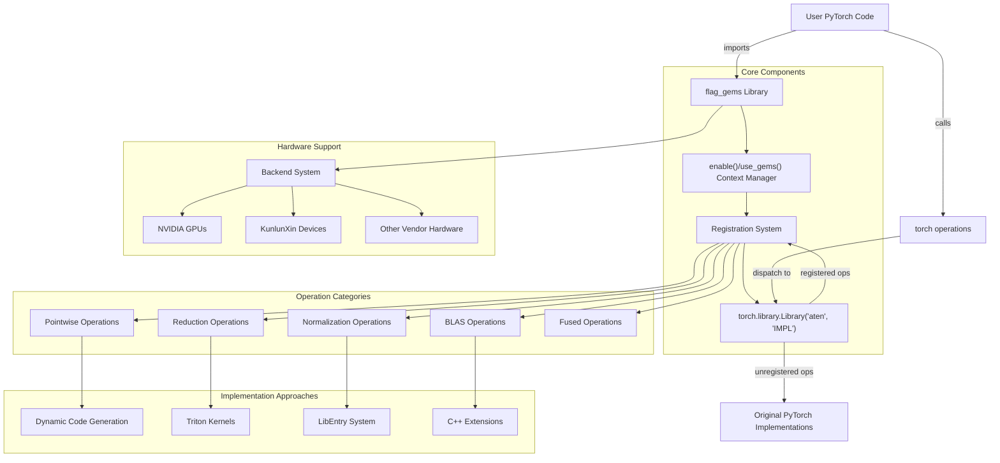
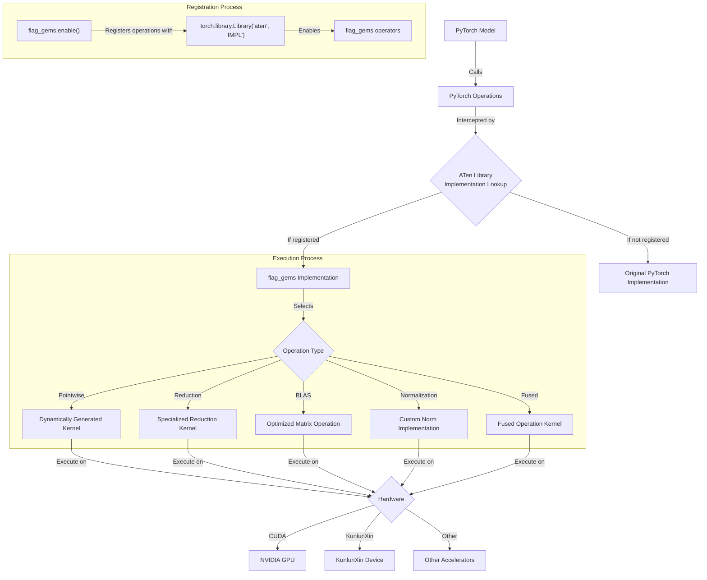
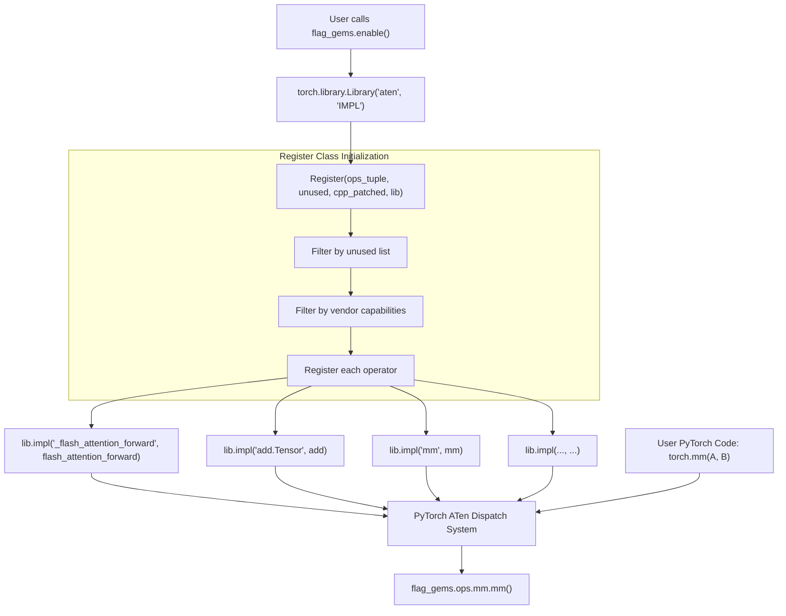
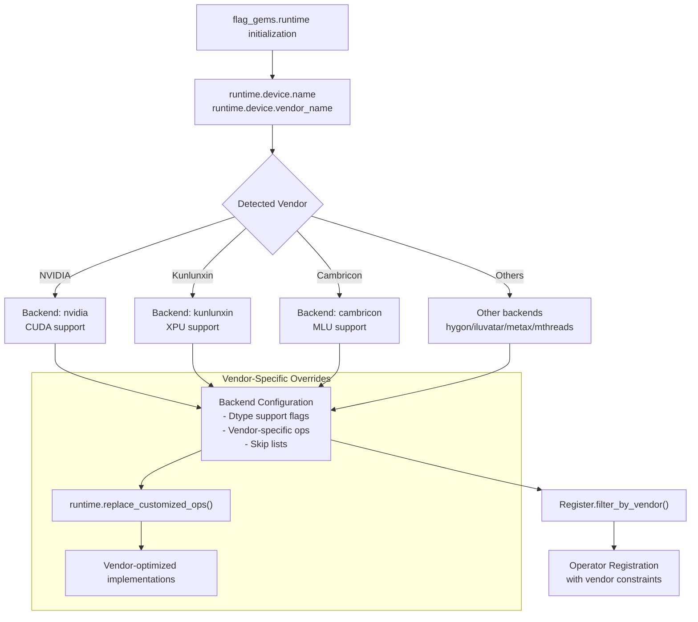
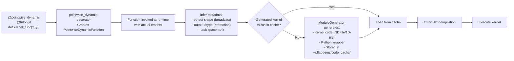
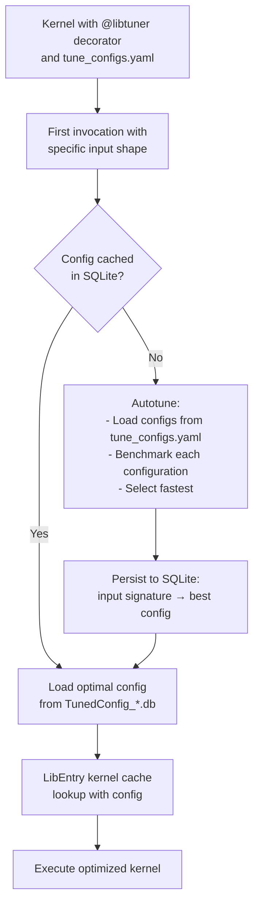
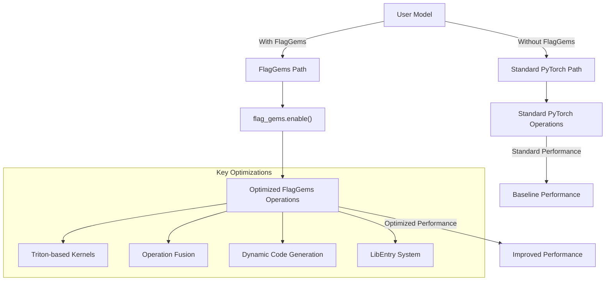

<!-- source: DeepWiki mcp.deepwiki.com · repo FlagOpen/FlagGems · page 1 Overview · fetched 2026-10-21 -->

# Overview

<details>
<summary>Relevant source files</summary>

The following files were used as context for generating this wiki page:

- [README.md](README.md)
- [README_cn.md](README_cn.md)
- [benchmark/test_special_perf.py](benchmark/test_special_perf.py)
- [benchmark/test_unary_pointwise_perf.py](benchmark/test_unary_pointwise_perf.py)
- [docs/add_a_cpp_wrapper.md](docs/add_a_cpp_wrapper.md)
- [docs/get_start_with_flaggems.md](docs/get_start_with_flaggems.md)
- [docs/how_to_use_flaggems.md](docs/how_to_use_flaggems.md)
- [docs/index.md](docs/index.md)
- [docs/installation.md](docs/installation.md)
- [docs/pointwise_dynamic.md](docs/pointwise_dynamic.md)
- [examples/integration_gems_with_vllm.py](examples/integration_gems_with_vllm.py)
- [mkdocs.yml](mkdocs.yml)
- [pyproject.toml](pyproject.toml)
- [src/flag_gems/__init__.py](src/flag_gems/__init__.py)
- [src/flag_gems/ops/__init__.py](src/flag_gems/ops/__init__.py)
- [src/flag_gems/ops/elu.py](src/flag_gems/ops/elu.py)
- [src/flag_gems/ops/embedding.py](src/flag_gems/ops/embedding.py)
- [src/flag_gems/ops/nllloss.py](src/flag_gems/ops/nllloss.py)
- [src/flag_gems/ops/sqrt.py](src/flag_gems/ops/sqrt.py)
- [tests/accuracy_utils.py](tests/accuracy_utils.py)
- [tests/test_binary_pointwise_ops.py](tests/test_binary_pointwise_ops.py)
- [tests/test_special_ops.py](tests/test_special_ops.py)
- [tests/test_unary_pointwise_ops.py](tests/test_unary_pointwise_ops.py)

</details>


FlagGems is a high-performance operator library for PyTorch, implemented using OpenAI's Triton programming language. It provides a collection of over 200 optimized operator implementations to accelerate machine learning workloads, with a focus on large language model (LLM) training and inference. FlagGems integrates seamlessly with PyTorch by registering alternative implementations with PyTorch's ATen backend through the `torch.library.Library` interface, enabling users to activate optimizations without modifying their model code.

Key capabilities include:
- **200+ Optimized Operators**: Comprehensive coverage of PyTorch operations including pointwise, reduction, BLAS, normalization, attention, and fused operations
- **Multi-Backend Support**: Validated on 10+ hardware platforms including NVIDIA, Kunlunxin, Cambricon, Hygon, Iluvatar, and others
- **Automatic Operator Replacement**: Seamless integration via `flag_gems.enable()` or the `use_gems` context manager
- **Dynamic Code Generation**: Automatic kernel generation for pointwise operations supporting arbitrary input types and layouts
- **Performance Optimization**: Hand-tuned kernels with autotuning support through LibEntry and LibTuner systems

Sources: [README.md:1-29](), [src/flag_gems/__init__.py:15-20](), [src/flag_gems/__init__.py:33-324]()

## Core Architecture

FlagGems is designed to integrate seamlessly with PyTorch while providing significant performance improvements through optimized implementations of common operations.

### FlagGems System Architecture



Sources: [src/flag_gems/__init__.py:21-27](), [src/flag_gems/__init__.py:43-326]()

### Operation Registration and Execution Flow



Sources: [src/flag_gems/__init__.py:43-326](), [src/flag_gems/ops/__init__.py:1-382]()

## Key Components

### Registration System

FlagGems provides two main mechanisms for enabling its optimized implementations:

1. **`flag_gems.enable()` function**: Registers FlagGems implementations globally with PyTorch's ATen library via `torch.library.Library("aten", "IMPL")`
2. **`flag_gems.use_gems` context manager**: Temporarily enables FlagGems implementations within a scoped context

The registration system uses the `Register` class to manage operator registration. At initialization, it creates a mapping of 200+ operators to their FlagGems implementations (lines 33-324 in `__init__.py`). The system supports selective operator exclusion via the `unused` parameter and handles vendor-specific operator filtering based on hardware capabilities.

#### Operator Registration Flow



**Example usage:**

```python
# Global enablement with selective operator exclusion
import flag_gems
flag_gems.enable(unused=["sum", "mean"])  # Exclude specific operators

# Scoped enablement
with flag_gems.use_gems():
    result = torch.add(tensor1, tensor2)  # Uses flag_gems.ops.add
```

Sources: [src/flag_gems/__init__.py:24-31](), [src/flag_gems/__init__.py:33-324](), [src/flag_gems/__init__.py:328-357](), [src/flag_gems/runtime/register.py]()

### Operation Categories

FlagGems supports a wide range of PyTorch operations across several categories:

| Category | Description | Examples |
|----------|-------------|----------|
| Pointwise Operations | Element-wise operations on tensors | add, mul, div, abs, exp |
| Reduction Operations | Operations that reduce tensor dimensions | sum, mean, max, argmax |
| Normalization Operations | Statistical normalization operations | layer_norm, batch_norm, rms_norm |
| BLAS Operations | Basic linear algebra operations | mm, bmm, addmm |
| Fused Operations | Combined operations for better performance | gelu_and_mul, silu_and_mul, skip_layer_norm |
| Tensor Manipulation | Operations that rearrange tensor data | gather, scatter, masked_select |
| Random Number Generation | Operations that generate random data | rand, normal, dropout |

Sources: [src/flag_gems/ops/__init__.py:1-382](), [src/flag_gems/__init__.py:47-306]()

### Multi-Backend Support

FlagGems supports execution on 10+ hardware platforms through a vendor detection and configuration system. The `flag_gems.runtime.device` module automatically identifies the current hardware vendor and loads appropriate backend-specific configurations.

#### Supported Hardware Platforms

| Vendor | Status | fp16 | fp32 | bf16 | Device Detection |
|--------|--------|------|------|------|------------------|
| NVIDIA | ✅ Full | ✅ | ✅ | ✅ | CUDA devices |
| Kunlunxin | ✅ Full | ✅ | ✅ | ✅ | XPU devices |
| Cambricon | ✅ Full | ✅ | ✅ | ✅ | MLU devices |
| Hygon | ✅ Full | ✅ | ✅ | ✅ | DCU devices |
| Iluvatar | ✅ Full | ✅ | ✅ | ✅ | Corex devices |
| Metax | ✅ Full | ✅ | ✅ | ✅ | Metax devices |
| Mthreads | ✅ Full | ✅ | ✅ | ✅ | Musa devices |
| Ascend | ✅ Partial | ✅ | ✅ | ✅ | NPU devices |
| AIPU | ✅ Partial | ✅ | ✅ | ✅ | AIPU devices |
| ARM CPU | 🚧 WIP | - | - | - | - |
| Tsingmicro | 🚧 WIP | - | - | - | - |

#### Backend Architecture



The `flag_gems.device` and `flag_gems.vendor_name` variables expose the detected hardware platform at runtime. Tests use `flag_gems.vendor_name` for platform-specific test skipping.

Sources: [README.md:96-110](), [src/flag_gems/__init__.py:16-17](), [src/flag_gems/__init__.py:21](), [tests/test_special_ops.py:34]()

### Dynamic Code Generation

FlagGems provides automatic code generation for pointwise operations through the `@pointwise_dynamic` decorator. This system generates specialized Triton kernels based on tensor rank, shape, stride, and data types at runtime, eliminating the need to write separate kernels for each tensor configuration.

#### Code Generation Pipeline



**Example usage:**

```python
from flag_gems.utils import pointwise_dynamic
import triton
import triton.language as tl

@pointwise_dynamic(promotion_methods=[(0, "DEFAULT")])
@triton.jit
def sqrt_func(x):
    return tl.sqrt(x.to(tl.float32))

# At runtime, specialized kernels are generated for each tensor rank/stride
result = sqrt_func(tensor)  # Generates kernel for tensor's configuration
```

The decorator supports:
- Arbitrary tensor ranks and shapes
- Broadcasting across inputs
- Type promotion rules
- Mixed tensor and non-tensor parameters
- In-place operations via `out0` parameter

Generated code is cached in `~/.flaggems/code_cache/` with hash-based filenames to avoid regeneration.

Sources: [README.md:36-40](), [src/flag_gems/ops/sqrt.py:11-25](), [src/flag_gems/ops/elu.py:11-69](), [docs/pointwise_dynamic.md:1-44]()

### LibEntry and LibTuner Systems

FlagGems provides two complementary systems for kernel execution optimization:

#### LibEntry - Kernel Cache Manager

`@libentry()` decorator manages per-device kernel caching, bypassing Triton's nested runtime invocations (`Autotuner`, `Heuristics`, `JitFunction`) to reduce dispatch overhead. It simplifies cache key computation and eliminates redundant parameter processing.

```python
from flag_gems.utils import libentry

@libentry()
@triton.jit
def embedding_kernel(out_ptr, in_ptr, weight_ptr, N: tl.constexpr, BLOCK_SIZE: tl.constexpr):
    pid = tle.program_id(0)
    # ... kernel implementation
```

LibEntry maintains a per-device cache (`kernel_cache`) that maps simplified cache keys directly to compiled kernels, achieving faster lookup than Triton's default multi-level caching.

#### LibTuner - Configuration Autotuning

`@libtuner()` decorator enables automatic performance tuning by evaluating multiple kernel configurations (block sizes, tile sizes, etc.) and selecting the optimal one. Results are persisted in SQLite databases (`TunedConfig_{device}.db`) for reuse across runs.



The combination of LibEntry (fast dispatch) and LibTuner (optimal configuration) provides both low overhead and high performance.

Sources: [README.md:42-47](), [src/flag_gems/ops/embedding.py:14-33](), [src/flag_gems/ops/embedding.py:36-51]()

## Usage Patterns

FlagGems is designed to be easy to integrate into existing PyTorch code. There are two main patterns for using FlagGems:

### Global Enabling

```python
import torch
import flag_gems

# Enable FlagGems globally
flag_gems.enable()

# All supported PyTorch operations will now use FlagGems implementations
result = torch.add(tensor1, tensor2)
```

### Context Manager

```python
import torch
import flag_gems

# Use FlagGems only within this context
with flag_gems.use_gems():
    # Operations here use FlagGems implementations
    result = torch.add(tensor1, tensor2)

# Operations here use standard PyTorch implementations
result2 = torch.add(tensor3, tensor4)
```

Sources: [src/flag_gems/__init__.py:43-326](), [src/flag_gems/__init__.py:328-357]()

## Performance Benefits

FlagGems provides significant performance improvements over standard PyTorch operations. The optimizations come from:

1. **Specialized Implementations**: Algorithms tailored for specific operation patterns
2. **Hardware Optimizations**: Kernels optimized for specific hardware capabilities
3. **Fusion Opportunities**: Combined operations that reduce memory traffic
4. **Triton Advantages**: Leveraging Triton's programming model for GPU optimization

Performance benchmarking in FlagGems measures metrics including:

- Latency (milliseconds)
- Speedup (compared to PyTorch)
- Throughput (GB/s)
- Computational performance (TFLOPS)



Sources: [README.md:76-80](), [benchmark/test_reduction_perf.py:22-33](), [benchmark/test_special_perf.py:9-17]()

## Supported Models and Hardware

### Supported Models

FlagGems has been tested and optimized for several popular deep learning models:

- Bert-base-uncased
- Llama-2-7b
- Llava-1.5-7b

### Supported Hardware

| Platform | float16 | float32 | bfloat16 |
|----------|---------|---------|----------|
| NVIDIA GPU | ✓ | ✓ | ✓ |

Additional hardware platforms are under development.

Sources: [README.md:64-69](), [README.md:70-75]()

---

