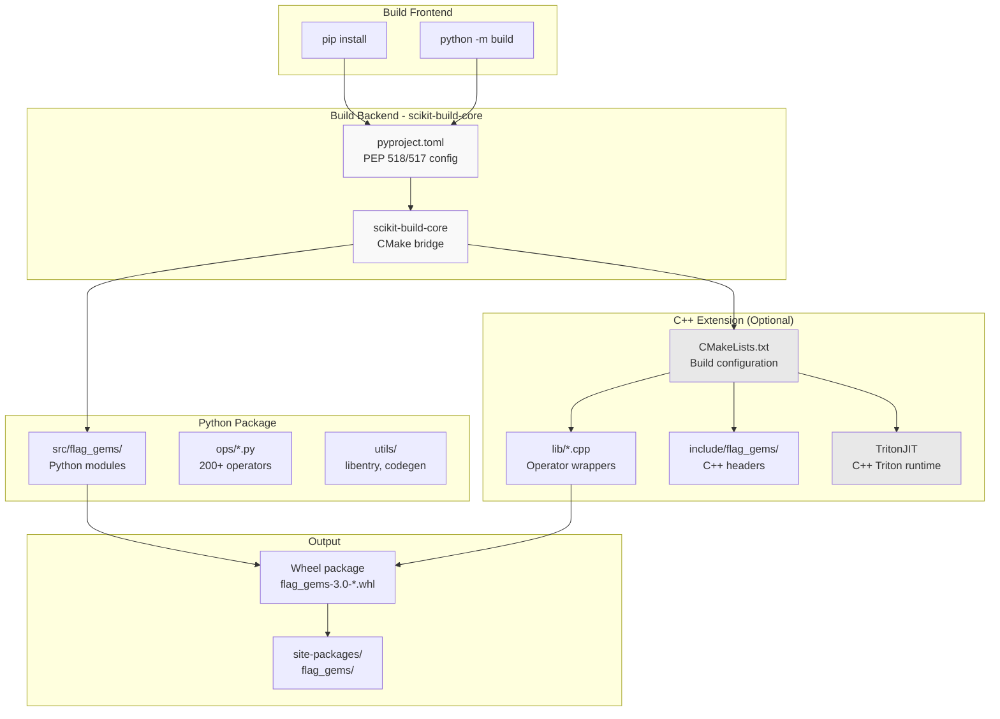
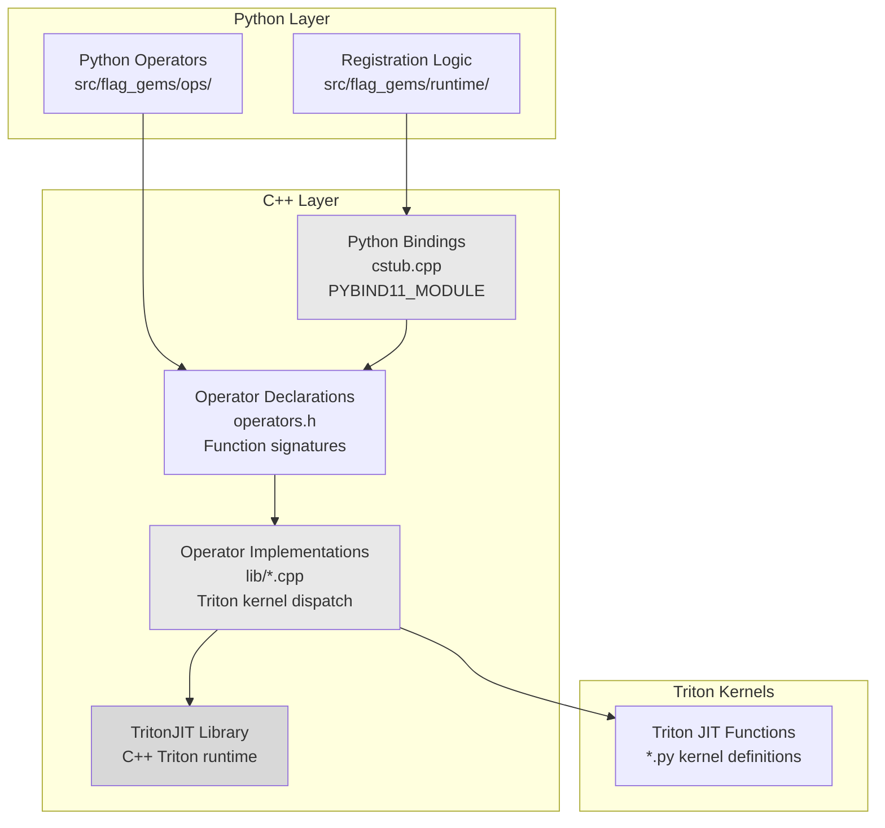
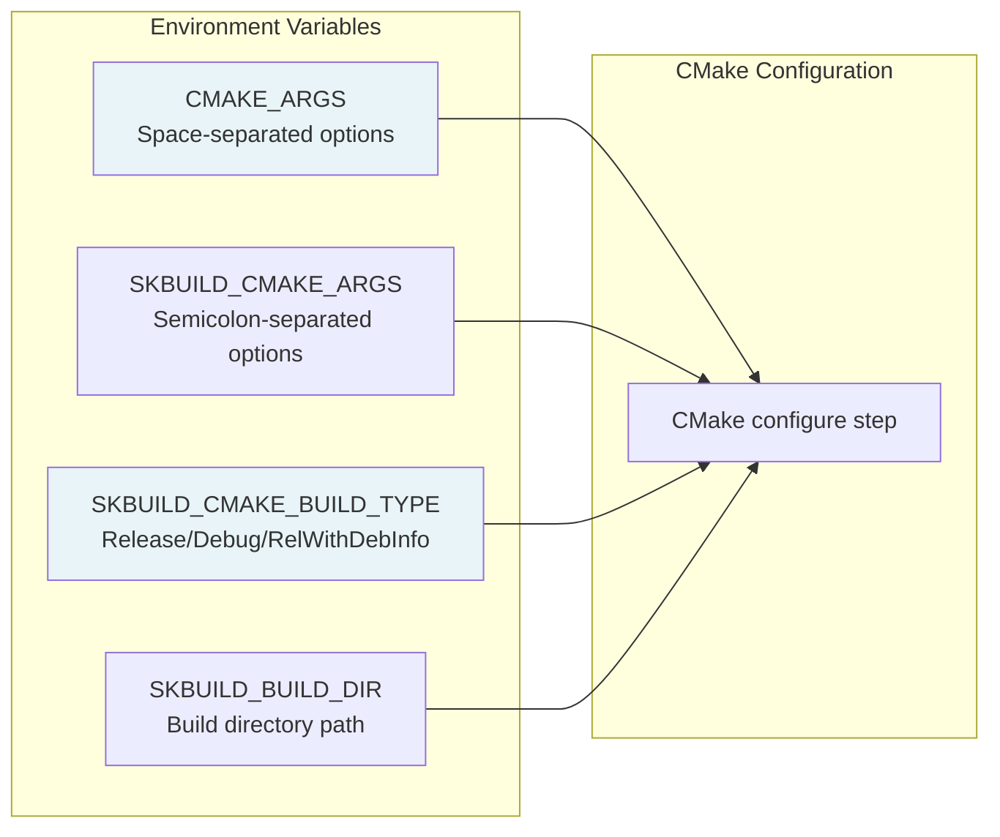
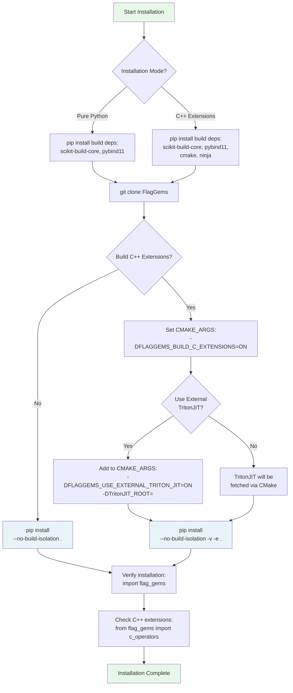

<!-- source: DeepWiki mcp.deepwiki.com · repo FlagOpen/FlagGems · page 1.1 Installation and Setup · fetched 2026-10-21 -->

# Installation and Setup

<details>
<summary>Relevant source files</summary>

The following files were used as context for generating this wiki page:

- [README.md](README.md)
- [README_cn.md](README_cn.md)
- [ctests/CMakeLists.txt](ctests/CMakeLists.txt)
- [ctests/test_triton_reduction.cpp](ctests/test_triton_reduction.cpp)
- [ctests/test_triton_rwkv_ka_fusion.cpp](ctests/test_triton_rwkv_ka_fusion.cpp)
- [ctests/test_triton_rwkv_mm_sparsity.cpp](ctests/test_triton_rwkv_mm_sparsity.cpp)
- [docs/add_a_cpp_wrapper.md](docs/add_a_cpp_wrapper.md)
- [docs/get_start_with_flaggems.md](docs/get_start_with_flaggems.md)
- [docs/how_to_use_flaggems.md](docs/how_to_use_flaggems.md)
- [docs/index.md](docs/index.md)
- [docs/installation.md](docs/installation.md)
- [docs/pointwise_dynamic.md](docs/pointwise_dynamic.md)
- [examples/integration_gems_with_vllm.py](examples/integration_gems_with_vllm.py)
- [include/flag_gems/operators.h](include/flag_gems/operators.h)
- [include/flag_gems/utils.h](include/flag_gems/utils.h)
- [lib/CMakeLists.txt](lib/CMakeLists.txt)
- [lib/rwkv_ka_fusion.cpp](lib/rwkv_ka_fusion.cpp)
- [lib/rwkv_mm_sparsity.cpp](lib/rwkv_mm_sparsity.cpp)
- [lib/utils.cpp](lib/utils.cpp)
- [mkdocs.yml](mkdocs.yml)
- [pyproject.toml](pyproject.toml)
- [src/flag_gems/csrc/cstub.cpp](src/flag_gems/csrc/cstub.cpp)
- [src/flag_gems/ops/sqrt.py](src/flag_gems/ops/sqrt.py)

</details>


## Purpose and Scope

This document covers the installation and setup process for FlagGems, including dependency requirements, installation methods, and build configuration options. It explains both pure Python installation (default) and C++ extension installation (advanced, for reduced runtime overhead).

For usage instructions after installation, see [Quick Start Guide](#1.2). For details about the C++ runtime capabilities, see [C++ Extensions](#6.1).

---

## Overview

FlagGems supports two installation modes:

| Installation Mode | Use Case | Build Time | Runtime Performance |
|------------------|----------|------------|-------------------|
| **Pure Python** | Standard usage, fastest setup | Minutes | Good |
| **C++ Extensions** | Production deployments, latency-sensitive scenarios | 10-20 minutes | Excellent |

The pure Python installation includes all core functionality. The C++ extensions provide an optional performance layer that reduces Python runtime overhead by implementing operator wrappers, registration, and dispatch logic in C++.

Sources: [README.md:48-50](), [docs/installation.md:34-48](), [pyproject.toml:1-59]()

---

## Build System Architecture



**FlagGems Build System**: The build uses `scikit-build-core` as the backend, bridging CMake and Python packaging. The Python package is always built; C++ extensions are conditionally compiled based on CMake options.

Sources: [pyproject.toml:1-59](), [docs/installation.md:16-20](), [lib/CMakeLists.txt:1-53]()

---

## Prerequisites

### Required Dependencies

The following dependencies are required for all installation modes:

```python
# Core runtime dependencies
torch >= 2.2.0      # PyTorch framework
packaging           # Version parsing utilities
pybind11           # Python-C++ bindings
PyYAML             # Configuration file parsing
```

### Build Dependencies

Additional dependencies required during installation:

```bash
# Build system requirements
setuptools >= 64.0
scikit-build-core >= 0.11
pybind11

# Development tools (for C++ extensions)
cmake              # Build system generator
ninja              # Fast build tool (optional but recommended)
```

Sources: [pyproject.toml:24-30](), [docs/installation.md:26-32](), [docs/get_start_with_flaggems.md:13-17]()

---

## Pure Python Installation

The pure Python installation is the default and recommended method for most users. It provides full FlagGems functionality without requiring C++ compilation.

### Installation Steps


**Pure Python Installation Flow**: Standard Python package installation workflow.

#### Step 1: Install Build Dependencies

```bash
pip install -U scikit-build-core>=0.11 pybind11 ninja cmake
```

#### Step 2: Clone Repository

```bash
git clone https://github.com/FlagOpen/FlagGems
cd FlagGems/
```

#### Step 3: Install Package

Choose one of the following installation methods:

**Standard Installation:**
```bash
pip install --no-build-isolation .
```

**Editable Installation** (for development):
```bash
pip install --no-build-isolation -e .
```

The `--no-build-isolation` flag is used because build dependencies are already installed. This speeds up installation and avoids redundant virtual environment creation.

Sources: [docs/installation.md:36-46](), [docs/get_start_with_flaggems.md:13-27](), [README.md:81-83]()

### Build Options

| pip Option | Effect |
|-----------|--------|
| `-v` | Verbose output (shows build progress) |
| `-e` | Editable install (changes reflected without reinstall) |
| `--no-build-isolation` | Skip virtual env creation (faster if deps installed) |
| `--no-deps` | Skip dependency installation |

Sources: [docs/installation.md:71-76]()

---

## C++ Extension Installation

The C++ extension build provides significant performance improvements by implementing the operator dispatch layer in C++ rather than Python. This reduces per-operator invocation overhead.

### Architecture with C++ Extensions



**C++ Extension Architecture**: C++ wrappers provide fast dispatch to Triton kernels, bypassing Python overhead for registered operators.

Sources: [include/flag_gems/operators.h:1-109](), [src/flag_gems/csrc/cstub.cpp:1-118](), [lib/CMakeLists.txt:1-53]()

### Build Configuration Options

The C++ build is controlled via CMake options passed through environment variables:

| CMake Option | Description | Default |
|-------------|-------------|---------|
| `FLAGGEMS_BUILD_C_EXTENSIONS` | Enable C++ extension build | `OFF` (pure Python) |
| `FLAGGEMS_USE_EXTERNAL_TRITON_JIT` | Use external TritonJIT library | `OFF` (fetch as subproject) |
| `FLAGGEMS_USE_EXTERNAL_PYBIND11` | Use external pybind11 library | `ON` |
| `FLAGGEMS_BUILD_CTESTS` | Build C++ unit tests | Same as `FLAGGEMS_BUILD_C_EXTENSIONS` |
| `FLAGGEMS_INSTALL` | Install CMake package files | `ON` when top-level project |

Sources: [docs/installation.md:54-62]()

### Installation with External TritonJIT

If you have TritonJIT pre-installed:

```bash
# Install build dependencies
pip install -U scikit-build-core ninja cmake pybind11

# Configure and install with external TritonJIT
CMAKE_ARGS="-DFLAGGEMS_BUILD_C_EXTENSIONS=ON \
            -DFLAGGEMS_USE_EXTERNAL_TRITON_JIT=ON \
            -DTritonJIT_ROOT=<path_to_triton_jit_install>" \
pip install --no-build-isolation -v -e .
```

Sources: [docs/installation.md:80-87]()

### Installation with TritonJIT as Subproject

For automatic TritonJIT download and build via CMake FetchContent:

```bash
# Install build dependencies
pip install -U scikit-build-core ninja cmake pybind11

# Configure and install (TritonJIT fetched automatically)
CMAKE_ARGS="-DFLAGGEMS_BUILD_C_EXTENSIONS=ON" \
pip install --no-build-isolation -v -e .
```

Sources: [docs/installation.md:89-94]()

### Environment Variables for Build Configuration



**Build Environment Variables**: Control CMake configuration through environment variables. Note: `CMAKE_ARGS` uses spaces, `SKBUILD_CMAKE_ARGS` uses semicolons.

| Variable | Purpose | Example |
|----------|---------|---------|
| `CMAKE_ARGS` | Pass CMake options (space-separated) | `"-DFLAGGEMS_BUILD_C_EXTENSIONS=ON"` |
| `SKBUILD_CMAKE_ARGS` | Pass CMake options (semicolon-separated) | `"-DFLAGGEMS_BUILD_C_EXTENSIONS=ON;-DCMAKE_BUILD_TYPE=Release"` |
| `SKBUILD_CMAKE_BUILD_TYPE` | Set build type | `Release`, `Debug`, `RelWithDebInfo`, `MinSizeRel` |
| `SKBUILD_BUILD_DIR` | Set build directory | `build/custom_dir` |

Sources: [docs/installation.md:51-69]()

---

## C++ Operator Wrappers

When C++ extensions are built, selected operators have C++ wrappers available:

```cpp
// Example operator declarations from operators.h
namespace flag_gems {
    at::Tensor sum(const at::Tensor &self, 
                   std::optional<at::ScalarType> dtype = std::nullopt);
    
    at::Tensor rms_norm(const at::Tensor &input, 
                        const at::Tensor &weight, 
                        double epsilon = 1e-5);
    
    at::Tensor mm_tensor(const at::Tensor &mat1, 
                         const at::Tensor &mat2);
    
    void fused_add_rms_norm(at::Tensor &input,
                           at::Tensor &residual,
                           const at::Tensor &weight,
                           double epsilon = 1e-5);
}
```

These operators are registered in the `flag_gems` namespace and accessible via `torch.ops.flag_gems.*`.

Currently supported C++ operators:

| Category | Operators |
|----------|-----------|
| **Reduction** | `sum`, `max`, `argmax`, `nonzero` |
| **Normalization** | `rms_norm`, `fused_add_rms_norm`, `softmax` |
| **Matrix Operations** | `mm`, `addmm`, `bmm` |
| **Tensor Operations** | `add`, `cat`, `contiguous`, `fill`, `zeros` |
| **Embedding** | `embedding`, `rotary_embedding` |
| **Special** | `topk`, `exponential_` |
| **RWKV** | `rwkv_mm_sparsity`, `rwkv_ka_fusion` |

Sources: [include/flag_gems/operators.h:5-109](), [src/flag_gems/csrc/cstub.cpp:8-116](), [lib/CMakeLists.txt:1-27]()

---

## Creating Distribution Packages

### Building a Wheel

To create a binary distribution (wheel) for distribution:

**Using `build` package (recommended):**
```bash
pip install -U build
python -m build --no-isolation --no-deps .
```

This creates both source distribution (`.tar.gz`) and wheel (`.whl`) in the `dist/` directory.

**Using `pip`:**
```bash
pip wheel --no-build-isolation --no-deps -w dist .
```

### Build Target Options

| Command | Output |
|---------|--------|
| `python -m build --no-isolation --no-deps .` | Both sdist and wheel |
| `python -m build --no-isolation --no-deps --sdist .` | Source distribution only |
| `python -m build --no-isolation --no-deps --wheel .` | Wheel only |

Sources: [docs/installation.md:96-131]()

---

## Runtime Environment Variables

After installation, FlagGems behavior can be configured via environment variables:

| Variable | Purpose | Values | Default |
|----------|---------|--------|---------|
| `GEMS_VENDOR` | Manually set backend vendor | `nvidia`, `kunlunxin`, `cambricon`, etc. | Auto-detected |
| `FLAGGEMS_SOURCE_DIR` | Path to source directory (C++ builds) | Directory path | Required for C++ extensions |

### Backend Auto-Detection

FlagGems automatically detects hardware vendor at runtime. To verify:

```python
import flag_gems
print(flag_gems.vendor_name)  # Prints detected vendor
```

Manual override (if auto-detection fails):
```bash
export GEMS_VENDOR=nvidia
```

Sources: [docs/how_to_use_flaggems.md:116-133](), [lib/utils.cpp:35-44]()

---

## Verification

After installation, verify that FlagGems is correctly installed:

### Basic Verification

```python
import flag_gems
print(f"FlagGems version: {flag_gems.__version__}")
print(f"Backend vendor: {flag_gems.vendor_name}")
print(f"Device: {flag_gems.device}")
```

### Verify C++ Extensions

To check if C++ extensions are available:

```python
try:
    from flag_gems import c_operators
    has_c_extension = True
    print("C++ extensions: Available")
except ImportError:
    has_c_extension = False
    print("C++ extensions: Not available")
```

### Verify Operator Registration

```python
import flag_gems
import torch

# Enable FlagGems
flag_gems.enable()

# Test a simple operation
x = torch.randn(10, 10, device=flag_gems.device)
y = torch.sum(x)  # Should use FlagGems implementation
print(f"Sum result: {y.item()}")
```

Sources: [docs/how_to_use_flaggems.md:406-417](), [docs/get_start_with_flaggems.md:42-64]()

---

## Installation Flow Diagram



**Complete Installation Flow**: Decision tree showing installation paths for both pure Python and C++ extension builds.

Sources: [docs/installation.md:1-131](), [docs/get_start_with_flaggems.md:1-64]()

---

## Common Installation Issues

### Build Isolation Warnings

If you see warnings about missing build dependencies when using `--no-build-isolation`, ensure all dependencies from `[build-system.requires]` are installed:

```bash
pip install -U setuptools>=64.0 scikit-build-core>=0.11 pybind11
```

### CMake Configuration Errors

If CMake fails to configure:
1. Verify CMake version: `cmake --version` (requires ≥3.15)
2. Check that environment variables are properly set
3. Use `-v` flag for verbose output: `pip install -v ...`

### TritonJIT Linking Errors

If linking fails with external TritonJIT:
1. Verify TritonJIT is properly installed at the specified path
2. Ensure `TritonJIT_ROOT` points to the installation prefix (containing `lib/` and `include/`)
3. Check that TritonJIT was built for the same PyTorch version

Sources: [docs/installation.md:22-27](), [docs/installation.md:64-65]()

---

## Next Steps

After successful installation:
- See [Quick Start Guide](#1.2) for basic usage examples
- See [Runtime and Device Management](#2.5) for backend configuration
- See [C++ Extensions](#6.1) for advanced C++ runtime usage
- See [Framework Integration](#6.2) for integrating with vLLM, Transformers, etc.

Sources: [README.md:81-89](), [docs/get_start_with_flaggems.md:38-64]()

---

