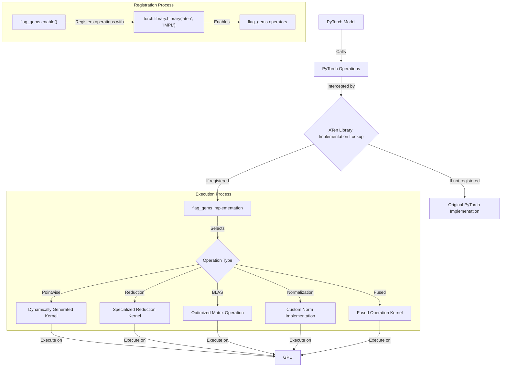
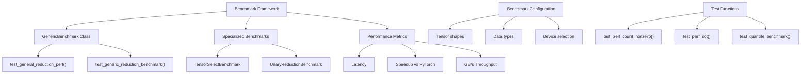

<!-- source: DeepWiki mcp.deepwiki.com · repo FlagOpen/FlagGems · page 1.2 Quick Start Guide · fetched 2026-10-21 -->

# Quick Start Guide

<details>
<summary>Relevant source files</summary>

The following files were used as context for generating this wiki page:

- [README.md](README.md)
- [README_cn.md](README_cn.md)
- [benchmark/test_special_perf.py](benchmark/test_special_perf.py)
- [benchmark/test_unary_pointwise_perf.py](benchmark/test_unary_pointwise_perf.py)
- [docs/add_a_cpp_wrapper.md](docs/add_a_cpp_wrapper.md)
- [docs/get_start_with_flaggems.md](docs/get_start_with_flaggems.md)
- [docs/how_to_use_flaggems.md](docs/how_to_use_flaggems.md)
- [docs/index.md](docs/index.md)
- [docs/installation.md](docs/installation.md)
- [docs/pointwise_dynamic.md](docs/pointwise_dynamic.md)
- [examples/integration_gems_with_vllm.py](examples/integration_gems_with_vllm.py)
- [mkdocs.yml](mkdocs.yml)
- [pyproject.toml](pyproject.toml)
- [src/flag_gems/__init__.py](src/flag_gems/__init__.py)
- [src/flag_gems/fused/__init__.py](src/flag_gems/fused/__init__.py)
- [src/flag_gems/fused/moe_align_block_size.py](src/flag_gems/fused/moe_align_block_size.py)
- [src/flag_gems/fused/reshape_and_cache.py](src/flag_gems/fused/reshape_and_cache.py)
- [src/flag_gems/fused/reshape_and_cache_flash.py](src/flag_gems/fused/reshape_and_cache_flash.py)
- [src/flag_gems/fused/silu_and_mul.py](src/flag_gems/fused/silu_and_mul.py)
- [src/flag_gems/ops/__init__.py](src/flag_gems/ops/__init__.py)
- [src/flag_gems/ops/elu.py](src/flag_gems/ops/elu.py)
- [src/flag_gems/ops/embedding.py](src/flag_gems/ops/embedding.py)
- [src/flag_gems/ops/nllloss.py](src/flag_gems/ops/nllloss.py)
- [src/flag_gems/ops/sqrt.py](src/flag_gems/ops/sqrt.py)
- [src/flag_gems/patches/patch_util.py](src/flag_gems/patches/patch_util.py)
- [src/flag_gems/patches/patch_vllm_all.py](src/flag_gems/patches/patch_vllm_all.py)
- [tests/accuracy_utils.py](tests/accuracy_utils.py)
- [tests/test_binary_pointwise_ops.py](tests/test_binary_pointwise_ops.py)
- [tests/test_special_ops.py](tests/test_special_ops.py)
- [tests/test_unary_pointwise_ops.py](tests/test_unary_pointwise_ops.py)

</details>


This guide provides a practical introduction to FlagGems, a high-performance operator library for PyTorch that leverages OpenAI Triton. You'll learn how to install FlagGems, integrate it into your PyTorch code, and understand the performance benefits it offers. For more detailed information about the system architecture, see [Core Architecture](#2).

## Installation

FlagGems can be installed either as a pure Python package or with C++ extensions for improved performance.

### Basic Installation

```bash
pip install flag-gems
```

### Installation with C++ Extensions

For better performance, you can build FlagGems with C++ extensions:

```bash
git clone https://github.com/FlagOpen/FlagGems.git
cd FlagGems
pip install -e .
```

Sources: [README.md:33-35](), [README.md:56-58]()

## Basic Usage

There are two main ways to enable FlagGems in your PyTorch code:

### Using the `enable()` function

The `enable()` function registers FlagGems implementations with PyTorch's ATen library globally:

```python
import torch
import flag_gems

# Enable FlagGems globally
flag_gems.enable()

# Your PyTorch code remains unchanged
x = torch.randn(1000, 1000, device="cuda")
y = torch.randn(1000, 1000, device="cuda")
z = x + y  # This will use FlagGems' optimized implementation
```

### Using the `use_gems()` context manager

The `use_gems()` context manager enables FlagGems only within its scope:

```python
import torch
import flag_gems

# Use FlagGems only within this context
with flag_gems.use_gems():
    x = torch.randn(1000, 1000, device="cuda")
    y = torch.randn(1000, 1000, device="cuda")
    z = x + y  # This will use FlagGems' optimized implementation

# Outside the context, standard PyTorch implementations are used
a = torch.randn(1000, 1000, device="cuda")
b = torch.randn(1000, 1000, device="cuda")
c = a + b  # This will use PyTorch's standard implementation
```

Sources: [src/flag_gems/__init__.py:43-326](), [src/flag_gems/__init__.py:328-357]()

## Operation Registration Flow

The following diagram illustrates how FlagGems integrates with PyTorch:



Sources: [src/flag_gems/__init__.py:23-27](), [src/flag_gems/__init__.py:43-326]()

## Examples of Common Operations

### Matrix Multiplication

```python
import torch
import flag_gems

with flag_gems.use_gems():
    # Matrix multiplication
    a = torch.randn(1024, 1024, device="cuda")
    b = torch.randn(1024, 1024, device="cuda")
    c = torch.mm(a, b)  # Uses FlagGems' optimized implementation
```

### Pointwise Operations

```python
import torch
import flag_gems

with flag_gems.use_gems():
    # Pointwise operations
    x = torch.randn(1000, 1000, device="cuda")
    y = torch.sin(x)  # Uses FlagGems' optimized implementation
    z = torch.exp(x)  # Uses FlagGems' optimized implementation
```

### Reduction Operations

```python
import torch
import flag_gems

with flag_gems.use_gems():
    # Reduction operations
    x = torch.randn(1000, 1000, device="cuda")
    y = torch.sum(x, dim=1)  # Uses FlagGems' optimized implementation
    z = torch.mean(x, dim=0)  # Uses FlagGems' optimized implementation
```

### Neural Network Operations

```python
import torch
import flag_gems

with flag_gems.use_gems():
    # Dropout
    x = torch.randn(1000, 1000, device="cuda")
    y = torch.nn.functional.dropout(x, p=0.3, training=True)
    
    # Embedding
    indices = torch.randint(0, 1000, (128, 20), device="cuda")
    embedding = torch.randn((1000, 768), device="cuda", requires_grad=True)
    output = torch.nn.functional.embedding(indices, embedding)
```

Sources: [tests/test_special_ops.py:31-84](), [tests/test_special_ops.py:205-241](), [tests/test_reduction_ops.py:381-404]()

## Categories of Supported Operations

FlagGems supports a wide range of PyTorch operations:

| Category | Examples | Description |
|----------|----------|-------------|
| Pointwise | `add`, `mul`, `div`, `sin`, `cos` | Element-wise operations on tensors |
| Reduction | `sum`, `mean`, `max`, `min` | Operations that reduce tensor dimensions |
| BLAS | `mm`, `bmm`, `addmm` | Basic Linear Algebra Subprograms |
| Normalization | `layer_norm`, `batch_norm`, `group_norm` | Normalization operations |
| Tensor Manipulation | `where`, `arange`, `repeat`, `masked_fill` | Operations that manipulate tensor structure |
| Neural Network | `embedding`, `dropout`, `softmax` | Operations commonly used in neural networks |
| Fused Operations | `apply_rotary_pos_emb`, `gelu_and_mul` | Optimized combinations of operations |

Sources: [src/flag_gems/ops/__init__.py:1-171](), [README.md:39-54]()

## Advanced Features

### Configuring Unused Operations

You can specify which operations should not be overridden by FlagGems:

```python
import torch
import flag_gems

# Keep PyTorch's implementation for softmax
unused_ops = ["softmax"]
flag_gems.enable(unused=unused_ops)

# or with context manager
with flag_gems.use_gems(unused=unused_ops):
    # Your code here
```

### Operation Logging

You can enable logging to track which operations are being used:

```python
import torch
import flag_gems

# Enable logging
flag_gems.enable(record=True)

# or with context manager
with flag_gems.use_gems(record=True):
    # Your code here
```

By default, logs are written to `~/.flaggems/oplist.log`. You can specify a custom path:

```python
import torch
import flag_gems

# Enable logging with custom path
flag_gems.enable(record=True, path="/path/to/logfile.log")
```

### One-time Logging

To log each operation only once per location in your code:

```python
import torch
import flag_gems

# Enable one-time logging
flag_gems.enable(record=True, once=True)
```

Sources: [src/flag_gems/__init__.py:43-326](), [src/flag_gems/__init__.py:328-357]()

## Performance Benchmarking

FlagGems can provide significant performance improvements. Here's a simple benchmarking example:

```python
import torch
import flag_gems
import time

# Prepare data
x = torch.randn(1024, 1024, device="cuda")
y = torch.randn(1024, 1024, device="cuda")

# Benchmark PyTorch
torch.cuda.synchronize()
start = time.time()
for _ in range(100):
    z = torch.mm(x, y)
torch.cuda.synchronize()
pytorch_time = time.time() - start

# Benchmark FlagGems
with flag_gems.use_gems():
    torch.cuda.synchronize()
    start = time.time()
    for _ in range(100):
        z = torch.mm(x, y)
    torch.cuda.synchronize()
    flaggems_time = time.time() - start

print(f"PyTorch time: {pytorch_time:.4f}s")
print(f"FlagGems time: {flaggems_time:.4f}s")
print(f"Speedup: {pytorch_time / flaggems_time:.2f}x")
```

For more comprehensive benchmarking, you can use the tools in the `benchmark` directory:



Sources: [benchmark/test_reduction_perf.py:22-36](), [benchmark/test_reduction_perf.py:52-86](), [benchmark/test_special_perf.py:41-73]()

## Supported Hardware and Operations

### Hardware Support

| Platform | float16 | float32 | bfloat16 |
|----------|---------|---------|----------|
| NVIDIA GPU | ✓ | ✓ | ✓ |

### Most Commonly Used Operations

| Operation | Description | Example |
|-----------|-------------|---------|
| `torch.mm` | Matrix multiplication | `torch.mm(a, b)` |
| `torch.bmm` | Batch matrix multiplication | `torch.bmm(a, b)` |
| `torch.add` | Element-wise addition | `torch.add(a, b)` |
| `torch.mul` | Element-wise multiplication | `torch.mul(a, b)` |
| `torch.div` | Element-wise division | `torch.div(a, b)` |
| `torch.sum` | Sum reduction | `torch.sum(a, dim=1)` |
| `torch.mean` | Mean reduction | `torch.mean(a, dim=0)` |
| `torch.max` | Maximum value | `torch.max(a, dim=1)` |
| `torch.sigmoid` | Sigmoid activation | `torch.sigmoid(a)` |
| `torch.tanh` | Tanh activation | `torch.tanh(a)` |
| `torch.gelu` | GELU activation | `torch.gelu(a)` |
| `torch.nn.functional.softmax` | Softmax activation | `torch.nn.functional.softmax(a, dim=1)` |
| `torch.nn.functional.dropout` | Dropout regularization | `torch.nn.functional.dropout(a, p=0.5)` |

For a complete list of supported operations, refer to [Operations](#3) in the wiki.

Sources: [README.md:71-75](), [src/flag_gems/ops/__init__.py:1-171]()

## Troubleshooting

### Operation Not Supported

If you encounter an operation that's not supported by FlagGems, you can add it to the `unused` list:

```python
import torch
import flag_gems

# Specify unsupported operations
unused_ops = ["unsupported_op"]
with flag_gems.use_gems(unused=unused_ops):
    # Your code here
```

### Performance Issues

If you encounter performance issues:

1. Ensure you're using the latest version of FlagGems and PyTorch
2. Consider building FlagGems with C++ extensions for better performance
3. Verify that your CUDA drivers and toolkit are up to date
4. Try different batch sizes or tensor shapes

Sources: [src/flag_gems/__init__.py:43-45](), [src/flag_gems/__init__.py:328-336]()

## Supported Models

FlagGems has been tested with the following models:

- Bert-base-uncased
- Llama-2-7b
- Llava-1.5-7b

These models can run correctly and efficiently with FlagGems-optimized operators.

Sources: [README.md:64-69]()

## Next Steps

- For more detailed information about the architecture, see [Core Architecture](#2) in the wiki
- For comprehensive information about specific operations, see [Operations](#3) in the wiki
- For information about hardware backends, see [Hardware Backends](#4) in the wiki
- For advanced topics, see [Advanced Topics](#6) in the wiki

---

