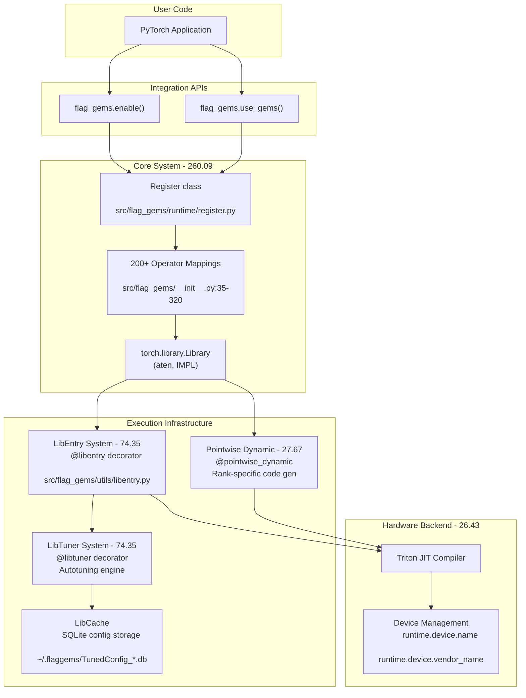
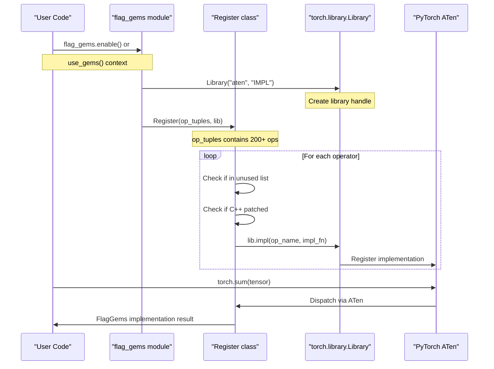
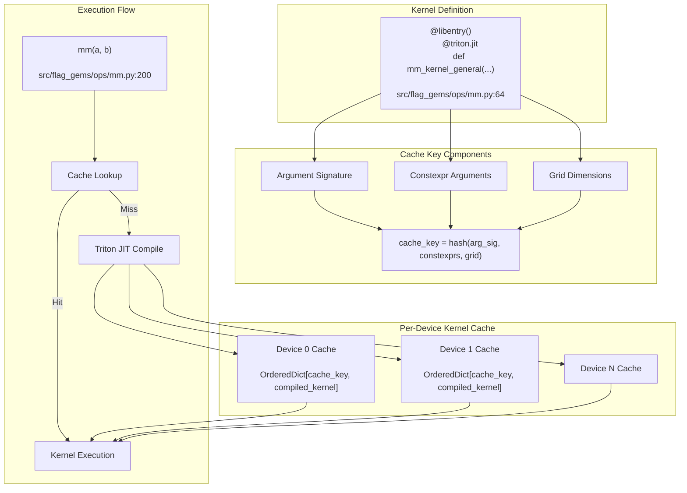
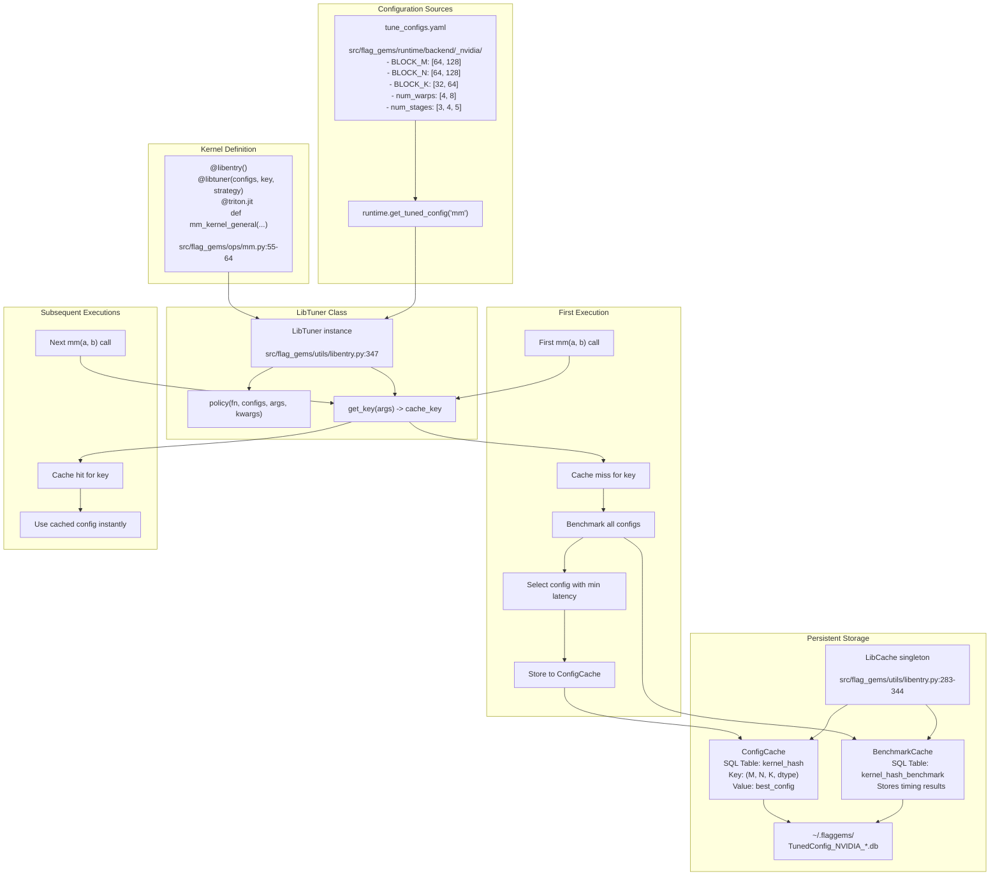
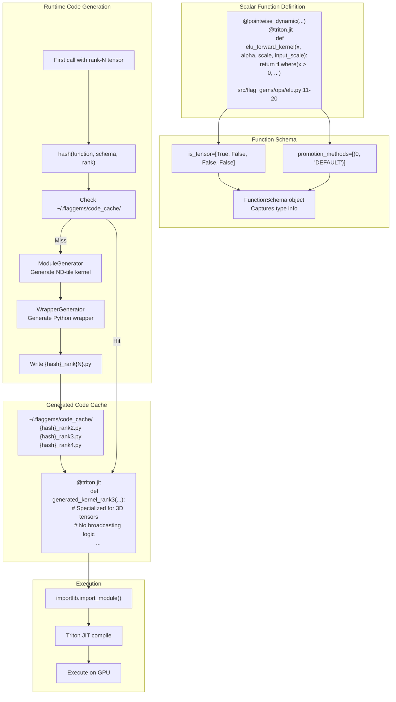
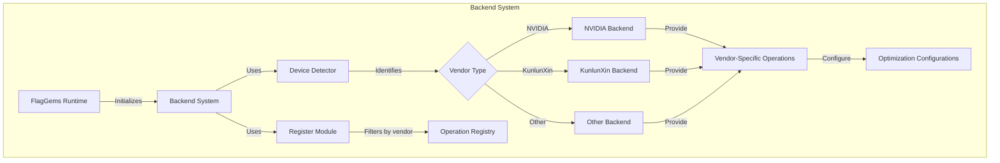

<!-- source: DeepWiki mcp.deepwiki.com · repo FlagOpen/FlagGems · page 2 Core Architecture · fetched 2026-10-21 -->

# Core Architecture

<details>
<summary>Relevant source files</summary>

The following files were used as context for generating this wiki page:

- [benchmark/test_special_perf.py](benchmark/test_special_perf.py)
- [benchmark/test_unary_pointwise_perf.py](benchmark/test_unary_pointwise_perf.py)
- [lib/addmm.cpp](lib/addmm.cpp)
- [lib/mm.cpp](lib/mm.cpp)
- [src/flag_gems/__init__.py](src/flag_gems/__init__.py)
- [src/flag_gems/csrc/aten_patch.cpp](src/flag_gems/csrc/aten_patch.cpp)
- [src/flag_gems/fused/fused_add_rms_norm.py](src/flag_gems/fused/fused_add_rms_norm.py)
- [src/flag_gems/ops/__init__.py](src/flag_gems/ops/__init__.py)
- [src/flag_gems/ops/addmm.py](src/flag_gems/ops/addmm.py)
- [src/flag_gems/ops/elu.py](src/flag_gems/ops/elu.py)
- [src/flag_gems/ops/embedding.py](src/flag_gems/ops/embedding.py)
- [src/flag_gems/ops/mm.py](src/flag_gems/ops/mm.py)
- [src/flag_gems/ops/mm_streamk.py](src/flag_gems/ops/mm_streamk.py)
- [src/flag_gems/ops/nllloss.py](src/flag_gems/ops/nllloss.py)
- [src/flag_gems/runtime/backend/_nvidia/tune_configs.yaml](src/flag_gems/runtime/backend/_nvidia/tune_configs.yaml)
- [src/flag_gems/utils/libentry.py](src/flag_gems/utils/libentry.py)
- [tests/accuracy_utils.py](tests/accuracy_utils.py)
- [tests/test_binary_pointwise_ops.py](tests/test_binary_pointwise_ops.py)
- [tests/test_blas_ops.py](tests/test_blas_ops.py)
- [tests/test_libentry.py](tests/test_libentry.py)
- [tests/test_special_ops.py](tests/test_special_ops.py)
- [tests/test_unary_pointwise_ops.py](tests/test_unary_pointwise_ops.py)

</details>


This document explains the fundamental architecture of FlagGems, including how operators are registered with PyTorch, how kernels are cached for performance, how configurations are auto-tuned, and how code is dynamically generated. These four systems form the core of FlagGems' ability to provide optimized operator implementations.

## Overview

FlagGems provides optimized Triton-based implementations for 200+ PyTorch operators. The architecture consists of four key systems:

1. **Operator Registration System** - Integrates with PyTorch's ATen library to intercept and replace operations
2. **LibEntry and Kernel Caching** - Manages compiled kernel caching to avoid JIT overhead
3. **LibTuner and Autotuning** - Automatically selects optimal kernel configurations
4. **Dynamic Code Generation** - Creates specialized kernels for pointwise operations

**System Architecture with Component Importance**



Sources:
- [src/flag_gems/__init__.py:1-367]()
- [src/flag_gems/utils/libentry.py:1-748]()

## Operator Registration System

The operator registration system is how FlagGems integrates with PyTorch's ATen library to provide optimized implementations. When enabled, FlagGems registers 200+ operator implementations that override PyTorch's default implementations.

### Registration APIs

FlagGems provides two APIs for enabling operator replacement:

| API | Scope | Usage |
|-----|-------|-------|
| `flag_gems.enable()` | Global | Registers operators for the entire program |
| `flag_gems.use_gems()` | Context manager | Registers operators only within a `with` block |

**Registration Flow**



Sources:
- [src/flag_gems/__init__.py:24-64]()
- [src/flag_gems/__init__.py:328-357]()

### Registered Operations

The `enable()` function registers a tuple of 200+ operations defined in [src/flag_gems/__init__.py:35-320](). Each tuple entry contains:

```python
("operation.variant", implementation_function)
```

Examples:
- `("abs", abs)` - Absolute value
- `("add.Tensor", add)` - Tensor addition
- `("mm", mm)` - Matrix multiplication
- `("native_layer_norm", layer_norm)` - Layer normalization

The registration can be filtered by:
- `unused` parameter - List of operations to skip
- `cpp_patched_ops_list` - Operations with C++ implementations from [src/flag_gems/config.py:aten_patch_list]()

The global `current_work_registrar` instance tracks all registered operations and can be queried via `flag_gems.all_ops()`.

Sources:
- [src/flag_gems/__init__.py:33-326]()
- [src/flag_gems/ops/__init__.py:1-482]()
- [src/flag_gems/csrc/aten_patch.cpp:1-44]()

## LibEntry and Kernel Caching

The `LibEntry` system provides per-device kernel caching to avoid Triton's JIT compilation overhead. Each device maintains its own cache, and the `@libentry()` decorator manages cache lookups and kernel execution.

### LibEntry Decorator

The `@libentry()` decorator wraps Triton kernels to provide:

1. **Device-specific caching** - Separate cache per GPU device
2. **Bypasses nested runtime** - Avoids Triton's `Autotuner`, `Heuristics`, and `JITFunction` overhead
3. **Direct kernel invocation** - Reduces dispatch latency

**Kernel Cache Architecture**



Sources:
- [src/flag_gems/utils/libentry.py:591-748]()
- [src/flag_gems/ops/mm.py:54-135]()

### Kernel Cache Implementation

The kernel cache is implemented in `LibEntry` class [src/flag_gems/utils/libentry.py:591-748](). Key features:

| Feature | Description |
|---------|-------------|
| Cache Storage | `OrderedDict` per device with LRU eviction |
| Cache Key | Hash of argument types, constexpr values, and grid config |
| Device Isolation | Each device has independent cache to avoid conflicts |
| Cache Size | Configurable maximum entries (default: 1024) |

The cache stores compiled kernels indexed by a hash of:
- Argument data types and shapes
- Constexpr parameter values (e.g., `BLOCK_M`, `BLOCK_N`, `BLOCK_K`)
- Grid launch configuration

**Example Usage**

```python
# From src/flag_gems/ops/embedding.py
@libentry()
@triton.jit
def embedding_kernel(
    out_ptr, in_ptr, weight_ptr,
    N: tl.constexpr,
    BLOCK_SIZE: tl.constexpr,
):
    # Kernel implementation
    ...
```

When `embedding_kernel` is called:
1. Cache key computed from argument types and constexpr values
2. If cache hit: use compiled kernel directly
3. If cache miss: compile via Triton, store in cache, then execute

Sources:
- [src/flag_gems/utils/libentry.py:591-748]()
- [src/flag_gems/ops/embedding.py:14-34]()

## LibTuner and Autotuning

The `LibTuner` system automatically selects optimal kernel configurations by benchmarking different tile sizes, warp counts, and pipeline stages. Tuned configurations are persisted in SQLite databases for reuse across runs.

### LibTuner Architecture

**Autotuning System Components**



Sources:
- [src/flag_gems/utils/libentry.py:347-547]()
- [src/flag_gems/runtime/backend/_nvidia/tune_configs.yaml:1-500]()

### Configuration Tuning Process

The `LibTuner` class [src/flag_gems/utils/libentry.py:347-547]() extends Triton's `Autotuner` with persistent caching:

**Tuning Steps:**

1. **Cache Key Generation** - The `get_key()` method computes a key from:
   - Operator arguments specified in `key` parameter (e.g., `["M", "N", "K"]`)
   - Strategy transformations (e.g., `"align32"` rounds to nearest multiple of 32)
   - Data types of all tensor arguments

2. **Configuration Search** - On cache miss:
   - Load configs from YAML or programmatic source
   - Benchmark each config using `do_bench=True`
   - Store timing results in `BenchmarkCache`
   - Select config with minimum p50 latency

3. **Persistent Storage** - Store best config in `ConfigCache`:
   - SQLite table named `{kernel_name}_{kernel_hash}`
   - Primary key: tuple of cache key components
   - Value: `triton.Config` with optimal parameters

4. **Cache Retrieval** - On cache hit:
   - Instant lookup from SQLite
   - No benchmarking overhead
   - Direct kernel launch with optimal config

**Example Configuration**

From [src/flag_gems/runtime/backend/_nvidia/tune_configs.yaml:126-210]():

```yaml
mm:
  - META:
      BLOCK_M: 64
      BLOCK_N: 64
      BLOCK_K: 64
    num_stages: 5
    num_warps: 4
  - META:
      BLOCK_M: 128
      BLOCK_N: 128
      BLOCK_K: 32
    num_stages: 4
    num_warps: 8
```

These configs are benchmarked for each unique `(M, N, K, dtype)` combination, and the best is cached.

Sources:
- [src/flag_gems/utils/libentry.py:347-547]()
- [src/flag_gems/utils/libentry.py:113-220]() (ConfigCache)
- [src/flag_gems/utils/libentry.py:222-281]() (BenchmarkCache)

### Cache Storage Details

| Cache Type | Purpose | Storage |
|------------|---------|---------|
| `ConfigCache` | Maps input shapes to best config | SQLite table per kernel |
| `BenchmarkCache` | Stores timing results for configs | SQLite table with `_benchmark` suffix |
| `LibCache` | Singleton managing all caches | `~/.flaggems/TunedConfig_{device}_triton_{version}.db` |

The cache location is determined by `config_cache_dir()` [src/flag_gems/utils/code_cache.py](), defaulting to `~/.flaggems/`.

Sources:
- [src/flag_gems/utils/libentry.py:283-344]()
- [src/flag_gems/utils/code_cache.py]()

## Dynamic Code Generation

The `@pointwise_dynamic` decorator generates rank-specific Triton kernels for element-wise operations. This eliminates broadcasting overhead and enables aggressive compiler optimizations by specializing kernels for specific tensor ranks.

### Pointwise Dynamic System

**Code Generation Pipeline**



Sources:
- [src/flag_gems/ops/elu.py:11-20]()
- Code generation system referenced in architecture diagrams

### Code Generation Features

The `@pointwise_dynamic` decorator provides:

| Feature | Description |
|---------|-------------|
| Rank Specialization | Generates separate kernel for each tensor rank (1D, 2D, 3D, etc.) |
| Type Promotion | Handles dtype promotion rules (e.g., `int + float → float`) |
| Broadcasting Elimination | Specialized kernels avoid runtime broadcasting checks |
| Cache Persistence | Generated code stored in `~/.flaggems/code_cache/` |
| Lazy Generation | Kernels generated only for ranks actually used |

**Example: ELU Forward**

From [src/flag_gems/ops/elu.py:11-20]():

```python
@pointwise_dynamic(
    is_tensor=[True, False, False, False],
    promotion_methods=[(0, "DEFAULT")]
)
@triton.jit
def elu_forward_kernel(x, alpha, scale, input_scale):
    return tl.where(
        x > 0,
        scale * input_scale * x,
        scale * alpha * (tl.exp(x.to(tl.float32) * input_scale) - 1),
    )
```

When called with a 2D tensor:
1. Compute hash of function + schema + rank=2
2. Check if `{hash}_rank2.py` exists in cache
3. If not, generate specialized 2D kernel without broadcasting logic
4. Import and JIT compile via Triton
5. Execute on GPU

**Generated Kernel Structure**

For a 3D tensor, the generator creates:

```python
# Generated at ~/.flaggems/code_cache/{hash}_rank3.py
@triton.jit
def elu_forward_kernel_rank3(
    out_ptr, x_ptr, 
    N0, N1, N2,  # Dimensions
    stride_x0, stride_x1, stride_x2,
    alpha, scale, input_scale,
    BLOCK_SIZE: tl.constexpr
):
    # 3D-specific indexing
    pid0 = tl.program_id(0)
    pid1 = tl.program_id(1) 
    pid2 = tl.program_id(2)
    # ... specialized 3D logic
```

This eliminates the need for dynamic rank checks and broadcasting, resulting in faster execution.

Sources:
- [src/flag_gems/ops/elu.py:11-20]()
- [src/flag_gems/fused/fused_add_rms_norm.py:14-59]()

## Backend System

FlagGems supports multiple hardware backends through a pluggable backend system. The backend system is responsible for:

1. Detecting the available hardware
2. Selecting the appropriate implementation for each operation
3. Optimizing execution for the specific hardware



Sources:
- [src/flag_gems/__init__.py:22-24]()
- [src/flag_gems/runtime/backend/_kunlunxin/ops/masked_select.py:1-80]()

### Device Detection

FlagGems automatically detects the available hardware devices and selects the appropriate backend. The detected device is stored in the `device` and `vendor_name` variables in the `flag_gems` namespace.

Currently supported hardware includes:
- NVIDIA GPUs
- KunlunXin accelerators
- Other vendors (through the extensible backend system)

Sources:
- [src/flag_gems/__init__.py:22-24]()
- [README.md:70-74]()

## Summary Table of Key Components

| Component | Description | Primary Files |
|-----------|-------------|--------------|
| Registration System | Intercepts PyTorch operations and redirects to FlagGems | [src/flag_gems/__init__.py]() |
| Operation Implementations | Optimized versions of PyTorch operations | [src/flag_gems/ops/__init__.py]() |
| LibEntry System | Manages kernel caching and optimization | Various kernel implementation files |
| Dynamic Code Generation | Creates specialized Triton kernels at runtime | [src/flag_gems/ops/index_add.py]() |
| Backend System | Supports different hardware devices | [src/flag_gems/runtime/backend/*]() |
| Fused Operations | Combined operations for better performance | [tests/test_special_ops.py]() |

## Performance Characteristics

FlagGems offers significant performance improvements over native PyTorch implementations:

1. **For pointwise operations** (like add, mul, div): Up to 2-5x speedup
2. **For reduction operations** (like sum, mean): Up to 2-3x speedup
3. **For BLAS operations** (like mm, bmm): Up to 1.5-2x speedup
4. **For fused operations**: Up to 3-7x speedup compared to separate operations

Performance varies by hardware, tensor shapes, and data types. The benchmarking system provides detailed performance metrics for each operation.

Sources:
- [benchmark/test_reduction_perf.py:1-311]()
- [benchmark/test_special_perf.py:1-423]()
- [benchmark/test_select_and_slice_perf.py:1-419]()
- [README.md:76-80]()

---

