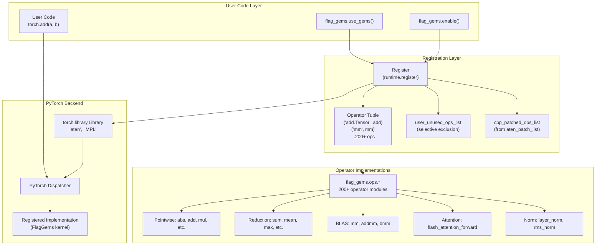
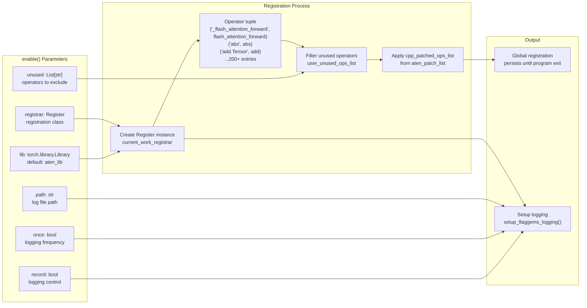
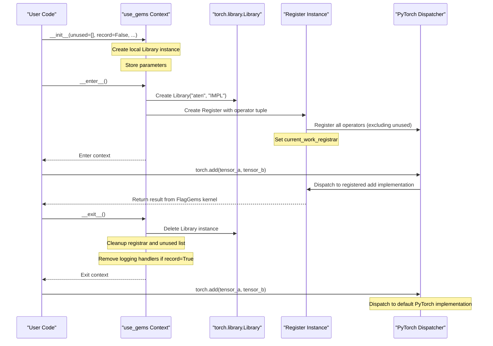
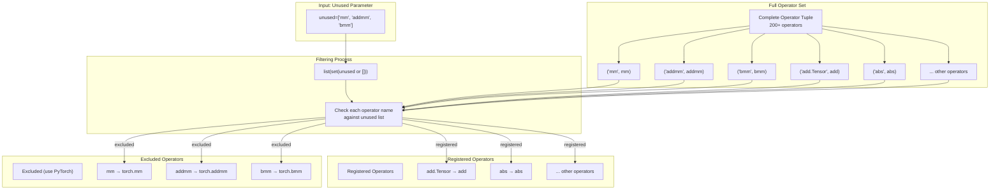
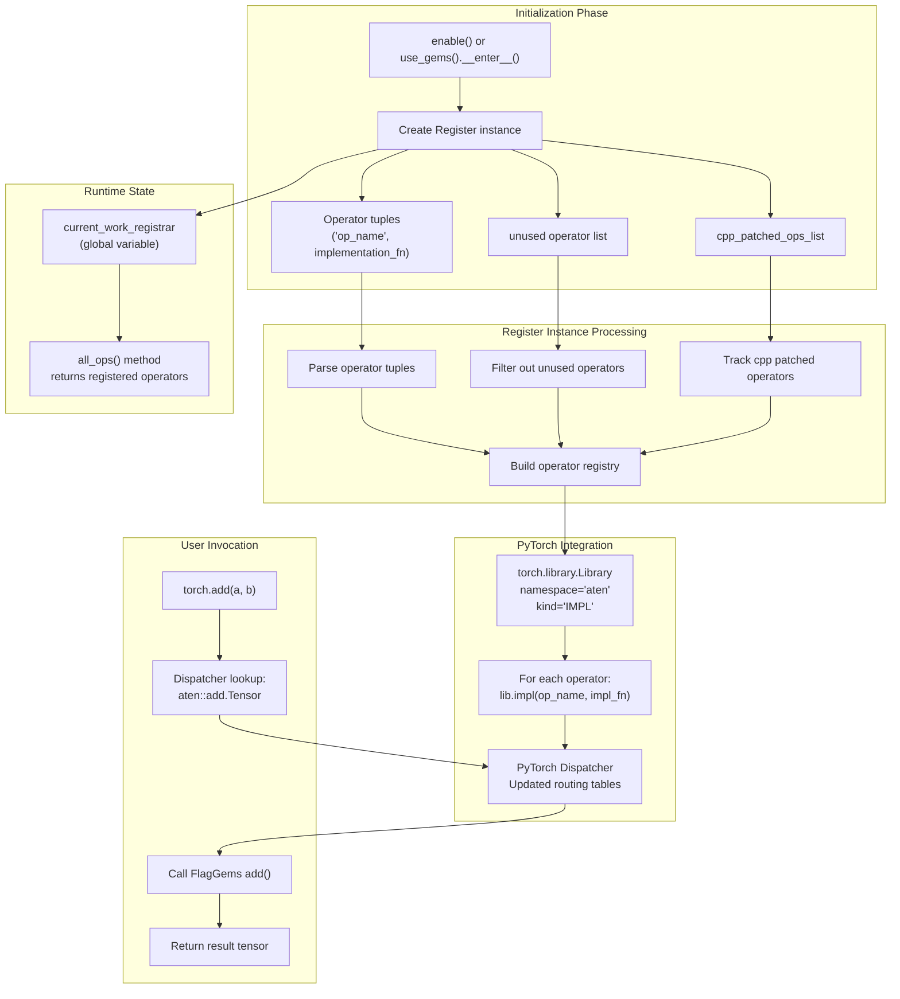
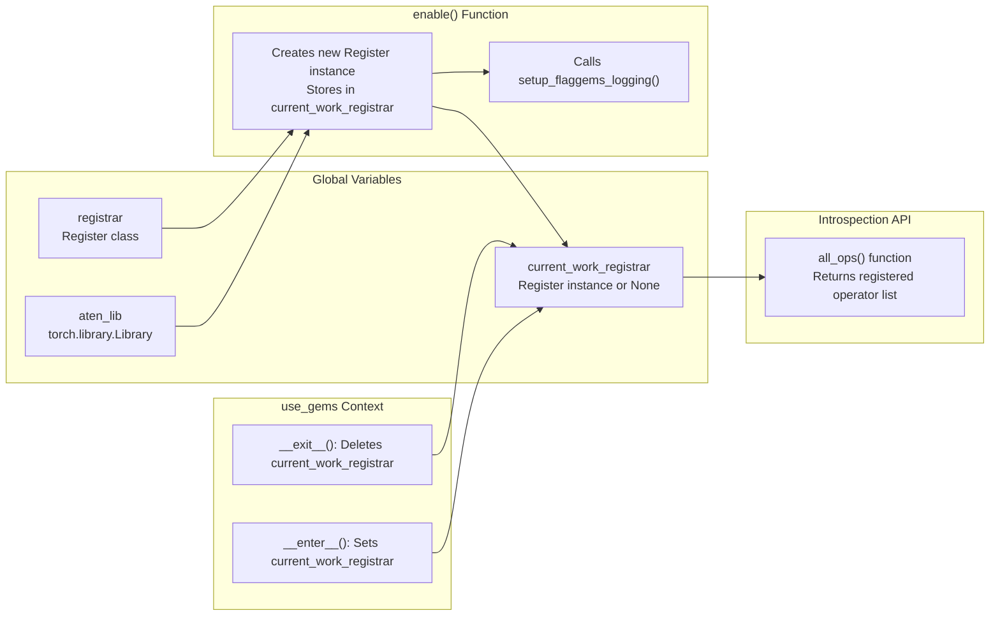

<!-- source: DeepWiki mcp.deepwiki.com · repo FlagOpen/FlagGems · page 2.1 Operator Registration System · fetched 2026-10-21 -->

# Operator Registration System

<details>
<summary>Relevant source files</summary>

The following files were used as context for generating this wiki page:

- [benchmark/test_special_perf.py](benchmark/test_special_perf.py)
- [benchmark/test_unary_pointwise_perf.py](benchmark/test_unary_pointwise_perf.py)
- [src/flag_gems/__init__.py](src/flag_gems/__init__.py)
- [src/flag_gems/ops/__init__.py](src/flag_gems/ops/__init__.py)
- [src/flag_gems/ops/elu.py](src/flag_gems/ops/elu.py)
- [src/flag_gems/ops/embedding.py](src/flag_gems/ops/embedding.py)
- [src/flag_gems/ops/nllloss.py](src/flag_gems/ops/nllloss.py)
- [tests/accuracy_utils.py](tests/accuracy_utils.py)
- [tests/test_binary_pointwise_ops.py](tests/test_binary_pointwise_ops.py)
- [tests/test_special_ops.py](tests/test_special_ops.py)
- [tests/test_unary_pointwise_ops.py](tests/test_unary_pointwise_ops.py)

</details>


This page describes how FlagGems registers over 200 optimized operator implementations with PyTorch's ATen backend, enabling automatic replacement of PyTorch operations with Triton-based kernels. For information about how individual operators are implemented, see [Operations Reference](#3). For details on the LibEntry kernel caching mechanism used after registration, see [LibEntry and Kernel Caching](#2.2).

## Overview

The operator registration system provides two primary APIs for activating FlagGems operators:
- **`flag_gems.enable()`**: Globally registers all operators for the duration of the program
- **`flag_gems.use_gems()`**: Context manager for scoped operator registration

Both APIs register FlagGems implementations with PyTorch's dispatcher, which intercepts calls to standard PyTorch operations (e.g., `torch.add`, `torch.mm`) and redirects them to the optimized Triton kernels.

**Sources:** [src/flag_gems/__init__.py:1-367]()

## Registration Architecture

The registration system consists of three layers: the user-facing API, the registration coordinator, and the PyTorch library backend.



**Diagram: Operator Registration Architecture**

The diagram shows how user-facing APIs interact with the registration coordinator (`Register`) to bind operator implementations to PyTorch's ATen library backend. The `Register` class processes the operator tuple, applies exclusions, and registers each operation with the dispatcher.

**Sources:** [src/flag_gems/__init__.py:18-19](), [src/flag_gems/__init__.py:24-326](), [src/flag_gems/ops/__init__.py:1-483]()

## The enable() Function

The `enable()` function provides global operator registration that persists for the entire program execution. It creates a `Register` instance with all available operators and optional exclusions.



**Diagram: enable() Function Flow**

The function signature and key behaviors:

| Parameter | Type | Default | Description |
|-----------|------|---------|-------------|
| `lib` | `torch.library.Library` | `aten_lib` | PyTorch library instance for registration |
| `unused` | `List[str]` | `None` | List of operator names to exclude from registration |
| `registrar` | `Register` | `Register` | Registration class to use |
| `record` | `bool` | `False` | Enable operation recording/logging |
| `once` | `bool` | `False` | Log each operation only once |
| `path` | `str` | `None` | Path for log output |

**Sources:** [src/flag_gems/__init__.py:24-326]()

### Operator Tuple Structure

The enable function registers operators using a large tuple where each entry maps an ATen operator signature to its FlagGems implementation:

```python
("abs", abs),                          # Basic unary operation
("add.Tensor", add),                   # Binary operation with tensor
("add_.Tensor", add_),                 # In-place variant
("native_layer_norm", layer_norm),     # Normalization operation
("mm.out", mm_out),                    # Output variant
```

**Operator naming conventions:**
- **Base name**: `"abs"`, `"add"`, `"mm"` - the core operation
- **Variant suffix**: `".Tensor"`, `".Scalar"`, `".out"` - indicates argument types or behavior
- **In-place suffix**: `"_"` at the end - indicates in-place modification (e.g., `"add_"`, `"abs_"`)

**Sources:** [src/flag_gems/__init__.py:35-320]()

## The use_gems Context Manager

The `use_gems` context manager provides scoped operator registration, allowing temporary replacement of PyTorch operations within a specific code block.



**Diagram: use_gems Context Manager Lifecycle**

The context manager creates a local `torch.library.Library` instance that is automatically cleaned up on exit, reverting to PyTorch's default operators.

**Sources:** [src/flag_gems/__init__.py:328-357]()

### Context Manager Usage Pattern

```python
# Operators registered only within context
with flag_gems.use_gems(unused=['mm', 'addmm']):
    result = torch.add(x, y)      # Uses FlagGems
    result = torch.mm(a, b)       # Uses PyTorch (excluded)
    
# PyTorch default operators after context exit
result = torch.add(x, y)          # Uses PyTorch
```

**Sources:** [tests/test_special_ops.py:61-62](), [tests/test_unary_pointwise_ops.py:30-31]()

## Selective Operator Registration

The `unused` parameter allows fine-grained control over which operators are registered, enabling users to exclude specific operations that may have compatibility issues or performance regressions on their workload.



**Diagram: Selective Operator Registration via unused Parameter**

The filtering mechanism deduplicates the unused list using `set()` and excludes matching operator names during registration initialization.

**Sources:** [src/flag_gems/__init__.py:321-324]()

## Operator Naming and Variant Types

PyTorch uses structured operator names in the ATen backend to distinguish between different argument types and behaviors. FlagGems follows this convention precisely to ensure correct dispatch.

| Operator Pattern | Example | Description |
|-----------------|---------|-------------|
| Base name | `"abs"`, `"sum"` | Core operation without qualifiers |
| Tensor argument variant | `"add.Tensor"`, `"mul.Tensor"` | Binary operation with tensor operands |
| Scalar argument variant | `"pow.Scalar"`, `"eq.Scalar"` | Operation with scalar parameter |
| Mixed variants | `"pow.Tensor_Scalar"`, `"bitwise_and.Scalar_Tensor"` | Different argument type combinations |
| Output variant | `"mm.out"`, `"sum.IntList_out"` | Pre-allocated output buffer |
| Dimension variant | `"sum.dim_IntList"`, `"max.dim"` | Dimension-specific operation |
| In-place operation | `"add_.Tensor"`, `"abs_"` | Modifies input tensor |
| Multiple qualifiers | `"sum.dim_IntList"`, `"div.Tensor_mode"` | Combined qualifiers |

**Examples from the operator tuple:**

```python
# Tensor-tensor operations
("add.Tensor", add),
("mul.Tensor", mul),

# In-place operations  
("add_.Tensor", add_),
("mul_.Tensor", mul_),

# Scalar operations
("eq.Scalar", eq_scalar),
("pow.Scalar", pow_scalar),

# Mixed scalar-tensor
("bitwise_and.Scalar_Tensor", bitwise_and_scalar_tensor),

# Output variants
("mm.out", mm_out),
("addmm.out", addmm_out),

# Dimension variants
("sum.dim_IntList", sum_dim),
("all.dim", all_dim),
```

**Sources:** [src/flag_gems/__init__.py:46-320]()

## Registration Process Details

The registration process involves several steps coordinated by the `Register` class, which manages the mapping between ATen operator signatures and FlagGems implementations.



**Diagram: Complete Registration and Dispatch Flow**

The `Register` class is instantiated with the operator mapping and processes it through filtering and registration steps before updating PyTorch's dispatcher.

**Sources:** [src/flag_gems/__init__.py:18-19](), [src/flag_gems/__init__.py:33-34](), [src/flag_gems/__init__.py:321-324](), [src/flag_gems/__init__.py:359-361]()

## Global State Management

FlagGems maintains a global registrar instance to track the current registration state and provide introspection capabilities.



**Diagram: Global State Variables and Their Lifecycle**

The `current_work_registrar` global variable provides access to the active registration state:

```python
# After enable() or within use_gems() context
all_registered = flag_gems.all_ops()  # Returns list of registered operator names
```

**Sources:** [src/flag_gems/__init__.py:18-21](), [src/flag_gems/__init__.py:32](), [src/flag_gems/__init__.py:348](), [src/flag_gems/__init__.py:359-361]()

## Usage Examples

The test suite demonstrates common registration patterns across different testing scenarios.

### Basic Registration with Context Manager

```python
import torch
import flag_gems

# Create input tensors
inp = torch.randn((1024, 1024), dtype=torch.float32, device=flag_gems.device)

# Use FlagGems operators within context
with flag_gems.use_gems():
    result = torch.abs(inp)           # Dispatches to flag_gems.abs
    result = torch.add(inp, inp)      # Dispatches to flag_gems.add
    
# Back to PyTorch operators
result = torch.abs(inp)               # Uses torch.abs
```

**Sources:** [tests/test_unary_pointwise_ops.py:30-33](), [tests/test_binary_pointwise_ops.py:42-43]()

### Selective Registration

```python
import flag_gems

# Register all operators except matrix multiplication
with flag_gems.use_gems(unused=['mm', 'addmm', 'bmm']):
    result = torch.add(a, b)      # Uses FlagGems
    result = torch.mm(a, b)       # Uses PyTorch default
```

**Sources:** [src/flag_gems/__init__.py:329-345]()

### Global Registration

```python
import flag_gems

# Register globally at program start
flag_gems.enable()

# All subsequent operations use FlagGems
result = torch.add(a, b)      # FlagGems
result = torch.mm(a, b)       # FlagGems
```

**Sources:** [src/flag_gems/__init__.py:24-326]()

### Testing with Dropout (Seeded Operations)

```python
import flag_gems
import torch

# Set seed for reproducible results on specific vendors
if flag_gems.vendor_name == "kunlunxin":
    torch.manual_seed(0)
    torch.cuda.manual_seed_all(0)

inp = torch.randn((32768,), dtype=torch.float32, device=flag_gems.device)

with flag_gems.use_gems():
    result = torch.nn.functional.dropout(inp, p=0.5, training=True)
```

**Sources:** [tests/test_special_ops.py:42-62]()

## Operator Categories in Registration

The operator tuple in `enable()` includes diverse operation types, organized by computational pattern. The registration order does not affect functionality but follows a logical grouping.

| Category | Example Operators | Count (Approx.) |
|----------|------------------|-----------------|
| Pointwise unary | `abs`, `exp`, `cos`, `neg`, `sigmoid` | 30+ |
| Pointwise binary | `add`, `mul`, `div`, `pow` | 40+ |
| Comparison | `eq`, `ne`, `gt`, `lt`, `ge`, `le` | 10+ |
| Logical/Bitwise | `bitwise_and`, `bitwise_or`, `logical_and` | 10+ |
| Reduction | `sum`, `mean`, `max`, `min`, `prod`, `cumsum` | 20+ |
| Matrix operations | `mm`, `addmm`, `bmm`, `mv`, `dot` | 10+ |
| Normalization | `layer_norm`, `batch_norm`, `rms_norm`, `group_norm` | 8+ |
| Attention | `flash_attention_forward`, `scaled_dot_product_attention` | 3+ |
| Tensor manipulation | `cat`, `stack`, `scatter`, `gather`, `index_add` | 20+ |
| Creation/Fill | `zeros`, `ones`, `full`, `arange`, `randn` | 15+ |
| Special | `dropout`, `embedding`, `topk`, `sort` | 15+ |

**Sources:** [src/flag_gems/__init__.py:35-320](), [src/flag_gems/ops/__init__.py:1-483]()

## Cpp Patched Operators

Some operators have C++ extension implementations for reduced Python overhead. These are tracked separately via `aten_patch_list`.

```python
# From enable() function
current_work_registrar = registrar(
    # ... operator tuples ...
    user_unused_ops_list=list(set(unused or [])),
    cpp_patched_ops_list=list(set(aten_patch_list)),  # From config
    lib=lib,
)
```

The `aten_patch_list` is imported from `flag_gems.config` and indicates which operators have optional C++ implementations for performance. See [C++ Extensions](#6.1) for details on the C++ runtime layer.

**Sources:** [src/flag_gems/__init__.py:7](), [src/flag_gems/__init__.py:322]()

---

