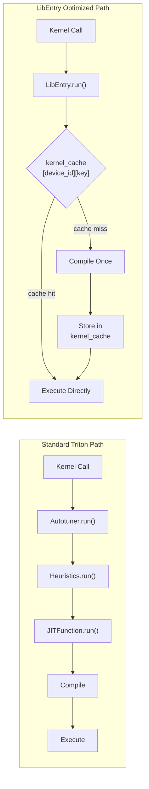
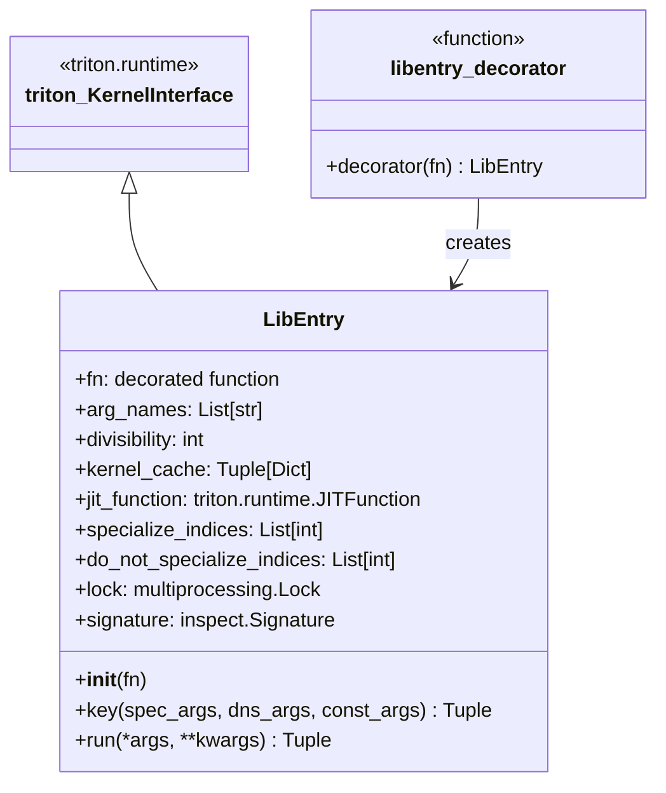
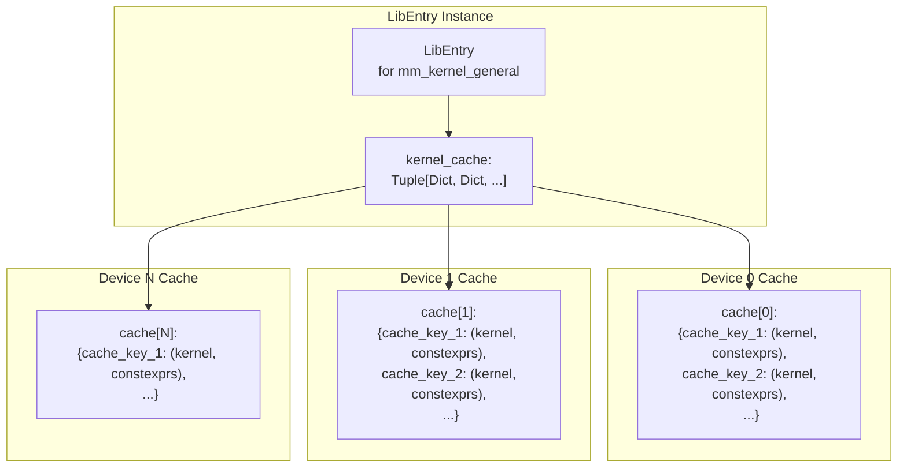
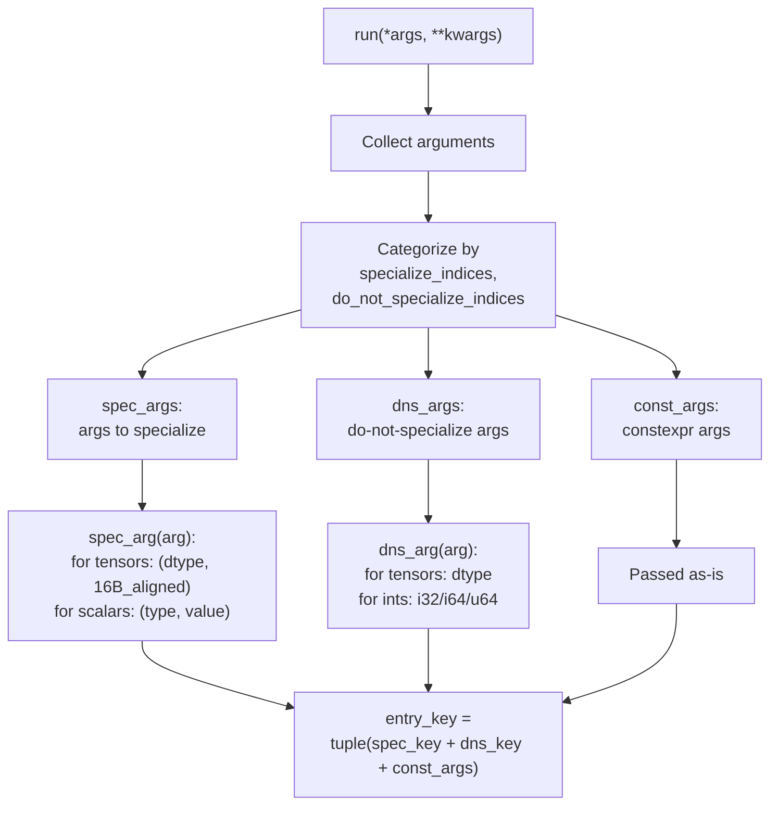
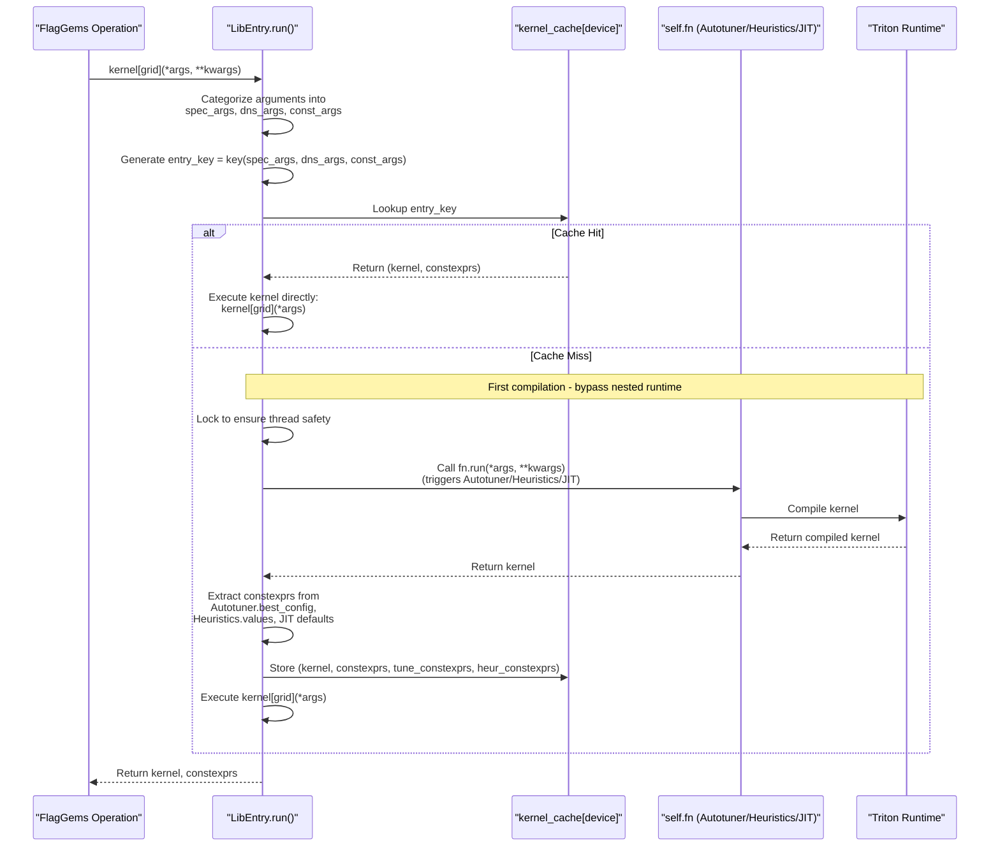

<!-- source: DeepWiki mcp.deepwiki.com · repo FlagOpen/FlagGems · page 2.2 LibEntry and Kernel Caching · fetched 2026-10-21 -->

# LibEntry and Kernel Caching

<details>
<summary>Relevant source files</summary>

The following files were used as context for generating this wiki page:

- [lib/addmm.cpp](lib/addmm.cpp)
- [lib/mm.cpp](lib/mm.cpp)
- [src/flag_gems/csrc/aten_patch.cpp](src/flag_gems/csrc/aten_patch.cpp)
- [src/flag_gems/fused/fused_add_rms_norm.py](src/flag_gems/fused/fused_add_rms_norm.py)
- [src/flag_gems/ops/addmm.py](src/flag_gems/ops/addmm.py)
- [src/flag_gems/ops/mm.py](src/flag_gems/ops/mm.py)
- [src/flag_gems/ops/mm_streamk.py](src/flag_gems/ops/mm_streamk.py)
- [src/flag_gems/runtime/backend/_nvidia/tune_configs.yaml](src/flag_gems/runtime/backend/_nvidia/tune_configs.yaml)
- [src/flag_gems/utils/libentry.py](src/flag_gems/utils/libentry.py)
- [tests/test_blas_ops.py](tests/test_blas_ops.py)
- [tests/test_libentry.py](tests/test_libentry.py)

</details>


The `LibEntry` system is FlagGems' specialized kernel execution infrastructure that provides per-device caching of compiled Triton kernels. It bypasses Triton's nested runtime to avoid redundant parameter processing on every kernel invocation, significantly reducing execution overhead.

For information about autotuning and configuration caching, see page 2.3 (LibTuner and Autotuning). For dynamic code generation, see page 2.4.

## Overview

`LibEntry` wraps Triton kernels and manages their compilation and execution lifecycle. Instead of repeatedly invoking Triton's `Autotuner`, `Heuristics`, and `JITFunction` layers on each call, `LibEntry` compiles kernels once per unique argument signature and device, then executes them directly via cached kernel objects.

**LibEntry Execution Flow Bypassing Triton Runtime**



Sources: [src/flag_gems/utils/libentry.py:733-905]()

## LibEntry Class Architecture

The `LibEntry` class extends `triton.KernelInterface` to intercept kernel execution and implement custom caching logic. It wraps any Triton kernel function (including those decorated with `@triton.autotune` and `@triton.heuristics`).

**LibEntry Class Structure**



Key attributes:

| Attribute | Type | Description |
|-----------|------|-------------|
| `kernel_cache` | `Tuple[Dict]` | Per-device cache storing compiled kernels, initialized as `tuple(dict() for _ in range(DEVICE_COUNT))` |
| `jit_function` | `triton.runtime.JITFunction` | The underlying JIT function extracted from decorator stack |
| `specialize_indices` | `List[int]` | Indices of parameters that should be specialized during compilation |
| `do_not_specialize_indices` | `List[int]` | Indices of parameters marked with `do_not_specialize` |
| `lock` | `multiprocessing.Lock` | Ensures thread-safe access to kernel cache |

Sources: [src/flag_gems/utils/libentry.py:733-757]()

## Per-Device Kernel Caching

`LibEntry` maintains a separate kernel cache for each device to accommodate device-specific kernel compilation and optimization. The cache is initialized as a tuple of dictionaries:

```python
self.kernel_cache = tuple(dict() for _ in range(DEVICE_COUNT))
```

**Per-Device Cache Architecture**



Each cache entry stores a tuple containing:
- `kernel`: Compiled Triton kernel object
- `constexprs`: Dictionary of constexpr values collected from `Autotuner`, `Heuristics`, and `JITFunction` defaults

The cache is accessed using the current device ID:
```python
device = torch_device_fn.current_device()
cache = self.kernel_cache[device]
```

Sources: [src/flag_gems/utils/libentry.py:741](), [src/flag_gems/utils/libentry.py:821-822](), [src/flag_gems/utils/libentry.py:863-868]()

## Cache Key Generation

`LibEntry` generates cache keys based on the specialized representation of kernel arguments. The `key()` method categorizes arguments into three types and generates appropriate key components:

**Argument Categorization**

| Argument Type | Key Representation | Example |
|---------------|-------------------|---------|
| Specializable args | `(dtype, is_16B_aligned)` for tensors, `(type, value)` for scalars | `(torch.float32, True)` |
| Do-not-specialize args | `dtype` for tensors, type hint for scalars | `torch.float32` or `"i32"` |
| Constexpr args | Passed by position as-is | `(64, 128, 32)` |

The cache key is a tuple combining all three categories:

```python
entry_key = self.key(spec_args, dns_args, const_args)
# Example: ((torch.float32, True), (torch.float32, True), torch.float32, 64, 128, 32)
```

**Cache Key Generation Flow**



Sources: [src/flag_gems/utils/libentry.py:759-779](), [src/flag_gems/utils/libentry.py:786-819]()

## Execution Flow and Runtime Bypass

The `run()` method implements the core logic that bypasses Triton's nested runtime:

**Detailed Execution Sequence**



The key optimization is that after the first compilation, `LibEntry` directly invokes `kernel[grid](*args)` without re-entering the `Autotuner`, `Heuristics`, or `JITFunction` layers. This eliminates parameter processing overhead on subsequent calls.

Sources: [src/flag_gems/utils/libentry.py:781-904]()

## Usage Examples

The `@libentry()` decorator wraps Triton kernels to enable kernel caching. It works with plain `@triton.jit` kernels as well as those decorated with `@triton.autotune` or `@triton.heuristics`.

### Basic Usage with @triton.jit

```python
from flag_gems.utils import libentry
import triton
import triton.language as tl

@libentry()
@triton.jit
def simple_kernel(x_ptr, y_ptr, N, BLOCK_SIZE: tl.constexpr):
    pid = tl.program_id(0)
    offsets = pid * BLOCK_SIZE + tl.arange(0, BLOCK_SIZE)
    mask = offsets < N
    x = tl.load(x_ptr + offsets, mask=mask)
    tl.store(y_ptr + offsets, x * 2, mask=mask)
```

### With @triton.autotune

`LibEntry` preserves the functionality of `@triton.autotune` while adding caching:

```python
@libentry()
@triton.autotune(
    configs=[
        triton.Config({"BLOCK_M": 64, "BLOCK_N": 64}, num_warps=4),
        triton.Config({"BLOCK_M": 128, "BLOCK_N": 64}, num_warps=4),
    ],
    key=["M", "N", "K"],
)
@triton.jit
def mm_kernel_general(A, B, C, M, N, K, ...):
    # Matrix multiplication implementation
    pass
```

During the first invocation with a given argument signature, the `Autotuner` runs and selects the best config. On subsequent calls with the same signature, `LibEntry` uses the cached kernel with the previously selected config, bypassing the autotuning overhead.

### With @triton.heuristics

`LibEntry` also works with `@triton.heuristics`:

```python
@libentry()
@triton.autotune(
    configs=[triton.Config({"TILE_N": 32}), triton.Config({"TILE_N": 64})],
    key=["N"],
)
@triton.heuristics(
    values={
        "TILE_M": lambda args: 1024 // args["TILE_N"],
        "ONE_TILE_PER_CTA": lambda args: args["TILE_N"] >= args["N"],
    },
)
@triton.jit
def softmax_kernel_inner(output_ptr, input_ptr, M, N, TILE_M: tl.constexpr, ...):
    # Softmax implementation
    pass
```

The heuristic values are computed once during the first invocation and cached along with the kernel.

Sources: [src/flag_gems/utils/libentry.py:907-914](), [tests/test_libentry.py:98-170](), [src/flag_gems/ops/mm.py:54-135]()

## Real-World Example: Matrix Multiplication

The matrix multiplication kernel `mm_kernel_general` demonstrates `LibEntry` usage:

```python
@libentry()
@libtuner(
    configs=runtime.get_tuned_config("mm"),
    key=["M", "N", "K", "stride_am", "stride_bk"],
    strategy=["align32", "align32", "align32", "align32", "align32"],
    warmup=5,
    rep=10,
)
@triton.jit
def mm_kernel_general(A, B, C, M, N, K, stride_am, stride_ak, stride_bk, stride_bn,
                      stride_cm, stride_cn, BLOCK_M: tl.constexpr, BLOCK_N: tl.constexpr,
                      BLOCK_K: tl.constexpr, GROUP_M: tl.constexpr):
    # Implementation...
```

When invoked via:
```python
grid = lambda META: (triton.cdiv(M, META["BLOCK_M"]) * triton.cdiv(N, META["BLOCK_N"]),)
mm_kernel_general[grid](a, b, c, M, N, K, ...)
```

The first call with a given `(M, N, K, stride_am, stride_bk)` tuple triggers autotuning and compilation. Subsequent calls with the same tuple execute the cached kernel directly.

Sources: [src/flag_gems/ops/mm.py:54-135](), [src/flag_gems/ops/mm.py:154-183]()

## Thread Safety

`LibEntry` uses a `multiprocessing.Lock` to ensure thread-safe compilation and caching:

```python
with self.lock:
    if entry_key in cache:
        break
    kernel = self.fn.run(*args, **kwargs)
    # ... extract constexprs ...
    cache[entry_key] = (kernel, constexprs, tune_constexprs, heur_constexprs)
```

The lock is only acquired during the first compilation for a given cache key. Once the kernel is cached, subsequent executions proceed lock-free.

The test suite includes thread safety validation:

```python
def run_two_threads():
    devices = [0, 0]
    fs = []
    def task_fn(dev):
        x = torch.randn((128, 128, 128), device=dev)
        return softmax_inner_decorator_cascade(x, 1)
    for dev in devices:
        work = TaskThread(task_fn, (dev,))
        work.start()
        fs.append(work)
    for i in range(len(fs)):
        fs[i].join()
```

Sources: [src/flag_gems/utils/libentry.py:756](), [src/flag_gems/utils/libentry.py:826-868](), [tests/test_libentry.py:214-238]()

## Integration with FlagGems Operations

`LibEntry` is used throughout FlagGems for operations requiring efficient kernel caching. Key integration points include:

| Operation Category | Example Operations | Files |
|-------------------|-------------------|-------|
| Matrix Operations | `mm`, `addmm`, `bmm` | [src/flag_gems/ops/mm.py](), [src/flag_gems/ops/addmm.py]() |
| Attention | `flash_attn_varlen_func`, `scaled_dot_product_attention` | [src/flag_gems/ops/attention.py]() |
| Normalization | `layer_norm`, `rms_norm`, `group_norm` | [src/flag_gems/ops/layer_norm.py]() |
| Fused Operations | `fused_add_rms_norm`, `silu_and_mul` | [src/flag_gems/fused/]() |

Example from `fused_add_rms_norm.py`:

```python
@libentry()
@triton.jit(do_not_specialize=["eps"])
def fused_add_rms_norm_kernel(input_ptr, residual_ptr, w_ptr, ...):
    # Kernel implementation
    pass

def fused_add_rms_norm(x, residual, normalized_shape, weight, eps=1e-5):
    # ...
    with torch_device_fn.device(x.device):
        fused_add_rms_norm_kernel[M,](x, residual, weight, N, 1, N, 1, N, eps, BLOCK_SIZE)
    return x, residual
```

Sources: [src/flag_gems/fused/fused_add_rms_norm.py:14-82](), [src/flag_gems/ops/mm.py:54-62](), [src/flag_gems/ops/addmm.py:15-22]()

## Performance Benefits

`LibEntry` provides significant performance improvements over standard Triton kernel execution:

**Overhead Reduction**

| Optimization | Standard Triton | LibEntry | Benefit |
|--------------|----------------|----------|---------|
| Parameter processing | Every call | First call only | ~10-20μs saved per call |
| Type checking/wrapping | Every call | First call only | Reduced overhead |
| Config lookup (Autotuner) | Every call | First call only | Eliminates repeated tuning |
| Heuristics evaluation | Every call | First call only | Single evaluation |
| Nested function calls | Deep stack | Direct execution | Reduced call overhead |

**Cache Hit Performance**

Once a kernel is cached, execution follows this fast path:
1. Generate cache key from arguments (~1-2μs)
2. Dictionary lookup in `kernel_cache[device]` (~0.5μs)
3. Direct kernel execution (no additional overhead)

The performance gain is most significant for:
- Frequently called kernels with stable argument signatures (e.g., attention layers in transformers)
- Kernels with multiple `@triton.autotune` configs
- Operations in tight loops (e.g., per-layer operations in LLM inference)

Sources: [src/flag_gems/utils/libentry.py:733-905]()

## Limitations and Considerations

When using the LibEntry system, consider the following:

1. **Memory usage**: Each device has its own cache, which can increase memory usage in multi-device scenarios
2. **Thread safety**: While LibEntry is thread-safe, users should be cautious when modifying underlying Triton kernels
3. **Cache persistence**: The LibTuner SQLite database can grow large with many configurations
4. **Version compatibility**: The implementation adapts to different Triton versions but may need adjustments for future versions

Sources: [src/flag_gems/utils/libentry.py:20-23](), [tests/test_libentry.py:229-237]()

---

