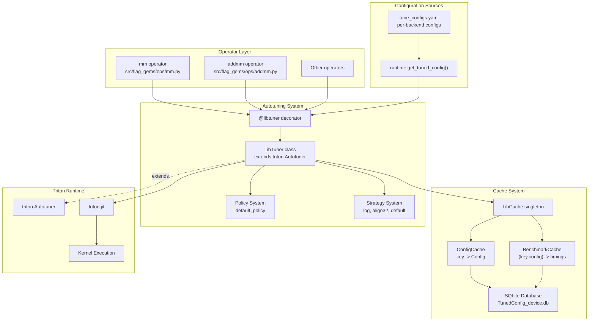
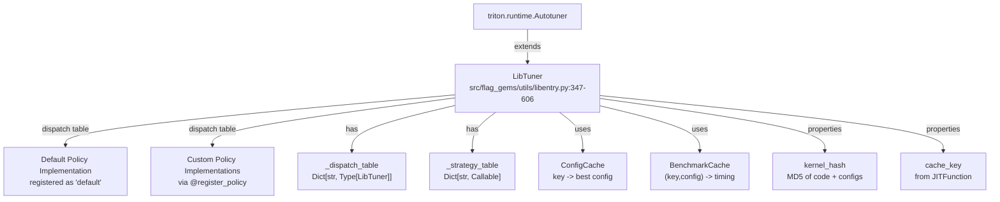
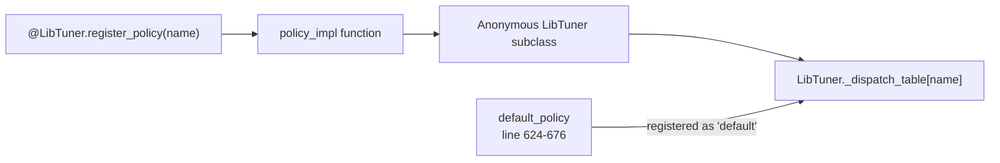
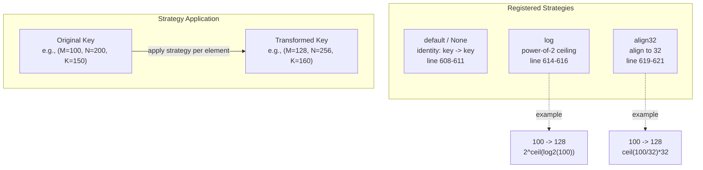
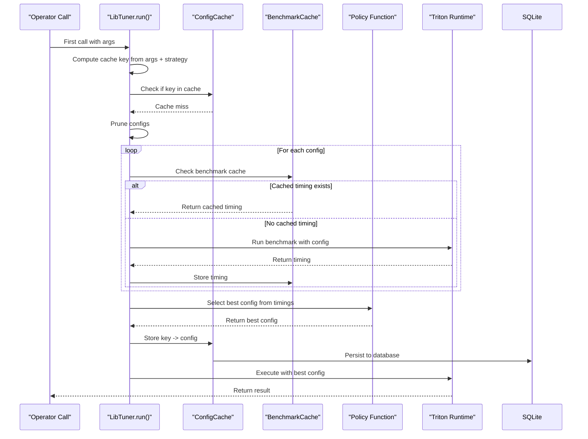
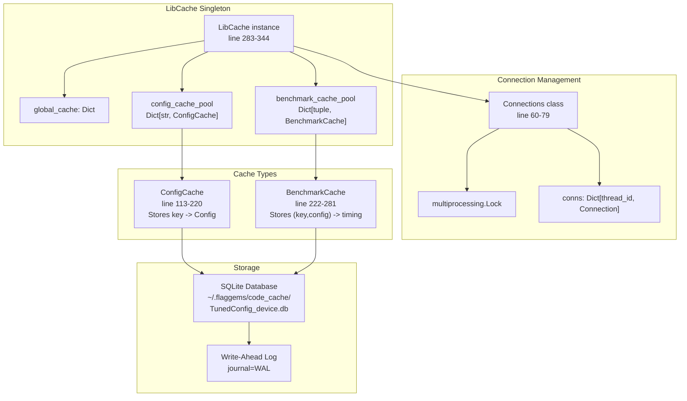
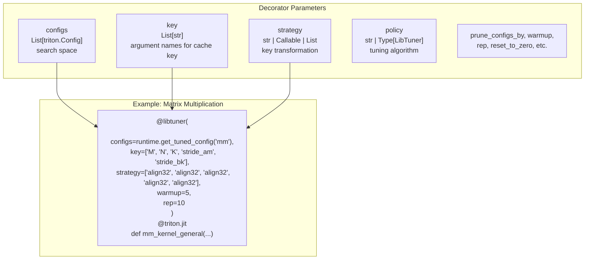
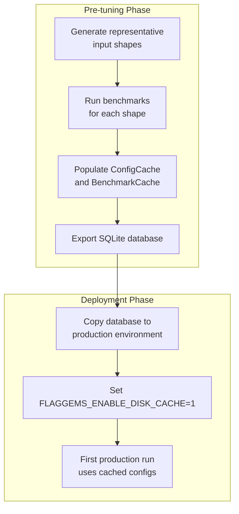

<!-- source: DeepWiki mcp.deepwiki.com · repo FlagOpen/FlagGems · page 2.3 LibTuner and Autotuning · fetched 2026-10-21 -->

# LibTuner and Autotuning

<details>
<summary>Relevant source files</summary>

The following files were used as context for generating this wiki page:

- [README.md](README.md)
- [README_cn.md](README_cn.md)
- [docs/add_a_cpp_wrapper.md](docs/add_a_cpp_wrapper.md)
- [docs/get_start_with_flaggems.md](docs/get_start_with_flaggems.md)
- [docs/how_to_use_flaggems.md](docs/how_to_use_flaggems.md)
- [docs/index.md](docs/index.md)
- [docs/installation.md](docs/installation.md)
- [docs/pointwise_dynamic.md](docs/pointwise_dynamic.md)
- [examples/integration_gems_with_vllm.py](examples/integration_gems_with_vllm.py)
- [lib/addmm.cpp](lib/addmm.cpp)
- [lib/mm.cpp](lib/mm.cpp)
- [mkdocs.yml](mkdocs.yml)
- [pyproject.toml](pyproject.toml)
- [src/flag_gems/csrc/aten_patch.cpp](src/flag_gems/csrc/aten_patch.cpp)
- [src/flag_gems/fused/fused_add_rms_norm.py](src/flag_gems/fused/fused_add_rms_norm.py)
- [src/flag_gems/ops/addmm.py](src/flag_gems/ops/addmm.py)
- [src/flag_gems/ops/mm.py](src/flag_gems/ops/mm.py)
- [src/flag_gems/ops/mm_streamk.py](src/flag_gems/ops/mm_streamk.py)
- [src/flag_gems/ops/sqrt.py](src/flag_gems/ops/sqrt.py)
- [src/flag_gems/runtime/backend/_nvidia/tune_configs.yaml](src/flag_gems/runtime/backend/_nvidia/tune_configs.yaml)
- [src/flag_gems/utils/libentry.py](src/flag_gems/utils/libentry.py)
- [tests/test_blas_ops.py](tests/test_blas_ops.py)
- [tests/test_libentry.py](tests/test_libentry.py)

</details>


## Purpose and Scope

This document describes the LibTuner autotuning system, which automatically searches for optimal kernel configurations to maximize performance across different input shapes and hardware platforms. LibTuner extends Triton's built-in `Autotuner` with persistent caching, flexible tuning policies, and cache key transformation strategies. For information about kernel registration and caching, see [LibEntry and Kernel Caching](#2.2). For details on code generation for pointwise operations, see [Dynamic Code Generation](#2.4).

## System Architecture

LibTuner operates as the configuration optimization layer between operator implementations and the Triton JIT runtime. It manages the search space of kernel configurations and persists optimal choices across runs.

### LibTuner Position in Architecture



**Sources:** [src/flag_gems/utils/libentry.py:347-730](), [src/flag_gems/ops/mm.py:54-62](), [src/flag_gems/runtime/backend/_nvidia/tune_configs.yaml]()

## LibTuner Core Concepts

### LibTuner Class

The `LibTuner` class extends Triton's `Autotuner` to provide persistent caching and flexible tuning strategies. It maintains a dispatch table for policy variations and a strategy table for cache key transformations.



**Key Properties:**

| Property | Type | Description |
|----------|------|-------------|
| `kernel_hash` | str | MD5 hash of kernel code and configuration space |
| `cache_key` | str | Cache key from underlying JITFunction |
| `config_table_name` | str | Table name for configuration cache |
| `benchmark_table_name` | str | Table name for benchmark results |
| `strategy` | List[Callable] | Transformation functions for cache keys |

**Sources:** [src/flag_gems/utils/libentry.py:347-447]()

### Policy System

Policies define the algorithm used to select the best configuration from the search space. The default policy exhaustively benchmarks all configurations and selects the one with minimum latency.



**Default Policy Algorithm:**

1. Receive benchmark function and configuration iterator
2. Benchmark each configuration by calling `bench_fn(config)`
3. Return configuration with minimum timing

**Policy Function Signature:**
```python
def policy(
    bench_fn: Callable[[triton.Config], List[float]],
    configs: Iterator[triton.Config],
    args: Tuple[Any],
    kwargs: Dict[str, Any]
) -> Tuple[triton.Config, Dict[str, float]]
```

**Sources:** [src/flag_gems/utils/libentry.py:498-676]()

### Strategy System

Strategies transform cache keys to enable configuration reuse across similar input shapes. This reduces the number of autotuning runs by grouping similar inputs.



**Strategy Transformation Examples:**

| Strategy | Input | Output | Formula |
|----------|-------|--------|---------|
| `default` | 100 | 100 | identity |
| `log` | 100 | 128 | 2^⌈log₂(100)⌉ |
| `align32` | 100 | 128 | ⌈100/32⌉ × 32 |
| `log` | 1500 | 2048 | 2^⌈log₂(1500)⌉ |
| `align32` | 1500 | 1504 | ⌈1500/32⌉ × 32 |

**Sources:** [src/flag_gems/utils/libentry.py:608-621]()

### Configuration Search Process

The autotuning search occurs on first invocation with a new cache key. The process benchmarks configurations, applies the policy to select the best, and persists the result.



**Sources:** [src/flag_gems/utils/libentry.py:548-605]()

## LibCache System

LibCache provides persistent storage for tuning results across process restarts. It uses SQLite with write-ahead logging (WAL) for concurrent access and maintains separate tables for configuration mappings and benchmark timings.

### LibCache Architecture



**Sources:** [src/flag_gems/utils/libentry.py:60-344]()

### ConfigCache

ConfigCache stores the mapping from tuning keys to optimal configurations. Each table represents one operator kernel variant identified by its hash.

**Table Structure:**
- **Key columns:** `key_0`, `key_1`, ..., `key_N` (dynamic based on key tuple length)
- **Config columns:** Parameters from `triton.Config` (e.g., `num_warps`, `num_stages`, `BLOCK_M`, etc.)
- **Primary key:** Composite of all key columns

**Key Operations:**

| Method | Purpose | Implementation |
|--------|---------|----------------|
| `get(key)` | Retrieve cached config | Check dict cache, then SQLite query |
| `set(key, config)` | Store new config | Create table if needed, insert/replace row |
| `__contains__(key)` | Check if key exists | Wrapper around `get()` |
| `__getitem__(key)` | Dict-like access | Wrapper around `get()` with KeyError |

**Sources:** [src/flag_gems/utils/libentry.py:113-220]()

### BenchmarkCache

BenchmarkCache stores detailed timing measurements for each configuration, enabling reuse of benchmark results across tuning sessions and reducing redundant measurements.

**Table Structure:**
- **Key columns:** From the tuning key (e.g., `key_0`, `key_1` for M, N, K)
- **Config columns:** Parameters from `triton.Config`
- **Timing columns:** `p50`, `p20`, `p80` (percentile timings)
- **Primary key:** Composite of key columns + config columns

**Benchmark Storage:**
```python
# Store benchmark result
cache[(M, N, K)] = config
benchmark_cache[config] = [p50, p20, p80]
```

**Sources:** [src/flag_gems/utils/libentry.py:222-281]()

### Database File Naming

The cache file name encodes device and Triton version information to prevent incompatible cache reuse:

```
TunedConfig_{device_name}_triton_{major}_{minor}.db
```

**Examples:**
- NVIDIA A100: `TunedConfig_NVIDIA_A100-SXM4-80GB_triton_3_2.db`
- Kunlunxin: `TunedConfig_kunlunxin_triton_3_2.db`

**Sources:** [src/flag_gems/utils/libentry.py:294-301]()

## Usage Patterns

### Decorator Syntax

The `@libtuner` decorator wraps Triton kernels to enable automatic configuration tuning with persistent caching.



**Complete Example from mm.py:**

The matrix multiplication kernel uses `libtuner` with align32 strategy to group similar shapes:

**Sources:** [src/flag_gems/ops/mm.py:54-62]()

### Configuration Spaces

Configuration spaces are defined in YAML files per backend, allowing hardware-specific optimization without code changes.

**Configuration Definition Format:**

```yaml
mm:
  - META:
      BLOCK_M: 64
      BLOCK_N: 64
      BLOCK_K: 64
    num_stages: 5
    num_warps: 4
  - META:
      BLOCK_M: 64
      BLOCK_N: 128
      BLOCK_K: 64
    num_stages: 3
    num_warps: 4
```

**Generated Configuration Space:**

| BLOCK_M | BLOCK_N | BLOCK_K | num_stages | num_warps |
|---------|---------|---------|------------|-----------|
| 64 | 64 | 64 | 5 | 4 |
| 64 | 128 | 64 | 3 | 4 |
| 64 | 64 | 128 | 4 | 8 |
| 128 | 128 | 32 | 5 | 8 |
| ... | ... | ... | ... | ... |

**Auto-generated Configurations:**

Some operators use `gen: true` to generate configurations programmatically:

```yaml
layer_norm_persistent:
  - gen: true
    param_map:
      META: {}
      num_warps: warps
    warps:
      - 4
      - 8
      - 16
```

This generates 3 configurations with `num_warps` set to 4, 8, and 16.

**Sources:** [src/flag_gems/runtime/backend/_nvidia/tune_configs.yaml:1-1002]()

### Integration in Operators

Matrix multiplication demonstrates complete integration of libtuner with configuration loading, strategy application, and cache-aware execution.

**Operator Integration Pattern:**

1. Load configuration space via `runtime.get_tuned_config(op_name)`
2. Decorate kernel with `@libtuner` specifying keys and strategies
3. Define grid computation lambda
4. Invoke kernel through grid syntax

**addmm Example:**

**Sources:** [src/flag_gems/ops/addmm.py:15-22]()

## Pre-tuning and Optimization

### Pre-tuning Workflow

Pre-tuning populates the cache with optimal configurations before deployment, eliminating first-run overhead in production.



**Environment Variables:**

| Variable | Default | Description |
|----------|---------|-------------|
| `FLAGGEMS_ENABLE_DISK_CACHE` | `"1"` | Enable persistent SQLite cache |
| `TRITON_PRINT_AUTOTUNING` | `"0"` | Print autotuning decisions |

**Disk Cache Control:**

Disk caching can be disabled for testing or to force re-tuning:
```python
os.environ["FLAGGEMS_ENABLE_DISK_CACHE"] = "0"  # Use memory-only cache
```

**Sources:** [src/flag_gems/utils/libentry.py:57](), [src/flag_gems/utils/libentry.py:591-595]()

### Cache Key Design

Effective cache keys balance reuse (fewer keys, more cache hits) against precision (more keys, better performance per shape).

**Cache Key Construction:**

```python
def get_key(self, args):
    # Apply strategy to each key argument
    key = tuple(
        self.strategy[idx](args[key_name])
        for idx, key_name in enumerate(self.keys)
    )
    # Append dtype information
    key += tuple(str(arg.dtype) for arg in args.values() if hasattr(arg, "dtype"))
    return key
```

**Example Key Transformation:**

| Original Args | Strategy | Transformed Key | Effect |
|---------------|----------|-----------------|--------|
| M=1024, N=512, K=768 | align32 | (1024, 512, 768) | Exact match |
| M=1025, N=513, K=769 | align32 | (1056, 544, 800) | Rounds up to align |
| M=1000, N=500, K=750 | log | (1024, 512, 1024) | Power-of-2 grouping |

**Sources:** [src/flag_gems/utils/libentry.py:448-459]()

### Multi-process Safety

LibCache uses process-level locks and SQLite's WAL mode to support concurrent access from multiple processes, enabling safe multi-GPU training and vLLM worker scenarios.

**Concurrency Features:**

1. **Thread-safe connections:** Separate SQLite connection per thread ID
2. **Process-safe locks:** `multiprocessing.Lock` for cache access
3. **WAL journaling:** Write-ahead log enables concurrent readers
4. **Atomic operations:** `INSERT OR REPLACE` for safe updates

**vLLM Signal Handling:**

When vLLM workers are terminated via signals (SIGTERM, SIGINT), LibCache ensures cache writes complete:

**Sources:** [src/flag_gems/utils/libentry.py:60-79](), [tests/test_libentry.py:358-508]()

### Performance Considerations

**First Run vs. Cached Run:**

| Scenario | Cold Cache | Warm Cache | Speedup |
|----------|------------|------------|---------|
| First operator call | 2-10s tuning | <1ms lookup | 1000x+ |
| Subsequent calls (same shape) | <1ms (no tuning) | <1ms | ~1x |
| Similar shape (with strategy) | 2-10s tuning | <1ms lookup | 1000x+ |

**Tuning Overhead:**

For matrix multiplication with 14 configurations, tuning takes approximately 5-10 seconds on A100. With caching:
- Configuration lookup: <1ms
- Kernel dispatch: ~0.1ms
- Total overhead: negligible

**Sources:** [src/flag_gems/utils/libentry.py:562-578]()

---

