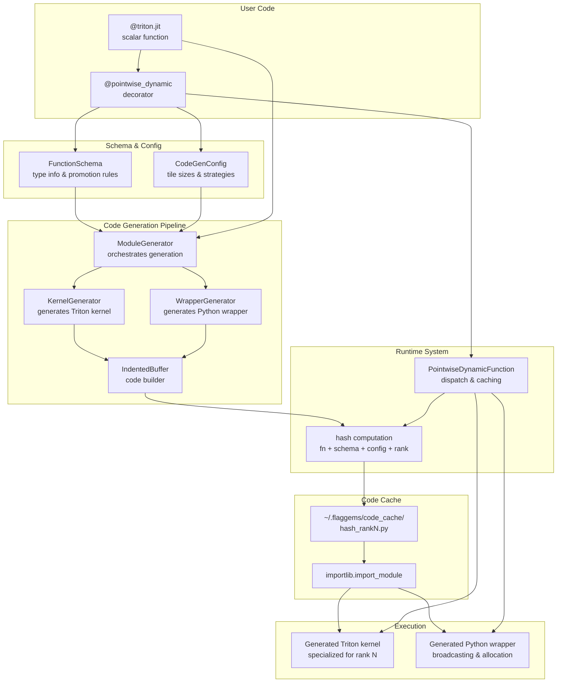
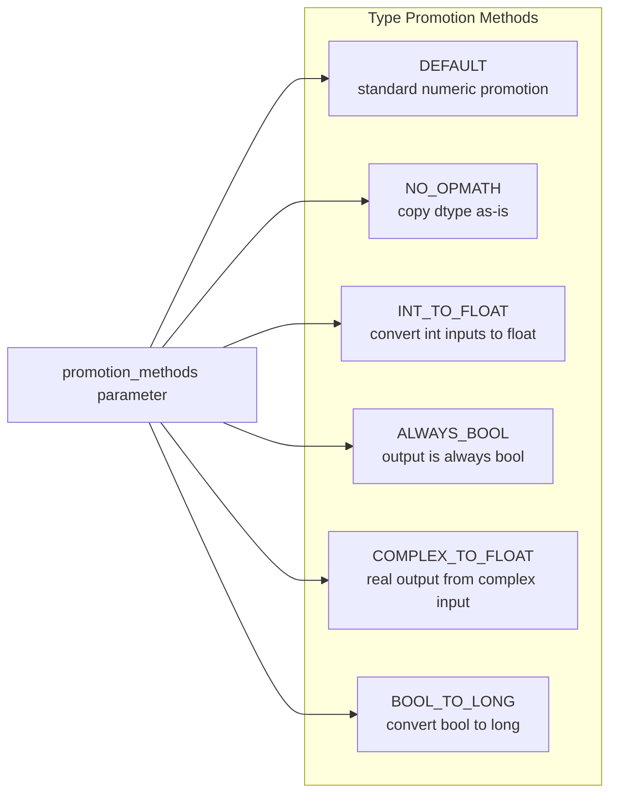
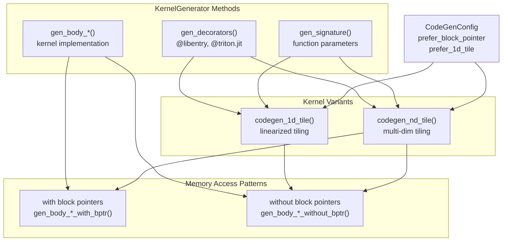
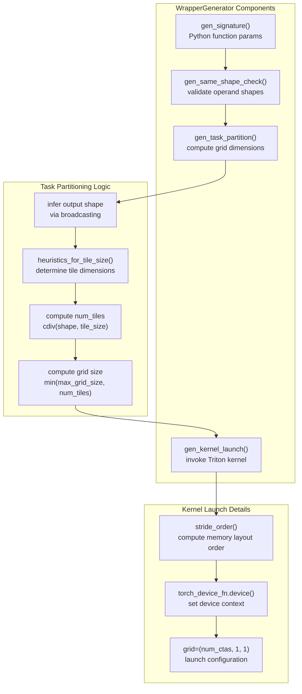
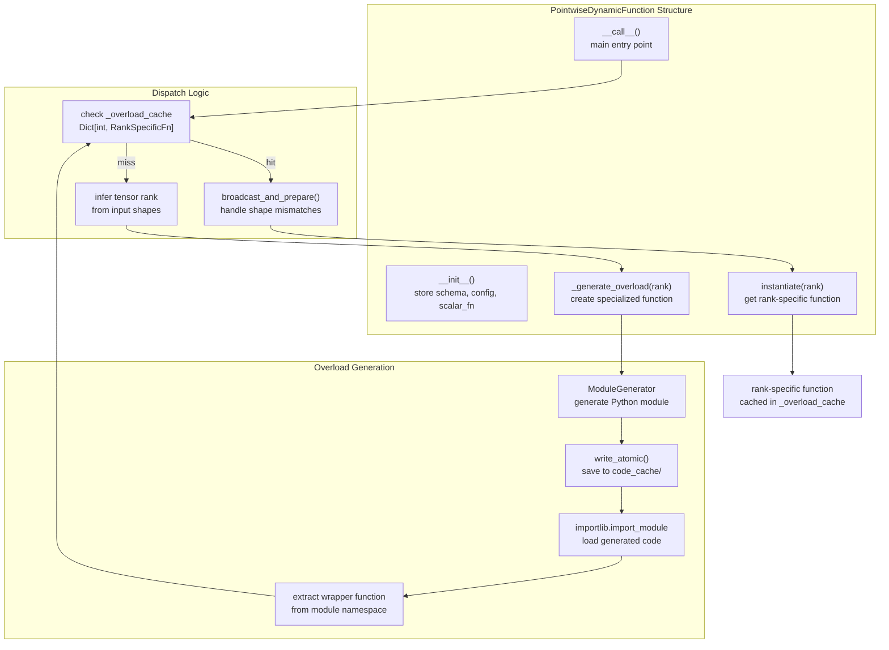
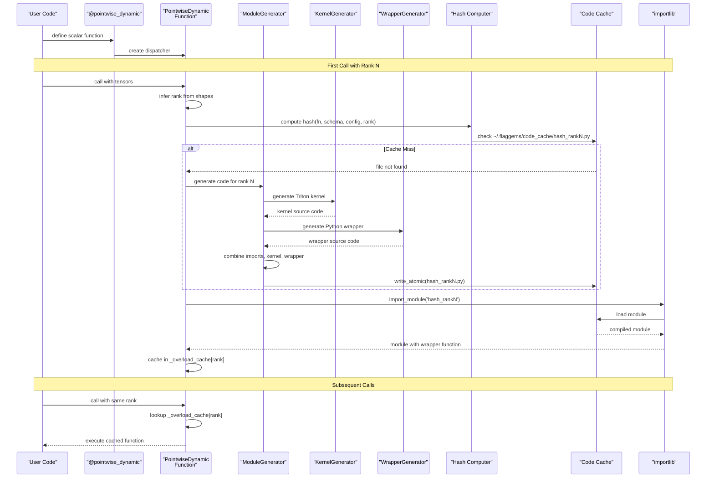
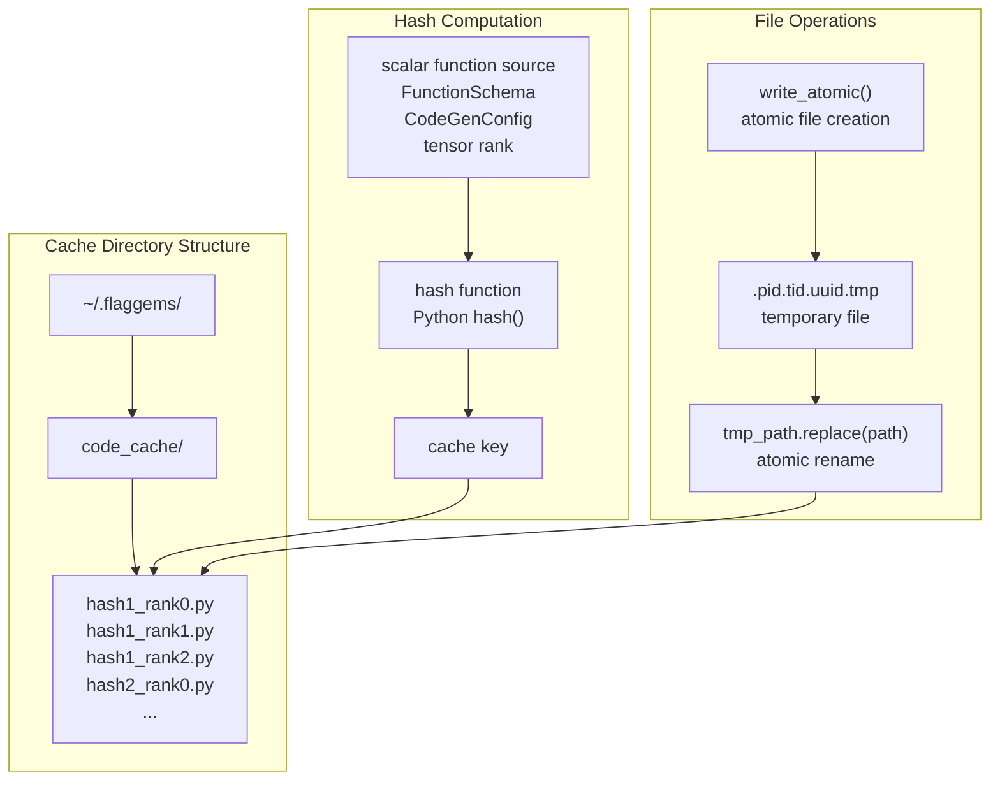
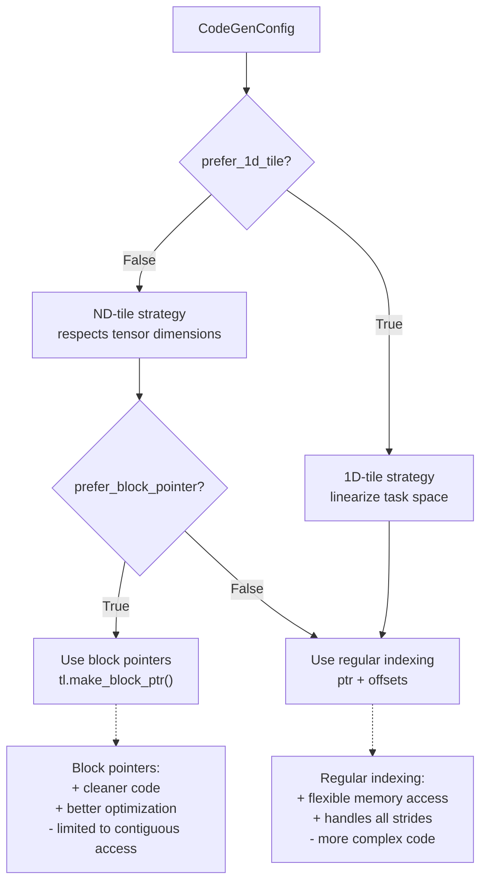
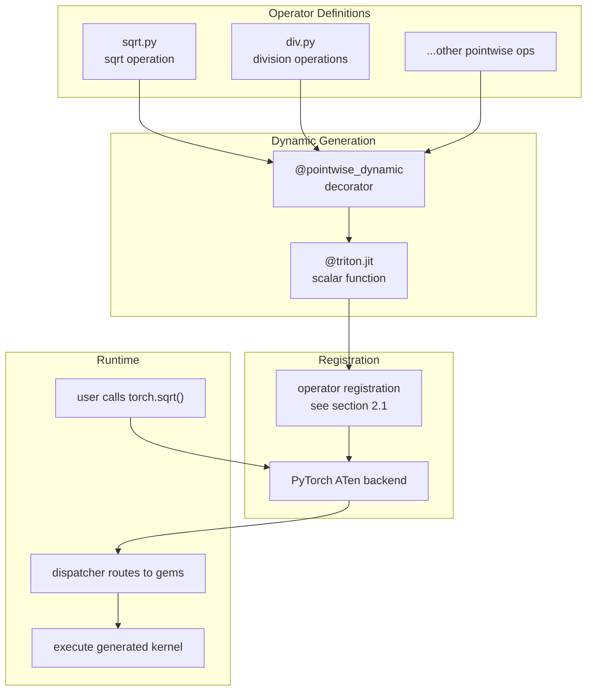

<!-- source: DeepWiki mcp.deepwiki.com · repo FlagOpen/FlagGems · page 2.4 Dynamic Code Generation · fetched 2026-10-21 -->

# Dynamic Code Generation

<details>
<summary>Relevant source files</summary>

The following files were used as context for generating this wiki page:

- [README.md](README.md)
- [README_cn.md](README_cn.md)
- [docs/add_a_cpp_wrapper.md](docs/add_a_cpp_wrapper.md)
- [docs/get_start_with_flaggems.md](docs/get_start_with_flaggems.md)
- [docs/how_to_use_flaggems.md](docs/how_to_use_flaggems.md)
- [docs/index.md](docs/index.md)
- [docs/installation.md](docs/installation.md)
- [docs/pointwise_dynamic.md](docs/pointwise_dynamic.md)
- [examples/integration_gems_with_vllm.py](examples/integration_gems_with_vllm.py)
- [mkdocs.yml](mkdocs.yml)
- [pyproject.toml](pyproject.toml)
- [src/flag_gems/ops/sqrt.py](src/flag_gems/ops/sqrt.py)
- [src/flag_gems/runtime/backend/_kunlunxin/ops/div.py](src/flag_gems/runtime/backend/_kunlunxin/ops/div.py)
- [src/flag_gems/utils/code_cache.py](src/flag_gems/utils/code_cache.py)
- [src/flag_gems/utils/code_utils.py](src/flag_gems/utils/code_utils.py)
- [src/flag_gems/utils/pointwise_dynamic.py](src/flag_gems/utils/pointwise_dynamic.py)
- [tests/test_pointwise_dynamic.py](tests/test_pointwise_dynamic.py)
- [tests/test_tensor_wrapper.py](tests/test_tensor_wrapper.py)

</details>


## Purpose and Scope

The Dynamic Code Generation system in FlagGems automatically generates optimized Triton kernels and their Python wrappers for pointwise operations at runtime. This system eliminates the need to manually write separate kernels for each tensor rank (0D, 1D, 2D, etc.) by generating specialized implementations on-demand based on input characteristics. The generated code is cached to disk for reuse across runs.

This page covers the code generation machinery, schema definition, kernel generation, wrapper generation, and caching mechanisms. For the overall operator registration system that uses these generated operators, see [2.1](#2.1). For pre-tuning the generated kernels, see [2.3](#2.3).

## System Architecture

The dynamic code generation system consists of several interconnected components that work together to transform a simple scalar function into a fully-functional, rank-specialized Triton kernel.



**Sources:** [src/flag_gems/utils/pointwise_dynamic.py:1-1949]()

## Core Components

### FunctionSchema

`FunctionSchema` describes the signature and type promotion rules for a pointwise operation. It encapsulates metadata about inputs, outputs, and how types should be promoted during computation.

| Attribute | Type | Description |
|-----------|------|-------------|
| `_num_inputs` | `int` | Total number of input arguments |
| `_is_tensor` | `List[bool]` | Whether each input is a tensor or scalar |
| `_dtypes` | `List[Optional[type]]` | Type constraints for non-tensor inputs |
| `_num_outputs` | `int` | Number of output tensors |
| `_promotion_methods` | `List[Tuple[int, ...]]` | Type promotion rules per output |
| `_num_input_tensors` | `int` | Count of tensor inputs |
| `_num_non_tensor_inputs` | `int` | Count of scalar inputs |

The schema supports various type promotion methods defined in `ELEMENTWISE_TYPE_PROMOTION_KIND`:



**Example Schema Definition:**

```python
# A simple unary operation (sqrt)
schema = FunctionSchema(
    num_inputs=1,
    promotion_methods=[(0, "INT_TO_FLOAT")]
)

# Binary operation with non-tensor alpha parameter
schema = FunctionSchema(
    num_inputs=3,
    is_tensor=[True, True, False],
    dtypes=[None, None, float],
    promotion_methods=[(0, 1, "DEFAULT")]
)
```

**Sources:** [src/flag_gems/utils/pointwise_dynamic.py:64-220](), [src/flag_gems/ops/sqrt.py:1-26]()

### KernelGenerator

`KernelGenerator` produces the Triton JIT kernel code specialized for a specific tensor rank. It generates different kernel variants based on configuration:

- **ND-tile kernels**: Multi-dimensional tiling with optional block pointer support
- **1D-tile kernels**: Linearized task space for simpler memory patterns



The kernel generation process creates code with the following structure for an ND-tile kernel:

1. **Function signature**: Tensor pointers, scalar parameters, strides, task space dimensions
2. **Program ID retrieval**: `pid = tle.program_id(0)`
3. **Multi-index reconstruction**: Map linear PID to ND coordinates
4. **Memory offset computation**: Apply strides to get actual memory addresses
5. **Load operations**: Read input tensors with masks
6. **Scalar function invocation**: Call the user-provided computation
7. **Store operations**: Write results to output tensors

**Sources:** [src/flag_gems/utils/pointwise_dynamic.py:222-738]()

### WrapperGenerator

`WrapperGenerator` creates the Python wrapper function that handles:

- Broadcasting of input shapes
- Output allocation and dtype inference
- Task space partitioning (grid/block dimensions)
- Kernel invocation with proper arguments



The wrapper handles two execution strategies:

- **Monolithic kernel** (`one_tile_per_cta=True`): Each CTA processes exactly one tile
- **Grid-stride loop** (`tiles_per_cta > 1`): Each CTA processes multiple tiles in a loop

**Sources:** [src/flag_gems/utils/pointwise_dynamic.py:740-1028]()

### PointwiseDynamicFunction

`PointwiseDynamicFunction` is the runtime dispatcher that manages rank-specific kernel instantiations and caching.



**Sources:** [src/flag_gems/utils/pointwise_dynamic.py:1030-1949]()

## Code Generation Process

The complete code generation pipeline transforms a scalar function into a specialized, cached implementation.



**Generated File Structure:**

Each generated file follows this structure:

1. **Module header**: Import statements for required modules
2. **Scalar function quote**: Original source code as documentation
3. **Triton kernel**: JIT-compiled kernel with `@libentry()` and `@triton.jit`
4. **Python wrapper**: Function that handles setup and kernel invocation
5. **Heuristic functions**: Helpers for tile size and warp count selection

**Sources:** [src/flag_gems/utils/pointwise_dynamic.py:1029-1277]()

## Cache System

The code cache system stores generated Python modules on disk to avoid regenerating code across process restarts.



### Cache Directory Management

The cache directory path is determined by:

| Priority | Source | Default Value |
|----------|--------|---------------|
| 1 | `FLAGGEMS_CACHE_DIR` environment variable | - |
| 2 | Default location | `~/.flaggems/` |

Within the cache directory:
- `code_cache/` - Generated Python modules for pointwise kernels
- `config_cache/` - Autotuning configurations (see [2.3](#2.3))

**Cache Filename Format:**

```
{hash}_{rank}{ndim}.py
```

Where:
- `hash`: Hash of the function, schema, and configuration
- `rank`: "rank" string literal
- `ndim`: Tensor dimensionality (0, 1, 2, 3, ...)

**Cache Clearing:**

The entire cache can be cleared using `clear_cache()`, which removes `~/.flaggems/` and all subdirectories.

**Sources:** [src/flag_gems/utils/code_cache.py:1-41](), [src/flag_gems/utils/code_utils.py:187-201](), [src/flag_gems/utils/pointwise_dynamic.py:1148-1180]()

## Configuration System

`CodeGenConfig` controls how kernels are generated and executed.

### CodeGenConfig Parameters

| Parameter | Type | Description | Default |
|-----------|------|-------------|---------|
| `max_tile_size` | `int` | Maximum elements per tile | 1024 |
| `max_grid_size` | `Tuple[int, int, int]` | Maximum grid dimensions | `(65535, 65535, 65535)` |
| `max_num_warps_per_cta` | `int` | Maximum warps per CTA | 32 |
| `prefer_block_pointer` | `bool` | Use Triton block pointers | `True` |
| `prefer_1d_tile` | `bool` | Use 1D tiling strategy | `False` |

### Tile Strategy Selection



The 1D-tile strategy is preferred when:
- Input tensors have complex broadcasting patterns
- There are zero strides in some dimensions
- Avoiding potential misaligned memory access issues

**Sources:** [src/flag_gems/utils/pointwise_dynamic.py:1-24](), [src/flag_gems/utils/codegen_config_utils.py:1-50]() (referenced), [tests/test_pointwise_dynamic.py:152-176]()

## Usage Patterns

### Basic Usage

The most common pattern is decorating a simple Triton JIT function:

```python
@pointwise_dynamic(promotion_methods=[(0, "INT_TO_FLOAT")])
@triton.jit
def sqrt_func(x):
    return tl.sqrt(x.to(tl.float32))

# Usage
A = torch.randn((100, 100), device='cuda')
result = sqrt_func(A)
```

**Sources:** [src/flag_gems/ops/sqrt.py:1-26](), [tests/test_pointwise_dynamic.py:152-176]()

### Operations with Non-Tensor Parameters

For operations that take scalar parameters in addition to tensors:

```python
@pointwise_dynamic(
    is_tensor=[True, True, False],
    dtypes=[None, None, float],
    promotion_methods=[(0, 1, "DEFAULT")]
)
@triton.jit
def axpy(x, y, alpha):
    return alpha * x + y

# Usage
x = torch.randn((100, 100), device='cuda')
y = torch.randn((100, 100), device='cuda')
result = axpy(x, y, 2.0)
```

**Sources:** [tests/test_pointwise_dynamic.py:178-206](), [docs/pointwise_dynamic.md:90-111]()

### Multiple Output Operations

For operations returning multiple tensors:

```python
@pointwise_dynamic(
    num_inputs=3,
    is_tensor=[True, True, False],
    num_outputs=2,
    promotion_methods=[(0, 1, "DEFAULT"), (0, 1, "DEFAULT")]
)
@triton.jit
def axpyaxmy(x, y, alpha):
    return alpha * x + y, alpha * x - y

# Usage
out0, out1 = axpyaxmy(x, y, 2.0)
```

**Sources:** [tests/test_pointwise_dynamic.py:208-238]()

### Manual Instantiation

For advanced use cases requiring manual control over rank instantiation:

```python
@pointwise_dynamic(
    is_tensor=[True],
    promotion_methods=[(0, "DEFAULT")]
)
@triton.jit
def copy_func(x):
    return x

# Manual instantiation for rank 3
rank3_copy = copy_func.instantiate(3)
out = torch.empty_like(input)
rank3_copy(input, out0=out)
```

This pattern is used when the operation needs custom tensor views (e.g., flipped strides) that bypass automatic shape inference.

**Sources:** [tests/test_pointwise_dynamic.py:418-445](), [docs/pointwise_dynamic.md:201-242]()

### Broadcasting Support

The system automatically handles broadcasting:

```python
x = torch.randn([10, 1, 10], device='cuda')  # Shape with broadcasting
y = torch.randn([1, 10, 1], device='cuda')   # Different broadcast pattern
result = axpy(x, y, 2.0)  # Automatically broadcasts to [10, 10, 10]
```

**Sources:** [tests/test_pointwise_dynamic.py:240-269](), [src/flag_gems/utils/pointwise_dynamic.py:1334-1370]()

### In-Place Operations

Output parameters can be specified for in-place operations:

```python
def sqrt_(A):
    sqrt_func(A, out0=A)
    return A
```

All output parameters must be passed by keyword using the `out{index}` naming convention.

**Sources:** [src/flag_gems/ops/sqrt.py:22-26](), [docs/pointwise_dynamic.md:166-184]()

## Integration with Operator Library

The pointwise dynamic system integrates with the broader FlagGems operator library:



Most pointwise operations in the `src/flag_gems/ops/` directory use the `@pointwise_dynamic` decorator to avoid manual kernel writing for each rank. Backend-specific overrides (e.g., for Kunlunxin) may provide custom implementations while maintaining the same API.

**Sources:** [src/flag_gems/ops/sqrt.py:1-26](), [src/flag_gems/runtime/backend/_kunlunxin/ops/div.py:1-267]()

---

